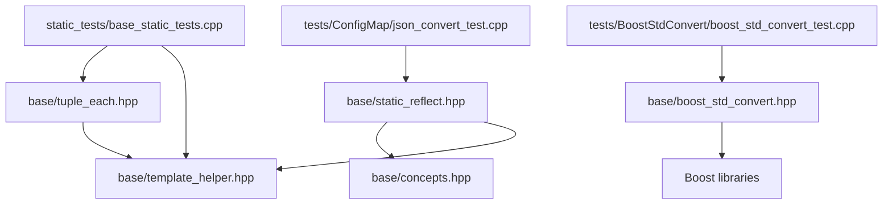
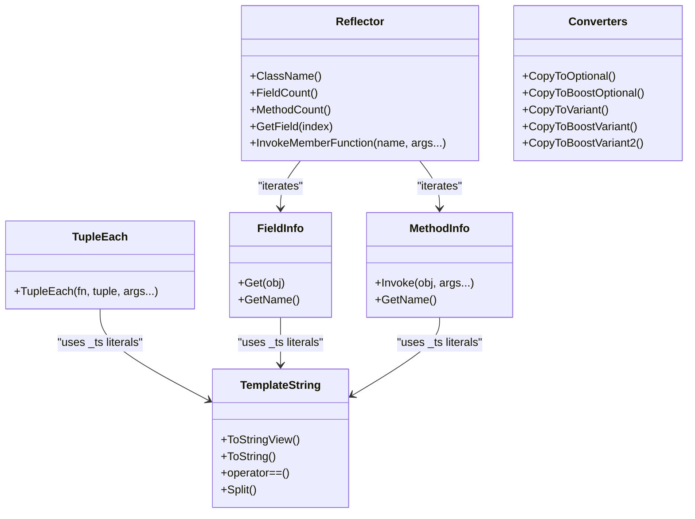
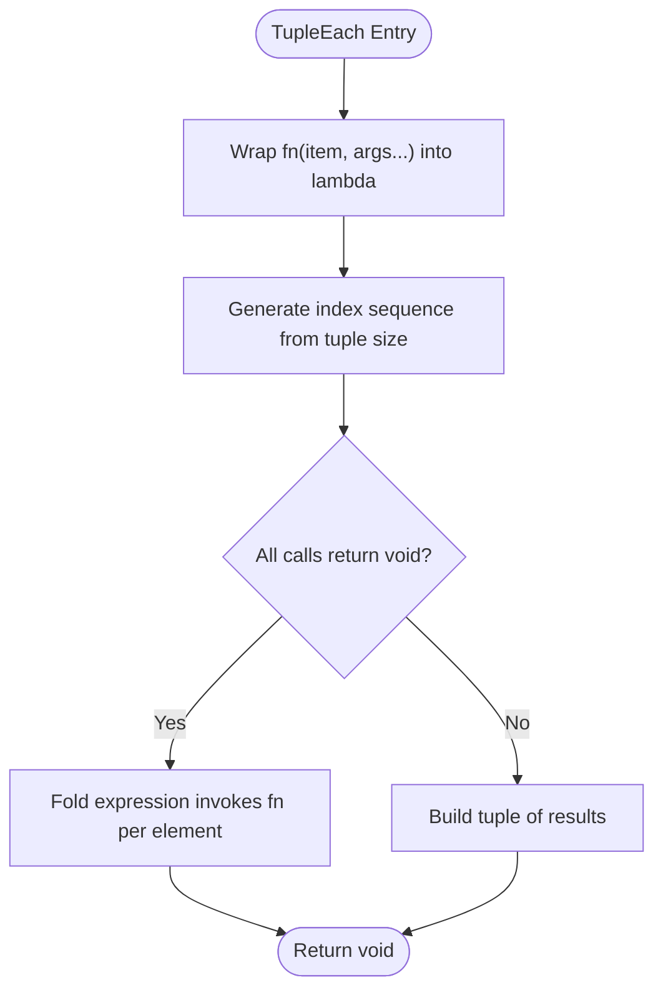
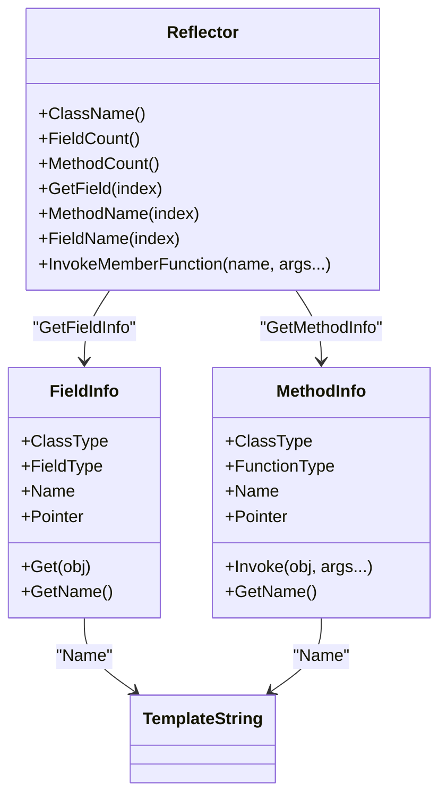
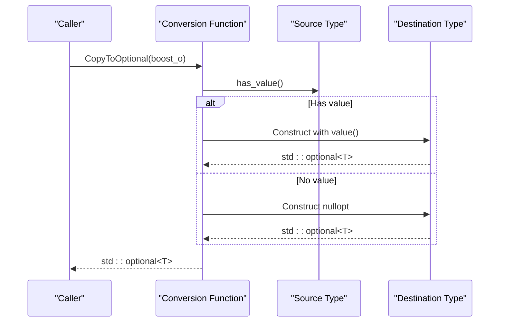
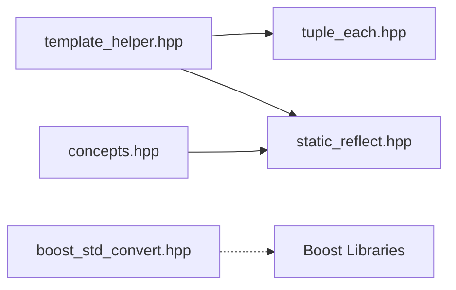

# Template Metaprogramming Helpers

<cite>
**Referenced Files in This Document**
- [tuple_each.hpp](file://base/tuple_each.hpp)
- [static_reflect.hpp](file://base/static_reflect.hpp)
- [boost_std_convert.hpp](file://base/boost_std_convert.hpp)
- [template_helper.hpp](file://base/template_helper.hpp)
- [concepts.hpp](file://base/concepts.hpp)
- [base_static_tests.cpp](file://static_tests/base_static_tests/base_static_tests.cpp)
- [boost_std_convert_test.cpp](file://tests/BoostStdConvert/boost_std_convert_test.cpp)
- [json_convert_test.cpp](file://tests/ConfigMap/json_convert_test.cpp)
</cite>

## Table of Contents
1. [Introduction](#introduction)
2. [Project Structure](#project-structure)
3. [Core Components](#core-components)
4. [Architecture Overview](#architecture-overview)
5. [Detailed Component Analysis](#detailed-component-analysis)
6. [Dependency Analysis](#dependency-analysis)
7. [Performance Considerations](#performance-considerations)
8. [Troubleshooting Guide](#troubleshooting-guide)
9. [Conclusion](#conclusion)
10. [Appendices](#appendices)

## Introduction
This document explains the template metaprogramming helpers in HsBaSlicer’s base directory that enable generic programming, reduce code duplication, and provide type-safe conversions between different data representations. The focus is on:
- TupleEach for iterating over tuple elements with parameter unpacking support
- StaticReflect for compile-time introspection and automatic serialization scaffolding
- Boost/Standard library conversion utilities for interoperability between std::optional/std::variant and boost::optional/boost::variant variants

These tools rely on modern C++ features such as concepts, constexpr if, fold expressions, index sequences, and user-defined literals to keep implementations concise and efficient.

## Project Structure
The relevant headers live under base/:
- tuple_each.hpp: tuple iteration utility
- static_reflect.hpp: compile-time reflection primitives and Reflector
- boost_std_convert.hpp: conversions between Boost and Standard optional/variant types
- template_helper.hpp: foundational utilities including TemplateString, Overloaded, enum helpers, named pointers, and formatting
- concepts.hpp: reusable C++20 concepts used by other utilities

**Diagram sources**
- [tuple_each.hpp:1-53](file://base/tuple_each.hpp#L1-L53)
- [static_reflect.hpp:1-188](file://base/static_reflect.hpp#L1-L188)
- [boost_std_convert.hpp:1-122](file://base/boost_std_convert.hpp#L1-L122)
- [template_helper.hpp:1-780](file://base/template_helper.hpp#L1-L780)
- [concepts.hpp:1-270](file://base/concepts.hpp#L1-L270)
- [base_static_tests.cpp:123-168](file://static_tests/base_static_tests/base_static_tests.cpp#L123-L168)
- [boost_std_convert_test.cpp:1-56](file://tests/BoostStdConvert/boost_std_convert_test.cpp#L1-L56)
- [json_convert_test.cpp:33-57](file://tests/ConfigMap/json_convert_test.cpp#L33-L57)

**Section sources**
- [tuple_each.hpp:1-53](file://base/tuple_each.hpp#L1-L53)
- [static_reflect.hpp:1-188](file://base/static_reflect.hpp#L1-L188)
- [boost_std_convert.hpp:1-122](file://base/boost_std_convert.hpp#L1-L122)
- [template_helper.hpp:1-780](file://base/template_helper.hpp#L1-L780)
- [concepts.hpp:1-270](file://base/concepts.hpp#L1-L270)

## Core Components
- TupleEach: Applies a callable to each element of a tuple, forwarding extra arguments to the callable. It returns either void (if all calls return void) or a tuple of results.
- StaticReflect: Provides FieldInfo and MethodInfo descriptors, a Reflectable concept, and a Reflector class to access fields/methods by index or name at compile time.
- Boost/Standard Conversion Utilities: Functions to convert between std::optional and boost::optional, and between std::variant, boost::variant, and boost::variant2::variant.

These components are designed to be header-only, constexpr-friendly where possible, and to leverage C++20 concepts and compile-time string handling via TemplateString.

**Section sources**
- [tuple_each.hpp:17-50](file://base/tuple_each.hpp#L17-L50)
- [static_reflect.hpp:26-183](file://base/static_reflect.hpp#L26-L183)
- [boost_std_convert.hpp:17-119](file://base/boost_std_convert.hpp#L17-L119)

## Architecture Overview
The helpers form a small but powerful metaprogramming layer:
- template_helper.hpp provides foundational building blocks like TemplateString, Overloaded, and enum utilities.
- tuple_each.hpp depends on template_helper.hpp for compile-time string literals and helper utilities.
- static_reflect.hpp depends on concepts.hpp and template_helper.hpp to define reflectable types and runtime-free introspection.
- boost_std_convert.hpp provides interoperability functions without depending on the rest of the metaprogramming layer.

**Diagram sources**
- [template_helper.hpp:50-335](file://base/template_helper.hpp#L50-L335)
- [tuple_each.hpp:17-50](file://base/tuple_each.hpp#L17-L50)
- [static_reflect.hpp:35-183](file://base/static_reflect.hpp#L35-L183)
- [boost_std_convert.hpp:17-119](file://base/boost_std_convert.hpp#L17-L119)

## Detailed Component Analysis

### TupleEach: Generic Tuple Iteration and Parameter Unpacking
TupleEach enables applying a function to every element of a tuple while forwarding additional arguments to the function. It uses:
- std::index_sequence to expand indices
- constexpr if to detect whether all calls return void
- Fold expressions to invoke the function across the tuple

Key behaviors:
- If the callable returns void for all elements, the overall result is void.
- Otherwise, it returns a tuple of results.
- Additional arguments are forwarded to the callable for each element.

**Diagram sources**
- [tuple_each.hpp:27-50](file://base/tuple_each.hpp#L27-L50)

Usage patterns demonstrated in tests:
- Iterate over heterogeneous tuple elements with a generic lambda
- Forward extra parameters to the callback
- Use Overloaded to dispatch per-element types

Example references:
- Basic iteration and parameter forwarding: [base_static_tests.cpp:123-168](file://static_tests/base_static_tests/base_static_tests.cpp#L123-L168)

**Section sources**
- [tuple_each.hpp:17-50](file://base/tuple_each.hpp#L17-L50)
- [base_static_tests.cpp:123-168](file://static_tests/base_static_tests/base_static_tests.cpp#L123-L168)

### StaticReflect: Compile-Time Introspection and Automatic Serialization Scaffolding
StaticReflect defines:
- FieldInfo: Captures field type, name (as TemplateString), member pointer, and provides Get accessors
- MethodInfo: Captures method type, name, member pointer, and provides Invoke overloads
- Reflectable concept: Requires FieldList, MethodList, and ClassName
- Reflector: Provides compile-time access to fields and methods by index or name, with bounds-checked accessors and recursive search for method invocation by name

**Diagram sources**
- [static_reflect.hpp:35-183](file://base/static_reflect.hpp#L35-L183)
- [template_helper.hpp:50-335](file://base/template_helper.hpp#L50-L335)

How it enables automatic serialization:
- Tests define structs with FieldList composed of FieldInfo entries and use JSON conversion utilities built on top of these descriptors.
- Reflector allows enumerating fields and invoking methods by name, enabling generic serializers/deserializers.

Example references:
- Reflectable struct definitions and usage in JSON conversion: [json_convert_test.cpp:33-57](file://tests/ConfigMap/json_convert_test.cpp#L33-L57), [json_convert_test.cpp:135-157](file://tests/ConfigMap/json_convert_test.cpp#L135-L157)

Error handling and safety:
- Index-based accessors include static_assert checks to ensure indices are within bounds.
- Method lookup by name recursively compares names and fails compilation if not found.

**Section sources**
- [static_reflect.hpp:26-183](file://base/static_reflect.hpp#L26-L183)
- [json_convert_test.cpp:33-57](file://tests/ConfigMap/json_convert_test.cpp#L33-L57)
- [json_convert_test.cpp:135-157](file://tests/ConfigMap/json_convert_test.cpp#L135-L157)

### Boost/Standard Library Conversion Utilities
The conversion utilities provide safe, explicit conversions between:
- std::optional and boost::optional
- std::variant and boost::variant
- std::variant and boost::variant2::variant
- boost::variant and boost::variant2::variant

Implementation highlights:
- Optional conversions check has_value and map nullopt/none appropriately
- Variant conversions use visitors to reconstruct the target variant with the active alternative

**Diagram sources**
- [boost_std_convert.hpp:24-46](file://base/boost_std_convert.hpp#L24-L46)

Test coverage demonstrates round-trip correctness and cross-library compatibility:
- Conversions from std::variant to boost::variant and boost::variant2::variant: [boost_std_convert_test.cpp:8-17](file://tests/BoostStdConvert/boost_std_convert_test.cpp#L8-L17)
- Conversions from boost::variant to std::variant and boost::variant2::variant: [boost_std_convert_test.cpp:19-28](file://tests/BoostStdConvert/boost_std_convert_test.cpp#L19-L28)
- Conversions from boost::variant2::variant to std::variant and boost::variant: [boost_std_convert_test.cpp:30-38](file://tests/BoostStdConvert/boost_std_convert_test.cpp#L30-L38)
- Optional conversions both directions: [boost_std_convert_test.cpp:40-54](file://tests/BoostStdConvert/boost_std_convert_test.cpp#L40-L54)

**Section sources**
- [boost_std_convert.hpp:17-119](file://base/boost_std_convert.hpp#L17-L119)
- [boost_std_convert_test.cpp:1-56](file://tests/BoostStdConvert/boost_std_convert_test.cpp#L1-L56)

## Dependency Analysis
- tuple_each.hpp depends on template_helper.hpp for compile-time string literals and helper utilities.
- static_reflect.hpp depends on concepts.hpp and template_helper.hpp for type constraints and TemplateString.
- boost_std_convert.hpp depends only on standard and Boost headers; it does not depend on the other metaprogramming helpers.

**Diagram sources**
- [tuple_each.hpp:13-15](file://base/tuple_each.hpp#L13-L15)
- [static_reflect.hpp:15-21](file://base/static_reflect.hpp#L15-L21)
- [boost_std_convert.hpp:10-15](file://base/boost_std_convert.hpp#L10-L15)

**Section sources**
- [tuple_each.hpp:13-15](file://base/tuple_each.hpp#L13-L15)
- [static_reflect.hpp:15-21](file://base/static_reflect.hpp#L15-L21)
- [boost_std_convert.hpp:10-15](file://base/boost_std_convert.hpp#L10-L15)

## Performance Considerations
- Compile-time evaluation: TupleEach and StaticReflect are designed to be evaluated at compile time where possible, reducing runtime overhead.
- Zero-cost abstractions: TupleEach uses fold expressions and index sequences to avoid dynamic loops; StaticReflect avoids RTTI and uses compile-time metadata.
- Visitor-based conversions: Variant conversions use visitors to minimize branching and maintain performance.
- Concept constraints: Using concepts improves error messages and reduces template instantiation bloat by failing early when constraints are not met.

[No sources needed since this section provides general guidance]

## Troubleshooting Guide
Common issues and resolutions:
- TupleEach callable signature mismatch: Ensure the callable accepts the tuple element type plus any forwarded arguments. Use Overloaded for multi-type dispatch.
  - Reference: [base_static_tests.cpp:123-168](file://static_tests/base_static_tests/base_static_tests.cpp#L123-L168)
- StaticReflect index out of range: Accessors include static_assert checks; verify indices against FieldCount()/MethodCount().
  - Reference: [static_reflect.hpp:119-156](file://base/static_reflect.hpp#L119-L156)
- Method not found by name: Reflector::InvokeMemberFunction performs compile-time search; ensure the method exists and the name matches exactly.
  - Reference: [static_reflect.hpp:157-182](file://base/static_reflect.hpp#L157-L182)
- Conversion failures: For optional/variant conversions, ensure the source and destination types are compatible and the active variant alternative exists.
  - Reference: [boost_std_convert_test.cpp:8-54](file://tests/BoostStdConvert/boost_std_convert_test.cpp#L8-L54)

**Section sources**
- [base_static_tests.cpp:123-168](file://static_tests/base_static_tests/base_static_tests.cpp#L123-L168)
- [static_reflect.hpp:119-182](file://base/static_reflect.hpp#L119-L182)
- [boost_std_convert_test.cpp:8-54](file://tests/BoostStdConvert/boost_std_convert_test.cpp#L8-L54)

## Conclusion
HsBaSlicer’s base metaprogramming helpers provide a robust foundation for generic programming:
- TupleEach simplifies tuple iteration and parameter unpacking with modern C++ features.
- StaticReflect offers compile-time introspection and supports automatic serialization through structured metadata.
- Conversion utilities bridge Boost and Standard libraries safely and efficiently.

Together, they reduce boilerplate, enforce type safety, and enable scalable, maintainable code across the project.

[No sources needed since this section summarizes without analyzing specific files]

## Appendices

### Modern C++ Features Used
- Concepts: Used in concepts.hpp and reflected in StaticReflect’s Reflectable concept.
  - Reference: [concepts.hpp:1-270](file://base/concepts.hpp#L1-L270), [static_reflect.hpp:99-107](file://base/static_reflect.hpp#L99-L107)
- constexpr if and fold expressions: Used in TupleEach to handle void vs non-void return types and iterate tuples.
  - Reference: [tuple_each.hpp:27-50](file://base/tuple_each.hpp#L27-L50)
- User-defined literals: TemplateString literals (_ts) used throughout for compile-time strings.
  - Reference: [template_helper.hpp:725-736](file://base/template_helper.hpp#L725-L736)
- Index sequences: Used in TupleEach and Reflector for compile-time iteration.
  - Reference: [tuple_each.hpp:27-50](file://base/tuple_each.hpp#L27-L50), [static_reflect.hpp:119-182](file://base/static_reflect.hpp#L119-L182)

**Section sources**
- [concepts.hpp:1-270](file://base/concepts.hpp#L1-L270)
- [static_reflect.hpp:99-107](file://base/static_reflect.hpp#L99-L107)
- [tuple_each.hpp:27-50](file://base/tuple_each.hpp#L27-L50)
- [template_helper.hpp:725-736](file://base/template_helper.hpp#L725-L736)