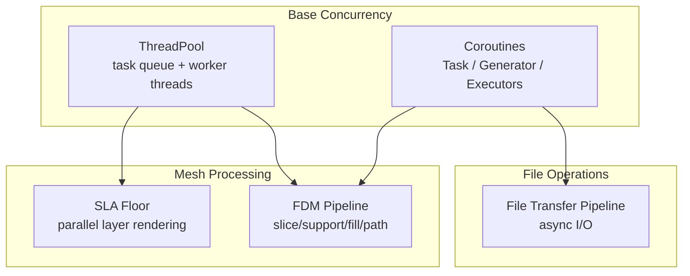
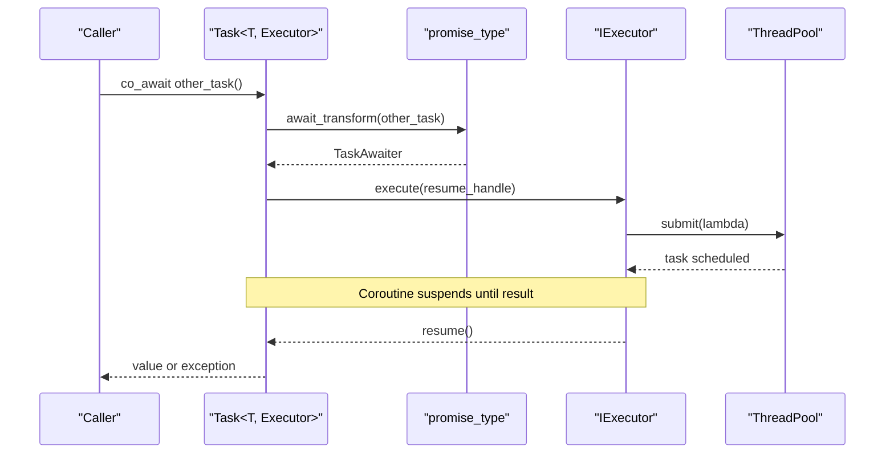
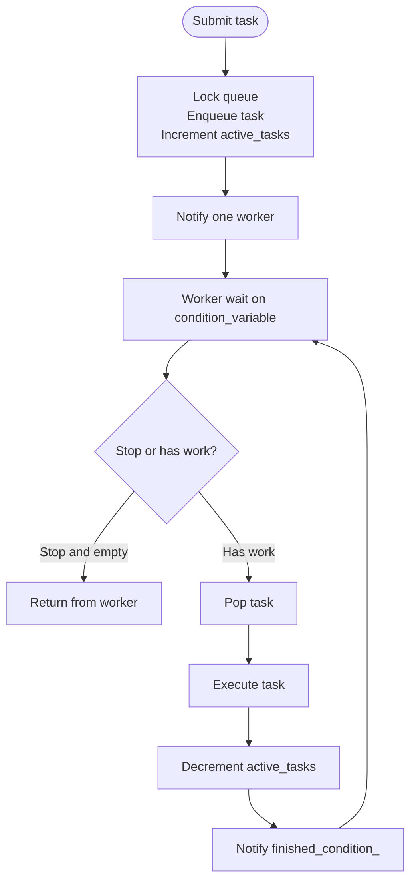
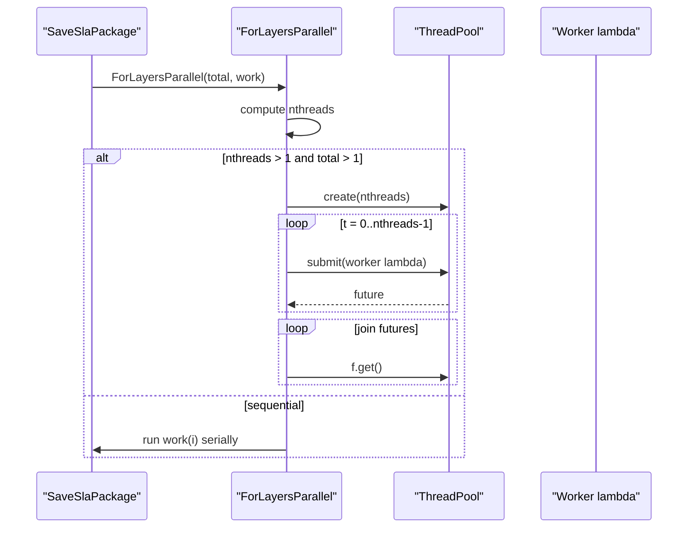
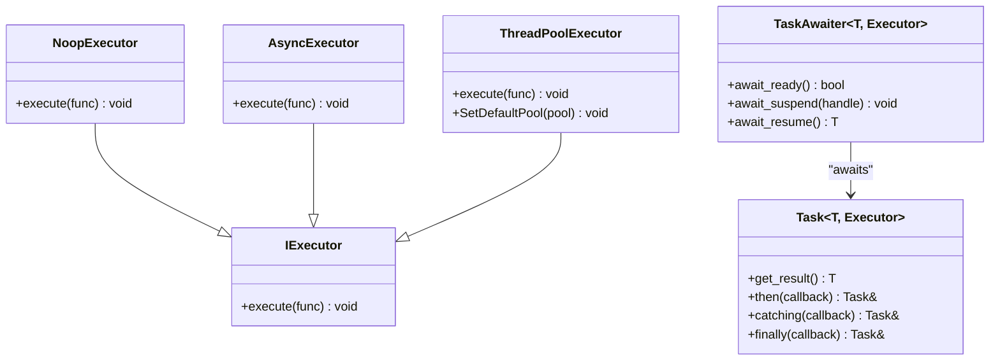
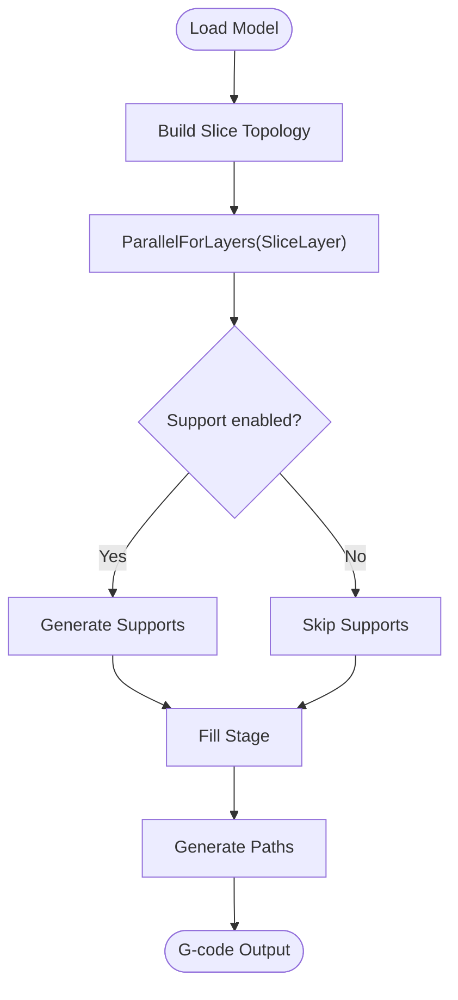
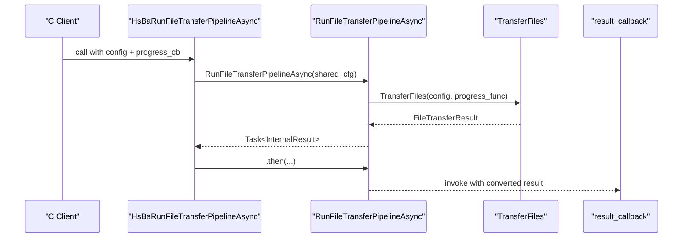
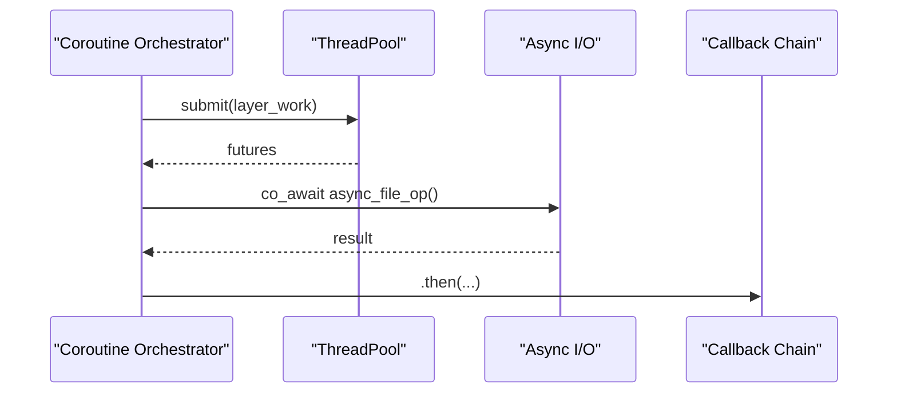
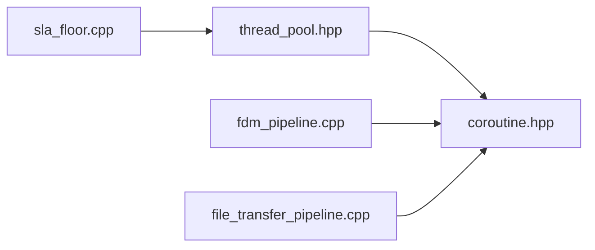

# Threading and Concurrency

<cite>
**Referenced Files in This Document**   
- [thread_pool.hpp](file://base/thread_pool.hpp)
- [coroutine.hpp](file://base/coroutine.hpp)
- [sla_floor.cpp](file://LibHsBaSlicer/Floor/sla_floor.cpp)
- [file_transfer_pipeline.cpp](file://DllHsBaSlicer/file_transfer_pipeline.cpp)
- [fdm_pipeline.cpp](file://DllHsBaSlicer/fdm_pipeline.cpp)
- [error.hpp](file://base/error.hpp)
- [CMakeLists.txt](file://CMakeLists.txt)
- [feature_check.cmake](file://static_check/feature_check.cmake)
</cite>

## Update Summary
**Changes Made**   
- Updated C++20 coroutine requirements as mandatory features
- Removed references to conditional compilation guards for core coroutine functionality
- Clarified that ThreadPoolExecutor integration is now always available
- Updated compiler requirement information to reflect C++20 mandate

## Table of Contents
1. [Introduction](#introduction)
2. [Project Structure](#project-structure)
3. [Core Components](#core-components)
4. [Architecture Overview](#architecture-overview)
5. [Detailed Component Analysis](#detailed-component-analysis)
6. [Dependency Analysis](#dependency-analysis)
7. [Performance Considerations](#performance-considerations)
8. [Troubleshooting Guide](#troubleshooting-guide)
9. [Conclusion](#conclusion)

## Introduction
This document explains the threading and concurrency primitives in HsBaSlicer's base directory, focusing on:
- The `ThreadPool` implementation for parallel task execution, including work distribution, load balancing, and resource management.
- The coroutine support built on mandatory C++20 features for asynchronous operations without callback complexity.
- Concrete usage patterns for parallelizing mesh processing tasks, implementing async file I/O with coroutines, and coordinating multiple concurrent operations.
- Thread safety patterns, deadlock prevention, performance tuning across hardware configurations, and debugging strategies for concurrent code.

The goal is to help both new and experienced users understand how HsBaSlicer achieves safe, scalable concurrency while keeping APIs clean and composable.

**Updated** C++20 coroutines are now a mandatory feature with no conditional compilation guards for core functionality.

## Project Structure
The relevant concurrency components live under `base/`, while real-world usage appears in pipeline and library modules:
- `base/thread_pool.hpp`: thread pool and coroutine executor integration (always available).
- `base/coroutine.hpp`: C++20 coroutine framework, executors, task types, generators, and mapping utilities.
- `LibHsBaSlicer/Floor/sla_floor.cpp`: demonstrates parallel layer rendering using `ThreadPool`.
- `DllHsBaSlicer/file_transfer_pipeline.cpp`: demonstrates async file transfer via coroutines.
- `DllHsBaSlicer/fdm_pipeline.cpp`: demonstrates coroutine-driven slicing pipeline with per-layer parallelism.

**Diagram sources**
- [thread_pool.hpp:29-162](file://base/thread_pool.hpp#L29-L162)
- [coroutine.hpp:47-73](file://base/coroutine.hpp#L47-L73)
- [sla_floor.cpp:430-465](file://LibHsBaSlicer/Floor/sla_floor.cpp#L430-L465)
- [fdm_pipeline.cpp:216-447](file://DllHsBaSlicer/fdm_pipeline.cpp#L216-L447)
- [file_transfer_pipeline.cpp:115-149](file://DllHsBaSlicer/file_transfer_pipeline.cpp#L115-L149)

**Section sources**
- [thread_pool.hpp:1-212](file://base/thread_pool.hpp#L1-L212)
- [coroutine.hpp:1-1051](file://base/coroutine.hpp#L1-L1051)
- [sla_floor.cpp:430-609](file://LibHsBaSlicer/Floor/sla_floor.cpp#L430-L609)
- [file_transfer_pipeline.cpp:1-198](file://DllHsBaSlicer/file_transfer_pipeline.cpp#L1-L198)
- [fdm_pipeline.cpp:200-497](file://DllHsBaSlicer/fdm_pipeline.cpp#L200-L497)

## Core Components
- ThreadPool: a bounded worker-thread pool that accepts arbitrary callable tasks, returns futures, tracks pending/active counts, supports waiting for completion, and integrates with coroutines through an executor interface.
- Coroutine Framework: provides executors (`NoopExecutor`, `AsyncExecutor`, and `ThreadPoolExecutor`), a generic `Task<T, Executor>` type with chaining callbacks (`then`, `catching`, `finally`), a generator abstraction, and allocator-aware variants.

Key responsibilities:
- Work distribution: `ThreadPool::submit` enqueues tasks; workers pull from a shared queue.
- Load balancing: dynamic scheduling pattern where each worker repeatedly fetches the next index until exhaustion.
- Resource management: controlled number of worker threads, graceful shutdown, exception handling within workers, and lifecycle synchronization.
- Async composition: coroutines enable structured asynchronous workflows without nested callbacks.

**Updated** The `ThreadPoolExecutor` is now always available without conditional compilation guards, providing seamless integration between thread pools and coroutines.

**Section sources**
- [thread_pool.hpp:29-162](file://base/thread_pool.hpp#L29-L162)
- [coroutine.hpp:47-73](file://base/coroutine.hpp#L47-L73)
- [coroutine.hpp:205-382](file://base/coroutine.hpp#L205-L382)
- [coroutine.hpp:388-555](file://base/coroutine.hpp#L388-L555)
- [coroutine.hpp:563-772](file://base/coroutine.hpp#L563-L772)
- [coroutine.hpp:784-893](file://base/coroutine.hpp#L784-L893)

## Architecture Overview
At runtime, HsBaSlicer uses two complementary mechanisms:
- CPU-bound parallelism via `ThreadPool` for independent per-layer or per-item computations.
- Asynchronous orchestration via coroutines for long-running or I/O-bound operations, with optional execution on a thread pool.

**Diagram sources**
- [coroutine.hpp:81-122](file://base/coroutine.hpp#L81-L122)
- [coroutine.hpp:234-276](file://base/coroutine.hpp#L234-L276)
- [thread_pool.hpp:164-209](file://base/thread_pool.hpp#L164-L209)

## Detailed Component Analysis

### ThreadPool Implementation
`ThreadPool` manages a fixed-size set of worker threads and a guarded task queue. It exposes:
- Construction with configurable thread count (defaults to hardware concurrency).
- `submit` returning `std::future` for typed results.
- `PendingTasks`, `ActiveTasks`, and `WaitAll` for monitoring and synchronization.
- Worker loop that waits on a condition variable, processes tasks, decrements active counters, and notifies completion.

Work distribution and load balancing:
- Tasks are queued in submission order.
- Workers compete to pop the next task.
- In practice, callers often use a shared atomic counter so each worker pulls indices until exhausted, providing dynamic load balancing for uneven workloads.

Resource management:
- Destructor sets a stop flag, wakes all workers, and joins them.
- Exceptions inside tasks are caught by the worker loop; the active task counter still decrements, preventing deadlocks due to unhandled exceptions.

Thread safety:
- Queue access is protected by a mutex.
- Active task count is atomic.
- Condition variables coordinate producer/consumer semantics.

**Diagram sources**
- [thread_pool.hpp:67-90](file://base/thread_pool.hpp#L67-L90)
- [thread_pool.hpp:118-154](file://base/thread_pool.hpp#L118-L154)

Practical example: parallel layer rendering in SLA floor generation
- A helper computes the number of threads based on data size and caps it appropriately.
- If single-threaded or trivial workload, it runs sequentially.
- Otherwise, it creates a `ThreadPool`, uses an atomic index, and submits one task per worker that loops fetching the next index until done.
- Futures are joined to propagate exceptions and ensure completion.

**Diagram sources**
- [sla_floor.cpp:430-465](file://LibHsBaSlicer/Floor/sla_floor.cpp#L430-L465)

**Section sources**
- [thread_pool.hpp:29-162](file://base/thread_pool.hpp#L29-L162)
- [sla_floor.cpp:430-465](file://LibHsBaSlicer/Floor/sla_floor.cpp#L430-L465)

### Coroutine Framework and Executors
The coroutine subsystem defines:
- `IExecutor`: abstract interface for executing closures.
- `NoopExecutor`: executes synchronously on the current thread.
- `AsyncExecutor`: uses `std::async` to run asynchronously.
- `Task<T, Executor>`: a coroutine-backed asynchronous result with chaining methods (`then`, `catching`, `finally`) and a promise-based state machine.
- `Generator<T>`: a lazy iterator-like coroutine that yields values.
- Allocator-aware variants (`CustomAllocatorTask`, `CustomAllocatorGenerator`) for custom memory allocation strategies.

Execution model:
- Coroutines suspend at `co_await` and resume when the awaited task completes.
- `DispatchAwaiter` ensures initial suspension resumes on the configured executor.
- `TaskAwaiter` registers a finalizer that resumes the awaiting coroutine on the executor once the inner task completes.

**Diagram sources**
- [coroutine.hpp:47-73](file://base/coroutine.hpp#L47-L73)
- [coroutine.hpp:81-122](file://base/coroutine.hpp#L81-L122)
- [coroutine.hpp:205-382](file://base/coroutine.hpp#L205-L382)
- [thread_pool.hpp:164-209](file://base/thread_pool.hpp#L164-L209)

**Updated** The `ThreadPoolExecutor` is now part of the standard coroutine API without requiring conditional compilation flags.

**Section sources**
- [coroutine.hpp:47-73](file://base/coroutine.hpp#L47-L73)
- [coroutine.hpp:81-122](file://base/coroutine.hpp#L81-L122)
- [coroutine.hpp:205-382](file://base/coroutine.hpp#L205-L382)
- [coroutine.hpp:388-555](file://base/coroutine.hpp#L388-L555)
- [coroutine.hpp:563-772](file://base/coroutine.hpp#L563-L772)
- [coroutine.hpp:784-893](file://base/coroutine.hpp#L784-L893)
- [thread_pool.hpp:164-209](file://base/thread_pool.hpp#L164-L209)

### Parallelizing Mesh Processing Tasks
HsBaSlicer applies parallelism to mesh-related workloads by splitting per-layer operations:
- Slicing layers independently using a topology built once and read-only during slicing.
- Support and fill generation can be parallelized when not constrained by interpreter state.
- Path generation is typically sequential because it consumes per-layer outputs.

**Diagram sources**
- [fdm_pipeline.cpp:216-447](file://DllHsBaSlicer/fdm_pipeline.cpp#L216-L447)

Concrete patterns:
- Per-layer slicing: build topology once, then iterate layers in parallel.
- Conditional parallelization: Lua-based stages may require serialization due to interpreter state constraints.
- Progress reporting: update progress callbacks proportionally as layers complete.

**Section sources**
- [fdm_pipeline.cpp:216-447](file://DllHsBaSlicer/fdm_pipeline.cpp#L216-L447)

### Implementing Async File I/O with Coroutines
The file transfer pipeline wraps asynchronous file operations into a coroutine:
- Builds internal configuration from C ABI inputs.
- Wraps progress callbacks to bridge between C and C++.
- Calls the library's `TransferFiles` function and maps its result into an internal structure.
- Exposes synchronous and asynchronous C API entry points:
  - Synchronous: constructs a task and blocks on `get_result`.
  - Asynchronous: chains `.then` to deliver results via a callback.

**Diagram sources**
- [file_transfer_pipeline.cpp:115-149](file://DllHsBaSlicer/file_transfer_pipeline.cpp#L115-L149)
- [file_transfer_pipeline.cpp:171-188](file://DllHsBaSlicer/file_transfer_pipeline.cpp#L171-L188)

**Section sources**
- [file_transfer_pipeline.cpp:115-149](file://DllHsBaSlicer/file_transfer_pipeline.cpp#L115-L149)
- [file_transfer_pipeline.cpp:171-188](file://DllHsBaSlicer/file_transfer_pipeline.cpp#L171-L188)

### Coordinating Multiple Concurrent Operations
Common coordination patterns in HsBaSlicer:
- Use `ThreadPool` to fan out independent work items (e.g., per-layer rendering).
- Use coroutines to sequence high-level stages (load, slice, support, fill, path) while delegating heavy work to parallel helpers.
- Combine futures and coroutines:
  - Futures for immediate result retrieval and exception propagation.
  - Coroutines for non-blocking orchestration and callback-driven flows.

Example coordination flow:

[No sources needed since this diagram shows conceptual workflow, not actual code structure]

## Dependency Analysis
- `ThreadPool` depends on standard concurrency primitives and includes `coroutine.hpp` to expose `ThreadPoolExecutor`.
- `ThreadPoolExecutor` implements `IExecutor` and defers execution to a `ThreadPool`, either user-provided or default-initialized.
- Coroutines depend on executors to control where resumed code runs.
- Real modules depend on these abstractions:
  - `sla_floor.cpp` uses `ThreadPool` directly for parallel rendering.
  - `fdm_pipeline.cpp` uses coroutines for pipeline orchestration and parallel helpers for per-layer work.
  - `file_transfer_pipeline.cpp` uses coroutines to wrap file transfer operations and expose both sync and async C APIs.

**Diagram sources**
- [thread_pool.hpp:22-23](file://base/thread_pool.hpp#L22-L23)
- [coroutine.hpp:47-73](file://base/coroutine.hpp#L47-L73)
- [sla_floor.cpp:430-465](file://LibHsBaSlicer/Floor/sla_floor.cpp#L430-L465)
- [fdm_pipeline.cpp:216-447](file://DllHsBaSlicer/fdm_pipeline.cpp#L216-L447)
- [file_transfer_pipeline.cpp:115-149](file://DllHsBaSlicer/file_transfer_pipeline.cpp#L115-L149)

**Updated** All coroutine functionality is now always available without conditional compilation.

**Section sources**
- [thread_pool.hpp:1-212](file://base/thread_pool.hpp#L1-L212)
- [coroutine.hpp:1-1051](file://base/coroutine.hpp#L1-L1051)
- [sla_floor.cpp:430-609](file://LibHsBaSlicer/Floor/sla_floor.cpp#L430-L609)
- [fdm_pipeline.cpp:200-497](file://DllHsBaSlicer/fdm_pipeline.cpp#L200-L497)
- [file_transfer_pipeline.cpp:1-198](file://DllHsBaSlicer/file_transfer_pipeline.cpp#L1-L198)

## Performance Considerations
- Thread count selection:
  - Default to hardware concurrency for CPU-bound workloads.
  - Cap thread count relative to workload size to avoid oversubscription.
- Task granularity:
  - Avoid submitting too many tiny tasks; batch work to reduce queue overhead.
  - Prefer chunked or dynamic scheduling patterns for uneven workloads.
- Executor choice:
  - Use `NoopExecutor` for lightweight, already-scheduled work.
  - Use `AsyncExecutor` for simple offloading.
  - Use `ThreadPoolExecutor` to bind coroutine resumption to a controlled thread pool.
- Memory and allocation:
  - Consider allocator-aware coroutines for high-throughput scenarios with custom allocators.
- I/O vs CPU balance:
  - For I/O-heavy pipelines, prefer coroutines to avoid blocking threads.
  - For CPU-heavy per-layer work, use `ThreadPool` with appropriate sizing.

**Updated** Compiler requirements: C++20 is now mandatory, ensuring consistent coroutine support across all builds.

## Troubleshooting Guide
Common issues and remedies:
- Deadlocks due to stopped pools:
  - Submitting to a stopped `ThreadPool` throws a runtime error; ensure pool lifetime covers all submissions.
- Unhandled exceptions in tasks:
  - Worker loop catches exceptions but still decrements active counters; inspect futures returned by `submit` to observe errors.
- Coroutine exceptions:
  - Coroutines capture exceptions in their promise/result; use `catching` or `get_result` to surface them.
- Debugging concurrent code:
  - Monitor `PendingTasks` and `ActiveTasks` to detect stalls.
  - Use progress callbacks in pipelines to identify stuck stages.
  - Validate executor binding to ensure coroutines resume on expected threads.

**Updated** No need to check for `HSBA_ENABLE_THREAD_POOL_COROUTINE` or similar preprocessor guards when using coroutine features.

**Section sources**
- [thread_pool.hpp:67-90](file://base/thread_pool.hpp#L67-L90)
- [thread_pool.hpp:118-154](file://base/thread_pool.hpp#L118-L154)
- [coroutine.hpp:234-276](file://base/coroutine.hpp#L234-L276)
- [coroutine.hpp:277-315](file://base/coroutine.hpp#L277-L315)
- [coroutine.hpp:414-487](file://base/coroutine.hpp#L414-L487)
- [error.hpp:1-200](file://base/error.hpp#L1-L200)

## Conclusion
HsBaSlicer's concurrency model combines a robust `ThreadPool` for CPU-bound parallelism with a flexible C++20 coroutine framework for asynchronous orchestration. With C++20 coroutines now mandatory, the system provides consistent, reliable asynchronous programming capabilities across all supported platforms. By separating concerns—parallel work distribution versus async workflow composition—the system remains efficient, testable, and extensible. Real modules demonstrate best practices: dynamic load balancing for uneven workloads, careful executor selection, and clear separation between parallelizable and serial stages. With proper sizing, exception handling, and progress instrumentation, developers can build high-performance mesh processing and file I/O pipelines that scale across diverse hardware configurations.

**Updated** The removal of conditional compilation guards simplifies the development experience and ensures consistent behavior across all builds, making the concurrency primitives more accessible and reliable for developers.