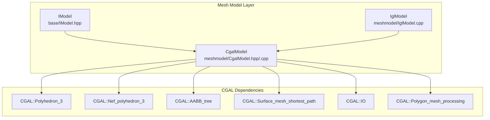
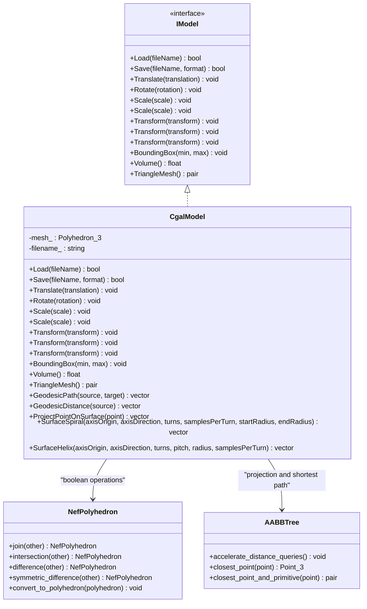
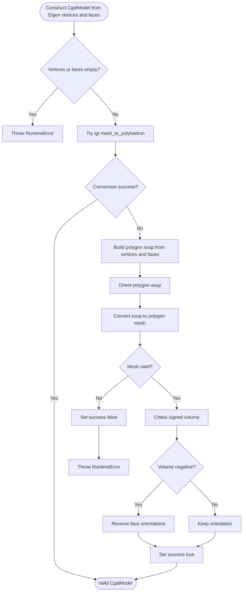
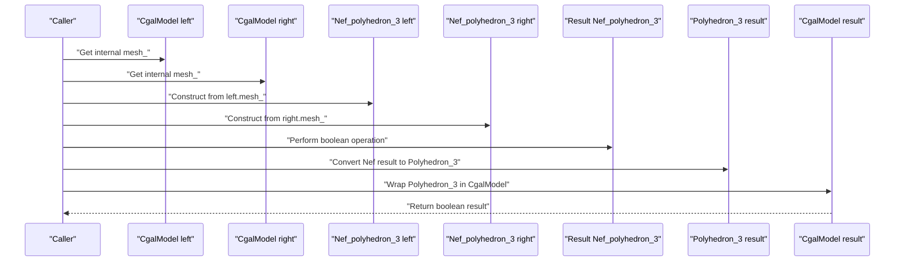
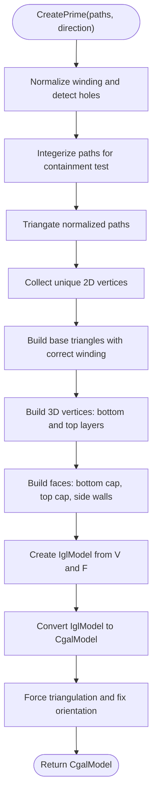
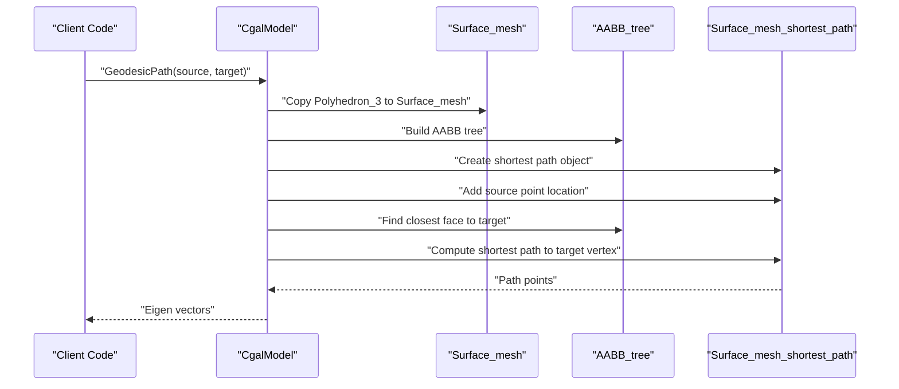
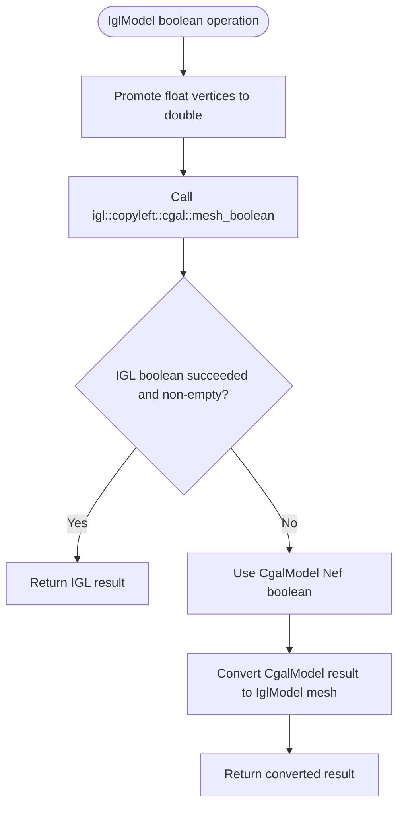
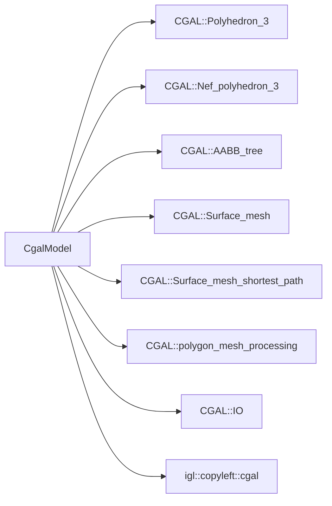

# CGAL Backend / CGAL后端

<cite>
**Referenced Files in This Document**   
- [CgalModel.hpp](file://meshmodel/CgalModel.hpp)
- [CgalModel.cpp](file://meshmodel/CgalModel.cpp)
- [IModel.hpp](file://base/IModel.hpp)
- [IglModel.cpp](file://meshmodel/IglModel.cpp)
- [cgal_model_test.cpp](file://tests/Models/cgal_model_test.cpp)
- [igl_model_test.cpp](file://tests/Models/igl_model_test.cpp)
- [vcpkg-dependencies.md](file://docs/en/vcpkg-dependencies.md)
</cite>

## Table of Contents
1. [Introduction](#introduction)
2. [Project Structure](#project-structure)
3. [Core Components](#core-components)
4. [Architecture Overview](#architecture-overview)
5. [Detailed Component Analysis](#detailed-component-analysis)
6. [Dependency Analysis](#dependency-analysis)
7. [Performance Considerations](#performance-considerations)
8. [Troubleshooting Guide](#troubleshooting-guide)
9. [Conclusion](#conclusion)
10. [Appendices](#appendices)

## Introduction
This document explains the CGAL backend implementation used by HsBaSlicer for advanced 3D mesh operations. The `CgalModel` class wraps a CGAL polyhedral surface data structure and exposes an `IModel`-compatible interface for loading, saving, transforming, querying, boolean operations, primitive creation, extrusion, and advanced surface analysis such as geodesic paths, point projection, and surface spiral/helix generation.

The CGAL backend is especially useful when:
- Robust CSG (union, intersection, difference, XOR) is required.
- Exact-predicate geometry kernels are preferred for numerical stability.
- Surface shortest-path and closest-point queries are needed.
- High-quality polygon mesh processing primitives are desired.

It is important to note that this repository does not implement CGAL-based mesh simplification or explicit mesh quality improvement algorithms; instead, it uses CGAL’s polygon mesh processing for triangulation, orientation correction, volume computation, and file I/O.

## Project Structure
The CGAL backend lives under the mesh model layer and integrates with the project-wide `IModel` abstraction. Boolean operations are also exposed to other backends through helper functions.

**Diagram sources**
- [IModel.hpp:110-139](file://base/IModel.hpp#L110-L139)
- [CgalModel.hpp:24-50](file://meshmodel/CgalModel.hpp#L24-L50)
- [CgalModel.cpp:12-33](file://meshmodel/CgalModel.cpp#L12-L33)

**Section sources**
- [IModel.hpp:110-139](file://base/IModel.hpp#L110-L139)
- [CgalModel.hpp:24-50](file://meshmodel/CgalModel.hpp#L24-L50)

## Core Components
`CgalModel` is a final class implementing `IModel`. Its core responsibilities include:

| Responsibility | Implementation Notes |
|---|---|
| Mesh storage | Uses `CGAL::Polyhedron_3<EpicKernel>` as the internal mesh representation. |
| Loading | Delegates to `CGAL::IO::read_polygon_mesh`, then forces triangulation. |
| Saving | Supports BinarySTL, ASCIISTL, BinaryPLY, ASCIIPLY, OBJ, and OFF via `CGAL::IO`. |
| Transformations | Converts Eigen transforms into `CGAL::Aff_transformation_3` and applies them through `CGAL::Polygon_mesh_processing::transform`. |
| Bounding box | Iterates over mesh points to compute axis-aligned bounds. |
| Volume | Uses `CGAL::Polygon_mesh_processing::volume`. |
| Triangle mesh export | Converts the polyhedron to libigl-style vertex/face matrices using `igl::copyleft::cgal::polyhedron_to_mesh`. |
| Boolean operations | Exposes `Union`, `Intersection`, `Difference`, and `Xor` as free functions operating on `CgalModel`. |
| Primitives | Provides factory methods for box, sphere, cylinder, cone, torus, and polygon extrusion. |
| Advanced analysis | Implements geodesic path, geodesic distance, point projection, surface spiral, and surface helix. |

**Section sources**
- [CgalModel.hpp:26-155](file://meshmodel/CgalModel.hpp#L26-L155)
- [CgalModel.cpp:121-237](file://meshmodel/CgalModel.cpp#L121-L237)

## Architecture Overview
At a high level, `CgalModel` sits between application code and CGAL:

**Diagram sources**
- [IModel.hpp:110-139](file://base/IModel.hpp#L110-L139)
- [CgalModel.hpp:26-155](file://meshmodel/CgalModel.hpp#L26-L155)
- [CgalModel.cpp:238-276](file://meshmodel/CgalModel.cpp#L238-L276)
- [CgalModel.cpp:959-1073](file://meshmodel/CgalModel.cpp#L959-L1073)

## Detailed Component Analysis

### CGAL Data Structures and Memory Management
`CgalModel` stores its geometry in a `CGAL::Polyhedron_3` built with the exact-predicates inexact-constructions kernel. This choice favors robust geometric predicates while keeping construction costs reasonable.

Key aspects:
- Internal mesh type: `CGAL::Polyhedron_3<EpicKernel>`.
- Kernel types: `EpicKernel`, `Point_3`, `Vector_3`, `Affine_3`.
- Boolean operations use `CGAL::Nef_polyhedron_3<EpicKernel>`.
- Construction from Eigen vertex/face arrays first tries `igl::copyleft::cgal::mesh_to_polyhedron`; if that fails, it builds a polygon soup, orients it, converts to a polygon mesh, validates validity, and corrects face orientation based on signed volume.
- File loading forces triangulation so downstream consumers expecting triangles remain safe.
- Exporting triangle meshes converts the polyhedron to libigl-style matrices after ensuring triangular faces.

**Diagram sources**
- [CgalModel.cpp:42-119](file://meshmodel/CgalModel.cpp#L42-L119)

**Section sources**
- [CgalModel.hpp:37-42](file://meshmodel/CgalModel.hpp#L37-L42)
- [CgalModel.cpp:42-119](file://meshmodel/CgalModel.cpp#L42-L119)
- [CgalModel.cpp:228-237](file://meshmodel/CgalModel.cpp#L228-L237)

### Boolean Operations
Boolean operations are implemented as free functions that convert two `CgalModel` instances into `Nef_polyhedron_3`, perform the operation, and convert the result back to `Polyhedron_3`.

Operations supported:
- Union: `left.join(right)`
- Intersection: `left.intersection(right)`
- Difference: `left.difference(right)`
- XOR: `left.symmetric_difference(right)`

**Diagram sources**
- [CgalModel.cpp:238-276](file://meshmodel/CgalModel.cpp#L238-L276)

Important behavior observed in tests:
- Two unit cubes offset along one axis produce union, intersection, difference, and XOR volumes consistent with expected geometric overlap.
- Tests assert non-empty vertex and face counts after boolean operations.

**Section sources**
- [CgalModel.cpp:238-276](file://meshmodel/CgalModel.cpp#L238-L276)
- [cgal_model_test.cpp:40-62](file://tests/Models/cgal_model_test.cpp#L40-L62)

### Primitive Creation and Extrusion
`CgalModel` provides several primitive factories:
- Box: uses CGAL generator to create a closed hexahedron, then triangulates faces.
- Sphere: generates latitude/longitude vertices and triangular faces.
- Cylinder: generates side panels and caps.
- Cone: generates base and lateral triangles.
- Torus: generates parametric ring mesh.
- Extrusion: `CreatePrime` supports single polygon and multiple polygons with holes.

Extrusion pipeline highlights:
- Single polygon: triangulates the 2D polygon, maps triangle indices to original vertices, builds bottom/top/side faces, creates an intermediate `IglModel`, converts to `CgalModel`, forces triangulation, and fixes face orientation if volume is negative.
- Multiple polygons: normalizes winding, determines holes by nesting depth, integerizes coordinates for containment testing, triangulates, builds unique vertices, constructs base triangles, ensures proper winding for outer contours and holes, builds side walls per edge, converts through `IglModel`, and repairs orientation.

**Diagram sources**
- [CgalModel.cpp:625-733](file://meshmodel/CgalModel.cpp#L625-L733)
- [CgalModel.cpp:735-955](file://meshmodel/CgalModel.cpp#L735-L955)

**Section sources**
- [CgalModel.cpp:278-445](file://meshmodel/CgalModel.cpp#L278-L445)
- [CgalModel.cpp:625-733](file://meshmodel/CgalModel.cpp#L625-L733)
- [CgalModel.cpp:735-955](file://meshmodel/CgalModel.cpp#L735-L955)
- [cgal_model_test.cpp:64-179](file://tests/Models/cgal_model_test.cpp#L64-L179)

### Advanced Mesh Analysis Functions
The advanced analysis features rely on converting the polyhedron to a triangulated `CGAL::Surface_mesh`, building an AABB tree, and using CGAL’s shortest-path machinery.

Supported operations:
- Geodesic path: computes shortest path on the surface between two points.
- Geodesic distance: computes distances from a source point to all mesh vertices.
- Point projection: finds the closest point on the mesh surface.
- Surface spiral: samples points along a spiral around an axis and projects them onto the surface.
- Surface helix: samples points along a helical path around an axis and projects them onto the surface.

**Diagram sources**
- [CgalModel.cpp:959-1101](file://meshmodel/CgalModel.cpp#L959-L1101)

**Section sources**
- [CgalModel.cpp:959-1210](file://meshmodel/CgalModel.cpp#L959-L1210)

### Comparison with Other Backends
The repository includes an `IglModel` backend that can also perform boolean operations. When CGAL is available:
- `IglModel` first attempts `igl::copyleft::cgal::mesh_boolean`, promoting float vertices to double.
- If that fails or returns an empty mesh, it falls back to `CgalModel`’s Nef polyhedron boolean operations.

This fallback strategy shows how the CGAL backend acts as a robust safety net for boolean operations when the libigl path is unreliable.

**Diagram sources**
- [IglModel.cpp:195-245](file://meshmodel/IglModel.cpp#L195-L245)

**Section sources**
- [IglModel.cpp:195-245](file://meshmodel/IglModel.cpp#L195-L245)
- [igl_model_test.cpp:44-67](file://tests/Models/igl_model_test.cpp#L44-L67)

### Guidelines for Choosing the CGAL Backend
Choose `CgalModel` when:
- You need robust CSG operations and prefer exact-predicate kernels.
- You require surface geodesic analysis, closest-point queries, or surface curve generation.
- You want reliable polygon mesh processing utilities like triangulation, orientation correction, and volume computation.
- You are integrating with CGAL-native workflows or exporting/importing formats supported by CGAL.

Consider alternatives when:
- You only need lightweight mesh manipulation without CGAL dependencies.
- Your build must avoid copyleft licensing constraints.
- You already have a workflow optimized for another backend and do not require CGAL-specific features.

[No sources needed since this section provides general guidance]

## Dependency Analysis
The CGAL backend depends on several CGAL components and optional libigl helpers:

| Dependency | Purpose |
|---|---|
| `CGAL::Polyhedron_3` | Primary mesh container. |
| `CGAL::Nef_polyhedron_3` | Boolean set operations. |
| `CGAL::AABB_tree` | Fast closest-point queries. |
| `CGAL::Surface_mesh` | Geometry for shortest-path algorithms. |
| `CGAL::Surface_mesh_shortest_path` | Geodesic path and distance computation. |
| `CGAL::polygon_mesh_processing` | Triangulation, orientation, volume, transformation. |
| `CGAL::IO` | STL, PLY, OBJ, OFF reading/writing. |
| `igl::copyleft::cgal` | Conversion between Eigen meshes and CGAL polyhedra. |

**Diagram sources**
- [CgalModel.cpp:12-33](file://meshmodel/CgalModel.cpp#L12-L33)

**Section sources**
- [CgalModel.cpp:12-33](file://meshmodel/CgalModel.cpp#L12-L33)

## Performance Considerations
- Boolean operations convert meshes to Nef polyhedra, which can be memory-intensive for large inputs.
- Advanced analysis functions construct a `Surface_mesh` and an AABB tree per call; repeated calls may incur overhead.
- Extrusion builds intermediate Eigen matrices and goes through `IglModel` before converting to `CgalModel`, adding conversion cost.
- Triangulation and orientation correction are applied where necessary to ensure stable volume and mesh properties.

Recommendations:
- Cache reusable geometry when possible.
- Avoid unnecessary conversions between Eigen, `IglModel`, and `CgalModel`.
- Use appropriate subdivision levels for primitives to balance accuracy and performance.
- Be aware that boolean operations may fail or return empty results for degenerate or coplanar inputs.

[No sources needed since this section provides general guidance]

## Troubleshooting Guide
Common issues and their likely causes:

| Symptom | Likely Cause | Resolution |
|---|---|---|
| Empty mesh after boolean operation | Degenerate input, coplanar faces, or floating-point precision issues. | Offset objects slightly, validate inputs, or rely on the documented fallback behavior. |
| Negative volume after extrusion | Incorrect face orientation. | The implementation forces triangulation and reverses face orientations when volume is negative. |
| Load/save failures | Unsupported format or invalid file path. | Use supported formats: BinarySTL, ASCIISTL, BinaryPLY, ASCIIPLY, OBJ, OFF. |
| Constructor throws error | Empty vertex or face arrays. | Ensure non-empty input meshes. |
| Invalid argument errors | Bad parameters for spiral/helix or extrusion. | Validate turns, samples, radius, and polygon vertex count. |

**Section sources**
- [CgalModel.cpp:42-119](file://meshmodel/CgalModel.cpp#L42-L119)
- [CgalModel.cpp:121-157](file://meshmodel/CgalModel.cpp#L121-L157)
- [CgalModel.cpp:625-631](file://meshmodel/CgalModel.cpp#L625-L631)
- [CgalModel.cpp:735-740](file://meshmodel/CgalModel.cpp#L735-L740)
- [CgalModel.cpp:1130-1137](file://meshmodel/CgalModel.cpp#L1130-L1137)
- [CgalModel.cpp:1179-1186](file://meshmodel/CgalModel.cpp#L1179-L1186)

## Conclusion
The CGAL backend in HsBaSlicer provides a robust, feature-rich mesh model implementation centered on `CGAL::Polyhedron_3`. It excels at boolean operations, polygon mesh processing, and advanced surface analysis. While it does not implement mesh simplification or explicit quality improvement algorithms, it leverages CGAL’s processing tools to maintain mesh validity and numerical stability. For applications requiring precise CSG and geometric analysis, `CgalModel` is a strong choice, subject to CGAL dependency and licensing considerations.

[No sources needed since this section summarizes without analyzing specific files]

## Appendices

### CGAL Dependency Requirements and Licensing
- CGAL is licensed under GPL-3.0-or-later.
- Builds linking copyleft kernels (including CGAL) are licensed under GPL-3.0-or-later.
- Builds without copyleft kernels are licensed under MIT.
- CGAL, libigl[cgal], and OpenCascade are installed only when the copyleft feature is enabled.
- The effective license is generated at configure time and exposed via version information APIs.

**Section sources**
- [vcpkg-dependencies.md:5-21](file://docs/en/vcpkg-dependencies.md#L5-L21)