# FullTopoModel / 完整拓扑模型

<cite>
**Referenced Files in This Document**   
- [FullTopoModel.hpp](file://meshmodel/FullTopoModel.hpp)
- [FullTopoModel.cpp](file://meshmodel/FullTopoModel.cpp)
- [Msg2FullTopoModel.hpp](file://convert/Msg2FullTopoModel.hpp)
- [Msg2FullTopoModel.cpp](file://convert/Msg2FullTopoModel.cpp)
- [FullTopoModel2Msg.hpp](file://convert/FullTopoModel2Msg.hpp)
- [FullTopoModel2Msg.cpp](file://convert/FullTopoModel2Msg.cpp)
- [mesh_slice.cpp](file://LibHsBaSlicer/Slice/mesh_slice.cpp)
- [full_topo_model_test.cpp](file://tests/Models/full_topo_model_test.cpp)
</cite>

## Table of Contents
1. [Introduction](#introduction)
2. [Project Structure](#project-structure)
3. [Core Components](#core-components)
4. [Architecture Overview](#architecture-overview)
5. [Detailed Component Analysis](#detailed-component-analysis)
6. [Dependency Analysis](#dependency-analysis)
7. [Performance Considerations](#performance-considerations)
8. [Troubleshooting Guide](#troubleshooting-guide)
9. [Conclusion](#conclusion)
10. [Appendices](#appendices)

## Introduction
FullTopoModel is a slicing-oriented mesh model that reconstructs full topological relationships between vertices, edges, and faces from an input triangle mesh. It is designed for planar slicing workflows: once constructed, it can slice along the Z axis safely or unsafely, compute Euler characteristic, export raw triangle data, and drive custom Lua-based slicing scripts.

The class does not provide general-purpose mesh repair operations such as automatic hole filling, duplicate vertex removal, normal vector correction, or non-manifold geometry resolution. Its documentation explicitly states that while it can rebuild a topological manifold, the rebuilt manifold may be incomplete, no exhaustive manifold check is provided, and the rebuilt manifold may contain errors. Topology validation is limited to checking whether the internal face and edge index references are consistent; it does not prove that the resulting surface is a valid topological manifold.

This document explains the implemented topology reconstruction, validation, slicing algorithms, integration points with the slicing pipeline, and usage patterns based on the source code.

## Project Structure
FullTopoModel lives under the mesh model layer and is consumed by the slicing subsystem and protobuf converters.

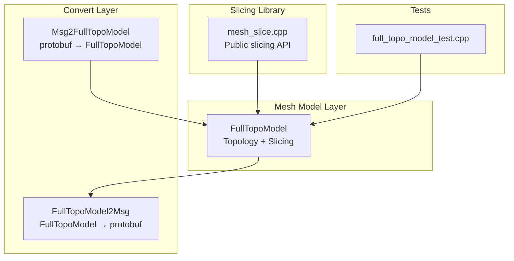

**Diagram sources**
- [FullTopoModel.hpp:43-146](file://meshmodel/FullTopoModel.hpp#L43-L146)
- [FullTopoModel.cpp:25-1243](file://meshmodel/FullTopoModel.cpp#L25-L1243)
- [mesh_slice.cpp:46-116](file://LibHsBaSlicer/Slice/mesh_slice.cpp#L46-L116)
- [Msg2FullTopoModel.cpp:12-36](file://convert/Msg2FullTopoModel.cpp#L12-L36)
- [FullTopoModel2Msg.cpp:10-39](file://convert/FullTopoModel2Msg.cpp#L10-L39)
- [full_topo_model_test.cpp:55-158](file://tests/Models/full_topo_model_test.cpp#L55-L158)

**Section sources**
- [FullTopoModel.hpp:43-146](file://meshmodel/FullTopoModel.hpp#L43-L146)
- [FullTopoModel.cpp:25-1243](file://meshmodel/FullTopoModel.cpp#L25-L1243)
- [mesh_slice.cpp:46-116](file://LibHsBaSlicer/Slice/mesh_slice.cpp#L46-L116)
- [Msg2FullTopoModel.cpp:12-36](file://convert/Msg2FullTopoModel.cpp#L12-L36)
- [FullTopoModel2Msg.cpp:10-39](file://convert/FullTopoModel2Msg.cpp#L10-L39)
- [full_topo_model_test.cpp:55-158](file://tests/Models/full_topo_model_test.cpp#L55-L158)

## Core Components
FullTopoModel exposes three core topological entities:

| Entity | Purpose | Key Fields |
|---|---|---|
| Vertex | Stores position and adjacency lists | Position, face indices, edge indices |
| Edge | Stores two endpoints and up to two adjacent faces | Two vertex indices, two face indices |
| Face | Stores triangle vertex indices, edge indices, and optional normal | Three vertex indices, three edge indices, normal vector |

The public API includes:

| API | Behavior |
|---|---|
| Constructors | Build from `IModel` or from explicit vertex/triangle arrays; optionally compute per-face normals |
| `CheckTopo()` | Validates internal index consistency across faces and edges |
| `TriangleMesh()` | Exposes raw vertex matrix and face index matrix |
| `EulerCharacteristic()` | Returns V − E + F; used as a rough manifold/hole indicator |
| `Intersection(...)` | Computes intersection of a line segment with a horizontal plane at a given height |
| `Slice(...)` | Safe slicing returning only closed contours |
| `UnSafeSlice(...)` | Slicing that may return open polylines with a closed flag |
| `SliceFast(...)` | Fast slicing that requires valid topology and throws if invalid |
| `SliceLua(...)` variants | Execute Lua scripts over exposed vertex/edge/face data |
| `UnSafeSliceLua(...)` | Lua slicing that returns potentially open polylines |

**Section sources**
- [FullTopoModel.hpp:56-146](file://meshmodel/FullTopoModel.hpp#L56-L146)
- [FullTopoModel.cpp:27-158](file://meshmodel/FullTopoModel.cpp#L27-L158)
- [FullTopoModel.cpp:160-244](file://meshmodel/FullTopoModel.cpp#L160-L244)
- [FullTopoModel.cpp:246-324](file://meshmodel/FullTopoModel.cpp#L246-L324)
- [FullTopoModel.cpp:328-1243](file://meshmodel/FullTopoModel.cpp#L328-L1243)

## Architecture Overview
FullTopoModel sits between generic mesh models and slicing consumers. The slicing library builds a `FullTopoModel`, then calls safe or unsafe slicing methods. Protobuf converters allow serialization and deserialization of triangulated meshes into this representation.

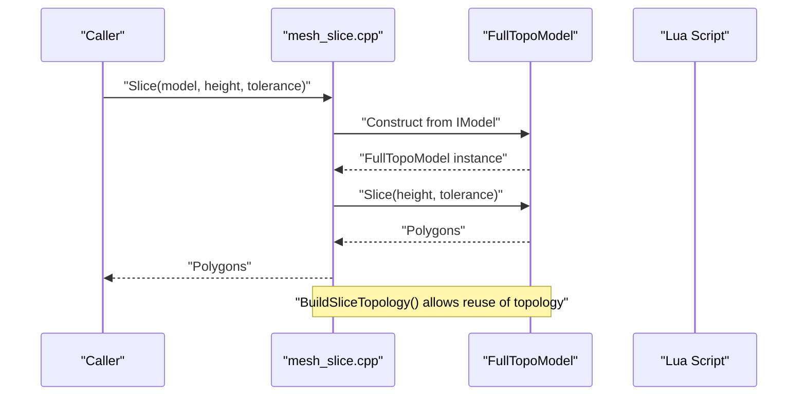

**Diagram sources**
- [mesh_slice.cpp:46-53](file://LibHsBaSlicer/Slice/mesh_slice.cpp#L46-L53)
- [mesh_slice.cpp:106-116](file://LibHsBaSlicer/Slice/mesh_slice.cpp#L106-L116)
- [FullTopoModel.cpp:32-48](file://meshmodel/FullTopoModel.cpp#L32-L48)
- [FullTopoModel.cpp:328-599](file://meshmodel/FullTopoModel.cpp#L328-L599)

## Detailed Component Analysis

### Topology Reconstruction
The constructor extracts triangles from an `IModel`, copies vertex positions, and rebuilds topology through `BuildTopo`. For each triangle, it:

1. Creates a `Face` with vertex indices.
2. Generates three edge keys from vertex pairs.
3. Uses a hash map to deduplicate edges by normalized vertex pair order.
4. Assigns edge indices to faces and records face indices in edges.
5. Updates vertex adjacency lists for both faces and edges.
6. Optionally computes per-face normals using an external normal computation routine.

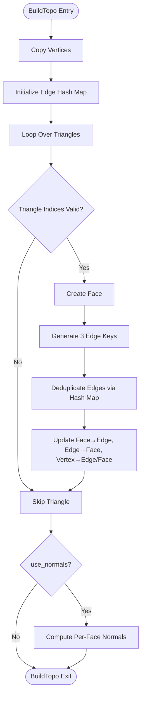

**Diagram sources**
- [FullTopoModel.cpp:50-158](file://meshmodel/FullTopoModel.cpp#L50-L158)

**Section sources**
- [FullTopoModel.cpp:27-48](file://meshmodel/FullTopoModel.cpp#L27-L48)
- [FullTopoModel.cpp:50-158](file://meshmodel/FullTopoModel.cpp#L50-L158)

### Topology Validation
`CheckTopo()` performs two checks:

- All face vertex and edge indices are within bounds and collectively cover all vertices and edges.
- All edge vertex and face indices are within bounds and collectively cover all vertices and faces.

This is an internal consistency check, not a proof that the mesh is a topological manifold. It does not verify:

- Whether every boundary edge has exactly one incident face.
- Whether every interior edge has exactly two incident faces.
- Whether vertex star neighborhoods form valid disk-like structures.
- Whether normals are consistently oriented.
- Whether duplicate or degenerate geometry exists.

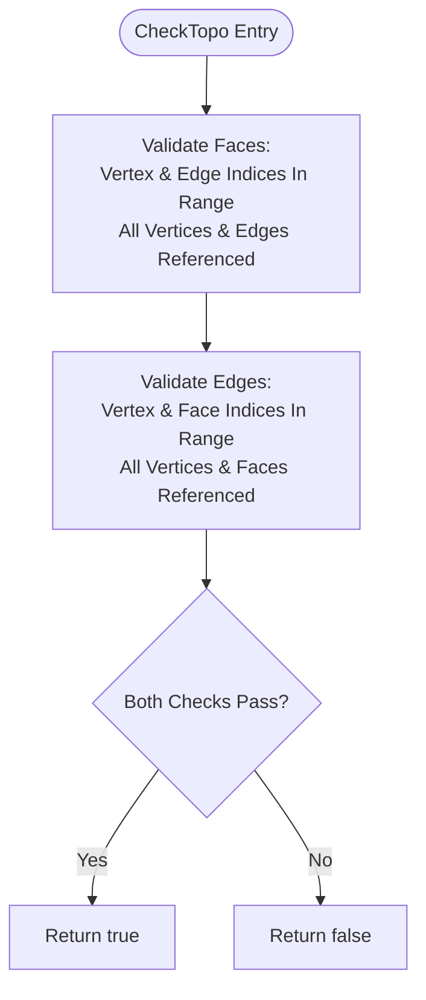

**Diagram sources**
- [FullTopoModel.cpp:160-218](file://meshmodel/FullTopoModel.cpp#L160-L218)

**Section sources**
- [FullTopoModel.hpp:80-84](file://meshmodel/FullTopoModel.hpp#L80-L84)
- [FullTopoModel.cpp:160-218](file://meshmodel/FullTopoModel.cpp#L160-L218)

### Slicing Algorithms

#### Safe Slicing
`Slice()` produces closed polygons only. It:

1. Intersects each triangle edge with the target height plane.
2. Builds a raw adjacency graph of integerized 2D coordinates.
3. Merges nearby nodes using grid hashing and union-find.
4. Builds a merged adjacency list.
5. Traverses the graph using angle-based neighbor selection to extract closed loops.
6. Discards open paths.

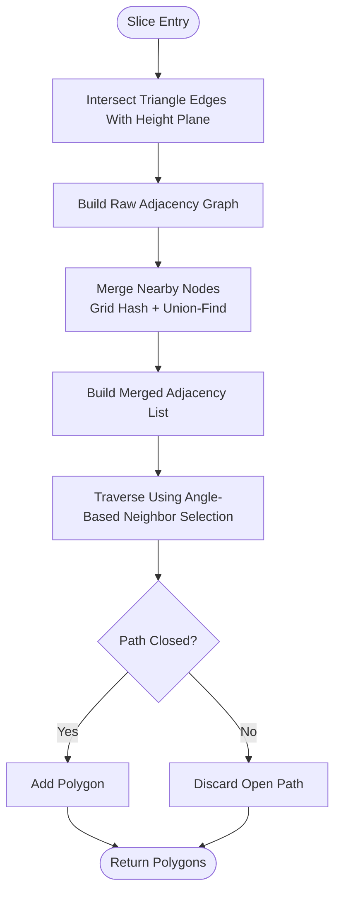

**Diagram sources**
- [FullTopoModel.cpp:328-599](file://meshmodel/FullTopoModel.cpp#L328-L599)

#### Unsafe Slicing
`UnSafeSlice()` follows the same geometric steps but retains open polylines. Each result carries a `closed` flag indicating whether traversal returned to the start point.

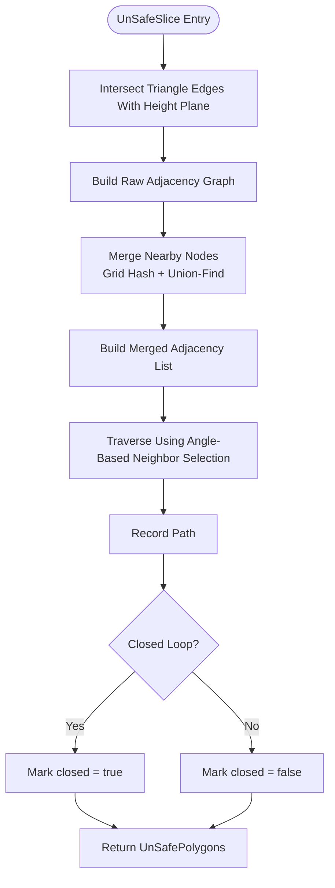

**Diagram sources**
- [FullTopoModel.cpp:604-873](file://meshmodel/FullTopoModel.cpp#L604-L873)

#### Fast Slicing
`SliceFast()` assumes valid topology and throws immediately if `CheckTopo()` fails. It uses precomputed edge intersections and face-edge relationships to build adjacency more directly than the common slicing path.

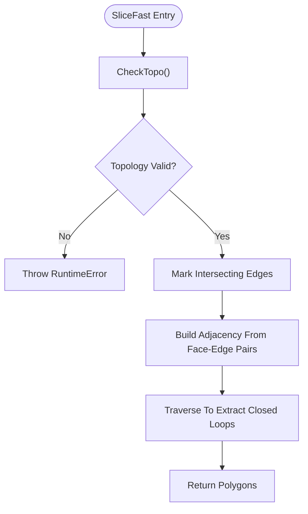

**Diagram sources**
- [FullTopoModel.cpp:875-1025](file://meshmodel/FullTopoModel.cpp#L875-L1025)

#### Lua Slicing
Lua slicing methods expose global tables `V`, `E`, `F`, and `height` to Lua scripts. Scripts can compute intersections, filter edges, build custom polygonization logic, and return polygon tables.

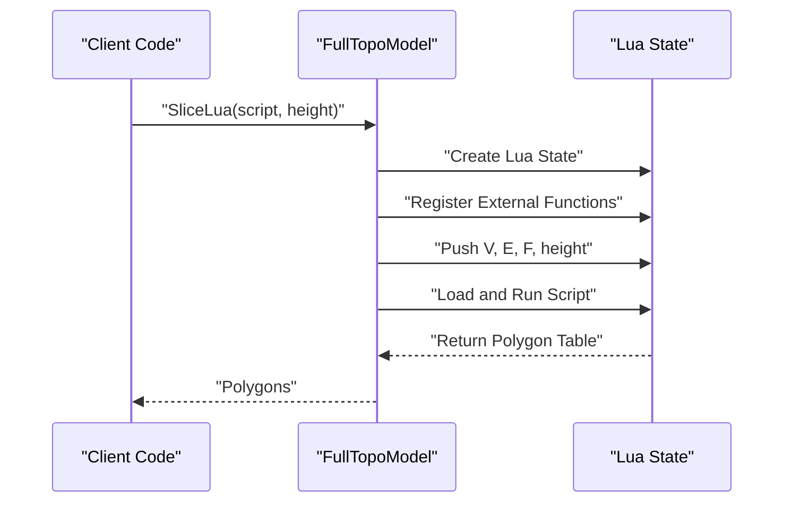

**Diagram sources**
- [FullTopoModel.cpp:1027-1073](file://meshmodel/FullTopoModel.cpp#L1027-L1073)
- [FullTopoModel.cpp:1132-1186](file://meshmodel/FullTopoModel.cpp#L1132-L1186)
- [FullTopoModel.cpp:1188-1241](file://meshmodel/FullTopoModel.cpp#L1188-L1241)
- [FullTopoModel.cpp:274-324](file://meshmodel/FullTopoModel.cpp#L274-L324)

**Section sources**
- [FullTopoModel.cpp:328-599](file://meshmodel/FullTopoModel.cpp#L328-L599)
- [FullTopoModel.cpp:604-873](file://meshmodel/FullTopoModel.cpp#L604-L873)
- [FullTopoModel.cpp:875-1025](file://meshmodel/FullTopoModel.cpp#L875-L1025)
- [FullTopoModel.cpp:1027-1241](file://meshmodel/FullTopoModel.cpp#L1027-L1241)

### Mesh Repair Capabilities
Based on the current implementation:

| Operation | Implemented? | Notes |
|---|---:|---|
| Hole filling | No | No hole-filling algorithm is present in `FullTopoModel` |
| Duplicate vertex removal | No | Construction copies vertices directly; no merging step |
| Normal vector correction | Partial | Optional per-face normal computation is supported, but no orientation correction or consistency enforcement |
| Non-manifold geometry resolution | No | No explicit non-manifold detection or repair |
| Topology completeness check | Yes | `CheckTopo()` validates internal index consistency |
| Manifold verification | No | Documentation explicitly states no exhaustive manifold check |

The class comment warns that the reconstructed manifold may be incomplete and may contain errors. Consumers requiring robust mesh repair should use other mesh processing classes such as `IglModel` or `CgalModel`, or CAD-level tools, before constructing `FullTopoModel`.

**Section sources**
- [FullTopoModel.hpp:43-52](file://meshmodel/FullTopoModel.hpp#L43-L52)
- [FullTopoModel.cpp:50-158](file://meshmodel/FullTopoModel.cpp#L50-L158)
- [FullTopoModel.cpp:160-218](file://meshmodel/FullTopoModel.cpp#L160-L218)

### Integration With the Slicing Pipeline
The slicing library provides public entry points that construct `FullTopoModel` internally and delegate to its slicing methods. It also provides:

- `BuildSliceTopology(model)`: builds and returns a shared `FullTopoModel` so multiple slices can reuse the same topology.
- `SliceLayer(topo, z, tolerance)`: normalizes unsafe slice results into simple closed polygons.
- `NormalizeUnSafePolygons(...)`: filters open polylines and converts unsafe polygons to integerized simple polygons.

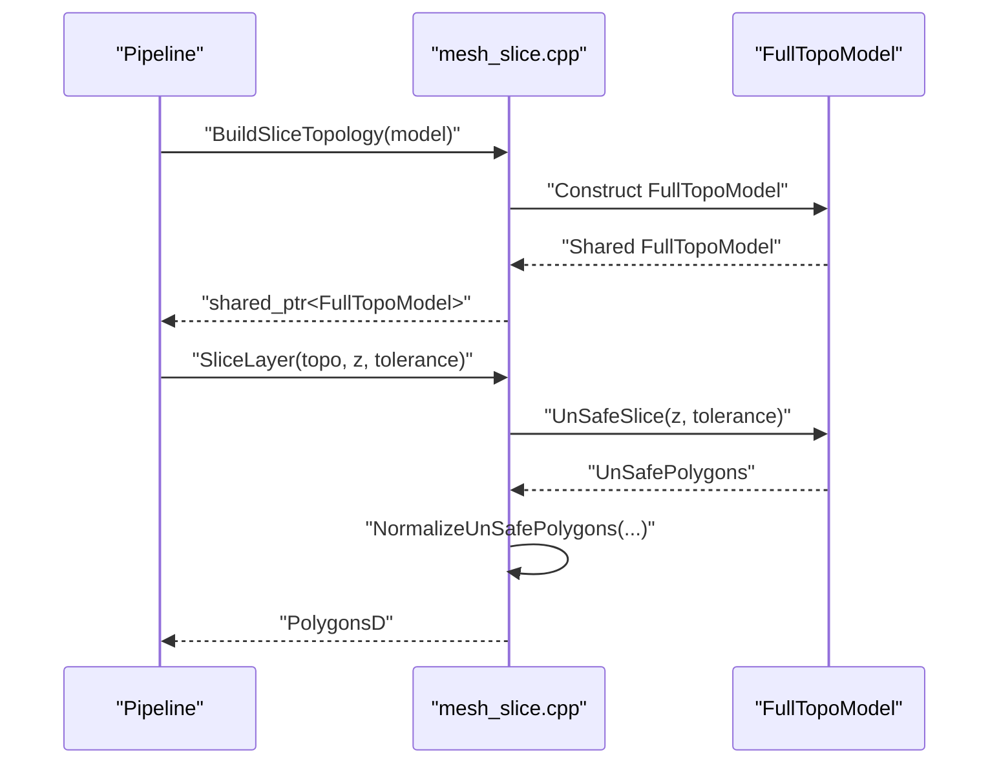

**Diagram sources**
- [mesh_slice.cpp:86-116](file://LibHsBaSlicer/Slice/mesh_slice.cpp#L86-L116)
- [FullTopoModel.cpp:604-873](file://meshmodel/FullTopoModel.cpp#L604-L873)

**Section sources**
- [mesh_slice.cpp:46-116](file://LibHsBaSlicer/Slice/mesh_slice.cpp#L46-L116)

### Usage Patterns

#### Basic Validation and Slicing
A typical workflow is:

1. Load or obtain an `IModel`.
2. Construct `FullTopoModel`.
3. Call `CheckTopo()` when using fast slicing or when topology correctness matters.
4. Use `Slice()` for safe closed contours.
5. Use `UnSafeSlice()` when open contours must be preserved.
6. Use `SliceFast()` only after confirming topology validity.

Example reference:
- [full_topo_model_test.cpp:55-75](file://tests/Models/full_topo_model_test.cpp#L55-L75)

#### Reusing Topology Across Layers
When slicing many layers, build the topology once and reuse it:

1. Call `BuildSliceTopology(model)`.
2. Call `SliceLayer(topo, z, tolerance)` for each layer.

Example reference:
- [mesh_slice.cpp:106-116](file://LibHsBaSlicer/Slice/mesh_slice.cpp#L106-L116)

#### Custom Lua Slicing
Use Lua slicing when built-in slicing is insufficient:

1. Prepare a script that reads `V`, `E`, `F`, and `height`.
2. Call `SliceLua(script, height)` or `UnSafeSliceLua(script, height)`.
3. Convert returned polygon tables into downstream formats.

Example reference:
- [full_topo_model_test.cpp:77-142](file://tests/Models/full_topo_model_test.cpp#L77-L142)

#### Protobuf Conversion
If working with protobuf messages:

- Convert message to `FullTopoModel` using `MsgTopoTrimeshes2FullTopoModel`.
- Convert `FullTopoModel` back to protobuf using `FullTopoModel2Msg`.

Example reference:
- [Msg2FullTopoModel.cpp:12-36](file://convert/Msg2FullTopoModel.cpp#L12-L36)
- [FullTopoModel2Msg.cpp:10-39](file://convert/FullTopoModel2Msg.cpp#L10-L39)

**Section sources**
- [full_topo_model_test.cpp:55-158](file://tests/Models/full_topo_model_test.cpp#L55-L158)
- [mesh_slice.cpp:86-116](file://LibHsBaSlicer/Slice/mesh_slice.cpp#L86-L116)
- [Msg2FullTopoModel.cpp:12-36](file://convert/Msg2FullTopoModel.cpp#L12-L36)
- [FullTopoModel2Msg.cpp:10-39](file://convert/FullTopoModel2Msg.cpp#L10-L39)

## Dependency Analysis
FullTopoModel depends on:

- Eigen for vector and matrix types.
- 2D polygon types for slicing output.
- `IModel` for mesh input.
- Lua adapter utilities for scripting support.
- igl for optional per-face normal computation.
- Boost hash utilities for key hashing.

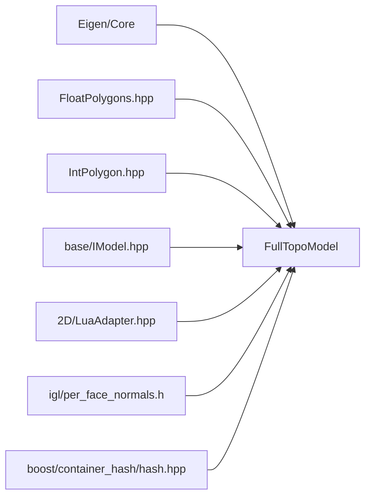

**Diagram sources**
- [FullTopoModel.hpp:5-16](file://meshmodel/FullTopoModel.hpp#L5-L16)
- [FullTopoModel.cpp:8-23](file://meshmodel/FullTopoModel.cpp#L8-L23)

**Section sources**
- [FullTopoModel.hpp:5-16](file://meshmodel/FullTopoModel.hpp#L5-L16)
- [FullTopoModel.cpp:8-23](file://meshmodel/FullTopoModel.cpp#L8-L23)

## Performance Considerations
- Topology construction is O(F × E_per_face) plus hash-map operations for edge deduplication. For triangle meshes, this is approximately linear in the number of faces, with constant overhead per triangle.
- Safe and unsafe slicing build an intermediate adjacency graph, merge nearby nodes using grid hashing and union-find, and traverse to extract loops. Complexity is dominated by face iteration, coordinate integerization, hashing, and loop traversal.
- Fast slicing avoids some intermediate work by reusing precomputed edge-face relationships, but it requires valid topology and throws otherwise.
- Memory usage grows with vertices, edges, and faces. The class stores adjacency lists for vertices, edges, and faces.
- For repeated slicing across many layers, prefer `BuildSliceTopology()` to avoid rebuilding topology repeatedly.
- Large or malformed meshes may produce incomplete manifolds; `CheckTopo()` helps detect internal inconsistencies but does not guarantee manifold correctness.

[No sources needed since this section provides general guidance]

## Troubleshooting Guide

### Common Issues

| Symptom | Likely Cause | Recommended Action |
|---|---|---|
| `SliceFast()` throws | `CheckTopo()` failed | Inspect input mesh for invalid indices, missing faces, or inconsistent topology |
| Slicing returns empty polygons | No edges intersect the target height | Verify model bounds and slice height |
| Slicing returns open polylines | Input mesh is not closed or contains holes | Use `UnSafeSlice()` and inspect `closed` flags; consider preprocessing with dedicated mesh repair tools |
| Lua slicing fails | Script load or runtime error | Check script syntax and ensure `V`, `E`, `F`, and `height` are available |
| Unexpected duplicate or degenerate contours | Floating-point precision or near-coincident vertices | Adjust tolerance parameter in slicing functions |

### Error Handling
- `SliceFast()` throws `RuntimeError` when topology is invalid.
- Lua slicing methods throw `RuntimeError` for Lua initialization, loading, or runtime failures.
- The slicing library wrapper translates foreign exceptions into `IOError` at the public API boundary.

**Section sources**
- [FullTopoModel.cpp:875-880](file://meshmodel/FullTopoModel.cpp#L875-L880)
- [FullTopoModel.cpp:1027-1073](file://meshmodel/FullTopoModel.cpp#L1027-L1073)
- [FullTopoModel.cpp:1075-1130](file://meshmodel/FullTopoModel.cpp#L1075-L1130)
- [FullTopoModel.cpp:1132-1241](file://meshmodel/FullTopoModel.cpp#L1132-L1241)
- [mesh_slice.cpp:28-43](file://LibHsBaSlicer/Slice/mesh_slice.cpp#L28-L43)

## Conclusion
FullTopoModel provides a focused, slicing-oriented topology representation. It reconstructs vertex/edge/face relationships, supports safe and unsafe slicing, offers a fast slicing path for validated meshes, and enables custom Lua-driven slicing. It does not implement general mesh repair operations such as hole filling, duplicate vertex removal, normal correction, or non-manifold resolution. Consumers should validate input meshes, use appropriate preprocessing tools when necessary, and rely on `CheckTopo()` and `EulerCharacteristic()` as lightweight diagnostics rather than guarantees of manifold correctness.

[No sources needed since this section summarizes without analyzing specific files]

## Appendices

### Class Diagram
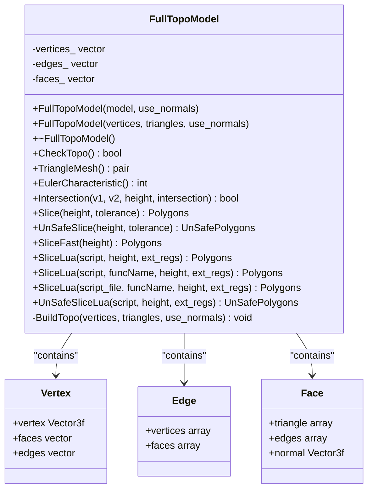

**Diagram sources**
- [FullTopoModel.hpp:56-146](file://meshmodel/FullTopoModel.hpp#L56-L146)
- [FullTopoModel.cpp:50-158](file://meshmodel/FullTopoModel.cpp#L50-L158)