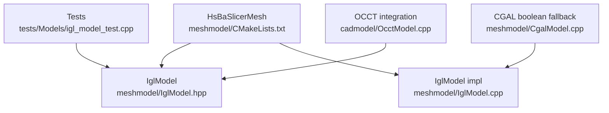
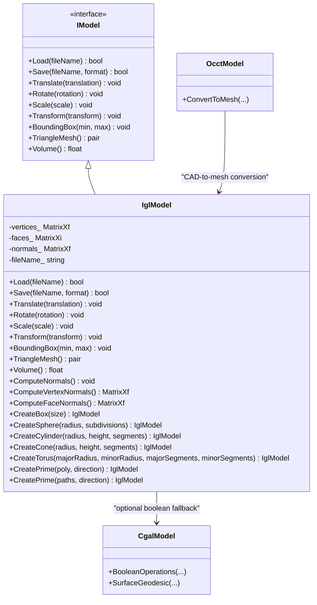
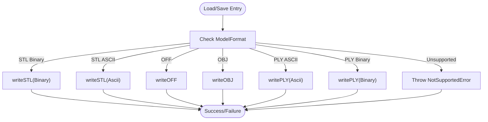
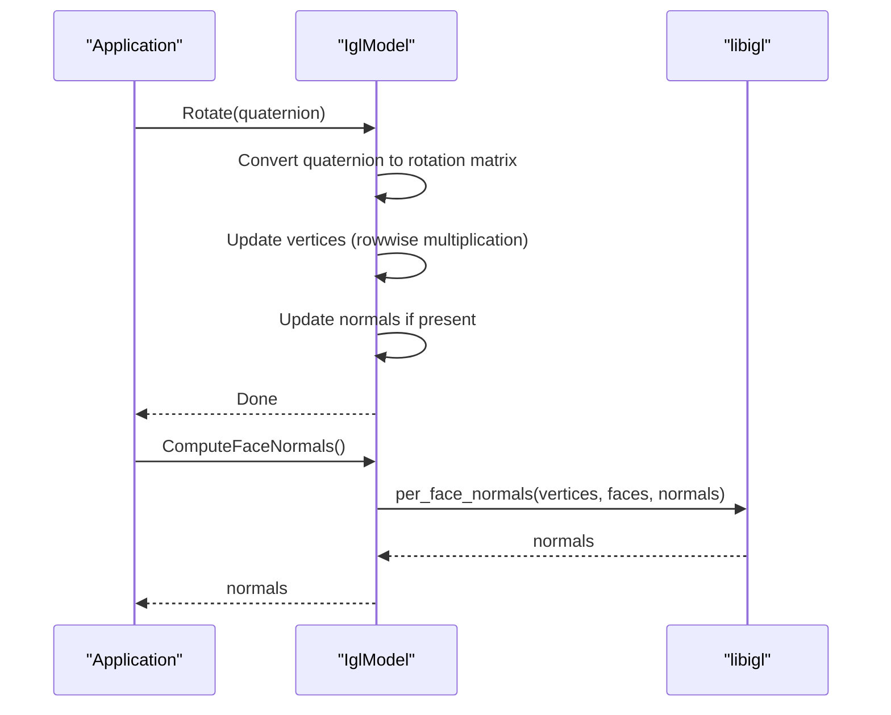
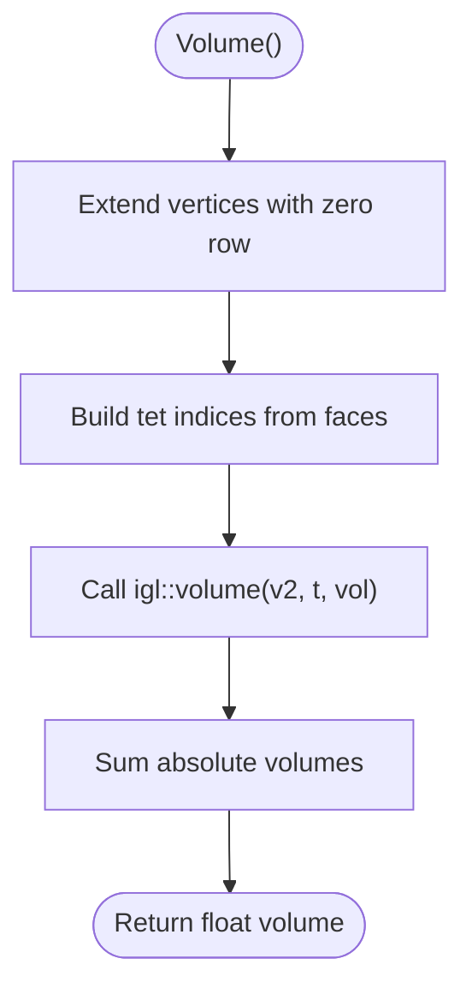
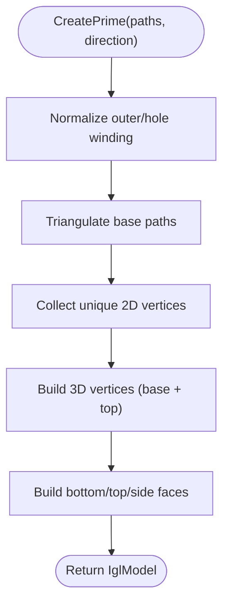
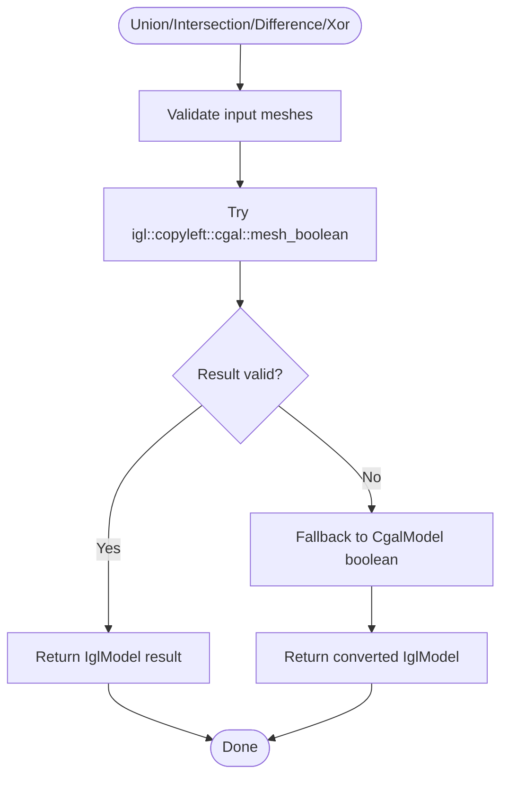
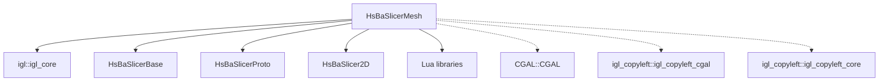

# IGL Backend / IGL 后端

<cite>
**Referenced Files in This Document**   
- [IglModel.hpp](file://meshmodel/IglModel.hpp)
- [IglModel.cpp](file://meshmodel/IglModel.cpp)
- [CMakeLists.txt](file://meshmodel/CMakeLists.txt)
- [igl_model_test.cpp](file://tests/Models/igl_model_test.cpp)
- [OcctModel.cpp](file://cadmodel/OcctModel.cpp)
- [CgalModel.cpp](file://meshmodel/CgalModel.cpp)
- [README.md](file://docs/en/LibHsBaSlicer/README.md)
</cite>

## Table of Contents
1. [Introduction](#introduction)
2. [Project Structure](#project-structure)
3. [Core Components](#core-components)
4. [Architecture Overview](#architecture-overview)
5. [Detailed Component Analysis](#detailed-component-analysis)
6. [Dependency Analysis](#dependency-analysis)
7. [Performance Considerations](#performance-considerations)
8. [Troubleshooting Guide](#troubleshooting-guide)
9. [Conclusion](#conclusion)
10. [Appendices](#appendices)

## Introduction
This document explains the IGL backend implementation used by HsBaSlicer for efficient mesh processing. The `IglModel` class is a libigl-backed triangle mesh model that implements the project’s `IModel` interface. It provides fast loading and saving, affine transforms, bounding-box and volume queries, normal computation, primitive generation, polygon extrusion, and optional CGAL-based mesh boolean operations.

The documentation focuses on:
- libigl-specific functionality such as fast mesh I/O, per-face/per-vertex normals, adjacency utilities, and signed-volume computation.
- How `IglModel` integrates with other backends (`CgalModel`, `OcctModel`) and the preprocessing pipeline.
- Practical usage patterns, error handling, and migration guidance when switching between backends.
- Realistic performance characteristics derived from the code structure and tests, including notes about where libigl excels and where CGAL or OCCT are preferred.

## Project Structure
The IGL backend lives under `meshmodel`. Its public API is declared in `IglModel.hpp`, implemented in `IglModel.cpp`, and linked through `meshmodel/CMakeLists.txt`. Tests validating geometry, volume, transforms, and extrusion are located in `tests/Models/igl_model_test.cpp`. Integration points include conversion to/from OCCT models and fallback boolean operations via `CgalModel`.

**Diagram sources**
- [CMakeLists.txt:1-42](file://meshmodel/CMakeLists.txt#L1-L42)
- [IglModel.hpp:1-124](file://meshmodel/IglModel.hpp#L1-L124)
- [IglModel.cpp:1-933](file://meshmodel/IglModel.cpp#L1-L933)
- [igl_model_test.cpp:1-204](file://tests/Models/igl_model_test.cpp#L1-L204)
- [OcctModel.cpp:58-264](file://cadmodel/OcctModel.cpp#L58-L264)
- [CgalModel.cpp:721-722](file://meshmodel/CgalModel.cpp#L721-L722)

**Section sources**
- [CMakeLists.txt:1-42](file://meshmodel/CMakeLists.txt#L1-L42)
- [IglModel.hpp:1-124](file://meshmodel/IglModel.hpp#L1-L124)
- [IglModel.cpp:1-933](file://meshmodel/IglModel.cpp#L1-L933)
- [igl_model_test.cpp:1-204](file://tests/Models/igl_model_test.cpp#L1-L204)

## Core Components
`IglModel` is a lightweight, Eigen-backed triangle mesh container implementing `IModel`. It stores vertices, faces, and optional normals as row-major Eigen matrices and exposes:
- File I/O for STL, OBJ, PLY, OFF using libigl readers/writers.
- Affine transforms (translate, rotate, scale, homogeneous transform).
- Bounding box and signed volume computation.
- Face and vertex normal computation.
- Primitive factories: box, sphere, cylinder, cone, torus.
- Polygon extrusion into solid meshes.
- Optional mesh boolean operations (union, intersection, difference, xor) when compiled with CGAL support.

Key responsibilities:
- Provide a fast, memory-efficient mesh representation suitable for real-time slicing workflows.
- Offer robust primitives and extrusion logic with consistent outward-facing normals.
- Integrate with higher-level pipelines through the `IModel` interface.

**Section sources**
- [IglModel.hpp:18-121](file://meshmodel/IglModel.hpp#L18-L121)
- [IglModel.cpp:64-185](file://meshmodel/IglModel.cpp#L64-L185)

## Architecture Overview
At runtime, `IglModel` uses libigl for core mesh operations and optionally CGAL for robust boolean operations. When CGAL is not available, boolean functions throw an explicit unsupported error. Higher-level components like `OcctModel` can convert CAD data into `IglModel` meshes, while `CgalModel` may use `IglModel` as an intermediate step during certain conversions.

**Diagram sources**
- [IglModel.hpp:18-121](file://meshmodel/IglModel.hpp#L18-L124)
- [IglModel.cpp:195-409](file://meshmodel/IglModel.cpp#L195-L409)
- [CgalModel.cpp:721-722](file://meshmodel/CgalModel.cpp#L721-L722)
- [OcctModel.cpp:264-264](file://cadmodel/OcctModel.cpp#L264-L264)

## Detailed Component Analysis

### Mesh I/O and Formats
`IglModel::Load` reads triangle meshes using libigl’s reader, supporting multiple formats. `IglModel::Save` writes to STL (binary/ASCII), OBJ, OFF, and PLY (ASCII/Binary) via libigl writers. Unsupported formats raise a clear exception.

**Diagram sources**
- [IglModel.cpp:64-99](file://meshmodel/IglModel.cpp#L64-L99)

**Section sources**
- [IglModel.cpp:64-99](file://meshmodel/IglModel.cpp#L64-L99)

### Transforms and Normals
Translation, rotation, scaling, and general transforms operate directly on row-major Eigen matrices. Rotation updates both vertices and normals when present. Normal computation uses libigl’s per-face and per-vertex routines.

**Diagram sources**
- [IglModel.cpp:107-149](file://meshmodel/IglModel.cpp#L107-L149)
- [IglModel.cpp:170-185](file://meshmodel/IglModel.cpp#L170-L185)

**Section sources**
- [IglModel.cpp:101-149](file://meshmodel/IglModel.cpp#L101-L149)
- [IglModel.cpp:170-185](file://meshmodel/IglModel.cpp#L170-L185)

### Volume and Bounding Box
Bounding box is computed by column-wise min/max over vertices. Signed volume is computed by extending the mesh to tetrahedra and calling libigl’s volume routine; the absolute sum is returned.

**Diagram sources**
- [IglModel.cpp:152-168](file://meshmodel/IglModel.cpp#L152-L168)

**Section sources**
- [IglModel.cpp:152-168](file://meshmodel/IglModel.cpp#L152-L168)

### Primitives and Extrusion
Primitive factories generate meshes with consistent winding so that normals point outward. `CreatePrime` extrudes one or more polygons along a direction, triangulating base faces and building side walls. It handles hole detection and winding normalization to ensure correct volume and orientation.

**Diagram sources**
- [IglModel.cpp:598-713](file://meshmodel/IglModel.cpp#L598-L713)
- [IglModel.cpp:715-800](file://meshmodel/IglModel.cpp#L715-L800)

**Section sources**
- [IglModel.cpp:411-596](file://meshmodel/IglModel.cpp#L411-L596)
- [IglModel.cpp:598-713](file://meshmodel/IglModel.cpp#L598-L713)
- [IglModel.cpp:715-800](file://meshmodel/IglModel.cpp#L715-L800)

### Boolean Operations and CGAL Fallback
When compiled with CGAL support, `IglModel` uses libigl’s CGAL copyleft boolean routine. If floating-point precision causes failure, it falls back to `CgalModel`’s Nef polyhedron booleans. Without CGAL, boolean functions throw an unsupported error.

**Diagram sources**
- [IglModel.cpp:195-246](file://meshmodel/IglModel.cpp#L195-L246)
- [IglModel.cpp:248-391](file://meshmodel/IglModel.cpp#L248-L391)
- [IglModel.cpp:392-409](file://meshmodel/IglModel.cpp#L392-L409)

**Section sources**
- [IglModel.cpp:195-409](file://meshmodel/IglModel.cpp#L195-L409)

### Integration with Other Backends
- `OcctModel` converts CAD data into `IglModel` meshes, enabling mesh-based workflows after CAD import.
- `CgalModel` sometimes constructs an `IglModel` first and then converts to CGAL structures for advanced operations.

**Diagram sources**
- [OcctModel.cpp:264-264](file://cadmodel/OcctModel.cpp#L264-L264)
- [CgalModel.cpp:721-722](file://meshmodel/CgalModel.cpp#L721-L722)

**Section sources**
- [OcctModel.cpp:58-264](file://cadmodel/OcctModel.cpp#L58-L264)
- [CgalModel.cpp:721-722](file://meshmodel/CgalModel.cpp#L721-L722)

## Dependency Analysis
The mesh module links against libigl core and optionally CGAL copyleft components when enabled. The build configuration controls whether CGAL sources are included and linked.

**Diagram sources**
- [CMakeLists.txt:1-42](file://meshmodel/CMakeLists.txt#L1-L42)

**Section sources**
- [CMakeLists.txt:1-42](file://meshmodel/CMakeLists.txt#L1-L42)

## Performance Considerations
- Fast mesh I/O: libigl’s readers/writers provide efficient parsing and serialization for common mesh formats.
- In-place transforms: Direct Eigen operations on row-major matrices avoid unnecessary allocations.
- Normal computation: Per-face and per-vertex normals are computed via optimized libigl routines.
- Volume calculation: Uses libigl’s volume function with minimal overhead.
- Boolean operations: When CGAL is enabled, libigl’s CGAL copyleft boolean routine is attempted first; otherwise, a fallback path ensures correctness at potential extra cost.

Practical implications:
- For real-time applications, prefer libigl-backed operations for I/O, transforms, normals, and volume.
- Use CGAL-enabled builds only when robust boolean operations are required; otherwise, keep builds lean.
- Memory efficiency: `IglModel` stores data in compact Eigen matrices, reducing overhead compared to heavier geometric kernels.

[No sources needed since this section provides general guidance]

## Troubleshooting Guide
Common issues and resolutions:
- Unsupported file format: Ensure the requested format is one of STL, OBJ, OFF, or PLY variants.
- Missing CGAL features: Boolean operations require CGAL; without it, calls will throw an unsupported error.
- Invalid mesh inputs: Boolean operations validate vertices and face indices; invalid inputs return empty meshes or errors.
- Winding and normals: Primitive and extrusion constructors enforce outward-facing normals; verify polygon winding when creating custom meshes.

Operational checks:
- Verify mesh validity before boolean operations.
- Confirm CGAL compilation flags when relying on boolean operations.
- Use tests as reference for expected behavior of primitives, volume, and extrusion.

**Section sources**
- [IglModel.cpp:72-99](file://meshmodel/IglModel.cpp#L72-L99)
- [IglModel.cpp:392-409](file://meshmodel/IglModel.cpp#L392-L409)
- [igl_model_test.cpp:11-72](file://tests/Models/igl_model_test.cpp#L11-L72)

## Conclusion
The IGL backend in HsBaSlicer provides a fast, flexible mesh processing layer built on libigl. It offers efficient I/O, transforms, normals, volume, primitives, and extrusion, with optional CGAL-backed boolean operations for robust CSG. Its design emphasizes performance and simplicity, making it well-suited for real-time slicing workflows. Integration points with OCCT and CGAL allow seamless transitions between CAD, mesh, and advanced geometric processing.

[No sources needed since this section summarizes without analyzing specific files]

## Appendices

### Usage Examples and Migration Notes
- Creating and transforming meshes: Use `CreateBox`, `CreateSphere`, `CreateCylinder`, `CreateCone`, `CreateTorus`, and apply `Translate`, `Rotate`, `Scale`, `Transform`.
- Extruding polygons: Use `CreatePrime` for single or multiple polygons; it handles winding and holes automatically.
- Boolean operations: Enable CGAL support for union/intersection/difference/xor; otherwise, expect unsupported errors.
- Converting from CAD: Use `OcctModel` to produce `IglModel` meshes for downstream mesh processing.

Reference documentation indicates how preprocessing routes operations between OCCT and IGL/CGAL depending on model types.

**Section sources**
- [IglModel.hpp:96-112](file://meshmodel/IglModel.hpp#L96-L112)
- [IglModel.cpp:411-596](file://meshmodel/IglModel.cpp#L411-L596)
- [IglModel.cpp:598-800](file://meshmodel/IglModel.cpp#L598-L800)
- [README.md:336-378](file://docs/en/LibHsBaSlicer/README.md#L336-L378)