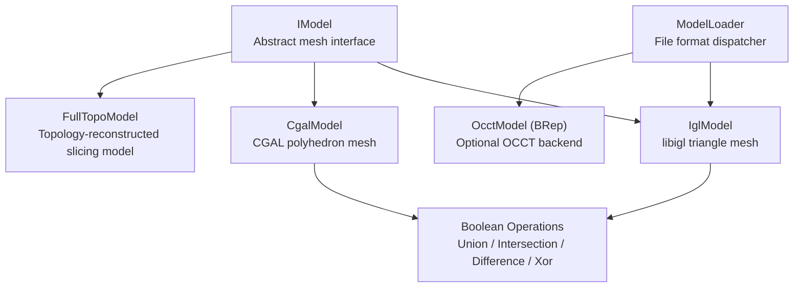
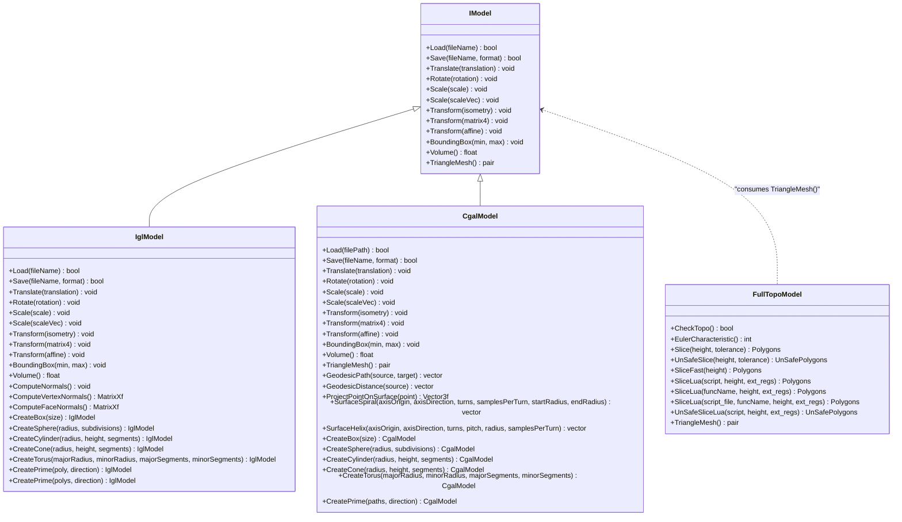
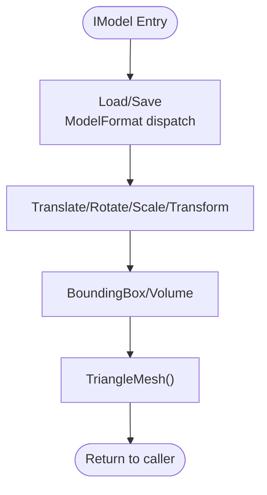
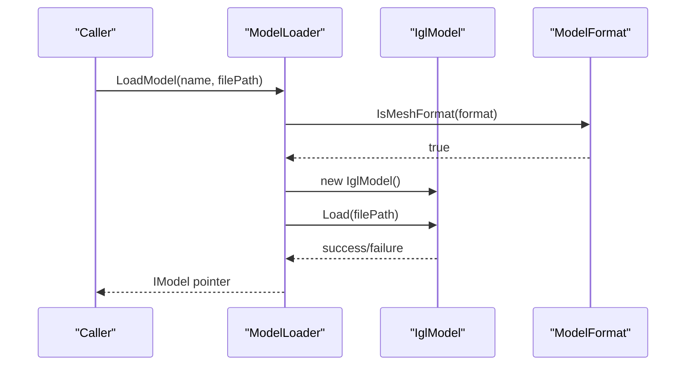
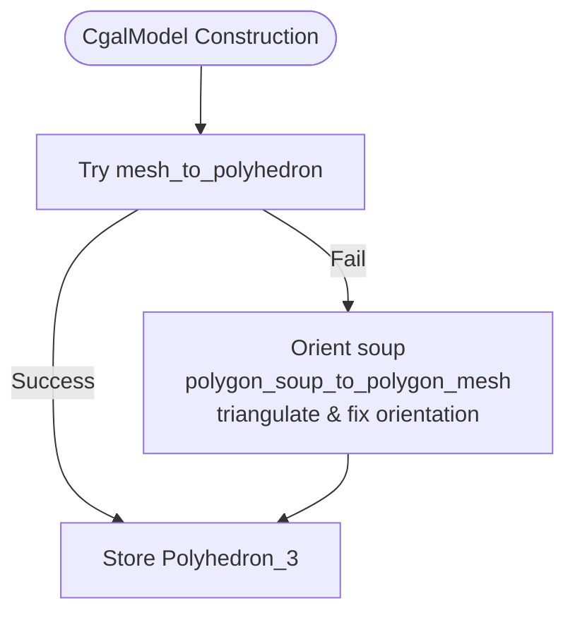
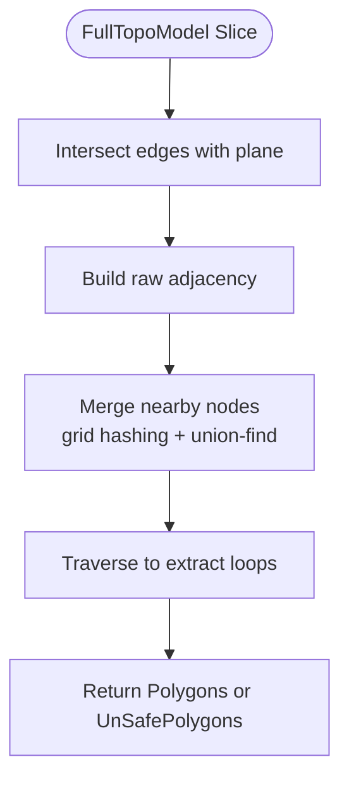
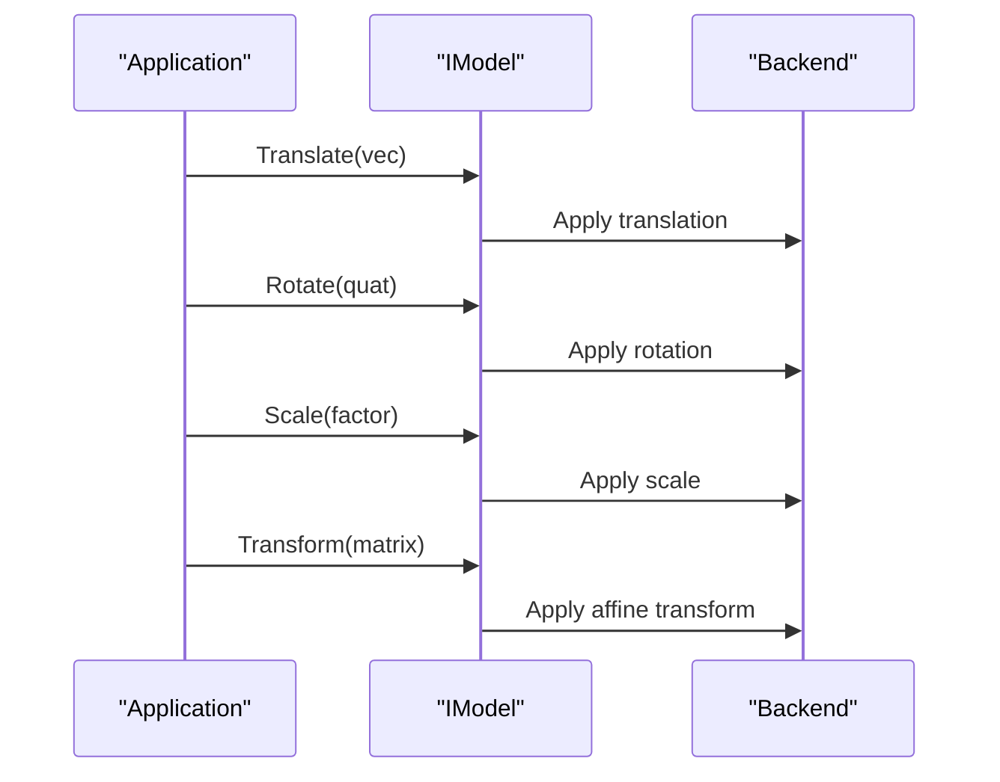
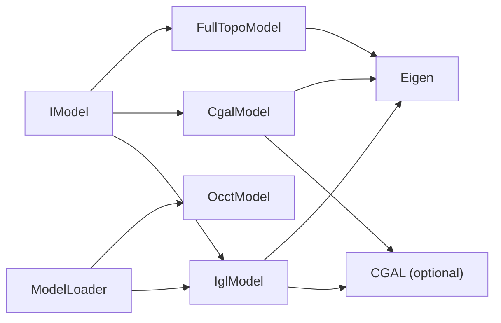

# Mesh Model Processing / 网格模型处理

<cite>
**Referenced Files in This Document**   
- [IModel.hpp](file://base/IModel.hpp)
- [ModelFormat.hpp](file://base/ModelFormat.hpp)
- [FullTopoModel.hpp](file://meshmodel/FullTopoModel.hpp)
- [FullTopoModel.cpp](file://meshmodel/FullTopoModel.cpp)
- [CgalModel.hpp](file://meshmodel/CgalModel.hpp)
- [CgalModel.cpp](file://meshmodel/CgalModel.cpp)
- [IglModel.hpp](file://meshmodel/IglModel.hpp)
- [IglModel.cpp](file://meshmodel/IglModel.cpp)
- [ModelLoader.hpp](file://preprocess/ModelLoader.hpp)
- [ModelLoader.cpp](file://preprocess/ModelLoader.cpp)
</cite>

## Table of Contents
1. [Introduction](#introduction)
2. [Project Structure](#project-structure)
3. [Core Components](#core-components)
4. [Architecture Overview](#architecture-overview)
5. [Detailed Component Analysis](#detailed-component-analysis)
6. [Dependency Analysis](#dependency-analysis)
7. [Performance Considerations](#performance-considerations)
8. [Troubleshooting Guide](#troubleshooting-guide)
9. [Conclusion](#conclusion)
10. [Appendices](#appendices)

## Introduction
This document explains the mesh model processing module that provides 3D mesh representation, manipulation, validation, and slicing capabilities. It covers:
- The `IModel` abstract interface defining the common contract for all mesh implementations.
- `FullTopoModel`, a topology-reconstructed model optimized for slicing with vertex/edge/face relationships.
- `CgalModel`, a CGAL-backed polyhedral mesh supporting robust boolean operations, primitives, extrusion, and surface geometry queries.
- `IglModel`, a libigl-backed triangle mesh implementation providing efficient loading, transformation, normals, primitives, extrusion, and optional CGAL-based boolean operations.
- Usage patterns for loading, transforming, validating, repairing, and exporting meshes, including concrete code example references.

## Project Structure
The mesh model processing module is centered under `meshmodel/`, with shared interfaces and utilities under `base/`, and high-level loading/pooling under `preprocess/`.

**Diagram sources**
- [IModel.hpp:110-139](file://base/IModel.hpp#L110-L139)
- [IglModel.hpp:18-121](file://meshmodel/IglModel.hpp#L18-L121)
- [CgalModel.hpp:26-155](file://meshmodel/CgalModel.hpp#L26-L155)
- [FullTopoModel.hpp:43-142](file://meshmodel/FullTopoModel.hpp#L43-L142)
- [ModelLoader.cpp:48-84](file://preprocess/ModelLoader.cpp#L48-L84)

**Section sources**
- [IModel.hpp:110-139](file://base/IModel.hpp#L110-L139)
- [ModelLoader.cpp:48-84](file://preprocess/ModelLoader.cpp#L48-L84)

## Core Components
- `IModel`: Defines the unified API for loading/saving models, applying transformations, querying bounding boxes/volume, and extracting a triangle mesh.
- `IglModel`: Stores vertices, faces, and optional normals as Eigen matrices; supports STL/OBJ/PLY/OFF I/O, affine transforms, normals computation, primitives, extrusion, and optional boolean operations via libigl/CGAL.
- `CgalModel`: Wraps a CGAL `Polyhedron_3`; supports robust boolean operations using Nef polyhedra, primitives, extrusion, AABB bounds, volume, triangulation, and advanced surface geodesic/helix/spiral operations.
- `FullTopoModel`: Reconstructs full topological relations (vertex/edge/face adjacency), exposes Euler characteristic checks, and provides safe/unsafe/fast Z-slicing plus Lua-driven custom slicing.

**Section sources**
- [IModel.hpp:110-139](file://base/IModel.hpp#L110-L139)
- [IglModel.hpp:18-121](file://meshmodel/IglModel.hpp#L18-L121)
- [CgalModel.hpp:26-155](file://meshmodel/CgalModel.hpp#L26-L155)
- [FullTopoModel.hpp:43-142](file://meshmodel/FullTopoModel.hpp#L43-L142)

## Architecture Overview
The architecture separates concerns across abstraction, lightweight mesh processing, robust geometric kernel operations, and slicing-oriented topology.

**Diagram sources**
- [IModel.hpp:110-139](file://base/IModel.hpp#L110-L139)
- [IglModel.hpp:18-121](file://meshmodel/IglModel.hpp#L18-L121)
- [CgalModel.hpp:26-155](file://meshmodel/CgalModel.hpp#L26-L155)
- [FullTopoModel.hpp:43-142](file://meshmodel/FullTopoModel.hpp#L43-L142)

## Detailed Component Analysis

### IModel Abstract Interface
`IModel` defines the core contract for all mesh backends:
- File I/O: `Load`, `Save` with `ModelFormat`.
- Transformations: translation, rotation, uniform/non-uniform scaling, and generic transforms via `Isometry3f`, `Matrix4f`, or `Affine`.
- Queries: axis-aligned bounding box and signed volume.
- Data access: `TriangleMesh()` returns an igl-style `(vertices, faces)` pair.

**Diagram sources**
- [IModel.hpp:110-139](file://base/IModel.hpp#L110-L139)

**Section sources**
- [IModel.hpp:110-139](file://base/IModel.hpp#L110-L139)
- [ModelFormat.hpp:62-84](file://base/ModelFormat.hpp#L62-L84)

### IglModel Implementation
`IglModel` stores mesh data as Eigen matrices and provides:
- Loading/saving STL/OBJ/PLY/OFF via libigl.
- Efficient row-wise transformations updating both vertices and normals when present.
- Normals computation: face and vertex normals.
- Primitives: box, sphere, cylinder, cone, torus.
- Extrusion: single polygon or multi-path extrusion into closed solids.
- Optional boolean operations: union, intersection, difference, xor, backed by libigl/CGAL with fallback to `CgalModel` Nef polyhedra.

Key behaviors:
- Transformations use homogeneous row vectors and update normals consistently.
- Volume uses tetrahedral decomposition over triangles.
- Boolean operations promote float to double for CGAL; if libigl’s boolean fails, it falls back to `CgalModel`’s Nef boolean.

**Diagram sources**
- [ModelLoader.cpp:48-84](file://preprocess/ModelLoader.cpp#L48-L84)
- [IglModel.cpp:64-99](file://meshmodel/IglModel.cpp#L64-L99)

**Section sources**
- [IglModel.hpp:18-121](file://meshmodel/IglModel.hpp#L18-L121)
- [IglModel.cpp:64-193](file://meshmodel/IglModel.cpp#L64-L193)
- [IglModel.cpp:195-409](file://meshmodel/IglModel.cpp#L195-L409)
- [IglModel.cpp:411-596](file://meshmodel/IglModel.cpp#L411-L596)
- [IglModel.cpp:598-713](file://meshmodel/IglModel.cpp#L598-L713)
- [IglModel.cpp:715-800](file://meshmodel/IglModel.cpp#L715-L800)

### CgalModel Backend
`CgalModel` wraps a CGAL `Polyhedron_3` and adds:
- Robust boolean operations via Nef polyhedra: union, intersection, difference, xor.
- Primitive creation: box, sphere, cylinder, cone, torus.
- Extrusion from 2D polygons into closed solids.
- Surface geometry: geodesic path/distance, point projection, spiral/helix generation.
- Mesh repair during construction: orientation correction, triangulation, volume sign fix.

**Diagram sources**
- [CgalModel.cpp:42-119](file://meshmodel/CgalModel.cpp#L42-L119)

**Section sources**
- [CgalModel.hpp:26-155](file://meshmodel/CgalModel.hpp#L26-L155)
- [CgalModel.cpp:42-119](file://meshmodel/CgalModel.cpp#L42-L119)
- [CgalModel.cpp:121-237](file://meshmodel/CgalModel.cpp#L121-L237)
- [CgalModel.cpp:238-276](file://meshmodel/CgalModel.cpp#L238-L276)
- [CgalModel.cpp:278-445](file://meshmodel/CgalModel.cpp#L278-L445)
- [CgalModel.cpp:625-733](file://meshmodel/CgalModel.cpp#L625-L733)
- [CgalModel.cpp:735-800](file://meshmodel/CgalModel.cpp#L735-L800)

### FullTopoModel Topology Reconstruction and Slicing
`FullTopoModel` reconstructs full topological relations:
- Builds vertex/edge/face adjacency lists.
- Provides `CheckTopo` and `EulerCharacteristic` for manifold diagnostics.
- Offers multiple slicing strategies:
  - Safe slice: only closed contours.
  - Unsafe slice: includes open contours.
  - Fast slice: direct traversal using prebuilt topology.
- Supports Lua scripting for custom slicing logic over V/E/F structures.

**Diagram sources**
- [FullTopoModel.cpp:328-599](file://meshmodel/FullTopoModel.cpp#L328-L599)
- [FullTopoModel.cpp:604-800](file://meshmodel/FullTopoModel.cpp#L604-L800)

**Section sources**
- [FullTopoModel.hpp:43-142](file://meshmodel/FullTopoModel.hpp#L43-L142)
- [FullTopoModel.cpp:27-48](file://meshmodel/FullTopoModel.cpp#L27-L48)
- [FullTopoModel.cpp:50-158](file://meshmodel/FullTopoModel.cpp#L50-L158)
- [FullTopoModel.cpp:160-244](file://meshmodel/FullTopoModel.cpp#L160-L244)
- [FullTopoModel.cpp:246-324](file://meshmodel/FullTopoModel.cpp#L246-L324)
- [FullTopoModel.cpp:328-599](file://meshmodel/FullTopoModel.cpp#L328-L599)
- [FullTopoModel.cpp:604-800](file://meshmodel/FullTopoModel.cpp#L604-L800)

### Mesh Transformation Operations
All backends implement consistent transformation APIs:
- Translation, rotation, uniform/non-uniform scaling.
- Generic transform via `Isometry3f`, `Matrix4f`, or `Affine`.
- Normal updates where applicable (`IglModel`).

**Diagram sources**
- [IModel.hpp:120-130](file://base/IModel.hpp#L120-L130)
- [IglModel.cpp:101-150](file://meshmodel/IglModel.cpp#L101-L150)
- [CgalModel.cpp:158-204](file://meshmodel/CgalModel.cpp#L158-L204)

**Section sources**
- [IModel.hpp:120-130](file://base/IModel.hpp#L120-L130)
- [IglModel.cpp:101-150](file://meshmodel/IglModel.cpp#L101-L150)
- [CgalModel.cpp:158-204](file://meshmodel/CgalModel.cpp#L158-L204)

### Coordinate System Conversions
- Input/output paths are converted between UTF-8 and local encoding before file I/O.
- Mesh data is represented as row-major Eigen matrices for performance and compatibility with libigl.
- CGAL conversions ensure triangular faces and correct orientation for downstream algorithms.

**Section sources**
- [IglModel.cpp:64-99](file://meshmodel/IglModel.cpp#L64-L99)
- [CgalModel.cpp:121-131](file://meshmodel/CgalModel.cpp#L121-L131)
- [CgalModel.cpp:228-237](file://meshmodel/CgalModel.cpp#L228-L237)

### Mesh Validation and Repair
- `FullTopoModel::CheckTopo` validates consistency of vertex/edge/face indices and adjacency.
- `CgalModel` constructor attempts direct conversion and repairs via CGAL Polygon Mesh Processing when needed, including orientation fixes and triangulation.
- `IglModel` boolean operations include input validation (finite values, index bounds).

**Section sources**
- [FullTopoModel.cpp:160-218](file://meshmodel/FullTopoModel.cpp#L160-L218)
- [CgalModel.cpp:42-119](file://meshmodel/CgalModel.cpp#L42-L119)
- [IglModel.cpp:248-293](file://meshmodel/IglModel.cpp#L248-L293)

### Performance Characteristics
- `IglModel`: Lightweight Eigen-based storage; fast transforms and normals; boolean operations depend on CGAL availability and may fall back to `CgalModel`.
- `CgalModel`: Robust but heavier due to CGAL kernels; suitable for complex boolean operations and advanced geometry.
- `FullTopoModel`: Topology reconstruction cost paid once at construction; subsequent slicing benefits from prebuilt adjacency.

[No sources needed since this section provides general guidance]

## Dependency Analysis
The mesh model layer depends on:
- `base/IModel.hpp` for the common interface.
- `base/ModelFormat.hpp` for format detection and mesh/BRep classification.
- `preprocess/ModelLoader` for file format dispatch and model pooling.
- External libraries: libigl, CGAL, Clipper2, Eigen.

**Diagram sources**
- [IModel.hpp:110-139](file://base/IModel.hpp#L110-L139)
- [ModelLoader.cpp:48-84](file://preprocess/ModelLoader.cpp#L48-L84)
- [IglModel.cpp:195-409](file://meshmodel/IglModel.cpp#L195-L409)
- [CgalModel.cpp:12-34](file://meshmodel/CgalModel.cpp#L12-L34)

**Section sources**
- [ModelLoader.hpp:47-70](file://preprocess/ModelLoader.hpp#L47-L70)
- [ModelLoader.cpp:48-84](file://preprocess/ModelLoader.cpp#L48-L84)

## Performance Considerations
- Prefer `IglModel` for fast, lightweight mesh processing when boolean operations are not required or can be deferred.
- Use `CgalModel` for robust boolean operations and advanced geometry; expect higher memory and CPU usage.
- Construct `FullTopoModel` once per mesh if performing many slices; reuse its topology for repeated slicing.
- Normalize winding and ensure triangulated meshes before boolean operations to avoid silent failures.

[No sources needed since this section provides general guidance]

## Troubleshooting Guide
Common issues and resolutions:
- Empty or invalid meshes after boolean operations: validate inputs (finite coordinates, valid indices); consider falling back to `CgalModel` Nef boolean.
- Unsupported file formats: ensure `ModelFormat` corresponds to supported mesh types; check `IsMeshFormat`.
- Orientation problems: verify face winding; `CgalModel` auto-fixes orientation and triangulates; `IglModel` primitives enforce outward normals.
- Slicing anomalies: adjust tolerance in `FullTopoModel::Slice`; ensure topology is complete via `CheckTopo`.

**Section sources**
- [IglModel.cpp:195-409](file://meshmodel/IglModel.cpp#L195-L409)
- [CgalModel.cpp:121-157](file://meshmodel/CgalModel.cpp#L121-L157)
- [FullTopoModel.cpp:160-218](file://meshmodel/FullTopoModel.cpp#L160-L218)

## Conclusion
The mesh model processing module provides a layered architecture:
- A stable `IModel` interface abstracts file I/O, transforms, and mesh queries.
- `IglModel` offers efficient, libigl-backed mesh operations with optional CGAL boolean support.
- `CgalModel` delivers robust geometric kernels for complex operations and advanced surface analysis.
- `FullTopoModel` enables slicing-focused topology reconstruction with flexible slicing strategies and Lua scripting.

Together, these components enable reliable loading, manipulation, validation, and export of 3D meshes across diverse workflows.

[No sources needed since this section summarizes without analyzing specific files]

## Appendices

### Usage Patterns and Examples

#### Loading Mesh Data
- Use `ModelLoader::LoadModel` to load mesh files; mesh formats are dispatched to `IglModel`.
- Example reference: [ModelLoader.cpp:48-84](file://preprocess/ModelLoader.cpp#L48-L84)

#### Manipulating Mesh Data
- Apply transformations via `Translate`, `Rotate`, `Scale`, `Transform`.
- Compute normals with `ComputeNormals`, `ComputeVertexNormals`, `ComputeFaceNormals`.
- Example references:
  - [IglModel.cpp:101-150](file://meshmodel/IglModel.cpp#L101-L150)
  - [IglModel.cpp:170-185](file://meshmodel/IglModel.cpp#L170-L185)

#### Boolean Operations
- For `IglModel`, use `Union`, `Intersection`, `Difference`, `Xor`; requires CGAL build.
- Fallback to `CgalModel` Nef boolean if libigl boolean fails.
- Example references:
  - [IglModel.cpp:195-409](file://meshmodel/IglModel.cpp#L195-L409)
  - [tests/Models/igl_model_test.cpp:44-67](file://tests/Models/igl_model_test.cpp#L44-L67)

#### Slicing with FullTopoModel
- Construct from any `IModel` via `TriangleMesh`.
- Use `Slice`, `UnSafeSlice`, or `SliceFast` for different slicing guarantees.
- Example references:
  - [FullTopoModel.cpp:27-48](file://meshmodel/FullTopoModel.cpp#L27-L48)
  - [FullTopoModel.cpp:328-599](file://meshmodel/FullTopoModel.cpp#L328-L599)

#### Exporting Mesh Data
- Save via `Save` with appropriate `ModelFormat`.
- Supported formats include STL, OBJ, PLY, OFF.
- Example references:
  - [IglModel.cpp:72-99](file://meshmodel/IglModel.cpp#L72-L99)
  - [CgalModel.cpp:133-157](file://meshmodel/CgalModel.cpp#L133-L157)