# Model Interface / 模型接口

<cite>
**Referenced Files in This Document**   
- [IModel.hpp](file://base/IModel.hpp)
- [IglModel.hpp](file://meshmodel/IglModel.hpp)
- [CgalModel.hpp](file://meshmodel/CgalModel.hpp)
- [OpenVdbModel.hpp](file://pointcloud/OpenVdbModel.hpp)
- [UserCustomCADModel.hpp](file://cadmodel/UserCustomCADModel.hpp)
- [ModelLoader.cpp](file://preprocess/ModelLoader.cpp)
- [mesh_slice.cpp](file://LibHsBaSlicer/Slice/mesh_slice.cpp)
- [full_topo_model_test.cpp](file://tests/Models/full_topo_model_test.cpp)
</cite>

## Table of Contents
1. [Introduction](#introduction)
2. [Project Structure](#project-structure)
3. [Core Components](#core-components)
4. [Architecture Overview](#architecture-overview)
5. [Detailed Component Analysis](#detailed-component-analysis)
6. [Dependency Analysis](#dependency-analysis)
7. [Performance Considerations](#performance-considerations)
8. [Troubleshooting Guide](#troubleshooting-guide)
9. [Conclusion](#conclusion)

## Introduction
This document explains the `IModel` abstract interface that defines the contract for all mesh, CAD, and point cloud model implementations in HsBaSlicer. It covers:
- The core interface methods: loading, saving, transformations, bounding box, volume, and triangle mesh export.
- How backends such as `IglModel`, `CgalModel`, `OpenVdbModel`, and `UserCustomCADModel` implement this contract.
- Design principles behind the abstraction layer.
- Boolean operations support through higher-level helpers.
- Error handling patterns and performance considerations when working with large meshes.

The goal is to help developers understand how to extend or use model types consistently while keeping slicing, preprocessing, and export pipelines backend-agnostic.

## Project Structure
At the center of the model subsystem is `base/IModel.hpp`. Concrete model backends live under:
- Mesh models: `meshmodel/IglModel.hpp`, `meshmodel/CgalModel.hpp`
- Point cloud model: `pointcloud/OpenVdbModel.hpp`
- Custom CAD adapter: `cadmodel/UserCustomCADModel.hpp`

Higher-level processing code consumes `IModel` uniformly:
- Preprocessing and boolean operations: `preprocess/ModelLoader.cpp`
- Slicing entry points: `LibHsBaSlicer/Slice/mesh_slice.cpp`

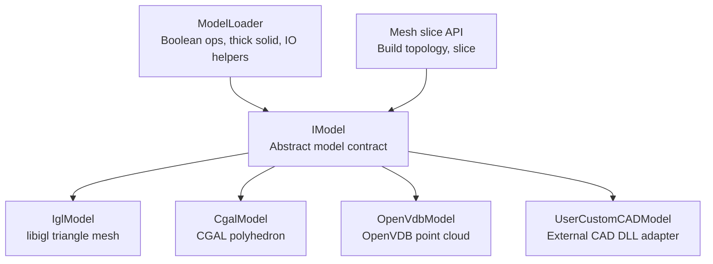

**Diagram sources**
- [IModel.hpp:111-139](file://base/IModel.hpp#L111-L139)
- [IglModel.hpp:26-121](file://meshmodel/IglModel.hpp#L26-L121)
- [CgalModel.hpp:34-155](file://meshmodel/CgalModel.hpp#L34-L155)
- [OpenVdbModel.hpp:28-116](file://pointcloud/OpenVdbModel.hpp#L28-L116)
- [UserCustomCADModel.hpp:79-121](file://cadmodel/UserCustomCADModel.hpp#L79-L121)
- [ModelLoader.cpp:137-320](file://preprocess/ModelLoader.cpp#L137-L320)
- [mesh_slice.cpp:46-84](file://LibHsBaSlicer/Slice/mesh_slice.cpp#L46-L84)

**Section sources**
- [IModel.hpp:111-139](file://base/IModel.hpp#L111-L139)
- [IglModel.hpp:26-121](file://meshmodel/IglModel.hpp#L26-L121)
- [CgalModel.hpp:34-155](file://meshmodel/CgalModel.hpp#L34-L155)
- [OpenVdbModel.hpp:28-116](file://pointcloud/OpenVdbModel.hpp#L28-L116)
- [UserCustomCADModel.hpp:79-121](file://cadmodel/UserCustomCADModel.hpp#L79-L121)
- [ModelLoader.cpp:137-320](file://preprocess/ModelLoader.cpp#L137-L320)
- [mesh_slice.cpp:46-84](file://LibHsBaSlicer/Slice/mesh_slice.cpp#L46-L84)

## Core Components
`IModel` defines a minimal but complete contract for 3D model backends:
- File I/O: `Load(fileName)` and `Save(fileName, format)`
- Transformations: `Translate`, `Rotate`, `Scale`, and multiple `Transform` overloads
- Geometry queries: `BoundingBox(min, max)`, `Volume()`
- Mesh export: `TriangleMesh()` returning an IGL-style pair of vertex and face matrices

It also declares `ModelFormat`, enumerating supported formats such as PLY, OBJ, STL, OFF, VRML, STEP, IGES, BREP, SLDPRT, CATPART, XYZ, VDB, and Unknown.

Key design properties:
- Pure virtual interface with a default destructor.
- Eigen-based math types for transforms and geometry.
- Format enumeration supports both mesh and non-mesh data (B-rep, point cloud).

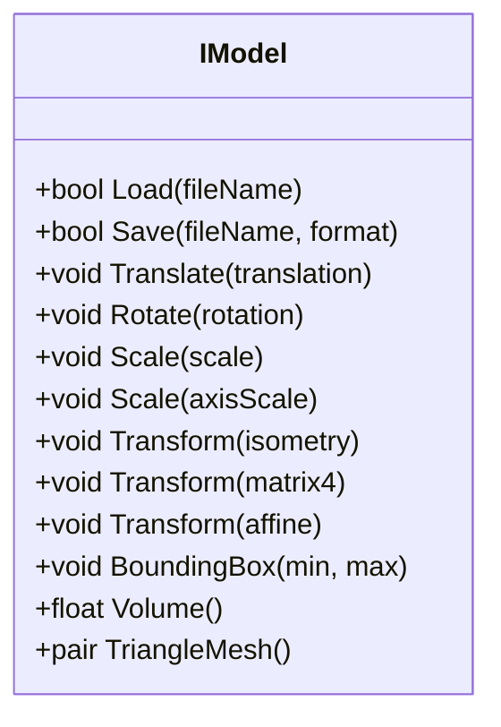

**Diagram sources**
- [IModel.hpp:111-139](file://base/IModel.hpp#L111-L139)

**Section sources**
- [IModel.hpp:65-109](file://base/IModel.hpp#L65-L109)
- [IModel.hpp:111-139](file://base/IModel.hpp#L111-L139)

## Architecture Overview
The architecture separates the model contract from its implementations:
- Consumers call `IModel` methods without knowing whether the underlying data is a libigl mesh, CGAL polyhedron, OpenVDB point cloud, or external CAD object.
- Higher-level services like `ModelLoader` and `MeshSlice` operate on `IModel` references or smart pointers.
- When backend-specific capabilities are needed, helpers perform safe dynamic casts and fallbacks.

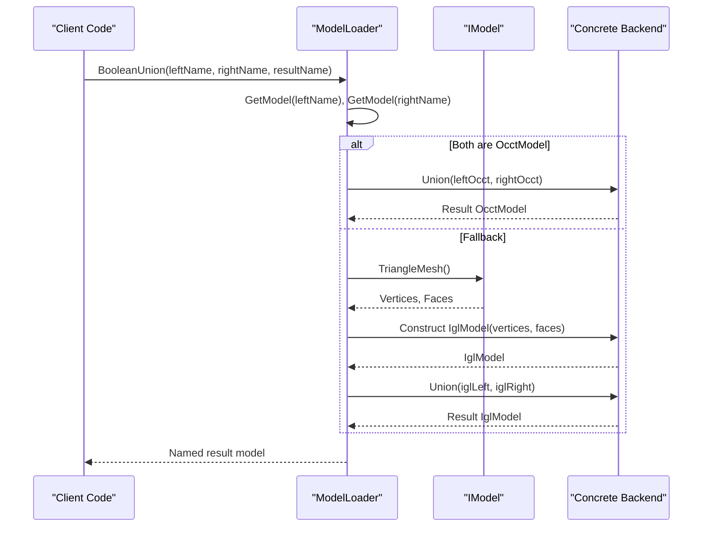

**Diagram sources**
- [ModelLoader.cpp:218-243](file://preprocess/ModelLoader.cpp#L218-L243)
- [ModelLoader.cpp:137-146](file://preprocess/ModelLoader.cpp#L137-L146)

**Section sources**
- [ModelLoader.cpp:137-146](file://preprocess/ModelLoader.cpp#L137-L146)
- [ModelLoader.cpp:218-320](file://preprocess/ModelLoader.cpp#L218-L320)

## Detailed Component Analysis

### IModel Abstract Contract
Responsibilities:
- Define the uniform surface for all model backends.
- Provide transformation APIs using Eigen types.
- Expose geometry queries required by slicing and preprocessing.
- Export a triangulated representation for algorithms that require triangles.

Design notes:
- `Load` and `Save` allow file-based persistence.
- Multiple `Transform` overloads accept rigid, homogeneous, and affine transforms.
- `TriangleMesh` returns an IGL-style pair so downstream tools can work with vertices and faces regardless of backend.

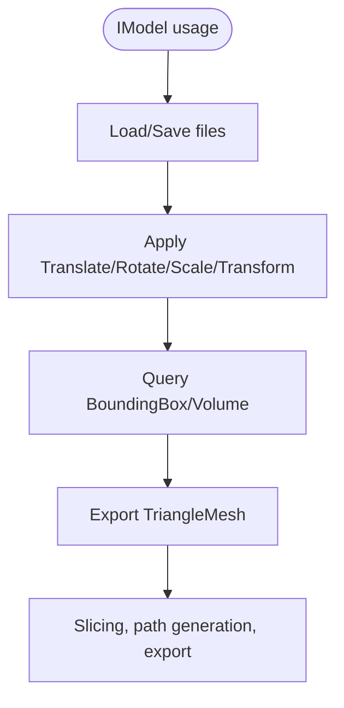

**Diagram sources**
- [IModel.hpp:111-139](file://base/IModel.hpp#L111-L139)

**Section sources**
- [IModel.hpp:111-139](file://base/IModel.hpp#L111-L139)

### IglModel: libigl-backed Triangle Mesh
`IglModel` implements `IModel` using Eigen matrices for vertices, faces, and optional normals. It provides:
- Loading/saving for common mesh formats.
- All transform methods.
- Bounding box, signed volume, and normal computation utilities.
- Static primitive factories (box, sphere, cylinder, cone, torus).
- Extrusion factories from 2D polygons.
- Boolean operations via friends (`Union`, `Intersection`, `Difference`, `Xor`).

Complexity characteristics:
- Vertex and face storage are linear in the number of vertices and faces.
- Normal computation and volume calculation typically scale with the number of faces.
- Boolean operations depend on the underlying library; CGAL-based operations may be expensive for large meshes.

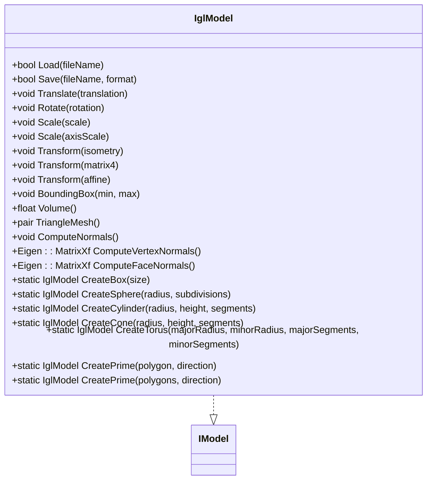

**Diagram sources**
- [IglModel.hpp:26-121](file://meshmodel/IglModel.hpp#L26-L121)
- [IModel.hpp:111-139](file://base/IModel.hpp#L111-L139)

**Section sources**
- [IglModel.hpp:26-121](file://meshmodel/IglModel.hpp#L26-L121)

### CgalModel: CGAL-backed Polyhedral Mesh
`CgalModel` wraps a CGAL polyhedron and adds robust geometric features:
- Full `IModel` implementation for load/save, transforms, bounds, volume, and mesh export.
- Nef-based boolean operations.
- Primitive and extrusion factories.
- Surface geodesic, spiral, and helix utilities.

Use cases:
- When CGAL’s exact predicates and robust boolean operations are required.
- When advanced surface analysis (geodesics, projections) is needed.

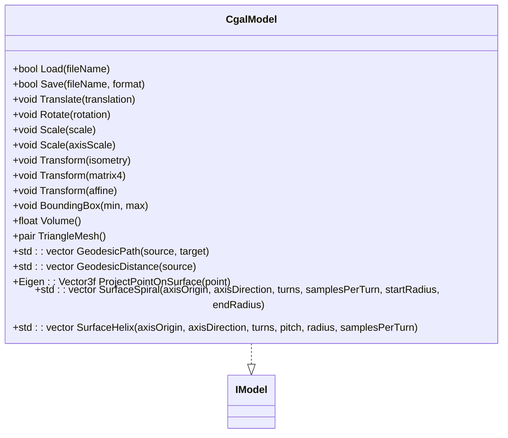

**Diagram sources**
- [CgalModel.hpp:34-155](file://meshmodel/CgalModel.hpp#L34-L155)
- [IModel.hpp:111-139](file://base/IModel.hpp#L111-L139)

**Section sources**
- [CgalModel.hpp:34-155](file://meshmodel/CgalModel.hpp#L34-L155)

### OpenVdbModel: Point Cloud Model
`OpenVdbModel` implements `IModel` for point clouds backed by an OpenVDB grid. It adds:
- Point insertion, querying (nearest neighbor, KNN, radius search), filtering.
- Voxelization, downsampling, centroid computation.
- Level-set mesh reconstruction into an IGL-style triangle mesh.
- Outlier removal and per-point normal estimation.

Important note:
- For point clouds, `Volume()` typically returns zero because there is no enclosed volume.
- `TriangleMesh()` returns vertices and an empty face matrix unless explicitly reconstructed.

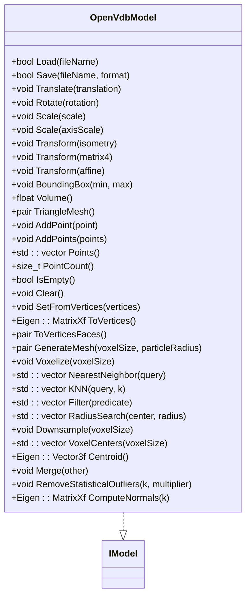

**Diagram sources**
- [OpenVdbModel.hpp:28-116](file://pointcloud/OpenVdbModel.hpp#L28-L116)
- [IModel.hpp:111-139](file://base/IModel.hpp#L111-L139)

**Section sources**
- [OpenVdbModel.hpp:28-116](file://pointcloud/OpenVdbModel.hpp#L28-L116)

### UserCustomCADModel: External CAD Adapter
`UserCustomCADModel` adapts a user-supplied CAD DLL/SO to the `IModel` contract. It:
- Loads a dynamic library and resolves factory functions for creating models, primitives, thickness setting, extrusions, and boolean operations.
- Delegates `Load`, `Save`, transforms, bounding box, volume, and mesh export to the external model instance.
- Provides a `BooleanOperation` method that forwards named operations to the external library.

This enables third-party CAD kernels to participate in HsBaSlicer pipelines without changing core code.

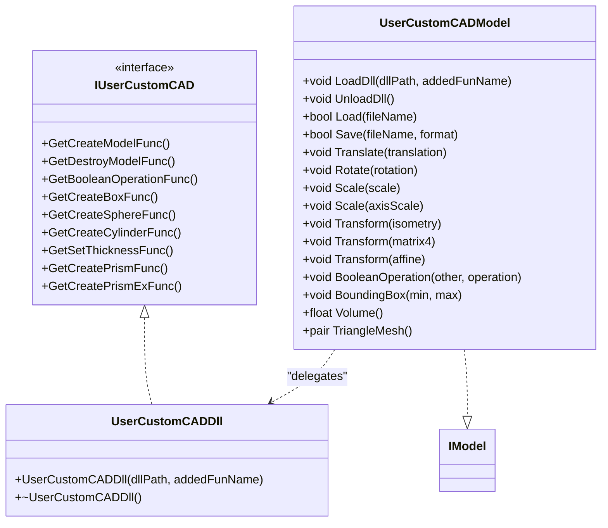

**Diagram sources**
- [UserCustomCADModel.hpp:27-48](file://cadmodel/UserCustomCADModel.hpp#L27-L48)
- [UserCustomCADModel.hpp:53-73](file://cadmodel/UserCustomCADModel.hpp#L53-L73)
- [UserCustomCADModel.hpp:79-121](file://cadmodel/UserCustomCADModel.hpp#L79-L121)
- [IModel.hpp:111-139](file://base/IModel.hpp#L111-L139)

**Section sources**
- [UserCustomCADModel.hpp:27-48](file://cadmodel/UserCustomCADModel.hpp#L27-L48)
- [UserCustomCADModel.hpp:53-73](file://cadmodel/UserCustomCADModel.hpp#L53-L73)
- [UserCustomCADModel.hpp:79-121](file://cadmodel/UserCustomCADModel.hpp#L79-L121)

### Boolean Operations Support
Boolean operations are exposed at the preprocessing layer rather than directly on `IModel`:
- `ModelLoader` provides `BooleanUnion`, `BooleanIntersection`, `BooleanDifference`, and `BooleanXor`.
- If both inputs are `OcctModel`, it uses OCCT operations.
- Otherwise, it converts inputs to `IglModel` via `ToIglModel` and performs CGAL-based boolean operations.

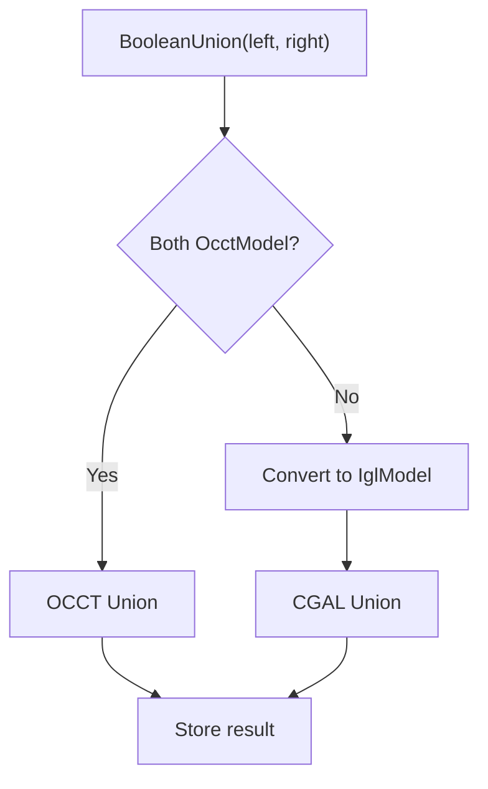

**Diagram sources**
- [ModelLoader.cpp:218-243](file://preprocess/ModelLoader.cpp#L218-L243)
- [ModelLoader.cpp:137-146](file://preprocess/ModelLoader.cpp#L137-L146)

**Section sources**
- [ModelLoader.cpp:137-146](file://preprocess/ModelLoader.cpp#L137-L146)
- [ModelLoader.cpp:218-320](file://preprocess/ModelLoader.cpp#L218-L320)

### Slicing and Topology Building
Slicing functions consume `IModel` and build a full topological representation before slicing:
- `Slice(model, height, tolerance)` constructs a `FullTopoModel` from the `IModel` and slices it.
- Lua-enabled slicing variants follow the same pattern.

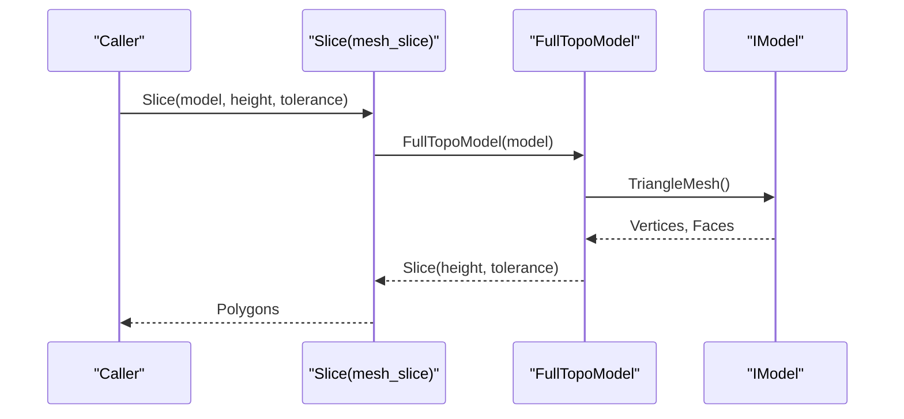

**Diagram sources**
- [mesh_slice.cpp:46-54](file://LibHsBaSlicer/Slice/mesh_slice.cpp#L46-L54)
- [mesh_slice.cpp:66-74](file://LibHsBaSlicer/Slice/mesh_slice.cpp#L66-L74)

**Section sources**
- [mesh_slice.cpp:46-54](file://LibHsBaSlicer/Slice/mesh_slice.cpp#L46-L54)
- [mesh_slice.cpp:66-84](file://LibHsBaSlicer/Slice/mesh_slice.cpp#L66-L84)

### Implementing a Custom Model Format
To add a custom model type:
1. Create a new class that inherits from `IModel`.
2. Implement all pure virtual methods:
   - `Load`, `Save`
   - `Translate`, `Rotate`, `Scale`, `Transform` overloads
   - `BoundingBox`, `Volume`
   - `TriangleMesh`
3. If your format requires special behavior (e.g., point clouds), ensure `Volume` and `TriangleMesh` semantics match expectations.
4. Optionally provide helper methods for domain-specific operations.

A minimal test implementation demonstrates the expected structure:
- A simple cube model implementing `IModel` with basic transforms and bounding box logic.

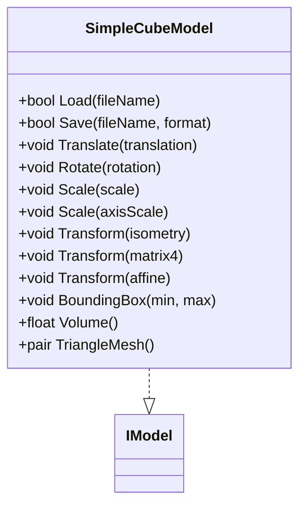

**Diagram sources**
- [full_topo_model_test.cpp:16-53](file://tests/Models/full_topo_model_test.cpp#L16-L53)
- [IModel.hpp:111-139](file://base/IModel.hpp#L111-L139)

**Section sources**
- [full_topo_model_test.cpp:16-53](file://tests/Models/full_topo_model_test.cpp#L16-L53)

## Dependency Analysis
The model subsystem has clear dependency boundaries:
- `IModel` depends only on Eigen and standard types.
- Backends depend on their respective libraries (libigl, CGAL, OpenVDB, OCCT, or external DLLs).
- `ModelLoader` orchestrates conversions and operations across backends.
- Slicing and preprocessing layers depend on `IModel` and concrete backends only where necessary.

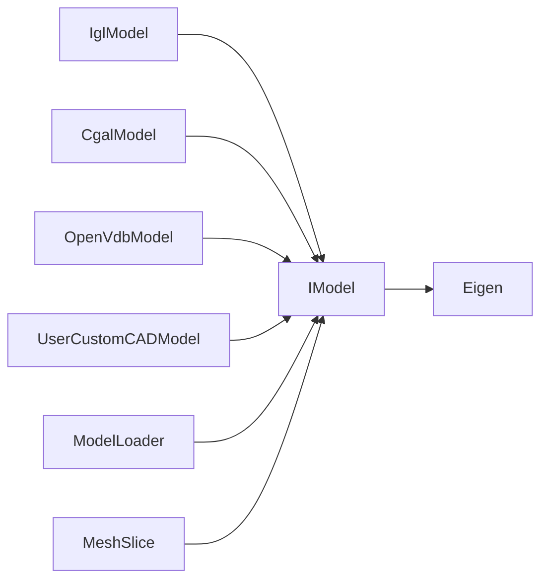

**Diagram sources**
- [IModel.hpp:111-139](file://base/IModel.hpp#L111-L139)
- [IglModel.hpp:26-121](file://meshmodel/IglModel.hpp#L26-L121)
- [CgalModel.hpp:34-155](file://meshmodel/CgalModel.hpp#L34-L155)
- [OpenVdbModel.hpp:28-116](file://pointcloud/OpenVdbModel.hpp#L28-L116)
- [UserCustomCADModel.hpp:79-121](file://cadmodel/UserCustomCADModel.hpp#L79-L121)
- [ModelLoader.cpp:137-320](file://preprocess/ModelLoader.cpp#L137-L320)
- [mesh_slice.cpp:46-84](file://LibHsBaSlicer/Slice/mesh_slice.cpp#L46-L84)

**Section sources**
- [IModel.hpp:111-139](file://base/IModel.hpp#L111-L139)
- [ModelLoader.cpp:137-320](file://preprocess/ModelLoader.cpp#L137-L320)

## Performance Considerations
When working with large meshes:
- Prefer backend-native operations:
  - Use `OcctModel` for robust B-rep boolean operations when available.
  - Use `CgalModel` for CGAL-based operations if you need exact predicates.
  - Use `IglModel` for lightweight mesh workflows and fast I/O.
- Avoid unnecessary conversions:
  - `ToIglModel` extracts triangles; repeated conversions can be costly.
- Be mindful of memory:
  - Large vertex/face matrices and CGAL structures can consume significant RAM.
  - Point cloud reconstruction (`GenerateMesh`) creates new meshes; downsample or filter beforehand.
- Tune parameters:
  - For point clouds, choose appropriate voxel sizes and particle radii during mesh reconstruction.
  - For boolean operations, consider simplifying meshes or using robust kernels.

[No sources needed since this section provides general guidance]

## Troubleshooting Guide
Common issues and patterns:
- Missing source model:
  - Helpers throw invalid argument errors when a named model is not found.
- Wrong backend type:
  - Some operations require specific backends (e.g., `ThickSolidModel` requires `OcctModel`).
  - Point cloud operations require `OpenVdbModel`; other types will raise runtime errors.
- Unsupported conversion:
  - Direct conversion from mesh to `OcctModel` may not be supported; use `OcctModel` sources for boolean operations.
- Not supported error:
  - Certain features are compiled conditionally (e.g., OCCT); missing features raise not-supported errors.

Error categories used in the codebase:
- Invalid argument errors for missing or invalid inputs.
- Runtime errors for unsupported operations or type mismatches.
- Not supported errors for disabled optional dependencies.

**Section sources**
- [ModelLoader.cpp:172-213](file://preprocess/ModelLoader.cpp#L172-L213)
- [ModelLoader.cpp:152-166](file://preprocess/ModelLoader.cpp#L152-L166)
- [ModelLoader.cpp:330-338](file://preprocess/ModelLoader.cpp#L330-L338)

## Conclusion
`IModel` provides a clean, backend-agnostic contract for 3D models in HsBaSlicer. It enables consistent loading, transformation, querying, and mesh export across diverse backends. Higher-level components like `ModelLoader` and `MeshSlice` rely on this abstraction to offer robust preprocessing, boolean operations, and slicing. By following the interface and leveraging backend-specific helpers, developers can extend HsBaSlicer with new model formats while maintaining compatibility with existing pipelines.

[No sources needed since this section summarizes without analyzing specific files]