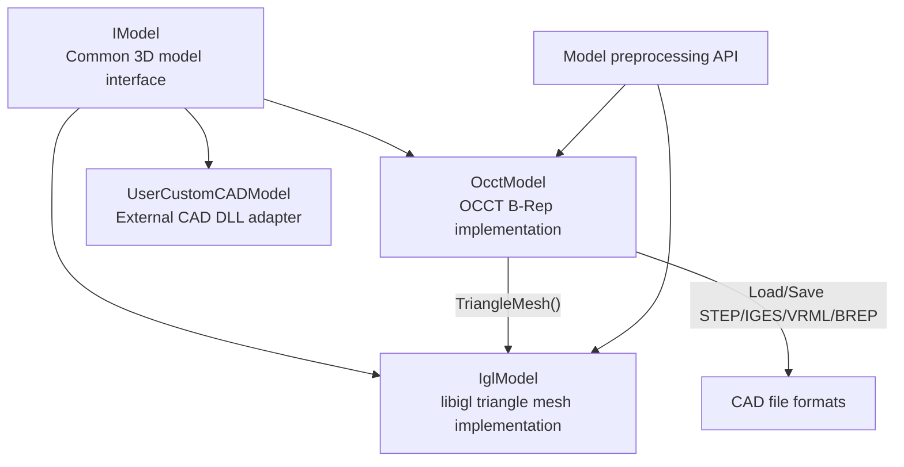
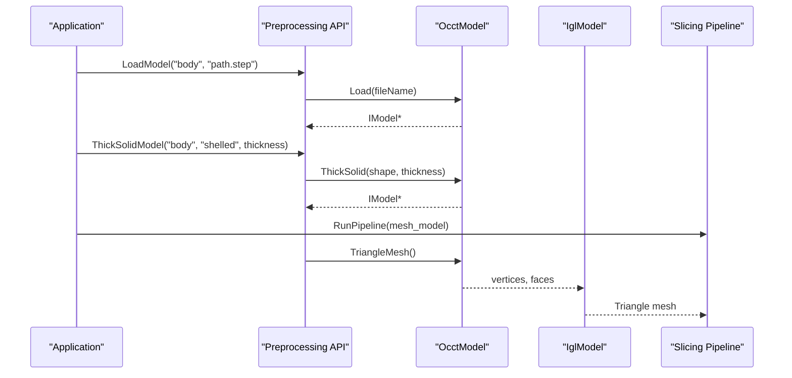
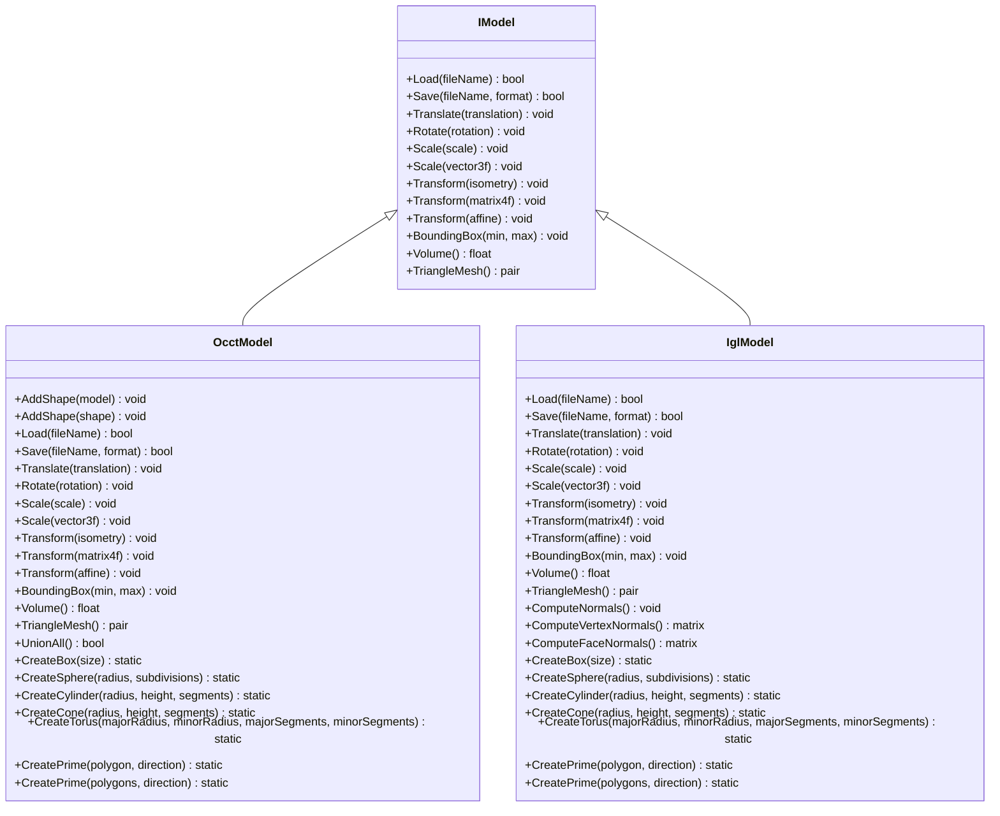
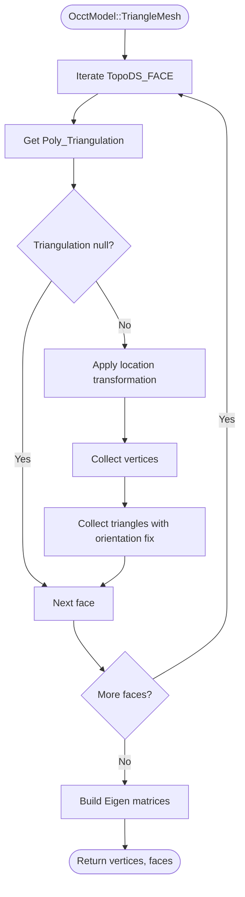
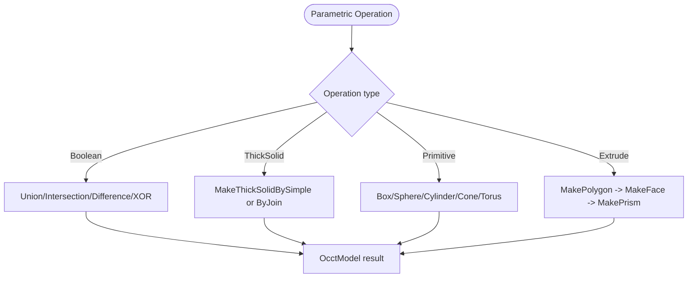
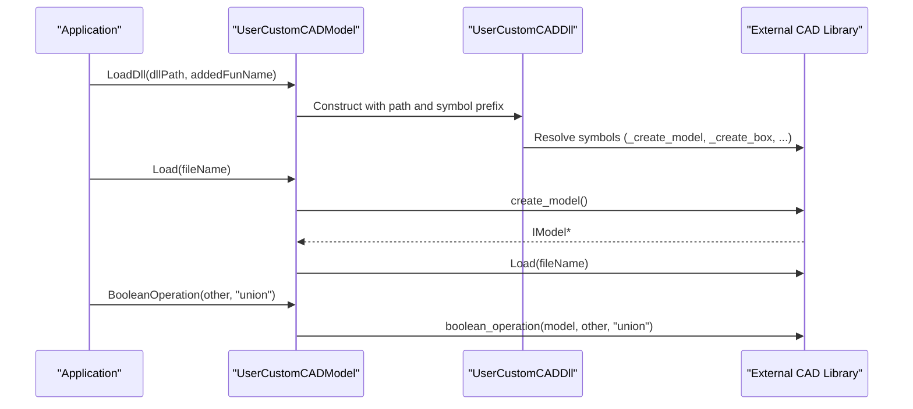
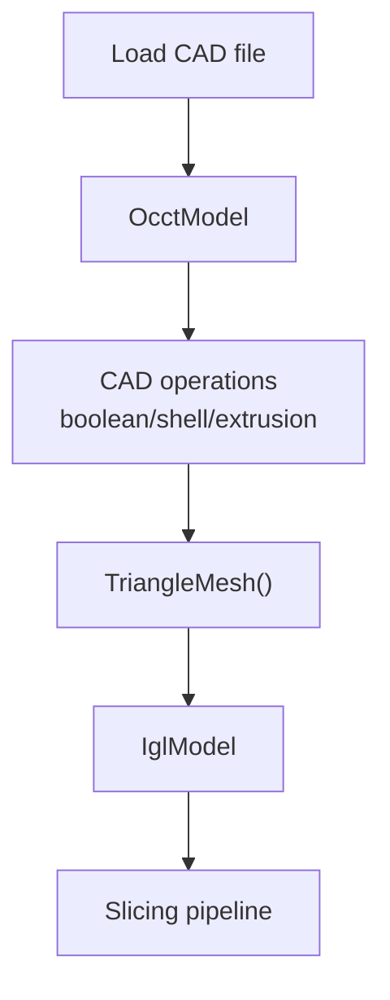
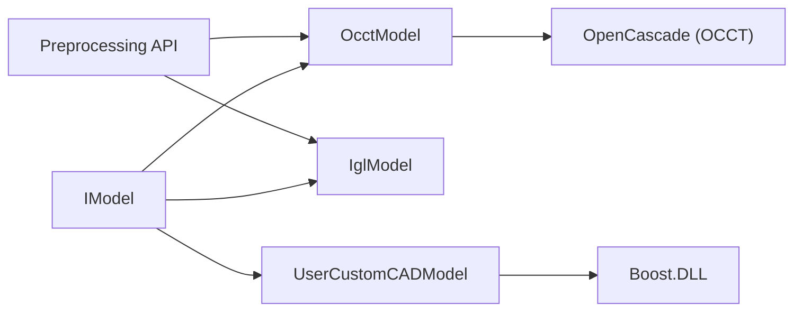

# CAD Model Integration

<cite>
**Referenced Files in This Document**
- [OcctModel.hpp](file://cadmodel/OcctModel.hpp)
- [OcctModel.cpp](file://cadmodel/OcctModel.cpp)
- [OcctTypeAliases.hpp](file://cadmodel/OcctTypeAliases.hpp)
- [UserCustomCADModel.hpp](file://cadmodel/UserCustomCADModel.hpp)
- [UserCustomCADModel.cpp](file://cadmodel/UserCustomCADModel.cpp)
- [IModel.hpp](file://base/IModel.hpp)
- [IglModel.hpp](file://meshmodel/IglModel.hpp)
- [model_preprocess.hpp](file://LibHsBaSlicer/Preprocess/model_preprocess.hpp)
- [ModelLoader.cpp](file://preprocess/ModelLoader.cpp)
- [README.md](file://docs/en/LibHsBaSlicer/README.md)
</cite>

## Table of Contents
1. [Introduction](#introduction)
2. [Project Structure](#project-structure)
3. [Core Components](#core-components)
4. [Architecture Overview](#architecture-overview)
5. [Detailed Component Analysis](#detailed-component-analysis)
6. [Dependency Analysis](#dependency-analysis)
7. [Performance Considerations](#performance-considerations)
8. [Troubleshooting Guide](#troubleshooting-guide)
9. [Conclusion](#conclusion)
10. [Appendices](#appendices)

## Introduction
This document explains how HsBaSlicer integrates CAD models through OpenCascade (OCCT) using the `OcctModel` class, and how it supports custom CAD implementations through `UserCustomCADModel`. It focuses on B-Rep capabilities, precise geometric modeling, parametric operations, conversion between B-Rep and mesh representations, and integration with the slicing pipeline. It also clarifies when to use CAD models versus polygonal meshes, and documents performance considerations for complex geometries.

## Project Structure
The CAD model integration lives primarily under the `cadmodel` directory, while the common model interface is defined in `base`, and the mesh representation used by the slicing pipeline is implemented in `meshmodel`. The preprocessing layer connects user-facing APIs to OCCT-specific operations.

**Diagram sources**
- [IModel.hpp:110-139](file://base/IModel.hpp#L110-L139)
- [OcctModel.hpp:22-124](file://cadmodel/OcctModel.hpp#L22-L124)
- [IglModel.hpp:18-121](file://meshmodel/IglModel.hpp#L18-L121)
- [UserCustomCADModel.hpp:75-121](file://cadmodel/UserCustomCADModel.hpp#L75-L121)

**Section sources**
- [IModel.hpp:110-139](file://base/IModel.hpp#L110-L139)
- [OcctModel.hpp:22-124](file://cadmodel/OcctModel.hpp#L22-L124)
- [IglModel.hpp:18-121](file://meshmodel/IglModel.hpp#L18-L121)
- [UserCustomCADModel.hpp:75-121](file://cadmodel/UserCustomCADModel.hpp#L75-L121)

## Core Components
- `IModel`: Abstract interface defining load/save, transforms, bounding box, volume, and triangle mesh access.
- `OcctModel`: OCCT-based B-Rep implementation supporting STEP/IGES/VRML/BREP, boolean operations, thick-solid shell creation, primitives, and extrusion from 2D polygons.
- `IglModel`: libigl-backed triangle mesh model used by the slicing pipeline.
- `UserCustomCADModel`: Adapter that loads a user-provided CAD library via dynamic loading and delegates model operations to it.

Key responsibilities:
- `OcctModel` provides exact B-Rep geometry, precise volume, and robust boolean/shell operations.
- `IglModel` provides efficient mesh storage and operations suitable for slicing.
- `UserCustomCADModel` enables pluggable CAD kernels without recompiling the slicer.

**Section sources**
- [IModel.hpp:110-139](file://base/IModel.hpp#L110-L139)
- [OcctModel.hpp:22-124](file://cadmodel/OcctModel.hpp#L22-L124)
- [IglModel.hpp:18-121](file://meshmodel/IglModel.hpp#L18-L121)
- [UserCustomCADModel.hpp:75-121](file://cadmodel/UserCustomCADModel.hpp#L75-L121)

## Architecture Overview
The architecture separates exact CAD geometry from the mesh-centric slicing pipeline. CAD models can be converted to meshes when needed, but CAD-native operations remain available where precision matters.

**Diagram sources**
- [model_preprocess.hpp:124-154](file://LibHsBaSlicer/Preprocess/model_preprocess.hpp#L124-L154)
- [ModelLoader.cpp:172-190](file://preprocess/ModelLoader.cpp#L172-L190)
- [OcctModel.cpp:213-270](file://cadmodel/OcctModel.cpp#L213-L270)
- [OcctModel.cpp:353-407](file://cadmodel/OcctModel.cpp#L353-L407)

## Detailed Component Analysis

### OcctModel: OCCT B-Rep Implementation
`OcctModel` wraps an OCCT `TopoDS_Shape` and implements the full `IModel` contract. It supports:
- Loading/saving: STEP, IGES, VRML, BREP.
- Transformations: translation, rotation, uniform/non-uniform scaling, arbitrary affine transforms.
- Geometry queries: axis-aligned bounding box, signed volume.
- Tessellation: conversion to triangle mesh for downstream mesh processing.
- Boolean operations: union, intersection, difference, XOR.
- Shell/thick-solid: inward/outward thickening with optional face exclusion.
- Primitives and extrusions: box, sphere, cylinder, cone, torus, and polygon extrusion into solids.

**Diagram sources**
- [IModel.hpp:110-139](file://base/IModel.hpp#L110-L139)
- [OcctModel.hpp:22-124](file://cadmodel/OcctModel.hpp#L22-L124)
- [IglModel.hpp:18-121](file://meshmodel/IglModel.hpp#L18-L121)

#### B-Rep Capabilities and Precise Modeling
- Exact topology: `TopoDS_Shape` preserves edges, faces, wires, and solids.
- Volume computation uses OCCT mass properties for accurate signed volume.
- Bounding box is computed by iterating over vertices of the shape.
- Tessellation extracts triangulation per face, applying location transformations and orientation handling.

**Diagram sources**
- [OcctModel.cpp:353-407](file://cadmodel/OcctModel.cpp#L353-L407)

#### Parametric Operations and Workflows
- Boolean operations: `Union`, `Intersection`, `Difference`, `Xor`.
- Thick-solid shell: global thickness or selective face removal before thickening.
- Primitives: box, sphere, cylinder, cone, torus.
- Extrusion: single closed polygon or multiple polygons (outer contour plus holes).

**Diagram sources**
- [OcctModel.cpp:451-540](file://cadmodel/OcctModel.cpp#L451-L540)
- [OcctModel.cpp:422-449](file://cadmodel/OcctModel.cpp#L422-L449)
- [OcctModel.cpp:542-663](file://cadmodel/OcctModel.cpp#L542-L663)

**Section sources**
- [OcctModel.hpp:22-124](file://cadmodel/OcctModel.hpp#L22-L124)
- [OcctModel.cpp:76-190](file://cadmodel/OcctModel.cpp#L76-L190)
- [OcctModel.cpp:213-329](file://cadmodel/OcctModel.cpp#L213-L329)
- [OcctModel.cpp:331-407](file://cadmodel/OcctModel.cpp#L331-L407)
- [OcctModel.cpp:409-663](file://cadmodel/OcctModel.cpp#L409-L663)

### UserCustomCADModel: Custom CAD Integration
`UserCustomCADModel` allows users to supply their own CAD kernel via a dynamically loaded library. It exposes factory functions for creating models, primitives, boolean operations, thickness setting, and extrusion.

Key behaviors:
- Dynamic loading of a shared library with a named entry function prefix.
- Function resolution for create/destroy, primitives, boolean operations, thickness, and extrusion.
- Delegation of all `IModel` methods to the underlying custom model instance.
- Safety checks for missing DLL, missing functions, and incompatible DLLs.

**Diagram sources**
- [UserCustomCADModel.hpp:27-73](file://cadmodel/UserCustomCADModel.hpp#L27-L73)
- [UserCustomCADModel.cpp:31-115](file://cadmodel/UserCustomCADModel.cpp#L31-L115)
- [UserCustomCADModel.cpp:134-173](file://cadmodel/UserCustomCADModel.cpp#L134-L173)
- [UserCustomCADModel.cpp:268-289](file://cadmodel/UserCustomCADModel.cpp#L268-L289)

**Section sources**
- [UserCustomCADModel.hpp:27-121](file://cadmodel/UserCustomCADModel.hpp#L27-L121)
- [UserCustomCADModel.cpp:24-149](file://cadmodel/UserCustomCADModel.cpp#L24-L149)
- [UserCustomCADModel.cpp:151-325](file://cadmodel/UserCustomCADModel.cpp#L151-L325)

### Mesh-Based vs B-Rep Approaches
- Mesh-based approach:
  - Represents geometry as vertex/face arrays.
  - Fast for rendering and slicing; widely supported by the pipeline.
  - Limited precision; no exact topology or analytical properties.
- B-Rep approach:
  - Represents geometry with topological entities (vertices, edges, faces, solids).
  - Enables exact boolean operations, shell/thick-solid, and accurate volume.
  - Requires tessellation for mesh-dependent steps like slicing.

When to use:
- Use CAD models (B-Rep) when you need precise geometry, boolean operations, shells, or analytical properties.
- Use polygonal meshes when you only need fast visualization, slicing, or when working with scanned data.

Conversion process:
- `OcctModel::TriangleMesh()` converts B-Rep to mesh for slicing.
- `OcctModel::Save()` can export mesh formats by converting to `IglModel` internally.
- Direct conversion from mesh to `OcctModel` is not currently supported in the loader.

**Section sources**
- [OcctModel.cpp:238-270](file://cadmodel/OcctModel.cpp#L238-L270)
- [OcctModel.cpp:353-407](file://cadmodel/OcctModel.cpp#L353-L407)
- [ModelLoader.cpp:163-167](file://preprocess/ModelLoader.cpp#L163-L167)

### Slicing Pipeline Integration
The slicing pipeline consumes triangle meshes. When CAD models are involved:
- Load CAD files into `OcctModel`.
- Perform CAD-native operations (boolean, shell, extrusion).
- Convert to mesh via `TriangleMesh()` or save to mesh format.
- Feed the resulting mesh into the slicing pipeline.

**Diagram sources**
- [model_preprocess.hpp:124-154](file://LibHsBaSlicer/Preprocess/model_preprocess.hpp#L124-L154)
- [README.md:336-378](file://docs/en/LibHsBaSlicer/README.md#L336-L378)

**Section sources**
- [model_preprocess.hpp:124-154](file://LibHsBaSlicer/Preprocess/model_preprocess.hpp#L124-L154)
- [README.md:336-378](file://docs/en/LibHsBaSlicer/README.md#L336-L378)

## Dependency Analysis
- `OcctModel` depends on OCCT libraries for B-Rep operations and file I/O.
- `UserCustomCADModel` depends on Boost.DLL for dynamic loading and resolves exported symbols based on a naming convention.
- Both `OcctModel` and `IglModel` implement `IModel`, enabling polymorphic usage in the preprocessing and slicing layers.
- The preprocessing layer routes thick-solid and boolean operations to appropriate kernels: OCCT for B-Rep, and mesh kernels for polygonal models.

**Diagram sources**
- [IModel.hpp:110-139](file://base/IModel.hpp#L110-L139)
- [OcctModel.cpp:8-59](file://cadmodel/OcctModel.cpp#L8-L59)
- [UserCustomCADModel.cpp:12-16](file://cadmodel/UserCustomCADModel.cpp#L12-L16)
- [model_preprocess.hpp:124-154](file://LibHsBaSlicer/Preprocess/model_preprocess.hpp#L124-L154)

**Section sources**
- [OcctModel.cpp:8-59](file://cadmodel/OcctModel.cpp#L8-L59)
- [UserCustomCADModel.cpp:12-16](file://cadmodel/UserCustomCADModel.cpp#L12-L16)
- [model_preprocess.hpp:124-154](file://LibHsBaSlicer/Preprocess/model_preprocess.hpp#L124-L154)

## Performance Considerations
- Tessellation cost: Converting complex B-Rep to mesh via `TriangleMesh()` can be expensive for large shapes with many faces.
- Boolean operations: OCCT boolean operations may produce complex topologies; consider simplifying inputs or reducing segment counts for primitives.
- Shell operations: `ThickSolid` can generate intricate geometry; limiting excluded faces and using reasonable tolerances helps stability.
- Memory usage: Large CAD models increase memory consumption during both B-Rep and tessellation phases.
- Conversion overhead: Saving CAD models to mesh formats triggers tessellation and mesh construction; batch operations where possible.
- External CAD libraries: Ensure the user-provided DLL is optimized and compatible; mismatched DLLs cause runtime errors.

[No sources needed since this section provides general guidance]

## Troubleshooting Guide
Common issues and resolutions:
- Unsupported model format:
  - Occurs when attempting to load/save formats not handled by `OcctModel`.
  - Resolution: Use supported formats (STEP, IGES, VRML, BREP) or convert to mesh formats via `IglModel`.
- Direct mesh-to-CAD conversion unsupported:
  - The loader throws when trying to convert mesh models to `OcctModel`.
  - Resolution: Use CAD-native sources for boolean/shell operations.
- Missing DLL or functions:
  - `UserCustomCADModel` throws if the DLL is not loaded or required symbols are missing.
  - Resolution: Verify DLL path, symbol naming convention, and ensure the external library exports the expected functions.
- Incompatible DLLs:
  - Boolean operations require both models to share the same DLL.
  - Resolution: Use models created by the same external CAD library.

**Section sources**
- [OcctModel.cpp:213-270](file://cadmodel/OcctModel.cpp#L213-L270)
- [ModelLoader.cpp:163-167](file://preprocess/ModelLoader.cpp#L163-L167)
- [UserCustomCADModel.cpp:151-173](file://cadmodel/UserCustomCADModel.cpp#L151-L173)
- [UserCustomCADModel.cpp:268-289](file://cadmodel/UserCustomCADModel.cpp#L268-L289)

## Conclusion
HsBaSlicer’s CAD integration centers on `OcctModel` for precise B-Rep modeling and `UserCustomCADModel` for extensible CAD kernels. The system bridges exact CAD geometry with the mesh-centric slicing pipeline through controlled conversions. For workflows requiring precision, boolean operations, and shell generation, prefer CAD models; for fast slicing and visualization, use polygonal meshes. Careful management of complexity and conversion steps ensures reliable performance even with intricate geometries.

[No sources needed since this section summarizes without analyzing specific files]

## Appendices

### Example CAD Operations
- Boolean union/difference/intersection/XOR between two `OcctModel` instances.
- Creating a shell around a solid with optional face exclusions.
- Building primitives and extruding 2D polygons (including holes) into 3D solids.
- Loading STEP/IGES/VRML/BREP files and saving to mesh formats via internal conversion.

**Section sources**
- [OcctModel.cpp:451-663](file://cadmodel/OcctModel.cpp#L451-L663)
- [OcctModel.cpp:213-270](file://cadmodel/OcctModel.cpp#L213-L270)

### Parametric Modeling Workflow
- Start with 2D polygons representing outer contours and holes.
- Create a face from the outer wire and add hole wires.
- Extrude the face along a direction to form a solid.
- Optionally apply boolean operations or shell thickness.

**Section sources**
- [OcctModel.cpp:542-663](file://cadmodel/OcctModel.cpp#L542-L663)

### Custom CAD Model Implementation
- Implement the required factory functions in an external library with a consistent symbol prefix.
- Export functions for model creation/destruction, primitives, boolean operations, thickness, and extrusion.
- Load the library via `UserCustomCADModel::LoadDll` and use standard `IModel` methods.

**Section sources**
- [UserCustomCADModel.hpp:27-73](file://cadmodel/UserCustomCADModel.hpp#L27-L73)
- [UserCustomCADModel.cpp:31-115](file://cadmodel/UserCustomCADModel.cpp#L31-L115)