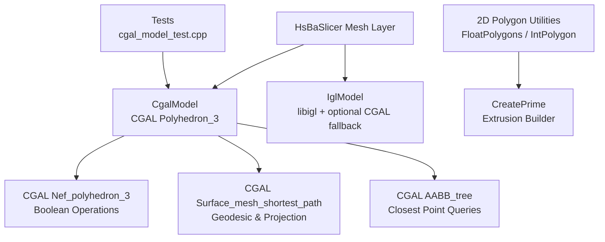
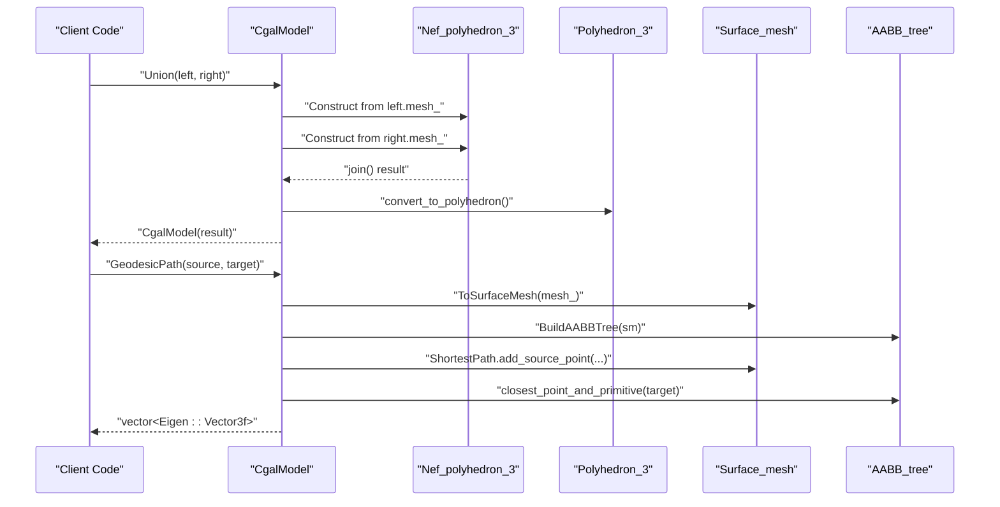
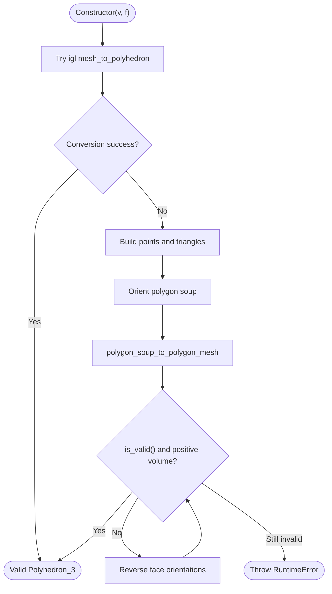
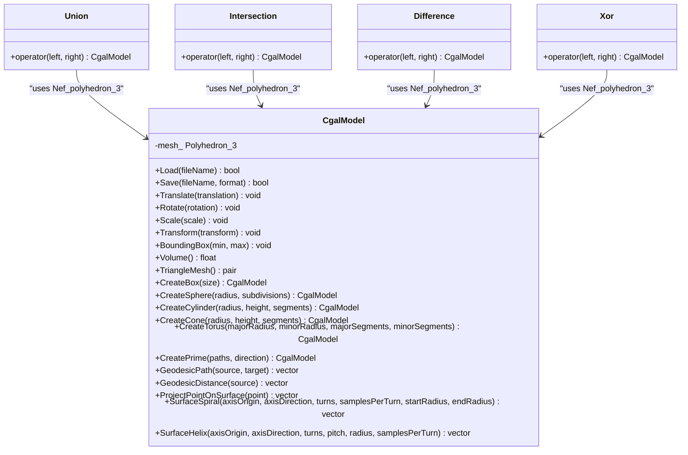
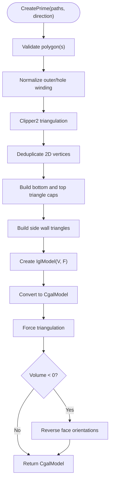
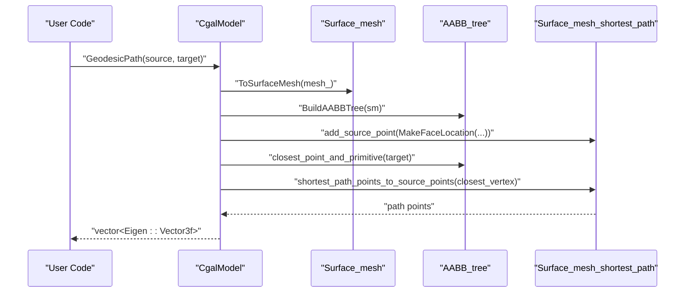
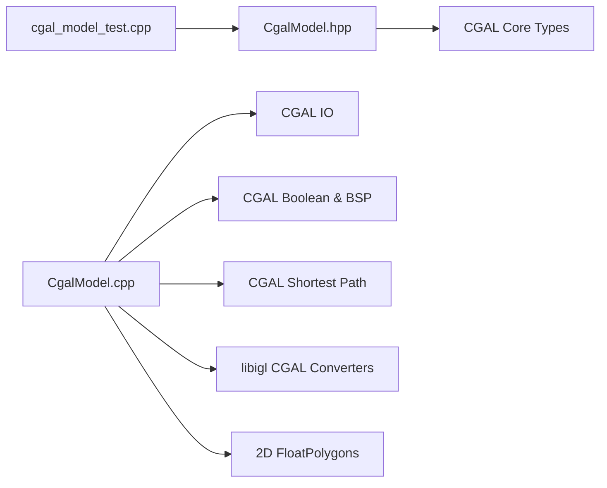

# CGAL Model Implementation

<cite>
**Referenced Files in This Document**
- [CgalModel.hpp](file://meshmodel/CgalModel.hpp)
- [CgalModel.cpp](file://meshmodel/CgalModel.cpp)
- [IglModel.cpp](file://meshmodel/IglModel.cpp)
- [FloatPolygons.hpp](file://2D/FloatPolygons.hpp)
- [cgal_model_test.cpp](file://tests/Models/cgal_model_test.cpp)
</cite>

## Table of Contents
1. [Introduction](#introduction)
2. [Project Structure](#project-structure)
3. [Core Components](#core-components)
4. [Architecture Overview](#architecture-overview)
5. [Detailed Component Analysis](#detailed-component-analysis)
6. [Dependency Analysis](#dependency-analysis)
7. [Performance Considerations](#performance-considerations)
8. [Troubleshooting Guide](#troubleshooting-guide)
9. [Conclusion](#conclusion)
10. [Appendices](#appendices)

## Introduction
This document explains the CGAL-backed polyhedral mesh model implementation used by HsBaSlicer. The central class is `CgalModel`, which wraps a CGAL `Polyhedron_3` and exposes:

- Loading and saving of common mesh formats.
- Affine transformations, bounding-box queries, signed volume computation, and conversion to libigl-style vertex/face arrays.
- Exact 3D boolean operations using CGAL `Nef_polyhedron_3`.
- Primitive shape creation for box, sphere, cylinder, cone, and torus.
- Extrusion from one or multiple closed polygons into watertight solids.
- Advanced surface analysis including geodesic path computation, per-vertex geodesic distance, point projection onto the mesh surface, and generation of spiral/helix curves constrained to the mesh surface.

The kernel choice is `CGAL::Exact_predicates_inexact_constructions_kernel`, selected to combine robust geometric predicates with efficient floating-point constructions. Boolean operations are implemented through Nef polyhedra, while extrusion and primitive generators produce triangulated meshes suitable for downstream slicing and visualization.

## Project Structure
The CGAL model lives under the mesh processing layer and integrates with both 2D polygon utilities and other mesh implementations:

**Diagram sources**
- [CgalModel.hpp:14-22](file://meshmodel/CgalModel.hpp#L14-L22)
- [CgalModel.cpp:12-28](file://meshmodel/CgalModel.cpp#L12-L28)
- [CgalModel.cpp:238-276](file://meshmodel/CgalModel.cpp#L238-L276)
- [CgalModel.cpp:957-1210](file://meshmodel/CgalModel.cpp#L957-L1210)
- [FloatPolygons.hpp:72-106](file://2D/FloatPolygons.hpp#L72-L106)
- [cgal_model_test.cpp:792-798](file://tests/Models/cgal_model_test.cpp#L792-L798)

**Section sources**
- [CgalModel.hpp:1-33](file://meshmodel/CgalModel.hpp#L1-L33)
- [CgalModel.cpp:1-34](file://meshmodel/CgalModel.cpp#L1-L34)

## Core Components
`CgalModel` implements the project’s `IModel` interface and provides:

| Capability | API or mechanism | Notes |
|---|---|---|
| Mesh storage | `CGAL::Polyhedron_3<EpicKernel>` | Triangulated faces are enforced where needed. |
| File I/O | `Load`, `Save` | Supports STL, PLY, OBJ, OFF via CGAL IO. |
| Transformations | `Translate`, `Rotate`, `Scale`, `Transform` | Applied through CGAL affine transforms. |
| Geometry queries | `BoundingBox`, `Volume`, `TriangleMesh` | Volume uses CGAL; TriangleMesh converts to Eigen matrices. |
| Boolean operations | `Union`, `Intersection`, `Difference`, `Xor` | Implemented as free functions using `Nef_polyhedron_3`. |
| Primitives | `CreateBox`, `CreateSphere`, `CreateCylinder`, `CreateCone`, `CreateTorus` | Generate valid, oriented, triangulated meshes. |
| Extrusion | `CreatePrime` (single polygon or polygon set) | Uses Clipper2 triangulation and incremental builder patterns. |
| Surface analysis | `GeodesicPath`, `GeodesicDistance`, `ProjectPointOnSurface` | Uses CGAL shortest-path and AABB tree. |
| Surface curves | `SurfaceSpiral`, `SurfaceHelix` | Sample helical/spiral candidates and project onto mesh. |

**Section sources**
- [CgalModel.hpp:34-155](file://meshmodel/CgalModel.hpp#L34-L155)
- [CgalModel.cpp:121-237](file://meshmodel/CgalModel.cpp#L121-L237)

## Architecture Overview
At runtime, `CgalModel` acts as the geometry engine for exact 3D modeling tasks. The main architectural flows are:

1. **Construction**: From an existing CGAL polyhedron, or from Eigen vertex/face data with automatic repair.
2. **Boolean pipeline**: Convert two `Polyhedron_3` objects to `Nef_polyhedron_3`, perform algebraic set operations, then convert back to `Polyhedron_3`.
3. **Primitive/extrusion pipeline**: Build vertex/face arrays and wrap them into `CgalModel`; ensure triangulation and correct face orientation.
4. **Surface analysis pipeline**: Convert `Polyhedron_3` to `Surface_mesh`, build an AABB tree, and run shortest-path or closest-point queries.

**Diagram sources**
- [CgalModel.cpp:238-276](file://meshmodel/CgalModel.cpp#L238-L276)
- [CgalModel.cpp:1075-1101](file://meshmodel/CgalModel.cpp#L1075-L1101)
- [CgalModel.cpp:979-994](file://meshmodel/CgalModel.cpp#L979-L994)

## Detailed Component Analysis

### Kernel Choice and Numerical Stability
`CgalModel` defines `EpicKernel = CGAL::Exact_predicates_inexact_constructions_kernel`. This kernel:

- Uses exact arithmetic for geometric predicates such as orientation tests and intersection decisions.
- Uses floating-point arithmetic for coordinate construction, keeping computations fast.
- Is appropriate for robust boolean operations on triangulated meshes while avoiding the full cost of exact constructions everywhere.

The header explicitly documents this kernel type and derives `Point_3`, `Vector_3`, `Affine_3`, `Polyhedron_3`, and `Nef_Polyheron_3` from it.

**Section sources**
- [CgalModel.hpp:37-42](file://meshmodel/CgalModel.hpp#L37-L42)

### Construction and Mesh Repair
When constructed from Eigen vertex/face data:

1. It attempts direct conversion via `igl::copyleft::cgal::mesh_to_polyhedron`.
2. If that fails, it builds a polygon soup, orients it, merges duplicate vertices, and constructs a proper mesh.
3. It validates validity and fixes face orientation if the computed volume is negative.
4. On unrecoverable failure, it throws a runtime error.

This makes `CgalModel` resilient to imperfect input meshes while preserving watertightness assumptions required by later operations.

**Diagram sources**
- [CgalModel.cpp:42-119](file://meshmodel/CgalModel.cpp#L42-L119)

**Section sources**
- [CgalModel.cpp:42-119](file://meshmodel/CgalModel.cpp#L42-L119)

### File I/O and Format Support
`Load` reads polygon meshes through CGAL IO and ensures faces are triangulated afterward. `Save` supports:

- Binary and ASCII STL
- Binary and ASCII PLY
- OBJ
- OFF

Unsupported formats throw a not-supported error.

**Section sources**
- [CgalModel.cpp:121-157](file://meshmodel/CgalModel.cpp#L121-L157)

### Transformations
All transformation methods construct a CGAL `Affine_3` and apply it through `CGAL::Polygon_mesh_processing::transform`. Supported inputs include:

- Translation vector
- Rotation quaternion
- Uniform scale
- Per-axis scale
- Eigen `Isometry3f`, `Matrix4f`, and `Transform<float, 3, Eigen::Affine>`

**Section sources**
- [CgalModel.cpp:158-204](file://meshmodel/CgalModel.cpp#L158-L204)

### Bounding Box, Volume, and Mesh Export
- `BoundingBox` scans all vertices and computes axis-aligned min/max coordinates.
- `Volume` returns the signed volume from CGAL.
- `TriangleMesh` ensures triangular faces and converts the CGAL polyhedron to Eigen matrices via libigl.

**Section sources**
- [CgalModel.cpp:206-237](file://meshmodel/CgalModel.cpp#L206-L237)

### Boolean Operations Using Nef_polyhedron_3
The four boolean operations are exposed as free functions:

- `Union`: joins two Nef polyhedra.
- `Intersection`: intersects two Nef polyhedra.
- `Difference`: subtracts the right operand from the left.
- `Xor`: symmetric difference.

Each operation converts the operands to `Nef_polyhedron_3`, performs the algebraic operation, converts the result back to `Polyhedron_3`, and wraps it in a new `CgalModel`.

**Diagram sources**
- [CgalModel.hpp:84-103](file://meshmodel/CgalModel.hpp#L84-L103)
- [CgalModel.cpp:238-276](file://meshmodel/CgalModel.cpp#L238-L276)

**Section sources**
- [CgalModel.cpp:238-276](file://meshmodel/CgalModel.cpp#L238-L276)

### Primitive Shape Creation
Primitives are generated as triangulated meshes:

- `CreateBox`: uses CGAL hexahedron generator and triangulates faces.
- `CreateSphere`: generates UV-sphere vertices and faces based on stack/slice counts.
- `CreateCylinder`: generates side panels and capped ends.
- `CreateCone`: generates base cap and conical side.
- `CreateTorus`: generates toroidal surface patches.

These primitives are intended for constructive modeling and testing rather than high-resolution rendering.

**Section sources**
- [CgalModel.cpp:278-445](file://meshmodel/CgalModel.cpp#L278-L445)

### Extrusion from Polygons
`CreatePrime` has two overloads:

1. Single closed polygon: triangulates the polygon, maps triangle vertices back to original indices, builds bottom/top caps and side walls, creates an intermediate `IglModel`, converts to `CgalModel`, forces triangulation, and fixes orientation if volume is negative.
2. Multiple polygons: normalizes winding, determines holes by nesting depth, triangulates with Clipper2, deduplicates 2D vertices, builds caps and side faces consistent with hole orientation, then follows the same conversion and validation steps.

**Diagram sources**
- [CgalModel.cpp:625-733](file://meshmodel/CgalModel.cpp#L625-L733)
- [CgalModel.cpp:735-955](file://meshmodel/CgalModel.cpp#L735-L955)

**Section sources**
- [CgalModel.cpp:625-955](file://meshmodel/CgalModel.cpp#L625-L955)

### Surface Geodesic and Projection Operations
The surface analysis features use a local helper namespace:

- `ToSurfaceMesh`: copies the face graph from `Polyhedron_3` to `Surface_mesh` and triangulates.
- `BuildAABBTree`: builds an AABB tree over triangle faces and accelerates distance queries.
- `MakeFaceLocation`: projects a query point onto the closest triangle and computes barycentric coordinates compatible with CGAL shortest-path APIs.

Public methods:

- `GeodesicPath`: finds the shortest surface path between source and target by projecting both points and querying the shortest-path structure.
- `GeodesicDistance`: computes distances from a source point to all mesh vertices.
- `ProjectPointOnSurface`: returns the closest point on the mesh surface.
- `SurfaceSpiral`: samples a spiraling curve around an axis and projects each sample onto the mesh.
- `SurfaceHelix`: samples a helical curve around an axis and projects each sample onto the mesh.

**Diagram sources**
- [CgalModel.cpp:957-1073](file://meshmodel/CgalModel.cpp#L957-L1073)
- [CgalModel.cpp:1075-1101](file://meshmodel/CgalModel.cpp#L1075-L1101)

**Section sources**
- [CgalModel.cpp:957-1210](file://meshmodel/CgalModel.cpp#L957-L1210)

### Integration with Other Mesh Implementations
`IglModel` can fall back to `CgalModel` for boolean operations when libigl’s CGAL-based boolean routine fails or produces empty results. This integration highlights how `CgalModel` serves as a reliable CGAL backend even when higher-level libraries encounter numerical issues.

**Section sources**
- [IglModel.cpp:195-230](file://meshmodel/IglModel.cpp#L195-L230)

## Dependency Analysis
Key dependencies and relationships:

- `CgalModel` depends on CGAL types: `Polyhedron_3`, `Nef_polyhedron_3`, `Surface_mesh`, `Surface_mesh_shortest_path`, `AABB_tree`, and polygon mesh processing utilities.
- It also depends on libigl helpers for converting between Eigen meshes and CGAL polyhedra.
- Extrusion relies on 2D polygon utilities and Clipper2 for triangulation and winding normalization.
- Tests are conditionally built when the copyleft CGAL configuration is enabled.

**Diagram sources**
- [CgalModel.hpp:14-22](file://meshmodel/CgalModel.hpp#L14-L22)
- [CgalModel.cpp:12-33](file://meshmodel/CgalModel.cpp#L12-L33)
- [FloatPolygons.hpp:72-106](file://2D/FloatPolygons.hpp#L72-L106)
- [cgal_model_test.cpp:792-798](file://tests/Models/cgal_model_test.cpp#L792-L798)

**Section sources**
- [CgalModel.hpp:14-22](file://meshmodel/CgalModel.hpp#L14-L22)
- [CgalModel.cpp:12-33](file://meshmodel/CgalModel.cpp#L12-L33)
- [cgal_model_test.cpp:792-798](file://tests/Models/cgal_model_test.cpp#L792-L798)

## Performance Considerations
Based on the implementation:

- **Boolean operations**: Each operation constructs two `Nef_polyhedron_3` instances and converts the result back to `Polyhedron_3`. This is exact but can be expensive for large or highly subdivided meshes.
- **Surface analysis**: Each call to `GeodesicPath`, `GeodesicDistance`, `ProjectPointOnSurface`, `SurfaceSpiral`, or `SurfaceHelix` reconstructs a `Surface_mesh` and builds an AABB tree. For repeated queries on the same mesh, caching these structures would reduce overhead.
- **Extrusion**: Multi-polygon extrusion involves triangulation, vertex deduplication, and face construction. Winding normalization and hole detection add computational cost but improve robustness.
- **Memory management**: The internal mesh is stored directly as a CGAL polyhedron. Large meshes increase memory usage proportionally to vertices, edges, and faces. Temporary copies are created during conversions and surface analysis.
- **Comparison with alternatives**: Compared to pure floating-point polygonal boolean routines, CGAL Nef-based operations provide stronger guarantees at higher computational cost. Compared to libigl’s boolean path, `CgalModel` offers a more explicit and tested fallback when libigl fails.

[No sources needed since this section provides general guidance]

## Troubleshooting Guide
Common issues and their likely causes:

| Symptom | Likely cause | Recommended action |
|---|---|---|
| Constructor throws after Eigen input | Input mesh cannot be converted to a valid CGAL polyhedron | Verify mesh connectivity, remove degenerate faces, and ensure reasonable vertex precision. |
| Saved mesh has unexpected orientation | Face normals may be inconsistent | Use `Volume()` to check sign and rely on internal orientation fixes where available. |
| Boolean operation returns empty or invalid mesh | Inputs are non-manifold, self-intersecting, or numerically unstable | Simplify inputs, avoid nearly coincident vertices, and consider preprocessing with mesh repair tools. |
| Extrusion produces incorrect caps | Polygon winding or hole classification is wrong | Ensure outer contours and holes follow expected conventions; verify triangulation output. |
| Geodesic path is empty or incorrect | Source/target points are far from the mesh or not projected correctly | Use `ProjectPointOnSurface` first or validate query points against the bounding box. |
| Spiral/helix path looks jagged | Too few samples per turn | Increase `samplesPerTurn`. |
| Tests do not build | CGAL copyleft configuration disabled | Enable the copyleft build flag required for CGAL-dependent tests. |

**Section sources**
- [CgalModel.cpp:42-119](file://meshmodel/CgalModel.cpp#L42-L119)
- [CgalModel.cpp:625-955](file://meshmodel/CgalModel.cpp#L625-L955)
- [CgalModel.cpp:1075-1210](file://meshmodel/CgalModel.cpp#L1075-L1210)
- [cgal_model_test.cpp:792-798](file://tests/Models/cgal_model_test.cpp#L792-L798)

## Conclusion
`CgalModel` provides a robust, CGAL-backed polyhedral mesh implementation within HsBaSlicer. Its strengths lie in exact predicate handling, Nef-based boolean operations, reliable extrusion from 2D polygons, and advanced surface analysis capabilities. While performance-sensitive workflows should account for the cost of Nef operations and repeated surface-tree construction, the design offers strong correctness guarantees and clear integration points with both 2D polygon processing and broader mesh pipelines.

[No sources needed since this section summarizes without analyzing specific files]

## Appendices

### Practical Usage Examples

#### Boolean Operations Workflow
1. Load or create two `CgalModel` objects.
2. Call `Union`, `Intersection`, `Difference`, or `Xor`.
3. Inspect the resulting mesh using `Volume`, `BoundingBox`, or export it via `Save`.

Example reference paths:
- [CgalModel.cpp:238-276](file://meshmodel/CgalModel.cpp#L238-L276)

#### Surface Analysis Workflow
1. Load a mesh.
2. Project query points onto the surface using `ProjectPointOnSurface`.
3. Compute geodesic paths or distances using `GeodesicPath` or `GeodesicDistance`.
4. Generate surface-constrained curves using `SurfaceSpiral` or `SurfaceHelix`.

Example reference paths:
- [CgalModel.cpp:1075-1210](file://meshmodel/CgalModel.cpp#L1075-L1210)

#### Extrusion Workflow
1. Prepare one or multiple closed 2D polygons.
2. Call `CreatePrime` with the desired extrusion direction.
3. Validate the resulting solid using `Volume` and export if needed.

Example reference paths:
- [CgalModel.cpp:625-955](file://meshmodel/CgalModel.cpp#L625-L955)