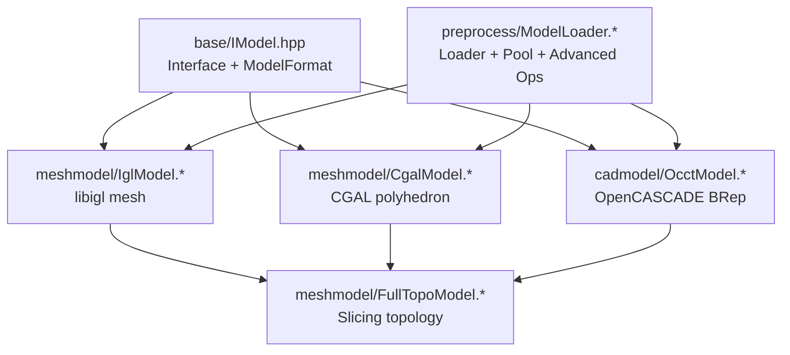
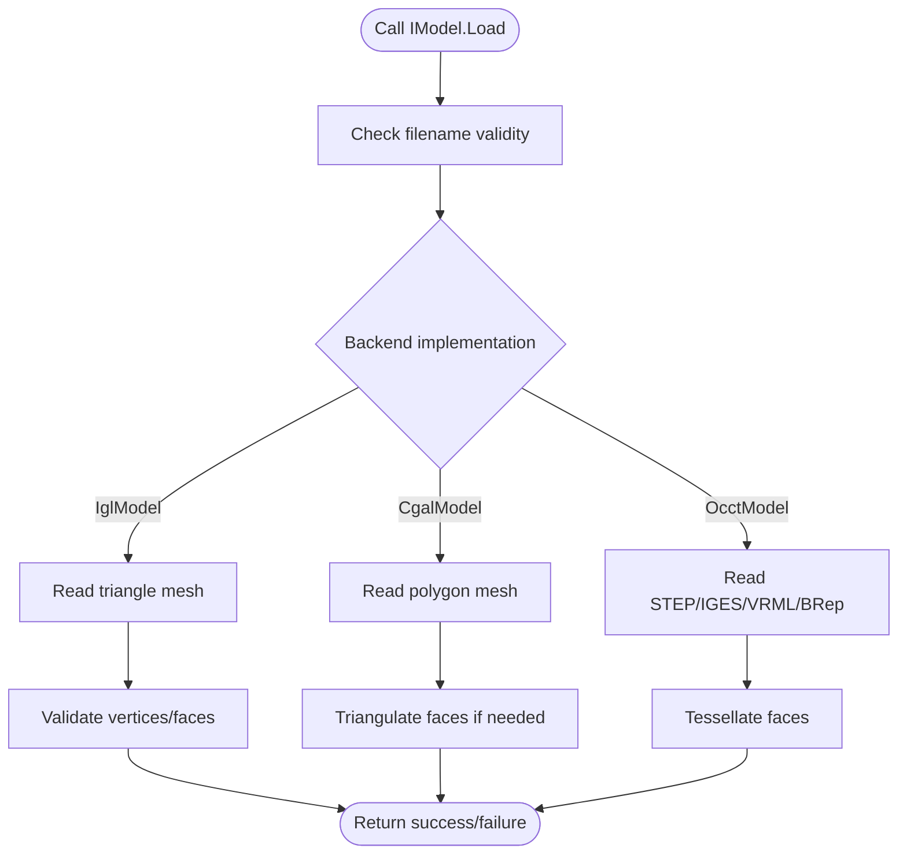
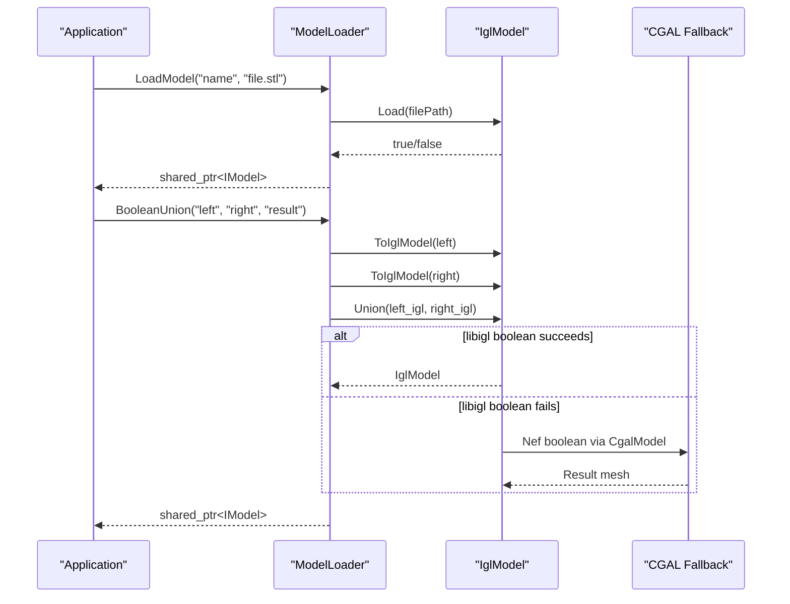
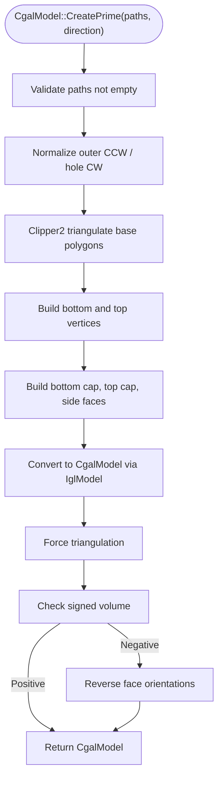
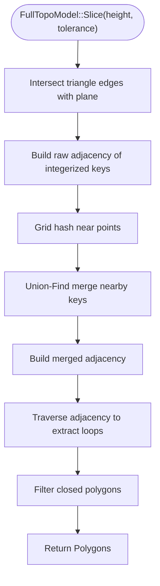
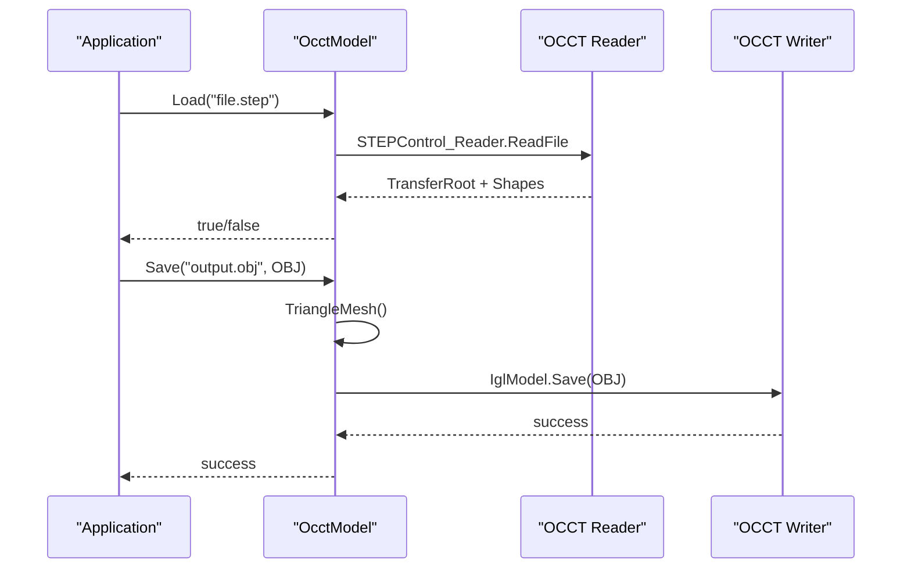
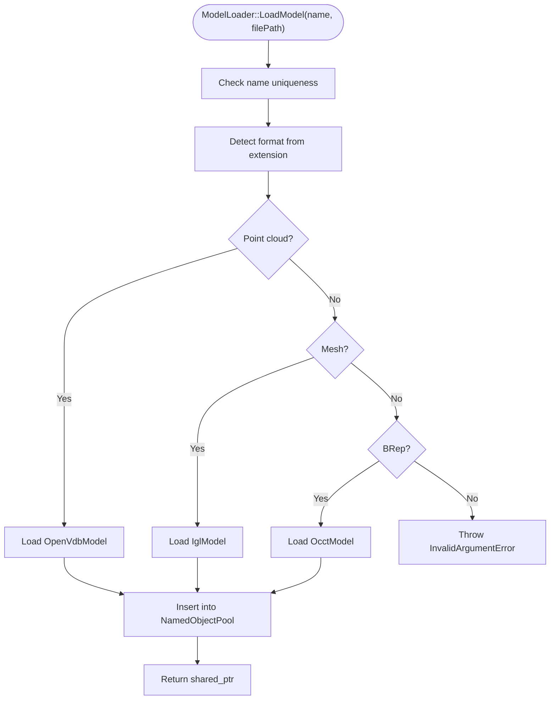
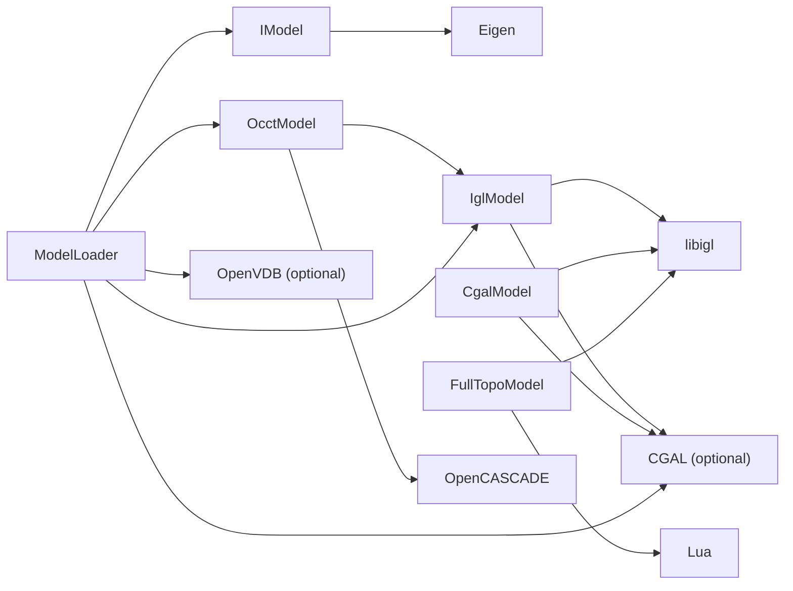

# Mesh Processing (meshmodel/, preprocess/)

<cite>
**Referenced Files in This Document**   
- [IModel.hpp](file://base/IModel.hpp)
- [CgalModel.hpp](file://meshmodel/CgalModel.hpp)
- [CgalModel.cpp](file://meshmodel/CgalModel.cpp)
- [IglModel.hpp](file://meshmodel/IglModel.hpp)
- [IglModel.cpp](file://meshmodel/IglModel.cpp)
- [FullTopoModel.hpp](file://meshmodel/FullTopoModel.hpp)
- [FullTopoModel.cpp](file://meshmodel/FullTopoModel.cpp)
- [OcctModel.hpp](file://cadmodel/OcctModel.hpp)
- [OcctModel.cpp](file://cadmodel/OcctModel.cpp)
- [ModelLoader.hpp](file://preprocess/ModelLoader.hpp)
- [ModelLoader.cpp](file://preprocess/ModelLoader.cpp)
</cite>

## Table of Contents
1. [Introduction](#introduction)
2. [Project Structure](#project-structure)
3. [Core Components](#core-components)
4. [Architecture Overview](#architecture-overview)
5. [Detailed Component Analysis](#detailed-component-analysis)
6. [Dependency Analysis](#dependency-analysis)
7. [Performance Considerations](#performance-considerations)
8. [Troubleshooting Guide](#troubleshooting-guide)
9. [Conclusion](#conclusion)
10. [Appendices](#appendices)

## Introduction
This document explains the mesh processing subsystem that combines `meshmodel/` and `preprocess/`. It covers the 3D model abstraction, four concrete model representations, file loading, validation and repair, boolean operations, geometric analysis tools, slicing integration, trade-offs between representations, performance considerations for large meshes, and error handling strategies for corrupted or invalid input data.

The system is built around a single interface: `IModel`. Concrete implementations provide different capabilities:

- `IglModel`: lightweight triangle mesh backed by Eigen and libigl; fast I/O, transforms, normals, primitives, and CGAL-backed boolean fallbacks.
- `CgalModel`: CGAL polyhedron with exact-predicates kernel, Nef-based boolean operations, surface geodesic/helix/spiral tools, and robust primitive/extrusion construction.
- `FullTopoModel`: topology-reconstructed mesh dedicated to slicing; exposes vertex/edge/face relationships, Euler characteristic, safe/unsafe/fast slicing, and Lua scripting hooks.
- `OcctModel`: OpenCASCADE BRep CAD model supporting STEP/IGES/VRML/BRep, tessellation, volume, boolean operations, thick-solid shell creation, and extrusion from polygons.
- `ModelLoader`: unified loader that dispatches to format-specific kernels, manages a named model pool, and provides optional advanced operations such as boolean operations, thick solids, and point-cloud reconstruction when enabled at build time.

## Project Structure
The relevant source tree is organized by capability rather than by layer:

**Diagram sources**
- [IModel.hpp:65-139](file://base/IModel.hpp#L65-L139)
- [IglModel.hpp:18-121](file://meshmodel/IglModel.hpp#L18-L121)
- [CgalModel.hpp:24-155](file://meshmodel/CgalModel.hpp#L24-L155)
- [OcctModel.hpp:20-124](file://cadmodel/OcctModel.hpp#L20-L124)
- [FullTopoModel.hpp:23-146](file://meshmodel/FullTopoModel.hpp#L23-L146)
- [ModelLoader.hpp:23-202](file://preprocess/ModelLoader.hpp#L23-L202)

**Section sources**
- [IModel.hpp:65-139](file://base/IModel.hpp#L65-L139)
- [ModelLoader.hpp:23-202](file://preprocess/ModelLoader.hpp#L23-L202)

## Core Components
The core components are the abstract model interface and its concrete implementations plus the loader.

| Component | Role | Key Capabilities | Typical Use Case |
|---|---|---|---|
| `IModel` | Abstract 3D model interface | Load/Save, transforms, bounding box, volume, triangle mesh extraction | Common API for all model types |
| `IglModel` | Triangle mesh model | STL/OBJ/PLY/OFF I/O, affine transforms, normals, primitives, boolean via CGAL fallback | Fast mesh editing, visualization, slicing input |
| `CgalModel` | CGAL polyhedral model | Exact predicates, Nef booleans, geodesic path/distance, projection, spiral/helix, robust extrusion | High-quality geometry, boolean-heavy workflows |
| `FullTopoModel` | Topology-reconstructed slicing model | Vertex/edge/face adjacency, Euler check, safe/unsafe/fast slice, Lua slice scripts | Slicing pipeline, contour extraction |
| `OcctModel` | OpenCASCADE CAD model | STEP/IGES/VRML/BRep I/O, tessellation, volume, boolean, thick solid, extrude | CAD import/export, precise solids |
| `ModelLoader` | Unified loader and pool | Format dispatch, named pool, optional boolean/thick-solid/point-cloud ops | Pipeline entry point for models |

**Section sources**
- [IModel.hpp:65-139](file://base/IModel.hpp#L65-L139)
- [IglModel.hpp:18-121](file://meshmodel/IglModel.hpp#L18-L121)
- [CgalModel.hpp:24-155](file://meshmodel/CgalModel.hpp#L24-L155)
- [FullTopoModel.hpp:23-146](file://meshmodel/FullTopoModel.hpp#L23-L146)
- [OcctModel.hpp:20-124](file://cadmodel/OcctModel.hpp#L20-L124)
- [ModelLoader.hpp:23-202](file://preprocess/ModelLoader.hpp#L23-L202)

## Architecture Overview
The architecture separates concerns into three layers:

1. **Interface Layer**: `IModel` defines the contract for loading, saving, transforming, querying, and extracting triangle meshes.
2. **Representation Layer**: `IglModel`, `CgalModel`, `OcctModel`, and `FullTopoModel` implement specific data structures and algorithms.
3. **Pipeline Integration Layer**: `ModelLoader` selects the correct representation based on file extension, stores models in a named pool, and exposes higher-level operations.

```mermaid
classDiagram
class IModel {
+Load(fileName) bool
+Save(fileName, format) bool
+Translate(translation) void
+Rotate(rotation) void
+Scale(scale) void
+Transform(transform) void
+BoundingBox(min, max) void
+Volume() float
+TriangleMesh() pair
}
class IglModel {
+ComputeNormals() void
+ComputeVertexNormals() MatrixXf
+ComputeFaceNormals() MatrixXf
+CreateBox(size) IglModel
+CreateSphere(radius, subdivisions) IglModel
+CreateCylinder(radius, height, segments) IglModel
+CreateCone(radius, height, segments) IglModel
+CreateTorus(majorRadius, minorRadius, majorSegments, minorSegments) IglModel
+CreatePrime(poly, direction) IglModel
+CreatePrime(paths, direction) IglModel
}
class CgalModel {
+GeodesicPath(source, target) vector
+GeodesicDistance(source) vector
+ProjectPointOnSurface(point) Vector3f
+SurfaceSpiral(axisOrigin, axisDirection, turns, samplesPerTurn, startRadius, endRadius) vector
+SurfaceHelix(axisOrigin, axisDirection, turns, pitch, radius, samplesPerTurn) vector
+CreateBox(size) CgalModel
+CreateSphere(radius, subdivisions) CgalModel
+CreateCylinder(radius, height, segments) CgalModel
+CreateCone(radius, height, segments) CgalModel
+CreateTorus(majorRadius, minorRadius, majorSegments, minorSegments) CgalModel
+CreatePrime(poly, direction) CgalModel
+CreatePrime(paths, direction) CgalModel
}
class FullTopoModel {
+CheckTopo() bool
+EulerCharacteristic() int
+Slice(height, tolerance) Polygons
+UnSafeSlice(height, tolerance) UnSafePolygons
+SliceFast(height) Polygons
+SliceLua(script, height, ext_regs) Polygons
+SliceLua(script, funcName, height, ext_regs) Polygons
+SliceLua(script_file, funcName, height, ext_regs) Polygons
+UnSafeSliceLua(script, height, ext_regs) UnSafePolygons
}
class OcctModel {
+AddShape(model) void
+UnionAll() bool
+CreateBox(size) OcctModel
+CreateSphere(radius, subdivisions) OcctModel
+CreateCylinder(radius, height, segments) OcctModel
+CreateCone(radius, height, segments) OcctModel
+CreateTorus(majorRadius, minorRadius, majorSegments, minorSegments) OcctModel
+CreatePrime(poly, direction) OcctModel
+CreatePrime(paths, direction) OcctModel
}
class ModelLoader {
+LoadModel(name, filePath) shared_ptr<IModel>
+GetModel(name) shared_ptr<IModel>
+InsertModel(name, model) shared_ptr<IModel>
+RemoveModel(name) void
+ContainsModel(name) bool
+ModelCount() size_t
+GetModelNames() vector<string>
+Cleanup() size_t
+BooleanUnion(leftName, rightName, resultName) shared_ptr<IModel>
+BooleanIntersection(leftName, rightName, resultName) shared_ptr<IModel>
+BooleanDifference(leftName, rightName, resultName) shared_ptr<IModel>
+BooleanXor(leftName, rightName, resultName) shared_ptr<IModel>
+ThickSolidModel(sourceName, resultName, thickness) shared_ptr<IModel>
}
IglModel ..|> IModel
CgalModel ..|> IModel
OcctModel ..|> IModel
ModelLoader --> IModel : "manages"
```

**Diagram sources**
- [IModel.hpp:65-139](file://base/IModel.hpp#L65-L139)
- [IglModel.hpp:18-121](file://meshmodel/IglModel.hpp#L18-L121)
- [CgalModel.hpp:24-155](file://meshmodel/CgalModel.hpp#L24-L155)
- [FullTopoModel.hpp:23-146](file://meshmodel/FullTopoModel.hpp#L23-L146)
- [OcctModel.hpp:20-124](file://cadmodel/OcctModel.hpp#L20-L124)
- [ModelLoader.hpp:23-202](file://preprocess/ModelLoader.hpp#L23-L202)

## Detailed Component Analysis

### Model Abstraction Hierarchy
`IModel` is the only required contract. Implementations must support:

- File I/O through `Load` and `Save`.
- Transformations through `Translate`, `Rotate`, `Scale`, and multiple `Transform` overloads.
- Geometry queries through `BoundingBox` and `Volume`.
- Mesh export through `TriangleMesh`.

`ModelFormat` enumerates supported formats across mesh, BRep, and point cloud categories. The loader uses this enumeration to route files to the appropriate backend.

**Diagram sources**
- [IModel.hpp:110-139](file://base/IModel.hpp#L110-L139)
- [IglModel.cpp:64-99](file://meshmodel/IglModel.cpp#L64-L99)
- [CgalModel.cpp:121-157](file://meshmodel/CgalModel.cpp#L121-L157)
- [OcctModel.cpp:213-271](file://cadmodel/OcctModel.cpp#L213-L271)

**Section sources**
- [IModel.hpp:65-139](file://base/IModel.hpp#L65-L139)
- [ModelLoader.cpp:45-84](file://preprocess/ModelLoader.cpp#L45-L84)

### IglModel: Interactive Triangle Mesh
`IglModel` stores vertices, faces, and optional normals as Eigen matrices. It supports:

- Loading and saving STL, OBJ, PLY, OFF.
- Affine transformations applied row-wise to vertex matrices.
- Face and vertex normal computation.
- Primitive factories for box, sphere, cylinder, cone, and torus.
- Extrusion from closed polygons using Clipper2 triangulation.
- Boolean operations via libigl CGAL helpers with a fallback to `CgalModel` Nef polyhedra when float precision causes failures.

Key behaviors:

- `Load` converts UTF-8 filenames to local encoding before calling libigl.
- `Save` throws `NotSupportedError` for unsupported formats.
- `Volume` computes signed volume per triangle and returns absolute sum.
- Boolean functions validate inputs and return empty meshes on failure instead of throwing.

**Diagram sources**
- [ModelLoader.cpp:132-167](file://preprocess/ModelLoader.cpp#L132-L167)
- [ModelLoader.cpp:218-243](file://preprocess/ModelLoader.cpp#L218-L243)
- [IglModel.cpp:195-246](file://meshmodel/IglModel.cpp#L195-L246)
- [IglModel.cpp:248-391](file://meshmodel/IglModel.cpp#L248-L391)

**Section sources**
- [IglModel.hpp:18-121](file://meshmodel/IglModel.hpp#L18-L121)
- [IglModel.cpp:64-193](file://meshmodel/IglModel.cpp#L64-L193)
- [IglModel.cpp:195-391](file://meshmodel/IglModel.cpp#L195-L391)
- [IglModel.cpp:411-713](file://meshmodel/IglModel.cpp#L411-L713)

### CgalModel: Computational Geometry Operations
`CgalModel` wraps a CGAL `Polyhedron_3` with an exact-predicates kernel. It provides:

- Robust loading and saving of mesh formats.
- Consistent face triangulation after load.
- Affine transformations through CGAL’s transformation utilities.
- Volume calculation via CGAL.
- Conversion to libigl-style triangle mesh.
- Nef-based boolean operations: union, intersection, difference, XOR.
- Primitives and extrusions with explicit winding and orientation fixes.
- Surface geodesic path and distance computation.
- Point projection onto the mesh surface.
- Spiral and helix generation around an axis.

Important details:

- Construction from vertex/face arrays attempts direct conversion, then repairs via CGAL polygon soup orientation and mesh building.
- `CreatePrime` triangulates base polygons, builds top/bottom caps and side quads, and ensures positive volume by checking and reversing face orientation when necessary.
- Boolean operations convert both operands to Nef polyhedra, perform set operations, and convert back to polyhedra.

**Diagram sources**
- [CgalModel.cpp:625-733](file://meshmodel/CgalModel.cpp#L625-L733)
- [CgalModel.cpp:735-800](file://meshmodel/CgalModel.cpp#L735-L800)
- [CgalModel.cpp:238-276](file://meshmodel/CgalModel.cpp#L238-L276)

**Section sources**
- [CgalModel.hpp:24-155](file://meshmodel/CgalModel.hpp#L24-L155)
- [CgalModel.cpp:38-119](file://meshmodel/CgalModel.cpp#L38-L119)
- [CgalModel.cpp:121-237](file://meshmodel/CgalModel.cpp#L121-L237)
- [CgalModel.cpp:238-276](file://meshmodel/CgalModel.cpp#L238-L276)
- [CgalModel.cpp:278-445](file://meshmodel/CgalModel.cpp#L278-L445)
- [CgalModel.cpp:447-621](file://meshmodel/CgalModel.cpp#L447-L621)
- [CgalModel.cpp:625-800](file://meshmodel/CgalModel.cpp#L625-L800)

### FullTopoModel: Topological Data Structures for Slicing
`FullTopoModel` reconstructs full topology from a mesh and is designed for slicing. It exposes:

- Vertex, edge, and face structures with adjacency lists.
- Topology completeness check.
- Euler characteristic calculation.
- Safe slicing returning only closed contours.
- Unsafe slicing including open contours.
- Fast slicing that assumes topological completeness.
- Lua-based slicing where scripts receive V, E, F, and height.

Construction:

- From `IModel`: extracts triangle mesh, builds vertex list, triangle list, and rebuilds edges and faces.
- From raw vertex/triangle vectors: directly builds topology.
- Optional normal computation uses libigl face normals.

Slicing algorithm overview:

1. Compute intersections of each triangle edge with the slicing plane.
2. Build raw adjacency of intersection points.
3. Merge nearby points using grid hashing and union-find.
4. Traverse adjacency to extract closed loops.
5. Return either safe closed polygons or unsafe polylines.

**Diagram sources**
- [FullTopoModel.cpp:27-48](file://meshmodel/FullTopoModel.cpp#L27-L48)
- [FullTopoModel.cpp:50-158](file://meshmodel/FullTopoModel.cpp#L50-L158)
- [FullTopoModel.cpp:328-599](file://meshmodel/FullTopoModel.cpp#L328-L599)

**Section sources**
- [FullTopoModel.hpp:23-146](file://meshmodel/FullTopoModel.hpp#L23-L146)
- [FullTopoModel.cpp:27-158](file://meshmodel/FullTopoModel.cpp#L27-L158)
- [FullTopoModel.cpp:160-244](file://meshmodel/FullTopoModel.cpp#L160-L244)
- [FullTopoModel.cpp:246-324](file://meshmodel/FullTopoModel.cpp#L246-L324)
- [FullTopoModel.cpp:328-599](file://meshmodel/FullTopoModel.cpp#L328-L599)
- [FullTopoModel.cpp:604-800](file://meshmodel/FullTopoModel.cpp#L604-L800)

### OcctModel: CAD Kernel Integration via OpenCascade
`OcctModel` wraps an OpenCASCADE `TopoDS_Shape` and implements `IModel`. It supports:

- Reading STEP, IGES, VRML, BRep.
- Writing STEP, IGES, VRML, BRep.
- Adding shapes into a compound.
- Affine transformations via OCCT transforms.
- Bounding box iteration over vertices.
- Tessellation to triangle mesh.
- Volume via GProp.
- Boolean union, intersection, difference, XOR.
- Thick-solid shell creation.
- Primitives and extrusion from polygons.

Important behaviors:

- `Load` routes to format-specific readers and throws `IOError` on read failures.
- `Save` delegates mesh formats to `IglModel` after tessellation.
- `TriangleMesh` iterates faces, applies triangulation location transforms, and adjusts orientation for reversed faces.
- Boolean operations use OCCT boolean APIs.
- `ThickSolid` supports simple thickness and opening-face exclusion.

**Diagram sources**
- [OcctModel.cpp:76-147](file://cadmodel/OcctModel.cpp#L76-L147)
- [OcctModel.cpp:213-271](file://cadmodel/OcctModel.cpp#L213-L271)
- [OcctModel.cpp:353-407](file://cadmodel/OcctModel.cpp#L353-L407)

**Section sources**
- [OcctModel.hpp:20-124](file://cadmodel/OcctModel.hpp#L20-L124)
- [OcctModel.cpp:63-211](file://cadmodel/OcctModel.cpp#L63-L211)
- [OcctModel.cpp:213-420](file://cadmodel/OcctModel.cpp#L213-L420)
- [OcctModel.cpp:422-540](file://cadmodel/OcctModel.cpp#L422-L540)
- [OcctModel.cpp:542-669](file://cadmodel/OcctModel.cpp#L542-L669)

### ModelLoader: File Format Support and Pipeline Entry Point
`ModelLoader` is the central entry point for loading models into the pipeline. It:

- Validates unique names.
- Determines format from file extension.
- Loads mesh formats into `IglModel`.
- Loads BRep formats into `OcctModel` when OCCT is available.
- Loads point cloud formats into `OpenVdbModel` when OpenVDB is available.
- Stores models in a named object pool.
- Provides advanced operations guarded by compile-time macros.

Advanced operations:

- Boolean operations prefer OCCT booleans when both operands are `OcctModel`; otherwise they fall back to `IglModel` booleans requiring CGAL.
- Thick-solid operations require `OcctModel`.
- Point cloud operations require `OpenVdbModel`.

**Diagram sources**
- [ModelLoader.cpp:45-84](file://preprocess/ModelLoader.cpp#L45-L84)
- [ModelLoader.cpp:132-167](file://preprocess/ModelLoader.cpp#L132-L167)
- [ModelLoader.cpp:172-323](file://preprocess/ModelLoader.cpp#L172-L323)
- [ModelLoader.cpp:343-451](file://preprocess/ModelLoader.cpp#L343-L451)

**Section sources**
- [ModelLoader.hpp:23-202](file://preprocess/ModelLoader.hpp#L23-L202)
- [ModelLoader.cpp:45-130](file://preprocess/ModelLoader.cpp#L45-L130)
- [ModelLoader.cpp:132-323](file://preprocess/ModelLoader.cpp#L132-L323)
- [ModelLoader.cpp:343-451](file://preprocess/ModelLoader.cpp#L343-L451)

## Dependency Analysis
The dependencies form a layered structure:

- `IModel` has no internal dependencies beyond Eigen and standard library.
- `IglModel` depends on libigl and optionally CGAL for boolean fallbacks.
- `CgalModel` depends on CGAL and libigl for mesh conversion.
- `FullTopoModel` depends on Eigen, libigl for normals, and Lua for scripting.
- `OcctModel` depends on OpenCASCADE and can delegate mesh saving to `IglModel`.
- `ModelLoader` depends on format detection, model implementations, and optional CGAL/OpenVDB/OCCT features.

**Diagram sources**
- [IglModel.cpp:12-31](file://meshmodel/IglModel.cpp#L12-L31)
- [CgalModel.cpp:12-34](file://meshmodel/CgalModel.cpp#L12-L34)
- [FullTopoModel.cpp:8-24](file://meshmodel/FullTopoModel.cpp#L8-L24)
- [OcctModel.cpp:8-59](file://cadmodel/OcctModel.cpp#L8-L59)
- [ModelLoader.cpp:13-22](file://preprocess/ModelLoader.cpp#L13-L22)

**Section sources**
- [IglModel.cpp:12-31](file://meshmodel/IglModel.cpp#L12-L31)
- [CgalModel.cpp:12-34](file://meshmodel/CgalModel.cpp#L12-L34)
- [FullTopoModel.cpp:8-24](file://meshmodel/FullTopoModel.cpp#L8-L24)
- [OcctModel.cpp:8-59](file://cadmodel/OcctModel.cpp#L8-L59)
- [ModelLoader.cpp:13-22](file://preprocess/ModelLoader.cpp#L13-L22)

## Performance Considerations
- **Large triangle meshes**: `IglModel` stores data in Eigen matrices; transformations are vectorized but may allocate temporary matrices. Prefer move constructors when constructing from temporary vertex/face arrays.
- **Boolean operations**: libigl boolean operations on float meshes can fail silently due to winding-number inconsistencies; the code promotes to double and falls back to CGAL Nef polyhedra. For large meshes, expect significant CPU and memory usage.
- **CGAL operations**: Nef-based booleans and surface geodesic computations are robust but expensive. Avoid chaining many boolean operations without intermediate simplification.
- **Topology reconstruction**: `FullTopoModel` rebuilds vertex/edge/face adjacency; this is O(F) during construction and beneficial for repeated slicing because topology is precomputed.
- **Slicing**: Safe and unsafe slicing build adjacency maps and use union-find; complexity grows with the number of intersected edges. Tolerance controls point merging and affects robustness versus precision.
- **CAD tessellation**: `OcctModel::TriangleMesh` iterates faces and triangulations; tessellation quality and density affect downstream mesh algorithms.
- **Named model pool**: `ModelLoader` uses a fixed-capacity pool controlled by `HSBA_MODEL_POOL_SIZE`. When CGAL is available, capacity defaults to 10; otherwise it is smaller. Excess models should be removed explicitly.

[No sources needed since this section provides general guidance]

## Troubleshooting Guide
Common issues and their likely causes:

| Symptom | Likely Cause | Resolution |
|---|---|---|
| `Load` returns false | Unsupported format, corrupted file, or missing backend | Verify extension, check file integrity, ensure required feature flags are enabled |
| `Save` throws `NotSupportedError` | Format not supported by the backend | Use a supported `ModelFormat` or convert through another model type |
| Boolean operation returns empty mesh | Float precision issues or inconsistent winding | Prefer `OcctModel` for CAD inputs; rely on CGAL fallback; simplify meshes before boolean |
| `CreatePrime` throws runtime error | Invalid polygon, failed triangulation, or unexpected triangulation output | Ensure closed polygon with at least three points; verify winding and coordinates |
| `FullTopoModel::CheckTopo` fails | Incomplete or inconsistent topology | Rebuild from clean mesh; inspect original mesh for duplicate or missing indices |
| Slicing produces open contours | Non-manifold geometry or degenerate triangles | Use `UnSafeSlice` to inspect; repair mesh or increase tolerance carefully |
| Point cloud to mesh fails | Reconstruction parameters too aggressive or sparse data | Adjust voxel size and particle radius; filter outliers first |
| Model pool insertion fails | Duplicate name or pool full | Use unique names; call `Cleanup` or remove unused models |

**Section sources**
- [IglModel.cpp:64-99](file://meshmodel/IglModel.cpp#L64-L99)
- [CgalModel.cpp:42-119](file://meshmodel/CgalModel.cpp#L42-L119)
- [CgalModel.cpp:625-733](file://meshmodel/CgalModel.cpp#L625-L733)
- [FullTopoModel.cpp:160-218](file://meshmodel/FullTopoModel.cpp#L160-L218)
- [ModelLoader.cpp:45-84](file://preprocess/ModelLoader.cpp#L45-L84)
- [ModelLoader.cpp:172-323](file://preprocess/ModelLoader.cpp#L172-L323)

## Conclusion
The mesh processing module provides a flexible, layered system for 3D model handling:

- Use `IglModel` for fast mesh I/O, basic geometry, and moderate boolean operations.
- Use `CgalModel` for robust computational geometry, surface analysis, and high-quality boolean results.
- Use `FullTopoModel` when slicing requires stable topology and efficient repeated contour extraction.
- Use `OcctModel` for CAD workflows, precise solids, and thick-solid shell operations.
- Use `ModelLoader` as the pipeline entry point to select the correct backend, manage models, and invoke advanced operations conditionally.

For large meshes, prioritize representation choice, avoid unnecessary conversions, and tune tolerances and reconstruction parameters carefully. For corrupted or invalid inputs, rely on the explicit error types and validation logic provided by each backend.

[No sources needed since this section summarizes without analyzing specific files]

## Appendices

### Concrete Usage Examples

#### Loading Different File Formats
- Load a mesh file into `IglModel`:
  - Call `ModelLoader::LoadModel("my_mesh", "model.stl")`.
  - If the file is OBJ, PLY, or OFF, the same call works.
- Load a CAD file into `OcctModel`:
  - Call `ModelLoader::LoadModel("my_cad", "part.step")`.
  - Supported BRep formats include STEP, IGES, VRML, and BREP.
- Load a point cloud into `OpenVdbModel`:
  - Call `ModelLoader::LoadModel("cloud", "data.xyz")` when OpenVDB is enabled.

**Section sources**
- [ModelLoader.cpp:45-84](file://preprocess/ModelLoader.cpp#L45-L84)

#### Performing Mesh Operations
- Boolean union of two meshes:
  - Call `ModelLoader::BooleanUnion("left", "right", "union_result")`.
  - If both models are `OcctModel`, OCCT boolean is used; otherwise, `IglModel` boolean with CGAL fallback is used.
- Create a prism from a polygon:
  - Call `IglModel::CreatePrime(polygon, direction)` or `CgalModel::CreatePrime(polygon, direction)`.
  - For multi-contour polygons with holes, use the `PolygonsD` overload.

**Section sources**
- [ModelLoader.cpp:218-243](file://preprocess/ModelLoader.cpp#L218-L243)
- [IglModel.cpp:598-713](file://meshmodel/IglModel.cpp#L598-L713)
- [CgalModel.cpp:625-733](file://meshmodel/CgalModel.cpp#L625-L733)

#### Integrating with the Slicing Pipeline
- Convert any `IModel` to `FullTopoModel`:
  - Construct `FullTopoModel` from an `IModel` or from extracted vertex/triangle data.
- Slice at a given height:
  - Call `FullTopoModel::Slice(height)` for closed contours.
  - Call `FullTopoModel::UnSafeSlice(height)` to include open contours.
  - Call `FullTopoModel::SliceFast(height)` when topology is known to be complete.
- Run custom Lua slicing logic:
  - Call `FullTopoModel::SliceLua(script, height)` or provide a function name and script file.

**Section sources**
- [FullTopoModel.cpp:27-48](file://meshmodel/FullTopoModel.cpp#L27-L48)
- [FullTopoModel.cpp:328-599](file://meshmodel/FullTopoModel.cpp#L328-L599)
- [FullTopoModel.cpp:604-800](file://meshmodel/FullTopoModel.cpp#L604-L800)
- [FullTopoModel.hpp:116-132](file://meshmodel/FullTopoModel.hpp#L116-L132)