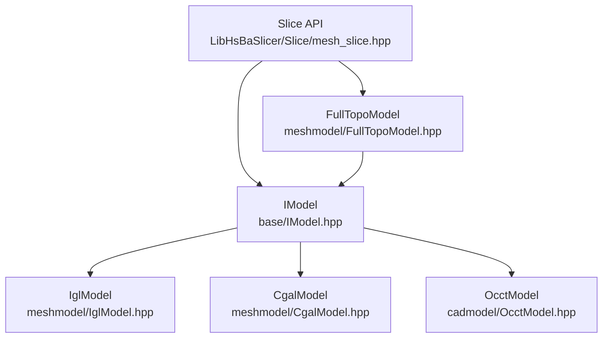
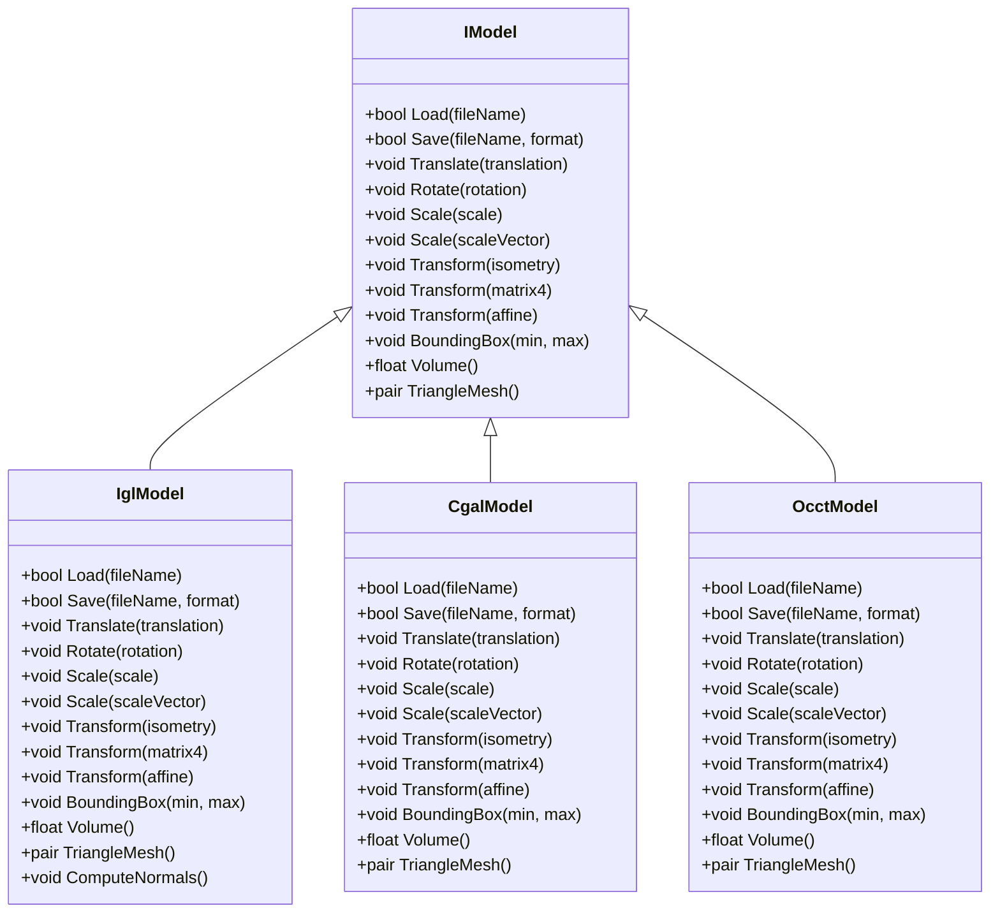
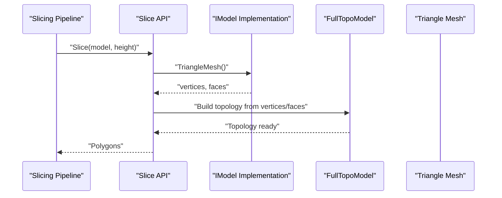
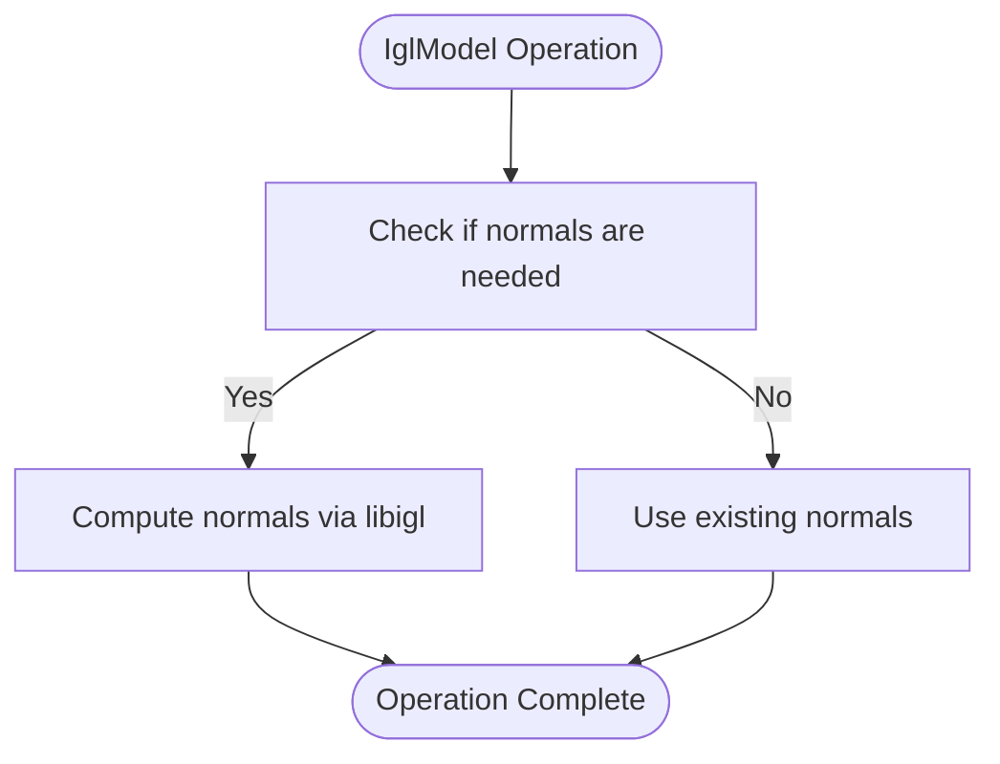
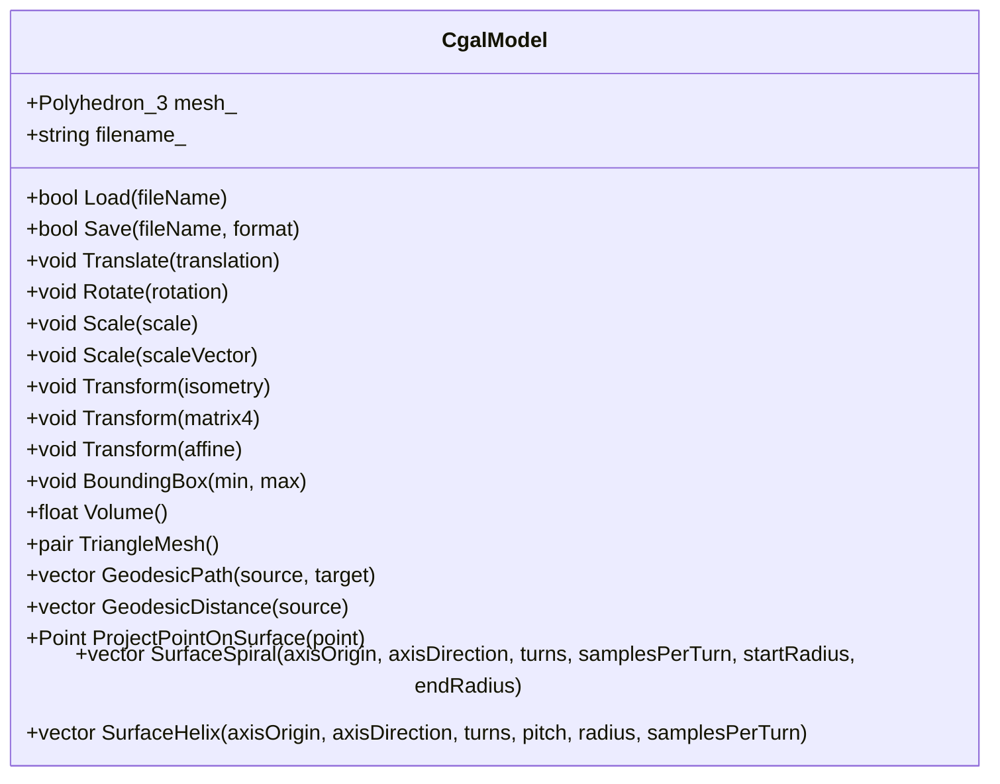
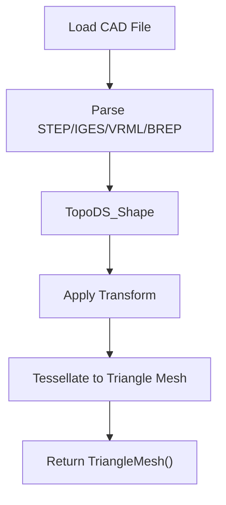
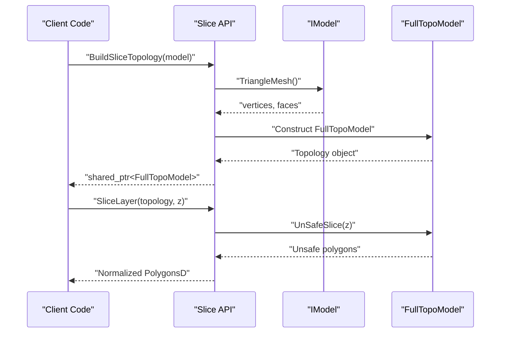
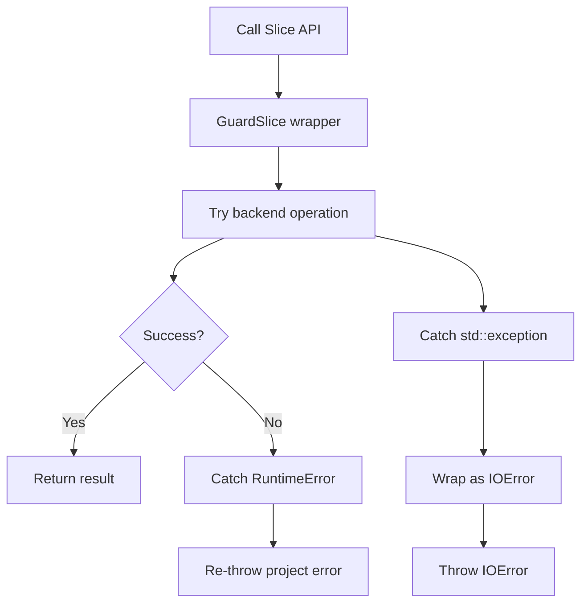
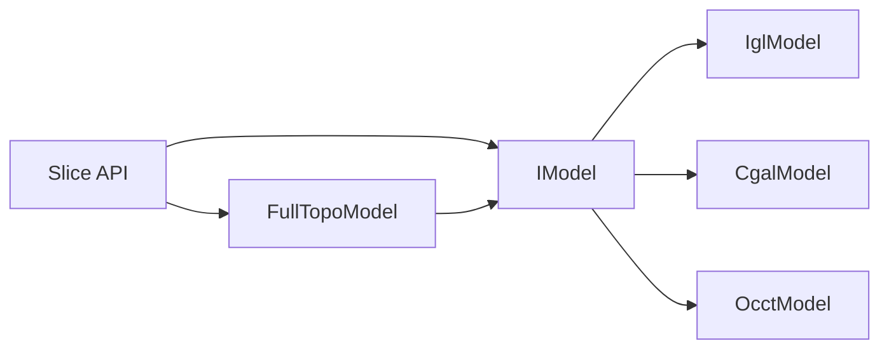

# Model Abstraction Interface

<cite>
**Referenced Files in This Document**   
- [IModel.hpp](file://base/IModel.hpp)
- [IglModel.hpp](file://meshmodel/IglModel.hpp)
- [IglModel.cpp](file://meshmodel/IglModel.cpp)
- [CgalModel.hpp](file://meshmodel/CgalModel.hpp)
- [CgalModel.cpp](file://meshmodel/CgalModel.cpp)
- [OcctModel.hpp](file://cadmodel/OcctModel.hpp)
- [mesh_slice.hpp](file://LibHsBaSlicer/Slice/mesh_slice.hpp)
- [mesh_slice.cpp](file://LibHsBaSlicer/Slice/mesh_slice.cpp)
- [FullTopoModel.hpp](file://meshmodel/FullTopoModel.hpp)
- [FullTopoModel.cpp](file://meshmodel/FullTopoModel.cpp)
- [error.hpp](file://base/error.hpp)
</cite>

## Table of Contents
1. [Introduction](#introduction)
2. [Project Structure](#project-structure)
3. [Core Components](#core-components)
4. [Architecture Overview](#architecture-overview)
5. [Detailed Component Analysis](#detailed-component-analysis)
6. [Dependency Analysis](#dependency-analysis)
7. [Performance Considerations](#performance-considerations)
8. [Troubleshooting Guide](#troubleshooting-guide)
9. [Conclusion](#conclusion)

## Introduction
This document explains the Model Abstraction Interface that defines the common contract for all mesh model implementations in HsBa Slicer. The central contract is the `IModel` interface, which exposes a unified API for file loading and saving, geometric transformations, bounding box queries, volume calculations, and triangle mesh extraction. Multiple backends implement this interface:

- **libigl-backed mesh model**: `IglModel`, optimized for fast triangle mesh operations.
- **CGAL-backed polyhedral mesh model**: `CgalModel`, providing robust boolean operations and surface geometry utilities.
- **OpenCascade CAD model**: `OcctModel`, representing BRep CAD data with tessellation to triangle meshes.

The slicing pipeline consumes models through `IModel`, converting them into an internal topological representation before generating 2D layer contours. This design allows different model representations to coexist while keeping slicing logic independent from backend-specific details.

## Project Structure
The model abstraction lives under `base`, while concrete implementations are split by domain:

- `base/IModel.hpp`: Core interface and shared types such as `ModelFormat`.
- `meshmodel/IglModel.*`: libigl-based triangle mesh implementation.
- `meshmodel/CgalModel.*`: CGAL-based polyhedron implementation.
- `cadmodel/OcctModel.hpp`: OpenCascade BRep model implementation.
- `LibHsBaSlicer/Slice/mesh_slice.*`: Public slicing API that consumes `IModel`.
- `meshmodel/FullTopoModel.*`: Internal topology built from any `IModel` for slicing.

**Diagram sources**
- [IModel.hpp:111-139](file://base/IModel.hpp#L111-L139)
- [IglModel.hpp:26-121](file://meshmodel/IglModel.hpp#L26-L121)
- [CgalModel.hpp:34-155](file://meshmodel/CgalModel.hpp#L34-L155)
- [OcctModel.hpp:30-124](file://cadmodel/OcctModel.hpp#L30-L124)
- [mesh_slice.hpp:33-103](file://LibHsBaSlicer/Slice/mesh_slice.hpp#L33-L103)
- [FullTopoModel.hpp:53-86](file://meshmodel/FullTopoModel.hpp#L53-L86)

**Section sources**
- [IModel.hpp:1-151](file://base/IModel.hpp#L1-L151)
- [IglModel.hpp:1-124](file://meshmodel/IglModel.hpp#L1-L124)
- [CgalModel.hpp:1-166](file://meshmodel/CgalModel.hpp#L1-L166)
- [OcctModel.hpp:1-132](file://cadmodel/OcctModel.hpp#L1-L132)
- [mesh_slice.hpp:1-108](file://LibHsBaSlicer/Slice/mesh_slice.hpp#L1-L108)
- [FullTopoModel.hpp:49-86](file://meshmodel/FullTopoModel.hpp#L49-L86)

## Core Components
The core component is the `IModel` interface. It defines:

- **File I/O**:
  - `Load(fileName)`: Load a model from disk.
  - `Save(fileName, format)`: Save a model to disk in a specified `ModelFormat`.
- **Geometric Transformations**:
  - `Translate(translation)`
  - `Rotate(rotation)`
  - `Scale(scale)` and `Scale(Vector3f scale)`
  - `Transform(Isometry3f)`, `Transform(Matrix4f)`, `Transform(Transform<float, 3, Affine>)`
- **Geometry Queries**:
  - `BoundingBox(min, max)`
  - `Volume()`
- **Mesh Extraction**:
  - `TriangleMesh()`: Returns a pair of vertex and face matrices compatible with libigl-style processing.

The interface also includes a C-compatible typedef block for vector, quaternion, matrix, and polygon structures used by external interfaces.

**Diagram sources**
- [IModel.hpp:111-139](file://base/IModel.hpp#L111-L139)
- [IglModel.hpp:26-121](file://meshmodel/IglModel.hpp#L26-L121)
- [CgalModel.hpp:34-155](file://meshmodel/CgalModel.hpp#L34-L155)
- [OcctModel.hpp:30-124](file://cadmodel/OcctModel.hpp#L30-L124)

**Section sources**
- [IModel.hpp:111-139](file://base/IModel.hpp#L111-L139)

## Architecture Overview
The model abstraction enables multiple backends to coexist behind a single API. Consumers such as the slicing pipeline do not need to know whether a model is backed by libigl, CGAL, or OpenCascade; they only call `IModel` methods.

**Diagram sources**
- [mesh_slice.cpp:46-54](file://LibHsBaSlicer/Slice/mesh_slice.cpp#L46-L54)
- [FullTopoModel.cpp:32-48](file://meshmodel/FullTopoModel.cpp#L32-L48)
- [IModel.hpp:137-138](file://base/IModel.hpp#L137-L138)

The architecture ensures:

- Backend independence: Slicing code depends only on `IModel`.
- Conversion point: `TriangleMesh()` is the canonical conversion from any model type to a triangle mesh.
- Error isolation: External exceptions from geometry kernels are wrapped into project error types at the slicing boundary.

**Section sources**
- [mesh_slice.cpp:17-44](file://LibHsBaSlicer/Slice/mesh_slice.cpp#L17-L44)
- [FullTopoModel.cpp:32-48](file://meshmodel/FullTopoModel.cpp#L32-L48)

## Detailed Component Analysis

### IModel Interface Contract
`IModel` defines the minimal contract required for any 3D model used by the slicer. Its responsibilities include:

| Capability | Method | Purpose |
|---|---|---|
| File loading | `Load(fileName)` | Reads a model from disk using backend-specific parsers. |
| File saving | `Save(fileName, format)` | Writes a model to disk in a requested `ModelFormat`. |
| Translation | `Translate(translation)` | Applies a 3D translation. |
| Rotation | `Rotate(rotation)` | Applies a rotation represented by a quaternion. |
| Scaling | `Scale(float)` / `Scale(Vector3f)` | Uniform or per-axis scaling. |
| General transform | `Transform(...)` | Supports isometry, homogeneous matrix, and affine transforms. |
| Bounding box | `BoundingBox(min, max)` | Computes axis-aligned bounds. |
| Volume | `Volume()` | Computes signed or unsigned volume depending on backend semantics. |
| Mesh extraction | `TriangleMesh()` | Exposes vertices and triangular faces for downstream algorithms. |

The interface also provides a C ABI block defining `HsBaVector2f_t`, `HsBaVector3f_t`, `HsBaQuaternionf_t`, `HsBaMatrix4f_t`, and polygon structures for interoperability.

**Section sources**
- [IModel.hpp:19-61](file://base/IModel.hpp#L19-L61)
- [IModel.hpp:111-139](file://base/IModel.hpp#L111-L139)

### libigl Model: IglModel
`IglModel` stores geometry as Eigen matrices and delegates most operations to libigl. Key characteristics:

- Stores `vertices_`, `faces_`, and optional `normals_`.
- Implements all `IModel` methods, including normal computation helpers.
- Provides primitive factories such as boxes, spheres, cylinders, cones, tori, and extrusions.
- Supports boolean operations through friend functions when CGAL is available.

**Diagram sources**
- [IglModel.cpp:37-48](file://meshmodel/IglModel.cpp#L37-L48)
- [IglModel.hpp:84-89](file://meshmodel/IglModel.hpp#L84-L89)

**Section sources**
- [IglModel.hpp:26-121](file://meshmodel/IglModel.hpp#L26-L121)
- [IglModel.cpp:1-52](file://meshmodel/IglModel.cpp#L1-L52)

### CGAL Model: CgalModel
`CgalModel` wraps a CGAL polyhedron and adds robust geometric capabilities:

- Uses exact-predicates kernel for numerical stability.
- Supports boolean operations through Nef polyhedra.
- Provides surface geodesic, spiral, and helix utilities.
- Converts between CGAL and libigl representations when needed.

**Diagram sources**
- [CgalModel.hpp:34-155](file://meshmodel/CgalModel.hpp#L34-L155)

**Section sources**
- [CgalModel.hpp:1-166](file://meshmodel/CgalModel.hpp#L1-L166)
- [CgalModel.cpp:1-49](file://meshmodel/CgalModel.cpp#L1-L49)

### OpenCascade Model: OcctModel
`OcctModel` represents BRep CAD data and provides:

- Loading/saving of STEP, IGES, VRML, and BRep files.
- Boolean operations and thick-solid generation.
- Tessellation to triangle meshes for slicing.
- Primitive creation and extrusion from 2D polygons.

**Diagram sources**
- [OcctModel.hpp:54-81](file://cadmodel/OcctModel.hpp#L54-L81)
- [OcctModel.hpp:114-123](file://cadmodel/OcctModel.hpp#L114-L123)

**Section sources**
- [OcctModel.hpp:1-132](file://cadmodel/OcctModel.hpp#L1-L132)

### Relationship Between IModel and the Slicing Pipeline
The slicing pipeline consumes `IModel` through public APIs:

- `Slice(model, height)`: Returns closed contour polygons.
- `UnSafeSlice(model, height)`: Includes open contours.
- `SliceLua` / `UnSafeSliceLua`: Script-driven slicing.
- `BuildSliceTopology(model)`: Builds reusable topology once for multi-layer slicing.
- `SliceLayer(topology, z)`: Extracts a single layer from prebuilt topology.

**Diagram sources**
- [mesh_slice.cpp:106-116](file://LibHsBaSlicer/Slice/mesh_slice.cpp#L106-L116)
- [FullTopoModel.cpp:32-48](file://meshmodel/FullTopoModel.cpp#L32-L48)
- [mesh_slice.hpp:89-103](file://LibHsBaSlicer/Slice/mesh_slice.hpp#L89-L103)

**Section sources**
- [mesh_slice.hpp:22-103](file://LibHsBaSlicer/Slice/mesh_slice.hpp#L22-L103)
- [mesh_slice.cpp:46-116](file://LibHsBaSlicer/Slice/mesh_slice.cpp#L46-L116)
- [FullTopoModel.cpp:32-48](file://meshmodel/FullTopoModel.cpp#L32-L48)

### Implementing Custom Model Types
To implement a custom model type:

1. Derive from `IModel`.
2. Implement all pure virtual methods:
   - `Load`, `Save`
   - `Translate`, `Rotate`, `Scale`, `Transform`
   - `BoundingBox`, `Volume`
   - `TriangleMesh`
3. Choose an appropriate internal representation:
   - For triangle meshes, follow `IglModel`.
   - For robust boolean operations, follow `CgalModel`.
   - For CAD data, follow `OcctModel`.
4. Ensure `TriangleMesh()` returns consistent, watertight triangles when possible.
5. Handle errors consistently with project error types.

Example pattern reference paths:

- Interface definition: [IModel.hpp:111-139](file://base/IModel.hpp#L111-L139)
- libigl implementation: [IglModel.hpp:26-121](file://meshmodel/IglModel.hpp#L26-L121)
- CGAL implementation: [CgalModel.hpp:34-155](file://meshmodel/CgalModel.hpp#L34-L155)
- OCCT implementation: [OcctModel.hpp:30-124](file://cadmodel/OcctModel.hpp#L30-L124)

**Section sources**
- [IModel.hpp:111-139](file://base/IModel.hpp#L111-L139)
- [IglModel.hpp:26-121](file://meshmodel/IglModel.hpp#L26-L121)
- [CgalModel.hpp:34-155](file://meshmodel/CgalModel.hpp#L34-L155)
- [OcctModel.hpp:30-124](file://cadmodel/OcctModel.hpp#L30-L124)

### Error Handling Patterns for File Operations
Error handling follows these patterns:

- Backend loaders may throw project exceptions such as `RuntimeError`.
- Geometry kernels outside the project hierarchy (for example, CGAL or OCCT failures) can raise foreign exception types.
- The slicing subsystem wraps all entry points with `GuardSlice`, converting foreign exceptions into `IOError`.
- File I/O should return `false` from `Save` when writing fails, and `Load` should throw or signal failure according to backend conventions.

**Diagram sources**
- [mesh_slice.cpp:28-43](file://LibHsBaSlicer/Slice/mesh_slice.cpp#L28-L43)

**Section sources**
- [mesh_slice.cpp:17-44](file://LibHsBaSlicer/Slice/mesh_slice.cpp#L17-L44)
- [error.hpp](file://base/error.hpp)

### Performance Considerations When Working With Large Meshes
Key performance considerations:

- **Avoid repeated topology rebuilds**: Use `BuildSliceTopology` once and reuse it across layers.
- **Prefer efficient mesh formats**: STL, OBJ, PLY, OFF have different parsing costs; choose formats aligned with workload.
- **Minimize unnecessary conversions**: Each call to `TriangleMesh()` copies vertices and faces into `FullTopoModel`.
- **Use appropriate backend**:
  - `IglModel` is lightweight for pure mesh workflows.
  - `CgalModel` adds robustness but increases memory and CPU usage.
  - `OcctModel` requires tessellation for slicing, which can be expensive for high-resolution CAD.
- **Control subdivision and segment counts**: Primitive factories expose parameters like subdivisions and segments; lower values reduce mesh size.
- **Reuse computed normals**: `IglModel` supports computing normals once and reusing them.

[No sources needed since this section provides general guidance]

## Dependency Analysis
The following diagram shows how the model abstraction connects to the slicing pipeline and internal topology.

**Diagram sources**
- [IModel.hpp:111-139](file://base/IModel.hpp#L111-L139)
- [IglModel.hpp:26-121](file://meshmodel/IglModel.hpp#L26-L121)
- [CgalModel.hpp:34-155](file://meshmodel/CgalModel.hpp#L34-L155)
- [OcctModel.hpp:30-124](file://cadmodel/OcctModel.hpp#L30-L124)
- [mesh_slice.hpp:33-103](file://LibHsBaSlicer/Slice/mesh_slice.hpp#L33-L103)
- [FullTopoModel.hpp:53-86](file://meshmodel/FullTopoModel.hpp#L53-L86)

**Section sources**
- [IModel.hpp:111-139](file://base/IModel.hpp#L111-L139)
- [mesh_slice.hpp:33-103](file://LibHsBaSlicer/Slice/mesh_slice.hpp#L33-L103)
- [FullTopoModel.hpp:53-86](file://meshmodel/FullTopoModel.hpp#L53-L86)

## Performance Considerations
[No sources needed since this section provides general guidance]

## Troubleshooting Guide
Common issues and resolutions:

- **Slicing throws unexpected exceptions**:
  - Cause: Foreign exceptions from CGAL or OCCT.
  - Resolution: Inspect the `IOError` message produced by `GuardSlice`; validate input mesh quality and tolerance.
- **Empty or invalid triangle mesh**:
  - Cause: Invalid source file or malformed mesh.
  - Resolution: Verify `Load` succeeds; check `TriangleMesh()` output dimensions.
- **Slow multi-layer slicing**:
  - Cause: Rebuilding topology per layer.
  - Resolution: Use `BuildSliceTopology` and `SliceLayer`.
- **Incorrect volume or bounding box**:
  - Cause: Non-watertight mesh or inconsistent orientation.
  - Resolution: Repair mesh upstream; verify backend-specific volume semantics.

**Section sources**
- [mesh_slice.cpp:17-44](file://LibHsBaSlicer/Slice/mesh_slice.cpp#L17-L44)
- [FullTopoModel.cpp:32-48](file://meshmodel/FullTopoModel.cpp#L32-L48)

## Conclusion
The `IModel` interface provides a clean, backend-agnostic contract for 3D models in HsBa Slicer. By standardizing file I/O, transformations, geometry queries, and triangle mesh extraction, it allows libigl, CGAL, and OpenCascade backends to coexist. The slicing pipeline consumes models uniformly through `IModel`, converting them into `FullTopoModel` for efficient layer-wise processing. Following the patterns documented here enables reliable extension with custom model types, robust error handling, and scalable performance for large meshes.

[No sources needed since this section summarizes without analyzing specific files]