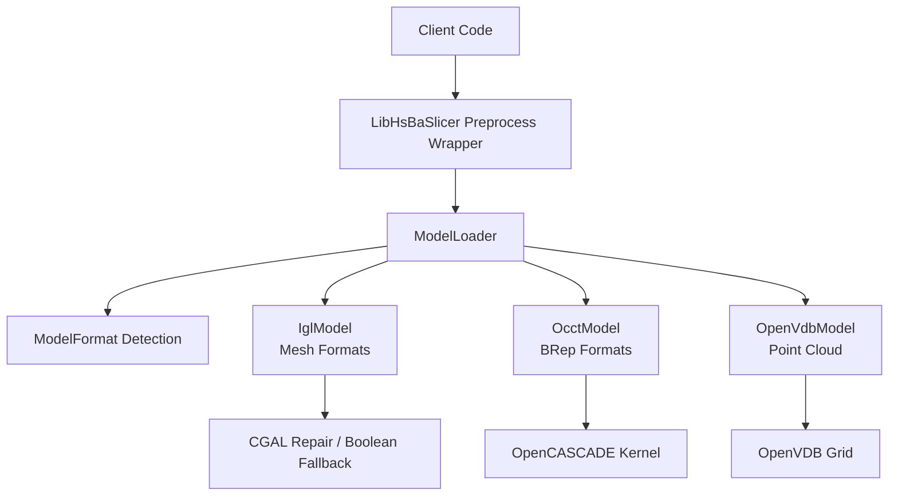
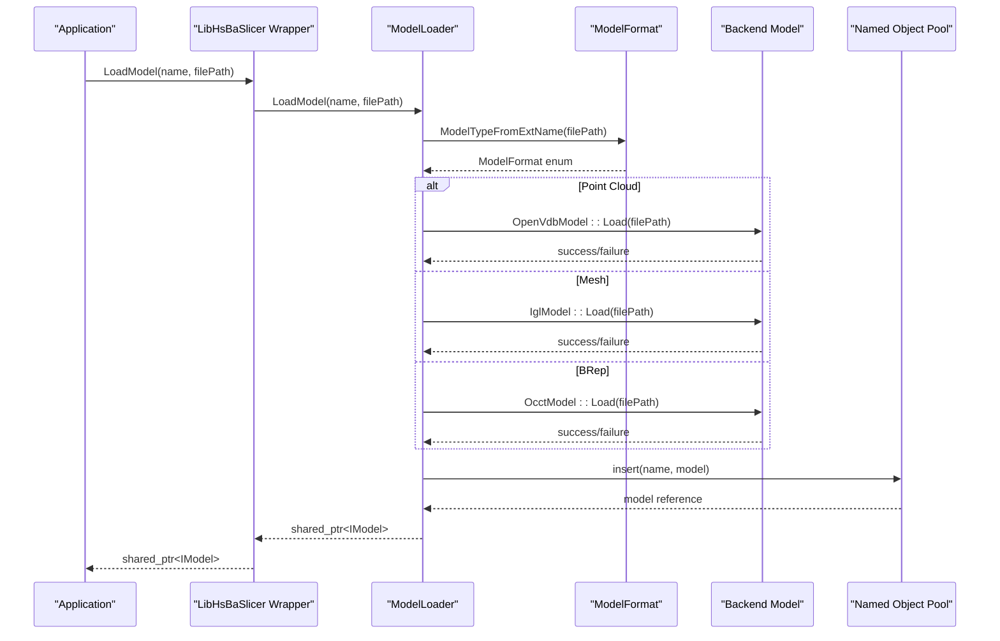
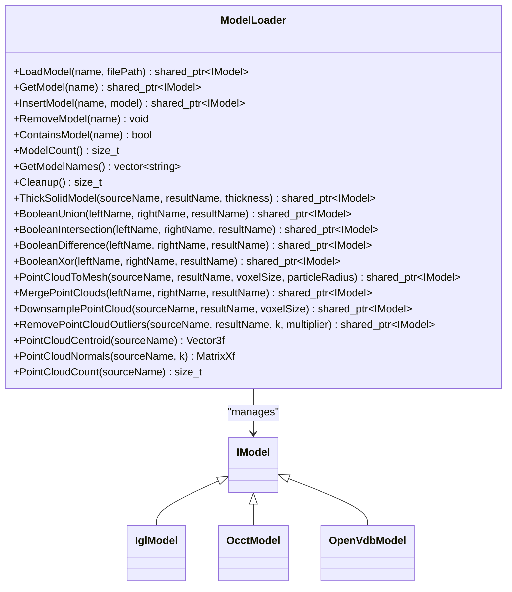
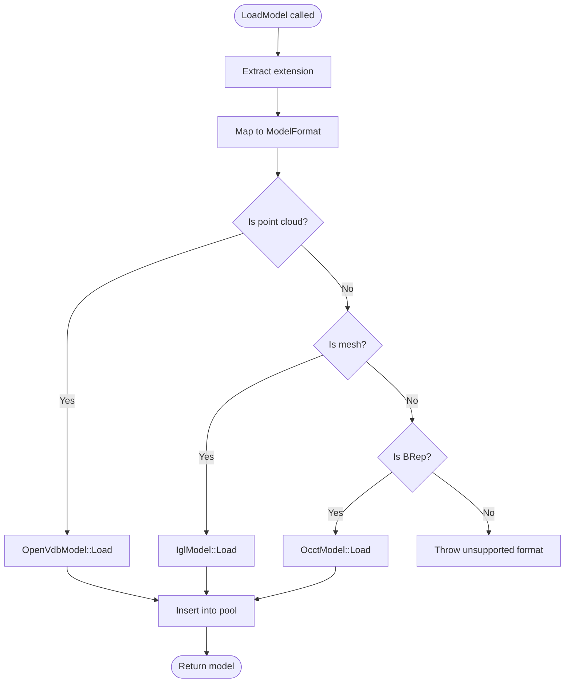
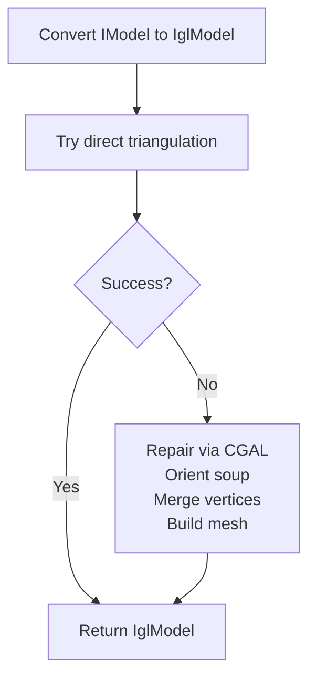
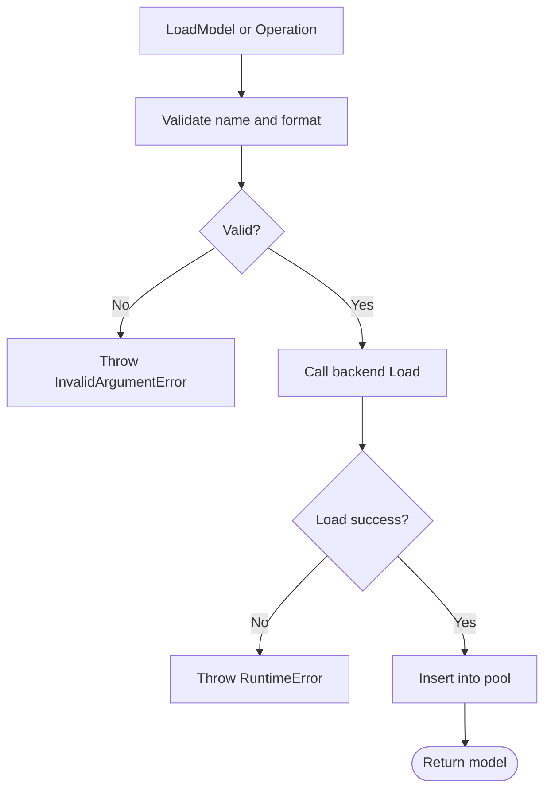
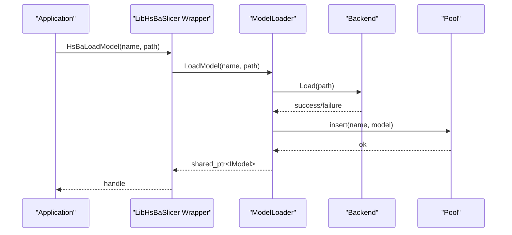
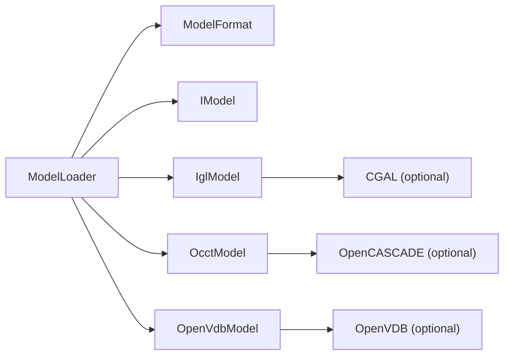

# Model Preprocessing Pipeline

<cite>
**Referenced Files in This Document**   
- [ModelLoader.hpp](file://preprocess/ModelLoader.hpp)
- [ModelLoader.cpp](file://preprocess/ModelLoader.cpp)
- [ModelFormat.hpp](file://base/ModelFormat.hpp)
- [ModelFormat.cpp](file://base/ModelFormat.cpp)
- [IModel.hpp](file://base/IModel.hpp)
- [IglModel.hpp](file://meshmodel/IglModel.hpp)
- [OcctModel.hpp](file://cadmodel/OcctModel.hpp)
- [OpenVdbModel.hpp](file://pointcloud/OpenVdbModel.hpp)
- [CgalModel.cpp](file://meshmodel/CgalModel.cpp)
- [OcctModel.cpp](file://cadmodel/OcctModel.cpp)
- [model_preprocess.hpp](file://LibHsBaSlicer/Preprocess/model_preprocess.hpp)
- [model_preprocess.cpp](file://LibHsBaSlicer/Preprocess/model_preprocess.cpp)
- [README.md](file://docs/en/DllHsBaSlicer/README.md)
- [model_loader_test.cpp](file://tests/Preprocess/model_loader_test.cpp)
</cite>

## Table of Contents
1. [Introduction](#introduction)
2. [Project Structure](#project-structure)
3. [Core Components](#core-components)
4. [Architecture Overview](#architecture-overview)
5. [Detailed Component Analysis](#detailed-component-analysis)
6. [Dependency Analysis](#dependency-analysis)
7. [Performance Considerations](#performance-considerations)
8. [Troubleshooting Guide](#troubleshooting-guide)
9. [Conclusion](#conclusion)
10. [Appendices](#appendices)

## Introduction
This document explains the model preprocessing pipeline that turns raw 3D files into validated models ready for slicing. The pipeline centers on `ModelLoader`, which performs automatic format detection, delegates loading to format-specific model classes, and manages a named model pool. It also exposes advanced preprocessing operations such as boolean operations, thick-solid shell creation, point cloud mesh reconstruction, downsampling, outlier removal, centroid computation, and normal estimation.

The supported input categories are:
- Mesh formats: STL, OBJ, PLY, OFF.
- BRep formats: STEP, IGES, VRML, BREP.
- Point cloud formats: XYZ (and VDB through the OpenVDB model).

The loader does not perform explicit mesh repair or coordinate system normalization itself; instead, it relies on the underlying model implementations and optional CGAL-based repair paths when converting meshes to higher-level representations.

## Project Structure
The preprocessing subsystem is split across several modules:
- Format detection lives in `base/ModelFormat.*`.
- Unified loading and pooling live in `preprocess/ModelLoader.*`.
- Concrete model backends live in `meshmodel`, `cadmodel`, and `pointcloud`.
- A LibHsBaSlicer translation layer wraps the C++ API for external consumers.

**Diagram sources**
- [ModelLoader.cpp:45-84](file://preprocess/ModelLoader.cpp#L45-L84)
- [ModelFormat.cpp:95-99](file://base/ModelFormat.cpp#L95-L99)
- [IglModel.hpp:55-58](file://meshmodel/IglModel.hpp#L55-L58)
- [OcctModel.hpp:54-57](file://cadmodel/OcctModel.hpp#L54-L57)
- [OpenVdbModel.hpp:46-47](file://pointcloud/OpenVdbModel.hpp#L46-L47)

**Section sources**
- [ModelLoader.hpp:23-59](file://preprocess/ModelLoader.hpp#L23-L59)
- [ModelLoader.cpp:45-84](file://preprocess/ModelLoader.cpp#L45-L84)
- [ModelFormat.hpp:68-114](file://base/ModelFormat.hpp#L68-L114)
- [ModelFormat.cpp:14-85](file://base/ModelFormat.cpp#L14-L85)

## Core Components
- `ModelLoader`: Central dispatcher that detects file type, loads into the correct backend, and stores models in a named pool. It also provides advanced preprocessing operations guarded by compile-time features.
- `ModelFormat`: Enumerates supported formats and provides extension-to-format mapping and category checks for mesh, BRep, CSG, and point cloud formats.
- `IModel`: Abstract interface defining load/save, transforms, bounding box, volume, and triangle mesh access.
- `IglModel`: libigl-backed triangle mesh implementation used for mesh formats and mesh-based boolean fallbacks.
- `OcctModel`: OpenCASCADE-backed BRep CAD model used for STEP/IGES/VRML/BREP.
- `OpenVdbModel`: Point cloud model backed by an OpenVDB grid, supporting voxelization, downsampling, mesh reconstruction, and statistics.

Key responsibilities:
- Automatic format detection from file extensions.
- Loading into appropriate backend with error propagation.
- Named model pool management with cleanup semantics.
- Advanced preprocessing via boolean operations, thick solid, and point cloud utilities.

**Section sources**
- [IModel.hpp:66-139](file://base/IModel.hpp#L66-L139)
- [ModelLoader.hpp:30-92](file://preprocess/ModelLoader.hpp#L30-L92)
- [ModelFormat.hpp:19-114](file://base/ModelFormat.hpp#L19-L114)

## Architecture Overview
The preprocessing workflow proceeds from raw file input to validated model output through these stages:
1. Extension-based format detection.
2. Category routing: point cloud, mesh, or BRep.
3. Backend loading with validation at each step.
4. Optional advanced preprocessing (boolean/thick-solid/mesh reconstruction).
5. Result storage in the named model pool.

**Diagram sources**
- [model_preprocess.cpp:19-23](file://LibHsBaSlicer/Preprocess/model_preprocess.cpp#L19-L23)
- [ModelLoader.cpp:45-84](file://preprocess/ModelLoader.cpp#L45-L84)
- [ModelFormat.cpp:95-99](file://base/ModelFormat.cpp#L95-L99)

**Section sources**
- [model_preprocess.hpp:32-40](file://LibHsBaSlicer/Preprocess/model_preprocess.hpp#L32-L40)
- [README.md:112-145](file://docs/en/DllHsBaSlicer/README.md#L112-L145)

## Detailed Component Analysis

### ModelLoader Capabilities
`ModelLoader` supports:
- Multi-format loading: STL, OBJ, PLY, OFF via `IglModel`; STEP, IGES, VRML, BREP via `OcctModel`; XYZ via `OpenVdbModel`.
- Automatic format detection using `ModelTypeFromExtName`.
- Named model pool insertion, retrieval, removal, and cleanup.
- Advanced preprocessing:
  - Thick-solid shell creation for BRep models.
  - Boolean union, intersection, difference, and XOR with OCCT-first and CGAL fallback.
  - Point cloud to mesh conversion, merging, downsampling, outlier removal, centroid, normals, and count.

Error handling:
- Duplicate names throw invalid argument errors.
- Unsupported formats throw invalid argument errors.
- File loading failures throw runtime errors.
- Missing source models in boolean/thick-solid operations throw invalid argument errors.
- Platform feature absence throws not-supported or runtime errors.

**Diagram sources**
- [ModelLoader.hpp:30-198](file://preprocess/ModelLoader.hpp#L30-L198)
- [IModel.hpp:111-139](file://base/IModel.hpp#L111-L139)
- [IglModel.hpp:18-121](file://meshmodel/IglModel.hpp#L18-L121)
- [OcctModel.hpp:22-124](file://cadmodel/OcctModel.hpp#L22-L124)
- [OpenVdbModel.hpp:21-116](file://pointcloud/OpenVdbModel.hpp#L21-L116)

**Section sources**
- [ModelLoader.hpp:47-92](file://preprocess/ModelLoader.hpp#L47-L92)
- [ModelLoader.cpp:45-130](file://preprocess/ModelLoader.cpp#L45-L130)

### Format Detection and Routing
Format detection uses regex-based extension matching to map filenames to `ModelFormat` values. Categories include:
- Mesh: STL, PLY, OBJ, OFF.
- BRep: STEP, VRML, IGES, BREP.
- CSG: SLDPRT, CATPART.
- Point cloud: XYZ, VDB.

Routing logic:
- If point cloud format → `OpenVdbModel::Load`.
- Else if mesh format → `IglModel::Load`.
- Else if BRep format → `OcctModel::Load`.
- Otherwise → unsupported format error.

**Diagram sources**
- [ModelFormat.cpp:14-85](file://base/ModelFormat.cpp#L14-L85)
- [ModelLoader.cpp:45-84](file://preprocess/ModelLoader.cpp#L45-L84)

**Section sources**
- [ModelFormat.hpp:68-114](file://base/ModelFormat.hpp#L68-L114)
- [ModelFormat.cpp:89-99](file://base/ModelFormat.cpp#L89-L99)
- [ModelLoader.cpp:45-84](file://preprocess/ModelLoader.cpp#L45-L84)

### Mesh Validation and Repair
Explicit mesh validation and repair are not performed inside `ModelLoader`. However:
- When converting arbitrary `IModel` to `IglModel` for boolean operations, the code attempts direct triangulation and falls back to CGAL polygon soup orientation and mesh building.
- `CgalModel` includes a repair path that tries direct conversion, then repairs via CGAL’s polygon mesh processing (orientation, duplicate vertex merge, mesh construction).

Implications:
- Corrupted or non-manifold meshes may be repaired automatically during conversion to CGAL-backed structures.
- Boolean operations on mesh inputs rely on CGAL; results may be empty for degenerate cases.

**Diagram sources**
- [ModelLoader.cpp:137-146](file://preprocess/ModelLoader.cpp#L137-L146)
- [CgalModel.cpp:45-100](file://meshmodel/CgalModel.cpp#L45-L100)

**Section sources**
- [ModelLoader.cpp:137-146](file://preprocess/ModelLoader.cpp#L137-L146)
- [CgalModel.cpp:45-100](file://meshmodel/CgalModel.cpp#L45-L100)

### Coordinate System Normalization
There is no automatic coordinate system normalization in the preprocessing pipeline. Models retain their original coordinates after loading. Transformations (translate, rotate, scale, transform) are available on all model types but must be applied explicitly by the caller.

**Section sources**
- [IModel.hpp:120-130](file://base/IModel.hpp#L120-L130)
- [IglModel.hpp:60-73](file://meshmodel/IglModel.hpp#L60-L73)
- [OcctModel.hpp:59-72](file://cadmodel/OcctModel.hpp#L59-L72)
- [OpenVdbModel.hpp:49-55](file://pointcloud/OpenVdbModel.hpp#L49-L55)

### Error Handling for Corrupted or Invalid Files
- Unsupported format: `InvalidArgumentError`.
- Duplicate name: `InvalidArgumentError`.
- Null model insertion: `InvalidArgumentError`.
- Missing source model in boolean/thick-solid: `InvalidArgumentError`.
- File read failures:
  - Mesh/BRep/point cloud loaders throw `RuntimeError` when `Load` returns false.
  - OCCT readers throw `IOError` for STEP/IGES/VRML/BREP read/write failures.
- Platform feature absence:
  - Point cloud without OpenVDB: `RuntimeError`.
  - BRep without OCCT: `RuntimeError`.
  - Thick-solid without OCCT: `NotSupportedError`.

**Diagram sources**
- [ModelLoader.cpp:45-84](file://preprocess/ModelLoader.cpp#L45-L84)
- [OcctModel.cpp:76-147](file://cadmodel/OcctModel.cpp#L76-L147)

**Section sources**
- [ModelLoader.cpp:45-84](file://preprocess/ModelLoader.cpp#L45-L84)
- [OcctModel.cpp:76-147](file://cadmodel/OcctModel.cpp#L76-L147)

### Preprocessing Workflow From Raw Input to Validated Output
End-to-end flow:
1. Application calls `LoadModel` through the LibHsBaSlicer wrapper.
2. `ModelLoader` detects format and routes to the correct backend.
3. Backend loads and validates data; errors propagate up.
4. Successful models are inserted into the named pool.
5. Consumers can retrieve models and optionally run advanced preprocessing (boolean/thick-solid/point cloud operations).

**Diagram sources**
- [README.md:112-145](file://docs/en/DllHsBaSlicer/README.md#L112-L145)
- [model_preprocess.cpp:19-23](file://LibHsBaSlicer/Preprocess/model_preprocess.cpp#L19-L23)
- [ModelLoader.cpp:45-84](file://preprocess/ModelLoader.cpp#L45-L84)

**Section sources**
- [model_preprocess.hpp:32-40](file://LibHsBaSlicer/Preprocess/model_preprocess.hpp#L32-L40)
- [README.md:112-145](file://docs/en/DllHsBaSlicer/README.md#L112-L145)

### Quality Checks, Mesh Simplification, and Integration Points
- Quality checks:
  - Volume and bounding box queries are available on all models.
  - Point cloud quality metrics include centroid, normals, and statistical outlier removal.
- Mesh simplification:
  - No dedicated mesh simplification is exposed by `ModelLoader`.
  - Point cloud downsampling (`DownsamplePointCloud`) reduces density via voxel filtering.
- Integration points:
  - Boolean operations integrate with both OCCT (for BRep) and CGAL (for mesh fallback).
  - Thick-solid integrates with OCCT.
  - Point cloud mesh reconstruction integrates with OpenVDB level set generation.

**Section sources**
- [ModelLoader.hpp:94-198](file://preprocess/ModelLoader.hpp#L94-L198)
- [ModelLoader.cpp:172-321](file://preprocess/ModelLoader.cpp#L172-L321)
- [OpenVdbModel.hpp:79-111](file://pointcloud/OpenVdbModel.hpp#L79-L111)

### Custom File Format Loaders
The current design dispatches based on file extension. To add a custom format:
- Extend `ModelFormat` enum with the new format identifier.
- Add extension matching in `ModelFormat.cpp`.
- Route the new format in `ModelLoader::LoadModel` to the appropriate backend or a new loader.
- Implement `Load`/`Save` in the target model class if needed.

Example pattern:
- For a new mesh format, implement `IglModel::Load` support or create a specialized loader and route it similarly to STL/OBJ/PLY/OFF.
- For a new BRep format, implement `OcctModel::Load` support and route accordingly.
- For a new point cloud format, implement `OpenVdbModel::Load` support and route accordingly.

**Section sources**
- [ModelFormat.hpp:66-109](file://base/ModelFormat.hpp#L66-L109)
- [ModelFormat.cpp:14-85](file://base/ModelFormat.cpp#L14-L85)
- [ModelLoader.cpp:45-84](file://preprocess/ModelLoader.cpp#L45-L84)

### Preprocessing Configuration Options
Configuration is primarily driven by compile-time macros and method parameters:
- Compile-time:
  - `USE_CGAL`: Enables CGAL-based boolean operations and mesh repair fallback.
  - `USE_OCCT`: Enables BRep loading and thick-solid operations.
  - `USE_OPENVDB`: Enables point cloud operations.
  - `HSBA_MODEL_POOL_SIZE`: Controls named model pool capacity.
- Runtime parameters:
  - Point cloud to mesh: `voxelSize`, `particleRadius`.
  - Downsample: `voxelSize`.
  - Outlier removal: `k`, `multiplier`.
  - Thick-solid: `thickness`, optional closing faces.

**Section sources**
- [ModelLoader.hpp:94-198](file://preprocess/ModelLoader.hpp#L94-L198)
- [ModelLoader.cpp:172-321](file://preprocess/ModelLoader.cpp#L172-L321)

## Dependency Analysis
The preprocessing pipeline depends on:
- `base/ModelFormat.*` for format detection.
- `base/IModel.hpp` for the unified model interface.
- `meshmodel/IglModel.hpp` for mesh loading and boolean fallback.
- `cadmodel/OcctModel.hpp/.cpp` for BRep loading and boolean/thick-solid.
- `pointcloud/OpenVdbModel.hpp` for point cloud operations.
- Optional CGAL and OpenVDB libraries for advanced features.

**Diagram sources**
- [ModelLoader.cpp:5-22](file://preprocess/ModelLoader.cpp#L5-L22)
- [IglModel.hpp:55-58](file://meshmodel/IglModel.hpp#L55-L58)
- [OcctModel.hpp:54-57](file://cadmodel/OcctModel.hpp#L54-L57)
- [OpenVdbModel.hpp:46-47](file://pointcloud/OpenVdbModel.hpp#L46-L47)

**Section sources**
- [ModelLoader.cpp:5-22](file://preprocess/ModelLoader.cpp#L5-L22)
- [IglModel.hpp:55-58](file://meshmodel/IglModel.hpp#L55-L58)
- [OcctModel.hpp:54-57](file://cadmodel/OcctModel.hpp#L54-L57)
- [OpenVdbModel.hpp:46-47](file://pointcloud/OpenVdbModel.hpp#L46-L47)

## Performance Considerations
- Named model pool capacity is controlled by `HSBA_MODEL_POOL_SIZE`; ensure sufficient capacity for concurrent models.
- Boolean operations on large meshes can be expensive; prefer OCCT for BRep inputs when possible.
- Point cloud mesh reconstruction cost scales with voxel resolution and point count; tune `voxelSize` and `particleRadius`.
- Downsampling reduces memory and compute costs for downstream operations.

[No sources needed since this section provides general guidance]

## Troubleshooting Guide
Common issues and resolutions:
- Duplicate model name:
  - Cause: Inserting or loading with an existing name.
  - Resolution: Use unique names or remove the existing model before inserting.
- Unsupported format:
  - Cause: File extension not recognized.
  - Resolution: Rename file to a supported extension or extend format detection.
- File load failure:
  - Cause: Corrupted or incompatible file.
  - Resolution: Verify file integrity and format; check backend logs.
- Missing source model in boolean/thick-solid:
  - Cause: Referencing a name that does not exist.
  - Resolution: Ensure both source models are loaded and present.
- Platform feature missing:
  - Cause: Building without required libraries (OCCT, CGAL, OpenVDB).
  - Resolution: Enable the corresponding compile-time flags or avoid dependent operations.

Validation references:
- Duplicate name and null insertion tests.
- Cleanup behavior for inactive vs active models.
- Boolean operation tests for both mesh and BRep inputs.
- Point cloud loading and counting tests.

**Section sources**
- [model_loader_test.cpp:55-69](file://tests/Preprocess/model_loader_test.cpp#L55-L69)
- [model_loader_test.cpp:100-128](file://tests/Preprocess/model_loader_test.cpp#L100-L128)
- [model_loader_test.cpp:132-149](file://tests/Preprocess/model_loader_test.cpp#L132-L149)
- [model_loader_test.cpp:159-254](file://tests/Preprocess/model_loader_test.cpp#L159-L254)
- [model_loader_test.cpp:277-318](file://tests/Preprocess/model_loader_test.cpp#L277-L318)

## Conclusion
The model preprocessing pipeline provides a robust, extensible foundation for loading and validating 3D models across multiple formats. `ModelLoader` centralizes format detection and backend dispatch, while concrete model classes encapsulate format-specific loading and capabilities. Advanced preprocessing integrates OCCT, CGAL, and OpenVDB to support boolean operations, thick solids, and point cloud mesh reconstruction. Users should configure compile-time features appropriately and apply explicit transformations and quality checks as needed.

[No sources needed since this section summarizes without analyzing specific files]

## Appendices

### Supported Formats Summary
- Mesh: STL, OBJ, PLY, OFF.
- BRep: STEP, IGES, VRML, BREP.
- Point cloud: XYZ (and VDB via OpenVDB model).

**Section sources**
- [ModelFormat.hpp:66-109](file://base/ModelFormat.hpp#L66-L109)
- [ModelFormat.cpp:14-85](file://base/ModelFormat.cpp#L14-L85)

### Example Usage Patterns
- Load mesh models and perform boolean union through the C ABI wrapper.
- Retrieve model info (bounding box and volume) after preprocessing.

**Section sources**
- [README.md:112-145](file://docs/en/DllHsBaSlicer/README.md#L112-L145)