# Model Preprocessing Pipeline

<cite>
**Referenced Files in This Document**   
- [ModelLoader.hpp](file://preprocess/ModelLoader.hpp)
- [ModelLoader.cpp](file://preprocess/ModelLoader.cpp)
- [model_preprocess.hpp](file://LibHsBaSlicer/Preprocess/model_preprocess.hpp)
- [model_preprocess.cpp](file://LibHsBaSlicer/Preprocess/model_preprocess.cpp)
- [model_preprocess.h](file://DllHsBaSlicer/model_preprocess.h)
- [model_preprocess.cpp](file://DllHsBaSlicer/model_preprocess.cpp)
- [IModel.hpp](file://base/IModel.hpp)
- [OcctModel.hpp](file://cadmodel/OcctModel.hpp)
- [OcctCsg.cpp](file://cadmodel/OcctCsg.cpp)
- [OcctCsg.hpp](file://cadmodel/OcctCsg.hpp)
- [README.md](file://docs/en/DllHsBaSlicer/README.md)
</cite>

## Update Summary
**Changes Made**   
- Added comprehensive triangle mesh export functionality with `GetModelTriangles` API
- Enhanced CSG boolean operations integration with OCCT-first and CGAL fallback strategies
- Implemented process-wide model publishing support via `PublishModel`/`UnpublishModel` APIs
- Added text CSG model creation capabilities through `BuildCsgModel` API
- Updated C ABI interfaces to support all new functionality
- Enhanced error handling and thread safety for cross-thread model access

## Table of Contents
1. [Introduction](#introduction)
2. [Project Structure](#project-structure)
3. [Core Components](#core-components)
4. [Architecture Overview](#architecture-overview)
5. [Detailed Component Analysis](#detailed-component-analysis)
6. [Dependency Analysis](#dependency-analysis)
7. [Performance Considerations](#performance-considerations)
8. [Troubleshooting Guide](#troubleshooting-guide)
9. [Conclusion](#conclusion)
10. [Appendices](#appendices)

## Introduction
This document explains the enhanced model preprocessing pipeline that turns raw 3D files into validated models ready for slicing. The pipeline now includes advanced features such as triangle mesh export, comprehensive CSG boolean operations, process-wide model publishing, and text-based CSG model creation. The system centers on `ModelLoader`, which performs automatic format detection, delegates loading to format-specific model classes, and manages a named model pool with both thread-local and process-wide visibility.

The supported input categories are:
- Mesh formats: STL, OBJ, PLY, OFF.
- BRep formats: STEP, IGES, VRML, BREP.
- Point cloud formats: XYZ (and VDB through the OpenVDB model).
- Text CSG scripts via OCCT DRAW Test Harness.

## Project Structure
The preprocessing subsystem is split across several modules with enhanced capabilities:
- Format detection lives in `base/ModelFormat.*`.
- Unified loading and pooling live in `preprocess/ModelLoader.*`.
- LibHsBaSlicer translation layer wraps the C++ API for external consumers.
- DllHsBaSlicer provides C ABI interfaces for cross-language compatibility.
- Concrete model backends live in `meshmodel`, `cadmodel`, and `pointcloud`.
- Text CSG functionality is implemented in `cadmodel/OcctCsg.*`.

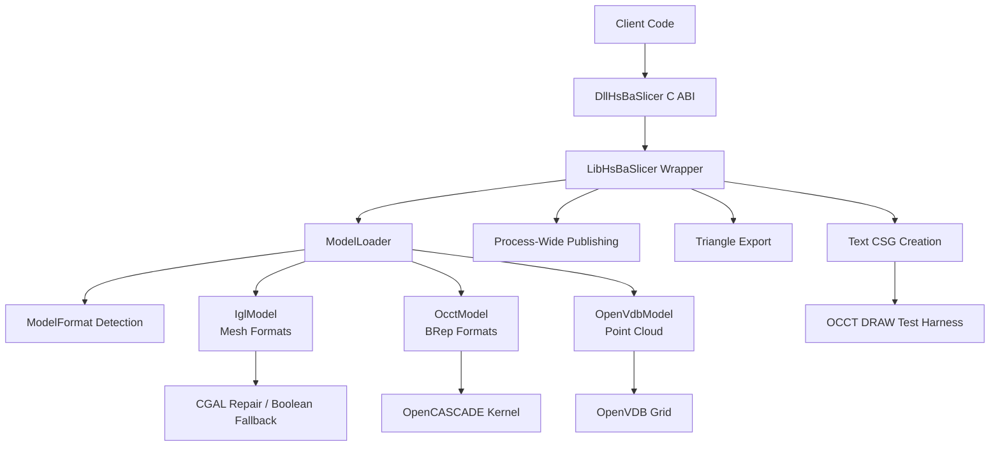

**Diagram sources**
- [model_preprocess.cpp:25-67](file://LibHsBaSlicer/Preprocess/model_preprocess.cpp#L25-L67)
- [model_preprocess.cpp:213-225](file://LibHsBaSlicer/Preprocess/model_preprocess.cpp#L213-L225)
- [model_preprocess.cpp:327-338](file://LibHsBaSlicer/Preprocess/model_preprocess.cpp#L327-L338)
- [OcctCsg.cpp:238-290](file://cadmodel/OcctCsg.cpp#L238-L290)

**Section sources**
- [ModelLoader.hpp:23-59](file://preprocess/ModelLoader.hpp#L23-L59)
- [ModelLoader.cpp:45-84](file://preprocess/ModelLoader.cpp#L45-L84)
- [model_preprocess.hpp:33-75](file://LibHsBaSlicer/Preprocess/model_preprocess.hpp#L33-L75)

## Core Components
- `ModelLoader`: Central dispatcher that detects file type, loads into the correct backend, and stores models in a named pool. It also provides advanced preprocessing operations guarded by compile-time features.
- `ModelFormat`: Enumerates supported formats and provides extension-to-format mapping and category checks for mesh, BRep, CSG, and point cloud formats.
- `IModel`: Abstract interface defining load/save, transforms, bounding box, volume, and triangle mesh access.
- `IglModel`: libigl-backed triangle mesh implementation used for mesh formats and mesh-based boolean fallbacks.
- `OcctModel`: OpenCASCADE-backed BRep CAD model used for STEP/IGES/VRML/BREP and text CSG creation.
- `OpenVdbModel`: Point cloud model backed by an OpenVDB grid, supporting voxelization, downsampling, mesh reconstruction, and statistics.
- `SharedTier`: Process-wide model storage for cross-thread visibility.

Key responsibilities:
- Automatic format detection from file extensions.
- Loading into appropriate backend with error propagation.
- Named model pool management with cleanup semantics.
- Process-wide model publishing for cross-thread access.
- Triangle mesh export for visualization and analysis.
- Advanced preprocessing via boolean operations, thick solid, and point cloud utilities.
- Text CSG model creation via OCCT DRAW Test Harness.

**Section sources**
- [IModel.hpp:111-139](file://base/IModel.hpp#L111-L139)
- [ModelLoader.hpp:30-92](file://preprocess/ModelLoader.hpp#L30-L92)
- [model_preprocess.hpp:33-75](file://LibHsBaSlicer/Preprocess/model_preprocess.hpp#L33-L75)
- [model_preprocess.cpp:39-67](file://LibHsBaSlicer/Preprocess/model_preprocess.cpp#L39-L67)

## Architecture Overview
The enhanced preprocessing workflow proceeds from raw file input to validated model output through these stages:
1. Extension-based format detection.
2. Category routing: point cloud, mesh, BRep, or text CSG.
3. Backend loading with validation at each step.
4. Optional advanced preprocessing (boolean/thick-solid/mesh reconstruction).
5. Result storage in the named model pool with optional process-wide publishing.
6. Triangle mesh export capability for visualization and analysis.

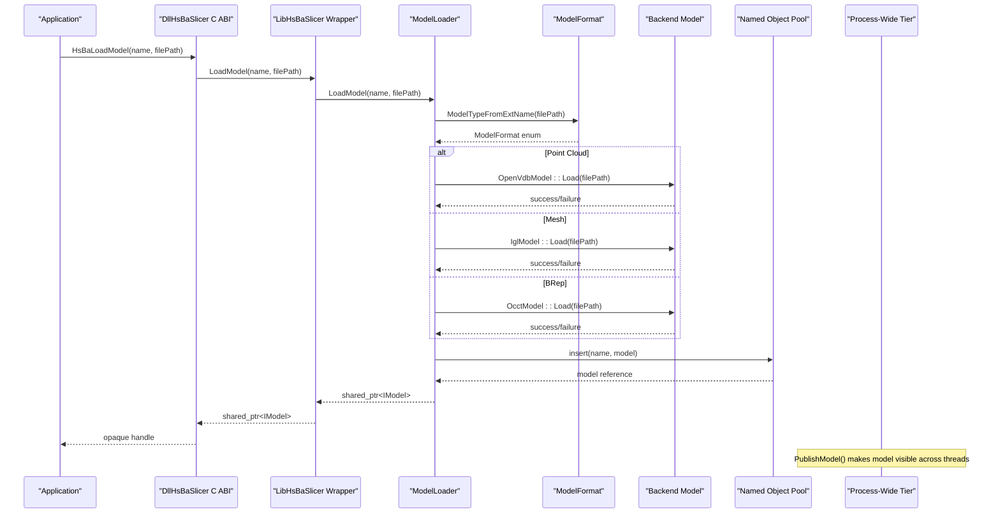

**Diagram sources**
- [model_preprocess.cpp:99-112](file://LibHsBaSlicer/Preprocess/model_preprocess.cpp#L99-L112)
- [model_preprocess.cpp:119-133](file://LibHsBaSlicer/Preprocess/model_preprocess.cpp#L119-L133)
- [ModelLoader.cpp:45-84](file://preprocess/ModelLoader.cpp#L45-L84)

**Section sources**
- [model_preprocess.hpp:33-75](file://LibHsBaSlicer/Preprocess/model_preprocess.hpp#L33-L75)
- [README.md:112-145](file://docs/en/DllHsBaSlicer/README.md#L112-L145)

## Detailed Component Analysis

### Enhanced ModelLoader Capabilities
`ModelLoader` now supports:
- Multi-format loading: STL, OBJ, PLY, OFF via `IglModel`; STEP, IGES, VRML, BREP via `OcctModel`; XYZ via `OpenVdbModel`.
- Automatic format detection using `ModelTypeFromExtName`.
- Named model pool insertion, retrieval, removal, and cleanup.
- Advanced preprocessing:
  - Thick-solid shell creation for BRep models.
  - Boolean union, intersection, difference, and XOR with OCCT-first and CGAL fallback.
  - Point cloud to mesh conversion, merging, downsampling, outlier removal, centroid, normals, and count.

Error handling:
- Duplicate names throw invalid argument errors.
- Unsupported formats throw invalid argument errors.
- File loading failures throw runtime errors.
- Missing source models in boolean/thick-solid operations throw invalid argument errors.
- Platform feature absence throws not-supported or runtime errors.

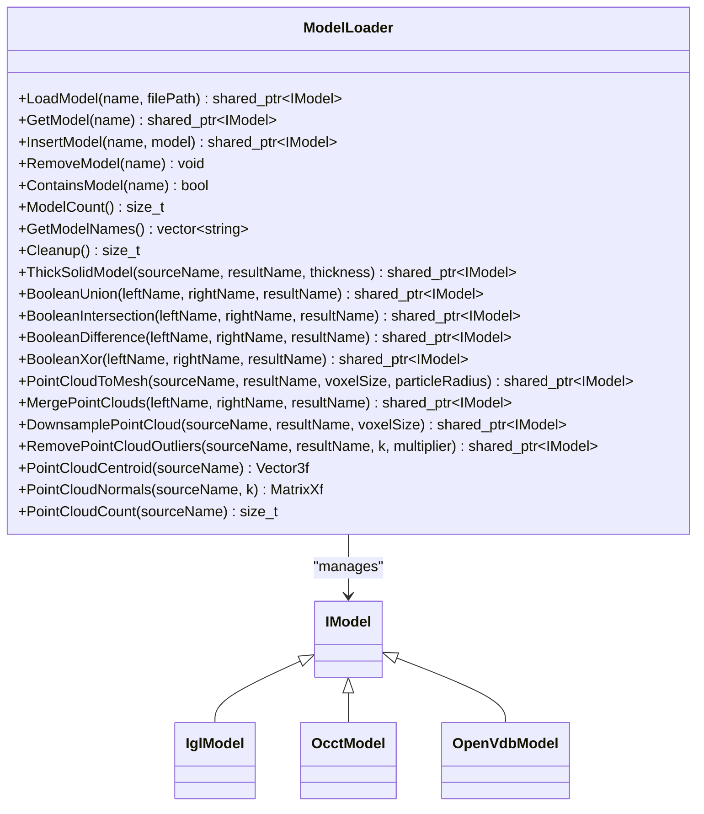

**Diagram sources**
- [ModelLoader.hpp:30-198](file://preprocess/ModelLoader.hpp#L30-L198)
- [IModel.hpp:111-139](file://base/IModel.hpp#L111-L139)
- [IglModel.hpp:18-121](file://meshmodel/IglModel.hpp#L18-L121)
- [OcctModel.hpp:22-124](file://cadmodel/OcctModel.hpp#L22-L124)
- [OpenVdbModel.hpp:21-116](file://pointcloud/OpenVdbModel.hpp#L21-L116)

**Section sources**
- [ModelLoader.hpp:47-92](file://preprocess/ModelLoader.hpp#L47-L92)
- [ModelLoader.cpp:45-130](file://preprocess/ModelLoader.cpp#L45-L130)

### Process-Wide Model Publishing Support
The enhanced system now includes process-wide model publishing that allows models loaded on one thread to be accessible from other threads:

- `PublishModel(name)`: Creates a process-wide reference to a model under the same name.
- `UnpublishModel(name)`: Removes the process-wide reference while keeping the local copy.
- Thread-safe implementation with mutex protection.
- Models remain visible across threads until unpublished or removed.
- Concurrent publishes overwrite: the last publisher's instance is shared.

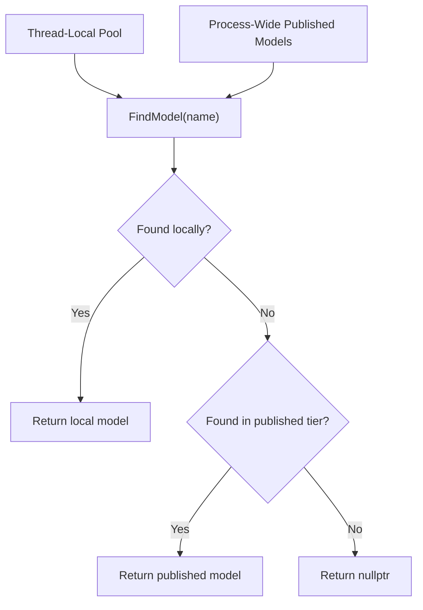

**Diagram sources**
- [model_preprocess.cpp:51-67](file://LibHsBaSlicer/Preprocess/model_preprocess.cpp#L51-L67)
- [model_preprocess.cpp:119-143](file://LibHsBaSlicer/Preprocess/model_preprocess.cpp#L119-L143)

**Section sources**
- [model_preprocess.hpp:53-75](file://LibHsBaSlicer/Preprocess/model_preprocess.hpp#L53-L75)
- [model_preprocess.cpp:39-67](file://LibHsBaSlicer/Preprocess/model_preprocess.cpp#L39-L67)
- [model_preprocess.cpp:119-143](file://LibHsBaSlicer/Preprocess/model_preprocess.cpp#L119-L143)

### Triangle Mesh Export Functionality
Enhanced triangle mesh export capabilities provide unified access to triangulated geometry:

- `GetModelTriangles(name)`: Returns vertex and face matrices for any model type.
- Mesh models return their stored triangles directly.
- BRep models are tessellated on demand with kernel-controlled deflection.
- Text CSG models automatically generate triangulation during creation.
- C ABI wrapper provides memory-safe access via `HsBaModelTriangles_t` structure.

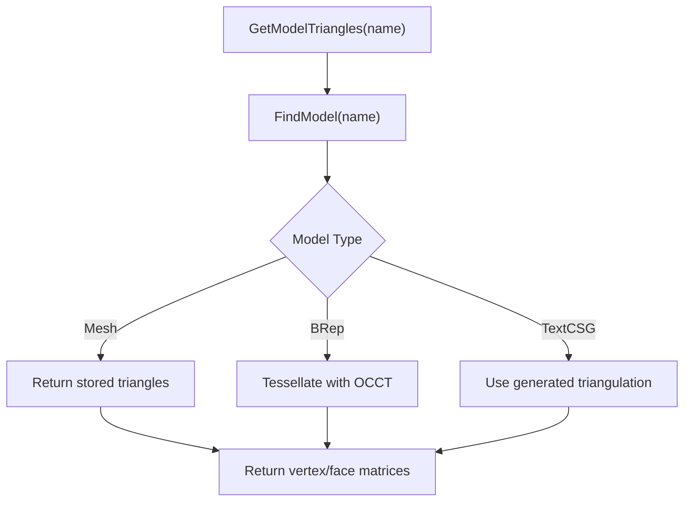

**Diagram sources**
- [model_preprocess.cpp:213-225](file://LibHsBaSlicer/Preprocess/model_preprocess.cpp#L213-L225)
- [model_preprocess.cpp:52-83](file://DllHsBaSlicer/model_preprocess.cpp#L52-L83)

**Section sources**
- [model_preprocess.hpp:112-122](file://LibHsBaSlicer/Preprocess/model_preprocess.hpp#L112-L122)
- [model_preprocess.cpp:213-225](file://LibHsBaSlicer/Preprocess/model_preprocess.cpp#L213-L225)
- [model_preprocess.h:124-159](file://DllHsBaSlicer/model_preprocess.h#L124-L159)

### CSG Boolean Operations Integration
Comprehensive CSG boolean operations with intelligent kernel routing:

- OCCT-first strategy for BRep-BRep operations (preferred for accuracy and performance).
- CGAL fallback for mesh models when OCCT is unavailable.
- All four boolean operations: Union, Intersection, Difference, XOR.
- Automatic model type detection and conversion.
- Error handling for missing models and unsupported operations.

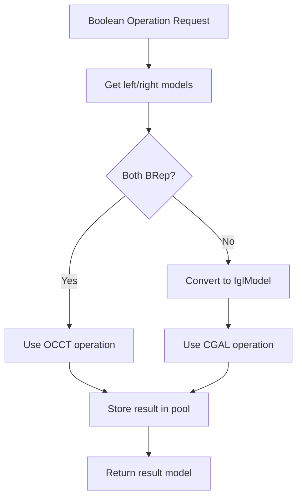

**Diagram sources**
- [ModelLoader.cpp:218-243](file://preprocess/ModelLoader.cpp#L218-L243)
- [ModelLoader.cpp:137-146](file://preprocess/ModelLoader.cpp#L137-L146)

**Section sources**
- [ModelLoader.hpp:94-133](file://preprocess/ModelLoader.hpp#L94-L133)
- [ModelLoader.cpp:218-321](file://preprocess/ModelLoader.cpp#L218-L321)

### Text CSG Model Creation Capabilities
New text-based CSG model creation via OCCT DRAW Test Harness:

- `BuildCsgModel(name, script, shapeName)`: Creates models from text scripts.
- Full Tcl interpreter support for parameter substitution.
- Comprehensive command set: primitives, transforms, booleans, utilities.
- Process-wide DRAW interpreter with thread safety.
- Automatic cleanup of temporary shapes in DRAW bank.
- Error reporting with detailed failure messages.

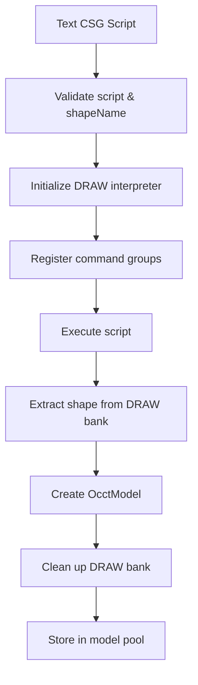

**Diagram sources**
- [OcctCsg.cpp:238-290](file://cadmodel/OcctCsg.cpp#L238-L290)
- [model_preprocess.cpp:327-338](file://LibHsBaSlicer/Preprocess/model_preprocess.cpp#L327-L338)

**Section sources**
- [model_preprocess.hpp:234-266](file://LibHsBaSlicer/Preprocess/model_preprocess.hpp#L234-L266)
- [OcctCsg.cpp:238-290](file://cadmodel/OcctCsg.cpp#L238-L290)
- [OcctCsg.hpp:19-31](file://cadmodel/OcctCsg.hpp#L19-L31)

### Format Detection and Routing
Format detection uses regex-based extension matching to map filenames to `ModelFormat` values. Categories include:
- Mesh: STL, PLY, OBJ, OFF.
- BRep: STEP, VRML, IGES, BREP.
- CSG: SLDPRT, CATPART.
- Point cloud: XYZ, VDB.

Routing logic:
- If point cloud format → `OpenVdbModel::Load`.
- Else if mesh format → `IglModel::Load`.
- Else if BRep format → `OcctModel::Load`.
- Otherwise → unsupported format error.

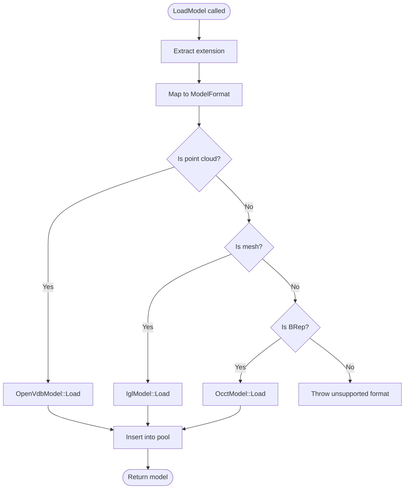

**Diagram sources**
- [ModelFormat.cpp:14-85](file://base/ModelFormat.cpp#L14-L85)
- [ModelLoader.cpp:45-84](file://preprocess/ModelLoader.cpp#L45-L84)

**Section sources**
- [ModelFormat.hpp:68-114](file://base/ModelFormat.hpp#L68-L114)
- [ModelFormat.cpp:89-99](file://base/ModelFormat.cpp#L89-L99)
- [ModelLoader.cpp:45-84](file://preprocess/ModelLoader.cpp#L45-L84)

### Mesh Validation and Repair
Explicit mesh validation and repair are not performed inside `ModelLoader`. However:
- When converting arbitrary `IModel` to `IglModel` for boolean operations, the code attempts direct triangulation and falls back to CGAL polygon soup orientation and mesh building.
- `CgalModel` includes a repair path that tries direct conversion, then repairs via CGAL's polygon mesh processing (orientation, duplicate vertex merge, mesh construction).

Implications:
- Corrupted or non-manifold meshes may be repaired automatically during conversion to CGAL-backed structures.
- Boolean operations on mesh inputs rely on CGAL; results may be empty for degenerate cases.

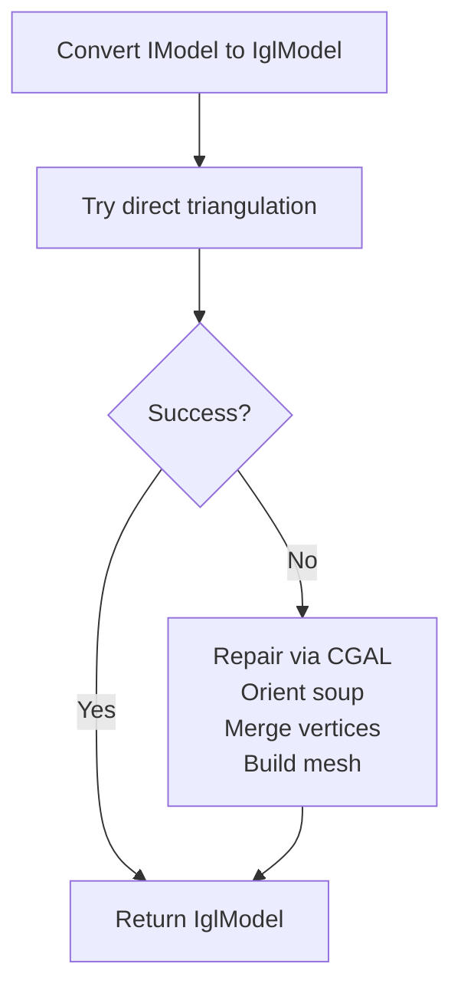

**Diagram sources**
- [ModelLoader.cpp:137-146](file://preprocess/ModelLoader.cpp#L137-L146)

**Section sources**
- [ModelLoader.cpp:137-146](file://preprocess/ModelLoader.cpp#L137-L146)

### Coordinate System Normalization
There is no automatic coordinate system normalization in the preprocessing pipeline. Models retain their original coordinates after loading. Transformations (translate, rotate, scale, transform) are available on all model types but must be applied explicitly by the caller.

**Section sources**
- [IModel.hpp:120-130](file://base/IModel.hpp#L120-L130)

### Error Handling for Corrupted or Invalid Files
Enhanced error handling covers all new functionality:
- Unsupported format: `InvalidArgumentError`.
- Duplicate name: `InvalidArgumentError`.
- Null model insertion: `InvalidArgumentError`.
- Missing source model in boolean/thick-solid: `InvalidArgumentError`.
- File read failures:
  - Mesh/BRep/point cloud loaders throw `RuntimeError` when `Load` returns false.
  - OCCT readers throw `IOError` for STEP/IGES/VRML/BREP read/write failures.
- Platform feature absence:
  - Point cloud without OpenVDB: `RuntimeError`.
  - BRep without OCCT: `RuntimeError`.
  - Thick-solid without OCCT: `NotSupportedError`.
  - Text CSG without DRAW: `NotSupportedError`.
- Cross-thread publishing conflicts: `AlreadyExistsError`.

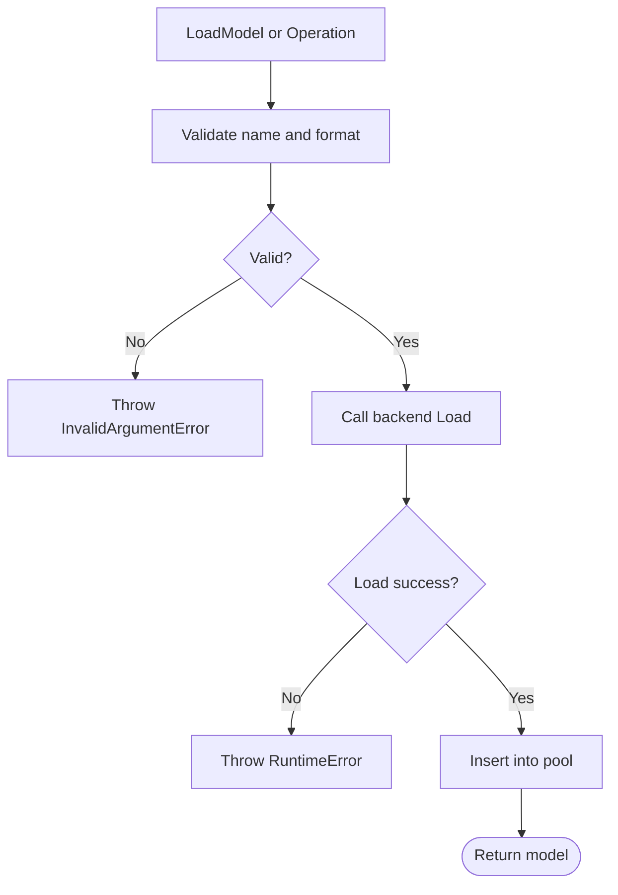

**Diagram sources**
- [ModelLoader.cpp:45-84](file://preprocess/ModelLoader.cpp#L45-L84)

**Section sources**
- [ModelLoader.cpp:45-84](file://preprocess/ModelLoader.cpp#L45-L84)

### Preprocessing Workflow From Raw Input to Validated Output
Enhanced end-to-end flow:
1. Application calls `LoadModel` through the DllHsBaSlicer C ABI or LibHsBaSlicer wrapper.
2. `ModelLoader` detects format and routes to the correct backend.
3. Backend loads and validates data; errors propagate up.
4. Successful models are inserted into the named pool.
5. Optional process-wide publishing via `PublishModel`.
6. Consumers can retrieve models and optionally run advanced preprocessing (boolean/thick-solid/point cloud operations).
7. Triangle mesh export available via `GetModelTriangles`.

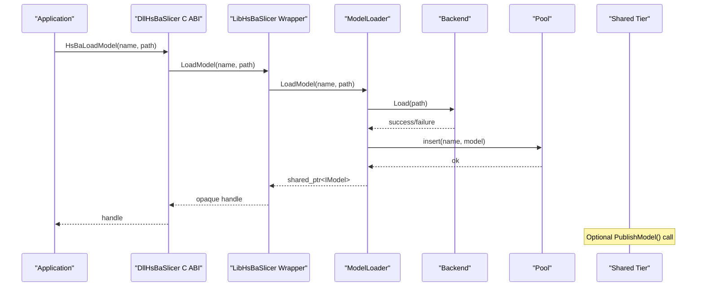

**Diagram sources**
- [README.md:112-145](file://docs/en/DllHsBaSlicer/README.md#L112-L145)
- [model_preprocess.cpp:99-112](file://LibHsBaSlicer/Preprocess/model_preprocess.cpp#L99-L112)
- [ModelLoader.cpp:45-84](file://preprocess/ModelLoader.cpp#L45-L84)

**Section sources**
- [model_preprocess.hpp:33-75](file://LibHsBaSlicer/Preprocess/model_preprocess.hpp#L33-L75)
- [README.md:112-145](file://docs/en/DllHsBaSlicer/README.md#L112-L145)

### Quality Checks, Mesh Simplification, and Integration Points
Enhanced quality checks and integration points:
- Quality checks:
  - Volume and bounding box queries are available on all models.
  - Point cloud quality metrics include centroid, normals, and statistical outlier removal.
  - Triangle mesh export provides comprehensive geometric analysis.
- Mesh simplification:
  - No dedicated mesh simplification is exposed by `ModelLoader`.
  - Point cloud downsampling (`DownsamplePointCloud`) reduces density via voxel filtering.
- Integration points:
  - Boolean operations integrate with both OCCT (for BRep) and CGAL (for mesh fallback).
  - Thick-solid integrates with OCCT.
  - Point cloud mesh reconstruction integrates with OpenVDB level set generation.
  - Text CSG integrates with OCCT DRAW Test Harness.
  - Process-wide publishing enables cross-thread model sharing.

**Section sources**
- [ModelLoader.hpp:94-198](file://preprocess/ModelLoader.hpp#L94-L198)
- [ModelLoader.cpp:172-321](file://preprocess/ModelLoader.cpp#L172-L321)

### Custom File Format Loaders
The current design dispatches based on file extension. To add a custom format:
- Extend `ModelFormat` enum with the new format identifier.
- Add extension matching in `ModelFormat.cpp`.
- Route the new format in `ModelLoader::LoadModel` to the appropriate backend or a new loader.
- Implement `Load`/`Save` in the target model class if needed.

Example pattern:
- For a new mesh format, implement `IglModel::Load` support or create a specialized loader and route it similarly to STL/OBJ/PLY/OFF.
- For a new BRep format, implement `OcctModel::Load` support and route accordingly.
- For a new point cloud format, implement `OpenVdbModel::Load` support and route accordingly.

**Section sources**
- [ModelFormat.hpp:66-109](file://base/ModelFormat.hpp#L66-L109)

### Preprocessing Configuration Options
Configuration is primarily driven by compile-time macros and method parameters:
- Compile-time:
  - `USE_CGAL`: Enables CGAL-based boolean operations and mesh repair fallback.
  - `USE_OCCT`: Enables BRep loading and thick-solid operations.
  - `USE_OPENVDB`: Enables point cloud operations.
  - `USE_OCCT_DRAW`: Enables text CSG model creation.
  - `HSBA_MODEL_POOL_SIZE`: Controls named model pool capacity.
- Runtime parameters:
  - Point cloud to mesh: `voxelSize`, `particleRadius`.
  - Downsample: `voxelSize`.
  - Outlier removal: `k`, `multiplier`.
  - Thick-solid: `thickness`, optional closing faces.
  - Text CSG: script content, shape name selection.

**Section sources**
- [ModelLoader.hpp:94-198](file://preprocess/ModelLoader.hpp#L94-L198)
- [model_preprocess.hpp:234-266](file://LibHsBaSlicer/Preprocess/model_preprocess.hpp#L234-L266)

## Dependency Analysis
The enhanced preprocessing pipeline depends on:
- `base/ModelFormat.*` for format detection.
- `base/IModel.hpp` for the unified model interface.
- `meshmodel/IglModel.hpp` for mesh loading and boolean fallback.
- `cadmodel/OcctModel.hpp/.cpp` for BRep loading and boolean/thick-solid.
- `cadmodel/OcctCsg.hpp/.cpp` for text CSG model creation.
- `pointcloud/OpenVdbModel.hpp` for point cloud operations.
- Optional CGAL, OpenVDB, and OCCT DRAW libraries for advanced features.

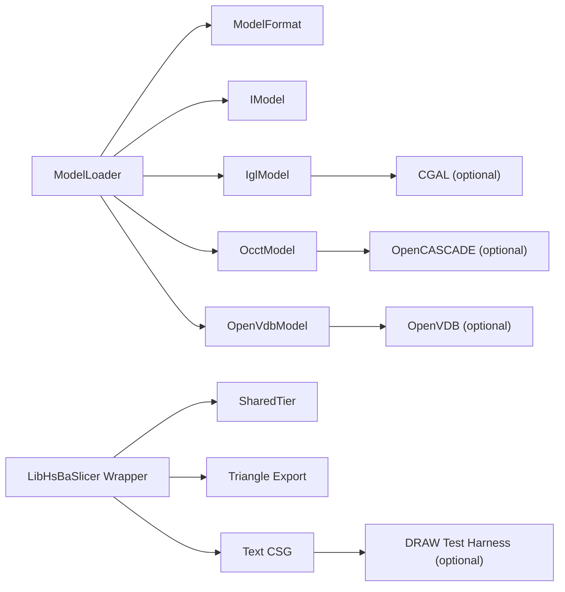

**Diagram sources**
- [ModelLoader.cpp:5-22](file://preprocess/ModelLoader.cpp#L5-L22)
- [model_preprocess.cpp:39-67](file://LibHsBaSlicer/Preprocess/model_preprocess.cpp#L39-L67)
- [model_preprocess.cpp:213-225](file://LibHsBaSlicer/Preprocess/model_preprocess.cpp#L213-L225)
- [model_preprocess.cpp:327-338](file://LibHsBaSlicer/Preprocess/model_preprocess.cpp#L327-L338)

**Section sources**
- [ModelLoader.cpp:5-22](file://preprocess/ModelLoader.cpp#L5-L22)

## Performance Considerations
Enhanced performance considerations:
- Named model pool capacity is controlled by `HSBA_MODEL_POOL_SIZE`; ensure sufficient capacity for concurrent models.
- Process-wide publishing adds minimal overhead but enables cross-thread model sharing.
- Boolean operations on large meshes can be expensive; prefer OCCT for BRep inputs when possible.
- Point cloud mesh reconstruction cost scales with voxel resolution and point count; tune `voxelSize` and `particleRadius`.
- Downsampling reduces memory and compute costs for downstream operations.
- Triangle mesh export triggers tessellation for BRep models; cache results if needed.
- Text CSG script execution involves full Tcl interpreter; avoid frequent small script executions.

## Troubleshooting Guide
Enhanced troubleshooting guide covering all new functionality:
Common issues and resolutions:
- Duplicate model name:
  - Cause: Inserting or loading with an existing name.
  - Resolution: Use unique names or remove the existing model before inserting.
- Unsupported format:
  - Cause: File extension not recognized.
  - Resolution: Rename file to a supported extension or extend format detection.
- File load failure:
  - Cause: Corrupted or incompatible file.
  - Resolution: Verify file integrity and format; check backend logs.
- Missing source model in boolean/thick-solid:
  - Cause: Referencing a name that does not exist.
  - Resolution: Ensure both source models are loaded and present.
- Platform feature missing:
  - Cause: Building without required libraries (OCCT, CGAL, OpenVDB, DRAW).
  - Resolution: Enable the corresponding compile-time flags or avoid dependent operations.
- Cross-thread model access issues:
  - Cause: Model only exists in thread-local pool.
  - Resolution: Call `PublishModel(name)` before accessing from other threads.
- Triangle export failures:
  - Cause: Model cannot produce triangle mesh.
  - Resolution: Verify model type and check underlying tessellation capabilities.
- Text CSG script errors:
  - Cause: Malformed script or unsupported commands.
  - Resolution: Check script syntax and verify DRAW module availability.

**Section sources**
- [model_preprocess.cpp:119-143](file://LibHsBaSlicer/Preprocess/model_preprocess.cpp#L119-L143)
- [model_preprocess.cpp:213-225](file://LibHsBaSlicer/Preprocess/model_preprocess.cpp#L213-L225)
- [model_preprocess.cpp:327-338](file://LibHsBaSlicer/Preprocess/model_preprocess.cpp#L327-L338)

## Conclusion
The enhanced model preprocessing pipeline provides a robust, extensible foundation for loading and validating 3D models across multiple formats. With the addition of triangle mesh export, comprehensive CSG boolean operations, process-wide model publishing, and text CSG model creation, the system now offers complete flexibility for various use cases. `ModelLoader` centralizes format detection and backend dispatch, while concrete model classes encapsulate format-specific loading and capabilities. Advanced preprocessing integrates OCCT, CGAL, and OpenVDB to support boolean operations, thick solids, point cloud mesh reconstruction, and text-based model creation. Users should configure compile-time features appropriately and apply explicit transformations and quality checks as needed.

## Appendices

### Supported Formats Summary
- Mesh: STL, OBJ, PLY, OFF.
- BRep: STEP, IGES, VRML, BREP.
- Point cloud: XYZ (and VDB via OpenVDB model).
- Text CSG: OCCT DRAW Test Harness scripts.

**Section sources**
- [ModelFormat.hpp:66-109](file://base/ModelFormat.hpp#L66-L109)

### Example Usage Patterns
- Load mesh models and perform boolean union through the C ABI wrapper.
- Retrieve model info (bounding box and volume) after preprocessing.
- Publish models for cross-thread access in pipeline operations.
- Export triangle meshes for visualization and analysis.
- Create models from text CSG scripts for programmatic geometry generation.

**Section sources**
- [README.md:112-145](file://docs/en/DllHsBaSlicer/README.md#L112-L145)
- [README.md:538-564](file://docs/en/LibHsBaSlicer/README.md#L538-L564)

### C ABI Interface Summary
The DllHsBaSlicer provides comprehensive C ABI interfaces:
- Basic operations: `HsBaLoadModel`, `HsBaGetModel`, `HsBaRemoveModel`, `HsBaContainsModel`.
- Transform operations: `HsBaTranslateModel`, `HsBaRotateModel`, `HsBaScaleModel`.
- Query operations: `HsBaGetModelInfo`, `HsBaGetModelTriangles`.
- Advanced operations: `HsBaThickSolidModel`, boolean operations.
- Text CSG: `HsBaTextCsgAvailable`, `HsBaBuildCsgModel`.
- Process-wide publishing: `HsBaPublishModel`, `HsBaUnpublishModel`.

**Section sources**
- [model_preprocess.h:16-306](file://DllHsBaSlicer/model_preprocess.h#L16-L306)