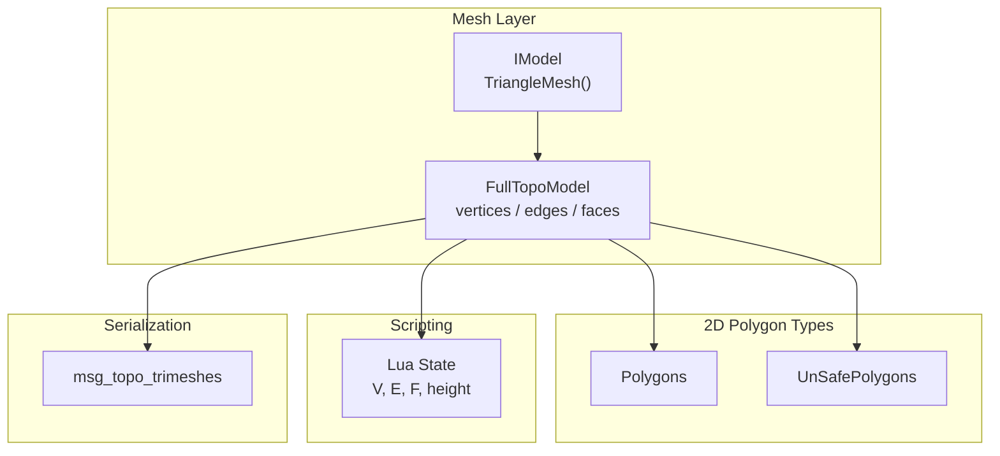
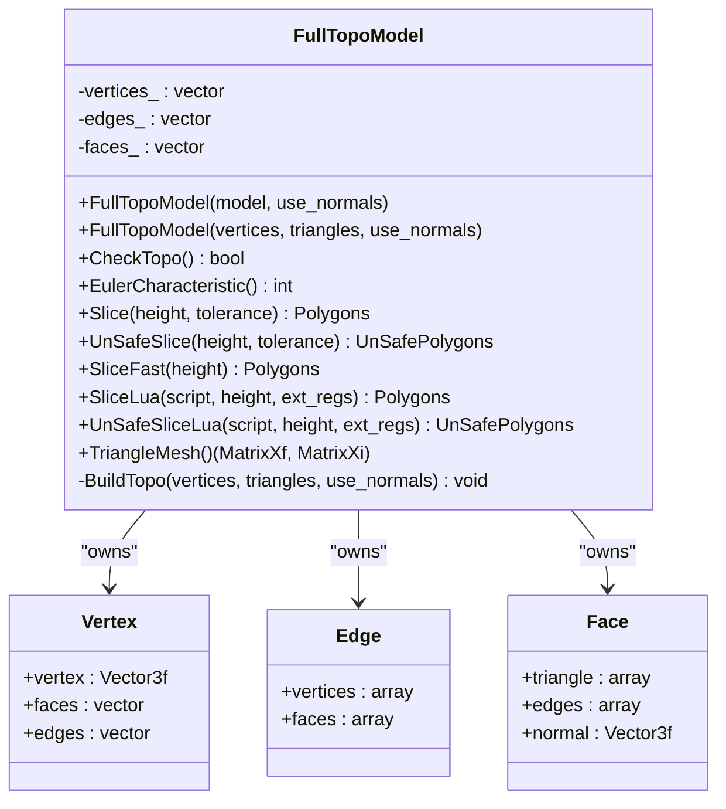
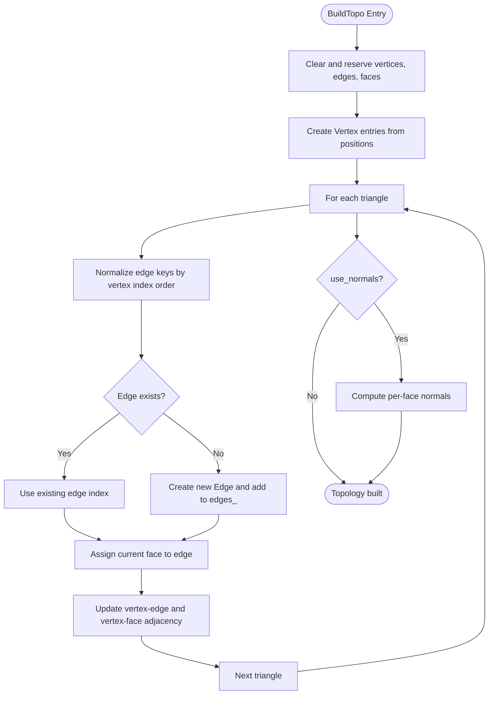
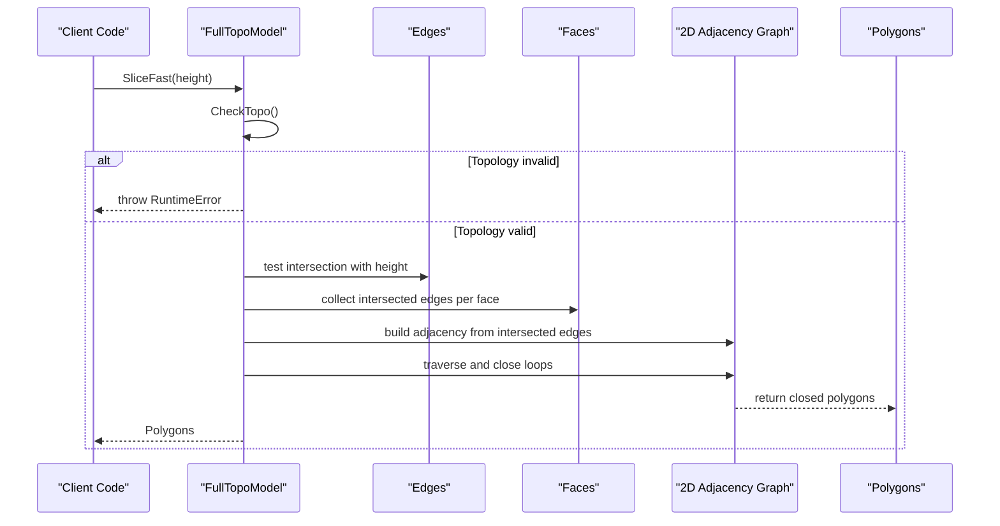
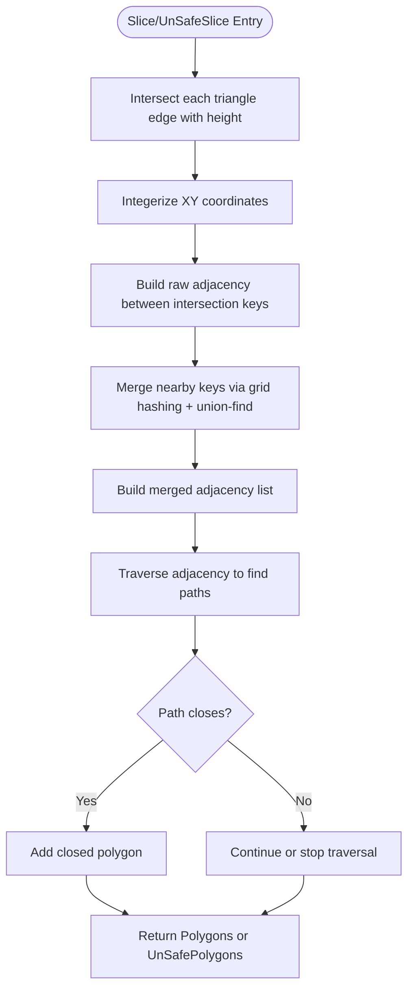
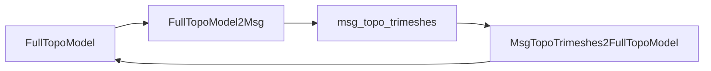

# Topological Model Representation

<cite>
**Referenced Files in This Document**
- [FullTopoModel.hpp](file://meshmodel/FullTopoModel.hpp)
- [FullTopoModel.cpp](file://meshmodel/FullTopoModel.cpp)
- [full_topo_model_test.cpp](file://tests/Models/full_topo_model_test.cpp)
- [FullTopoModel2Msg.hpp](file://convert/FullTopoModel2Msg.hpp)
- [FullTopoModel2Msg.cpp](file://convert/FullTopoModel2Msg.cpp)
- [Msg2FullTopoModel.hpp](file://convert/Msg2FullTopoModel.hpp)
- [Msg2FullTopoModel.cpp](file://convert/Msg2FullTopoModel.cpp)
</cite>

## Table of Contents
1. [Introduction](#introduction)
2. [Project Structure](#project-structure)
3. [Core Components](#core-components)
4. [Architecture Overview](#architecture-overview)
5. [Detailed Component Analysis](#detailed-component-analysis)
6. [Dependency Analysis](#dependency-analysis)
7. [Performance Considerations](#performance-considerations)
8. [Troubleshooting Guide](#troubleshooting-guide)
9. [Conclusion](#conclusion)
10. [Appendices](#appendices)

## Introduction
This document explains the FullTopoModel class, which provides a fully reconstructed topological representation of a triangle mesh for slicing and advanced geometric analysis. It stores vertices, edges, faces, and their connectivity relationships so that complex operations such as boundary detection, manifold validation, Euler characteristic computation, and multiple slicing strategies can be performed efficiently after an initial topology rebuild.

The class is intended for slicing workflows where repeated queries over the same mesh are common. It exposes:
- A complete vertex/edge/face adjacency structure.
- Topology validation and Euler characteristic checks.
- Safe and unsafe slicing APIs returning closed or open contours.
- A fast slicing path that relies on prebuilt edge-face connectivity.
- Lua-based custom slicing scripts that receive V, E, F, and height.
- Conversion to and from protobuf messages for serialization and pipeline integration.

## Project Structure
FullTopoModel lives under the mesh model layer and integrates with 2D polygon types, the IModel abstraction, Lua scripting, and protobuf conversion utilities.

**Diagram sources**
- [FullTopoModel.hpp:43-127](file://meshmodel/FullTopoModel.hpp#L43-L127)
- [FullTopoModel.cpp:32-48](file://meshmodel/FullTopoModel.cpp#L32-L48)
- [FullTopoModel2Msg.hpp:15-16](file://convert/FullTopoModel2Msg.hpp#L15-L16)
- [Msg2FullTopoModel.hpp:18-22](file://convert/Msg2FullTopoModel.hpp#L18-L22)

**Section sources**
- [FullTopoModel.hpp:43-127](file://meshmodel/FullTopoModel.hpp#L43-L127)
- [FullTopoModel.cpp:32-48](file://meshmodel/FullTopoModel.cpp#L32-L48)

## Core Components
FullTopoModel maintains three primary collections:
- Vertices: position plus lists of incident faces and edges.
- Edges: two endpoints plus up to two adjacent faces.
- Faces: three vertex indices, three edge indices, and optional per-face normal.

It also defines lightweight contour types:
- Polygons: closed 2D polygons used by safe slicing.
- UnSafePolygons: polylines with a closed flag, allowing open contours.

Key responsibilities:
- Build full topology from raw triangles.
- Validate topological completeness.
- Compute Euler characteristic.
- Slice at a given Z-height using different algorithms.
- Expose data to Lua for custom processing.
- Convert to/from protobuf messages.

**Section sources**
- [FullTopoModel.hpp:56-72](file://meshmodel/FullTopoModel.hpp#L56-L72)
- [FullTopoModel.hpp:25-41](file://meshmodel/FullTopoModel.hpp#L25-L41)
- [FullTopoModel.hpp:80-127](file://meshmodel/FullTopoModel.hpp#L80-L127)

## Architecture Overview
The class follows a construction-time topology rebuild pattern. Consumers provide either:
- An IModel instance, which supplies vertex and face arrays.
- Raw vertex and triangle arrays.

After construction, the internal structures support efficient traversal and slicing without rebuilding adjacency repeatedly.

**Diagram sources**
- [FullTopoModel.hpp:53-142](file://meshmodel/FullTopoModel.hpp#L53-L142)
- [FullTopoModel.cpp:50-158](file://meshmodel/FullTopoModel.cpp#L50-L158)

## Detailed Component Analysis

### Topological Data Structures
- Vertex stores its 3D position and adjacency lists to incident faces and edges.
- Edge stores its two endpoint vertex indices and up to two adjacent face indices.
- Face stores three vertex indices, three edge indices, and an optional normal vector.

These structures form a bidirectional adjacency graph:
- Faces reference edges and vertices.
- Edges reference vertices and faces.
- Vertices reference faces and edges.

This design enables:
- Fast traversal of neighbors around a vertex or edge.
- Efficient identification of boundary edges (those with only one adjacent face).
- Direct access to incident geometry during slicing and repair operations.

Complexity notes:
- Building topology is linear in the number of triangles, with hash map lookups for deduplicating edges.
- Querying incident elements is proportional to the degree of the queried element.

**Section sources**
- [FullTopoModel.hpp:56-72](file://meshmodel/FullTopoModel.hpp#L56-L72)
- [FullTopoModel.cpp:50-158](file://meshmodel/FullTopoModel.cpp#L50-L158)

### Topology Construction
Construction performs:
1. Clear and reserve storage for vertices, edges, and faces.
2. Create vertex entries from input positions.
3. Iterate over triangles to:
   - Normalize edge keys by sorting vertex indices.
   - Deduplicate edges using a hash map.
   - Assign edge indices to each face.
   - Record face indices in edges.
   - Update vertex adjacency lists for both edges and faces.
4. Optionally compute per-face normals using an external library.

**Diagram sources**
- [FullTopoModel.cpp:50-158](file://meshmodel/FullTopoModel.cpp#L50-L158)

**Section sources**
- [FullTopoModel.cpp:50-158](file://meshmodel/FullTopoModel.cpp#L50-L158)

### Topology Validation and Euler Characteristic
- CheckTopo verifies that all face references point to valid vertices and edges, and that all edge references point to valid vertices and faces. It also ensures that every vertex and edge appears in at least one face or edge respectively.
- EulerCharacteristic returns V - E + F. If it is odd or greater than two, the model may not be a topological manifold; this can indicate holes or non-manifold features.

Usage guidance:
- Call CheckTopo before SliceFast because SliceFast assumes a consistent topology.
- Use EulerCharacteristic as a quick sanity check for global topology properties.

**Section sources**
- [FullTopoModel.hpp:80-98](file://meshmodel/FullTopoModel.hpp#L80-L98)
- [FullTopoModel.cpp:160-244](file://meshmodel/FullTopoModel.cpp#L160-L244)

### Slicing Algorithms
FullTopoModel provides several slicing methods along the Z-axis:

- Intersection: computes whether an edge intersects a horizontal plane at a given height and returns the intersection point when applicable.
- Slice: builds a robust 2D adjacency graph from triangle intersections, merges nearby points using integerization and union-find, then traverses to extract closed polygons.
- UnSafeSlice: similar to Slice but preserves open polylines and marks them with a closed flag.
- SliceFast: uses prebuilt edge-face connectivity to quickly identify intersected edges and build adjacency directly from faces. It throws if topology is invalid.
- SliceLua variants: create a Lua state, push V, E, F, and height, execute user scripts, and convert returned tables into Polygons or UnSafePolygons.

**Diagram sources**
- [FullTopoModel.cpp:875-1025](file://meshmodel/FullTopoModel.cpp#L875-L1025)

**Diagram sources**
- [FullTopoModel.cpp:328-600](file://meshmodel/FullTopoModel.cpp#L328-L600)
- [FullTopoModel.cpp:604-873](file://meshmodel/FullTopoModel.cpp#L604-L873)

**Section sources**
- [FullTopoModel.cpp:246-272](file://meshmodel/FullTopoModel.cpp#L246-L272)
- [FullTopoModel.cpp:328-600](file://meshmodel/FullTopoModel.cpp#L328-L600)
- [FullTopoModel.cpp:604-873](file://meshmodel/FullTopoModel.cpp#L604-L873)
- [FullTopoModel.cpp:875-1025](file://meshmodel/FullTopoModel.cpp#L875-L1025)

### Lua Integration
FullTopoModel supports custom slicing through Lua:
- PushFullTopoModelToLua exposes V (1-based vertex table), E (1-based edge table), F (1-based face table), and height.
- SliceLua and UnSafeSliceLua load and run scripts, handle errors, and convert results to C++ polygon types.
- Multiple overloads accept inline script strings, function names, or file paths.

Typical usage patterns:
- Compute intersection points from V and F.
- Build a custom contour algorithm in Lua.
- Return a table of polygons or rely on a global polys variable.

Error handling:
- Lua initialization failures, load errors, runtime errors, and missing functions raise RuntimeError with descriptive messages.

**Section sources**
- [FullTopoModel.cpp:274-324](file://meshmodel/FullTopoModel.cpp#L274-L324)
- [FullTopoModel.cpp:1027-1241](file://meshmodel/FullTopoModel.cpp#L1027-L1241)

### Conversion Between Representations
FullTopoModel integrates with protobuf messages:
- FullTopoModel2Msg serializes vertices and triangular faces, including optional per-face normals.
- MsgTopoTrimeshes2FullTopoModel reconstructs a FullTopoModel from a protobuf message, skipping invalid triangle indices.

This enables:
- Exporting topological meshes for visualization or downstream tools.
- Importing preprocessed topologies into slicing pipelines.

**Diagram sources**
- [FullTopoModel2Msg.cpp:10-40](file://convert/FullTopoModel2Msg.cpp#L10-L40)
- [Msg2FullTopoModel.cpp:12-37](file://convert/Msg2FullTopoModel.cpp#L12-L37)

**Section sources**
- [FullTopoModel2Msg.hpp:15-16](file://convert/FullTopoModel2Msg.hpp#L15-L16)
- [FullTopoModel2Msg.cpp:10-40](file://convert/FullTopoModel2Msg.cpp#L10-L40)
- [Msg2FullTopoModel.hpp:18-22](file://convert/Msg2FullTopoModel.hpp#L18-L22)
- [Msg2FullTopoModel.cpp:12-37](file://convert/Msg2FullTopoModel.cpp#L12-L37)

## Dependency Analysis
FullTopoModel depends on:
- Eigen vectors and matrices for geometry.
- 2D polygon types for slicing outputs.
- IModel for constructing from other mesh representations.
- Lua for scripting integration.
- igl for optional per-face normals.
- Boost hash utilities for key hashing.
- Protobuf converters for serialization.

Coupling:
- Low coupling to IModel: only TriangleMesh is used.
- Moderate coupling to 2D polygon types: slicing outputs depend on these types.
- Scripting coupling is explicit via helper functions and adapters.

Potential circular dependencies:
- None observed within FullTopoModel itself; dependencies are unidirectional toward helpers and libraries.

External integration points:
- Lua state creation and error handling.
- Protobuf message schema for serialization.

**Section sources**
- [FullTopoModel.hpp:5-16](file://meshmodel/FullTopoModel.hpp#L5-L16)
- [FullTopoModel.cpp:8-23](file://meshmodel/FullTopoModel.cpp#L8-L23)
- [FullTopoModel2Msg.hpp:9-10](file://convert/FullTopoModel2Msg.hpp#L9-L10)
- [Msg2FullTopoModel.hpp:12-13](file://convert/Msg2FullTopoModel.hpp#L12-L13)

## Performance Considerations
Memory overhead:
- Full topology stores redundant adjacency information:
  - Each face stores three vertex indices and three edge indices.
  - Each edge stores two vertex indices and two face indices.
  - Each vertex stores dynamic lists of incident faces and edges.
- For N vertices, M edges, and T faces, memory grows roughly as O(N + M + T) plus adjacency list sizes. In typical triangle meshes, M ≈ 3T and each vertex’s average degree is constant, so total memory is approximately linear in T.

When to choose FullTopoModel:
- Choose it when you need repeated topological queries, boundary detection, manifold validation, or multiple slicing passes over the same mesh.
- Avoid it for one-off geometric computations where a simple vertex-face pair suffices.

Slicing performance:
- Slice and UnSafeSlice perform additional steps like integerization, grid hashing, union-find merging, and loop traversal. They are robust but more expensive than SliceFast.
- SliceFast leverages prebuilt edge-face connectivity and validates topology first; it is faster but requires a consistent topology.

Optimization opportunities:
- Reuse FullTopoModel across multiple heights instead of rebuilding.
- Use SliceFast when topology is known to be valid.
- Tune tolerance carefully to balance numerical stability and performance.

[No sources needed since this section provides general guidance]

## Troubleshooting Guide
Common issues and remedies:
- Invalid topology:
  - Symptom: SliceFast throws a runtime error indicating invalid topology.
  - Action: Call CheckTopo before SliceFast; inspect vertices, edges, and faces for dangling references.
- Non-manifold or holey models:
  - Symptom: EulerCharacteristic is odd or greater than two.
  - Action: Inspect boundary edges and consider repair operations such as filling holes or fixing orientation.
- Open contours in slicing:
  - Symptom: UnSafeSlice returns open polylines.
  - Action: Use Slice when only closed contours are acceptable; investigate boundary edges causing open paths.
- Lua script errors:
  - Symptom: RuntimeError with Lua load or runtime messages.
  - Action: Validate script syntax, ensure V, E, F, and height are available, and verify returned tables match expected formats.

**Section sources**
- [FullTopoModel.cpp:875-880](file://meshmodel/FullTopoModel.cpp#L875-L880)
- [FullTopoModel.cpp:1042-1055](file://meshmodel/FullTopoModel.cpp#L1042-L1055)
- [FullTopoModel.cpp:1146-1171](file://meshmodel/FullTopoModel.cpp#L1146-L1171)
- [FullTopoModel.cpp:1202-1227](file://meshmodel/FullTopoModel.cpp#L1202-L1227)

## Conclusion
FullTopoModel provides a comprehensive topological representation optimized for slicing and advanced mesh analysis. By reconstructing full adjacency between vertices, edges, and faces, it enables robust boundary detection, manifold validation, Euler characteristic inspection, and multiple slicing strategies. While it incurs higher memory overhead than simpler representations, it pays off when performing repeated topological queries or multi-pass slicing. For one-off operations, lighter representations may be preferable; for complex workflows, FullTopoModel offers the structural foundation needed for reliable and extensible mesh processing.

[No sources needed since this section summarizes without analyzing specific files]

## Appendices

### Example Usage Patterns
- Construct from IModel:
  - Load a mesh via IModel and pass it to FullTopoModel constructor.
- Construct from raw data:
  - Provide vertex positions and triangle indices directly.
- Validate and analyze:
  - Call CheckTopo and EulerCharacteristic to assess manifold quality.
- Slice:
  - Use Slice for robust closed contours.
  - Use UnSafeSlice for open and closed polylines.
  - Use SliceFast for speed when topology is guaranteed valid.
- Custom scripting:
  - Use SliceLua or UnSafeSliceLua to implement custom contour extraction logic in Lua.
- Serialization:
  - Convert to protobuf with FullTopoModel2Msg.
  - Reconstruct from protobuf with MsgTopoTrimeshes2FullTopoModel.

**Section sources**
- [full_topo_model_test.cpp:55-75](file://tests/Models/full_topo_model_test.cpp#L55-L75)
- [full_topo_model_test.cpp:77-142](file://tests/Models/full_topo_model_test.cpp#L77-L142)
- [full_topo_model_test.cpp:144-158](file://tests/Models/full_topo_model_test.cpp#L144-L158)