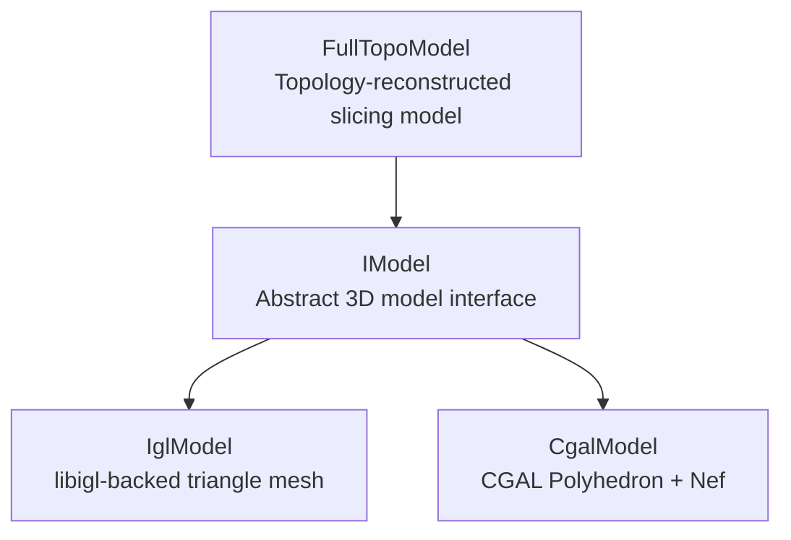
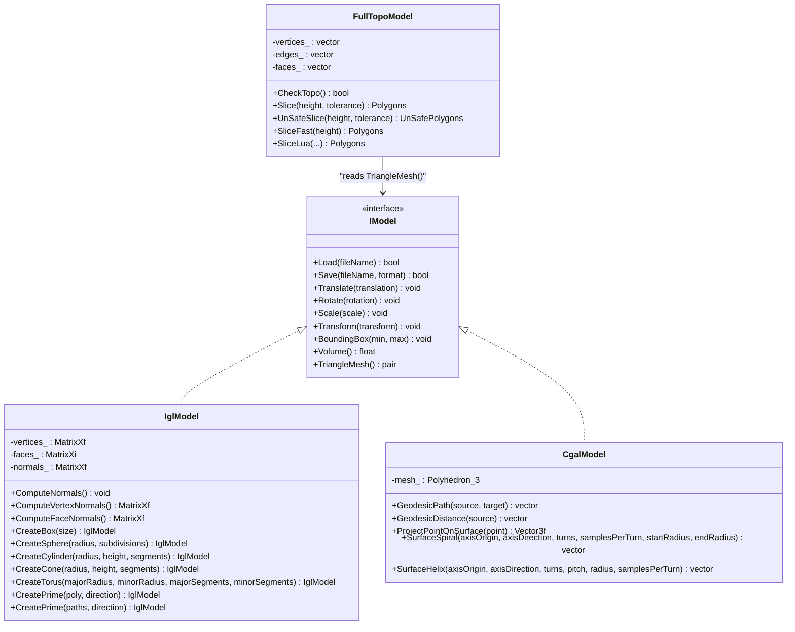
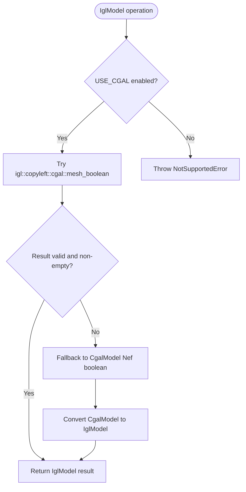
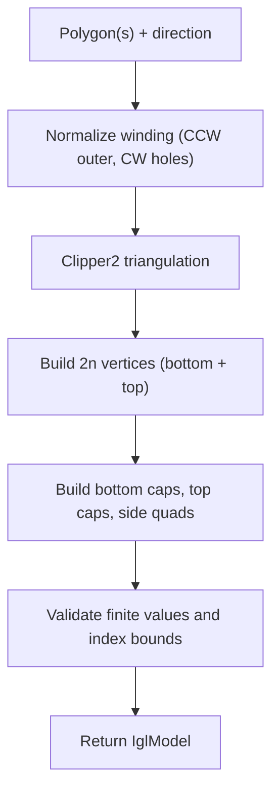
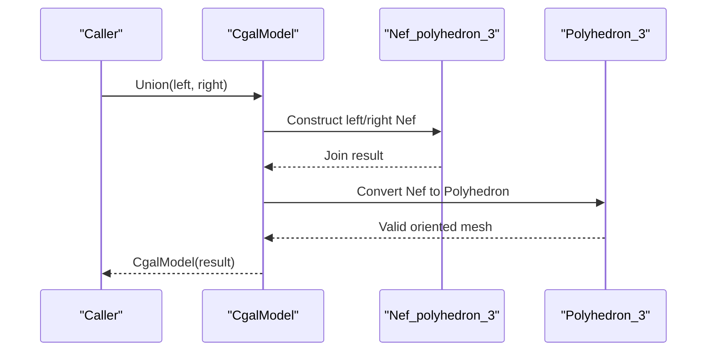
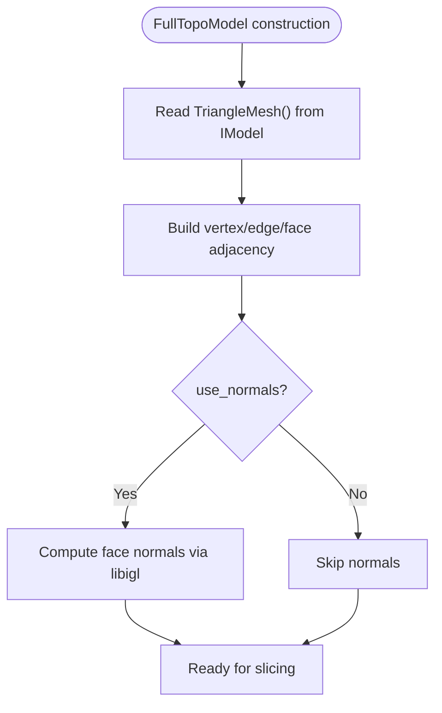
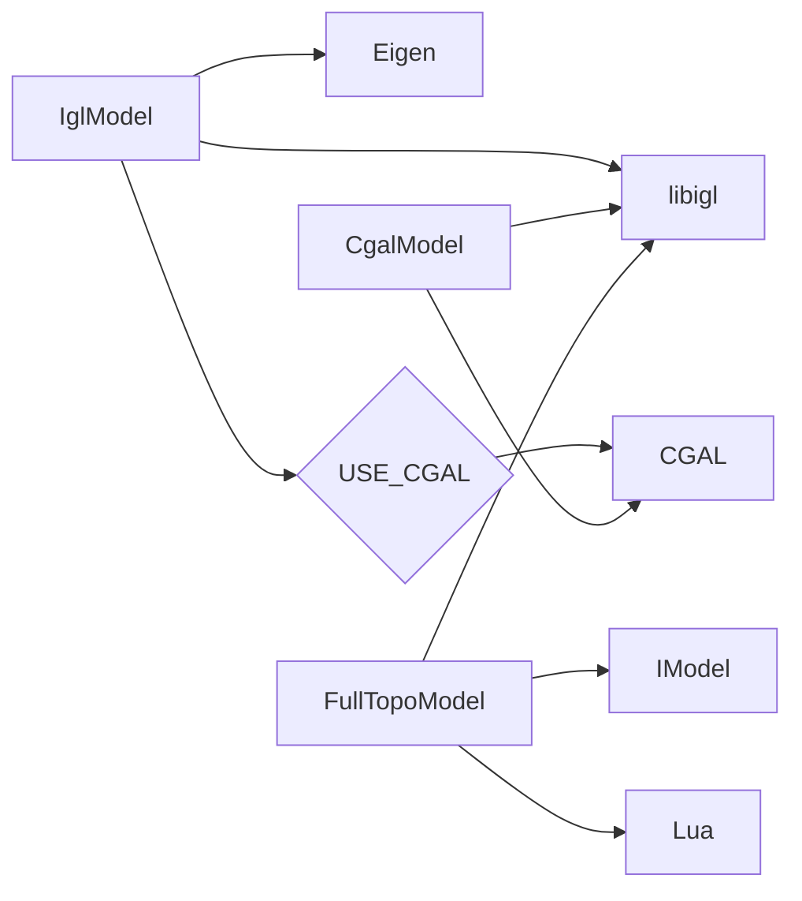

# libigl Model Implementation

<cite>
**Referenced Files in This Document**
- [IModel.hpp](file://base/IModel.hpp)
- [IglModel.hpp](file://meshmodel/IglModel.hpp)
- [IglModel.cpp](file://meshmodel/IglModel.cpp)
- [CgalModel.hpp](file://meshmodel/CgalModel.hpp)
- [CgalModel.cpp](file://meshmodel/CgalModel.cpp)
- [FullTopoModel.hpp](file://meshmodel/FullTopoModel.hpp)
- [FullTopoModel.cpp](file://meshmodel/FullTopoModel.cpp)
</cite>

## Table of Contents
1. [Introduction](#introduction)
2. [Project Structure](#project-structure)
3. [Core Components](#core-components)
4. [Architecture Overview](#architecture-overview)
5. [Detailed Component Analysis](#detailed-component-analysis)
6. [Dependency Analysis](#dependency-analysis)
7. [Performance Considerations](#performance-considerations)
8. [Troubleshooting Guide](#troubleshooting-guide)
9. [Conclusion](#conclusion)
10. [Appendices](#appendices)

## Introduction
This document explains the mesh model implementation used by HsBaSlicer, with a focus on the libigl-backed `IglModel` class. It covers how vertices and faces are stored as Eigen matrices, how geometric operations are implemented efficiently, how the model integrates with libigl algorithms, and how it participates in boolean operations through CGAL when enabled. It also compares libigl’s performance-oriented approach with CGAL’s topological robustness, provides mesh manipulation workflows, and gives guidance for real-time geometry processing.

The project exposes a common `IModel` interface so that different backends can be swapped without changing higher-level slicing or pipeline code. `IglModel` is optimized for speed and compatibility with libigl; `CgalModel` wraps CGAL polyhedra and Nef polyhedra for robust topology; `FullTopoModel` rebuilds full vertex-edge-face topology for slicing.

## Project Structure
The mesh model layer lives under `meshmodel/`. The key files are:
- `IModel.hpp`: abstract interface defining loading, saving, transforms, bounding box, volume, and triangle mesh access.
- `IglModel.*`: libigl-backed triangle mesh model.
- `CgalModel.*`: CGAL-backed polyhedral model with Nef-based boolean operations and surface geodesic/helix helpers.
- `FullTopoModel.*`: fully reconstructed topology model specialized for slicing.

**Diagram sources**
- [IModel.hpp:110-139](file://base/IModel.hpp#L110-L139)
- [IglModel.hpp:18-121](file://meshmodel/IglModel.hpp#L18-L121)
- [CgalModel.hpp:26-155](file://meshmodel/CgalModel.hpp#L26-L155)
- [FullTopoModel.hpp:43-142](file://meshmodel/FullTopoModel.hpp#L43-L142)

**Section sources**
- [IModel.hpp:110-139](file://base/IModel.hpp#L110-L139)
- [IglModel.hpp:18-121](file://meshmodel/IglModel.hpp#L18-L121)
- [CgalModel.hpp:26-155](file://meshmodel/CgalModel.hpp#L26-L155)
- [FullTopoModel.hpp:43-142](file://meshmodel/FullTopoModel.hpp#L43-L142)

## Core Components
- `IModel`: defines the contract for all models. It requires file I/O, affine/isometric transforms, bounding box, signed volume, and a libigl-style `(vertices, faces)` accessor.
- `IglModel`: stores `Eigen::MatrixXf vertices`, `Eigen::MatrixXi faces`, and optional `Eigen::MatrixXf normals`. It implements fast translation, rotation, scaling, and homogeneous transforms using row-major storage. It supports STL/OBJ/PLY/OFF load/save via libigl, normal computation via libigl, signed volume via libigl, and optional boolean operations via libigl’s CGAL bridge.
- `CgalModel`: wraps a CGAL `Polyhedron_3` and provides robust boolean operations via `Nef_polyhedron_3`. It also offers geodesic path, distance, projection, spiral, and helix utilities.
- `FullTopoModel`: builds explicit vertex/edge/face adjacency from an `IModel`, enabling safe and fast slicing routines.

Key responsibilities:
- Efficient storage and vectorized math over Eigen matrices.
- Consistent outward-facing normals for primitives and extrusions.
- Optional CGAL integration for robust topology.
- Slicing-friendly topology reconstruction.

**Section sources**
- [IModel.hpp:110-139](file://base/IModel.hpp#L110-L139)
- [IglModel.hpp:18-121](file://meshmodel/IglModel.hpp#L18-L121)
- [CgalModel.hpp:26-155](file://meshmodel/CgalModel.hpp#L26-L155)
- [FullTopoModel.hpp:43-142](file://meshmodel/FullTopoModel.hpp#L43-L142)

## Architecture Overview
The architecture separates data representation from algorithmic backends:

**Diagram sources**
- [IModel.hpp:110-139](file://base/IModel.hpp#L110-L139)
- [IglModel.hpp:18-121](file://meshmodel/IglModel.hpp#L18-L121)
- [CgalModel.hpp:26-155](file://meshmodel/CgalModel.hpp#L26-L155)
- [FullTopoModel.hpp:43-142](file://meshmodel/FullTopoModel.hpp#L43-L142)

## Detailed Component Analysis

### IglModel: libigl-backed efficient triangle mesh
`IglModel` is designed for speed and compatibility with libigl. Its core data layout uses row-major Eigen matrices:
- Vertices: `Eigen::MatrixXf` (N × 3).
- Faces: `Eigen::MatrixXi` (M × 3).
- Normals: `Eigen::MatrixXf` (M × 3), optionally computed.

Important behaviors:
- File I/O delegates to libigl readers/writers for STL/OBJ/PLY/OFF.
- Transformations are implemented with row-wise broadcasting and homogeneous conversion to avoid undefined behavior and maximize vectorization.
- Volume is computed by converting triangles to tetrahedra against the origin and summing signed volumes.
- Normal computation uses libigl per-face and per-vertex routines.
- Boolean operations are conditionally compiled: if CGAL is available, they use libigl’s CGAL bridge with a fallback to `CgalModel` Nef polyhedra when floating-point precision causes failures.

**Diagram sources**
- [IglModel.cpp:195-246](file://meshmodel/IglModel.cpp#L195-L246)
- [IglModel.cpp:392-409](file://meshmodel/IglModel.cpp#L392-L409)

#### Transformations and storage layout
Because vertices are stored row-wise, transformations must multiply each row by the transpose of the transformation matrix. For example:
- Translation adds the translation vector to each row.
- Rotation multiplies vertices by the transposed rotation matrix.
- Homogeneous transforms convert rows to homogeneous coordinates, multiply by the transposed 4×4 matrix, then h-normalize.

Normals are updated consistently with rotations and isometries.

**Section sources**
- [IglModel.cpp:101-150](file://meshmodel/IglModel.cpp#L101-L150)
- [IglModel.cpp:152-185](file://meshmodel/IglModel.cpp#L152-L185)

#### Primitive factories and extrusion
`IglModel` provides primitive constructors for boxes, spheres, cylinders, cones, and tori. These generate consistent outward-facing winding to ensure reliable boolean classification. Extrusion (`CreatePrime`) triangulates base polygons using Clipper2, maps indices back to original vertices, and constructs bottom/top caps and side quads split into triangles.

**Diagram sources**
- [IglModel.cpp:598-713](file://meshmodel/IglModel.cpp#L598-L713)
- [IglModel.cpp:715-800](file://meshmodel/IglModel.cpp#L715-L800)

**Section sources**
- [IglModel.cpp:411-596](file://meshmodel/IglModel.cpp#L411-L596)
- [IglModel.cpp:598-713](file://meshmodel/IglModel.cpp#L598-L713)
- [IglModel.cpp:715-800](file://meshmodel/IglModel.cpp#L715-L800)

### CgalModel: CGAL-backed robust topology
`CgalModel` wraps a CGAL `Polyhedron_3` and provides:
- Robust boolean operations via `Nef_polyhedron_3`.
- Surface geodesic shortest paths, distances, point projection, and spiral/helix generation.
- Conversion between libigl meshes and CGAL polyhedra, including repair and orientation fixes.

**Diagram sources**
- [CgalModel.cpp:238-246](file://meshmodel/CgalModel.cpp#L238-L246)

**Section sources**
- [CgalModel.hpp:26-155](file://meshmodel/CgalModel.hpp#L26-L155)
- [CgalModel.cpp:38-119](file://meshmodel/CgalModel.cpp#L38-L119)
- [CgalModel.cpp:121-237](file://meshmodel/CgalModel.cpp#L121-L237)
- [CgalModel.cpp:238-276](file://meshmodel/CgalModel.cpp#L238-L276)

### FullTopoModel: topology-reconstructed slicing model
`FullTopoModel` reconstructs explicit vertex/edge/face relationships from an `IModel`. It enables:
- Topology validation (`CheckTopo`).
- Euler characteristic computation.
- Safe and unsafe slicing with tolerance-aware merging.
- Fast slicing when topology is already built.
- Lua scripting interfaces for custom slice logic.

**Diagram sources**
- [FullTopoModel.cpp:27-48](file://meshmodel/FullTopoModel.cpp#L27-L48)
- [FullTopoModel.cpp:50-158](file://meshmodel/FullTopoModel.cpp#L50-L158)

**Section sources**
- [FullTopoModel.hpp:43-142](file://meshmodel/FullTopoModel.hpp#L43-L142)
- [FullTopoModel.cpp:27-158](file://meshmodel/FullTopoModel.cpp#L27-L158)
- [FullTopoModel.cpp:160-244](file://meshmodel/FullTopoModel.cpp#L160-L244)

## Dependency Analysis
- `IglModel` depends on:
  - Eigen for dense linear algebra.
  - libigl for reading/writing mesh formats, computing normals, and computing volume.
  - Optionally CGAL via libigl’s CGAL bridge for boolean operations.
- `CgalModel` depends on:
  - CGAL for polyhedra, Nef polyhedra, AABB trees, surface mesh shortest paths, and IO.
  - libigl’s CGAL converters for mesh/polyhedron conversions.
- `FullTopoModel` depends on:
  - `IModel` to obtain raw triangle meshes.
  - libigl for optional face normal computation.
  - Lua for scripting slice algorithms.

**Diagram sources**
- [IglModel.cpp:12-27](file://meshmodel/IglModel.cpp#L12-L27)
- [CgalModel.cpp:12-33](file://meshmodel/CgalModel.cpp#L12-L33)
- [FullTopoModel.cpp:17-24](file://meshmodel/FullTopoModel.cpp#L17-L24)

**Section sources**
- [IglModel.cpp:12-27](file://meshmodel/IglModel.cpp#L12-L27)
- [CgalModel.cpp:12-33](file://meshmodel/CgalModel.cpp#L12-L33)
- [FullTopoModel.cpp:17-24](file://meshmodel/FullTopoModel.cpp#L17-L24)

## Performance Considerations
- Use `IglModel` for high-throughput geometry processing where speed matters more than topological guarantees. Its row-wise Eigen storage allows vectorized transforms and avoids expensive object overhead.
- Prefer `CgalModel` when robust boolean operations, exact predicates, or advanced surface queries (geodesics, projections) are required. Be aware that CGAL operations may be slower but provide stronger correctness guarantees.
- For slicing-heavy workflows, construct `FullTopoModel` once and reuse it across multiple slices. The constructor rebuilds topology once, making repeated slicing faster.
- Avoid unnecessary copies: pass Eigen matrices by reference or move semantics where possible. `IglModel` constructors support move semantics for vertices/faces/normals.
- When using boolean operations, ensure input meshes are watertight and have consistent outward normals. Invalid inputs can cause libigl’s CGAL bridge to fail silently; the fallback to `CgalModel` improves reliability.

[No sources needed since this section provides general guidance]

## Troubleshooting Guide
Common issues and resolutions:
- Boolean operations throw unsupported errors:
  - Cause: CGAL is not enabled at compile time.
  - Resolution: Enable `USE_CGAL` during build or avoid boolean operations.
- Boolean results are empty or invalid:
  - Cause: Floating-point precision issues in libigl’s CGAL bridge.
  - Resolution: Rely on the automatic fallback to `CgalModel` Nef polyhedra; ensure meshes are watertight and normals are outward-facing.
- Unexpected winding or inward normals:
  - Cause: Incorrect polygon winding or inconsistent face orientation.
  - Resolution: Use provided primitive factories and extrusion functions that enforce outward normals; verify area signs and reverse winding when necessary.
- Mesh conversion failures:
  - Cause: Non-manifold or degenerate input meshes.
  - Resolution: Repair meshes before conversion; `CgalModel` attempts orientation and triangulation repairs.

**Section sources**
- [IglModel.cpp:392-409](file://meshmodel/IglModel.cpp#L392-L409)
- [IglModel.cpp:195-246](file://meshmodel/IglModel.cpp#L195-L246)
- [CgalModel.cpp:42-119](file://meshmodel/CgalModel.cpp#L42-L119)

## Conclusion
`IglModel` provides a fast, libigl-compatible triangle mesh backend ideal for interactive geometry processing and large-scale computations. It leverages Eigen matrices for efficient storage and vectorized operations, integrates seamlessly with libigl algorithms, and includes optional CGAL-backed boolean operations for robustness. `CgalModel` complements it with strong topological guarantees and advanced surface queries. `FullTopoModel` bridges these representations to slicing workflows by rebuilding explicit topology. Choose `IglModel` for speed, `CgalModel` for robustness, and `FullTopoModel` for slicing efficiency.

[No sources needed since this section summarizes without analyzing specific files]

## Appendices

### API Reference Summary

- `IModel`
  - Load/Save: file I/O for various formats.
  - Transforms: translate, rotate, scale, isometry, homogeneous, affine.
  - Queries: bounding box, volume, triangle mesh.

- `IglModel`
  - Constructors: copy/move from Eigen matrices; optional normal computation.
  - Geometry: compute normals, bounding box, volume.
  - Primitives: box, sphere, cylinder, cone, torus.
  - Extrusion: single polygon or multiple polygons.
  - Boolean: union, intersection, difference, xor (optional CGAL).

- `CgalModel`
  - Robust booleans via Nef polyhedra.
  - Surface queries: geodesic path/distance, projection, spiral, helix.
  - Conversion: mesh to polyhedron and back, with repair and orientation fixes.

- `FullTopoModel`
  - Topology: vertex/edge/face adjacency, validation, Euler characteristic.
  - Slicing: safe, unsafe, fast, and Lua-driven slicing.

**Section sources**
- [IModel.hpp:110-139](file://base/IModel.hpp#L110-L139)
- [IglModel.hpp:18-121](file://meshmodel/IglModel.hpp#L18-L121)
- [CgalModel.hpp:26-155](file://meshmodel/CgalModel.hpp#L26-L155)
- [FullTopoModel.hpp:43-142](file://meshmodel/FullTopoModel.hpp#L43-L142)