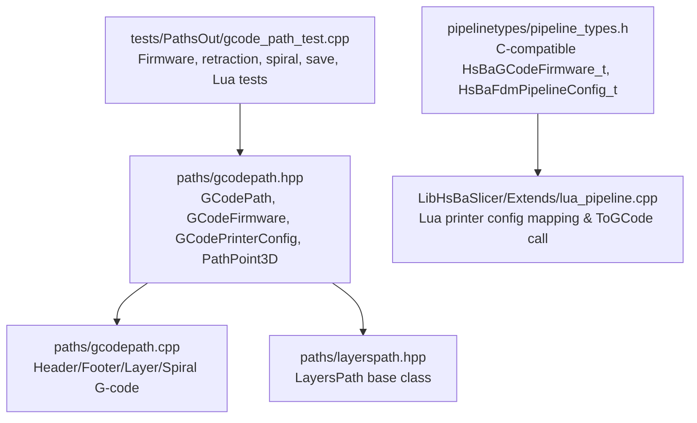
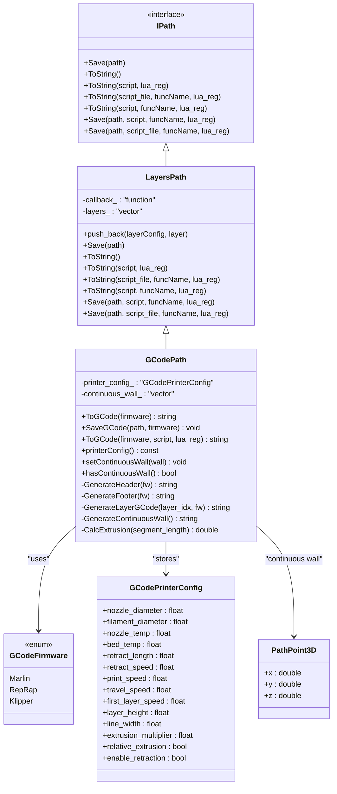
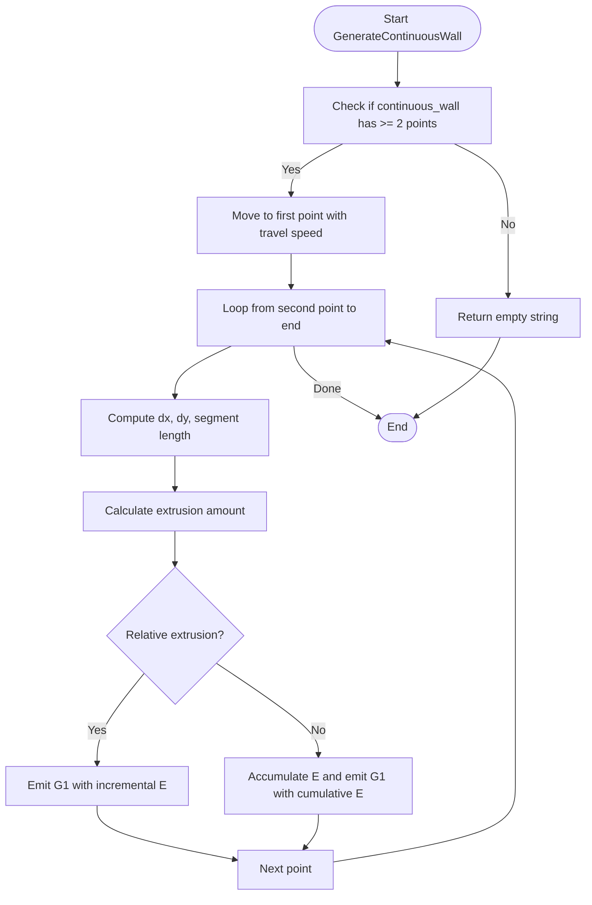
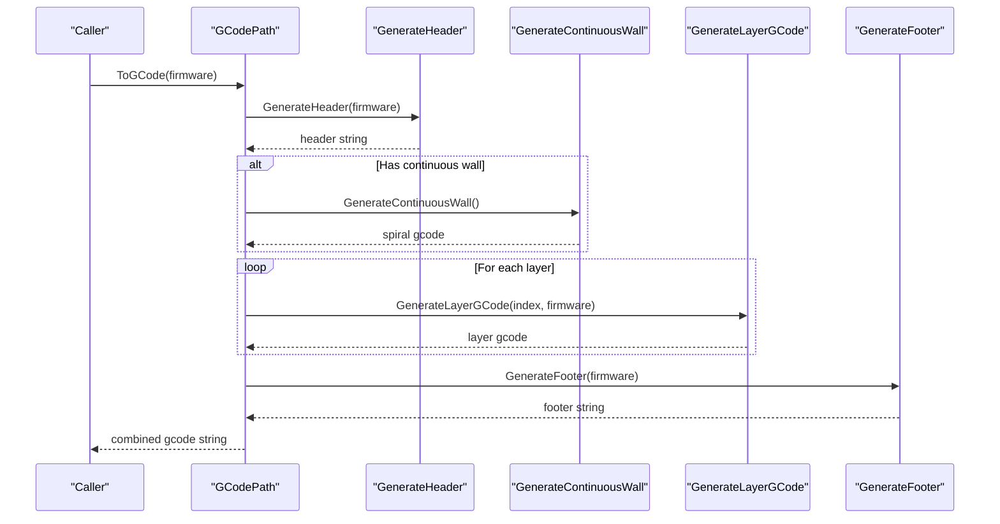
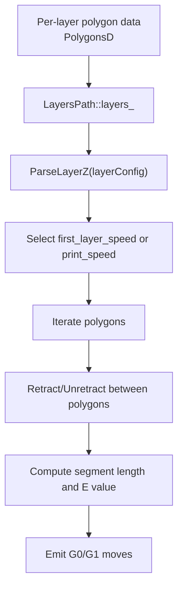
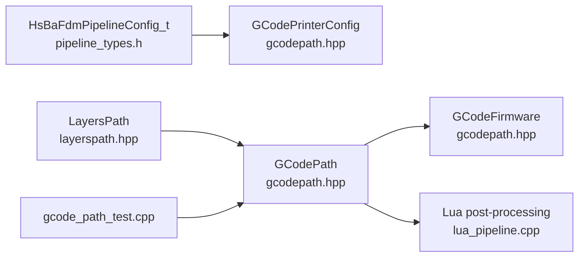

# G-Code Path Generation / G代码路径生成

<cite>
**Referenced Files in This Document**   
- [gcodepath.hpp](file://paths/gcodepath.hpp)
- [gcodepath.cpp](file://paths/gcodepath.cpp)
- [layerspath.hpp](file://paths/layerspath.hpp)
- [pipeline_types.h](file://pipelinetypes/pipeline_types.h)
- [lua_pipeline.cpp](file://LibHsBaSlicer/Extends/lua_pipeline.cpp)
- [gcode_path_test.cpp](file://tests/PathsOut/gcode_path_test.cpp)
</cite>

## Table of Contents
1. [Introduction](#introduction)
2. [Project Structure](#project-structure)
3. [Core Components](#core-components)
4. [Architecture Overview](#architecture-overview)
5. [Detailed Component Analysis](#detailed-component-analysis)
6. [Dependency Analysis](#dependency-analysis)
7. [Performance Considerations](#performance-considerations)
8. [Troubleshooting Guide](#troubleshooting-guide)
9. [Conclusion](#conclusion)

## Introduction
This document explains the GCodePath class and its surrounding system that converts sliced layer polygon data into multi-firmware FDM G-code. It covers:

- The `GCodeFirmware` enum for Marlin, RepRap/RRF, and Klipper variants.
- The `GCodePrinterConfig` structure including nozzle diameter, filament diameter, temperature settings, retraction parameters, speed configurations, extrusion modes, and related pipeline configuration fields.
- Continuous wall (spiralize/vase mode) support using `PathPoint3D` to generate helical deposition paths.
- The `ToGCode()` methods for standard generation, file saving via `SaveGCode()`, and Lua post-processing integration.
- How `GCodePath` inherits from `LayersPath` and converts per-layer polygon data into G-code commands.

The goal is to make both C++ developers and slicer integrators able to configure printers, enable spiral walls, and produce correct firmware-specific G-code.

## Project Structure
The G-code path generation lives under the `paths` module and integrates with the broader slicing pipeline through shared types and Lua scripting.

**Diagram sources**
- [gcodepath.hpp:25-49](file://paths/gcodepath.hpp#L25-L49)
- [gcodepath.cpp:69-209](file://paths/gcodepath.cpp#L69-L209)
- [layerspath.hpp:25-60](file://paths/layerspath.hpp#L25-L60)
- [pipeline_types.h:46-113](file://pipelinetypes/pipeline_types.h#L46-L113)
- [lua_pipeline.cpp:666-689](file://LibHsBaSlicer/Extends/lua_pipeline.cpp#L666-L689)
- [gcode_path_test.cpp:43-220](file://tests/PathsOut/gcode_path_test.cpp#L43-L220)

**Section sources**
- [gcodepath.hpp:1-112](file://paths/gcodepath.hpp#L1-L112)
- [layerspath.hpp:1-64](file://paths/layerspath.hpp#L1-L64)
- [pipeline_types.h:46-113](file://pipelinetypes/pipeline_types.h#L46-L113)

## Core Components
This section documents the primary types used by G-code generation.

### GCodeFirmware Enum
`GCodeFirmware` selects the target firmware format for G-code output.

| Enum Value | Firmware | Generated Behavior |
|---|---|---|
| `Marlin` | Marlin | Temperature waits, absolute or relative extrusion mode, no explicit fan command in header/footer beyond heater control. |
| `RepRap` | RepRap/RRF | Adds M106 fan on full in header and M107 fan off in footer. |
| `Klipper` | Klipper | Adds pressure advance, speed/flow percentage, and `SET_FAN_SPEED`. |

A C-compatible equivalent exists in the pipeline types as `HsBaGCodeFirmware_t` with values `HSBA_GCODE_MARLIN`, `HSBA_GCODE_REPRAP`, and `HSBA_GCODE_KLIPPER`.

**Section sources**
- [gcodepath.hpp:25-30](file://paths/gcodepath.hpp#L25-L30)
- [pipeline_types.h:46-51](file://pipelinetypes/pipeline_types.h#L46-L51)

### GCodePrinterConfig Structure
`GCodePrinterConfig` holds printer parameters used during G-code generation.

| Field | Default | Meaning |
|---|---:|---|
| `nozzle_diameter` | 0.4 mm | Nozzle diameter used in comments and geometry assumptions. |
| `filament_diameter` | 1.75 mm | Filament cross-section radius used to compute extrusion length. |
| `nozzle_temp` | 200.0 °C | Target nozzle temperature. |
| `bed_temp` | 60.0 °C | Target bed temperature. |
| `retract_length` | 1.0 mm | Retraction distance. |
| `retract_speed` | 40.0 mm/s | Retraction travel speed. |
| `print_speed` | 50.0 mm/s | Normal print feed rate. |
| `travel_speed` | 100.0 mm/s | Travel move feed rate. |
| `first_layer_speed` | 20.0 mm/s | First layer print speed. |
| `layer_height` | 0.2 mm | Layer height used for extrusion volume calculation. |
| `line_width` | 0.4 mm | Extrusion line width used for extrusion volume calculation. |
| `extrusion_multiplier` | 1.0 | Global extrusion multiplier. |
| `relative_extrusion` | false | Use M83 relative extrusion instead of M82 absolute extrusion. |
| `enable_retraction` | true | Insert retract/unretract moves between polygons. |

These defaults are verified by unit tests and are also reflected in the C-compatible `HsBaFdmPipelineConfig_t` used by higher-level pipelines.

**Section sources**
- [gcodepath.hpp:33-49](file://paths/gcodepath.hpp#L33-L49)
- [pipeline_types.h:94-102](file://pipelinetypes/pipeline_types.h#L94-L102)
- [gcode_path_test.cpp:18-22](file://tests/PathsOut/gcode_path_test.cpp#L18-L22)

### PathPoint3D and Continuous Wall
`PathPoint3D` represents a single point in a continuous 3D deposition path. Unlike `LayersPath`, which stores constant-Z polygons per layer, `PathPoint3D` carries an independent Z value so the outer wall can rise continuously across layers.

When `setContinuousWall()` is called, `ToGCode()` emits this helix first, then any per-layer polygon data. If the wall has fewer than two points, it is skipped.

**Section sources**
- [gcodepath.hpp:51-60](file://paths/gcodepath.hpp#L51-L60)
- [gcodepath.hpp:87-96](file://paths/gcodepath.hpp#L87-L96)
- [gcodepath.cpp:291-330](file://paths/gcodepath.cpp#L291-L330)

## Architecture Overview
`GCodePath` extends `LayersPath`, which stores ordered per-layer polygon groups plus optional layer configuration strings. `GCodePath` adds firmware-aware G-code generation, spiral wall support, and Lua post-processing.

**Diagram sources**
- [layerspath.hpp:25-60](file://paths/layerspath.hpp#L25-L60)
- [gcodepath.hpp:25-107](file://paths/gcodepath.hpp#L25-L107)

## Detailed Component Analysis

### GCodePath Class
`GCodePath` is the main entry point for generating FDM G-code. Its responsibilities include:

- Storing `GCodePrinterConfig`.
- Holding optional continuous spiral wall data.
- Generating firmware-specific headers and footers.
- Converting per-layer polygon data into G-code moves.
- Supporting Lua post-processing.

#### Public API Summary
| Method | Purpose |
|---|---|
| `ToGCode(firmware)` | Generate firmware-specific G-code string. |
| `SaveGCode(path, firmware)` | Save firmware-specific G-code to a file. |
| `ToGCode(firmware, script, lua_reg)` | Generate G-code and run Lua post-processing. |
| `printerConfig()` | Read the current printer configuration. |
| `setContinuousWall(wall)` | Set a continuous helical outer wall. |
| `hasContinuousWall()` | Check whether spiral wall data is present. |

#### Constructor and Configuration
The constructor accepts a `GCodePrinterConfig` and an optional progress callback inherited from `LayersPath`. The configuration controls temperatures, speeds, extrusion behavior, and retraction.

**Section sources**
- [gcodepath.hpp:69-72](file://paths/gcodepath.hpp#L69-L72)
- [gcodepath.cpp:51-55](file://paths/gcodepath.cpp#L51-L55)

#### Header and Footer Generation
`GenerateHeader()` writes:

- A generated-by comment.
- Firmware identification.
- Nozzle, filament, and layer height metadata.
- Firmware-specific initialization commands.

`GenerateFooter()` writes:

- End-of-print comments.
- Heater shutdown.
- Optional fan shutdown.
- Retract, lift, home, and motor disable commands.

Key firmware differences:

| Firmware | Header Differences | Footer Differences |
|---|---|---|
| Marlin | Temperature waits, homing, extruder reset, M82/M83, lift nozzle. | Retract, lift, home XY, disable motors. |
| RepRap | Same as Marlin plus M106 fan on full. | Adds M107 fan off before retract. |
| Klipper | Same as Marlin plus pressure advance, speed/flow percentage, and `SET_FAN_SPEED`. | Uses `SET_FAN_SPEED` to turn off the part fan. |

**Section sources**
- [gcodepath.cpp:69-158](file://paths/gcodepath.cpp#L69-L158)
- [gcodepath.cpp:160-209](file://paths/gcodepath.cpp#L160-L209)
- [gcode_path_test.cpp:43-82](file://tests/PathsOut/gcode_path_test.cpp#L43-L82)

#### Per-Layer Polygon to G-Code Conversion
`GenerateLayerGCode()` processes each layer stored by `LayersPath`:

1. Parses the layer Z height from the layer configuration string.
2. Selects first-layer speed or normal print speed.
3. Moves to the layer Z height.
4. Iterates over polygons in the layer.
5. Inserts retract/unretract moves between polygons when enabled.
6. Computes segment lengths and extrusion amounts.
7. Emits G1 moves with X, Y, optional Z, and E depending on extrusion mode.

Extrusion calculation uses:

- Line width.
- Layer height.
- Segment length.
- Filament diameter.
- Extrusion multiplier.

Absolute extrusion accumulates E values; relative extrusion emits incremental E values.

**Section sources**
- [gcodepath.cpp:211-289](file://paths/gcodepath.cpp#L211-L289)
- [layerspath.hpp:49-60](file://paths/layerspath.hpp#L49-L60)
- [gcode_path_test.cpp:84-116](file://tests/PathsOut/gcode_path_test.cpp#L84-L116)

#### Spiralize / Vase Mode Continuous Wall
`GenerateContinuousWall()` emits a single unbroken extrusion path whose Z rises continuously. This is the core of spiralize/vase mode:

- Requires at least two points.
- Moves to the first point without extrusion.
- For every subsequent point, computes segment length and extrusion amount.
- Does not insert retract/unretract between wall points, keeping the wall extrusion-continuous.
- Works with both absolute and relative extrusion modes.

**Diagram sources**
- [gcodepath.cpp:291-330](file://paths/gcodepath.cpp#L291-L330)

**Section sources**
- [gcodepath.cpp:291-330](file://paths/gcodepath.cpp#L291-L330)
- [gcode_path_test.cpp:132-169](file://tests/PathsOut/gcode_path_test.cpp#L132-L169)

#### ToGCode() Standard Generation
`ToGCode(firmware)` composes the final G-code:

1. Writes the firmware-specific header.
2. Writes the continuous wall if present.
3. Iterates over all layers and writes their G-code.
4. Writes the firmware-specific footer.

**Diagram sources**
- [gcodepath.cpp:332-350](file://paths/gcodepath.cpp#L332-L350)

**Section sources**
- [gcodepath.cpp:332-350](file://paths/gcodepath.cpp#L332-L350)

#### SaveGCode() File Saving
`SaveGCode(path, firmware)` generates firmware-specific G-code and writes it to the given filesystem path. Tests verify:

- The file is created.
- The file contains the expected firmware comment.
- Writing to an unwritable location raises `HsBa::Slicer::RuntimeError`.

**Section sources**
- [gcodepath.hpp:77-78](file://paths/gcodepath.hpp#L77-L78)
- [gcode_path_test.cpp:171-190](file://tests/PathsOut/gcode_path_test.cpp#L171-L190)

#### Lua Post-Processing Integration
`ToGCode(firmware, script, lua_reg)` allows a Lua script to transform the generated G-code. The test suite verifies:

- An empty script returns the base G-code unchanged.
- The returned string replaces the output.
- Globals such as `firmware`, `printer_config`, and `gcode` are available.
- Numeric returns are coerced to strings.
- Non-coercible returns fall back to the base output.

Higher-level Lua integration maps Lua-side printer configuration fields into `GCodePrinterConfig` and calls `GenerateGCodePathV2()` followed by `ToGCode(firmware)`.

**Section sources**
- [gcodepath.hpp:80-82](file://paths/gcodepath.hpp#L80-L82)
- [gcode_path_test.cpp:192-220](file://tests/PathsOut/gcode_path_test.cpp#L192-L220)
- [lua_pipeline.cpp:666-689](file://LibHsBaSlicer/Extends/lua_pipeline.cpp#L666-L689)

### Relationship with LayersPath Inheritance
`LayersPath` provides:

- Storage of per-layer polygon data.
- Layer configuration strings.
- Generic serialization and Lua-based export interfaces.
- A callback mechanism for progress/status reporting.

`GCodePath` builds on this by interpreting those polygons as printable paths and converting them into firmware-specific G-code. The layer configuration string supports a simple `Z:<height>` format used to determine the Z position for each layer.

**Diagram sources**
- [layerspath.hpp:49-60](file://paths/layerspath.hpp#L49-L60)
- [gcodepath.cpp:28-47](file://paths/gcodepath.cpp#L28-L47)
- [gcodepath.cpp:211-289](file://paths/gcodepath.cpp#L211-L289)

**Section sources**
- [layerspath.hpp:17-60](file://paths/layerspath.hpp#L17-L60)
- [gcodepath.cpp:28-47](file://paths/gcodepath.cpp#L28-L47)
- [gcodepath.cpp:211-289](file://paths/gcodepath.cpp#L211-L289)

## Dependency Analysis
The following diagram shows how G-code generation depends on lower-level path storage, pipeline configuration, and Lua integration.

**Diagram sources**
- [pipeline_types.h:94-113](file://pipelinetypes/pipeline_types.h#L94-L113)
- [layerspath.hpp:25-60](file://paths/layerspath.hpp#L25-L60)
- [gcodepath.hpp:25-107](file://paths/gcodepath.hpp#L25-L107)
- [lua_pipeline.cpp:666-689](file://LibHsBaSlicer/Extends/lua_pipeline.cpp#L666-L689)
- [gcode_path_test.cpp:43-220](file://tests/PathsOut/gcode_path_test.cpp#L43-L220)

**Section sources**
- [pipeline_types.h:94-113](file://pipelinetypes/pipeline_types.h#L94-L113)
- [layerspath.hpp:25-60](file://paths/layerspath.hpp#L25-L60)
- [gcodepath.hpp:25-107](file://paths/gcodepath.hpp#L25-L107)
- [lua_pipeline.cpp:666-689](file://LibHsBaSlicer/Extends/lua_pipeline.cpp#L666-L689)
- [gcode_path_test.cpp:43-220](file://tests/PathsOut/gcode_path_test.cpp#L43-L220)

## Performance Considerations
- Extrusion calculation is linear in the number of polygon segments.
- Spiral wall generation avoids retract/unretract between points, reducing command overhead and improving continuous extrusion quality.
- Feed rates are converted from mm/s to mm/min using a constant factor, which affects G-code speed values but not algorithmic complexity.
- Per-layer processing iterates once per layer and once per polygon vertex, making it suitable for typical slice outputs.

[No sources needed since this section provides general guidance]

## Troubleshooting Guide

### Common Issues and Fixes

| Symptom | Likely Cause | Fix |
|---|---|---|
| G-code lacks fan commands for RepRap/Klipper | Wrong firmware selected | Use `GCodeFirmware::RepRap` or `GCodeFirmware::Klipper`. |
| Relative extrusion not applied | `relative_extrusion` not set | Set `GCodePrinterConfig.relative_extrusion = true`. |
| Spiral wall does not appear | Fewer than two points in continuous wall | Provide at least two `PathPoint3D` entries. |
| Unexpected Z height | Missing or malformed `Z:` prefix | Use `"Z:<value>"` as the layer configuration string. |
| Save fails with runtime error | Unwritable path or missing parent directory | Ensure the output directory exists and is writable. |
| Lua script does not see printer settings | Script expects globals not provided | Verify Lua script accesses exported globals like `printer_config` and `firmware`. |

**Section sources**
- [gcode_path_test.cpp:43-82](file://tests/PathsOut/gcode_path_test.cpp#L43-L82)
- [gcode_path_test.cpp:118-130](file://tests/PathsOut/gcode_path_test.cpp#L118-L130)
- [gcode_path_test.cpp:132-169](file://tests/PathsOut/gcode_path_test.cpp#L132-L169)
- [gcode_path_test.cpp:171-190](file://tests/PathsOut/gcode_path_test.cpp#L171-L190)
- [gcode_path_test.cpp:192-220](file://tests/PathsOut/gcode_path_test.cpp#L192-L220)

## Conclusion
`GCodePath` provides a clean, extensible bridge between sliced polygon layers and production-ready FDM G-code. It supports multiple firmware targets, configurable printer parameters, continuous spiral walls for vase mode, and Lua-based post-processing. By inheriting from `LayersPath`, it reuses robust layer storage while adding firmware-specific command generation, retraction handling, and extrusion calculations. Integrators should choose the correct `GCodeFirmware`, configure `GCodePrinterConfig` for their hardware, and use `setContinuousWall()` when enabling spiralize/vase mode.

[No sources needed since this section summarizes without analyzing specific files]