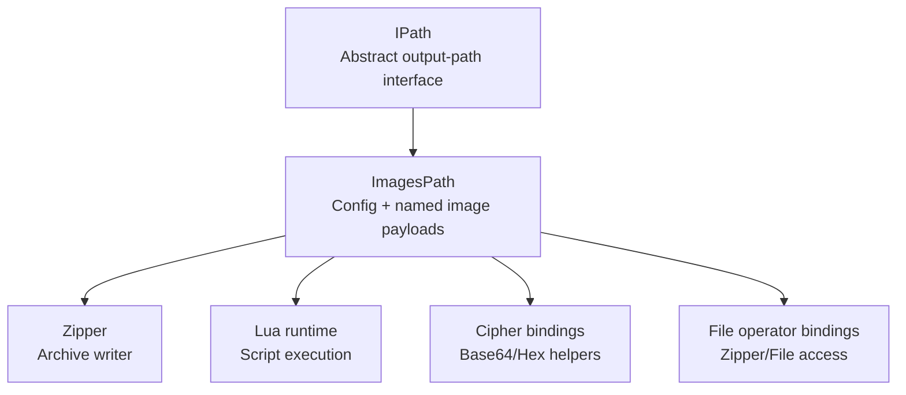
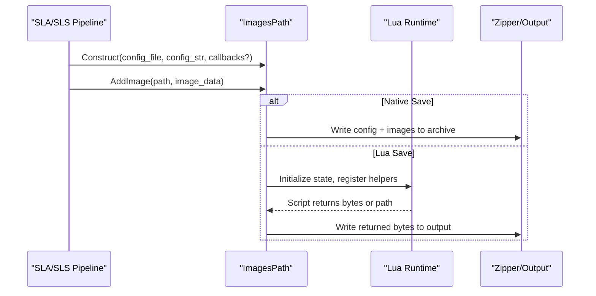
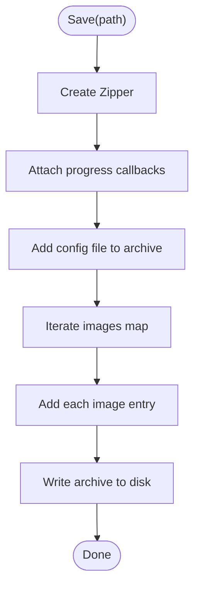
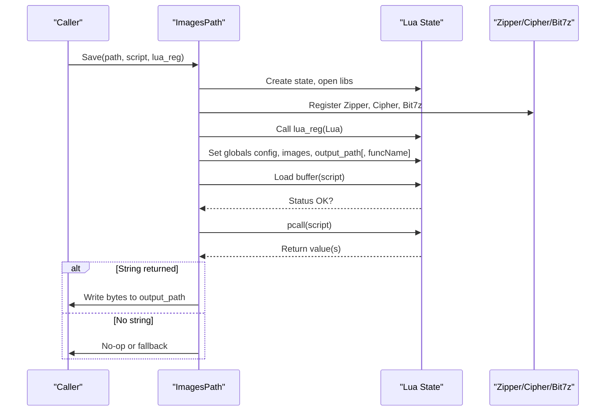
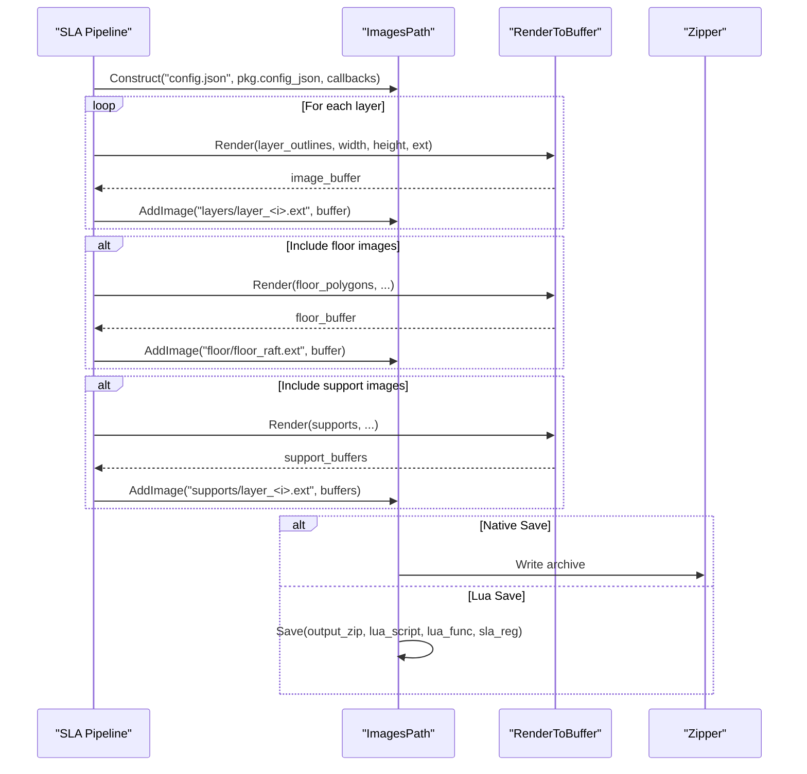
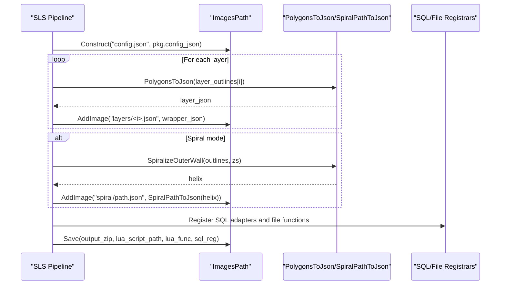
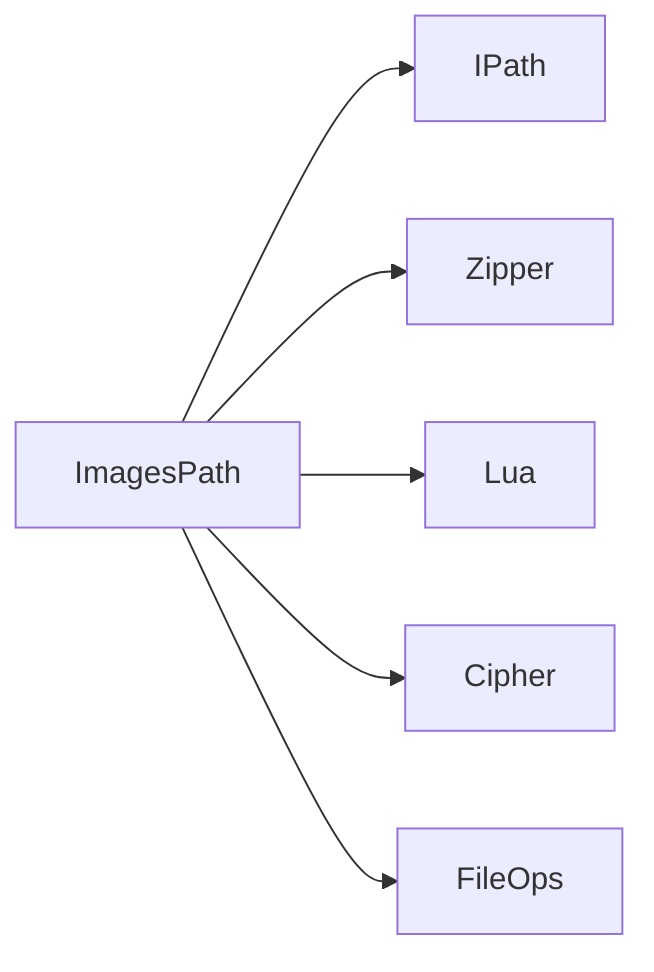

# Image-Based Output / 图像输出

<cite>
**Referenced Files in This Document**
- [imagespath.hpp](file://paths/imagespath.hpp)
- [imagespath.cpp](file://paths/imagespath.cpp)
- [IPath.hpp](file://paths/IPath.hpp)
- [images_path_test.cpp](file://tests/PathsOut/images_path_test.cpp)
- [sla_floor.cpp](file://LibHsBaSlicer/Floor/sla_floor.cpp)
- [sls_export.cpp](file://LibHsBaSlicer/Path/sls_export.cpp)
</cite>

## Table of Contents
1. [Introduction](#introduction)
2. [Project Structure](#project-structure)
3. [Core Components](#core-components)
4. [Architecture Overview](#architecture-overview)
5. [Detailed Component Analysis](#detailed-component-analysis)
6. [Dependency Analysis](#dependency-analysis)
7. [Performance Considerations](#performance-considerations)
8. [Troubleshooting Guide](#troubleshooting-guide)
9. [Conclusion](#conclusion)
10. [Appendices](#appendices)

## Introduction
This document explains the `ImagesPath` class used for image-oriented outputs such as SLA/SLS layer images. It covers:
- Constructor parameters: configuration file name, configuration content string, and optional progress callback functions.
- The `AddImage()` method for managing named image payloads in an internal unordered map.
- Dual output approach: native file writing and Lua post-processing scripts.
- Relationship with SLA floor generation and other image-based manufacturing pipelines.
- Examples for generating layer images, managing multiple image formats, and integrating with SLA/SLS workflows.
- Callback mechanism for tracking image processing progress and error handling strategies.

The goal is to make this component accessible to both new users and experienced developers working on image-based manufacturing outputs.

## Project Structure
`ImagesPath` lives under the path output subsystem and implements a common interface for slicer outputs. It packages:
- A configuration sidecar (config file name plus config content).
- A set of named image payloads stored by path/name.
- Optional progress callbacks invoked during serialization or saving.



**Diagram sources**
- [IPath.hpp:29-57](file://paths/IPath.hpp#L29-L57)
- [imagespath.hpp:23-60](file://paths/imagespath.hpp#L23-L60)
- [imagespath.cpp:34-47](file://paths/imagespath.cpp#L34-L47)
- [imagespath.cpp:49-127](file://paths/imagespath.cpp#L49-L127)

**Section sources**
- [IPath.hpp:29-57](file://paths/IPath.hpp#L29-L57)
- [imagespath.hpp:23-60](file://paths/imagespath.hpp#L23-L60)

## Core Components
- `ImagesPath`: Implements `IPath`, stores a configuration sidecar and a map of named image strings, and supports both native archive creation and Lua-driven post-processing.
- `IPath`: Abstract interface defining Save/ToString families that accept inline scripts, script files, function names, and Lua registration callbacks.

Key responsibilities:
- Store configuration metadata alongside image payloads.
- Provide AddImage() to add or replace entries by path/name.
- Serialize to a human-readable string format or save to disk via native zip or Lua scripts.
- Expose configuration and images to Lua scripts through globals.

**Section sources**
- [imagespath.hpp:23-60](file://paths/imagespath.hpp#L23-L60)
- [IPath.hpp:29-57](file://paths/IPath.hpp#L29-L57)

## Architecture Overview
`ImagesPath` integrates with SLA/SLS pipelines by packaging rendered layer images, floor images, support images, and SLS JSON outlines into archives or custom outputs driven by Lua scripts.



**Diagram sources**
- [imagespath.cpp:23-32](file://paths/imagespath.cpp#L23-L32)
- [imagespath.cpp:34-47](file://paths/imagespath.cpp#L34-L47)
- [imagespath.cpp:49-127](file://paths/imagespath.cpp#L49-L127)

**Section sources**
- [imagespath.cpp:23-32](file://paths/imagespath.cpp#L23-L32)
- [imagespath.cpp:34-47](file://paths/imagespath.cpp#L34-L47)
- [imagespath.cpp:49-127](file://paths/imagespath.cpp#L49-L127)

## Detailed Component Analysis

### Class and Interface Design
`ImagesPath` extends `IPath` and provides:
- Constructors accepting configuration file name, configuration content, and optional progress callbacks.
- `Save(...)` overloads for native archive creation and Lua-driven saving.
- `ToString(...)` overloads for native string serialization and Lua-driven string transformation.
- `AddImage(path, image_str)` to manage named image payloads.

```mermaid
classDiagram
class IPath {
<<interface>>
+Save(path)
+Save(path, script, lua_reg)
+Save(path, script, funcName, lua_reg)
+Save(path, script_file, funcName, lua_reg)
+ToString()
+ToString(script, lua_reg)
+ToString(script, funcName, lua_reg)
+ToString(script_file, funcName, lua_reg)
}
class ImagesPath {
-ConfigFile config_
-unordered_map<string,string> images_
-vector<function<void(double,string_view)>> callbacks_
+ImagesPath(config_file, config_str, callbacks)
+~ImagesPath()
+Save(path)
+Save(path, script, lua_reg)
+Save(path, script, funcName, lua_reg)
+Save(path, script_file, funcName, lua_reg)
+ToString()
+ToString(script, lua_reg)
+ToString(script, funcName, lua_reg)
+ToString(script_file, funcName, lua_reg)
+AddImage(path, image_str)
}
class ConfigFile {
+string path
+string configStr
}
IPath <|.. ImagesPath
ImagesPath --> ConfigFile : "uses"
```

**Diagram sources**
- [IPath.hpp:29-57](file://paths/IPath.hpp#L29-L57)
- [imagespath.hpp:23-60](file://paths/imagespath.hpp#L23-L60)

**Section sources**
- [IPath.hpp:29-57](file://paths/IPath.hpp#L29-L57)
- [imagespath.hpp:23-60](file://paths/imagespath.hpp#L23-L60)

### Constructor Parameters
- `config_file`: Name/path of the configuration sidecar included in the output.
- `config_str`: Configuration content string embedded alongside images.
- `callback`: Optional vector of progress callbacks invoked with `(percent, stage)`. These are forwarded to the underlying zipper when saving natively.

Behavior:
- Stores configuration metadata internally.
- Initializes empty image payload map.
- Captures callbacks for later use during native operations.

**Section sources**
- [imagespath.hpp:32-33](file://paths/imagespath.hpp#L32-L33)
- [imagespath.cpp:23-27](file://paths/imagespath.cpp#L23-L27)

### AddImage Method
Purpose:
- Adds or replaces an image payload under the given path/name.
- Uses an internal unordered map keyed by path string.

Complexity:
- Insertion is average O(1) per call.
- Memory usage grows linearly with total image data size.

Usage patterns:
- Layer images: `"layers/layer_<index>.ext"`
- Floor images: `"floor/floor_raft.ext"`
- Support images: `"supports/layer_<index>.ext"`
- SLS JSON outlines: `"layers/<index>.json"`

**Section sources**
- [imagespath.hpp:49-50](file://paths/imagespath.hpp#L49-L50)
- [imagespath.cpp:29-32](file://paths/imagespath.cpp#L29-L32)

### Dual Output Approach

#### Native File Writing
Native Save writes a zip archive containing:
- The configuration sidecar file.
- All added image payloads.

Callbacks:
- Progress callbacks attached to the zipper are invoked during native save.



**Diagram sources**
- [imagespath.cpp:34-47](file://paths/imagespath.cpp#L34-L47)

**Section sources**
- [imagespath.cpp:34-47](file://paths/imagespath.cpp#L34-L47)

#### Lua Post-Processing Scripts
Lua-enabled Save/ToString:
- Creates a Lua state and opens standard libraries.
- Registers helper modules: Zipper, Cipher, optional Bit7z Zipper.
- Invokes user-provided `lua_reg` to expose additional functions.
- Pushes global tables:
  - `config`: table with `path` and `configStr`.
  - `images`: array of tables with `path` and `data`.
  - `output_path`: target output path (for Save).
  - `funcName`: function name (when using funcName overloads).
- Loads and executes the provided script; if it returns a string, writes it to the output path or returns it from ToString.

Error handling:
- Lua load errors and runtime errors are wrapped into `RuntimeError`.
- Missing script files raise `RuntimeError`.



**Diagram sources**
- [imagespath.cpp:49-127](file://paths/imagespath.cpp#L49-L127)
- [imagespath.cpp:129-203](file://paths/imagespath.cpp#L129-L203)
- [imagespath.cpp:205-217](file://paths/imagespath.cpp#L205-L217)

**Section sources**
- [imagespath.cpp:49-127](file://paths/imagespath.cpp#L49-L127)
- [imagespath.cpp:129-203](file://paths/imagespath.cpp#L129-L203)
- [imagespath.cpp:205-217](file://paths/imagespath.cpp#L205-L217)

### Relationship with SLA Floor Generation and Manufacturing Pipelines

#### SLA Package Saving
SLA pipeline uses `ImagesPath` to package:
- Layer images rendered from polygon outlines.
- Optional floor raft image.
- Optional support images per layer.

Two modes:
- Native Save with progress callbacks integrated via zipper event callback.
- Lua Save with external 2D and file functions registered for the script.



**Diagram sources**
- [sla_floor.cpp:468-529](file://LibHsBaSlicer/Floor/sla_floor.cpp#L468-L529)
- [sla_floor.cpp:531-606](file://LibHsBaSlicer/Floor/sla_floor.cpp#L531-L606)

**Section sources**
- [sla_floor.cpp:468-529](file://LibHsBaSlicer/Floor/sla_floor.cpp#L468-L529)
- [sla_floor.cpp:531-606](file://LibHsBaSlicer/Floor/sla_floor.cpp#L531-L606)

#### SLS Package Export
SLS pipeline uses `ImagesPath` to package:
- JSON outlines per layer with z-height metadata.
- Optional spiral/vase mode continuous deposition path.
- SQL adapters and file functions for Lua scripts.



**Diagram sources**
- [sls_export.cpp:79-143](file://LibHsBaSlicer/Path/sls_export.cpp#L79-L143)

**Section sources**
- [sls_export.cpp:79-143](file://LibHsBaSlicer/Path/sls_export.cpp#L79-L143)

### Examples

#### Generating Layer Images
- Render layer polygons to image buffers using a renderer.
- Add each image via `AddImage("layers/layer_<index>.ext", buffer)`.
- Optionally include floor and support images similarly.

References:
- SLA pipeline adds layer, floor, and support images before saving.

**Section sources**
- [sla_floor.cpp:468-529](file://LibHsBaSlicer/Floor/sla_floor.cpp#L468-L529)

#### Managing Multiple Image Formats
- Use different extensions (e.g., `.png`, `.bin`, `.json`) to represent various formats.
- In Lua scripts, decode base64 payloads using Cipher bindings when needed.

Test coverage demonstrates base64 encoding/decoding and hex encode/decode via Cipher bindings.

**Section sources**
- [images_path_test.cpp:26-54](file://tests/PathsOut/images_path_test.cpp#L26-L54)
- [images_path_test.cpp:218-235](file://tests/PathsOut/images_path_test.cpp#L218-L235)

#### Integrating with SLA/SLS Pipelines
- SLA: Use either native Save with zipper callbacks or Lua Save with 2D/file function registration.
- SLS: Use Lua Save with SQL adapter registration and file functions.

**Section sources**
- [sla_floor.cpp:468-529](file://LibHsBaSlicer/Floor/sla_floor.cpp#L468-L529)
- [sla_floor.cpp:531-606](file://LibHsBaSlicer/Floor/sla_floor.cpp#L531-L606)
- [sls_export.cpp:79-143](file://LibHsBaSlicer/Path/sls_export.cpp#L79-L143)

### Callback Mechanism for Progress Tracking
- Constructor accepts a vector of callbacks `(double percent, std::string_view stage)`.
- Native Save forwards these callbacks to the zipper for progress reporting.
- ToString invokes callbacks at start with a placeholder message indicating no-use for callbacks in string mode.

Usage:
- Integrate UI progress bars or logging systems by providing lambda callbacks.

**Section sources**
- [imagespath.hpp:32-33](file://paths/imagespath.hpp#L32-L33)
- [imagespath.cpp:34-47](file://paths/imagespath.cpp#L34-L47)
- [imagespath.cpp:366-381](file://paths/imagespath.cpp#L366-L381)
- [images_path_test.cpp:56-81](file://tests/PathsOut/images_path_test.cpp#L56-L81)
- [images_path_test.cpp:85-98](file://tests/PathsOut/images_path_test.cpp#L85-L98)

### Error Handling Strategies
- Lua initialization failures throw `RuntimeError`.
- Lua load errors and runtime errors are caught and rethrown as `RuntimeError`.
- Missing script files throw `RuntimeError`.
- Invalid Lua operations (e.g., invalid hex decoding) propagate as `RuntimeError`.

Best practices:
- Wrap calls to Save/ToString in try/catch blocks to handle `RuntimeError`.
- Validate script paths before invoking Save/ToString with script files.

**Section sources**
- [imagespath.cpp:49-127](file://paths/imagespath.cpp#L49-L127)
- [imagespath.cpp:129-203](file://paths/imagespath.cpp#L129-L203)
- [imagespath.cpp:205-217](file://paths/imagespath.cpp#L205-L217)
- [imagespath.cpp:219-282](file://paths/imagespath.cpp#L219-L282)
- [imagespath.cpp:284-364](file://paths/imagespath.cpp#L284-L364)
- [images_path_test.cpp:158-175](file://tests/PathsOut/images_path_test.cpp#L158-L175)
- [images_path_test.cpp:218-235](file://tests/PathsOut/images_path_test.cpp#L218-L235)

## Dependency Analysis
`ImagesPath` depends on:
- `IPath` interface for standardized Save/ToString APIs.
- Zipper for native archive creation.
- Lua runtime for script execution.
- Cipher bindings for base64/hex utilities.
- File operator bindings for Zipper/File access.



**Diagram sources**
- [IPath.hpp:29-57](file://paths/IPath.hpp#L29-L57)
- [imagespath.cpp:11-19](file://paths/imagespath.cpp#L11-L19)

**Section sources**
- [IPath.hpp:29-57](file://paths/IPath.hpp#L29-L57)
- [imagespath.cpp:11-19](file://paths/imagespath.cpp#L11-L19)

## Performance Considerations
- Rendering layer images can be parallelized before insertion into `ImagesPath`.
- Adding many images increases memory proportional to total payload size.
- Native Save iterates over all images once; complexity is linear in number of images.
- Lua script execution overhead should be considered for large datasets; prefer efficient scripts and avoid unnecessary conversions.

[No sources needed since this section provides general guidance]

## Troubleshooting Guide
Common issues and resolutions:
- Missing script file: Ensure script path exists before calling Save/ToString with script file variants.
- Lua syntax errors: Validate Lua scripts externally or use minimal test scripts to isolate issues.
- Invalid data in Cipher bindings: Verify base64/hex inputs; invalid characters cause runtime errors.
- Progress callbacks not firing: Confirm callbacks are provided to constructor and used in native Save.

Diagnostic tips:
- Use ToString with simple scripts to verify environment setup.
- Check error messages wrapped in `RuntimeError` for details.

**Section sources**
- [images_path_test.cpp:158-175](file://tests/PathsOut/images_path_test.cpp#L158-L175)
- [images_path_test.cpp:218-235](file://tests/PathsOut/images_path_test.cpp#L218-L235)

## Conclusion
`ImagesPath` provides a flexible, robust mechanism for packaging configuration and image payloads for SLA/SLS outputs. It supports both native archive creation and Lua-driven customization, integrates seamlessly with manufacturing pipelines, and offers clear error handling and progress tracking. By leveraging its API, developers can generate layer images, manage multiple formats, and integrate with SLA/SLS workflows effectively.

[No sources needed since this section summarizes without analyzing specific files]

## Appendices

### API Reference Summary

| Component | Purpose | Key Methods | Notes |
|---|---|---|---|
| `ImagesPath` | Image-based output packaging | `AddImage`, `Save`, `ToString` | Supports native and Lua outputs |
| `IPath` | Abstract interface | `Save`, `ToString` overloads | Standardizes output behavior |
| `ConfigFile` | Internal config storage | `path`, `configStr` | Used internally by `ImagesPath` |

**Section sources**
- [imagespath.hpp:23-60](file://paths/imagespath.hpp#L23-L60)
- [IPath.hpp:29-57](file://paths/IPath.hpp#L29-L57)