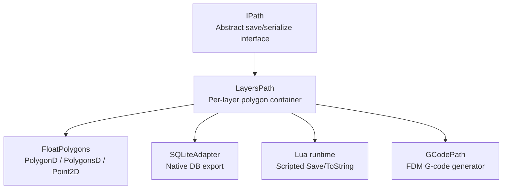
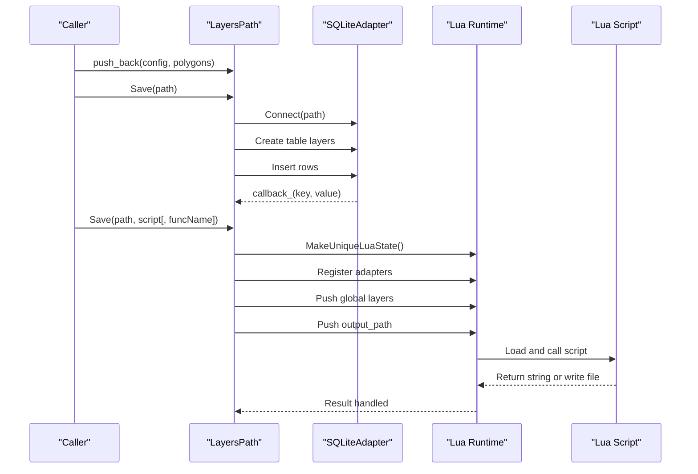
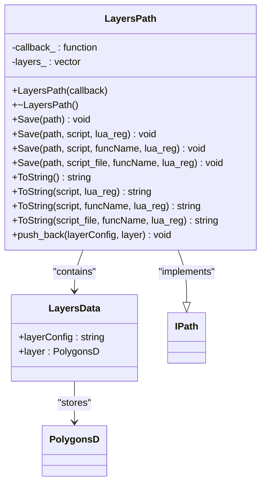
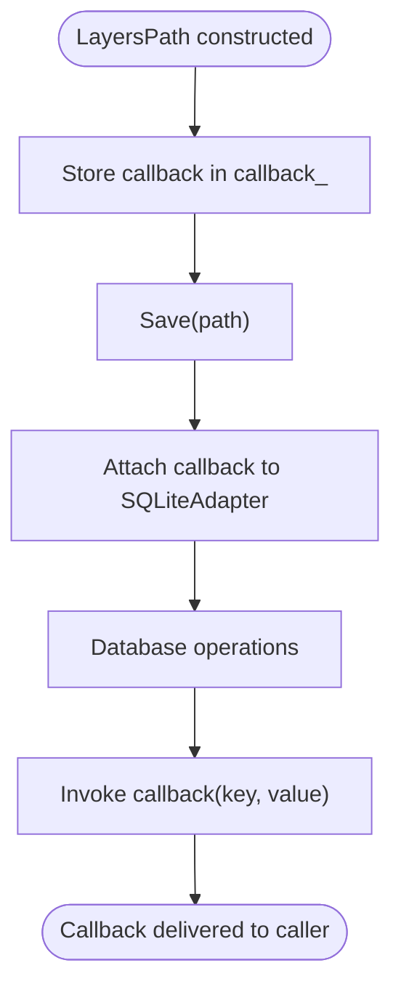
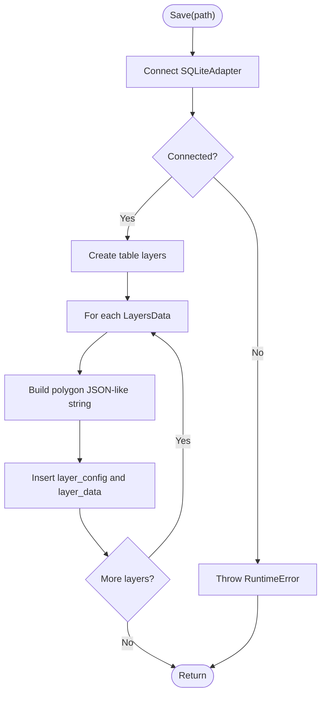
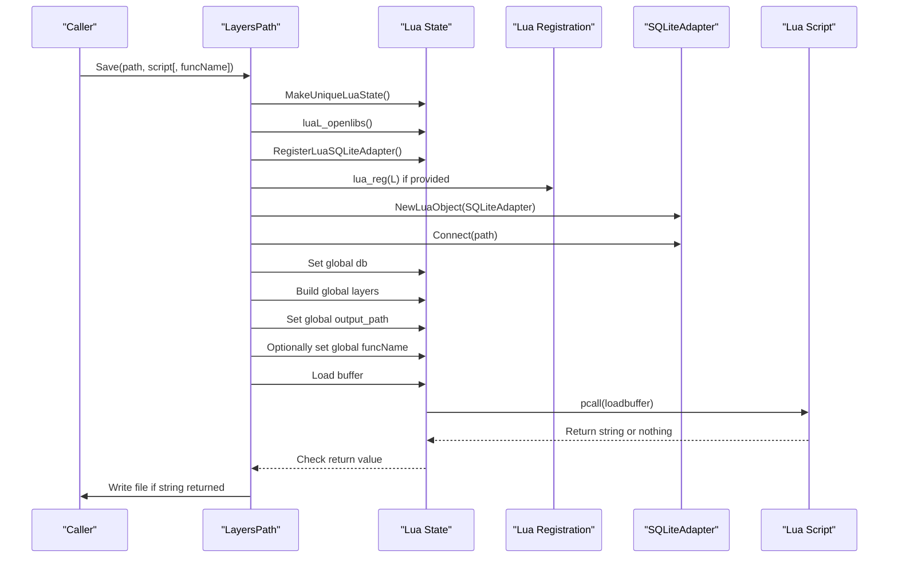
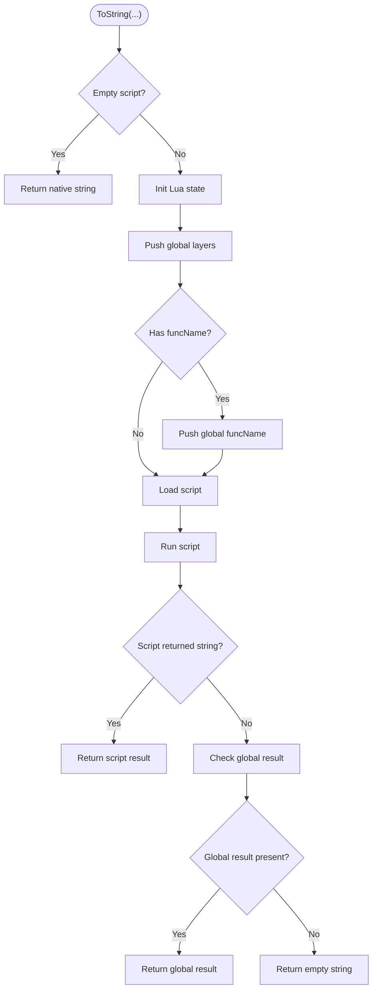
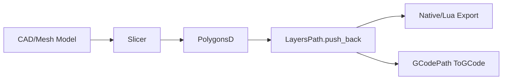
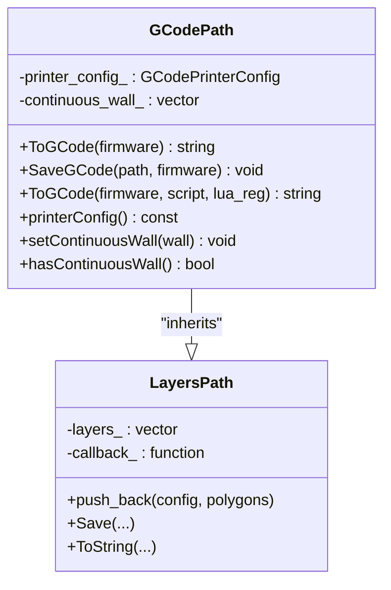
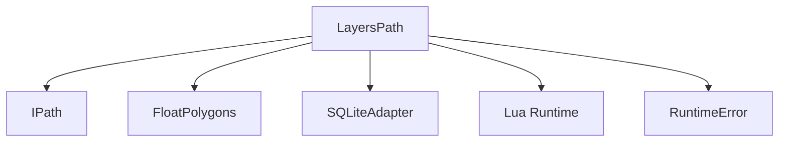

# Layer-Based Paths / 基于层的路径

<cite>
**Referenced Files in This Document**   
- [layerspath.hpp](file://paths/layerspath.hpp)
- [layerspath.cpp](file://paths/layerspath.cpp)
- [IPath.hpp](file://paths/IPath.hpp)
- [FloatPolygons.hpp](file://2D/FloatPolygons.hpp)
- [gcodepath.hpp](file://paths/gcodepath.hpp)
- [layers_path_test.cpp](file://tests/PathsOut/layers_path_test.cpp)
</cite>

## Table of Contents
1. [Introduction](#introduction)
2. [Project Structure](#project-structure)
3. [Core Components](#core-components)
4. [Architecture Overview](#architecture-overview)
5. [Detailed Component Analysis](#detailed-component-analysis)
6. [Dependency Analysis](#dependency-analysis)
7. [Performance Considerations](#performance-considerations)
8. [Troubleshooting Guide](#troubleshooting-guide)
9. [Conclusion](#conclusion)
10. [Appendices](#appendices)

## Introduction
LayersPath is the layer-oriented path container used by the slicer pipeline to store per-layer polygon data together with free-form layer configuration strings. It implements the generic IPath interface, so every LayersPath instance can be saved to a file or serialized to a string using either native output or Lua-based post-processing. The class is designed around:
- Ordered layers.
- Per-layer configuration strings.
- Double-precision 2D polygons from FloatPolygons.
- Native SQLite serialization.
- Lua-driven Save and ToString workflows.
- A progress/status callback that can report database operations.
- Inheritance by GCodePath for FDM-style G-code generation.

This document explains how LayersPath organizes polygon data, how it serializes layers, how callbacks work, how Lua scripts receive layer data, and how higher-level path generators such as GCodePath build on top of it.

## Project Structure
The relevant code lives under `paths/` and `2D/`:
- `paths/layerspath.hpp` and `paths/layerspath.cpp` define and implement LayersPath.
- `paths/IPath.hpp` defines the abstract IPath interface that LayersPath implements.
- `2D/FloatPolygons.hpp` defines PolygonD, PolygonsD, Point2D, and related geometry utilities.
- `paths/gcodepath.hpp` shows how GCodePath extends LayersPath.
- `tests/PathsOut/layers_path_test.cpp` demonstrates usage patterns for LayersPath.

**Diagram sources**
- [IPath.hpp:20-56](file://paths/IPath.hpp#L20-L56)
- [layerspath.hpp:15-60](file://paths/layerspath.hpp#L15-L60)
- [FloatPolygons.hpp:18-25](file://2D/FloatPolygons.hpp#L18-L25)
- [gcodepath.hpp:62-107](file://paths/gcodepath.hpp#L62-L107)

**Section sources**
- [layerspath.hpp:1-64](file://paths/layerspath.hpp#L1-L64)
- [layerspath.cpp:1-496](file://paths/layerspath.cpp#L1-L496)
- [IPath.hpp:1-68](file://paths/IPath.hpp#L1-L68)
- [FloatPolygons.hpp:1-271](file://2D/FloatPolygons.hpp#L1-L271)
- [gcodepath.hpp:1-112](file://paths/gcodepath.hpp#L1-L112)
- [layers_path_test.cpp:1-229](file://tests/PathsOut/layers_path_test.cpp#L1-L229)

## Core Components
### LayersPath
LayersPath stores an ordered sequence of layers. Each layer consists of:
- A configuration string describing layer-specific settings.
- A group of double-precision polygons representing the 2D slice at that height.

Public behavior includes:
- Construction with an optional progress/status callback.
- Adding layers through `push_back`.
- Native `Save(path)` writing a SQLite database.
- Lua-assisted `Save` overloads accepting inline scripts, script files, function names, and custom Lua registration functions.
- `ToString()` overloads returning native text or Lua-processed text.

Protected storage includes:
- `callback_`, a `std::function<void(std::string_view, std::string_view)>` used during database operations.
- `layers_`, a vector of `LayersData`.

**Section sources**
- [layerspath.hpp:17-60](file://paths/layerspath.hpp#L17-L60)
- [layerspath.cpp:21-28](file://paths/layerspath.cpp#L21-L28)

### LayersData
`LayersData` is a simple structure pairing:
- `layerConfig`: a free-form string used to describe layer settings.
- `layer`: a `PolygonsD` containing one or more 2D polygons for that layer.

This structure is not part of the public API surface; it exists inside LayersPath to keep each layer’s configuration and geometry together.

**Section sources**
- [layerspath.hpp:52-59](file://paths/layerspath.hpp#L52-L59)

### FloatPolygons Types
LayersPath uses double-precision polygon types defined in FloatPolygons:
- `Point2D`: a 2D point with double coordinates.
- `PolygonD`: a single polygon path with double coordinates.
- `PolygonsD`: a collection of polygons.

These types are aliases over Clipper2Lib types and provide the geometric foundation for slicing outputs.

**Section sources**
- [FloatPolygons.hpp:18-25](file://2D/FloatPolygons.hpp#L18-L25)

### IPath Interface
IPath defines the common contract for all path output types:
- `Save(path)` for native format saving.
- `Save(path, script, lua_reg)` for Lua-scripted saving.
- `Save(path, script, funcName, lua_reg)` for named Lua entry points.
- `Save(path, script_file, funcName, lua_reg)` for file-based Lua scripts.
- `ToString()` for native string serialization.
- `ToString(script, lua_reg)` for Lua-scripted string serialization.
- `ToString(script, funcName, lua_reg)` for named Lua entry points.
- `ToString(script_file, funcName, lua_reg)` for file-based Lua scripts.

LayersPath overrides these methods to provide layer-aware behavior.

**Section sources**
- [IPath.hpp:20-56](file://paths/IPath.hpp#L20-L56)

## Architecture Overview
LayersPath sits between low-level 2D polygon data and high-level output formats. Its architecture has three main directions:

1. **Input direction**: Slicing produces `PolygonsD` per layer. Callers add them via `push_back(layerConfig, PolygonsD)`.
2. **Storage direction**: Layers are stored in memory as `std::vector<LayersData>`.
3. **Output direction**:
   - Native SQLite export.
   - Lua-driven export or string generation.
   - Higher-level consumers like GCodePath inherit LayersPath and generate printer-specific output.

**Diagram sources**
- [layerspath.cpp:30-59](file://paths/layerspath.cpp#L30-L59)
- [layerspath.cpp:61-163](file://paths/layerspath.cpp#L61-L163)
- [layerspath.cpp:165-277](file://paths/layerspath.cpp#L165-L277)

## Detailed Component Analysis

### Data Model: LayersPath and LayersData
LayersPath is a container for layered 2D geometry. Each layer carries:
- A configuration string.
- One or more polygons.

Internally, LayersPath stores these as `std::vector<LayersData>`. The protected struct keeps configuration and geometry tightly coupled, which simplifies iteration during serialization.

**Diagram sources**
- [layerspath.hpp:17-60](file://paths/layerspath.hpp#L17-L60)
- [IPath.hpp:20-56](file://paths/IPath.hpp#L20-L56)

**Section sources**
- [layerspath.hpp:17-60](file://paths/layerspath.hpp#L17-L60)

### Callback System for Progress Reporting
LayersPath accepts a callback in its constructor:
- Type: `std::function<void(std::string_view, std::string_view)>`.
- Default: an empty lambda.
- Usage: attached to the SQLite adapter during native `Save(path)` and Lua-assisted `Save` overloads.

The callback receives two string views. In the native SQLite path, it is used to report database operations. Tests demonstrate capturing and printing callback arguments.

Important characteristics:
- The callback is stored in `callback_`.
- It is passed into SQLiteAdapter via the `+=` operator.
- It does not control Lua execution directly; it is primarily tied to database operations exposed through SQLiteAdapter.

**Diagram sources**
- [layerspath.cpp:21-23](file://paths/layerspath.cpp#L21-L23)
- [layerspath.cpp:30-59](file://paths/layerspath.cpp#L30-L59)
- [layers_path_test.cpp:56-63](file://tests/PathsOut/layers_path_test.cpp#L56-L63)

**Section sources**
- [layerspath.hpp:28-33](file://paths/layerspath.hpp#L28-L33)
- [layerspath.cpp:21-59](file://paths/layerspath.cpp#L21-L59)
- [layers_path_test.cpp:56-63](file://tests/PathsOut/layers_path_test.cpp#L56-L63)

### Native Save(path)
`Save(path)` writes LayersPath data into a SQLite database:
1. Creates or opens the database file.
2. Attaches the callback to the SQLite adapter.
3. Creates a `layers` table with columns:
   - `id`: auto-increment primary key.
   - `layer_config`: text configuration string.
   - `layer_data`: blob storing serialized polygon data.
4. Iterates through `layers_`.
5. For each layer, builds a JSON-like representation of polygons.
6. Inserts one row per layer.

The polygon serialization format is a nested structure:
- Outer object contains polygon arrays.
- Each polygon array contains point tuples `(x,y)`.

**Diagram sources**
- [layerspath.cpp:30-59](file://paths/layerspath.cpp#L30-L59)

**Section sources**
- [layerspath.cpp:30-59](file://paths/layerspath.cpp#L30-L59)

### Lua-Assisted Save Overloads
LayersPath provides several Lua-assisted Save methods:

| Method | Purpose | Key Behavior |
|---|---|---|
| `Save(path, script, lua_reg)` | Inline Lua script saves to file | Creates Lua state, registers SQLite adapter, pushes `db`, `layers`, `output_path`, loads and runs script. If script returns a string, writes it to `path`. |
| `Save(path, script, funcName, lua_reg)` | Named Lua function | Same as above, but also exposes `funcName` globally. |
| `Save(path, script_file, funcName, lua_reg)` | File-based Lua script | Reads script file into memory and delegates to the inline script overload. |

Common Lua environment setup:
- `MakeUniqueLuaState()` creates a managed Lua state.
- Standard Lua libraries are opened.
- SQLite adapter is registered.
- Optional MySQL and PostgreSQL adapters are conditionally registered when enabled.
- Custom `lua_reg` callback can register additional Lua functions.
- Global `db` is a connected SQLiteAdapter pointing to `path`.
- Global `layers` is a Lua table where each element has:
  - `config`: layer configuration string.
  - `data`: array of polygons, each polygon being an array of `{x, y}` points.
- Global `output_path` holds the target file path.

If the Lua script returns a string, LayersPath writes that string to the output file. Otherwise, the method returns without writing.

**Diagram sources**
- [layerspath.cpp:61-163](file://paths/layerspath.cpp#L61-L163)
- [layerspath.cpp:165-277](file://paths/layerspath.cpp#L165-L277)

**Section sources**
- [layerspath.cpp:61-163](file://paths/layerspath.cpp#L61-L163)
- [layerspath.cpp:165-277](file://paths/layerspath.cpp#L165-L277)

### ToString Overloads
LayersPath supports multiple ways to serialize itself:

| Method | Output | Notes |
|---|---|---|
| `ToString()` | Native string | Returns a compact representation containing config and polygon coordinates. |
| `ToString(script, lua_reg)` | String | If script is empty, falls back to native `ToString()`. Otherwise, executes Lua script and prefers returned string; otherwise reads global `result`. |
| `ToString(script, funcName, lua_reg)` | String | Exposes `funcName` globally and follows the same return/global-result fallback logic. |
| `ToString(script_file, funcName, lua_reg)` | String | Loads script from file and delegates to the inline version. |

Native `ToString()` builds a string containing:
- An outer container.
- For each layer:
  - `config` field.
  - `data` field containing polygon arrays.
  - Each polygon containing point tuples.

Lua-assisted `ToString()` methods:
- Create a Lua state.
- Open standard libraries.
- Apply optional `lua_reg`.
- Push `layers` global.
- Optionally push `funcName`.
- Load and run the script.
- Prefer script return value.
- Fall back to global `result`.
- Return empty string if neither is present.

**Diagram sources**
- [layerspath.cpp:279-301](file://paths/layerspath.cpp#L279-L301)
- [layerspath.cpp:303-392](file://paths/layerspath.cpp#L303-L392)
- [layerspath.cpp:394-493](file://paths/layerspath.cpp#L394-L493)

**Section sources**
- [layerspath.cpp:279-301](file://paths/layerspath.cpp#L279-L301)
- [layerspath.cpp:303-392](file://paths/layerspath.cpp#L303-L392)
- [layerspath.cpp:394-493](file://paths/layerspath.cpp#L394-L493)

### Relationship with FloatPolygons and 2D Polygon Flow
LayersPath consumes `PolygonsD`, which is a collection of `PolygonD`, which is a collection of `Point2D`. This matches the typical slicing pipeline:
1. CAD or mesh model is sliced.
2. Each slice produces `PolygonsD`.
3. Pipeline code calls `LayersPath::push_back(layerConfig, PolygonsD)`.
4. LayersPath stores the polygons and configuration.
5. Export or G-code generation reads the stored polygons.

**Diagram sources**
- [FloatPolygons.hpp:18-25](file://2D/FloatPolygons.hpp#L18-L25)
- [layerspath.cpp:25-28](file://paths/layerspath.cpp#L25-L28)
- [gcodepath.hpp:62-107](file://paths/gcodepath.hpp#L62-L107)

**Section sources**
- [FloatPolygons.hpp:18-25](file://2D/FloatPolygons.hpp#L18-L25)
- [layerspath.cpp:25-28](file://paths/layerspath.cpp#L25-L28)
- [gcodepath.hpp:62-107](file://paths/gcodepath.hpp#L62-L107)

### Integration with GCodePath
GCodePath inherits LayersPath and adds:
- Printer configuration.
- G-code generation for Marlin, RepRap, and Klipper.
- Continuous spiral wall support for vase mode.
- Lua-assisted G-code generation.

Because GCodePath derives from LayersPath, it automatically gains:
- Layer storage.
- Native SQLite export.
- Lua-assisted Save and ToString.
- Callback-based progress reporting during database operations.

**Diagram sources**
- [layerspath.hpp:17-60](file://paths/layerspath.hpp#L17-L60)
- [gcodepath.hpp:62-107](file://paths/gcodepath.hpp#L62-L107)

**Section sources**
- [gcodepath.hpp:24-107](file://paths/gcodepath.hpp#L24-L107)

### Examples: Adding Layers and Configuring Settings
From the test suite, representative usage patterns include:
- Creating a LayersPath with a callback.
- Building a `PolygonsD` with one polygon and one point.
- Calling `push_back("cfg1", poly)`.
- Using `ToString()` to verify configuration appears in output.
- Using `Save(path, script)` to write a CSV-like file through Lua.
- Using native `Save(path)` to create a SQLite database with a `layers` table.

These examples show:
- How layer configuration strings are carried alongside polygon data.
- How Lua scripts can iterate over `layers`.
- How the callback can observe database operations.

**Section sources**
- [layers_path_test.cpp:16-54](file://tests/PathsOut/layers_path_test.cpp#L16-L54)
- [layers_path_test.cpp:56-140](file://tests/PathsOut/layers_path_test.cpp#L56-L140)

## Dependency Analysis
LayersPath depends on:
- `IPath`: abstract interface.
- `FloatPolygons`: polygon types.
- SQLite adapter: native database export.
- Lua runtime: scripted export and serialization.
- Error handling utilities: runtime error exceptions.

**Diagram sources**
- [layerspath.hpp:9-13](file://paths/layerspath.hpp#L9-L13)
- [layerspath.cpp:7-16](file://paths/layerspath.cpp#L7-L16)

**Section sources**
- [layerspath.hpp:9-13](file://paths/layerspath.hpp#L9-L13)
- [layerspath.cpp:7-16](file://paths/layerspath.cpp#L7-L16)

## Performance Considerations
### Memory Management
- LayersPath stores layers in a `std::vector<LayersData>`.
- Each `LayersData` owns a `PolygonsD`.
- Polygon data is double-precision and can grow large for complex models.
- Memory usage grows linearly with the number of layers and total vertex count.

Recommendations:
- Avoid keeping unnecessary copies of `PolygonsD`.
- Reuse LayersPath instances only when you understand lifetime implications.
- Clear or recreate LayersPath when processing many independent models.

### Serialization Performance
- Native `Save(path)` iterates layers once and inserts one row per layer.
- Polygon data is converted into a string before insertion.
- Lua-assisted Save/ToString creates a new Lua state for each call.
- Large polygon sets increase both CPU time and memory pressure during Lua table construction.

Optimization notes:
- Batch operations are already per-layer; further optimization would require reducing polygon vertex counts or using streaming exports.
- Avoid repeatedly calling Save/ToString on very large LayersPath objects unless necessary.
- Use native SQLite export when database persistence is sufficient.
- Use Lua scripts only when custom formatting or external integration is required.

### Callback Overhead
- The callback is invoked during database operations.
- If the callback performs expensive logging or UI updates, it can slow down native export.
- Keep callback implementations lightweight.

[No sources needed since this section provides general guidance]

## Troubleshooting Guide
### Common Errors
| Symptom | Likely Cause | Resolution |
|---|---|---|
| Database creation fails | SQLite connection failed | Check file path permissions and ensure the directory exists. |
| Lua initialization fails | Lua state creation failed | Verify Lua is available and initialized correctly. |
| Lua load error | Invalid Lua syntax | Fix script syntax and re-run. |
| Lua runtime error | Script throws or invalid operation | Inspect script logic and globals like `layers`, `db`, `output_path`, `funcName`. |
| Missing script file error | Script path does not exist | Ensure script file exists before calling Save/ToString with a file path. |
| No output file from Lua Save | Script did not return a string | Modify script to return a string or write the file directly. |

### Debugging Tips
- Use the callback to log database operations during native Save.
- Print `#layers` in Lua scripts to confirm layer count.
- Access `layers[i].config` and `layers[i].data` to inspect per-layer data.
- Use `funcName` to route different behaviors in shared Lua scripts.
- Test with small polygon sets first, then scale up.

**Section sources**
- [layerspath.cpp:30-59](file://paths/layerspath.cpp#L30-L59)
- [layerspath.cpp:61-163](file://paths/layerspath.cpp#L61-L163)
- [layerspath.cpp:165-277](file://paths/layerspath.cpp#L165-L277)
- [layerspath.cpp:279-493](file://paths/layerspath.cpp#L279-L493)
- [layers_path_test.cpp:142-226](file://tests/PathsOut/layers_path_test.cpp#L142-L226)

## Conclusion
LayersPath is the central container for per-layer 2D polygon data in the slicer pipeline. It combines:
- Simple layer configuration strings.
- Double-precision polygon groups.
- Native SQLite export.
- Flexible Lua-driven Save and ToString workflows.
- A callback mechanism for database progress reporting.
- Inheritance by GCodePath for FDM-style G-code generation.

For large layer sets, prioritize efficient polygon data management, avoid unnecessary Lua invocations, and keep callbacks lightweight. When integrating with higher-level path generators, treat LayersPath as the source of truth for layer geometry and use its Lua APIs for custom export logic.

[No sources needed since this section summarizes without analyzing specific files]

## Appendices

### API Summary Table
| Member | Signature Category | Description |
|---|---|---|
| Constructor | `LayersPath(callback)` | Stores optional progress/status callback. |
| `push_back` | `void push_back(layerConfig, layer)` | Adds a layer with configuration and polygons. |
| `Save(path)` | Native | Writes layers to SQLite database. |
| `Save(path, script, lua_reg)` | Lua inline | Runs inline Lua script with `db`, `layers`, `output_path`. |
| `Save(path, script, funcName, lua_reg)` | Lua inline with function name | Adds `funcName` global. |
| `Save(path, script_file, funcName, lua_reg)` | Lua file | Loads script from file. |
| `ToString()` | Native | Returns native string representation. |
| `ToString(script, lua_reg)` | Lua inline | Returns Lua result or native fallback. |
| `ToString(script, funcName, lua_reg)` | Lua inline with function name | Adds `funcName` global. |
| `ToString(script_file, funcName, lua_reg)` | Lua file | Loads script from file. |

**Section sources**
- [layerspath.hpp:28-50](file://paths/layerspath.hpp#L28-L50)
- [layerspath.cpp:30-493](file://paths/layerspath.cpp#L30-L493)