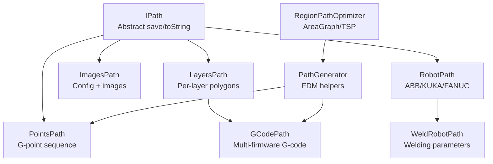
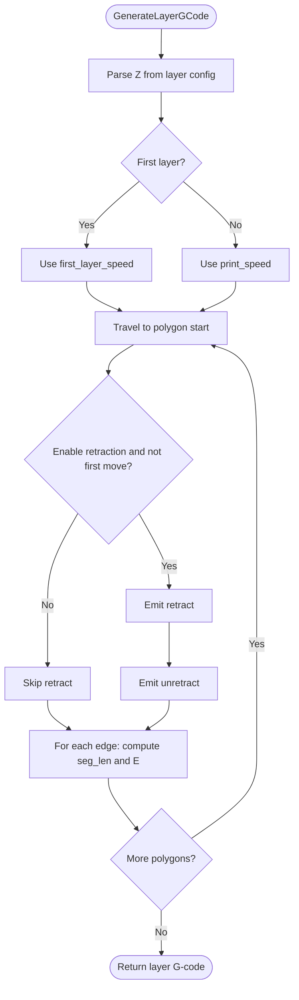
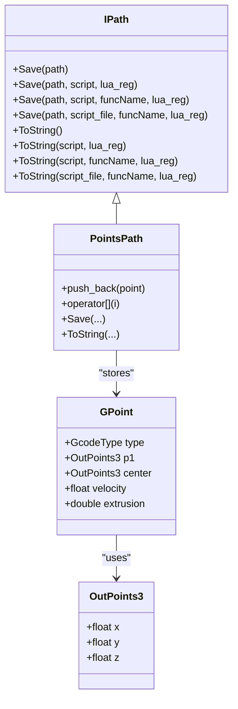
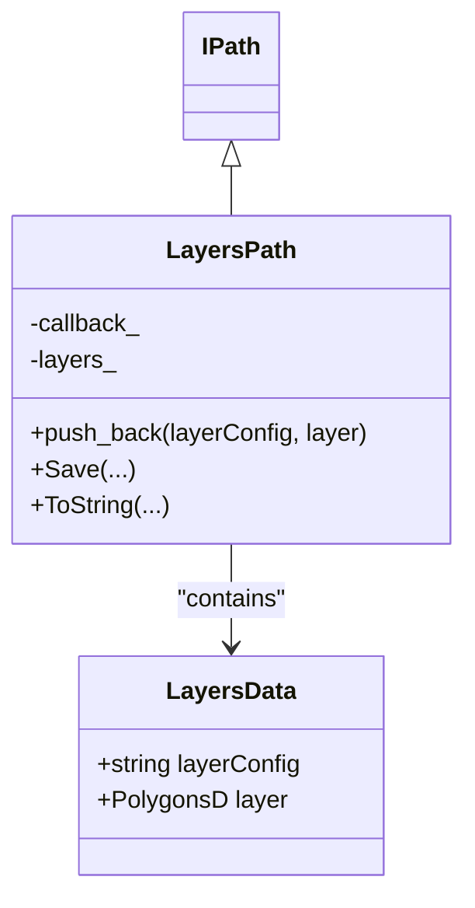
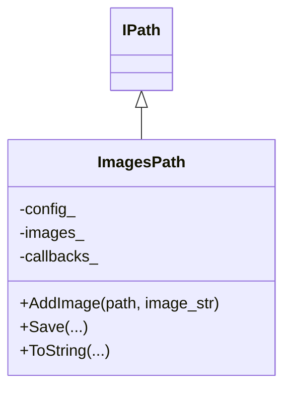
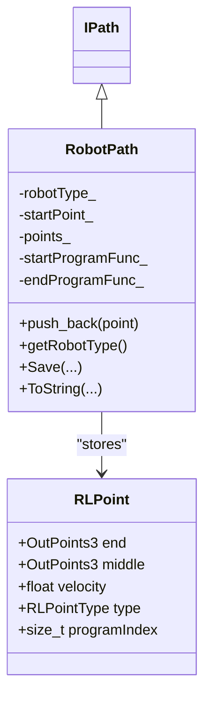
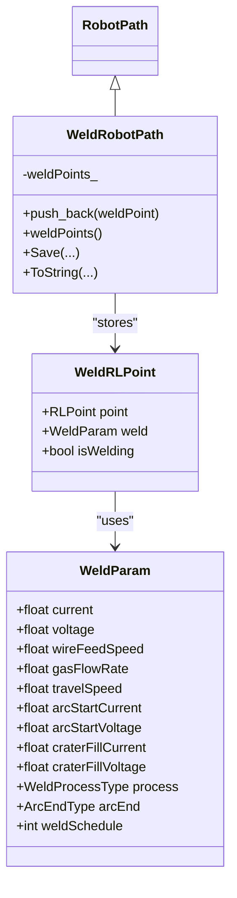
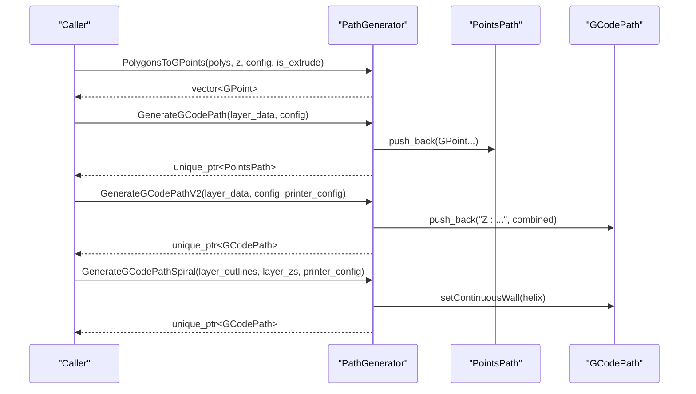
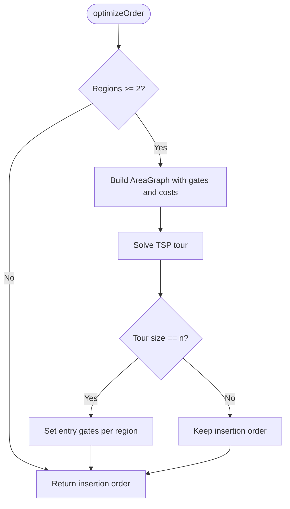
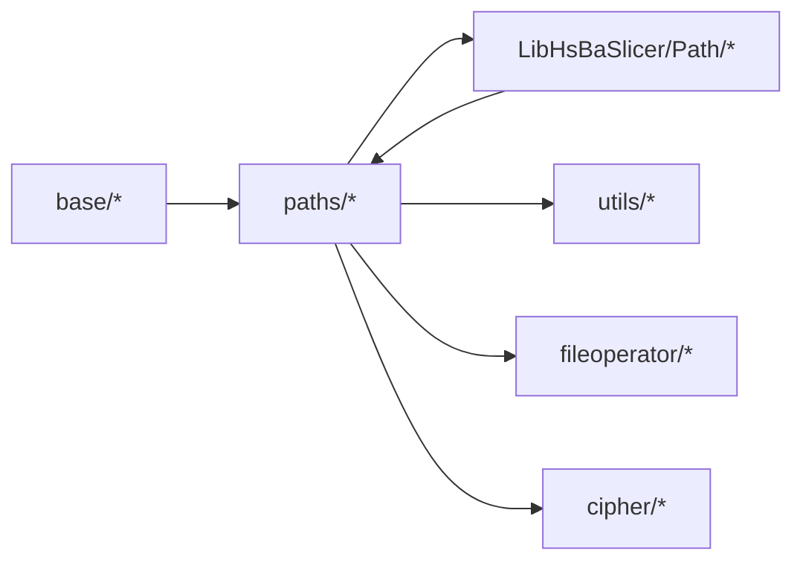

# Path Generation & Optimization / 路径生成与优化

<cite>
**Referenced Files in This Document**   
- [IPath.hpp](file://paths/IPath.hpp)
- [pointspath.hpp](file://paths/pointspath.hpp)
- [layerspath.hpp](file://paths/layerspath.hpp)
- [gcodepath.hpp](file://paths/gcodepath.hpp)
- [imagespath.hpp](file://paths/imagespath.hpp)
- [robotpath.hpp](file://paths/robotpath.hpp)
- [weldrobotpath.hpp](file://paths/weldrobotpath.hpp)
- [path_generator.hpp](file://LibHsBaSlicer/Path/path_generator.hpp)
- [path_optimizer.hpp](file://LibHsBaSlicer/Path/path_optimizer.hpp)
- [gcodepath.cpp](file://paths/gcodepath.cpp)
- [layerspath.cpp](file://paths/layerspath.cpp)
- [imagespath.cpp](file://paths/imagespath.cpp)
- [robotpath.cpp](file://paths/robotpath.cpp)
- [weldrobotpath.cpp](file://paths/weldrobotpath.cpp)
- [path_generator.cpp](file://LibHsBaSlicer/Path/path_generator.cpp)
- [path_optimizer.cpp](file://LibHsBaSlicer/Path/path_optimizer.cpp)
</cite>

## Table of Contents
1. [Introduction](#introduction)
2. [Project Structure](#project-structure)
3. [Core Components](#core-components)
4. [Architecture Overview](#architecture-overview)
5. [Detailed Component Analysis](#detailed-component-analysis)
6. [Dependency Analysis](#dependency-analysis)
7. [Performance Considerations](#performance-considerations)
8. [Troubleshooting Guide](#troubleshooting-guide)
9. [Conclusion](#conclusion)

## Introduction
This document explains the path generation and optimization module that converts geometric data into machine-readable movement instructions for FDM, SLA/SLS image-based slicing, industrial robotics, and welding applications. It focuses on:

- GCodePath for FDM g-code generation with extrusion control, travel moves, temperature management, retraction, and multi-firmware compatibility (Marlin, RepRap/RRF, Klipper).
- Point-based and layer-based path abstractions used by higher-level exporters.
- ImagePath for SLA layer image packaging.
- RobotPath for ABB/KUKA/FANUC robot programs.
- WeldRobotPath for welding-specific robot programs with arc start/end and weld parameters.
- Region-based path ordering optimization using AreaGraph and TSP, including pre-fill polygon mode and post-fill polyline mode.
- Firmware-specific motion planning considerations, retraction strategies, spiral/vase continuous wall generation, and Lua-driven extensibility.

## Project Structure
The path system is organized around a common abstract interface and several concrete output types:



**Diagram sources**
- [IPath.hpp:20-57](file://paths/IPath.hpp#L20-L57)
- [pointspath.hpp:44-94](file://paths/pointspath.hpp#L44-L94)
- [layerspath.hpp:17-60](file://paths/layerspath.hpp#L17-L60)
- [imagespath.hpp:16-61](file://paths/imagespath.hpp#L16-L61)
- [robotpath.hpp:44-104](file://paths/robotpath.hpp#L44-L104)
- [weldrobotpath.hpp:51-96](file://paths/weldrobotpath.hpp#L51-L96)
- [gcodepath.hpp:62-107](file://paths/gcodepath.hpp#L62-L107)
- [path_generator.hpp:20-91](file://LibHsBaSlicer/Path/path_generator.hpp#L20-L91)
- [path_optimizer.hpp:23-100](file://LibHsBaSlicer/Path/path_optimizer.hpp#L23-L100)

**Section sources**
- [IPath.hpp:20-57](file://paths/IPath.hpp#L20-L57)
- [pointspath.hpp:44-94](file://paths/pointspath.hpp#L44-L94)
- [layerspath.hpp:17-60](file://paths/layerspath.hpp#L17-L60)
- [imagespath.hpp:16-61](file://paths/imagespath.hpp#L16-L61)
- [robotpath.hpp:44-104](file://paths/robotpath.hpp#L44-L104)
- [weldrobotpath.hpp:51-96](file://paths/weldrobotpath.hpp#L51-L96)
- [gcodepath.hpp:62-107](file://paths/gcodepath.hpp#L62-L107)
- [path_generator.hpp:20-91](file://LibHsBaSlicer/Path/path_generator.hpp#L20-L91)
- [path_optimizer.hpp:23-100](file://LibHsBaSlicer/Path/path_optimizer.hpp#L23-L100)

## Core Components
- IPath: Abstract base providing Save/ToString overloads with optional Lua post-processing. All path outputs implement this interface.
- PointsPath: Ordered GPoint sequence; supports G0/G1/G2/G3 motions, feed rates, and extrusion amounts.
- LayersPath: Stores per-layer polygon groups plus free-form config strings; serializes to SQLite or via Lua scripts.
- GCodePath: Extends LayersPath to generate firmware-specific G-code with temperature, retraction, relative/absolute extrusion, and continuous spiral walls.
- ImagesPath: Packages a configuration file and named image payloads; saves as zip or string.
- RobotPath: Generates brand-specific robot code (ABB/KUKA/FANUC) from RLPoint sequences.
- WeldRobotPath: Extends RobotPath with WeldParam per point and arc start/end handling.
- PathGenerator: FDM helpers converting PolygonsD to GPoint sequences and building PointsPath or GCodePath, including spiral/vase mode.
- RegionPathOptimizer: Pre-optimizes region visit order using AreaGraph and TSP; supports polygon mode and fill-result mode.

**Section sources**
- [IPath.hpp:20-57](file://paths/IPath.hpp#L20-L57)
- [pointspath.hpp:44-94](file://paths/pointspath.hpp#L44-L94)
- [layerspath.hpp:17-60](file://paths/layerspath.hpp#L17-L60)
- [gcodepath.hpp:62-107](file://paths/gcodepath.hpp#L62-L107)
- [imagespath.hpp:16-61](file://paths/imagespath.hpp#L16-L61)
- [robotpath.hpp:44-104](file://paths/robotpath.hpp#L44-L104)
- [weldrobotpath.hpp:51-96](file://paths/weldrobotpath.hpp#L51-L96)
- [path_generator.hpp:20-91](file://LibHsBaSlicer/Path/path_generator.hpp#L20-L91)
- [path_optimizer.hpp:23-100](file://LibHsBaSlicer/Path/path_optimizer.hpp#L23-L100)

## Architecture Overview
The pipeline transforms geometric layers into multiple target formats:

```mermaid
sequenceDiagram
participant Caller as "Caller"
participant Gen as "PathGenerator"
participant Opt as "RegionPathOptimizer"
participant LP as "LayersPath"
participant GP as "GCodePath"
participant PP as "PointsPath"
participant RP as "RobotPath/WeldRobotPath"
participant IP as "ImagesPath"
Caller->>Opt : Add regions (polygons or paths)
Opt-->>Caller : Optimized order
Caller->>Gen : GenerateGCodePathV2(layer_data, printer_config)
Gen->>LP : push_back("Z : ...", combined_polygons)
Gen->>GP : setContinuousWall(helix) for vase mode
GP-->>Caller : ToGCode(firmware)
Caller->>PP : PolygonsToGPoints(...)
Caller->>RP : push_back(RLPoint/WeldRLPoint)
Caller->>IP : AddImage(path, image_str)
```

**Diagram sources**
- [path_generator.cpp:63-140](file://LibHsBaSlicer/Path/path_generator.cpp#L63-L140)
- [path_optimizer.cpp:129-185](file://LibHsBaSlicer/Path/path_optimizer.cpp#L129-L185)
- [gcodepath.cpp:291-350](file://paths/gcodepath.cpp#L291-L350)
- [robotpath.cpp:91-113](file://paths/robotpath.cpp#L91-L113)
- [imagespath.cpp:34-47](file://paths/imagespath.cpp#L34-L47)

## Detailed Component Analysis

### GCodePath for FDM G-code Generation
GCodePath extends LayersPath and generates standard G-code for Marlin, RepRap/RRF, and Klipper. It manages:

- Temperature setup and wait commands.
- Homing and axis positioning.
- Relative vs absolute extrusion modes.
- Retraction/unretract on travel moves between polygons.
- First-layer speed vs normal print speed.
- Continuous helical wall for spiral/vase mode without retraction between wall points.

Key behaviors:
- Header/footer differ per firmware (e.g., Klipper uses SET_PRESSURE_ADVANCE and fan control).
- Layer generation parses Z height from layer config ("Z:...") and emits G0/Z moves before printing each polygon.
- Extrusion amount is computed from line width, layer height, segment length, filament diameter, and multiplier.
- Spiral wall is emitted first, then per-layer polygons; no retraction inside the continuous wall.



**Diagram sources**
- [gcodepath.cpp:211-289](file://paths/gcodepath.cpp#L211-L289)

**Section sources**
- [gcodepath.hpp:32-49](file://paths/gcodepath.hpp#L32-L49)
- [gcodepath.hpp:62-107](file://paths/gcodepath.hpp#L62-L107)
- [gcodepath.cpp:57-67](file://paths/gcodepath.cpp#L57-L67)
- [gcodepath.cpp:69-158](file://paths/gcodepath.cpp#L69-L158)
- [gcodepath.cpp:160-209](file://paths/gcodepath.cpp#L160-L209)
- [gcodepath.cpp:211-289](file://paths/gcodepath.cpp#L211-L289)
- [gcodepath.cpp:291-350](file://paths/gcodepath.cpp#L291-L350)

### PathPoint and Basic Point Sequences
PointsPath stores an ordered sequence of GPoint objects representing G0/G1/G2/G3 motions with velocities and extrusion values. It provides native serialization and Lua post-processing hooks.

- GPoint includes motion type, target point, optional arc center, velocity, and extrusion.
- ToString emits units header (G20/G21), absolute positioning (G90), initial move, and subsequent moves with feed and extrusion.



**Diagram sources**
- [IPath.hpp:20-57](file://paths/IPath.hpp#L20-L57)
- [pointspath.hpp:44-94](file://paths/pointspath.hpp#L44-L94)

**Section sources**
- [pointspath.hpp:16-52](file://paths/pointspath.hpp#L16-L52)
- [pointspath.hpp:54-94](file://paths/pointspath.hpp#L54-L94)

### LayerPath for Per-Layer Organization
LayersPath holds an ordered list of per-layer polygon groups with free-form config strings. It supports:

- Native SQLite storage with progress callbacks.
- Lua-driven Save/ToString with database adapters and custom logic.
- Pushing layers as config + polygons.



**Diagram sources**
- [layerspath.hpp:17-60](file://paths/layerspath.hpp#L17-L60)

**Section sources**
- [layerspath.hpp:17-60](file://paths/layerspath.hpp#L17-L60)
- [layerspath.cpp:25-59](file://paths/layerspath.cpp#L25-L59)
- [layerspath.cpp:61-163](file://paths/layerspath.cpp#L61-L163)
- [layerspath.cpp:165-277](file://paths/layerspath.cpp#L165-L277)
- [layerspath.cpp:279-496](file://paths/layerspath.cpp#L279-L496)

### ImagePath for SLA Layer Image Generation
ImagesPath packages a configuration file and named image payloads. It supports:

- Zipper-based saving with progress callbacks.
- Lua post-processing with cipher and zipper helpers.
- String serialization with base64 decoding for display.



**Diagram sources**
- [imagespath.hpp:16-61](file://paths/imagespath.hpp#L16-L61)

**Section sources**
- [imagespath.hpp:16-61](file://paths/imagespath.hpp#L16-L61)
- [imagespath.cpp:23-47](file://paths/imagespath.cpp#L23-L47)
- [imagespath.cpp:49-127](file://paths/imagespath.cpp#L49-L127)
- [imagespath.cpp:129-217](file://paths/imagespath.cpp#L129-L217)
- [imagespath.cpp:219-384](file://paths/imagespath.cpp#L219-L384)

### RobotPath for Robotic Manufacturing Processes
RobotPath generates brand-specific robot language programs (ABB/KUKA/FANUC) from RLPoint sequences. It supports:

- Program blocks (start/end markers) and linear/circular moves.
- Velocity and program index metadata.
- Lua post-processing with header, start/end program functions, and points table.



**Diagram sources**
- [robotpath.hpp:44-104](file://paths/robotpath.hpp#L44-L104)

**Section sources**
- [robotpath.hpp:15-52](file://paths/robotpath.hpp#L15-L52)
- [robotpath.hpp:54-104](file://paths/robotpath.hpp#L54-L104)
- [robotpath.cpp:60-113](file://paths/robotpath.cpp#L60-L113)
- [robotpath.cpp:115-225](file://paths/robotpath.cpp#L115-L225)
- [robotpath.cpp:227-404](file://paths/robotpath.cpp#L227-L404)
- [robotpath.cpp:406-524](file://paths/robotpath.cpp#L406-L524)

### WeldRobotPath for Welding Applications
WeldRobotPath extends RobotPath with welding parameters per point and arc start/end handling. It supports:

- WeldProcessType (MIG/MAG, TIG, Plasma, Laser).
- ArcEndType (Normal, CraterFill, SlowRetract).
- WeldParam fields (current, voltage, wireFeedSpeed, gasFlowRate, travelSpeed, arc start/end parameters, schedule).
- Brand-specific welding code generation (ABB/KUKA/FANUC).



**Diagram sources**
- [weldrobotpath.hpp:16-57](file://paths/weldrobotpath.hpp#L16-L57)
- [weldrobotpath.hpp:59-96](file://paths/weldrobotpath.hpp#L59-L96)

**Section sources**
- [weldrobotpath.hpp:16-57](file://paths/weldrobotpath.hpp#L16-L57)
- [weldrobotpath.hpp:59-96](file://paths/weldrobotpath.hpp#L59-L96)
- [weldrobotpath.cpp:54-101](file://paths/weldrobotpath.cpp#L54-L101)
- [weldrobotpath.cpp:103-194](file://paths/weldrobotpath.cpp#L103-L194)
- [weldrobotpath.cpp:196-223](file://paths/weldrobotpath.cpp#L196-L223)
- [weldrobotpath.cpp:225-483](file://paths/weldrobotpath.cpp#L225-L483)

### Path Generation Helpers and Spiral/Vase Mode
PathGenerator provides:

- PolygonsToGPoints: Converts PolygonsD to GPoint sequences with travel and extrusion moves.
- GenerateGCodePath: Builds PointsPath from outlines/fills/supports per layer.
- GenerateGCodePathV2: Builds GCodePath with per-layer Z config and combined polygons.
- GenerateGCodePathSpiral: Creates a continuous helical outer wall for vase mode.



**Diagram sources**
- [path_generator.cpp:14-61](file://LibHsBaSlicer/Path/path_generator.cpp#L14-L61)
- [path_generator.cpp:63-140](file://LibHsBaSlicer/Path/path_generator.cpp#L63-L140)

**Section sources**
- [path_generator.hpp:20-91](file://LibHsBaSlicer/Path/path_generator.hpp#L20-L91)
- [path_generator.cpp:14-61](file://LibHsBaSlicer/Path/path_generator.cpp#L14-L61)
- [path_generator.cpp:63-140](file://LibHsBaSlicer/Path/path_generator.cpp#L63-L140)

### Region-Based Path Ordering Optimization
RegionPathOptimizer treats independent polygon regions as graph vertices and solves the visit order minimizing total air-move cost. Two modes:

- Polygon mode (before fill): gates are all polygon vertices; outputs polygons in optimized order.
- Fill-result mode (after fill): gates are head/tail endpoints of polylines; outputs complete fill paths.

Algorithm highlights:
- Intra-region gate-to-gate cost is straight-line distance.
- Inter-region routing cost is minimum endpoint distance unless manually overridden.
- TSP solved via AreaGraph; intra-region arrangement uses nearest-neighbor greedy scheme.
- Manual routes can override auto-computed costs.



**Diagram sources**
- [path_optimizer.cpp:129-185](file://LibHsBaSlicer/Path/path_optimizer.cpp#L129-L185)

**Section sources**
- [path_optimizer.hpp:23-100](file://LibHsBaSlicer/Path/path_optimizer.hpp#L23-L100)
- [path_optimizer.cpp:45-127](file://LibHsBaSlicer/Path/path_optimizer.cpp#L45-L127)
- [path_optimizer.cpp:129-185](file://LibHsBaSlicer/Path/path_optimizer.cpp#L129-L185)
- [path_optimizer.cpp:187-235](file://LibHsBaSlicer/Path/path_optimizer.cpp#L187-L235)
- [path_optimizer.cpp:252-312](file://LibHsBaSlicer/Path/path_optimizer.cpp#L252-L312)
- [path_optimizer.cpp:314-438](file://LibHsBaSlicer/Path/path_optimizer.cpp#L314-L438)
- [path_optimizer.cpp:476-741](file://LibHsBaSlicer/Path/path_optimizer.cpp#L476-L741)

## Dependency Analysis
The path modules form a layered dependency structure:



- Paths depend on base types (error, any_object, etc.).
- LibHsBaSlicer/Path depends on 2D geometry and AreaGraph utilities.
- Paths integrate with file operator (zipper/sql adapter) and cipher for image packaging and Lua scripting.

**Diagram sources**
- [layerspath.cpp:1-17](file://paths/layerspath.cpp#L1-L17)
- [imagespath.cpp:1-20](file://paths/imagespath.cpp#L1-L20)
- [robotpath.cpp:1-18](file://paths/robotpath.cpp#L1-L18)
- [path_optimizer.cpp:1-22](file://LibHsBaSlicer/Path/path_optimizer.cpp#L1-L22)

**Section sources**
- [layerspath.cpp:1-17](file://paths/layerspath.cpp#L1-L17)
- [imagespath.cpp:1-20](file://paths/imagespath.cpp#L1-L20)
- [robotpath.cpp:1-18](file://paths/robotpath.cpp#L1-L18)
- [path_optimizer.cpp:1-22](file://LibHsBaSlicer/Path/path_optimizer.cpp#L1-L22)

## Performance Considerations
- RegionPathOptimizer uses AreaGraph and TSP; complexity grows with number of regions and gates. For small region counts, direct comparison avoids genetic algorithm overhead.
- Intra-region arrangement is greedy nearest-neighbor; reversing polylines reduces jumps.
- GCodePath extrusion calculation is O(n) per layer based on segment lengths.
- Spiral wall generation avoids retraction between points, reducing unnecessary moves.
- Lua post-processing adds overhead but enables flexible customization; use sparingly for performance-critical paths.

[No sources needed since this section provides general guidance]

## Troubleshooting Guide
Common issues and resolutions:

- Mixing region modes: Cannot mix addRegion and addPolygonRegion within one optimizer instance; ensure consistent mode usage.
- Script loading errors: Lua load/pcall failures throw RuntimeError with detailed messages; verify script syntax and function names.
- File open failures: Output file or script file open errors raise RuntimeError; check paths and permissions.
- Unsupported robot types: RobotPath throws NotSupportedError when robot type is unknown; provide valid RLType or use Lua script.
- Spiral wall continuity: Ensure continuous wall has at least two points; otherwise, it is ignored.

**Section sources**
- [path_optimizer.cpp:68-127](file://LibHsBaSlicer/Path/path_optimizer.cpp#L68-L127)
- [layerspath.cpp:61-163](file://paths/layerspath.cpp#L61-L163)
- [imagespath.cpp:49-127](file://paths/imagespath.cpp#L49-L127)
- [robotpath.cpp:91-113](file://paths/robotpath.cpp#L91-L113)
- [gcodepath.cpp:353-362](file://paths/gcodepath.cpp#L353-L362)

## Conclusion
The path generation and optimization module provides a comprehensive toolkit for converting geometric data into machine-readable movement instructions across FDM, SLA/SLS, robotics, and welding domains. Its modular design, firmware-specific support, and Lua extensibility enable flexible and efficient production of high-quality toolpaths. Region-based optimization reduces travel time, while GCodePath and RobotPath/WeldRobotPath ensure compatibility with diverse target machines.

[No sources needed since this section summarizes without analyzing specific files]