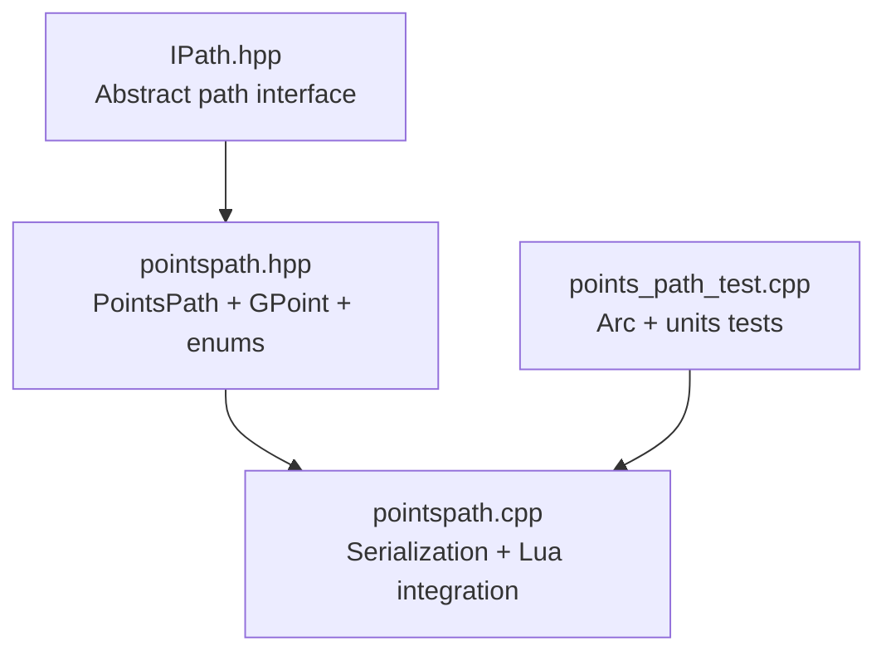
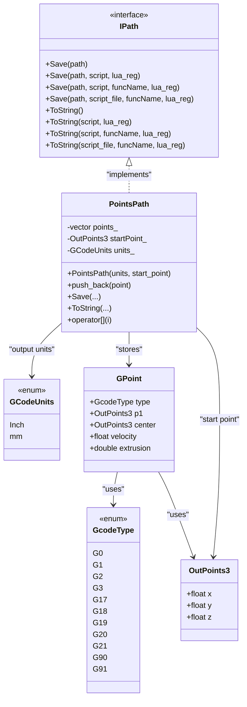
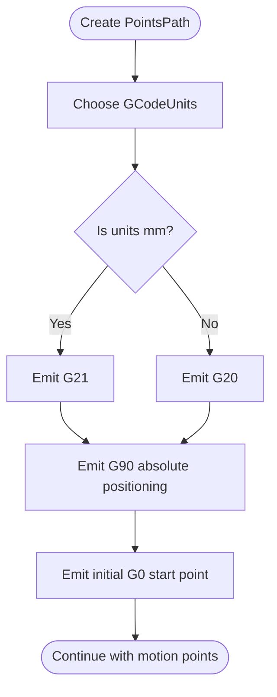
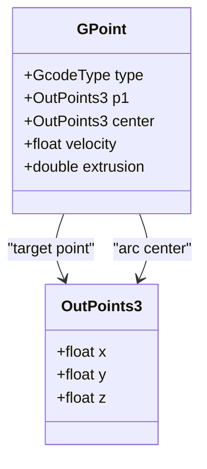
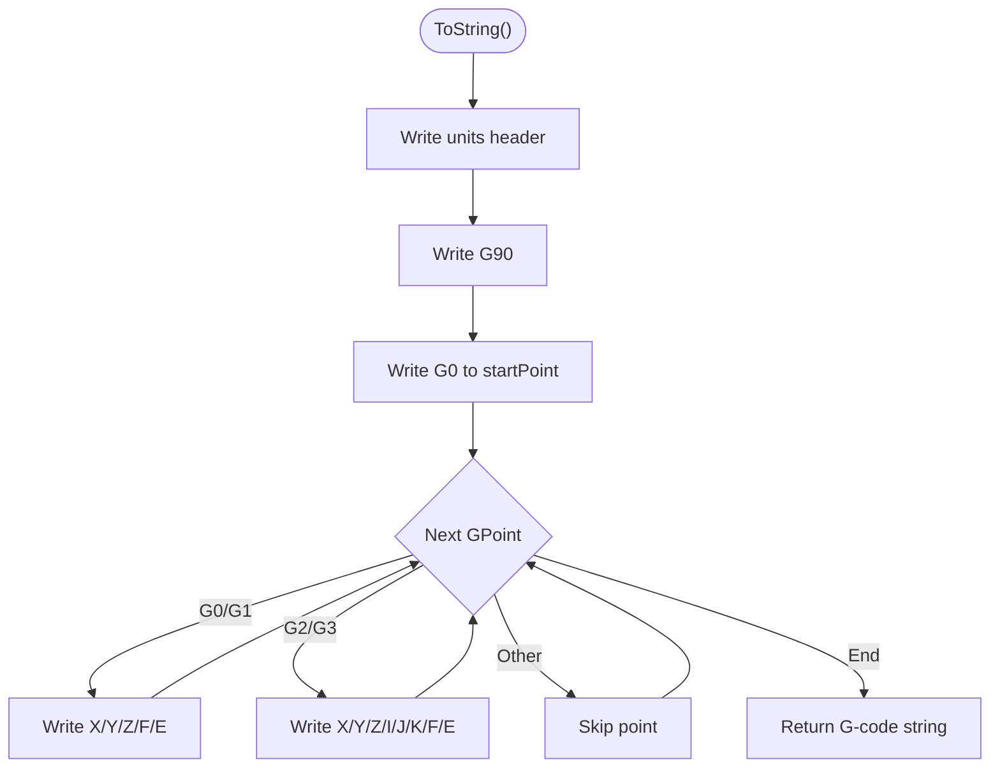
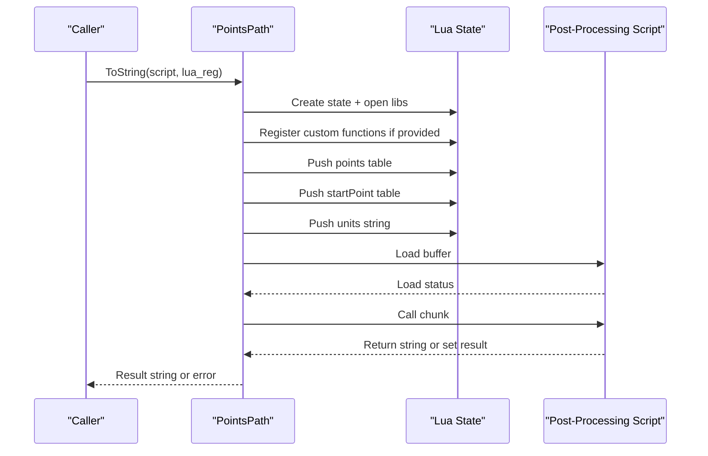
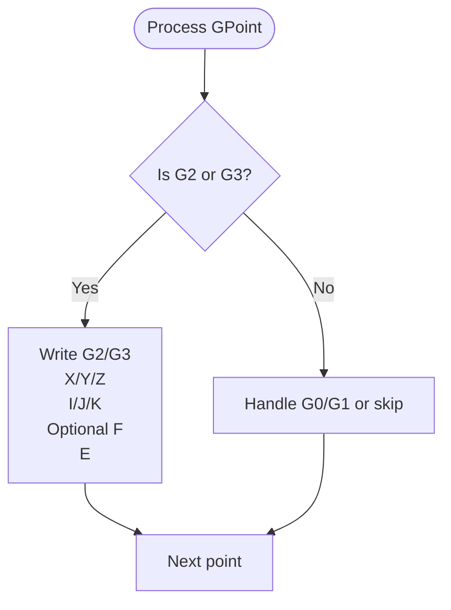
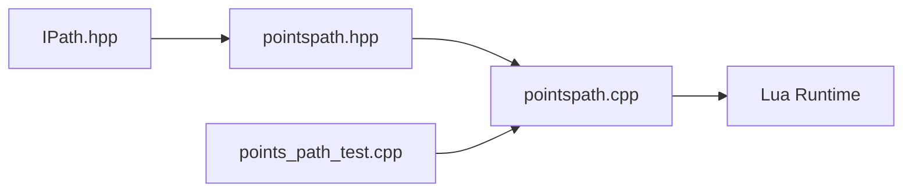

# Point-Based Paths / 基于点的路径

<cite>
**Referenced Files in This Document**   
- [pointspath.hpp](file://paths/pointspath.hpp)
- [pointspath.cpp](file://paths/pointspath.cpp)
- [IPath.hpp](file://paths/IPath.hpp)
- [points_path_test.cpp](file://tests/PathsOut/points_path_test.cpp)
</cite>

## Table of Contents
1. [Introduction](#introduction)
2. [Project Structure](#project-structure)
3. [Core Components](#core-components)
4. [Architecture Overview](#architecture-overview)
5. [Detailed Component Analysis](#detailed-component-analysis)
6. [Dependency Analysis](#dependency-analysis)
7. [Performance Considerations](#performance-considerations)
8. [Troubleshooting Guide](#troubleshooting-guide)
9. [Conclusion](#conclusion)
10. [Appendices](#appendices)

## Introduction
This document explains the point-based G-code path system used to build low-level motion sequences for FDM-style toolpaths. It focuses on:

- The `PointsPath` class as an `IPath` implementation that stores ordered G-code points and serializes them to text or Lua-post-processed output.
- The `GPoint` structure representing a single motion command, including target coordinates, arc center points, velocity, and extrusion amount.
- The `GcodeType` enum covering rapid moves (`G0`), linear interpolation (`G1`), clockwise/counterclockwise arcs (`G2`/`G3`), plane selection codes (`G17`/`G18`/`G19`), unit commands (`G20`/`G21`), and positioning modes (`G90`/`G91`).
- The `GCodeUnits` enum selecting inches versus millimeters when emitting G-code.
- How `PointsPath` integrates with the broader path pipeline through `IPath`, `OutPoints3`, and optional Lua post-processing.

The goal is to help you construct complex toolpaths programmatically, handle arc motions correctly, optimize point sequences, and understand how this fits into the slicer’s path generation workflow.

## Project Structure
The point-based path functionality lives under the `paths` directory and is exposed through a small set of headers and implementations:



**Diagram sources**
- [IPath.hpp:1-68](file://paths/IPath.hpp#L1-L68)
- [pointspath.hpp:1-99](file://paths/pointspath.hpp#L1-L99)
- [pointspath.cpp:1-379](file://paths/pointspath.cpp#L1-L379)
- [points_path_test.cpp:194-234](file://tests/PathsOut/points_path_test.cpp#L194-L234)

**Section sources**
- [IPath.hpp:1-68](file://paths/IPath.hpp#L1-L68)
- [pointspath.hpp:1-99](file://paths/pointspath.hpp#L1-L99)
- [pointspath.cpp:1-379](file://paths/pointspath.cpp#L1-L379)
- [points_path_test.cpp:194-234](file://tests/PathsOut/points_path_test.cpp#L194-L234)

## Core Components
This section introduces the main types and responsibilities:

| Component | Purpose | Key Behavior |
|---|---|---|
| `GcodeType` | Enumerates supported G-code motion and setting commands | Includes `G0`, `G1`, `G2`, `G3`, `G17`, `G18`, `G19`, `G20`, `G21`, `G90`, `G91`. |
| `GCodeUnits` | Selects length units for G-code output | `Inch` emits `G20`; `mm` emits `G21`. |
| `GPoint` | Represents one G-code move | Holds type, target point `p1`, arc center `center`, feed velocity, and extrusion amount. |
| `PointsPath` | Stores an ordered sequence of `GPoint`s and serializes them | Implements `Save()`, `ToString()`, and Lua-driven save/serialize overloads. |
| `IPath` | Abstract interface for all path outputs | Defines common `Save()` and `ToString()` APIs, including Lua post-processing. |
| `OutPoints3` | 3D output coordinate type | Holds `x`, `y`, `z` floats used by `GPoint.p1`, `GPoint.center`, and `PointsPath::startPoint_`. |

**Section sources**
- [pointspath.hpp:16-52](file://paths/pointspath.hpp#L16-L52)
- [pointspath.hpp:54-94](file://paths/pointspath.hpp#L54-L94)
- [IPath.hpp:20-65](file://paths/IPath.hpp#L20-L65)

## Architecture Overview
`PointsPath` is a concrete path product that implements the generic `IPath` interface. It does not compute geometry itself; instead, it accepts precomputed motion points and turns them into G-code text.



**Diagram sources**
- [IPath.hpp:20-65](file://paths/IPath.hpp#L20-L65)
- [pointspath.hpp:16-94](file://paths/pointspath.hpp#L16-L94)

## Detailed Component Analysis

### GcodeType: Motion and Setting Codes
`GcodeType` is the central enumeration for G-code commands handled by `PointsPath`. It covers:

- Rapid move: `G0`
- Linear interpolation: `G1`
- Clockwise arc: `G2`
- Counter-clockwise arc: `G3`
- Plane selection:
  - `G17`: XY plane
  - `G18`: XZ plane
  - `G19`: YZ plane
- Units:
  - `G20`: Inches
  - `G21`: Millimeters
- Positioning mode:
  - `G90`: Absolute positioning
  - `G91`: Relative positioning

Although `PointsPath::ToString()` currently only serializes `G0`, `G1`, `G2`, and `G3` into motion lines, the presence of `G17`/`G18`/`G19`, `G20`/`G21`, and `G90`/`G91` allows callers to represent additional G-code state through `GPoint.type`. In the native serialization loop, non-motion codes are skipped rather than emitted directly.

**Section sources**
- [pointspath.hpp:16-35](file://paths/pointspath.hpp#L16-L35)
- [pointspath.cpp:24-53](file://paths/pointspath.cpp#L24-L53)
- [pointspath.cpp:84-118](file://paths/pointspath.cpp#L84-L118)

### GCodeUnits: Inch vs Millimeter Coordinate Systems
`GCodeUnits` controls the unit header emitted at the beginning of the generated G-code:

- `GCodeUnits::mm` → emits `G21 ; units mm`
- `GCodeUnits::Inch` → emits `G20 ; units inch`

The constructor of `PointsPath` accepts the chosen unit system, and `ToString()` writes the corresponding unit command before any motion lines.



**Diagram sources**
- [pointspath.cpp:56-82](file://paths/pointspath.cpp#L56-L82)

**Section sources**
- [pointspath.hpp:37-42](file://paths/pointspath.hpp#L37-L42)
- [pointspath.cpp:56-82](file://paths/pointspath.cpp#L56-L82)

### GPoint: Target Coordinates, Arc Centers, Velocity, and Extrusion
`GPoint` represents one G-code command entry:

| Field | Type | Meaning |
|---|---|---|
| `type` | `GcodeType` | Motion or setting code. Default is `G1`. |
| `p1` | `OutPoints3` | Target coordinates for the move. |
| `center` | `OutPoints3` | Arc center or transition point. Used for `G2`/`G3`. |
| `velocity` | `float` | Feed rate. If greater than zero, included as `F`. |
| `extrusion` | `double` | Filament extrusion amount. Always written as `E`. |

For linear moves (`G0`/`G1`), `p1` is the destination. For arc moves (`G2`/`G3`), `p1` is the endpoint and `center` provides the `I`/`J`/`K` offsets.



**Diagram sources**
- [pointspath.hpp:44-52](file://paths/pointspath.hpp#L44-L52)
- [IPath.hpp:59-65](file://paths/IPath.hpp#L59-L65)

**Section sources**
- [pointspath.hpp:44-52](file://paths/pointspath.hpp#L44-L52)
- [IPath.hpp:59-65](file://paths/IPath.hpp#L59-L65)

### PointsPath: IPath Implementation with Save(), ToString(), and Lua Post-Processing
`PointsPath` is a vector-backed container of `GPoint` entries plus a starting position and unit system. Its responsibilities include:

- Storing points via `push_back()`.
- Serializing to G-code text via `ToString()`.
- Saving to files via `Save()`.
- Supporting Lua post-processing through multiple overloads of `Save()` and `ToString()`.

#### Native Serialization Flow
Native `ToString()` performs these steps:

1. Writes unit header (`G20` or `G21`).
2. Writes absolute positioning (`G90`).
3. Emits an initial rapid move to the stored start point.
4. Iterates over `GPoint`s:
   - For `G0`/`G1`: writes target `X/Y/Z`, optional `F`, and `E`.
   - For `G2`/`G3`: writes target `X/Y/Z`, `I/J/K`, optional `F`, and `E`.
   - For other `GcodeType` values: skips the point.



**Diagram sources**
- [pointspath.cpp:66-122](file://paths/pointspath.cpp#L66-L122)

#### Lua Post-Processing Flow
When a Lua script is provided, `PointsPath` creates a Lua state, opens standard libraries, optionally registers custom functions, and exposes:

- A global table `points` containing serialized `GPoint` entries.
- A global table `startPoint` with `x`, `y`, `z`.
- A global string `units` with value `"mm"` or `"inch"`.

The script can return a string directly or set a global `result` string. Errors during load or runtime are converted into error strings or thrown as runtime errors depending on the overload.



**Diagram sources**
- [pointspath.cpp:124-230](file://paths/pointspath.cpp#L124-L230)

**Section sources**
- [pointspath.hpp:54-94](file://paths/pointspath.hpp#L54-L94)
- [pointspath.cpp:56-122](file://paths/pointspath.cpp#L56-L122)
- [pointspath.cpp:124-230](file://paths/pointspath.cpp#L124-L230)
- [pointspath.cpp:232-376](file://paths/pointspath.cpp#L232-L376)

### Building Complex Toolpaths Programmatically
You can build complex toolpaths by constructing `GPoint` objects and appending them to a `PointsPath`. Typical patterns include:

- **Linear segments**: Set `type = GcodeType::G1`, fill `p1` with the next target, set `velocity` and `extrusion`.
- **Rapid moves**: Set `type = GcodeType::G0` for non-extruding travel.
- **Arc segments**: Set `type = GcodeType::G2` for clockwise arcs or `GcodeType::G3` for counter-clockwise arcs, set `p1` to the arc endpoint, and set `center` to the arc center offset.
- **Unit and mode control**: Use `GCodeUnits` when constructing the path; additional `G17`/`G18`/`G19`, `G20`/`G21`, `G90`/`G91` values exist in `GcodeType` for representing G-code state, although native serialization currently only emits motion commands for `G0`/`G1`/`G2`/`G3`.

Example usage pattern (conceptual):

1. Construct `PointsPath` with `GCodeUnits::mm` or `GCodeUnits::Inch`.
2. Set the initial start point through the constructor.
3. Append linear moves for walls, perimeters, and infill.
4. Append arc moves for rounded corners or circular features.
5. Call `ToString()` for inspection or `Save()` to write a file.
6. Optionally provide a Lua script to transform, filter, merge, or reformat the point sequence.

**Section sources**
- [pointspath.hpp:54-94](file://paths/pointspath.hpp#L54-L94)
- [pointspath.cpp:66-122](file://paths/pointspath.cpp#L66-L122)

### Handling Arc Motions
Arc handling is explicit in `PointsPath::ToString()`:

- `G2` produces a clockwise arc line.
- `G3` produces a counter-clockwise arc line.
- Both use `p1` as the endpoint and `center` as the `I`/`J`/`K` offsets.
- Optional feed rate and extrusion are appended after the coordinates.

The test suite demonstrates:

- Creating an arc with `GcodeType::G2`.
- Creating a counter-clockwise arc with `GcodeType::G3`.
- Verifying that inch units emit `G20`.
- Verifying that arc endpoints and `I`/`J`/`K` offsets appear in the output.
- Verifying that non-motion codes like `G90` do not duplicate motion lines.



**Diagram sources**
- [pointspath.cpp:100-113](file://paths/pointspath.cpp#L100-L113)
- [points_path_test.cpp:194-234](file://tests/PathsOut/points_path_test.cpp#L194-L234)

**Section sources**
- [pointspath.cpp:100-113](file://paths/pointspath.cpp#L100-L113)
- [points_path_test.cpp:194-234](file://tests/PathsOut/points_path_test.cpp#L194-L234)

### Optimizing Point Sequences
Optimization strategies for `PointsPath` include:

- **Remove redundant points**: If consecutive `GPoint`s have identical targets, keep only one.
- **Merge collinear segments**: Combine adjacent linear moves with the same direction and feed rate.
- **Separate travel from extrusion**: Use `G0` for non-extruding moves and `G1` for extruding moves.
- **Prefer arcs where appropriate**: Replace short linear chains with `G2`/`G3` arcs when the geometry supports it.
- **Use Lua post-processing**: Filter, reorder, or rewrite point sequences without changing the C++ path builder.

Because `PointsPath` stores points in a `std::vector`, random access via `operator[]` is efficient, but insertions or deletions in the middle of the sequence may involve shifting elements. For large toolpaths, prefer building the final sequence once and then applying Lua-based transformations.

**Section sources**
- [pointspath.hpp:87-94](file://paths/pointspath.hpp#L87-L94)
- [pointspath.cpp:60-63](file://paths/pointspath.cpp#L60-L63)
- [pointspath.cpp:124-230](file://paths/pointspath.cpp#L124-L230)

### Relationship with OutPoints3 and the Broader Path Pipeline
`OutPoints3` is the shared 3D coordinate type used across path outputs. It contains:

- `x`: planar X coordinate.
- `y`: planar Y coordinate.
- `z`: build height.

`GPoint` uses `OutPoints3` for both its target point and its arc center. `PointsPath` also stores a separate `startPoint_` of type `OutPoints3`, which is emitted as the first rapid move.

```mermaid
erDiagram
OUTPOINTS3 {
float x
float y
float z
}
GPOINT {
GcodeType type
OutPoints3 p1
OutPoints3 center
float velocity
double extrusion
}
POINTSPATH {
vector<GPoint> points_
OutPoints3 startPoint_
GCodeUnits units_
}
GPOINT ||--|| OUTPOINTS3 : "p1"
GPOINT ||--|| OUTPOINTS3 : "center"
POINTSPATH ||--o{ GPOINT : "contains"
POINTSPATH ||--|| OUTPOINTS3 : "startPoint_"
```

**Diagram sources**
- [IPath.hpp:59-65](file://paths/IPath.hpp#L59-L65)
- [pointspath.hpp:44-94](file://paths/pointspath.hpp#L44-L94)

**Section sources**
- [IPath.hpp:59-65](file://paths/IPath.hpp#L59-L65)
- [pointspath.hpp:44-94](file://paths/pointspath.hpp#L44-L94)

## Dependency Analysis
The core dependencies are straightforward:

- `PointsPath` depends on `IPath` for the common interface contract.
- `PointsPath` depends on `GPoint`, `GcodeType`, and `GCodeUnits`.
- `GPoint` depends on `OutPoints3`.
- Lua integration depends on the Lua runtime and helper utilities for creating and managing Lua states.



**Diagram sources**
- [IPath.hpp:1-68](file://paths/IPath.hpp#L1-L68)
- [pointspath.hpp:1-99](file://paths/pointspath.hpp#L1-L99)
- [pointspath.cpp:1-379](file://paths/pointspath.cpp#L1-L379)
- [points_path_test.cpp:194-234](file://tests/PathsOut/points_path_test.cpp#L194-L234)

**Section sources**
- [IPath.hpp:1-68](file://paths/IPath.hpp#L1-L68)
- [pointspath.hpp:1-99](file://paths/pointspath.hpp#L1-L99)
- [pointspath.cpp:1-379](file://paths/pointspath.cpp#L1-L379)
- [points_path_test.cpp:194-234](file://tests/PathsOut/points_path_test.cpp#L194-L234)

## Performance Considerations
- **Vector storage**: `PointsPath` uses `std::vector<GPoint>`, giving O(1) append amortized time and O(1) indexed access.
- **String construction**: `ToString()` builds the full G-code string in memory; for very large toolpaths, consider streaming or Lua-based incremental processing.
- **Lua overhead**: Each Lua-enabled call creates a new Lua state, loads scripts, and marshals data. Reuse Lua scripts and avoid frequent recreation when possible.
- **Precision formatting**: Coordinates are formatted with fixed precision; excessive decimal places increase output size.
- **Arc vs linear tradeoff**: Arcs reduce point count but require correct center calculation; incorrect centers can produce invalid G-code.

[No sources needed since this section provides general guidance]

## Troubleshooting Guide
Common issues and their likely causes:

| Symptom | Likely Cause | Resolution |
|---|---|---|
| Generated G-code lacks expected unit command | Incorrect `GCodeUnits` passed to `PointsPath` | Ensure the constructor uses `GCodeUnits::mm` or `GCodeUnits::Inch`. |
| Arc commands missing `I`/`J`/`K` | Using wrong `GcodeType` or leaving `center` unset | Use `GcodeType::G2` or `GcodeType::G3` and set `center`. |
| Non-motion G-code codes not appearing | Native serialization skips non-`G0`/`G1`/`G2`/`G3` points | Use Lua post-processing to inject additional G-code state. |
| Lua script returns empty output | Script did not return a string or set `result` | Make the script return a string or assign the result to the global `result`. |
| Lua runtime error | Invalid script syntax or missing function | Check script content and ensure required globals `points`, `startPoint`, and `units` are available. |
| File write fails | Output path cannot be opened | Verify filesystem permissions and valid path. |

**Section sources**
- [pointspath.cpp:66-122](file://paths/pointspath.cpp#L66-L122)
- [pointspath.cpp:124-230](file://paths/pointspath.cpp#L124-L230)
- [pointspath.cpp:232-376](file://paths/pointspath.cpp#L232-L376)
- [points_path_test.cpp:194-234](file://tests/PathsOut/points_path_test.cpp#L194-L234)

## Conclusion
`PointsPath` provides a focused, low-level mechanism for building G-code motion sequences from explicit points. It separates geometry generation from serialization, making it suitable for:

- Programmatic construction of linear and arc toolpaths.
- Unit-aware G-code output.
- Extensible post-processing through Lua.
- Integration with the broader path pipeline via `IPath` and `OutPoints3`.

For advanced workflows, combine programmatic point construction with Lua scripts to filter, merge, and optimize toolpaths before exporting to G-code.

[No sources needed since this section summarizes without analyzing specific files]

## Appendices

### API Summary Table

| API | Description | Notes |
|---|---|---|
| `PointsPath(GCodeUnits, OutPoints3)` | Constructs a point path with units and start point | Default units are millimeters; default start point is origin. |
| `push_back(const GPoint&)` | Appends a motion point | Supports linear, rapid, and arc moves. |
| `Save(path)` | Saves native G-code to file | Uses `ToString()` internally. |
| `Save(path, script, lua_reg)` | Saves with inline Lua post-processing | Script receives `points`, `startPoint`, `units`. |
| `Save(path, script, funcName, lua_reg)` | Saves with named Lua function | Calls the specified function. |
| `Save(path, script_file, funcName, lua_reg)` | Saves using a Lua script file | Loads script from disk. |
| `ToString()` | Returns native G-code string | Emits units, absolute positioning, start move, and motion points. |
| `ToString(script, lua_reg)` | Returns Lua-processed string | Script can return string or set `result`. |
| `ToString(script, funcName, lua_reg)` | Calls named Lua function | Throws if function is missing. |
| `ToString(script_file, funcName, lua_reg)` | Calls named function from script file | Throws if script file cannot be opened. |
| `operator[](size_t)` | Accesses a stored `GPoint` | Random access into the internal vector. |

**Section sources**
- [pointspath.hpp:61-94](file://paths/pointspath.hpp#L61-L94)
- [pointspath.cpp:56-376](file://paths/pointspath.cpp#L56-L376)