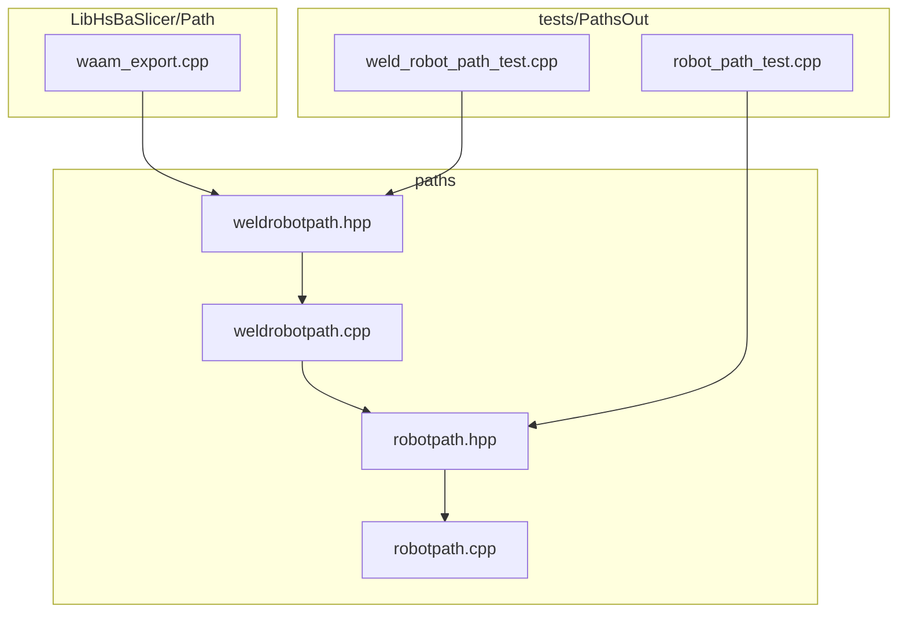
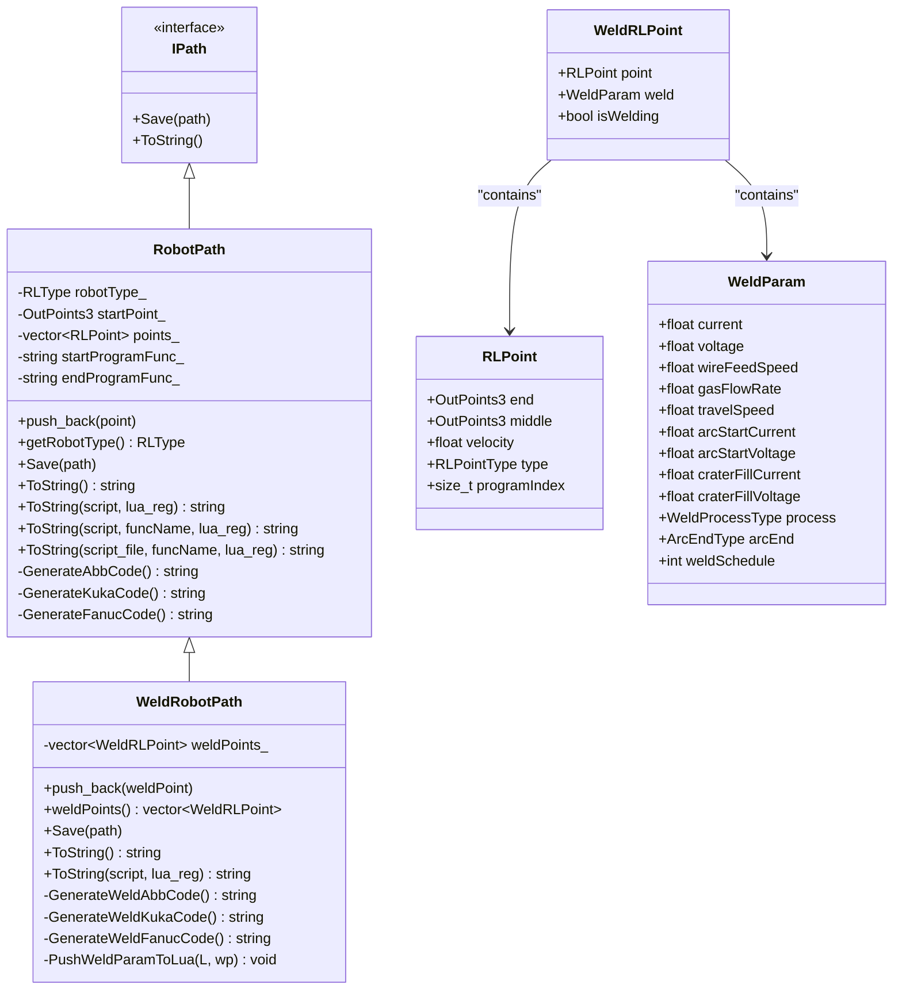
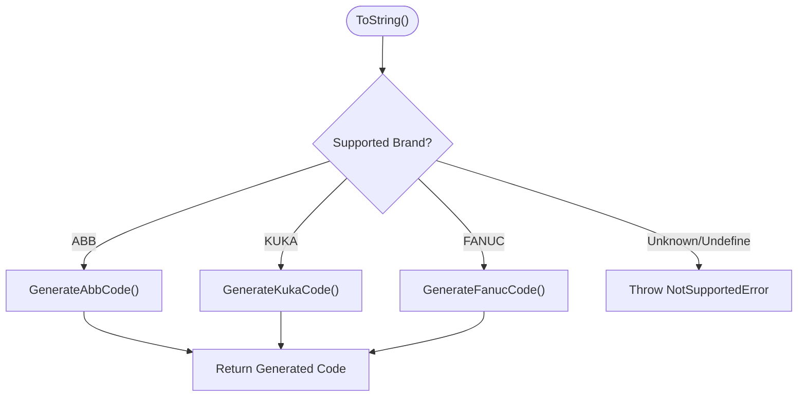
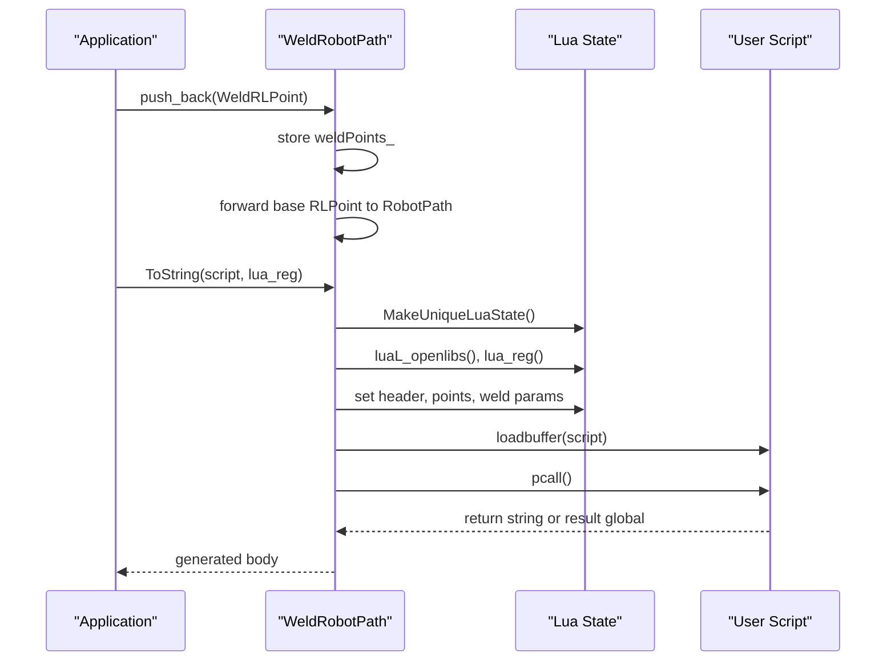
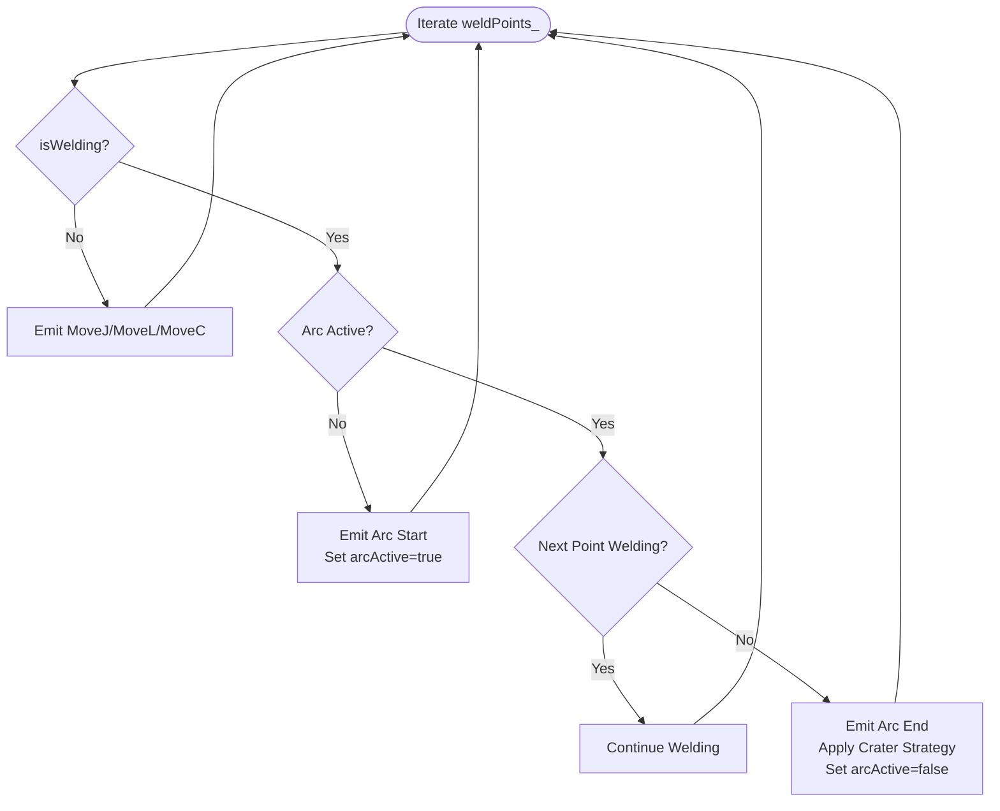
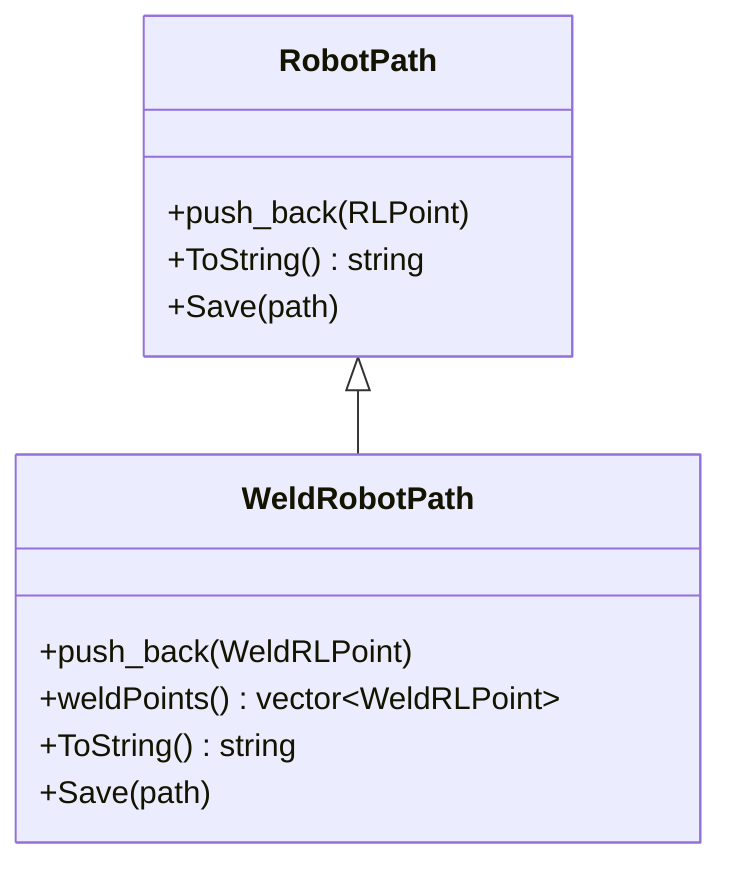
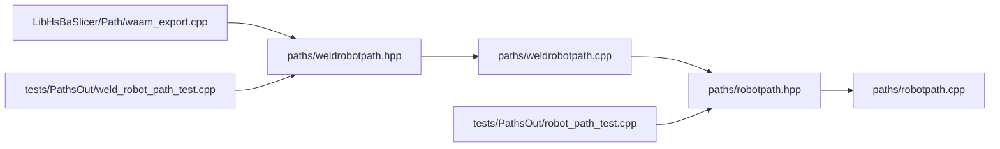

# Robot Path Generation / 机器人路径生成

<cite>
**Referenced Files in This Document**   
- [robotpath.hpp](file://paths/robotpath.hpp)
- [robotpath.cpp](file://paths/robotpath.cpp)
- [weldrobotpath.hpp](file://paths/weldrobotpath.hpp)
- [weldrobotpath.cpp](file://paths/weldrobotpath.cpp)
- [waam_export.cpp](file://LibHsBaSlicer/Path/waam_export.cpp)
- [robot_path_test.cpp](file://tests/PathsOut/robot_path_test.cpp)
- [weld_robot_path_test.cpp](file://tests/PathsOut/weld_robot_path_test.cpp)
</cite>

## Table of Contents
1. [Introduction](#introduction)
2. [Project Structure](#project-structure)
3. [Core Concepts](#core-concepts)
4. [Architecture Overview](#architecture-overview)
5. [Detailed Component Analysis](#detailed-component-analysis)
6. [Dependency Analysis](#dependency-analysis)
7. [Performance Considerations](#performance-considerations)
8. [Troubleshooting Guide](#troubleshooting-guide)
9. [Conclusion](#conclusion)
10. [Appendices](#appendices)

## Introduction
This document explains the industrial robot path generation system used by HsBaSlicer for ABB, KUKA, and FANUC robots. It focuses on:
- The base `RobotPath` class and its motion/command model.
- The welding extension `WeldRobotPath`, including weld parameters, arc start/end handling, and weld schedule management.
- The enums `RLPointType`, `RLType`, `WeldProcessType`, and `ArcEndType`.
- The data structures `RLPoint`, `WeldParam`, and `WeldRLPoint`.
- How brand-specific code is generated and how Lua scripting can customize output.
- Practical examples from tests and the WAAM export pipeline.

## Project Structure
The robot path functionality lives under `paths/`, with additional usage in the WAAM export module and unit tests.

**Diagram sources**
- [robotpath.hpp:1-108](file://paths/robotpath.hpp#L1-L108)
- [robotpath.cpp:1-524](file://paths/robotpath.cpp#L1-L524)
- [weldrobotpath.hpp:1-100](file://paths/weldrobotpath.hpp#L1-L100)
- [weldrobotpath.cpp:1-483](file://paths/weldrobotpath.cpp#L1-L483)
- [waam_export.cpp:52-191](file://LibHsBaSlicer/Path/waam_export.cpp#L52-L191)
- [robot_path_test.cpp:1-256](file://tests/PathsOut/robot_path_test.cpp#L1-L256)
- [weld_robot_path_test.cpp:1-116](file://tests/PathsOut/weld_robot_path_test.cpp#L1-L116)

**Section sources**
- [robotpath.hpp:1-108](file://paths/robotpath.hpp#L1-L108)
- [weldrobotpath.hpp:1-100](file://paths/weldrobotpath.hpp#L1-L100)

## Core Concepts
This section defines the core types that describe robot motions, brands, points, and welding parameters.

### RLPointType: Motion and Program Block Types
`RLPointType` describes both physical robot moves and program block markers:
- MoveJ: Joint (PTP) move.
- MoveL: Linear move.
- MoveC: Circular move.
- ProgramLStart, ProgramStart, ProgramCStart: Start of linear/circular or generic program blocks.
- ProgramL, ProgramC: Program-level linear/circular moves.
- ProgramLEnd, ProgramCEnd: End of linear/circular program blocks.

These values are converted to strings for Lua exposure and for comments during native code generation.

**Section sources**
- [robotpath.hpp:19-32](file://paths/robotpath.hpp#L19-L32)
- [robotpath.cpp:27-55](file://paths/robotpath.cpp#L27-L55)

### RLType: Supported Robot Brands
`RLType` selects the target robot language:
- Unknown: Unspecified; native generation throws an error.
- Abb: ABR RobotStudio-style code.
- Kuka: KUKA KRL-style code.
- Fanuc: FANUC TP-style code.
- Undefine: Explicit undefined marker.

When the type is Unknown or Undefine, `ToString()` throws a not-supported error unless a Lua script is provided.

**Section sources**
- [robotpath.hpp:34-42](file://paths/robotpath.hpp#L34-L42)
- [robotpath.cpp:91-113](file://paths/robotpath.cpp#L91-L113)
- [robot_path_test.cpp:121-130](file://tests/PathsOut/robot_path_test.cpp#L121-L130)

### RLPoint: Robot Position, Velocity, and Command Kind
`RLPoint` represents one path point:
- end: Target position.
- middle: Via/middle position for circular moves.
- velocity: Movement speed.
- type: Motion/command kind from `RLPointType`.
- programIndex: Index used to pair program block starts and ends.

Default velocity is defined as a constant.

**Section sources**
- [robotpath.hpp:15-17](file://paths/robotpath.hpp#L15-L17)
- [robotpath.hpp:44-52](file://paths/robotpath.hpp#L44-L52)

### Welding Extensions: Process, Arc End, Parameters, and Points
`WeldProcessType` enumerates welding processes:
- MIG/MAG, TIG, Plasma, Laser.

`ArcEndType` enumerates crater/arc-end strategies:
- Normal: Simple arc extinction.
- CraterFill: Fill crater before stopping.
- SlowRetract: Slowly retract to avoid crater.

`WeldParam` holds per-segment welding settings:
- current, voltage, wireFeedSpeed, gasFlowRate, travelSpeed.
- arcStartCurrent, arcStartVoltage.
- craterFillCurrent, craterFillVoltage.
- process: welding process type.
- arcEnd: arc end strategy.
- weldSchedule: weld schedule number (FANUC style).

`WeldRLPoint` extends `RLPoint`:
- point: base robot path point.
- weld: welding parameters.
- isWelding: whether this point belongs to a weld seam.

**Section sources**
- [weldrobotpath.hpp:16-57](file://paths/weldrobotpath.hpp#L16-L57)
- [weldrobotpath.cpp:21-51](file://paths/weldrobotpath.cpp#L21-L51)

## Architecture Overview
`RobotPath` is the base implementation of `IPath`. It stores `RLPoint` entries and generates brand-specific programs. `WeldRobotPath` inherits from `RobotPath` and adds welding semantics.

**Diagram sources**
- [robotpath.hpp:54-104](file://paths/robotpath.hpp#L54-L104)
- [weldrobotpath.hpp:51-96](file://paths/weldrobotpath.hpp#L51-L96)

## Detailed Component Analysis

### RobotPath: Base Industrial Robot Path
`RobotPath` accumulates `RLPoint` objects and emits brand-specific programs. It supports:
- Native generation for ABB, KUKA, and FANUC.
- Lua-based customization via `ToString(script)` or `ToString(script, funcName)`.
- Program block markers using `Program*` variants and `startProgramFunc_`/`endProgramFunc_`.

Key behaviors:
- `ToString()` dispatches to `GenerateAbbCode()`, `GenerateKukaCode()`, or `GenerateFanucCode()`.
- Unknown or undefined robot types throw a not-supported error.
- Lua interfaces expose:
  - `header`: indicates user-provided script mode.
  - `points`: array of point tables with fields `end`, `middle`, `velocity`, `type`.
  - `startPoint`: initial position.
  - `funcName`: function name when using the function-name overload.

**Diagram sources**
- [robotpath.cpp:91-113](file://paths/robotpath.cpp#L91-L113)

**Section sources**
- [robotpath.hpp:54-104](file://paths/robotpath.hpp#L54-L104)
- [robotpath.cpp:60-113](file://paths/robotpath.cpp#L60-L113)
- [robotpath.cpp:227-306](file://paths/robotpath.cpp#L227-L306)
- [robotpath.cpp:308-356](file://paths/robotpath.cpp#L308-L356)
- [robotpath.cpp:358-404](file://paths/robotpath.cpp#L358-L404)
- [robot_path_test.cpp:53-130](file://tests/PathsOut/robot_path_test.cpp#L53-L130)

#### ABB Code Generation Highlights
- Emits a module and procedure wrapper.
- Uses MOVEJ, MOVEL, MOVEC commands.
- Wraps program block starts/ends with configurable function names.
- Applies ABB speed brackets and tool/work object references.

**Section sources**
- [robotpath.cpp:227-306](file://paths/robotpath.cpp#L227-L306)

#### KUKA Code Generation Highlights
- Emits a KRL function.
- Uses LIN and CIRC commands.
- Marks program segments with comments and injected function calls.

**Section sources**
- [robotpath.cpp:308-356](file://paths/robotpath.cpp#L308-L356)

#### FANUC Code Generation Highlights
- Emits TP-style lines.
- Uses J and ARC commands.
- Marks program segments with comments and injected function calls.

**Section sources**
- [robotpath.cpp:358-404](file://paths/robotpath.cpp#L358-L404)

### WeldRobotPath: Welding-Specific Extension
`WeldRobotPath` extends `RobotPath` to include welding parameters and arc control logic. It maintains:
- `weldPoints_`: list of `WeldRLPoint`.
- Inherited `points_`: base path points for compatibility.

Key behaviors:
- `push_back(WeldRLPoint)` adds a weld point and also forwards the base `RLPoint` to the parent.
- `ToString()` overrides default behavior to generate welding-aware code for ABB, KUKA, and FANUC.
- Lua interface exposes:
  - `points`: array of weld point tables with fields `end`, `middle`, `velocity`, `type`, `isWelding`, and nested `weld` table.
  - `header`: indicates user-provided script mode.

**Diagram sources**
- [weldrobotpath.cpp:60-65](file://paths/weldrobotpath.cpp#L60-L65)
- [weldrobotpath.cpp:103-194](file://paths/weldrobotpath.cpp#L103-L194)

**Section sources**
- [weldrobotpath.hpp:51-96](file://paths/weldrobotpath.hpp#L51-L96)
- [weldrobotpath.cpp:54-70](file://paths/weldrobotpath.cpp#L54-L70)
- [weldrobotpath.cpp:79-101](file://paths/weldrobotpath.cpp#L79-L101)
- [weld_robot_path_test.cpp:36-50](file://tests/PathsOut/weld_robot_path_test.cpp#L36-L50)

#### Arc Start/End Handling Strategy
All three brand generators follow a consistent state machine:
- If `isWelding` is true and no arc is active: emit arc start with start parameters.
- If `isWelding` is true and arc is active:
  - If next point is also welding: continue welding.
  - Else: emit arc end with crater strategy and turn off arc.
- If not welding: emit normal movement commands.

**Diagram sources**
- [weldrobotpath.cpp:236-304](file://paths/weldrobotpath.cpp#L236-L304)
- [weldrobotpath.cpp:319-393](file://paths/weldrobotpath.cpp#L319-L393)
- [weldrobotpath.cpp:423-480](file://paths/weldrobotpath.cpp#L423-L480)

**Section sources**
- [weldrobotpath.cpp:225-305](file://paths/weldrobotpath.cpp#L225-L305)
- [weldrobotpath.cpp:307-394](file://paths/weldrobotpath.cpp#L307-L394)
- [weldrobotpath.cpp:396-481](file://paths/weldrobotpath.cpp#L396-L481)

#### Brand-Specific Welding Details
- ABB:
  - Uses `ArcLStart`, `ArcL`, `ArcLEnd`.
  - Includes seam/weave/tool/work object references.
  - Applies crater fill parameters at arc end.
- KUKA:
  - Initializes ARC technology package.
  - Sets weld/start/crater parameters.
  - Turns ARC On/Off around LIN moves.
- FANUC:
  - Emits `/PROG` structure with attributes.
  - Uses `ARC START` and `ARC END[Schedule N]`.
  - Tracks line numbers and uses travel speed for welding moves.

**Section sources**
- [weldrobotpath.cpp:225-305](file://paths/weldrobotpath.cpp#L225-L305)
- [weldrobotpath.cpp:307-394](file://paths/weldrobotpath.cpp#L307-L394)
- [weldrobotpath.cpp:396-481](file://paths/weldrobotpath.cpp#L396-L481)

#### Weld Schedule Management
- `WeldParam.weldSchedule` is exposed to Lua as an integer.
- FANUC code includes `ARC END[Schedule N]` referencing the schedule number.
- Other brands do not directly use the schedule field in generated code but still expose it for scripting.

**Section sources**
- [weldrobotpath.hpp:34-49](file://paths/weldrobotpath.hpp#L34-L49)
- [weldrobotpath.cpp:196-223](file://paths/weldrobotpath.cpp#L196-L223)
- [weldrobotpath.cpp:433-451](file://paths/weldrobotpath.cpp#L433-L451)

### Relationship Between RobotPath and WeldRobotPath
- `WeldRobotPath` inherits all base path functionality.
- It adds welding-specific storage (`weldPoints_`) and overrides generation methods.
- It reuses base `RLPoint` and `RLPointType` for motion description while adding `WeldParam` and `isWelding`.

**Diagram sources**
- [robotpath.hpp:54-104](file://paths/robotpath.hpp#L54-L104)
- [weldrobotpath.hpp:59-96](file://paths/weldrobotpath.hpp#L59-L96)

**Section sources**
- [weldrobotpath.cpp:54-65](file://paths/weldrobotpath.cpp#L54-L65)

## Dependency Analysis
The following diagram shows how components depend on each other across modules.

**Diagram sources**
- [robotpath.hpp:1-108](file://paths/robotpath.hpp#L1-L108)
- [robotpath.cpp:1-524](file://paths/robotpath.cpp#L1-L524)
- [weldrobotpath.hpp:1-100](file://paths/weldrobotpath.hpp#L1-L100)
- [weldrobotpath.cpp:1-483](file://paths/weldrobotpath.cpp#L1-L483)
- [waam_export.cpp:52-191](file://LibHsBaSlicer/Path/waam_export.cpp#L52-L191)
- [robot_path_test.cpp:1-256](file://tests/PathsOut/robot_path_test.cpp#L1-L256)
- [weld_robot_path_test.cpp:1-116](file://tests/PathsOut/weld_robot_path_test.cpp#L1-L116)

**Section sources**
- [waam_export.cpp:52-191](file://LibHsBaSlicer/Path/waam_export.cpp#L52-L191)

## Performance Considerations
- String building: All brand generators construct output using string streams; large paths may produce significant memory allocations.
- Lua integration: Each script execution creates a new Lua state, loads libraries, pushes globals, and executes the script. For many small exports, consider batching or caching scripts if performance becomes critical.
- Weld iteration: Arc state tracking is O(n) over weld points; ensure weld sequences are contiguous where possible to minimize arc start/end transitions.

[No sources needed since this section provides general guidance]

## Troubleshooting Guide
Common issues and their causes:
- Unknown or undefined robot brand:
  - Cause: `RLType::Unknown` or `RLType::Undefine` selected for native generation.
  - Symptom: `NotSupportedError` thrown by `ToString()`.
  - Resolution: Use a supported brand or provide a Lua script.
- Lua script errors:
  - Cause: Invalid Lua syntax or runtime error.
  - Symptom: `RuntimeError` wrapping Lua error message.
  - Resolution: Validate script content and inspect error messages.
- Missing Lua script file:
  - Cause: File path does not exist.
  - Symptom: `RuntimeError` indicating failed to open script file.
  - Resolution: Verify file path and permissions.

**Section sources**
- [robotpath.cpp:91-113](file://paths/robotpath.cpp#L91-L113)
- [robotpath.cpp:115-225](file://paths/robotpath.cpp#L115-L225)
- [robotpath.cpp:406-507](file://paths/robotpath.cpp#L406-L507)
- [robot_path_test.cpp:121-191](file://tests/PathsOut/robot_path_test.cpp#L121-L191)
- [weld_robot_path_test.cpp:94-113](file://tests/PathsOut/weld_robot_path_test.cpp#L94-L113)

## Conclusion
The HsBaSlicer robot path system provides a robust foundation for generating ABB, KUKA, and FANUC robot programs. `RobotPath` handles motion and program block semantics, while `WeldRobotPath` adds comprehensive welding support, including process selection, arc start/end strategies, and weld schedules. Lua scripting enables flexible customization without modifying core generators. Tests and the WAAM export pipeline demonstrate practical usage patterns for complex robotic workflows.

[No sources needed since this section summarizes without analyzing specific files]

## Appendices

### Examples and Usage Patterns

#### Generating Brand-Specific Robot Code
- Create a `RobotPath` with a supported brand.
- Add `RLPoint` entries with appropriate motion types.
- Call `ToString()` or `Save()` to generate code.

Evidence:
- ABB, KUKA, and FANUC branches are exercised in tests.
- Program block markers inject custom functions.

**Section sources**
- [robot_path_test.cpp:68-119](file://tests/PathsOut/robot_path_test.cpp#L68-L119)

#### Setting Up Welding Parameters
- Construct `WeldParam` with current, voltage, wire feed, gas flow, travel speed, start/crater parameters, process, arc end, and schedule.
- Wrap into `WeldRLPoint` and set `isWelding`.
- Push into `WeldRobotPath`.

Evidence:
- Test helper constructs weld points with TIG process and crater fill.

**Section sources**
- [weld_robot_path_test.cpp:15-26](file://tests/PathsOut/weld_robot_path_test.cpp#L15-L26)

#### Handling Complex Robotic Workflows
- Combine non-welding travel moves with welding deposition along contours.
- Use spiral/vase mode to create continuous Z-rising weld beads without arc interruption.

Evidence:
- WAAM export builds travel points and weld points, then saves either with Lua script or native generator.

**Section sources**
- [waam_export.cpp:52-87](file://LibHsBaSlicer/Path/waam_export.cpp#L52-L87)
- [waam_export.cpp:145-191](file://LibHsBaSlicer/Path/waam_export.cpp#L145-L191)