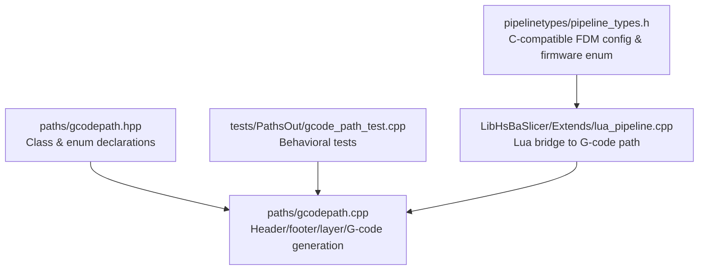
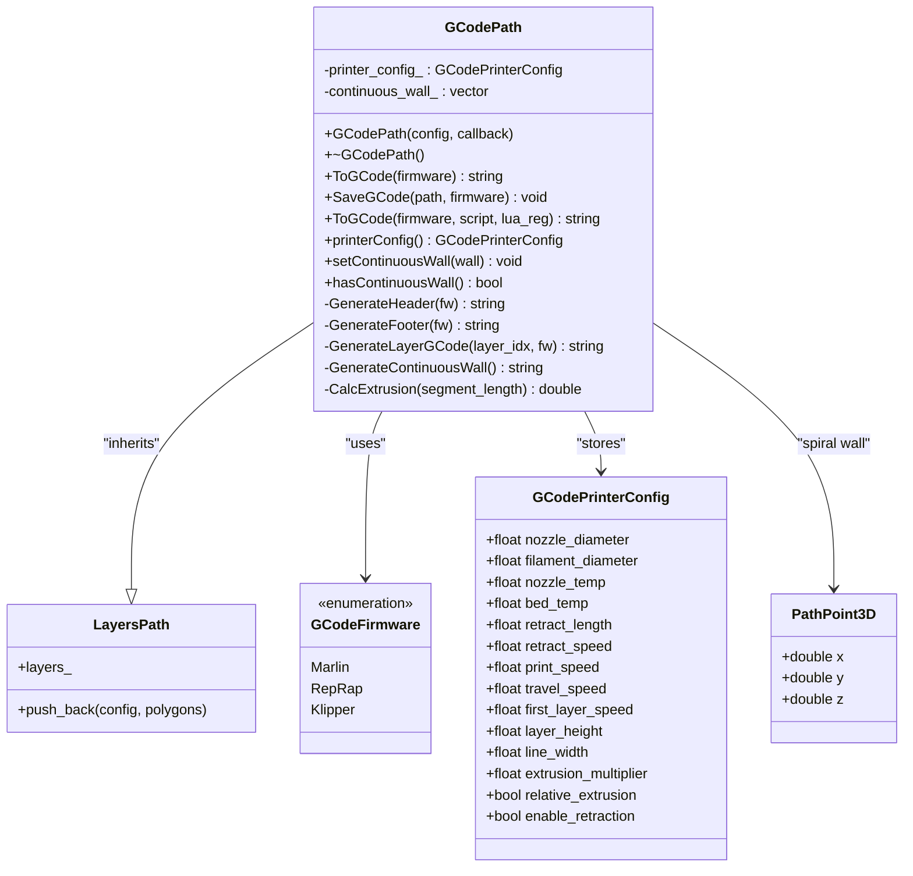
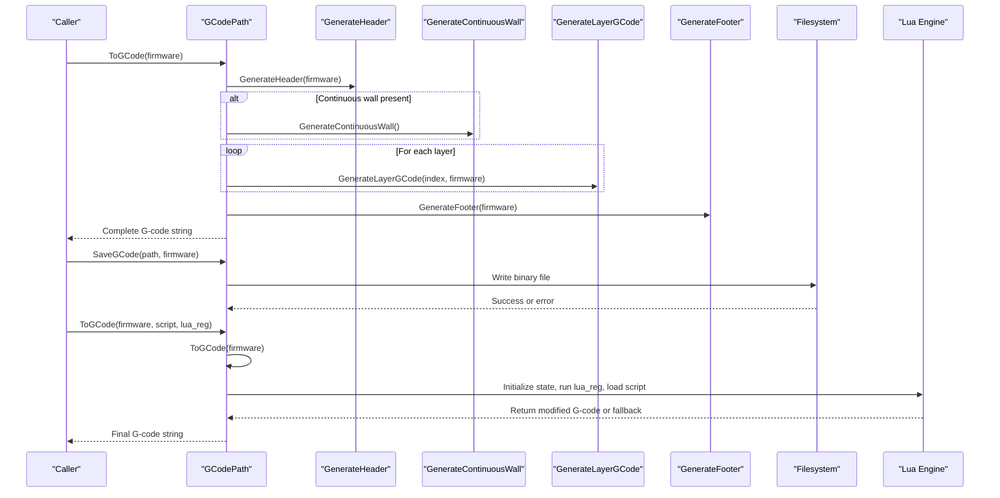
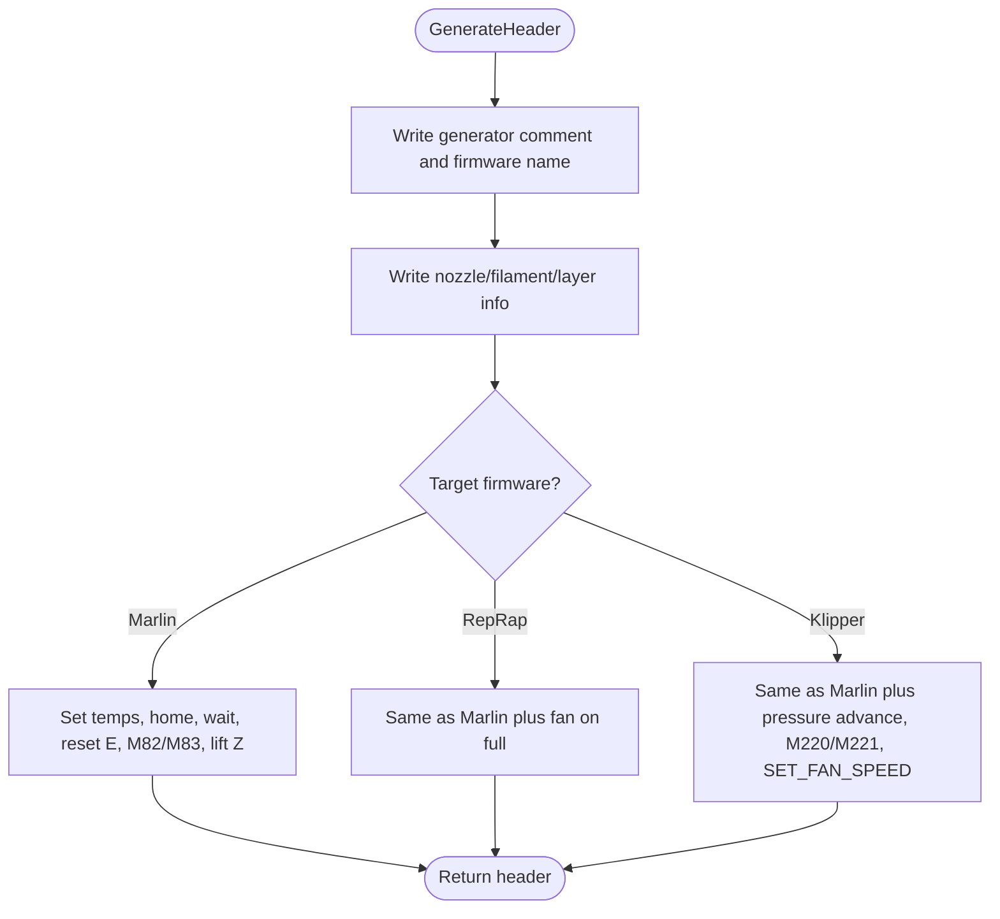
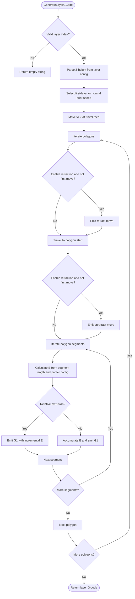
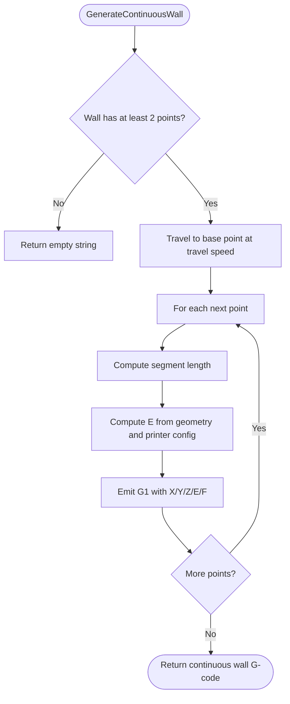
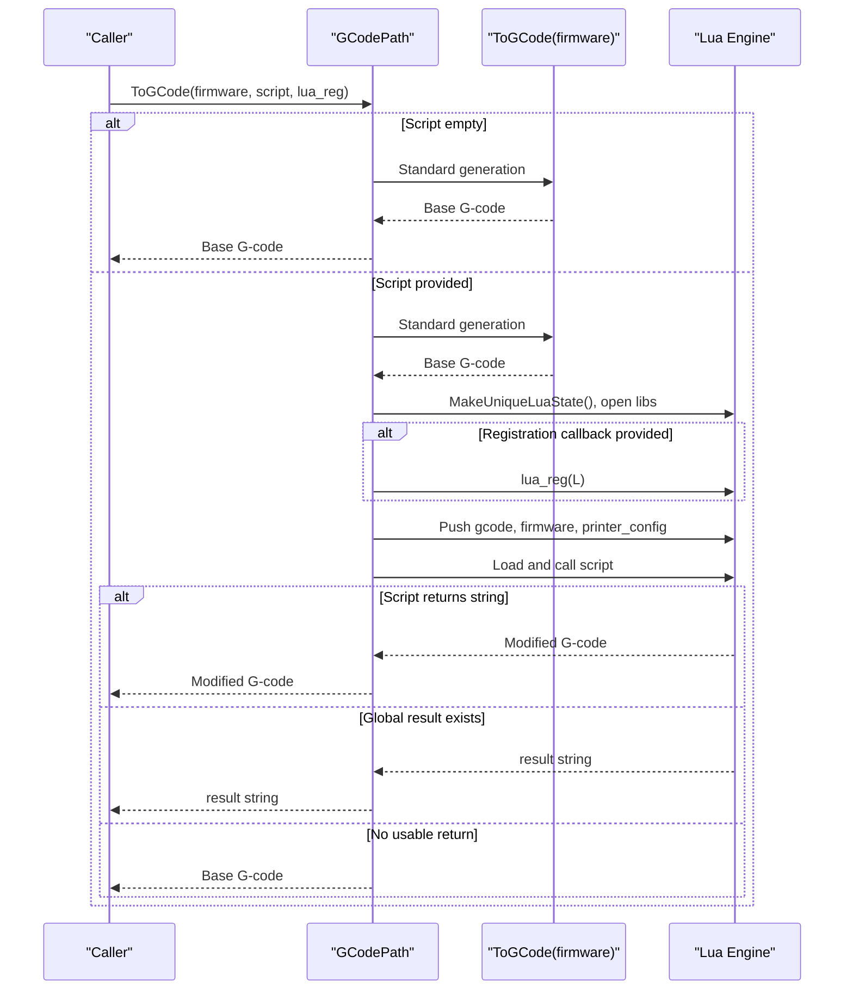
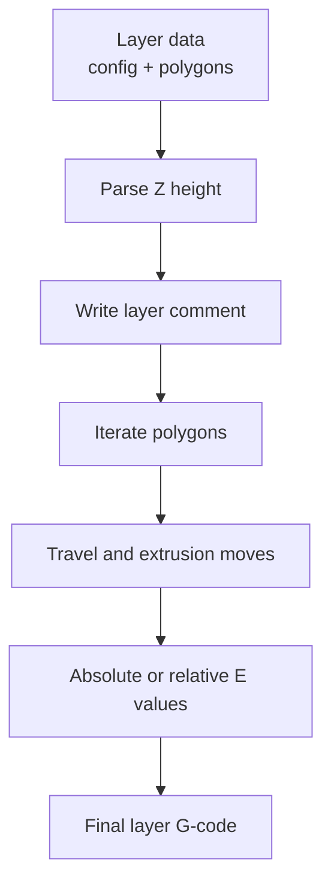
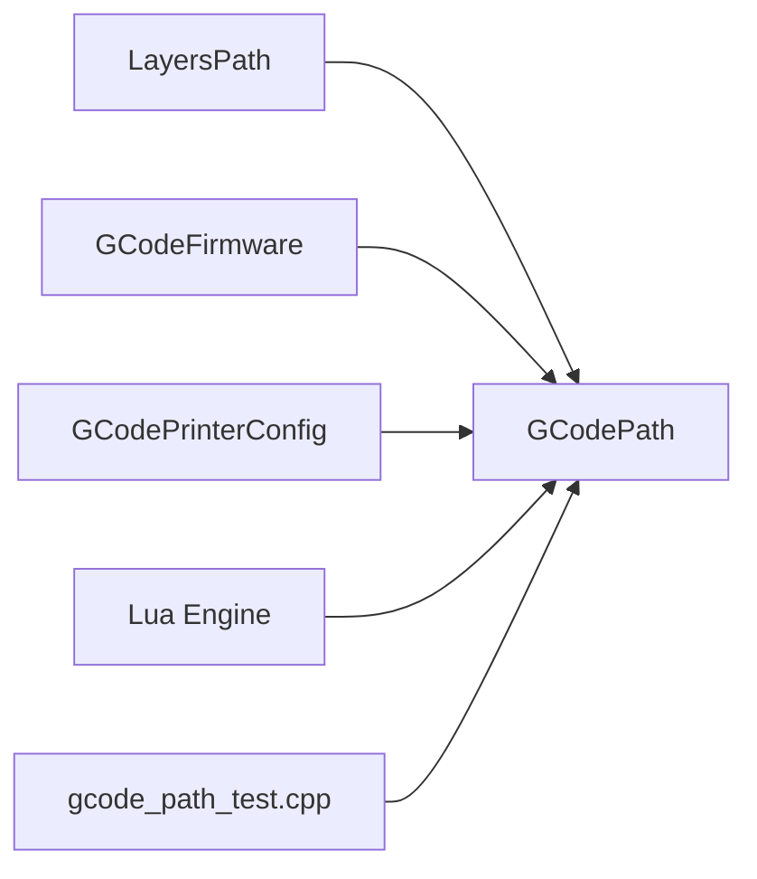

# G-code Generation

<cite>
**Referenced Files in This Document**
- [gcodepath.hpp](file://paths/gcodepath.hpp)
- [gcodepath.cpp](file://paths/gcodepath.cpp)
- [pipeline_types.h](file://pipelinetypes/pipeline_types.h)
- [lua_pipeline.cpp](file://LibHsBaSlicer/Extends/lua_pipeline.cpp)
- [gcode_path_test.cpp](file://tests/PathsOut/gcode_path_test.cpp)
</cite>

## Table of Contents
1. [Introduction](#introduction)
2. [Project Structure](#project-structure)
3. [Core Components](#core-components)
4. [Architecture Overview](#architecture-overview)
5. [Detailed Component Analysis](#detailed-component-analysis)
6. [Dependency Analysis](#dependency-analysis)
7. [Performance Considerations](#performance-considerations)
8. [Troubleshooting Guide](#troubleshooting-guide)
9. [Conclusion](#conclusion)

## Introduction
This document explains the G-code generation system used by HsBaSlicer for FDM 3D printing. It focuses on:

- The `GCodePath` class, which turns layer data into firmware-specific G-code strings or files.
- The `GCodeFirmware` enumeration covering Marlin, RepRap/RRF, and Klipper.
- The `GCodePrinterConfig` structure with nozzle diameter, filament diameter, temperatures, speeds, retraction settings, extrusion mode, and related print parameters.
- The `ToGCode()` methods for standard and Lua-post-processed output.
- The `SaveGCode()` method for writing G-code to disk.
- How continuous spiral walls implement vase/spiralize mode.
- Parameter validation behavior and performance considerations for large models.

The goal is to help both new users and advanced integrators configure different printers, generate correct G-code, and customize output through Lua scripts.

## Project Structure
The G-code generation logic lives primarily under the `paths` module, with supporting type definitions in `pipelinetypes`, Lua integration in `LibHsBaSlicer/Extends`, and behavioral verification in tests.

**Diagram sources**
- [gcodepath.hpp:24-49](file://paths/gcodepath.hpp#L24-L49)
- [gcodepath.cpp:69-362](file://paths/gcodepath.cpp#L69-L362)
- [pipeline_types.h:43-113](file://pipelinetypes/pipeline_types.h#L43-L113)
- [lua_pipeline.cpp:653-690](file://LibHsBaSlicer/Extends/lua_pipeline.cpp#L653-L690)
- [gcode_path_test.cpp:43-238](file://tests/PathsOut/gcode_path_test.cpp#L43-L238)

**Section sources**
- [gcodepath.hpp:1-112](file://paths/gcodepath.hpp#L1-L112)
- [gcodepath.cpp:1-459](file://paths/gcodepath.cpp#L1-L459)
- [pipeline_types.h:43-113](file://pipelinetypes/pipeline_types.h#L43-L113)
- [lua_pipeline.cpp:653-690](file://LibHsBaSlicer/Extends/lua_pipeline.cpp#L653-L690)
- [gcode_path_test.cpp:1-241](file://tests/PathsOut/gcode_path_test.cpp#L1-L241)

## Core Components
This section documents the main types and responsibilities relevant to G-code generation.

### GCodeFirmware Enumeration
`GCodeFirmware` selects the target printer firmware and controls header/footer commands:

| Enum Value | Firmware | Key Output Differences |
|---|---|---|
| `Marlin` | Marlin | Uses M104/M109 temperature waits, G92 E0 reset, M82/M83 extrusion mode, no dedicated fan-on command in header. |
| `RepRap` | RepRap/RRF | Adds M106 fan-on in header and M107 fan-off in footer. |
| `Klipper` | Klipper | Adds SET_PRESSURE_ADVANCE, M220/M221 speed/flow percentage, and SET_FAN_SPEED commands. |

These behaviors are verified by tests that assert firmware-specific comments and commands appear only for the selected firmware.

**Section sources**
- [gcodepath.hpp:24-30](file://paths/gcodepath.hpp#L24-L30)
- [gcodepath.cpp:69-158](file://paths/gcodepath.cpp#L69-L158)
- [gcodepath.cpp:160-209](file://paths/gcodepath.cpp#L160-L209)
- [gcode_path_test.cpp:43-82](file://tests/PathsOut/gcode_path_test.cpp#L43-L82)

### GCodePrinterConfig Structure
`GCodePrinterConfig` holds the printer parameters used during G-code generation.

| Field | Default | Meaning |
|---|---:|---|
| `nozzle_diameter` | 0.4 | Nozzle diameter in millimeters. |
| `filament_diameter` | 1.75 | Filament diameter in millimeters. |
| `nozzle_temp` | 200.0 | Nozzle temperature in degrees Celsius. |
| `bed_temp` | 60.0 | Bed temperature in degrees Celsius. |
| `retract_length` | 1.0 | Retraction length in millimeters. |
| `retract_speed` | 40.0 | Retraction speed in mm/s. |
| `print_speed` | 50.0 | Normal print speed in mm/s. |
| `travel_speed` | 100.0 | Travel speed in mm/s. |
| `first_layer_speed` | 20.0 | First-layer print speed in mm/s. |
| `layer_height` | 0.2 | Layer height in millimeters. |
| `line_width` | 0.4 | Extrusion line width in millimeters. |
| `extrusion_multiplier` | 1.0 | Extrusion volume multiplier. |
| `relative_extrusion` | false | Use relative extrusion (M83); otherwise absolute extrusion (M82). |
| `enable_retraction` | true | Enable retraction/unretraction on travel moves between polygons. |

These defaults are also reflected in the C-compatible FDM pipeline configuration, where the same fields exist as part of `HsBaFdmPipelineConfig_t`.

**Section sources**
- [gcodepath.hpp:32-49](file://paths/gcodepath.hpp#L32-L49)
- [pipeline_types.h:94-113](file://pipelinetypes/pipeline_types.h#L94-L113)
- [pipeline_types.h:742-783](file://pipelinetypes/pipeline_types.h#L742-L783)

### PathPoint3D and Continuous Spiral Walls
A continuous wall is a sequence of 3D points with distinct Z values. It represents an extrusion-continuous helix used by spiralize/vase mode.

| Field | Type | Meaning |
|---|---|---|
| `x` | double | X coordinate. |
| `y` | double | Y coordinate. |
| `z` | double | Z coordinate; rises continuously across layers. |

When `setContinuousWall()` is called, `ToGCode()` emits this wall before per-layer polygon data. If empty, normal per-layer output is unchanged.

**Section sources**
- [gcodepath.hpp:51-60](file://paths/gcodepath.hpp#L51-L60)
- [gcodepath.hpp:87-96](file://paths/gcodepath.hpp#L87-L96)
- [gcodepath.cpp:291-330](file://paths/gcodepath.cpp#L291-L330)
- [gcode_path_test.cpp:132-169](file://tests/PathsOut/gcode_path_test.cpp#L132-L169)

### GCodePath Class Responsibilities
`GCodePath` extends layer storage and adds G-code generation capabilities:

- Constructor accepts `GCodePrinterConfig` and an optional callback.
- `ToGCode(firmware)` generates a complete G-code string.
- `SaveGCode(path, firmware)` writes the generated G-code to a file.
- `ToGCode(firmware, script, lua_reg)` optionally runs a Lua post-processing script.
- `printerConfig()` exposes the stored printer configuration.
- `setContinuousWall()` and `hasContinuousWall()` manage spiralized outer walls.

Private helpers include:

- `GenerateHeader(firmware)`
- `GenerateFooter(firmware)`
- `GenerateLayerGCode(layer_idx, firmware)`
- `GenerateContinuousWall()`
- `CalcExtrusion(segment_length)`

**Diagram sources**
- [gcodepath.hpp:24-107](file://paths/gcodepath.hpp#L24-L107)

**Section sources**
- [gcodepath.hpp:62-107](file://paths/gcodepath.hpp#L62-L107)
- [gcodepath.cpp:51-67](file://paths/gcodepath.cpp#L51-L67)

## Architecture Overview
At a high level, G-code generation follows this flow:

1. Layer data is added via `LayersPath::push_back`, including a layer configuration string such as `"Z:<height>"` and one or more polygons.
2. `ToGCode(firmware)` builds:
   - A firmware-specific header.
   - An optional continuous spiral wall.
   - Per-layer G-code.
   - A firmware-specific footer.
3. `SaveGCode(path, firmware)` serializes the result to disk.
4. `ToGCode(firmware, script, lua_reg)` can post-process the base G-code through Lua.

**Diagram sources**
- [gcodepath.cpp:69-362](file://paths/gcodepath.cpp#L69-L362)
- [gcodepath.cpp:364-456](file://paths/gcodepath.cpp#L364-L456)

## Detailed Component Analysis

### G-code Header and Footer Generation
The header sets up the printer environment, while the footer performs cleanup.

Key behaviors:

- All three firmware targets set nozzle and bed temperatures, home axes, wait for temperatures, reset extruder position, and select absolute or relative extrusion based on `relative_extrusion`.
- RepRap adds a fan-on command in the header and fan-off in the footer.
- Klipper adds pressure advance, speed/flow percentage, and fan control using Klipper-style commands.
- The footer retracts according to `retract_length` and `retract_speed`, lifts Z, homes X/Y, and disables motors.

Feed rates use a constant factor converting mm/s to mm/min.

**Diagram sources**
- [gcodepath.cpp:69-158](file://paths/gcodepath.cpp#L69-L158)

**Section sources**
- [gcodepath.cpp:69-158](file://paths/gcodepath.cpp#L69-L158)
- [gcodepath.cpp:160-209](file://paths/gcodepath.cpp#L160-L209)
- [gcode_path_test.cpp:43-82](file://tests/PathsOut/gcode_path_test.cpp#L43-L82)

### Layer G-code Generation and Extrusion Calculation
For each layer:

1. The layer index is written as a comment.
2. The Z height is parsed from the layer configuration string.
3. Feed rate uses `first_layer_speed` for the first layer and `print_speed` for later layers.
4. Travel feed rate uses `travel_speed`.
5. Between polygons, retraction and unretraction may be inserted if enabled.
6. Each segment computes extrusion using line width, layer height, filament diameter, and extrusion multiplier.
7. Absolute extrusion accumulates E values; relative extrusion emits incremental E values.

**Diagram sources**
- [gcodepath.cpp:211-289](file://paths/gcodepath.cpp#L211-L289)
- [gcodepath.cpp:57-67](file://paths/gcodepath.cpp#L57-L67)

**Section sources**
- [gcodepath.cpp:57-67](file://paths/gcodepath.cpp#L57-L67)
- [gcodepath.cpp:211-289](file://paths/gcodepath.cpp#L211-L289)
- [gcode_path_test.cpp:84-116](file://tests/PathsOut/gcode_path_test.cpp#L84-L116)

### Continuous Spiral Wall for Vase Mode
The continuous wall is emitted as one unbroken extrusion path whose Z rises across layers. This is the core of spiralize/vase mode.

Important rules:

- At least two points are required; fewer points produce no output.
- No retraction is inserted between wall points, keeping the wall extrusion-continuous.
- The wall is emitted before per-layer polygon data.
- Both absolute and relative extrusion modes are supported.

**Diagram sources**
- [gcodepath.cpp:291-330](file://paths/gcodepath.cpp#L291-L330)

**Section sources**
- [gcodepath.cpp:291-330](file://paths/gcodepath.cpp#L291-L330)
- [gcode_path_test.cpp:132-169](file://tests/PathsOut/gcode_path_test.cpp#L132-L169)

### ToGCode() Methods
There are two overloads:

1. `ToGCode(firmware)` returns the standard G-code string.
2. `ToGCode(firmware, script, lua_reg)` optionally applies Lua post-processing.

Standard generation order:

1. Header.
2. Continuous wall if present.
3. Per-layer G-code.
4. Footer.

Lua post-processing:

- If the script is empty, it returns the standard G-code.
- Otherwise, it initializes Lua, opens libraries, runs an optional registration callback, pushes globals, loads and executes the script, and returns either the returned string, the global `result`, or falls back to the base G-code.

**Diagram sources**
- [gcodepath.cpp:332-362](file://paths/gcodepath.cpp#L332-L362)
- [gcodepath.cpp:364-456](file://paths/gcodepath.cpp#L364-L456)

**Section sources**
- [gcodepath.cpp:332-362](file://paths/gcodepath.cpp#L332-L362)
- [gcodepath.cpp:364-456](file://paths/gcodepath.cpp#L364-L456)
- [gcode_path_test.cpp:192-238](file://tests/PathsOut/gcode_path_test.cpp#L192-L238)

### SaveGCode() File Output
`SaveGCode(path, firmware)`:

- Generates the full G-code string.
- Opens the destination file in binary mode.
- Writes the G-code content.
- Throws a project `RuntimeError` if the file cannot be opened.

Tests verify successful file creation and error propagation when the parent directory does not exist.

**Section sources**
- [gcodepath.cpp:353-362](file://paths/gcodepath.cpp#L353-L362)
- [gcode_path_test.cpp:171-190](file://tests/PathsOut/gcode_path_test.cpp#L171-L190)

### Lua Post-processing Integration
The Lua integration supports:

- Reading layer data and generating G-code through the Lua pipeline bridge.
- Injecting globals:
  - `gcode`: the base G-code string.
  - `firmware`: lowercase firmware name (`marlin`, `reprap`, `klipper`).
  - `printer_config`: table containing nozzle temperature, bed temperature, print speed, travel speed, layer height, line width, and total layer count.
- Returning a modified G-code string from the script.
- Falling back to the global `result` variable if nothing is returned.
- Throwing `RuntimeError` for Lua load or runtime errors.

The Lua bridge also maps Lua-side configuration fields to `GCodePrinterConfig` and `GCodeFirmware`.

**Section sources**
- [gcodepath.cpp:364-456](file://paths/gcodepath.cpp#L364-L456)
- [lua_pipeline.cpp:653-690](file://LibHsBaSlicer/Extends/lua_pipeline.cpp#L653-L690)
- [gcode_path_test.cpp:192-238](file://tests/PathsOut/gcode_path_test.cpp#L192-L238)

### Relationship Between Layer Data and G-code Commands
Layer data drives G-code as follows:

- Each layer contributes a `;LAYER:n` comment.
- The layer’s Z value comes from the layer configuration string.
- Polygon boundaries determine travel moves and extrusion segments.
- Multiple polygons in one layer trigger retraction/unretraction between them when enabled.
- Extrusion values depend on geometry and `GCodePrinterConfig`.

**Diagram sources**
- [gcodepath.cpp:211-289](file://paths/gcodepath.cpp#L211-L289)

**Section sources**
- [gcodepath.cpp:211-289](file://paths/gcodepath.cpp#L211-L289)
- [gcode_path_test.cpp:84-130](file://tests/PathsOut/gcode_path_test.cpp#L84-L130)

### Parameter Validation Rules
Validation behavior observed in the implementation and tests:

- Invalid or out-of-range Z values in the layer configuration fall back to zero rather than failing the entire generation.
- A continuous wall with fewer than two points produces no output.
- Missing or unwritable output paths raise `RuntimeError`.
- Lua load or runtime errors raise `RuntimeError`.
- Relative vs absolute extrusion changes both mode commands and E-value handling.
- Disabling retraction removes retract/unretract moves.

**Section sources**
- [gcodepath.cpp:28-47](file://paths/gcodepath.cpp#L28-L47)
- [gcodepath.cpp:291-296](file://paths/gcodepath.cpp#L291-L296)
- [gcodepath.cpp:353-362](file://paths/gcodepath.cpp#L353-L362)
- [gcodepath.cpp:422-434](file://paths/gcodepath.cpp#L422-L434)
- [gcode_path_test.cpp:118-130](file://tests/PathsOut/gcode_path_test.cpp#L118-L130)
- [gcode_path_test.cpp:164-169](file://tests/PathsOut/gcode_path_test.cpp#L164-L169)
- [gcode_path_test.cpp:186-190](file://tests/PathsOut/gcode_path_test.cpp#L186-L190)
- [gcode_path_test.cpp:235-238](file://tests/PathsOut/gcode_path_test.cpp#L235-L238)

## Dependency Analysis
The G-code generation system depends on several internal components:

- `LayersPath` provides layer storage and iteration.
- `GCodeFirmware` controls firmware-specific command selection.
- `GCodePrinterConfig` supplies geometric and thermal parameters.
- Lua engine integration enables post-processing.
- Tests validate firmware differences, layer behavior, spiral mode, file I/O, and Lua behavior.

**Diagram sources**
- [gcodepath.hpp:16-107](file://paths/gcodepath.hpp#L16-L107)
- [gcodepath.cpp:14-18](file://paths/gcodepath.cpp#L14-L18)
- [gcode_path_test.cpp:1-14](file://tests/PathsOut/gcode_path_test.cpp#L1-L14)

**Section sources**
- [gcodepath.hpp:16-107](file://paths/gcodepath.hpp#L16-L107)
- [gcodepath.cpp:14-18](file://paths/gcodepath.cpp#L14-L18)
- [gcode_path_test.cpp:1-14](file://tests/PathsOut/gcode_path_test.cpp#L1-L14)

## Performance Considerations
For large models, consider these aspects:

- **String construction**: G-code is built using string streams. Very large models can produce large intermediate strings.
- **Per-segment calculations**: Every polygon segment computes distance, extrusion, and formatting. This is linear in the number of segments.
- **Retraction overhead**: Enabling retraction adds extra moves between polygons.
- **Lua post-processing**: Initializing Lua, loading scripts, and executing scripts add overhead; avoid heavy computation inside Lua unless necessary.
- **File I/O**: `SaveGCode` writes the complete G-code string to disk; ensure sufficient disk space and write permissions.
- **First-layer speed**: Using a lower first-layer speed reduces feed rate for the first layer but increases total print time.

Practical recommendations:

- Prefer reasonable layer heights and line widths to avoid excessive segment counts.
- Disable retraction if your printer/material does not benefit from it.
- Keep Lua post-processing scripts lightweight.
- Validate output paths before calling `SaveGCode`.
- For vase mode, ensure the continuous wall contains enough points to represent the desired spiral without unnecessary fragmentation.

[No sources needed since this section provides general guidance]

## Troubleshooting Guide

### Symptom: Wrong firmware commands appear
**Likely cause:** Incorrect `GCodeFirmware` value or mixing configurations.

**Checks:**

- Verify the firmware passed to `ToGCode()` or `SaveGCode()`.
- Confirm header/footer assertions match the expected firmware.
- Check that RepRap includes fan commands and Klipper includes pressure advance and speed/flow percentage commands.

**Section sources**
- [gcodepath.cpp:69-158](file://paths/gcodepath.cpp#L69-L158)
- [gcodepath.cpp:160-209](file://paths/gcodepath.cpp#L160-L209)
- [gcode_path_test.cpp:43-82](file://tests/PathsOut/gcode_path_test.cpp#L43-L82)

### Symptom: Z height is always zero
**Likely cause:** Malformed layer configuration string.

**Checks:**

- Ensure the layer configuration starts with `"Z:"` followed by a valid numeric value.
- Remember that invalid or out-of-range values fall back to zero.

**Section sources**
- [gcodepath.cpp:28-47](file://paths/gcodepath.cpp#L28-L47)
- [gcode_path_test.cpp:118-130](file://tests/PathsOut/gcode_path_test.cpp#L118-L130)

### Symptom: Vase mode prints nothing or breaks continuity
**Likely cause:** Insufficient continuous wall points or unexpected retraction.

**Checks:**

- Provide at least two points to `setContinuousWall()`.
- Do not insert retraction between continuous wall points; the implementation intentionally avoids it.
- Verify that the wall Z values rise as intended.

**Section sources**
- [gcodepath.cpp:291-330](file://paths/gcodepath.cpp#L291-L330)
- [gcode_path_test.cpp:132-169](file://tests/PathsOut/gcode_path_test.cpp#L132-L169)

### Symptom: SaveGCode fails
**Likely cause:** Invalid or unwritable output path.

**Checks:**

- Ensure the parent directory exists and is writable.
- Catch `RuntimeError` when saving.

**Section sources**
- [gcodepath.cpp:353-362](file://paths/gcodepath.cpp#L353-L362)
- [gcode_path_test.cpp:171-190](file://tests/PathsOut/gcode_path_test.cpp#L171-L190)

### Symptom: Lua post-processing throws an error
**Likely cause:** Lua syntax error or runtime error in the script.

**Checks:**

- Validate the Lua script independently.
- Inspect the thrown `RuntimeError` message.
- Use simple return statements to test basic integration.

**Section sources**
- [gcodepath.cpp:422-434](file://paths/gcodepath.cpp#L422-L434)
- [gcode_path_test.cpp:235-238](file://tests/PathsOut/gcode_path_test.cpp#L235-L238)

## Conclusion
The G-code generation system in HsBaSlicer centers on `GCodePath`, which converts layered geometry into firmware-aware G-code. It supports Marlin, RepRap, and Klipper through explicit header and footer generation, handles absolute and relative extrusion, manages retraction, and supports continuous spiral walls for vase mode. Configuration is controlled by `GCodePrinterConfig`, while Lua integration allows flexible post-processing. For large models, careful attention to geometry, retraction, and Lua script complexity helps maintain performance and reliability.

[No sources needed since this section summarizes without analyzing specific files]