# Path Generation (paths/, LibHsBaSlicer/Path/)

<cite>
**Referenced Files in This Document**   
- [IPath.hpp](file://paths/IPath.hpp)
- [layerspath.hpp](file://paths/layerspath.hpp)
- [gcodepath.hpp](file://paths/gcodepath.hpp)
- [pointspath.hpp](file://paths/pointspath.hpp)
- [robotpath.hpp](file://paths/robotpath.hpp)
- [weldrobotpath.hpp](file://paths/weldrobotpath.hpp)
- [imagespath.hpp](file://paths/imagespath.hpp)
- [path_generator.hpp](file://LibHsBaSlicer/Path/path_generator.hpp)
- [path_optimizer.hpp](file://LibHsBaSlicer/Path/path_optimizer.hpp)
- [spiral_path.hpp](file://LibHsBaSlicer/Path/spiral_path.hpp)
- [sls_export.hpp](file://LibHsBaSlicer/Path/sls_export.hpp)
- [waam_export.hpp](file://LibHsBaSlicer/Path/waam_export.hpp)
- [pipeline_parallel.hpp](file://DllHsBaSlicer/pipeline_parallel.hpp)
- [parallel.hpp](file://base/parallel.hpp)
- [thread_pool.hpp](file://base/thread_pool.hpp)
</cite>

## Update Summary
**Changes Made**   
- Updated Performance Considerations section to document ParallelMapLayers optimization
- Added new section on Concurrent Layer Processing Architecture
- Enhanced Detailed Component Analysis with parallel processing details
- Updated Performance Considerations with specific parallelization benefits
- Added troubleshooting guidance for parallel execution issues

## Table of Contents
1. [Introduction](#introduction)
2. [Project Structure](#project-structure)
3. [Core Components](#core-components)
4. [Architecture Overview](#architecture-overview)
5. [Concurrent Layer Processing Architecture](#concurrent-layer-processing-architecture)
6. [Detailed Component Analysis](#detailed-component-analysis)
7. [Dependency Analysis](#dependency-analysis)
8. [Performance Considerations](#performance-considerations)
9. [Troubleshooting Guide](#troubleshooting-guide)
10. [Conclusion](#conclusion)
11. [Appendices](#appendices)

## Introduction
This document explains the Path Generation module that combines the `paths/` and `LibHsBaSlicer/Path/` directories. It covers:
- The G-code generation system for FDM printers with concurrent layer processing.
- Robot path output for ABB, KUKA, and FANUC industrial robots.
- Weld robot path generation for WAAM and other additive welding processes.
- Path optimization algorithms for reducing travel distance and improving print quality.
- Spiral/vase mode support through continuous helical outer-wall generation.
- The relationship between 2D slice contours and 3D toolpaths.
- Parameter tuning for materials and geometries.
- Export formats and integration with the overall slicing pipeline.
- **ParallelMapLayers-based concurrent processing for significantly improved serialization performance on large models.**

The module is designed so that 2D polygon slices can be converted into executable machine instructions, whether those are G-code for desktop printers or robot programs for industrial equipment, with modern parallel processing capabilities for optimal performance.

## Project Structure
The Path Generation module is split into two complementary layers:

- `paths/`: Core path data structures and format-specific exporters.
  - Abstract interface and base types.
  - Layer-based, point-based, image-based, robot-based, weld-robot-based, and G-code path classes.
- `LibHsBaSlicer/Path/`: High-level APIs used by pipelines and scripts.
  - FDM path generation API with parallel processing.
  - Region-based path optimizer.
  - Spiral/vase wall generator.
  - SLS and WAAM export packages.

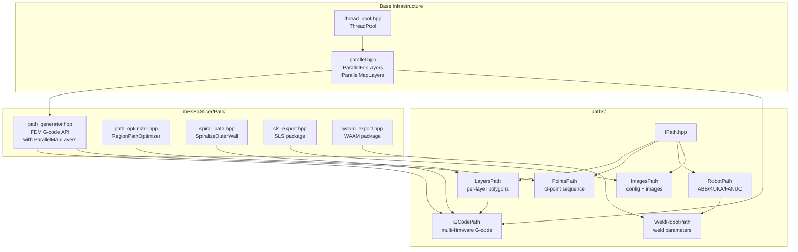

**Diagram sources**
- [IPath.hpp:20-65](file://paths/IPath.hpp#L20-L65)
- [layerspath.hpp:17-60](file://paths/layerspath.hpp#L17-L60)
- [pointspath.hpp:44-94](file://paths/pointspath.hpp#L44-L94)
- [gcodepath.hpp:24-107](file://paths/gcodepath.hpp#L24-L107)
- [robotpath.hpp:15-104](file://paths/robotpath.hpp#L15-L104)
- [weldrobotpath.hpp:16-96](file://paths/weldrobotpath.hpp#L16-L96)
- [imagespath.hpp:17-61](file://paths/imagespath.hpp#L17-L61)
- [path_generator.hpp:20-91](file://LibHsBaSlicer/Path/path_generator.hpp#L20-L91)
- [path_optimizer.hpp:23-100](file://LibHsBaSlicer/Path/path_optimizer.hpp#L23-L100)
- [spiral_path.hpp:16-58](file://LibHsBaSlicer/Path/spiral_path.hpp#L16-L58)
- [sls_export.hpp:17-56](file://LibHsBaSlicer/Path/sls_export.hpp#L17-L56)
- [waam_export.hpp:17-72](file://LibHsBaSlicer/Path/waam_export.hpp#L17-L72)
- [parallel.hpp:178-219](file://base/parallel.hpp#L178-L219)
- [thread_pool.hpp:29-162](file://base/thread_pool.hpp#L29-L162)

**Section sources**
- [IPath.hpp:20-65](file://paths/IPath.hpp#L20-L65)
- [path_generator.hpp:20-91](file://LibHsBaSlicer/Path/path_generator.hpp#L20-L91)

## Core Components
The Path Generation module centers on a small set of well-defined components:

| Component | Purpose | Key Data | Typical Output |
|---|---|---|---|
| `IPath` | Abstract interface for all path outputs | None directly; defines Save/ToString contracts | File or string in native format |
| `OutPoints3` | 3D output point with planar X/Y and build height Z | `x`, `y`, `z` | Shared coordinate type |
| `LayersPath` | Ordered per-layer polygons plus config | `layerConfig`, `PolygonsD` | Layered geometry |
| `PointsPath` | Ordered G-code motion points | `GPoint[]` | G-code text |
| `GCodePath` | Multi-firmware G-code from layers | `GCodePrinterConfig`, optional continuous wall | Marlin/RepRap/Klipper G-code |
| `RobotPath` | Industrial robot program | `RLPoint[]`, robot brand | ABB/KUKA/FANUC code |
| `WeldRobotPath` | Robot program with welding parameters | `WeldRLPoint[]` | Welding-aware robot code |
| `ImagesPath` | Config sidecar plus named image payloads | `config`, `images map` | Image-oriented export |
| `RegionPathOptimizer` | Region visit-order pre-optimizer | Polygon or fill-result regions | Optimized polygon/fill order |
| `SpiralizeOuterWall` | Continuous helical outer wall | Per-layer closed contours | 3D spiral polyline |
| `WaamRobotPackage` / `SlsPackage` | Pipeline export packages | Contours, heights, settings | Lua-driven export |
| `ParallelMapLayers` | Concurrent layer processing engine | Atomic cursor + ThreadPool | Parallel result vectors |

**Section sources**
- [IPath.hpp:20-65](file://paths/IPath.hpp#L20-L65)
- [layerspath.hpp:17-60](file://paths/layerspath.hpp#L17-L60)
- [pointspath.hpp:44-94](file://paths/pointspath.hpp#L44-L94)
- [gcodepath.hpp:24-107](file://paths/gcodepath.hpp#L24-L107)
- [robotpath.hpp:15-104](file://paths/robotpath.hpp#L15-L104)
- [weldrobotpath.hpp:16-96](file://paths/weldrobotpath.hpp#L16-L96)
- [imagespath.hpp:17-61](file://paths/imagespath.hpp#L17-L61)
- [path_optimizer.hpp:23-100](file://LibHsBaSlicer/Path/path_optimizer.hpp#L23-L100)
- [spiral_path.hpp:16-58](file://LibHsBaSlicer/Path/spiral_path.hpp#L16-L58)
- [sls_export.hpp:17-56](file://LibHsBaSlicer/Path/sls_export.hpp#L17-L56)
- [waam_export.hpp:17-72](file://LibHsBaSlicer/Path/waam_export.hpp#L17-L72)
- [parallel.hpp:209-219](file://base/parallel.hpp#L209-L219)

## Architecture Overview
The architecture separates concerns into three layers with integrated parallel processing:

1. **Geometry layer**: 2D polygons from slicing (`PolygonsD`) and shared 3D point types.
2. **Path representation layer**: `IPath` subclasses store either layered polygons, point sequences, or robot moves.
3. **Export layer**: Firmware-specific G-code, robot-brand code, or Lua-driven export packages.
4. **Parallel processing layer**: Process-wide ThreadPool with atomic cursor scheduling for concurrent layer operations.

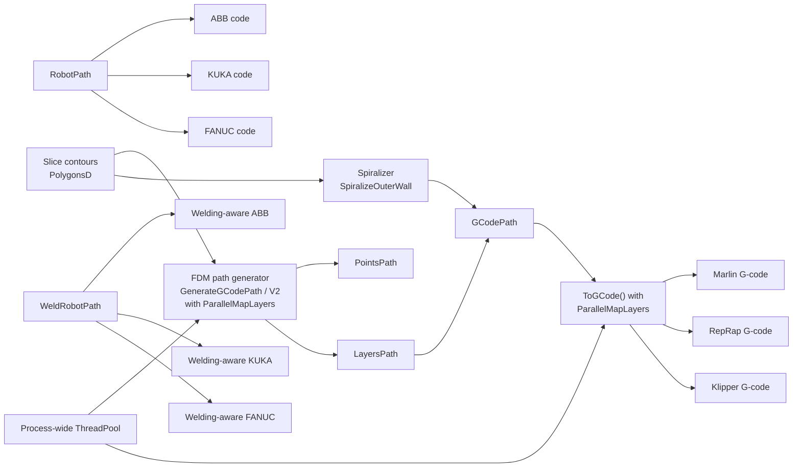

**Diagram sources**
- [path_generator.hpp:44-91](file://LibHsBaSlicer/Path/path_generator.hpp#L44-L91)
- [spiral_path.hpp:31-58](file://LibHsBaSlicer/Path/spiral_path.hpp#L31-L58)
- [gcodepath.hpp:24-107](file://paths/gcodepath.hpp#L24-L107)
- [robotpath.hpp:15-104](file://paths/robotpath.hpp#L15-L104)
- [weldrobotpath.hpp:16-96](file://paths/weldrobotpath.hpp#L16-L96)
- [parallel.hpp:64-68](file://base/parallel.hpp#L64-L68)

## Concurrent Layer Processing Architecture

**Updated** The Path Generation module now leverages `ParallelMapLayers` for concurrent processing of independent layers, significantly optimizing serialization performance for large models.

### Process-Wide Thread Pool Infrastructure
The parallel infrastructure is built around a process-wide `ThreadPool` singleton accessed via `PipelinePool()`:

- **Single instance**: Created lazily on first use and lives until process exit
- **Dynamic sizing**: Respects `HSBA_PIPELINE_THREADS` environment variable, falls back to hardware concurrency
- **Atomic cursor scheduling**: Workers compete for work items using `std::atomic<int> cursor.fetch_add(1)`
- **Progress reporting**: Main thread polls completion counter every 32 layers for efficient progress updates
- **Exception safety**: Worker exceptions are rethrown via futures on the calling thread

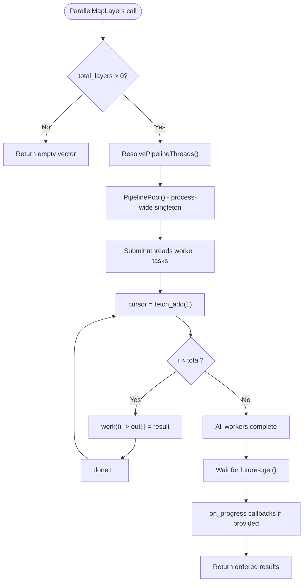

**Diagram sources**
- [parallel.hpp:90-174](file://base/parallel.hpp#L90-L174)
- [parallel.hpp:209-219](file://base/parallel.hpp#L209-L219)

### Path Generation Parallelization
Both `GenerateGCodePath` and `GenerateGCodePathV2` utilize `ParallelMapLayers` to parallelize the most computationally intensive parts:

#### GenerateGCodePath Parallelization
- **Per-layer G-point generation**: Outlines, fills, and supports are processed independently
- **Thread-safe assembly**: Results are collected in local vectors then appended to shared `PointsPath`
- **Order preservation**: Final insertion maintains deterministic layer ordering

#### GenerateGCodePathV2 Parallelization  
- **Polygon combination**: Outlines, fills, and supports are merged per layer concurrently
- **Bundle collection**: Each layer returns a `LayerBundle` containing config and combined polygons
- **Safe accumulation**: `GCodePath::push_back` remains on caller thread for thread safety

### G-Code Serialization Parallelization
The `GCodePath::ToGCode` method parallelizes firmware-specific G-code generation:

- **Independent layer serialization**: Each layer's G-code generation is pure const read operation
- **String concatenation**: Header + continuous wall + parallel layer bodies + footer assembled on main thread
- **Memory optimization**: Pre-calculates total size to avoid incremental string growth

**Section sources**
- [parallel.hpp:37-75](file://base/parallel.hpp#L37-L75)
- [parallel.hpp:90-174](file://base/parallel.hpp#L90-L174)
- [parallel.hpp:209-219](file://base/parallel.hpp#L209-L219)
- [path_generator.cpp:75-112](file://LibHsBaSlicer/Path/path_generator.cpp#L75-L112)
- [path_generator.cpp:123-149](file://LibHsBaSlicer/Path/path_generator.cpp#L123-L149)
- [gcodepath.cpp:333-368](file://paths/gcodepath.cpp#L333-L368)

## Detailed Component Analysis

### Abstract Path Interface and Shared Types
`IPath` defines the common contract for saving or serializing any path product. Every concrete path class supports:
- Native file save.
- String serialization.
- Optional inline Lua post-processing.
- Optional script-file post-processing with a named entry function.

`OutPoints3` provides a simple 3D output point used across path types.

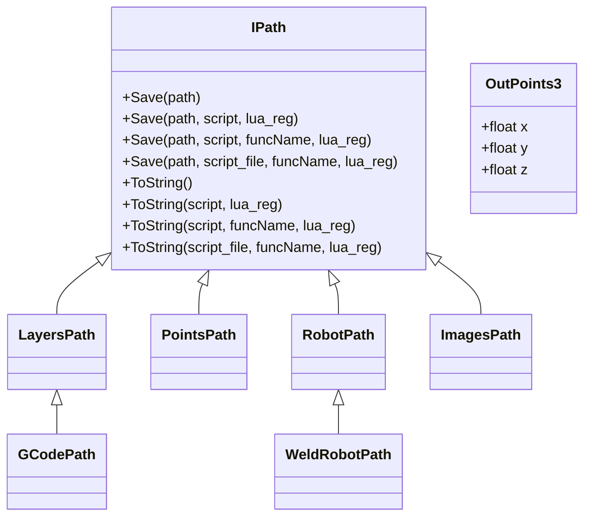

**Diagram sources**
- [IPath.hpp:20-65](file://paths/IPath.hpp#L20-L65)
- [layerspath.hpp:17-60](file://paths/layerspath.hpp#L17-L60)
- [pointspath.hpp:44-94](file://paths/pointspath.hpp#L44-L94)
- [gcodepath.hpp:66-107](file://paths/gcodepath.hpp#L66-L107)
- [robotpath.hpp:61-104](file://paths/robotpath.hpp#L61-L104)
- [weldrobotpath.hpp:65-96](file://paths/weldrobotpath.hpp#L65-L96)
- [imagespath.hpp:17-61](file://paths/imagespath.hpp#L17-L61)

**Section sources**
- [IPath.hpp:20-65](file://paths/IPath.hpp#L20-L65)

### Layer-Based Path Representation
`LayersPath` stores an ordered list of layers, where each layer pairs:
- A free-form configuration string.
- A `PolygonsD` polygon group.

It exposes callbacks for progress/status reporting and supports both native and Lua-post-processed serialization.

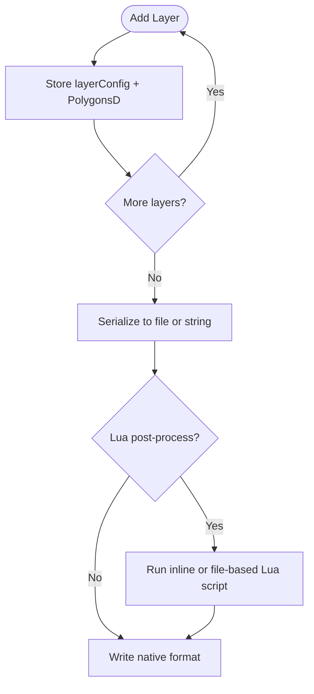

**Diagram sources**
- [layerspath.hpp:17-60](file://paths/layerspath.hpp#L17-L60)

**Section sources**
- [layerspath.hpp:17-60](file://paths/layerspath.hpp#L17-L60)

### G-Code Path System for FDM Printers
`GCodePath` extends `LayersPath` and adds multi-firmware G-code generation with parallel serialization support. It supports:
- Firmware selection: Marlin, RepRap, Klipper.
- Printer configuration such as nozzle diameter, filament diameter, temperatures, speeds, retraction, extrusion mode, and layer height.
- Optional continuous spiral wall emission before per-layer data.
- Extrusion calculation based on segment length and printer configuration.
- **Parallel layer serialization via ParallelMapLayers for improved performance**.

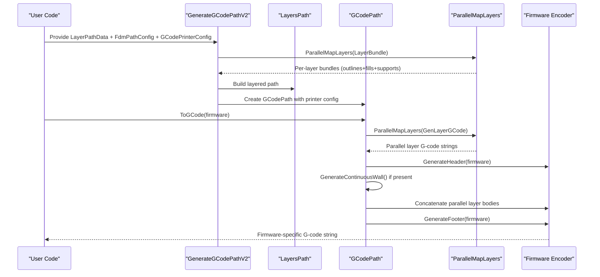

**Diagram sources**
- [path_generator.hpp:53-62](file://LibHsBaSlicer/Path/path_generator.hpp#L53-L62)
- [gcodepath.hpp:24-107](file://paths/gcodepath.hpp#L24-L107)
- [parallel.hpp:209-219](file://base/parallel.hpp#L209-L219)

Concrete example workflow for FDM:
1. Prepare per-layer outlines, fills, and supports as `LayerPathData`.
2. Configure `FdmPathConfig` with layer height, line width, print speed, travel speed, extrusion multiplier, and units.
3. Configure `GCodePrinterConfig` with nozzle diameter, filament diameter, temperatures, speeds, retraction, and extrusion mode.
4. Call `GenerateGCodePathV2` to obtain a `GCodePath`.
5. Call `ToGCode(Marlin)` or another firmware to produce printable G-code with automatic parallel serialization.

Parameter tuning guidance:
- Increase `line_width` or decrease `nozzle_diameter` carefully to maintain volumetric flow limits.
- Reduce `print_speed` for first layers to improve bed adhesion.
- Adjust `retract_length` and `retract_speed` for stringing control.
- Tune `extrusion_multiplier` to compensate for material shrinkage or over-extrusion.

**Section sources**
- [path_generator.hpp:20-62](file://LibHsBaSlicer/Path/path_generator.hpp#L20-L62)
- [gcodepath.hpp:24-107](file://paths/gcodepath.hpp#L24-L107)
- [path_generator.cpp:114-149](file://LibHsBaSlicer/Path/path_generator.cpp#L114-L149)
- [gcodepath.cpp:333-368](file://paths/gcodepath.cpp#L333-L368)

### Point-Based G-Code Representation
`PointsPath` represents a sequence of G-code motion commands. Each `GPoint` includes:
- Motion or setting code.
- Target point.
- Optional arc center/middle point.
- Velocity.
- Extrusion amount.

This abstraction is useful when lower-level control over G-code motion is required, or when converting arbitrary polylines into G-code segments.

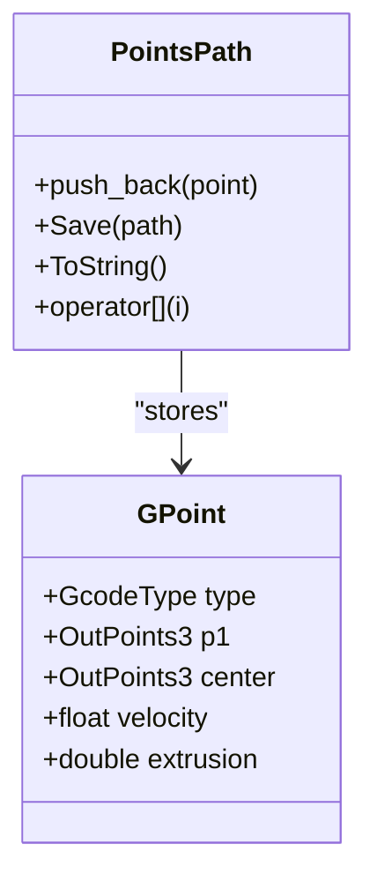

**Diagram sources**
- [pointspath.hpp:16-94](file://paths/pointspath.hpp#L16-L94)

**Section sources**
- [pointspath.hpp:16-94](file://paths/pointspath.hpp#L16-L94)

### Industrial Robot Path Output
`RobotPath` accumulates robot moves and emits brand-specific programs for:
- ABB.
- KUKA.
- FANUC.

Each move is represented by `RLPoint`, which includes:
- End position.
- Middle/via position for circular moves.
- Velocity.
- Command kind such as joint move, linear move, circular move, or program block markers.

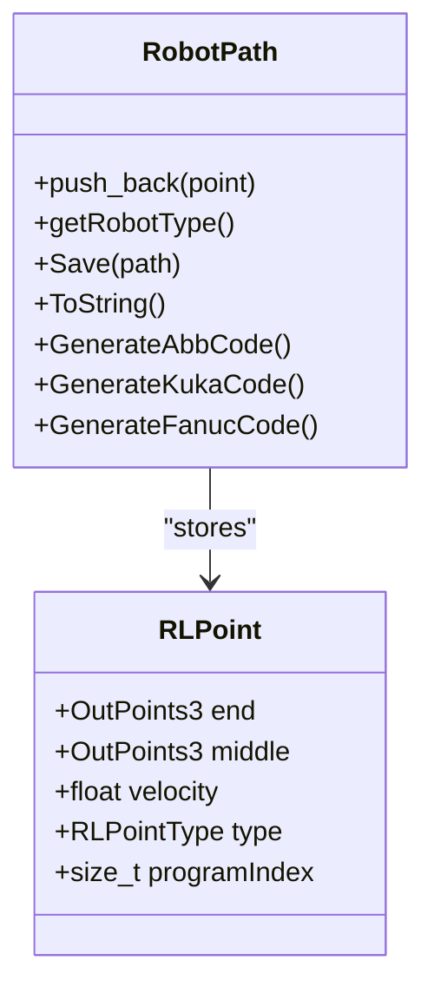

**Diagram sources**
- [robotpath.hpp:15-104](file://paths/robotpath.hpp#L15-L104)

Industrial robot usage pattern:
1. Choose target robot brand via `RLType`.
2. Set initial robot position.
3. Append movement points with appropriate motion types.
4. Save or serialize to the target robot language.

**Section sources**
- [robotpath.hpp:15-104](file://paths/robotpath.hpp#L15-L104)

### Weld Robot Path Generation
`WeldRobotPath` extends `RobotPath` to include welding parameters for each point. It supports:
- Weld process types such as MIG/MAG, TIG, Plasma, Laser.
- Arc end handling strategies.
- Weld parameters including current, voltage, wire feed speed, gas flow rate, travel speed, hot start values, crater fill values, schedule number, and process type.

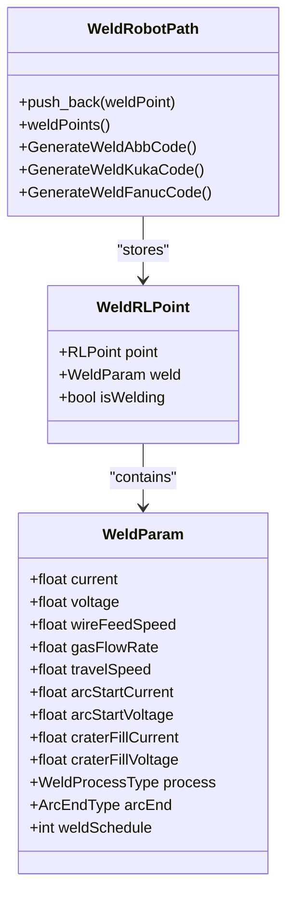

**Diagram sources**
- [weldrobotpath.hpp:16-96](file://paths/weldrobotpath.hpp#L16-L96)

WAAM integration:
- `WaamRobotPackage` carries per-layer deposition contours, Z heights, welding parameters, robot type, bead width, optional configuration JSON, and spiral mode flag.
- `SaveWaamRobotPath` builds a `WeldRobotPath` and writes brand-specific robot code, optionally post-processed by Lua.

**Section sources**
- [weldrobotpath.hpp:16-96](file://paths/weldrobotpath.hpp#L16-L96)
- [waam_export.hpp:17-72](file://LibHsBaSlicer/Path/waam_export.hpp#L17-L72)

### Spiral and Vase Mode Support
Spiral/vase mode generates a single continuous helical outer wall instead of per-layer walls. The key algorithm is exposed as `SpiralizeOuterWall`:

- Selects the outermost closed contour per layer.
- Aligns seam vertices between layers.
- Traverses each loop while ramping Z continuously.
- Skips layers without valid closed contours.
- Returns a 3D polyline suitable for continuous extrusion.

`GCodePath` integrates this by accepting a continuous wall through `setContinuousWall`, emitting it before per-layer data.

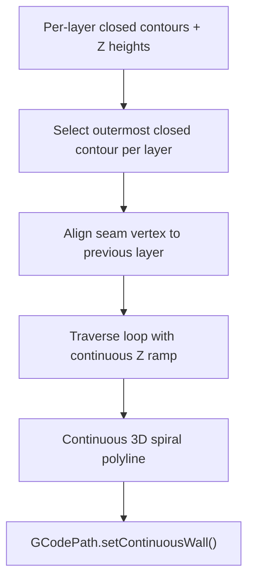

**Diagram sources**
- [spiral_path.hpp:31-58](file://LibHsBaSlicer/Path/spiral_path.hpp#L31-L58)
- [gcodepath.hpp:87-96](file://paths/gcodepath.hpp#L87-L96)

Practical guidance:
- Use spiral mode for uniform-cross-section models such as cylinders or prisms.
- Ensure at least one valid closed contour per layer.
- Combine with appropriate print speed and extrusion settings to avoid under- or over-extrusion along the helix.

**Section sources**
- [spiral_path.hpp:31-58](file://LibHsBaSlicer/Path/spiral_path.hpp#L31-L58)
- [gcodepath.hpp:87-96](file://paths/gcodepath.hpp#L87-L96)

### Path Optimization Algorithms
`RegionPathOptimizer` performs region-based pre-optimization to reduce air-move travel and improve print quality. It supports two modes:

- **Polygon mode**: Runs before filling. Regions are polygons; all vertices act as entry/exit gates. Outputs polygons in optimized order.
- **Fill-result mode**: Runs after filling. Regions are fill paths; head/tail endpoints act as gates. Outputs complete fill paths in optimized order.

Algorithmic summary:
- Treats independent regions as graph vertices.
- Computes intra-region gate-to-gate cost as straight-line distance.
- Computes inter-region routing cost as minimum endpoint distance.
- Solves region visit order using a genetic TSP solver.
- Arranges intra-region entry/exit order using nearest-neighbor greedy logic.

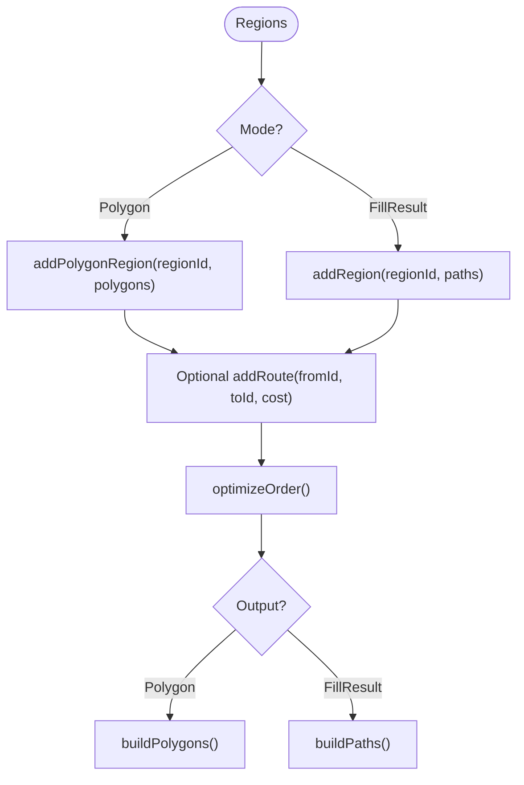

**Diagram sources**
- [path_optimizer.hpp:23-100](file://LibHsBaSlicer/Path/path_optimizer.hpp#L23-L100)

Lua integration:
- `RegisterLuaPathOptimizeFunctions` registers global table functions.
- One-shot helpers allow optimizing regions via embedded Lua scripts.
- Script environment includes polygon operations, fill functions, and optimizer functions.

**Section sources**
- [path_optimizer.hpp:23-100](file://LibHsBaSlicer/Path/path_optimizer.hpp#L23-L100)

### Image-Based and SLS Export
`ImagesPath` packages a configuration sidecar with named image payloads. It is used by image-oriented outputs such as SLA/SLS layer images.

`SlsPackage` carries:
- Per-layer slice outlines.
- Z heights.
- Configuration JSON.
- Optional spiral mode flag exposing a continuous spiralized outer-wall path alongside per-layer images.

`SaveSlsPackageLua` executes a Lua script that receives configuration, images, output path, and registered libraries.

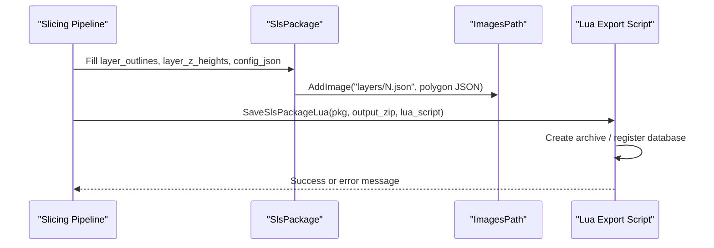

**Diagram sources**
- [imagespath.hpp:17-61](file://paths/imagespath.hpp#L17-L61)
- [sls_export.hpp:17-56](file://LibHsBaSlicer/Path/sls_export.hpp#L17-L56)

**Section sources**
- [imagespath.hpp:17-61](file://paths/imagespath.hpp#L17-L61)
- [sls_export.hpp:17-56](file://LibHsBaSlicer/Path/sls_export.hpp#L17-L56)

## Dependency Analysis
The following diagram shows how high-level APIs depend on core path types, exporters, and the parallel processing infrastructure.

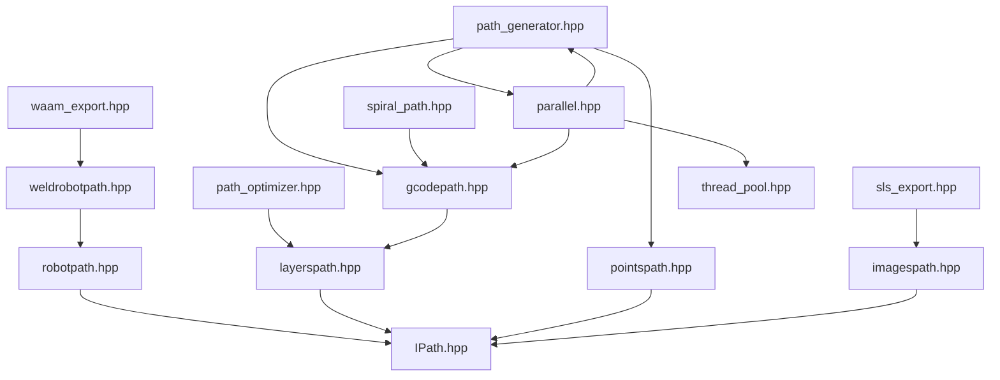

**Diagram sources**
- [path_generator.hpp:10-91](file://LibHsBaSlicer/Path/path_generator.hpp#L10-L91)
- [path_optimizer.hpp:10-100](file://LibHsBaSlicer/Path/path_optimizer.hpp#L10-L100)
- [spiral_path.hpp:10-58](file://LibHsBaSlicer/Path/spiral_path.hpp#L10-L58)
- [waam_export.hpp:10-72](file://LibHsBaSlicer/Path/waam_export.hpp#L10-L72)
- [sls_export.hpp:10-56](file://LibHsBaSlicer/Path/sls_export.hpp#L10-L56)
- [gcodepath.hpp:16-107](file://paths/gcodepath.hpp#L16-L107)
- [pointspath.hpp:10-94](file://paths/pointspath.hpp#L10-L94)
- [layerspath.hpp:10-60](file://paths/layerspath.hpp#L10-L60)
- [robotpath.hpp:10-104](file://paths/robotpath.hpp#L10-L104)
- [weldrobotpath.hpp:10-96](file://paths/weldrobotpath.hpp#L10-L96)
- [imagespath.hpp:10-61](file://paths/imagespath.hpp#L10-L61)
- [IPath.hpp:10-65](file://paths/IPath.hpp#L10-L65)
- [parallel.hpp:178-219](file://base/parallel.hpp#L178-L219)
- [thread_pool.hpp:29-162](file://base/thread_pool.hpp#L29-L162)

**Section sources**
- [path_generator.hpp:10-91](file://LibHsBaSlicer/Path/path_generator.hpp#L10-L91)
- [path_optimizer.hpp:10-100](file://LibHsBaSlicer/Path/path_optimizer.hpp#L10-L100)
- [spiral_path.hpp:10-58](file://LibHsBaSlicer/Path/spiral_path.hpp#L10-L58)
- [waam_export.hpp:10-72](file://LibHsBaSlicer/Path/waam_export.hpp#L10-L72)
- [sls_export.hpp:10-56](file://LibHsBaSlicer/Path/sls_export.hpp#L10-L56)
- [gcodepath.hpp:16-107](file://paths/gcodepath.hpp#L16-L107)
- [pointspath.hpp:10-94](file://paths/pointspath.hpp#L10-L94)
- [layerspath.hpp:10-60](file://paths/layerspath.hpp#L10-L60)
- [robotpath.hpp:10-104](file://paths/robotpath.hpp#L10-L104)
- [weldrobotpath.hpp:10-96](file://paths/weldrobotpath.hpp#L10-L96)
- [imagespath.hpp:10-61](file://paths/imagespath.hpp#L10-L61)
- [IPath.hpp:10-65](file://paths/IPath.hpp#L10-L65)
- [parallel.hpp:178-219](file://base/parallel.hpp#L178-L219)
- [thread_pool.hpp:29-162](file://base/thread_pool.hpp#L29-L162)

## Performance Considerations

**Updated** The Path Generation module now incorporates significant parallel processing optimizations that dramatically improve performance for large models:

### Parallel Processing Benefits
- **Concurrent layer processing**: `ParallelMapLayers` enables simultaneous processing of independent layers during both path generation and G-code serialization
- **Process-wide thread pool**: Single `ThreadPool` instance eliminates repeated initialization overhead across multiple parallel operations
- **Atomic cursor scheduling**: Dynamic load balancing prevents thread starvation and improves utilization efficiency
- **Memory-efficient string assembly**: Pre-calculation of total output size avoids incremental string growth during concatenation

### Performance Optimization Strategies
- Prefer region-based path optimization before filling to reduce total travel distance.
- Use spiral/vase mode for uniform cross-sections to eliminate retractions and per-layer travel jumps.
- Tune print speed and travel speed separately: higher travel speed reduces non-print time, but excessive values may cause vibration or missed steps.
- Keep extrusion consistent by matching line width, nozzle diameter, and extrusion multiplier.
- For robot paths, minimize unnecessary circular moves and program-block overhead.
- For welding paths, ensure travel speed and wire feed speed are balanced to avoid undercutting or excess buildup.
- **Configure HSBA_PIPELINE_THREADS environment variable to optimize parallelism for your hardware**:
  - Default uses hardware_concurrency() for automatic scaling
  - Set to 1 for serial execution (debugging/regression testing)
  - Set to specific value for fine-tuned performance control

### Memory Management
- **Pre-sized result vectors**: `ParallelMapLayers` allocates output vectors upfront to avoid reallocation
- **Reserve capacity**: String concatenation pre-calculates total size to prevent memory fragmentation
- **Local temporary storage**: Parallel workers use local vectors that are moved to final destinations

### Scaling Characteristics
- **Linear scaling**: Performance scales approximately linearly with number of cores for CPU-bound operations
- **Memory bandwidth bound**: Very large models may become limited by memory bandwidth rather than CPU cores
- **Diminishing returns**: Beyond hardware concurrency, additional threads provide no benefit and may increase overhead

**Section sources**
- [parallel.hpp:37-75](file://base/parallel.hpp#L37-L75)
- [parallel.hpp:90-174](file://base/parallel.hpp#L90-L174)
- [path_generator.cpp:120-141](file://LibHsBaSlicer/Path/path_generator.cpp#L120-L141)
- [gcodepath.cpp:335-368](file://paths/gcodepath.cpp#L335-L368)

## Troubleshooting Guide
Common issues and resolution strategies:

| Symptom | Likely Cause | Resolution |
|---|---|---|
| Poor bed adhesion | First layer speed too high, wrong nozzle temperature, or incorrect line width | Lower `first_layer_speed`, adjust `nozzle_temp`, verify `line_width` vs `nozzle_diameter` |
| Stringing or oozing | Retraction settings mismatched with filament | Tune `retract_length` and `retract_speed`; enable/disable `enable_retraction` as needed |
| Under-extrusion | Extrusion multiplier too low or line width too large | Increase `extrusion_multiplier`, reduce `line_width`, check volumetric flow |
| Over-extrusion | Extrusion multiplier too high or line width too small | Decrease `extrusion_multiplier`, increase `line_width` |
| Spiral wall gaps | Missing closed contour or inconsistent layer Z | Ensure every layer has a valid outer contour and correct `layer_zs` |
| Robot program errors | Incorrect motion type or missing via point for circular moves | Use `MoveL` for straight segments, provide `middle` for `MoveC` |
| Weld defects | Travel speed and wire feed speed mismatch | Balance `travelSpeed` and `wireFeedSpeed`; verify `process` and `arcEnd` settings |
| SLS export fails | Lua script error or missing image payload | Validate Lua script, confirm `AddImage` calls and `config_json` content |
| **Slow G-code generation** | Insufficient parallelism or memory constraints | Set `HSBA_PIPELINE_THREADS` appropriately, monitor memory usage |
| **Inconsistent layer ordering** | Race conditions in custom parallel code | Ensure only main thread modifies shared state, use proper synchronization |
| **Thread pool exhaustion** | Nested parallel operations or resource leaks | Avoid submitting work from within parallel callbacks, check for proper cleanup |

**Section sources**
- [gcodepath.hpp:32-49](file://paths/gcodepath.hpp#L32-L49)
- [spiral_path.hpp:31-58](file://LibHsBaSlicer/Path/spiral_path.hpp#L31-L58)
- [robotpath.hpp:15-52](file://paths/robotpath.hpp#L15-L52)
- [weldrobotpath.hpp:16-57](file://paths/weldrobotpath.hpp#L16-L57)
- [imagespath.hpp:32-50](file://paths/imagespath.hpp#L32-L50)
- [sls_export.hpp:35-56](file://LibHsBaSlicer/Path/sls_export.hpp#L35-L56)
- [parallel.hpp:56-68](file://base/parallel.hpp#L56-L68)

## Conclusion
The Path Generation module provides a cohesive system for turning 2D slice contours into executable manufacturing instructions, now enhanced with advanced parallel processing capabilities. It supports:
- FDM G-code generation for multiple firmware targets with concurrent layer serialization.
- Industrial robot program generation for ABB, KUKA, and FANUC.
- Welding-aware robot paths for WAAM and related processes.
- Region-based path optimization to reduce travel and improve quality.
- Spiral/vase mode for continuous helical walls.
- Flexible export through native formats and Lua-driven scripts.
- **Process-wide parallel infrastructure with dynamic load balancing for optimal performance on large models.**

By combining layered polygon data, point-based motion primitives, brand-specific exporters, and modern parallel processing techniques, the module bridges slicing geometry and real-world production equipment with significantly improved performance characteristics.

## Appendices

### Example Workflows

#### Generate FDM G-code
1. Build `LayerPathData` for each layer.
2. Configure `FdmPathConfig`.
3. Configure `GCodePrinterConfig`.
4. Call `GenerateGCodePathV2`.
5. Call `ToGCode` with desired firmware.

**Section sources**
- [path_generator.hpp:44-62](file://LibHsBaSlicer/Path/path_generator.hpp#L44-L62)
- [gcodepath.hpp:74-85](file://paths/gcodepath.hpp#L74-L85)

#### Create Robot Paths for Industrial Applications
1. Choose `RLType`.
2. Set initial position.
3. Append `RLPoint` moves.
4. Save or serialize to ABB/KUKA/FANUC code.

**Section sources**
- [robotpath.hpp:61-104](file://paths/robotpath.hpp#L61-L104)

#### Optimize Paths for Print Quality and Speed
1. Identify independent regions.
2. Choose polygon mode or fill-result mode.
3. Optionally override route costs.
4. Run `optimizeOrder`.
5. Build optimized polygons or fill paths.

**Section sources**
- [path_optimizer.hpp:52-95](file://LibHsBaSlicer/Path/path_optimizer.hpp#L52-L95)

#### Enable Spiral/Vase Mode
1. Compute per-layer outer contours.
2. Call `SpiralizeOuterWall`.
3. Set continuous wall on `GCodePath`.
4. Generate firmware-specific G-code.

**Section sources**
- [spiral_path.hpp:31-58](file://LibHsBaSlicer/Path/spiral_path.hpp#L31-L58)
- [gcodepath.hpp:87-96](file://paths/gcodepath.hpp#L87-L96)

#### Configure Parallel Processing Performance
1. Set `HSBA_PIPELINE_THREADS` environment variable before pipeline execution.
2. Monitor performance with different thread counts.
3. Use serial mode (`HSBA_PIPELINE_THREADS=1`) for debugging and regression testing.
4. Leverage automatic hardware detection for optimal default performance.

**Section sources**
- [parallel.hpp:37-54](file://base/parallel.hpp#L37-L54)
- [parallel.hpp:56-75](file://base/parallel.hpp#L56-L75)