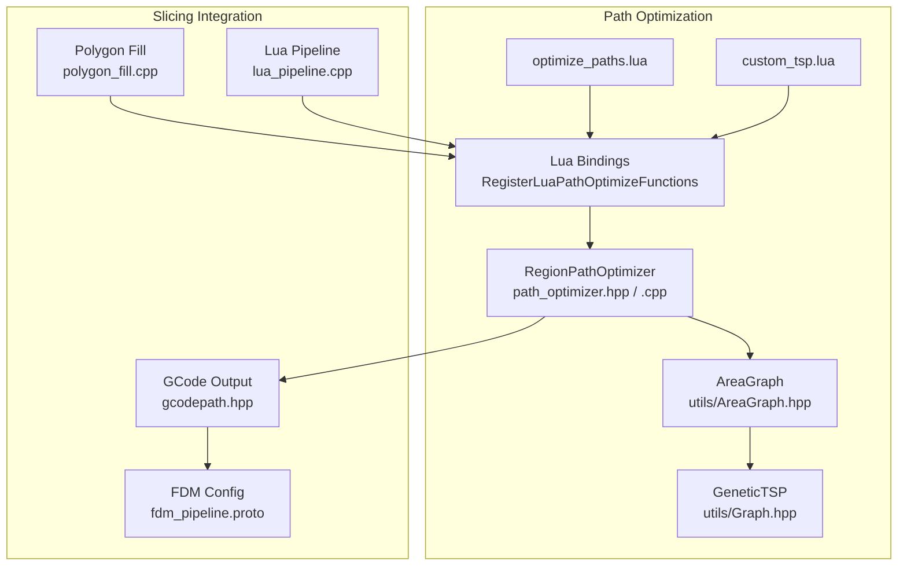
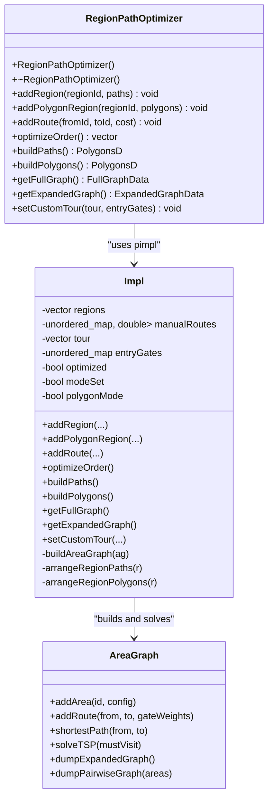
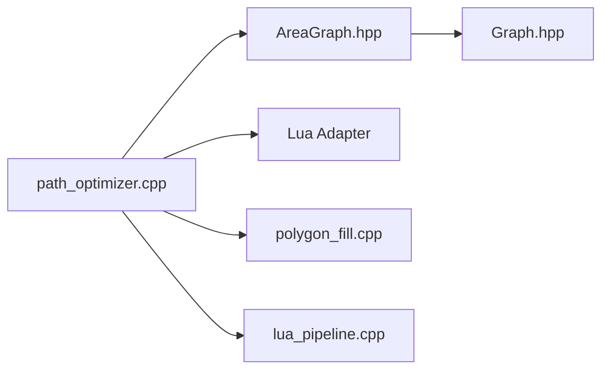

# Path Optimization

<cite>
**Referenced Files in This Document**
- [path_optimizer.hpp](file://LibHsBaSlicer/Path/path_optimizer.hpp)
- [path_optimizer.cpp](file://LibHsBaSlicer/Path/path_optimizer.cpp)
- [AreaGraph.hpp](file://utils/AreaGraph.hpp)
- [Graph.hpp](file://utils/Graph.hpp)
- [optimize_paths.lua](file://tests/PolygonFill/optimize_paths.lua)
- [custom_tsp.lua](file://tests/PolygonFill/custom_tsp.lua)
- [hsba_pipeline.d.lua](file://types/hsba_pipeline.d.lua)
- [polygon_fill_test.cpp](file://tests/PolygonFill/polygon_fill_test.cpp)
- [polygon_fill.cpp](file://LibHsBaSlicer/Fill/polygon_fill.cpp)
- [lua_pipeline.cpp](file://LibHsBaSlicer/Extends/lua_pipeline.cpp)
- [gcodepath.hpp](file://paths/gcodepath.hpp)
- [fdm_pipeline.proto](file://proto/fdm_pipeline.proto)
</cite>

## Update Summary
**Changes Made**
- Enhanced documentation for full combination graph exposure via `getFullGraph()` method with detailed API reference
- Enhanced documentation for gate-level expanded graph exposure via `getExpandedGraph()` method with structural details
- Enhanced documentation for custom tour support via `setCustomTour()` method with validation rules
- Updated Lua API reference with comprehensive data structures and type definitions
- Added practical examples of custom path optimization strategies including nearest-neighbor greedy and brute-force TSP algorithms
- Enhanced customization options section with advanced user capabilities and performance considerations
- Added comprehensive testing coverage information for the new features

## Table of Contents
1. [Introduction](#introduction)
2. [Project Structure](#project-structure)
3. [Core Components](#core-components)
4. [Architecture Overview](#architecture-overview)
5. [Detailed Component Analysis](#detailed-component-analysis)
6. [Dependency Analysis](#dependency-analysis)
7. [Performance Considerations](#performance-considerations)
8. [Troubleshooting Guide](#troubleshooting-guide)
9. [Conclusion](#conclusion)
10. [Appendices](#appendices)

## Introduction
This document explains the path optimization system used by HsBaSlicer to reduce travel distance, improve print speed, and support thermal and quality strategies through configurable optimization levels. The core implementation is a region-based pre-optimizer that treats independent polygon regions as graph vertices and solves a gate-aware visit order using shortest paths and a genetic TSP solver. It supports two modes:

- **Polygon mode (before filling)**: optimizes the visit order of outline polygons so subsequent fill algorithms start from better entry points.
- **Fill-result mode (after filling)**: optimizes the traversal order of already generated fill paths, including multi-point polylines.

The optimizer reduces air-move distance between regions and within regions, which directly lowers non-extrusion travel time, can reduce retraction events, and improves thermal stability by avoiding long hot extruder moves. Advanced users can tune genetic algorithm parameters, override inter-region costs, or write custom Lua optimization scripts.

**Updated** The system now provides comprehensive graph exposure and custom tour support, enabling users to implement arbitrary path optimization strategies in Lua instead of relying solely on the built-in genetic TSP algorithm. This includes full combination graphs (N×N distance matrices), gate-level expanded graphs (all vertices and edges), and the ability to bypass the built-in solver with user-computed tours.

## Project Structure
The path optimization feature lives primarily under `LibHsBaSlicer/Path`, with supporting graph algorithms under `utils`. Lua bindings expose both a C++ class and a global Lua table for scripting.



**Diagram sources**
- [path_optimizer.hpp:23-95](file://LibHsBaSlicer/Path/path_optimizer.hpp#L23-L95)
- [path_optimizer.cpp:45-474](file://LibHsBaSlicer/Path/path_optimizer.cpp#L45-L474)
- [AreaGraph.hpp:95-345](file://utils/AreaGraph.hpp#L95-L345)
- [Graph.hpp:878-905](file://utils/Graph.hpp#L878-L905)
- [optimize_paths.lua:7-27](file://tests/PolygonFill/optimize_paths.lua#L7-L27)
- [custom_tsp.lua:17-55](file://tests/PolygonFill/custom_tsp.lua#L17-L55)
- [polygon_fill.cpp:38-46](file://LibHsBaSlicer/Fill/polygon_fill.cpp#L38-L46)
- [lua_pipeline.cpp:928](file://LibHsBaSlicer/Extends/lua_pipeline.cpp#L928)
- [gcodepath.hpp:42-49](file://paths/gcodepath.hpp#L42-L49)
- [fdm_pipeline.proto:50-61](file://proto/fdm_pipeline.proto#L50-L61)

**Section sources**
- [path_optimizer.hpp:23-95](file://LibHsBaSlicer/Path/path_optimizer.hpp#L23-L95)
- [path_optimizer.cpp:45-474](file://LibHsBaSlicer/Path/path_optimizer.cpp#L45-L474)
- [AreaGraph.hpp:95-345](file://utils/AreaGraph.hpp#L95-L345)
- [Graph.hpp:878-905](file://utils/Graph.hpp#L878-L905)
- [optimize_paths.lua:7-27](file://tests/PolygonFill/optimize_paths.lua#L7-L27)
- [custom_tsp.lua:17-55](file://tests/PolygonFill/custom_tsp.lua#L17-L55)
- [polygon_fill.cpp:38-46](file://LibHsBaSlicer/Fill/polygon_fill.cpp#L38-L46)
- [lua_pipeline.cpp:928](file://LibHsBaSlicer/Extends/lua_pipeline.cpp#L928)
- [gcodepath.hpp:42-49](file://paths/gcodepath.hpp#L42-L49)
- [fdm_pipeline.proto:50-61](file://proto/fdm_pipeline.proto#L50-L61)

## Core Components
The main component is `RegionPathOptimizer`, which provides:

- Adding regions either as post-fill paths or pre-fill polygons.
- Optional manual route cost overrides.
- Solving the optimal region visit order.
- Building optimized output paths or polygons.
- **Enhanced**: Full combination graph exposure for custom optimization algorithms via `getFullGraph()`.
- **Enhanced**: Gate-level expanded graph access for fine-grained path planning via `getExpandedGraph()`.
- **Enhanced**: Custom tour support to bypass built-in TSP solver via `setCustomTour()`.

It also exposes Lua functions under `PathOptimize` and helper APIs for running embedded Lua optimization scripts.

Key responsibilities:

| Component | Responsibility |
|---|---|
| `RegionPathOptimizer` | Builds a gate-aware area graph, solves TSP, arranges intra-region paths, and outputs ordered results. |
| `AreaGraph` | Provides gate-aware shortest paths and genetic TSP over areas. |
| `GeneticTSP` | Implements the evolutionary TSP solver used by `AreaGraph::solveTSP`. |
| Lua bindings | Expose `PathOptimize.new`, `optimizeRegions`, `optimizePolygons`, and per-instance methods. |
| Example scripts | Demonstrate built-in and manual optimization strategies, including custom algorithms. |

**Section sources**
- [path_optimizer.hpp:23-115](file://LibHsBaSlicer/Path/path_optimizer.hpp#L23-L115)
- [path_optimizer.cpp:45-474](file://LibHsBaSlicer/Path/path_optimizer.cpp#L45-L474)
- [AreaGraph.hpp:95-345](file://utils/AreaGraph.hpp#L95-L345)
- [Graph.hpp:878-905](file://utils/Graph.hpp#L878-L905)
- [optimize_paths.lua:7-27](file://tests/PolygonFill/optimize_paths.lua#L7-L27)
- [custom_tsp.lua:17-55](file://tests/PolygonFill/custom_tsp.lua#L17-L55)

## Architecture Overview
The optimization pipeline maps physical printing concepts into graph operations:

1. Each independent region becomes an area vertex.
2. Candidate entry/exit gates are derived from polygon vertices or polyline endpoints.
3. Intra-region movement cost is modeled as straight-line gate-to-gate distance.
4. Inter-region routing cost is modeled as air-move distance between gates.
5. A genetic TSP solver finds a near-optimal region visit order.
6. Within each region, greedy nearest-neighbor ordering arranges polygons or polylines.
7. The result is either reordered polygons or complete optimized fill paths.

**Updated** Users can now intercept this process by accessing the full combination graph or expanded graph, implementing custom optimization algorithms in Lua, and feeding back their computed tours.

```mermaid
flowchart TD
Start(["Input Regions"]) --> Mode{"Mode"}
Mode --> |Polygon Mode| Polygons["Add Polygon Regions<br/>Gates = all vertices"]
Mode --> |Fill Result Mode| Paths["Add Path Regions<br/>Gates = head/tail endpoints"]
Polygons --> BuildGraph["Build AreaGraph<br/>Intra + Inter Gate Costs"]
Paths --> BuildGraph
BuildGraph --> SolveTSP["Solve TSP<br/>Genetic Algorithm"]
SolveTSP --> Tour{"Tour Valid?"}
Tour --> |No| KeepOrder["Keep Insertion Order"]
Tour --> |Yes| Arrange["Arrange Intra-Region Order<br/>Greedy Nearest Neighbor"]
KeepOrder --> Arrange
Arrange --> Output{"Output Type"}
Output --> |Polygon Mode| BuildPolygons["buildPolygons()"]
Output --> |Fill Result Mode| BuildPaths["buildPaths()"]
BuildPolygons --> End(["Ordered Polygons"])
BuildPaths --> End
% New custom optimization path
BuildGraph --> CustomGraph["getFullGraph()/getExpandedGraph()<br/>Custom Lua Algorithms"]
CustomGraph --> CustomTour["setCustomTour()<br/>User-computed order"]
CustomTour --> Arrange
```

**Diagram sources**
- [path_optimizer.cpp:68-127](file://LibHsBaSlicer/Path/path_optimizer.cpp#L68-L127)
- [path_optimizer.cpp:129-184](file://LibHsBaSlicer/Path/path_optimizer.cpp#L129-L184)
- [path_optimizer.cpp:187-235](file://LibHsBaSlicer/Path/path_optimizer.cpp#L187-L235)
- [path_optimizer.cpp:252-312](file://LibHsBaSlicer/Path/path_optimizer.cpp#L252-L312)
- [path_optimizer.cpp:316-438](file://LibHsBaSlicer/Path/path_optimizer.cpp#L316-L438)
- [AreaGraph.hpp:197-345](file://utils/AreaGraph.hpp#L197-L345)

## Detailed Component Analysis

### RegionPathOptimizer Class
`RegionPathOptimizer` implements a pimpl pattern with an internal `Impl` struct. It manages:

- Region data including IDs, mode flags, paths/polygons, gates, and gate ownership.
- Manual route overrides.
- Optimized tour and entry gate mapping.
- Two mutually exclusive modes: polygon mode and fill-result mode.

Public API highlights:

| Method | Purpose |
|---|---|
| `addRegion(regionId, paths)` | Add post-fill path regions; gates are polyline endpoints. |
| `addPolygonRegion(regionId, polygons)` | Add pre-fill polygon regions; gates are all polygon vertices. |
| `addRoute(fromId, toId, cost)` | Override symmetric air-move cost between regions. |
| `optimizeOrder()` | Compute region visit order via TSP when there are at least two regions. |
| `buildPaths()` | Return complete optimized fill paths in fill-result mode. |
| `buildPolygons()` | Return optimized polygon set in polygon mode. |
| **`getFullGraph()`** | **Get area-level full combination graph with N×N distance matrix.** |
| **`getExpandedGraph()`** | **Get gate-level expanded graph with all vertices and edges.** |
| **`setCustomTour(tour, entryGates)`** | **Set user-computed tour and entry gates, bypassing built-in TSP.** |



**Diagram sources**
- [path_optimizer.hpp:44-99](file://LibHsBaSlicer/Path/path_optimizer.hpp#L44-L99)
- [path_optimizer.cpp:45-474](file://LibHsBaSlicer/Path/path_optimizer.cpp#L45-L474)
- [AreaGraph.hpp:95-345](file://utils/AreaGraph.hpp#L95-L345)

**Section sources**
- [path_optimizer.hpp:44-99](file://LibHsBaSlicer/Path/path_optimizer.hpp#L44-L99)
- [path_optimizer.cpp:45-474](file://LibHsBaSlicer/Path/path_optimizer.cpp#L45-L474)

### Travel Path Minimization Strategy
Travel path minimization is implemented by modeling regions as graph areas and minimizing total air-move distance:

- **Intra-region cost**: straight-line distance between gates inside a region.
- **Inter-region cost**: straight-line distance between gates across regions.
- **Manual routes**: allow overriding computed costs for specific region pairs.
- **Gate selection**: TSP returns entry gates per stop, enabling precise endpoint matching.

```mermaid
flowchart TD
Input["Regions with Gates"] --> Graph["AreaGraph Construction"]
Graph --> Intra["Intra-Region Gate Costs"]
Graph --> Inter["Inter-Region Gate Costs"]
Intra --> TSP["Genetic TSP Solver"]
Inter --> TSP
TSP --> Tour["Optimized Region Tour"]
Tour --> EntryGates["Entry Gate Mapping"]
EntryGates --> Output["Ordered Regions"]
% New custom optimization path
Graph --> CustomAccess["Custom Access Points"]
CustomAccess --> FullGraph["getFullGraph()<br/>N×N Distance Matrix"]
CustomAccess --> ExpandedGraph["getExpandedGraph()<br/>All Vertices & Edges"]
FullGraph --> CustomAlgo["Custom Lua Algorithms"]
ExpandedGraph --> CustomAlgo
CustomAlgo --> CustomTour["setCustomTour()<br/>User-computed order"]
CustomTour --> Output
```

**Diagram sources**
- [path_optimizer.cpp:252-312](file://LibHsBaSlicer/Path/path_optimizer.cpp#L252-L312)
- [AreaGraph.hpp:197-345](file://utils/AreaGraph.hpp#L197-L345)

**Section sources**
- [path_optimizer.cpp:252-312](file://LibHsBaSlicer/Path/path_optimizer.cpp#L252-L312)
- [AreaGraph.hpp:197-345](file://utils/AreaGraph.hpp#L197-L345)

### Print Speed Optimization
Reducing travel distance improves effective print speed because:

- Less air-move time means more time available for extrusion.
- Shorter travel reduces acceleration/deceleration overhead.
- Fewer long retractions can reduce stringing and nozzle clogging risk.

Relevant printer configuration fields include travel speed, first layer speed, line width, extrusion multiplier, and retraction settings. These affect how much time saved by path optimization translates into actual print performance.

| Parameter | Typical Role |
|---|---|
| Travel speed | Controls non-extrusion move rate. |
| First layer speed | Controls initial adhesion moves. |
| Line width | Influences fill density and extrusion volume. |
| Extrusion multiplier | Scales material flow. |
| Retraction length/speed | Controls filament retraction behavior. |

**Section sources**
- [gcodepath.hpp:42-49](file://paths/gcodepath.hpp#L42-L49)
- [fdm_pipeline.proto:50-61](file://proto/fdm_pipeline.proto#L50-L61)

### Thermal Management
Long air moves with a hot extruder increase heat creep and thermal drift. By minimizing travel distance and avoiding unnecessary repositioning:

- Nozzle stays closer to recently deposited material.
- Thermal gradients become more stable.
- Risk of oozing and stringing decreases.
- Layer cooling fans can operate more predictably.

Thermal benefits are indirect but meaningful: they come from reduced hot extruder motion rather than explicit temperature control in the optimizer.

[No sources needed since this section explains conceptual thermal effects without analyzing specific files]

### Quality Enhancement Algorithms
Quality improvements arise from:

- Better entry points reducing visible seams.
- Greedy intra-region arrangement minimizing jumps.
- Preserving polygon winding direction during rotation.
- Avoiding unnecessary path reversals in fill-result mode.

These behaviors help maintain consistent extrusion directionality and reduce abrupt toolhead changes.

**Section sources**
- [path_optimizer.cpp:316-438](file://LibHsBaSlicer/Path/path_optimizer.cpp#L316-L438)

### Optimization Strategies and Examples

#### Built-in One-Shot Strategies
The example script demonstrates two built-in strategies:

- `optimize_paths`: fills after generating paths, then optimizes region order.
- `optimize_polygons`: optimizes polygon order before filling.

```lua
function optimize_paths(regions)
    return PathOptimize.optimizeRegions(regions)
end

function optimize_polygons(regions)
    return PathOptimize.optimizePolygons(regions)
end
```

**Section sources**
- [optimize_paths.lua:7-27](file://tests/PolygonFill/optimize_paths.lua#L7-L27)

#### Manual Custom Strategy
Advanced users can construct an optimizer manually, add regions, optionally override route costs, compute order, and build results.

```lua
function optimize_paths_manual(regions)
    local opt = PathOptimize.new()
    for i, paths in ipairs(regions) do
        opt:addRegion(i, paths)
    end
    -- Example: manually specify air-move cost between regions
    -- opt:addRoute(1, 2, 15.0)
    local order = opt:optimizeOrder()
    return opt:buildPaths()
end
```

**Section sources**
- [optimize_paths.lua:12-22](file://tests/PolygonFill/optimize_paths.lua#L12-L22)
- [path_optimizer.cpp:499-524](file://LibHsBaSlicer/Path/path_optimizer.cpp#L499-L524)

#### Custom Graph-Based Strategies
**Enhanced** Users can now implement arbitrary path optimization algorithms in Lua using the exposed graph data:

##### Full Combination Graph Approach
The `getFullGraph()` method returns an N×N distance matrix and flat edge list, enabling algorithms like nearest-neighbor greedy or brute-force TSP:

```lua
function optimize_paths_custom(regions)
    local opt = PathOptimize.new()
    for i, paths in ipairs(regions) do
        opt:addRegion(i, paths)
    end

    -- Get the full combination graph
    local graph = opt:getFullGraph()

    -- Implement nearest-neighbor greedy algorithm
    local n = #graph.vertices
    local visited = {}
    local tour = {graph.vertices[1]}
    visited[graph.vertices[1]] = true
    
    for step = 2, n do
        local curr = tour[#tour]
        local bestId, bestCost = nil, math.huge
        
        for j = 1, n do
            local nextId = graph.vertices[j]
            if not visited[nextId] then
                local ci = indexOf(graph.vertices, curr)
                local cj = indexOf(graph.vertices, nextId)
                local cost = graph.distMatrix[ci][cj]
                if cost and cost < bestCost then
                    bestCost = cost
                    bestId = nextId
                end
            end
        end
        
        tour[#tour + 1] = bestId
        visited[bestId] = true
    end

    -- Feed back the custom order
    opt:setCustomTour(tour)
    return opt:buildPaths()
end
```

##### Brute Force TSP for Small N
For small numbers of regions, users can implement exact solutions:

```lua
function optimize_paths_bruteforce(regions)
    local opt = PathOptimize.new()
    for i, paths in ipairs(regions) do
        opt:addRegion(i, paths)
    end

    local graph = opt:getFullGraph()
    local verts = graph.vertices
    local n = #verts

    local bestTour, bestCost = nil, math.huge
    local perm = {}
    local used = {}

    local function tourCost(order)
        local total = 0
        for i = 1, n do
            local a = indexOf(verts, order[i])
            local b = indexOf(verts, order[(i % n) + 1])
            local c = graph.distMatrix[a][b]
            if not c then
                return nil
            end
            total = total + c
        end
        return total
    end

    local function backtrack(depth)
        if depth > n then
            local c = tourCost(perm)
            if c and c < bestCost then
                bestCost = c
                bestTour = {}
                for i = 1, n do
                    bestTour[i] = perm[i]
                end
            end
            return
        end
        for i = 1, n do
            if not used[i] then
                used[i] = true
                perm[depth] = verts[i]
                backtrack(depth + 1)
                used[i] = false
            end
        end
    end

    if n > 0 and n <= 8 then
        backtrack(1)
    else
        -- Fall back to nearest-neighbor for larger N
        return optimize_paths_custom(regions)
    end

    if bestTour then
        opt:setCustomTour(bestTour)
    end
    return opt:buildPaths()
end
```

##### Expanded Graph Exploration
Users can also access the gate-level expanded graph for fine-grained path analysis:

```lua
function optimize_paths_probe(regions)
    local opt = PathOptimize.new()
    for i, paths in ipairs(regions) do
        opt:addRegion(i, paths)
    end
    
    local exp = opt:getExpandedGraph()
    -- Analyze vertexCount, edgeCount, vertices, and edges
    assert(exp.vertexCount >= 0)
    assert(exp.edgeCount >= 0)
    assert(#exp.vertices == exp.vertexCount)
    assert(#exp.edges == exp.edgeCount)
    
    return opt:buildPaths()
end
```

**Section sources**
- [custom_tsp.lua:17-55](file://tests/PolygonFill/custom_tsp.lua#L17-L55)
- [custom_tsp.lua:58-119](file://tests/PolygonFill/custom_tsp.lua#L58-L119)
- [custom_tsp.lua:122-133](file://tests/PolygonFill/custom_tsp.lua#L122-L133)

### Tuning Optimization Parameters
The genetic TSP solver exposes population size, maximum generations, mutation rate, and crossover rate. These parameters control solution quality versus computational cost.

Recommended tuning approach:

| Goal | Recommended Adjustment |
|---|---|
| Faster optimization | Reduce population size and max generations. |
| Better tour quality | Increase population size and generations. |
| More diversity | Increase mutation rate slightly. |
| Stronger convergence | Increase crossover rate. |

Default values in `AreaGraph::solveTSP` use a population size of 150, max generations of 500, mutation rate of 0.03, and crossover rate of 0.85.

**Section sources**
- [AreaGraph.hpp:267-318](file://utils/AreaGraph.hpp#L267-L318)
- [Graph.hpp:893-905](file://utils/Graph.hpp#L893-L905)

### Measuring Optimization Effectiveness
Effectiveness can be measured by comparing:

- Total air-move distance before and after optimization.
- Number of region transitions.
- Estimated travel time based on travel speed.
- Retraction count if downstream GCode generation is available.
- Print time improvement for representative models.

A practical measurement workflow:

1. Generate baseline paths without optimization.
2. Record total path length and region transition count.
3. Run optimization with desired strategy.
4. Generate optimized paths.
5. Compare metrics and estimate time savings using travel speed.
6. Validate part quality by inspecting seams, stringing, and surface finish.

[No sources needed since this section provides general measurement guidance]

### Trade-offs Between Optimization Level and Computational Cost
Higher optimization levels generally mean:

- More accurate TSP tours.
- More expensive pairwise shortest-path computations.
- Larger memory usage for path caches.
- Longer preprocessing time.

Low-level trade-offs:

| Optimization Level | Computational Cost | Expected Benefit |
|---|---|---|
| None | Minimal | Baseline behavior. |
| Greedy intra-region only | Low | Small local improvements. |
| Genetic TSP with small population | Moderate | Noticeable travel reduction. |
| Genetic TSP with large population | High | Near-optimal tour, higher CPU time. |
| **Custom Lua algorithms** | **Variable** | **Algorithm-specific performance vs. quality trade-offs.** |

**Section sources**
- [AreaGraph.hpp:267-345](file://utils/AreaGraph.hpp#L267-L345)
- [Graph.hpp:878-905](file://utils/Graph.hpp#L878-L905)

### Integration with the Main Slicing Pipeline
Path optimization integrates with the slicing pipeline through Lua:

- `RegisterLuaPathOptimizeFunctions` registers the `PathOptimize` table and `RegionPathOptimizer` userdata.
- Polygon fill registration includes path optimization functions.
- Lua pipeline registration makes them available to user scripts.

```mermaid
sequenceDiagram
participant User as "User Script"
participant Fill as "Polygon Fill"
participant Lua as "Lua Environment"
participant Opt as "PathOptimize"
participant Cpp as "RegionPathOptimizer"
participant Graph as "AreaGraph"
User->>Fill : Call fill or optimization function
Fill->>Lua : Register polygon and path optimization functions
Lua->>Opt : PathOptimize.optimizeRegions / optimizePolygons
Opt->>Cpp : Create optimizer and add regions
Cpp->>Graph : Build area graph and solve TSP
Graph-->>Cpp : Return tour and entry gates
Cpp-->>Opt : Return optimized order
Opt-->>User : Return optimized paths or polygons
% New custom optimization flow
User->>Opt : getFullGraph() / getExpandedGraph()
Opt-->>User : Graph data structures
User->>User : Custom Lua algorithm
User->>Opt : setCustomTour(userTour)
Opt->>Cpp : Use user-provided tour
Cpp-->>Opt : Optimized results
Opt-->>User : Final optimized paths
```

**Diagram sources**
- [polygon_fill.cpp:38-46](file://LibHsBaSlicer/Fill/polygon_fill.cpp#L38-L46)
- [lua_pipeline.cpp:928](file://LibHsBaSlicer/Extends/lua_pipeline.cpp#L928)
- [path_optimizer.cpp:699-709](file://LibHsBaSlicer/Path/path_optimizer.cpp#L699-L709)
- [path_optimizer.cpp:565-623](file://LibHsBaSlicer/Path/path_optimizer.cpp#L565-L623)

**Section sources**
- [polygon_fill.cpp:38-46](file://LibHsBaSlicer/Fill/polygon_fill.cpp#L38-L46)
- [lua_pipeline.cpp:928](file://LibHsBaSlicer/Extends/lua_pipeline.cpp#L928)
- [path_optimizer.cpp:699-709](file://LibHsBaSlicer/Path/path_optimizer.cpp#L699-L709)
- [path_optimizer.cpp:565-623](file://LibHsBaSlicer/Path/path_optimizer.cpp#L565-L623)

### Customization Options for Advanced Users
Advanced customization options include:

- Using `PathOptimize.new()` to construct a custom optimizer instance.
- Calling `addRoute` to override inter-region air-move costs.
- Writing custom Lua optimization functions that combine polygon operations, fill algorithms, and path optimization.
- Choosing between polygon mode and fill-result mode depending on whether optimization runs before or after filling.
- **Enhanced**: Accessing the full combination graph via `getFullGraph()` for custom TSP implementations.
- **Enhanced**: Exploring the gate-level expanded graph via `getExpandedGraph()` for fine-grained path analysis.
- **Enhanced**: Bypassing the built-in TSP solver via `setCustomTour()` with user-computed orders.

Type definitions confirm the exposed Lua API:

| Lua API | Description |
|---|---|
| `PathOptimize.new()` | Creates a new optimizer instance. |
| `addRegion(regionId, paths)` | Adds path regions. |
| `addPolygons(regionId, polygons)` | Adds polygon regions. |
| `addRoute(fromId, toId, cost)` | Overrides route cost. |
| `optimizeOrder()` | Computes region order. |
| `buildPaths()` | Returns optimized paths. |
| `buildPolygons()` | Returns optimized polygons. |
| **`getFullGraph()`** | **Returns area-level full combination graph with N×N distance matrix.** |
| **`getExpandedGraph()`** | **Returns gate-level expanded graph with all vertices and edges.** |
| **`setCustomTour(tour, entryGates)`** | **Sets user-computed tour and entry gates, bypassing built-in TSP.** |

**Section sources**
- [hsba_pipeline.d.lua:65-77](file://types/hsba_pipeline.d.lua#L65-L77)
- [path_optimizer.cpp:499-554](file://LibHsBaSlicer/Path/path_optimizer.cpp#L499-L554)

## Dependency Analysis
The path optimization module depends on:

- `AreaGraph` for gate-aware shortest paths and TSP planning.
- `GeneticTSP` for evolutionary tour solving.
- Lua adapter utilities for converting between Lua tables and `PolygonsD`.
- Polygon fill and Lua pipeline infrastructure for integration.



**Diagram sources**
- [path_optimizer.cpp:1-23](file://LibHsBaSlicer/Path/path_optimizer.cpp#L1-L23)
- [AreaGraph.hpp:1-25](file://utils/AreaGraph.hpp#L1-L25)
- [Graph.hpp:878-905](file://utils/Graph.hpp#L878-L905)
- [polygon_fill.cpp:38-46](file://LibHsBaSlicer/Fill/polygon_fill.cpp#L38-L46)
- [lua_pipeline.cpp:928](file://LibHsBaSlicer/Extends/lua_pipeline.cpp#L928)

**Section sources**
- [path_optimizer.cpp:1-23](file://LibHsBaSlicer/Path/path_optimizer.cpp#L1-L23)
- [AreaGraph.hpp:1-25](file://utils/AreaGraph.hpp#L1-L25)
- [Graph.hpp:878-905](file://utils/Graph.hpp#L878-L905)
- [polygon_fill.cpp:38-46](file://LibHsBaSlicer/Fill/polygon_fill.cpp#L38-L46)
- [lua_pipeline.cpp:928](file://LibHsBaSlicer/Extends/lua_pipeline.cpp#L928)

## Performance Considerations
Key performance considerations:

- **Graph construction cost**: O(R² × G²) where R is region count and G is average gate count, due to inter-region gate pair evaluation.
- **TSP computation cost**: Depends on population size, generations, and number of must-visit areas.
- **Memory usage**: Path cache stores pairwise shortest paths during TSP preparation.
- **Fallback behavior**: If TSP fails or region count is less than two, insertion order is preserved.
- **Custom algorithm cost**: Lua-based algorithms may have different performance characteristics depending on implementation complexity.

Recommendations:

- Use polygon mode when optimization should run before filling to avoid processing large fill path sets.
- Limit region count or simplify geometry for very large models.
- Tune genetic algorithm parameters based on model complexity and available CPU time.
- Prefer built-in one-shot functions for simple cases; use manual optimization only when custom routing logic is required.
- **Enhanced**: For custom Lua algorithms, consider algorithmic complexity - brute force approaches work well for small N (< 8), while greedy heuristics scale better for larger problems.

[No sources needed since this section provides general performance guidance]

## Troubleshooting Guide
Common issues and resolutions:

| Issue | Cause | Resolution |
|---|---|---|
| Mixing region types | Added both path regions and polygon regions in one optimizer. | Use separate optimizers or choose one mode per instance. |
| Duplicate region ID | Same region ID added twice. | Ensure unique region IDs. |
| `buildPaths` called in polygon mode | Wrong output method for current mode. | Use `buildPolygons` for polygon mode. |
| `buildPolygons` called in fill-result mode | Wrong output method for current mode. | Use `buildPaths` for fill-result mode. |
| TSP fallback to insertion order | TSP could not find valid tour. | Check connectivity and route costs. |
| Lua function not found | Custom script missing expected function name. | Verify function name and script loading. |
| Lua script load error | Syntax or runtime error in Lua script. | Inspect error message and validate script. |
| **Empty custom tour** | Called `setCustomTour` with empty tour array. | Ensure tour contains at least one region ID. |
| **Unreachable regions in custom graph** | Some regions cannot reach others in the graph. | Check route connectivity and adjust manual routes if needed. |
| **Custom algorithm performance issues** | Lua algorithm too complex for problem size. | Optimize algorithm choice - use greedy for large N, brute force for small N. |
| **Invalid graph data structure** | Incorrect interpretation of returned graph structures. | Verify field names and data types match API specification. |

Error handling in the implementation throws runtime errors for invalid operations, duplicate IDs, unreachable regions, and Lua execution failures.

**Section sources**
- [path_optimizer.cpp:68-127](file://LibHsBaSlicer/Path/path_optimizer.cpp#L68-L127)
- [path_optimizer.cpp:187-235](file://LibHsBaSlicer/Path/path_optimizer.cpp#L187-L235)
- [path_optimizer.cpp:660-695](file://LibHsBaSlicer/Path/path_optimizer.cpp#L660-L695)

## Conclusion
The HsBaSlicer path optimization system provides a robust, extensible mechanism for reducing travel distance and improving print efficiency. Its gate-aware area graph and genetic TSP solver balance solution quality with computational cost, while Lua integration allows advanced users to customize strategies for specific materials, geometries, and production requirements. 

**Enhanced** The addition of full combination graph exposure and custom tour support significantly enhances the system's flexibility, enabling users to implement arbitrary path optimization algorithms in Lua. For most users, the built-in `optimizeRegions` and `optimizePolygons` functions remain sufficient; advanced workflows can leverage manual optimization, route overrides, custom graph exploration, and bespoke Lua algorithms to fine-tune performance, thermal behavior, and final part quality.

[No sources needed since this section summarizes without analyzing specific files]

## Appendices

### Lua API Reference Summary
The following Lua API is exposed by `RegisterLuaPathOptimizeFunctions`:

| API | Signature | Description |
|---|---|---|
| `PathOptimize.new()` | `(): PathOptimizeInstance` | Creates a new optimizer instance. |
| `addRegion` | `(regionId: integer, paths: Polygons): void` | Adds path regions. |
| `addPolygons` | `(regionId: integer, polygons: Polygons): void` | Adds polygon regions. |
| `addRoute` | `(fromId: integer, toId: integer, cost: number): void` | Overrides inter-region cost. |
| `optimizeOrder` | `(): integer[]` | Returns optimized region order. |
| `buildPaths` | `(): Polygons` | Returns optimized fill paths. |
| `buildPolygons` | `(): Polygons` | Returns optimized polygons. |
| **`getFullGraph`** | **`(): FullGraph`** | **Returns area-level full combination graph with N×N distance matrix.** |
| **`getExpandedGraph`** | **`(): ExpandedGraph`** | **Returns gate-level expanded graph with all vertices and edges.** |
| **`setCustomTour`** | **`(tour: integer[], entryGates?: table): void`** | **Sets user-computed tour and optional entry gates, bypassing built-in TSP.** |
| `PathOptimize.optimizeRegions` | `(regions: Polygons[]): Polygons` | One-shot fill-result optimization. |
| `PathOptimize.optimizePolygons` | `(regions: Polygons[]): Polygons` | One-shot polygon optimization. |

### Full Graph Data Structure
The `getFullGraph()` method returns a structure containing:

| Field | Type | Description |
|---|---|---|
| `vertices` | `integer[]` | Array of region IDs in matrix order. |
| `distMatrix` | `number[][]` | N×N distance matrix where `distMatrix[i][j]` is the cost from region i to region j. Unreachable pairs contain `false`. |
| `edges` | `table[]` | Flat edge list with `{from, to, cost}` entries for reachable pairs. |
| `areaCount` | `integer` | Total number of areas in the graph. |

### Expanded Graph Data Structure
The `getExpandedGraph()` method returns a structure containing:

| Field | Type | Description |
|---|---|---|
| `vertices` | `table[]` | Array of vertex info with `{areaId, gateId, isExit}` properties. |
| `edges` | `table[]` | Array of edge info with `{from, to, weight}` properties (1-based indices). |
| `vertexCount` | `integer` | Total number of vertices in the expanded graph. |
| `edgeCount` | `integer` | Total number of edges in the expanded graph. |

### Testing Coverage
The new graph exposure features are comprehensively tested:

| Test Case | Description | Validation |
|---|---|---|
| `optimizer_full_graph_matrix` | Validates 3×3 distance matrix structure | Diagonal zeros, non-negative costs, complete edge coverage |
| `optimizer_expanded_graph_structure` | Validates gate-level expanded graph | Vertex count = regions × gates × 2, valid edge indices |
| `optimizer_custom_tour_build_paths` | Validates custom tour functionality | Correct output ordering, exception handling |
| `lua_custom_graph_optimize` | Tests Lua integration | All three custom algorithms work correctly |

**Section sources**
- [polygon_fill_test.cpp:516-546](file://tests/PolygonFill/polygon_fill_test.cpp#L516-L546)
- [polygon_fill_test.cpp:548-572](file://tests/PolygonFill/polygon_fill_test.cpp#L548-L572)
- [polygon_fill_test.cpp:574-598](file://tests/PolygonFill/polygon_fill_test.cpp#L574-L598)
- [polygon_fill_test.cpp:600-624](file://tests/PolygonFill/polygon_fill_test.cpp#L600-L624)

**Section sources**
- [hsba_pipeline.d.lua:65-77](file://types/hsba_pipeline.d.lua#L65-L77)
- [path_optimizer.cpp:499-627](file://LibHsBaSlicer/Path/path_optimizer.cpp#L499-L627)
- [path_optimizer.cpp:639-782](file://LibHsBaSlicer/Path/path_optimizer.cpp#L639-L782)