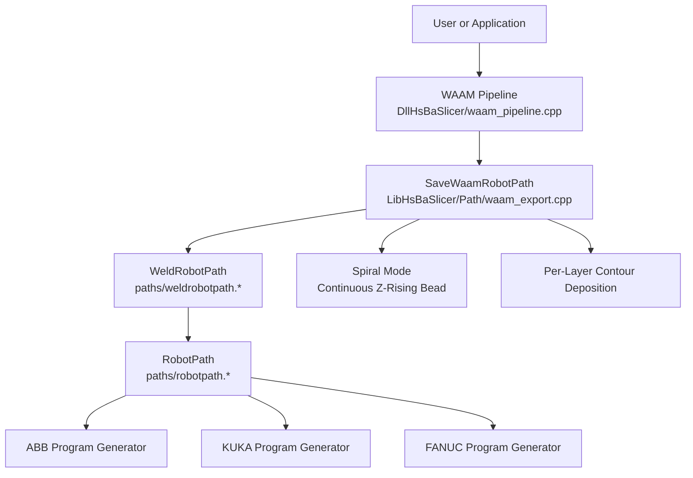
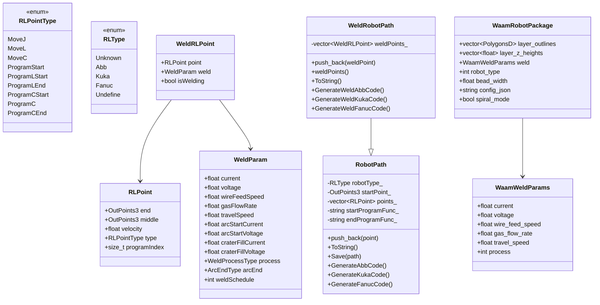
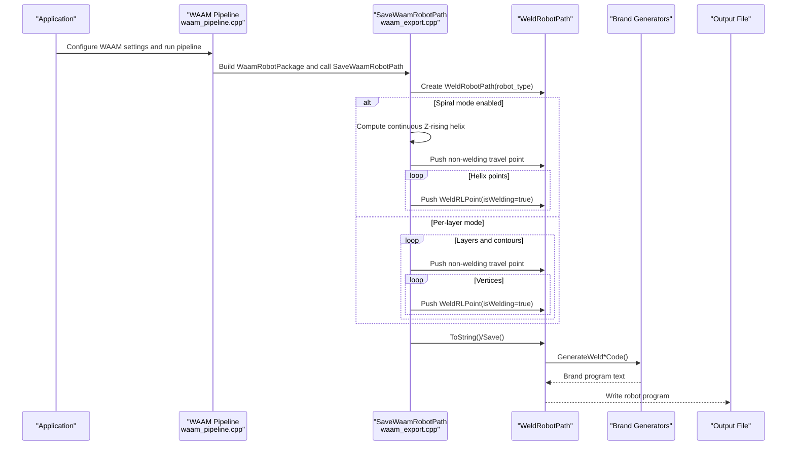
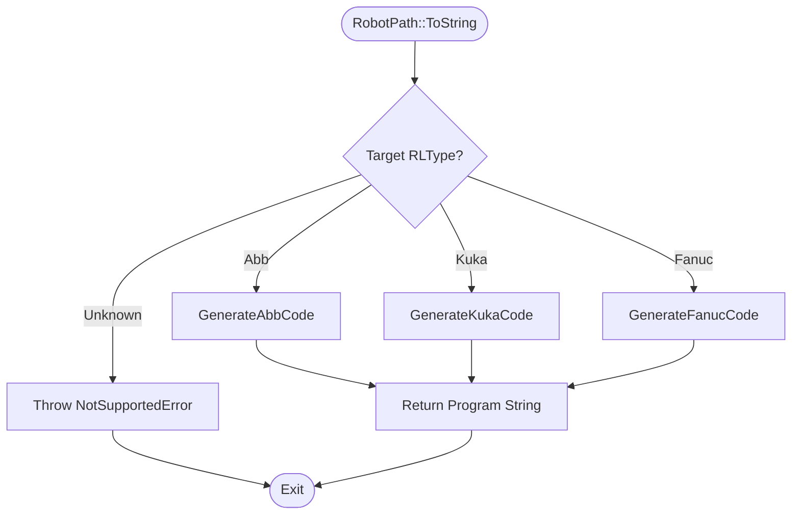
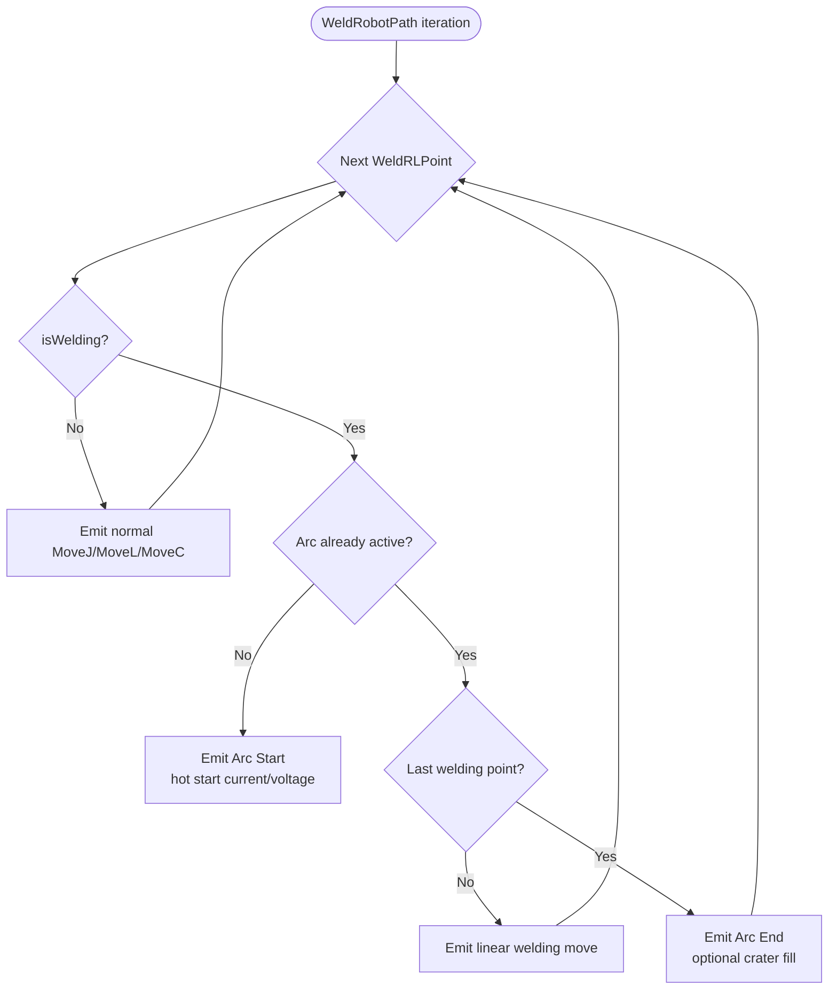
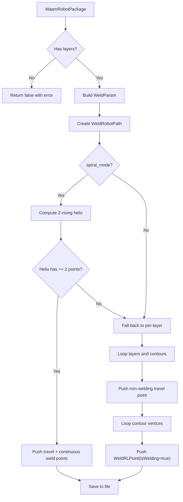
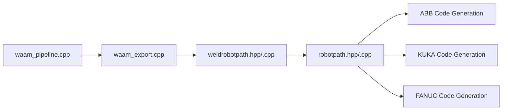

# Robot Path Output

<cite>
**Referenced Files in This Document**   
- [robotpath.hpp](file://paths/robotpath.hpp)
- [robotpath.cpp](file://paths/robotpath.cpp)
- [weldrobotpath.hpp](file://paths/weldrobotpath.hpp)
- [weldrobotpath.cpp](file://paths/weldrobotpath.cpp)
- [waam_export.hpp](file://LibHsBaSlicer/Path/waam_export.hpp)
- [waam_export.cpp](file://LibHsBaSlicer/Path/waam_export.cpp)
- [waam_pipeline.cpp](file://DllHsBaSlicer/waam_pipeline.cpp)
- [main.cpp](file://samples/WAAM/main.cpp)
- [my_waam_pipeline.lua](file://samples/Custom/scripts/my_waam_pipeline.lua)
</cite>

## Table of Contents
1. [Introduction](#introduction)
2. [Project Structure](#project-structure)
3. [Core Components](#core-components)
4. [Architecture Overview](#architecture-overview)
5. [Detailed Component Analysis](#detailed-component-analysis)
6. [Dependency Analysis](#dependency-analysis)
7. [Performance Considerations](#performance-considerations)
8. [Troubleshooting Guide](#troubleshooting-guide)
9. [Conclusion](#conclusion)
10. [Appendices](#appendices)

## Introduction
This document explains the robot path output system used by HsBaSlicer for industrial robotic platforms, with a focus on Wire Arc Additive Manufacturing (WAAM). It documents:

- The `RobotPath` base class that accumulates robot moves and emits brand-specific programs for ABB, KUKA, and FANUC.
- The `WeldRobotPath` specialization that adds welding parameters, arc start/end control, and crater handling.
- The WAAM export pipeline that converts sliced layer outlines into continuous or per-layer weld paths.
- Coordinate usage between slicing space and robot workspace.
- Tool orientation behavior in the current implementation.
- Concrete examples of generating robot programs for ABB, KUKA, and FANUC.
- Safety and process constraints relevant to robotic additive manufacturing.

The goal is to make this system understandable both to developers extending the codebase and to users integrating it with real welding robots.

## Project Structure
The robot path output system spans three main areas:

| Area | Responsibility | Key Files |
|---|---|---|
| Core robot path types | Base classes, point structures, motion types, and brand generators | [robotpath.hpp](file://paths/robotpath.hpp), [robotpath.cpp](file://paths/robotpath.cpp) |
| Welding extension | Welding parameters, arc control, and welding-aware program generation | [weldrobotpath.hpp](file://paths/weldrobotpath.hpp), [weldrobotpath.cpp](file://paths/weldrobotpath.cpp) |
| WAAM export integration | Converts sliced contours into robot programs, supports spiral mode and Lua post-processing | [waam_export.hpp](file://LibHsBaSlicer/Path/waam_export.hpp), [waam_export.cpp](file://LibHsBaSlicer/Path/waam_export.cpp) |
| Pipeline entry points | Connects configuration, slicing, and robot program export | [waam_pipeline.cpp](file://DllHsBaSlicer/waam_pipeline.cpp), [main.cpp](file://samples/WAAM/main.cpp), [my_waam_pipeline.lua](file://samples/Custom/scripts/my_waam_pipeline.lua) |

**Diagram sources**
- [waam_pipeline.cpp:232-258](file://DllHsBaSlicer/waam_pipeline.cpp#L232-L258)
- [waam_export.cpp:61-192](file://LibHsBaSlicer/Path/waam_export.cpp#L61-L192)
- [weldrobotpath.cpp:79-100](file://paths/weldrobotpath.cpp#L79-L100)
- [robotpath.cpp:91-113](file://paths/robotpath.cpp#L91-L113)

**Section sources**
- [robotpath.hpp:15-52](file://paths/robotpath.hpp#L15-L52)
- [weldrobotpath.hpp:16-57](file://paths/weldrobotpath.hpp#L16-L57)
- [waam_export.hpp:17-52](file://LibHsBaSlicer/Path/waam_export.hpp#L17-L52)
- [waam_export.cpp:61-192](file://LibHsBaSlicer/Path/waam_export.cpp#L61-L192)

## Core Components
The core components are:

| Component | Purpose | Important Fields / Methods |
|---|---|---|
| `RLPoint` | Represents one robot move with end position, optional middle/via position, velocity, motion type, and program block index | `end`, `middle`, `velocity`, `type`, `programIndex` |
| `RLPointType` | Enumerates joint, linear, circular, and program-block commands | `MoveJ`, `MoveL`, `MoveC`, `ProgramStart`, `ProgramLStart`, `ProgramLEnd`, etc. |
| `RLType` | Selects target robot language brand | `Unknown`, `Abb`, `Kuka`, `Fanuc`, `Undefine` |
| `RobotPath` | Accumulates `RLPoint` values and generates ABB/KUKA/FANUC programs; supports Lua-based post-processing | `push_back`, `ToString`, `Save`, `GenerateAbbCode`, `GenerateKukaCode`, `GenerateFanucCode` |
| `WeldParam` | Describes welding process settings for a segment | `current`, `voltage`, `wireFeedSpeed`, `gasFlowRate`, `travelSpeed`, `arcStartCurrent`, `arcStartVoltage`, `craterFillCurrent`, `craterFillVoltage`, `process`, `arcEnd`, `weldSchedule` |
| `WeldRLPoint` | Extends `RLPoint` with welding state and parameters | `point`, `weld`, `isWelding` |
| `WeldRobotPath` | Adds welding-aware program generation over `RobotPath` | `push_back(WeldRLPoint)`, `weldPoints`, `GenerateWeldAbbCode`, `GenerateWeldKukaCode`, `GenerateWeldFanucCode` |
| `WaamRobotPackage` | Input package for WAAM export | `layer_outlines`, `layer_z_heights`, `weld`, `robot_type`, `bead_width`, `config_json`, `spiral_mode` |
| `WaamWeldParams` | C ABI welding parameter subset | `current`, `voltage`, `wire_feed_speed`, `gas_flow_rate`, `travel_speed`, `process` |

**Diagram sources**
- [robotpath.hpp:15-104](file://paths/robotpath.hpp#L15-L104)
- [weldrobotpath.hpp:16-96](file://paths/weldrobotpath.hpp#L16-L96)
- [waam_export.hpp:17-52](file://LibHsBaSlicer/Path/waam_export.hpp#L17-L52)

**Section sources**
- [robotpath.hpp:15-104](file://paths/robotpath.hpp#L15-L104)
- [weldrobotpath.hpp:16-96](file://paths/weldrobotpath.hpp#L16-L96)
- [waam_export.hpp:17-52](file://LibHsBaSlicer/Path/waam_export.hpp#L17-L52)

## Architecture Overview
The WAAM robot program flow starts from a high-level pipeline configuration and ends with a brand-specific robot program file.

**Diagram sources**
- [waam_pipeline.cpp:232-258](file://DllHsBaSlicer/waam_pipeline.cpp#L232-L258)
- [waam_export.cpp:61-192](file://LibHsBaSlicer/Path/waam_export.cpp#L61-L192)
- [weldrobotpath.cpp:79-100](file://paths/weldrobotpath.cpp#L79-L100)

## Detailed Component Analysis

### RobotPath Base Class
`RobotPath` is the foundation for all robot program output. It stores:

- Target robot brand through `robotType_`.
- Initial robot position through `startPoint_`.
- A sequence of `RLPoint` moves.
- Optional program preamble and epilogue function names.

Key behaviors:

- `push_back` appends a robot point.
- `ToString` selects the brand generator based on `RLType`.
- `Save` writes the generated string to disk.
- Multiple `ToString`/`Save` overloads support inline Lua scripts or script files, allowing custom post-processing when built-in brand generators are insufficient.

Built-in brand generators:

- `GenerateAbbCode`: Emits ABB-style module, procedure, start point, `MOVEJ`/`MOVEL`/`MOVEC`, speed brackets, work object, and tool data references.
- `GenerateKukaCode`: Emits KRL-style `DEF main`, `LIN`, `CIRC`, and program comments.
- `GenerateFanucCode`: Emits FANUC TP-style lines, joint moves, and ARC placeholders.

**Diagram sources**
- [robotpath.cpp:91-113](file://paths/robotpath.cpp#L91-L113)
- [robotpath.cpp:227-305](file://paths/robotpath.cpp#L227-L305)
- [robotpath.cpp:308-355](file://paths/robotpath.cpp#L308-L355)
- [robotpath.cpp:358-404](file://paths/robotpath.cpp#L358-L404)

**Section sources**
- [robotpath.hpp:44-104](file://paths/robotpath.hpp#L44-L104)
- [robotpath.cpp:60-113](file://paths/robotpath.cpp#L60-L113)
- [robotpath.cpp:227-404](file://paths/robotpath.cpp#L227-L404)

### WeldRobotPath Specialization
`WeldRobotPath` extends `RobotPath` to support welding processes. It maintains:

- A separate list of `WeldRLPoint` objects.
- A flag `isWelding` indicating whether a point belongs to an active weld seam.
- Full welding parameters through `WeldParam`.

Important welding concepts:

- **Weld process**: MIG/MAG, TIG, Plasma, Laser.
- **Arc end handling**: Normal extinction, crater fill, or slow retract.
- **Arc start**: Uses hot-start current and voltage.
- **Crater fill**: Uses reduced current and voltage at the end of a weld segment.
- **Travel speed**: Controls torch movement during deposition.

The welding generators manage arc lifecycle:

- On the first welding point, they emit arc start commands.
- While welding continues, they emit linear deposition moves.
- At the last welding point, they emit arc end commands and optionally crater-fill commands.
- Non-welding points become normal robot movements.

**Diagram sources**
- [weldrobotpath.cpp:225-305](file://paths/weldrobotpath.cpp#L225-L305)
- [weldrobotpath.cpp:307-394](file://paths/weldrobotpath.cpp#L307-L394)
- [weldrobotpath.cpp:396-481](file://paths/weldrobotpath.cpp#L396-L481)

**Section sources**
- [weldrobotpath.hpp:16-96](file://paths/weldrobotpath.hpp#L16-L96)
- [weldrobotpath.cpp:54-100](file://paths/weldrobotpath.cpp#L54-L100)
- [weldrobotpath.cpp:196-223](file://paths/weldrobotpath.cpp#L196-L223)
- [weldrobotpath.cpp:225-481](file://paths/weldrobotpath.cpp#L225-L481)

### WAAM Export Pipeline
The WAAM export API converts sliced 2D contours into robot programs. Its responsibilities include:

- Validating input layers.
- Building a base `WeldParam` from `WaamWeldParams`.
- Creating a `WeldRobotPath` with the selected robot brand.
- Generating either a continuous spiral weld or per-layer contour welds.
- Writing the result using built-in generators or a Lua script.

Spiral mode behavior:

- When `spiral_mode` is true, the outer walls of all layers are merged into one continuous, Z-rising weld bead.
- The torch does not lift or restart the arc between layers.
- If no valid helix can be computed, the exporter falls back to standard per-layer deposition.

Per-layer mode behavior:

- For each layer and each contour, a rapid non-welding move positions the torch at the contour start.
- Each vertex becomes a welding point with `isWelding = true`.

**Diagram sources**
- [waam_export.cpp:61-192](file://LibHsBaSlicer/Path/waam_export.cpp#L61-L192)

**Section sources**
- [waam_export.hpp:33-72](file://LibHsBaSlicer/Path/waam_export.hpp#L33-L72)
- [waam_export.cpp:21-57](file://LibHsBaSlicer/Path/waam_export.cpp#L21-L57)
- [waam_export.cpp:61-192](file://LibHsBaSlicer/Path/waam_export.cpp#L61-L192)

### Coordinate Transformation Between Slicing Space and Robot Workspace
In the current implementation:

- Layer outlines come from 2D polygon processing and use 2D coordinates.
- The exporter assigns the layer Z height directly to each point.
- The resulting robot program contains X, Y, Z positions without explicit coordinate transformation matrices.
- There is no dedicated transform step between slicing space and robot workspace in the analyzed files.

Practical implication:

- Users should ensure that the CAD model, slicing origin, and robot workpiece frame are aligned before exporting.
- If the robot uses a different work coordinate system, the user may need to adjust the model placement or use a Lua post-processing script to apply offsets or transformations.

Recommended approach:

- Keep slicing units consistent with robot units (millimeters).
- Align the model so that its intended build origin matches the robot’s expected zero or work object.
- Use Lua scripts to add systematic offsets, rotations, or work-object mappings when needed.

[No sources needed since this section provides conceptual guidance derived from observed behavior]

### Tool Orientation Control
The current robot path types store only positional data:

- `RLPoint.end` and `RLPoint.middle` are 3D positions.
- No orientation fields such as roll, pitch, yaw, or tool vector are present.
- Built-in generators emit default orientations or placeholder angles.

Implications for WAAM:

- Torch orientation is not controlled by `RobotPath` or `WeldRobotPath`.
- For WAAM, proper torch angle relative to the deposited surface is critical for melt pool stability, penetration, and bead shape.
- Users must handle orientation externally:
  - By pre-transforming the model so the desired torch direction aligns with the global frame.
  - By writing a Lua script that computes and injects orientation data into the generated program.
  - By teaching or adjusting the robot program offline after export.

[No sources needed since this section provides conceptual guidance derived from observed behavior]

### Examples of Generating Robot Programs

#### ABB Example
The ABB generator produces:

- A module and procedure structure.
- A start point move.
- Joint, linear, and circular moves.
- Speed brackets containing velocity and controller limits.
- Work object and tool data references.

When welding is enabled, the welding generator emits arc start, continuous arc moves, and arc end commands with crater-fill parameters.

**Section sources**
- [robotpath.cpp:227-305](file://paths/robotpath.cpp#L227-L305)
- [weldrobotpath.cpp:225-305](file://paths/weldrobotpath.cpp#L225-L305)

#### KUKA Example
The KUKA generator produces:

- A `DEF main` procedure.
- Linear and circular moves.
- Program comments marking segment boundaries.
- Welding arc initialization, parameter setting, arc-on, and arc-off sequences.

**Section sources**
- [robotpath.cpp:308-355](file://paths/robotpath.cpp#L308-L355)
- [weldrobotpath.cpp:307-394](file://paths/weldrobotpath.cpp#L307-L394)

#### FANUC Example
The FANUC generator produces:

- A TP program header.
- Joint and linear moves.
- ARC placeholders and schedule-based arc control.
- Line numbering and comments suitable for FANUC teach pendant workflows.

**Section sources**
- [robotpath.cpp:358-404](file://paths/robotpath.cpp#L358-L404)
- [weldrobotpath.cpp:396-481](file://paths/weldrobotpath.cpp#L396-L481)

#### Lua Script Integration
Both `RobotPath` and `WeldRobotPath` support Lua-based customization:

- Inline scripts can access `points`, `startPoint`, `header`, and optional function names.
- Welding scripts receive `points` as welding points with `isWelding` and nested `weld` parameters.
- Scripts can return a string or set a global `result` variable.
- The WAAM sample shows how a Lua pipeline calls the save API with welding parameters and robot type.

**Section sources**
- [robotpath.cpp:115-225](file://paths/robotpath.cpp#L115-L225)
- [weldrobotpath.cpp:103-194](file://paths/weldrobotpath.cpp#L103-L194)
- [my_waam_pipeline.lua:62-93](file://samples/Custom/scripts/my_waam_pipeline.lua#L62-L93)

## Dependency Analysis
The following diagram shows how the WAAM pipeline depends on the export API, which in turn depends on the welding and base robot path classes.

**Diagram sources**
- [waam_pipeline.cpp:232-258](file://DllHsBaSlicer/waam_pipeline.cpp#L232-L258)
- [waam_export.cpp:61-192](file://LibHsBaSlicer/Path/waam_export.cpp#L61-L192)
- [weldrobotpath.cpp:79-100](file://paths/weldrobotpath.cpp#L79-L100)
- [robotpath.cpp:91-113](file://paths/robotpath.cpp#L91-L113)

**Section sources**
- [waam_pipeline.cpp:232-258](file://DllHsBaSlicer/waam_pipeline.cpp#L232-L258)
- [waam_export.cpp:61-192](file://LibHsBaSlicer/Path/waam_export.cpp#L61-L192)
- [weldrobotpath.cpp:79-100](file://paths/weldrobotpath.cpp#L79-L100)
- [robotpath.cpp:91-113](file://paths/robotpath.cpp#L91-L113)

## Performance Considerations
For industrial robotic additive manufacturing, performance and efficiency should be considered at several levels:

| Area | Current Behavior | Optimization Guidance |
|---|---|---|
| Path continuity | Spiral mode creates one continuous weld bead across layers. | Prefer spiral mode for tall, single-wall parts to reduce arc restarts and travel time. |
| Movement types | Default deposition uses linear moves. | Use circular moves only where geometry requires them; avoid unnecessary via points. |
| Velocity | Default velocity is defined as a constant; welding travel speed comes from `WeldParam`. | Tune travel speed to match material, wire feed, and heat input requirements. |
| Program size | Built-in generators produce straightforward programs. | Use Lua scripts to remove redundant points, merge short segments, or optimize dwell times. |
| Multi-axis motion | Pointers store positions; orientation is not modeled. | Precompute smooth multi-axis trajectories if required by the application. |
| Error handling | Missing layers or unsupported robot types raise errors or fall back. | Validate inputs early and provide meaningful error messages. |

[No sources needed since this section provides general guidance]

## Troubleshooting Guide

| Problem | Likely Cause | Resolution |
|---|---|---|
| Export fails because there are no layers | `layer_outlines` is empty. | Ensure slicing produced at least one layer before calling the export API. |
| Unsupported robot type | `RLType::Unknown` or undefined value. | Provide a supported robot type or supply a Lua script for custom generation. |
| Lua script load or runtime error | Invalid Lua syntax or missing globals. | Check script content and ensure it returns a string or sets `result`. |
| Generated program has incorrect positions | Model origin or workpiece frame mismatch. | Align the CAD model with the robot workspace or apply offsets in a Lua script. |
| Poor weld quality due to torch angle | Tool orientation is not controlled by path types. | Adjust model orientation or extend the exporter to compute and emit orientation data. |
| Spiral mode does not create a continuous bead | No closed outer contours or degenerate helix. | Verify that each layer has at least one closed contour; otherwise the exporter falls back to per-layer mode. |

**Section sources**
- [waam_export.cpp:67-75](file://LibHsBaSlicer/Path/waam_export.cpp#L67-L75)
- [waam_export.cpp:85-130](file://LibHsBaSlicer/Path/waam_export.cpp#L85-L130)
- [robotpath.cpp:115-225](file://paths/robotpath.cpp#L115-L225)
- [weldrobotpath.cpp:103-194](file://paths/weldrobotpath.cpp#L103-L194)

## Conclusion
HsBaSlicer’s robot path output system provides a clear separation between geometric path accumulation and brand-specific program generation. `RobotPath` handles generic industrial robot moves, while `WeldRobotPath` adds welding semantics such as arc start/end, crater handling, and process parameters. The WAAM export pipeline bridges sliced layer outlines to robot programs, supporting both continuous spiral deposition and per-layer contour deposition.

For production use, users should:

- Align slicing coordinates with the robot workspace.
- Treat tool orientation as external to the current path types.
- Tune welding parameters for material, geometry, and thermal requirements.
- Use Lua scripts for advanced customization, safety checks, and manufacturer-specific extensions.
- Validate inputs and review generated programs before running on physical equipment.

[No sources needed since this section summarizes without analyzing specific files]

## Appendices

### Appendix A: WAAM Configuration and Sample Usage
The WAAM pipeline configuration includes welding parameters, robot type, spiral mode, and output path. The sample demonstrates enabling spiral mode to generate a continuous rising weld bead.

**Section sources**
- [waam_pipeline.cpp:232-258](file://DllHsBaSlicer/waam_pipeline.cpp#L232-L258)
- [main.cpp:186-216](file://samples/WAAM/main.cpp#L186-L216)
- [my_waam_pipeline.lua:62-93](file://samples/Custom/scripts/my_waam_pipeline.lua#L62-L93)

### Appendix B: Safety Constraints for Robotic Additive Manufacturing
Although not fully implemented in the analyzed path classes, safe WAAM operation should consider:

- Arc ignition and extinguishing only at approved locations.
- Gas flow interlocks and shielding gas availability.
- Wire feed synchronization with travel speed.
- Thermal limits, interpass temperature control, and cooling intervals.
- Collision avoidance and reachability validation.
- Emergency stop handling and safe retraction.
- Verification of workpiece fixturing and grounding.

These constraints should be enforced at the pipeline, controller, or cell level, and can be partially addressed through Lua scripts and offline verification tools.

[No sources needed since this section provides general safety guidance]