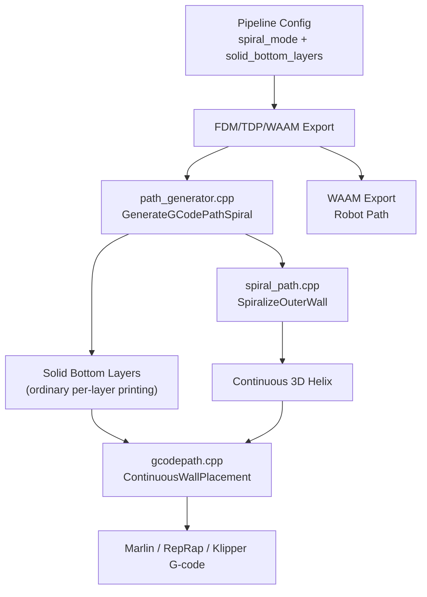
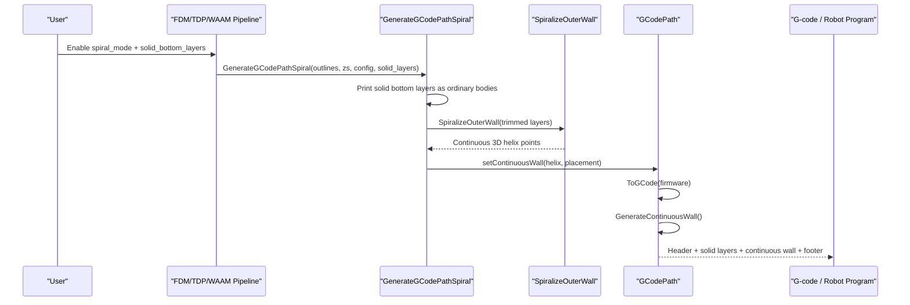
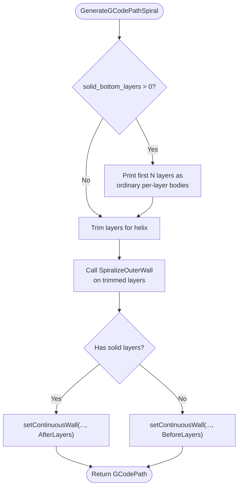
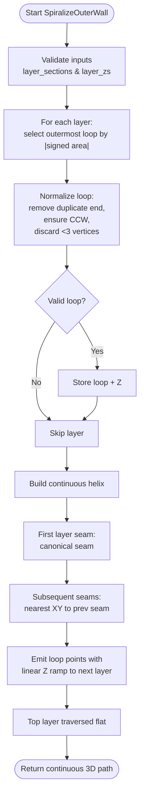
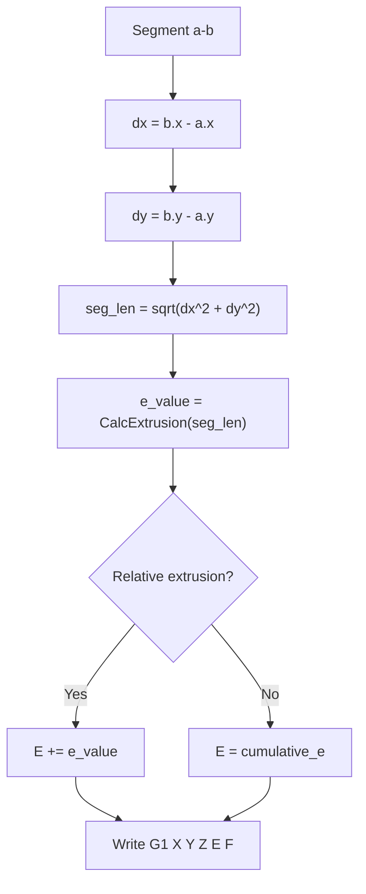
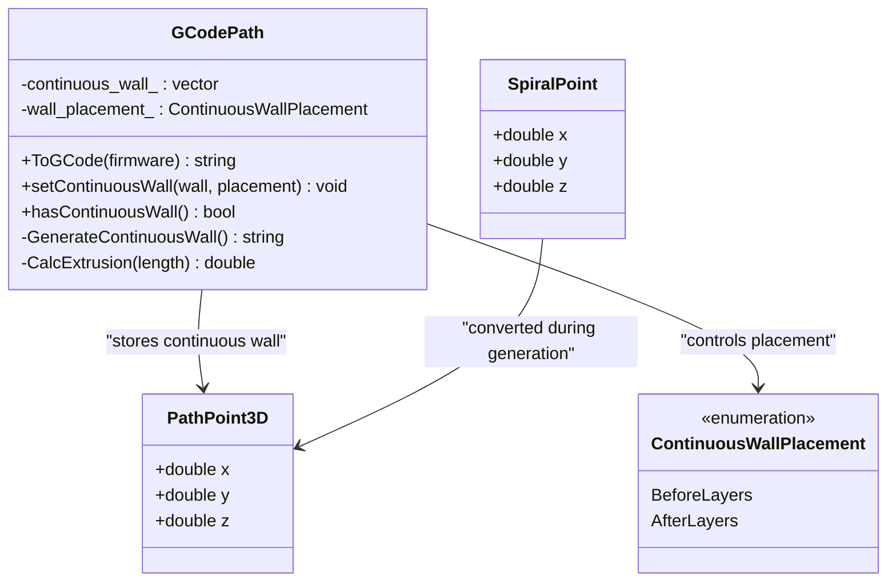
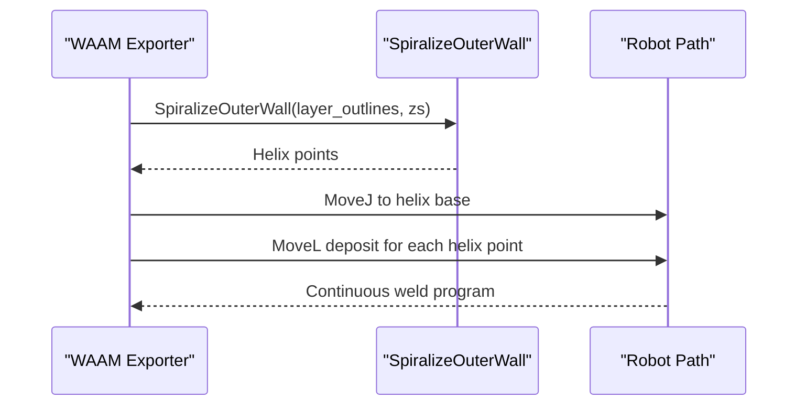
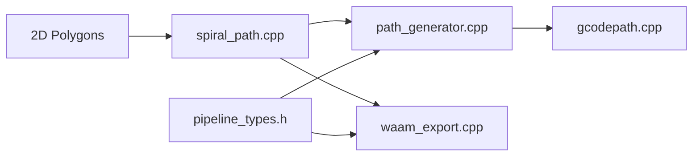

# Spiral/Vase Mode Support

<cite>
**Referenced Files in This Document**
- [spiral_path.hpp](file://LibHsBaSlicer/Path/spiral_path.hpp)
- [spiral_path.cpp](file://LibHsBaSlicer/Path/spiral_path.cpp)
- [path_generator.hpp](file://LibHsBaSlicer/Path/path_generator.hpp)
- [path_generator.cpp](file://LibHsBaSlicer/Path/path_generator.cpp)
- [gcodepath.hpp](file://paths/gcodepath.hpp)
- [gcodepath.cpp](file://paths/gcodepath.cpp)
- [waam_export.cpp](file://LibHsBaSlicer/Path/waam_export.cpp)
- [pipeline_types.h](file://pipelinetypes/pipeline_types.h)
- [spiral_path_test.cpp](file://tests/SpiralPath/spiral_path_test.cpp)
- [path_generator_test.cpp](file://tests/PathsOut/path_generator_test.cpp)
</cite>

## Update Summary
**Changes Made**
- Updated G-code path generation to support solid bottom layers while spiraling walls
- Added new parameter `solid_bottom_layers` to control base layer printing
- Enhanced continuous wall placement logic to handle mixed solid/helix output
- Improved documentation to reflect solid base functionality and open-bottom artifact prevention

## Table of Contents
1. [Introduction](#introduction)
2. [Project Structure](#project-structure)
3. [Core Components](#core-components)
4. [Architecture Overview](#architecture-overview)
5. [Detailed Component Analysis](#detailed-component-analysis)
6. [Dependency Analysis](#dependency-analysis)
7. [Performance Considerations](#performance-considerations)
8. [Troubleshooting Guide](#troubleshooting-guide)
9. [Conclusion](#conclusion)

## Introduction
This document explains the spiral and vase mode path generation implemented in HsBaSlicer. It focuses on how per-layer outer contours are merged into one continuous, Z-rising helical wall, how G-code is generated without retractions between layers, and how the feature integrates with FDM, TDP, and WAAM pipelines. The system now supports **solid bottom layers** while maintaining spiral walls, preventing open-bottom artifacts by printing the first N layers as ordinary per-layer bodies before starting the continuous helix. It also documents the mathematical behavior of the spiral algorithm, practical configuration for enabling vase mode, handling complex geometries, and troubleshooting extrusion issues at layer transitions.

## Project Structure
The spiral/vase feature spans several modules:

- `LibHsBaSlicer/Path/spiral_path.{hpp,cpp}`: Core spiralization algorithm that converts per-layer 2D outlines into a continuous 3D polyline.
- `LibHsBaSlicer/Path/path_generator.{hpp,cpp}`: Public API that exposes `GenerateGCodePathSpiral`, bridging spiralized geometry to G-code output with solid bottom layer support.
- `paths/gcodepath.{hpp,cpp}`: Multi-firmware G-code writer that emits continuous walls with flexible placement relative to per-layer data.
- `LibHsBaSlicer/Path/waam_export.cpp`: Robot/WAAM export branch that uses the same spiralizer when `spiral_mode` is enabled.
- `pipelinetypes/pipeline_types.h`: Pipeline configuration structures exposing `spiral_mode` for FDM, TDP, and WAAM.
- Tests under `tests/SpiralPath` and `tests/PathsOut` validate spiral behavior and G-code integration.

**Diagram sources**
- [pipeline_types.h:138-140](file://pipelinetypes/pipeline_types.h#L138-L140)
- [path_generator.cpp:153-208](file://LibHsBaSlicer/Path/path_generator.cpp#L153-L208)
- [spiral_path.cpp:88-163](file://LibHsBaSlicer/Path/spiral_path.cpp#L88-L163)
- [gcodepath.cpp:370-413](file://paths/gcodepath.cpp#L370-L413)
- [waam_export.cpp:82-127](file://LibHsBaSlicer/Path/waam_export.cpp#L82-L127)

**Section sources**
- [spiral_path.hpp:16-58](file://LibHsBaSlicer/Path/spiral_path.hpp#L16-L58)
- [path_generator.hpp:64-95](file://LibHsBaSlicer/Path/path_generator.hpp#L64-L95)
- [gcodepath.hpp:79-87](file://paths/gcodepath.hpp#L79-L87)
- [pipeline_types.h:138-140](file://pipelinetypes/pipeline_types.h#L138-L140)

## Core Components
- `SpiralPoint`: Represents a point on the continuous 3D deposition path, carrying X/Y planar coordinates and an absolute Z build height. Unlike per-layer paths, each point has its own Z so the wall rises continuously.
- `SpiralizeOuterWall`: Builds the continuous helical outer-wall path from per-layer closed contours. It selects the outermost loop per layer, aligns seams across layers, and linearly interpolates Z over one revolution per layer.
- `GenerateGCodePathSpiral`: Public API that calls `SpiralizeOuterWall` and stores the result as a continuous wall inside a `GCodePath`. **Updated** to support solid bottom layers by printing the first N layers as ordinary per-layer bodies before starting the helix.
- `GCodePath::GenerateContinuousWall`: Emits the continuous wall as one unbroken extrusion line, moving rapidly to the base then printing every segment with incremental or cumulative E values depending on firmware/extrusion mode.
- `GCodePath::ToGCode`: Writes header, continuous wall (if present), per-layer polygon data, and footer. In pure vase mode, only the continuous wall is emitted. **Updated** to support flexible wall placement via `ContinuousWallPlacement` enum.
- `ContinuousWallPlacement`: Enum defining whether the continuous wall should be placed before or after per-layer data, crucial for models with solid bottom layers.
- `spiral_mode` pipeline fields: FDM, TDP, and WAAM configurations expose `spiral_mode` to enable this behavior at the pipeline level.

**Section sources**
- [spiral_path.hpp:16-58](file://LibHsBaSlicer/Path/spiral_path.hpp#L16-L58)
- [path_generator.cpp:153-208](file://LibHsBaSlicer/Path/path_generator.cpp#L153-L208)
- [gcodepath.cpp:329-368](file://paths/gcodepath.cpp#L329-L368)
- [gcodepath.hpp:79-87](file://paths/gcodepath.hpp#L79-L87)
- [pipeline_types.h:138-140](file://pipelinetypes/pipeline_types.h#L138-L140)

## Architecture Overview
The spiral/vase workflow connects slicing outputs to G-code or robot code through a shared spiralizer, now enhanced with solid bottom layer support:

**Diagram sources**
- [path_generator.cpp:153-208](file://LibHsBaSlicer/Path/path_generator.cpp#L153-L208)
- [spiral_path.cpp:88-163](file://LibHsBaSlicer/Path/spiral_path.cpp#L88-L163)
- [gcodepath.cpp:370-413](file://paths/gcodepath.cpp#L370-L413)

## Detailed Component Analysis

### Solid Bottom Layer Support
The enhanced `GenerateGCodePathSpiral` function now supports printing solid bottom layers before starting the spiral wall:

1. **Solid layer processing**: The first `solid_bottom_layers` layers are printed as ordinary per-layer bodies with both outlines and fills.
2. **Helix trimming**: Only layers above the solid base are passed to `SpiralizeOuterWall`.
3. **Smart placement**: When solid layers exist, the continuous wall is placed after them (`AfterLayers`) to ensure proper deposition order.
4. **Pure vase mode**: With zero solid layers, the behavior remains identical to previous versions (pure helix output).

**Diagram sources**
- [path_generator.cpp:153-208](file://LibHsBaSlicer/Path/path_generator.cpp#L153-L208)

**Section sources**
- [path_generator.cpp:153-208](file://LibHsBaSlicer/Path/path_generator.cpp#L153-L208)

### Spiral Path Algorithm
The core algorithm performs these steps:

1. **Select outermost loop per layer**: For each layer's polygons, compute twice the signed area using the shoelace formula; choose the polygon with the largest absolute area.
2. **Normalize loops**: Remove duplicate closing vertices, ensure counter-clockwise winding, and discard invalid loops with fewer than three distinct vertices.
3. **Seam alignment**: For the first layer, pick a canonical seam vertex (lowest Y, then lowest X). For subsequent layers, pick the vertex closest in XY to the previous seam.
4. **Z interpolation**: For each layer loop, emit points around the perimeter while linearly ramping Z from the current layer's height to the next layer's height. The final layer is traversed flat at its own height.
5. **Continuity guarantee**: Emitting m+1 points per loop ensures the last point closes back onto the seam at the next layer's start, producing an unbroken path.

**Diagram sources**
- [spiral_path.cpp:16-85](file://LibHsBaSlicer/Path/spiral_path.cpp#L16-L85)
- [spiral_path.cpp:88-163](file://LibHsBaSlicer/Path/spiral_path.cpp#L88-L163)

**Section sources**
- [spiral_path.cpp:16-85](file://LibHsBaSlicer/Path/spiral_path.cpp#L16-L85)
- [spiral_path.cpp:88-163](file://LibHsBaSlicer/Path/spiral_path.cpp#L88-L163)

### Mathematical Principles
- **Signed area**: Uses the shoelace sum to determine orientation and magnitude. Positive indicates counter-clockwise winding.
- **Seam selection**: Canonical seam chooses the lexicographically smallest vertex by Y then X for deterministic starting position. Nearest-seam alignment minimizes XY jumps between layers.
- **Z interpolation**: For each loop index k from 0 to m, Z is computed as `z_start + (z_end - z_start) * (k/m)`. This yields exactly one layer rise per revolution.
- **Extrusion calculation**: Segment length is Euclidean distance between consecutive points; extrusion is derived from nozzle diameter, filament diameter, line width, and extrusion multiplier via `CalcExtrusion`.

**Diagram sources**
- [gcodepath.cpp:329-368](file://paths/gcodepath.cpp#L329-L368)

**Section sources**
- [spiral_path.cpp:16-85](file://LibHsBaSlicer/Path/spiral_path.cpp#L16-L85)
- [gcodepath.cpp:329-368](file://paths/gcodepath.cpp#L329-L368)

### G-code Integration for Continuous Wall Output
`GenerateGCodePathSpiral` creates a `GCodePath`, computes the helix via `SpiralizeOuterWall`, and sets it as the continuous wall with appropriate placement. When `ToGCode` is called:

- Header is written based on target firmware.
- If a continuous wall exists, `GenerateContinuousWall` emits a rapid move to the base, then prints every segment without travel/retraction between points.
- Per-layer polygon data follows (empty in pure vase mode, or contains solid bottom layers when configured).
- Footer is appended.
- **Updated**: Wall placement is controlled by `ContinuousWallPlacement` enum to ensure correct deposition order.

**Diagram sources**
- [gcodepath.hpp:51-160](file://paths/gcodepath.hpp#L51-L160)
- [gcodepath.cpp:370-413](file://paths/gcodepath.cpp#L370-L413)
- [path_generator.cpp:153-208](file://LibHsBaSlicer/Path/path_generator.cpp#L153-L208)

**Section sources**
- [path_generator.cpp:153-208](file://LibHsBaSlicer/Path/path_generator.cpp#L153-L208)
- [gcodepath.cpp:370-413](file://paths/gcodepath.cpp#L370-L413)

### WAAM Integration
When `spiral_mode` is enabled in WAAM, the exporter calls `SpiralizeOuterWall` and generates a single continuous weld bead. It emits a non-welding MoveJ to the helix base, then deposits every subsequent point as a welding MoveL without lifting or arc interruption between layers.

**Diagram sources**
- [waam_export.cpp:82-127](file://LibHsBaSlicer/Path/waam_export.cpp#L82-L127)

**Section sources**
- [waam_export.cpp:82-127](file://LibHsBaSlicer/Path/waam_export.cpp#L82-L127)

### Enabling Vase Mode and Configuring Parameters
- **FDM**: Set `spiral_mode` to 1 in `HsBaFdmPipelineConfig_t`. Use `solid_bottom_layers` parameter in `GenerateGCodePathSpiral` to control base layer printing. When enabled, the outer wall is emitted as one extrusion-continuous helix and per-layer infill/support are skipped.
- **TDP**: Set `spiral_mode` to 1 in `HsBaTdpPipelineConfig_t`.
- **WAAM**: Set `spiral_mode` to 1 in `HsBaWaamPipelineConfig_t`.

Relevant defaults initialize `spiral_mode` to 0 across all pipeline types.

**Section sources**
- [pipeline_types.h:138-140](file://pipelinetypes/pipeline_types.h#L138-L140)
- [pipeline_types.h:587-589](file://pipelinetypes/pipeline_types.h#L587-L589)
- [pipeline_types.h:701-703](file://pipelinetypes/pipeline_types.h#L701-L703)
- [pipeline_types.h:892](file://pipelinetypes/pipeline_types.h#L892)
- [pipeline_types.h:1061](file://pipelinetypes/pipeline_types.h#L1061)
- [pipeline_types.h:1095](file://pipelinetypes/pipeline_types.h#L1095)

### Handling Complex Geometries in Vase Mode
- The algorithm selects the outermost closed contour per layer; layers without valid closed contours are skipped.
- For varying cross-sections, seam alignment still produces a connected path, but geometric fidelity depends on consistent outer-loop topology.
- Models with holes, islands, or disconnected shells may produce unexpected seam alignments if inner loops are selected instead of the true outer boundary. Ensure slicing produces a clear outermost loop per layer.
- **Updated**: With solid bottom layers, the first N layers provide structural integrity while the remaining layers form the continuous spiral wall.

**Section sources**
- [spiral_path.cpp:98-130](file://LibHsBaSlicer/Path/spiral_path.cpp#L98-L130)
- [path_generator.cpp:153-208](file://LibHsBaSlicer/Path/path_generator.cpp#L153-L208)

### Troubleshooting Common Issues
- **Over-extrusion at layer transitions**: Increase print speed or reduce extrusion multiplier. Verify `line_width`, `nozzle_diameter`, and `filament_diameter` in `GCodePrinterConfig`.
- **Under-extrusion at layer transitions**: Reduce print speed or increase extrusion multiplier. Confirm relative vs absolute extrusion settings (`relative_extrusion`) match firmware expectations.
- **Stair-stepping or visible seams**: Ensure model geometry provides smooth outer loops; avoid sharp discontinuities in the outer boundary. Adjust layer height to balance resolution and transition smoothness.
- **Empty or degenerate spiral**: Validate that each layer contains at least one valid closed polygon with sufficient vertices. Check input `layer_sections` and `layer_zs` sizes.
- **Open bottom artifacts**: Use `solid_bottom_layers` parameter in `GenerateGCodePathSpiral` to print the first N layers as ordinary per-layer bodies, preventing open-bottom artifacts in vase mode.
- **Incorrect wall placement**: Ensure `ContinuousWallPlacement` is set correctly. Use `AfterLayers` when solid bottom layers exist to ensure proper deposition order.

**Section sources**
- [gcodepath.cpp:329-368](file://paths/gcodepath.cpp#L329-L368)
- [gcodepath.hpp:33-50](file://paths/gcodepath.hpp#L33-L50)
- [spiral_path.cpp:98-130](file://LibHsBaSlicer/Path/spiral_path.cpp#L98-L130)
- [path_generator.cpp:153-208](file://LibHsBaSlicer/Path/path_generator.cpp#L153-L208)

## Dependency Analysis
The spiral/vase feature has clear dependencies:

- `spiral_path.cpp` depends on 2D polygon utilities (`PolygonD`, `PolygonsD`).
- `path_generator.cpp` depends on `spiral_path.hpp` and `gcodepath.hpp`.
- `gcodepath.cpp` depends on printer configuration and firmware-specific formatting.
- `waam_export.cpp` depends on `spiral_path.hpp` and robot path structures.
- Pipeline configs in `pipeline_types.h` expose `spiral_mode` to higher-level integrators.

**Diagram sources**
- [spiral_path.cpp:1-10](file://LibHsBaSlicer/Path/spiral_path.cpp#L1-L10)
- [path_generator.cpp:1-15](file://LibHsBaSlicer/Path/path_generator.cpp#L1-L15)
- [gcodepath.cpp:1-19](file://paths/gcodepath.cpp#L1-L19)
- [waam_export.cpp:1-10](file://LibHsBaSlicer/Path/waam_export.cpp#L1-L10)
- [pipeline_types.h:138-140](file://pipelinetypes/pipeline_types.h#L138-L140)

**Section sources**
- [spiral_path.cpp:1-10](file://LibHsBaSlicer/Path/spiral_path.cpp#L1-L10)
- [path_generator.cpp:1-15](file://LibHsBaSlicer/Path/path_generator.cpp#L1-L15)
- [gcodepath.cpp:1-19](file://paths/gcodepath.cpp#L1-L19)
- [waam_export.cpp:1-10](file://LibHsBaSlicer/Path/waam_export.cpp#L1-L10)
- [pipeline_types.h:138-140](file://pipelinetypes/pipeline_types.h#L138-L140)

## Performance Considerations
- **Large vase models**: The continuous wall can contain many points proportional to total perimeter across layers. Memory usage scales with the number of vertices in outer loops.
- **Computation cost**: Outer-loop selection is O(n_layers × n_polygons_per_layer); seam alignment is O(m) per layer where m is loop size; Z interpolation is O(total vertices).
- **Solid layer overhead**: Printing solid bottom layers adds computational overhead proportional to the number of solid layers, but this is typically minimal compared to the spiral wall generation.
- **Optimization opportunities**:
  - Pre-reserve vectors for helix points to avoid reallocations.
  - Skip layers with no valid outer loops early.
  - Use efficient nearest-seam search; current implementation is linear per layer, acceptable for typical perimeters.
- **I/O and G-code size**: Continuous walls generate large G-code files due to many G1 commands. Firmware buffering and streaming may be required for very tall models.

## Troubleshooting Guide
- **Enable vase mode**:
  - FDM: Set `spiral_mode = 1` in `HsBaFdmPipelineConfig_t`.
  - TDP: Set `spiral_mode = 1` in `HsBaTdpPipelineConfig_t`.
  - WAAM: Set `spiral_mode = 1` in `HsBaWaamPipelineConfig_t`.
- **Configure solid bottom layers**: Use `solid_bottom_layers` parameter in `GenerateGCodePathSpiral` to prevent open-bottom artifacts. Typical values range from 1-3 layers depending on model requirements.
- **Verify inputs**: Ensure `layer_outlines` and `layer_zs` have matching sizes and contain valid outer loops.
- **Check extrusion parameters**: Tune `line_width`, `nozzle_diameter`, `filament_diameter`, and `extrusion_multiplier` in `GCodePrinterConfig`.
- **Validate G-code**: Inspect generated G-code for continuous Z ramps and absence of travel/retraction between wall segments. Verify correct wall placement relative to solid layers.
- **Test with simple geometry**: Start with prismatic shapes (e.g., cylinders or squares) to confirm baseline behavior before testing complex models.

**Section sources**
- [pipeline_types.h:138-140](file://pipelinetypes/pipeline_types.h#L138-L140)
- [pipeline_types.h:587-589](file://pipelinetypes/pipeline_types.h#L587-L589)
- [pipeline_types.h:701-703](file://pipelinetypes/pipeline_types.h#L701-L703)
- [gcodepath.hpp:33-50](file://paths/gcodepath.hpp#L33-L50)
- [spiral_path_test.cpp:43-49](file://tests/SpiralPath/spiral_path_test.cpp#L43-L49)
- [path_generator_test.cpp:108-119](file://tests/PathsOut/path_generator_test.cpp#L108-L119)

## Conclusion
HsBaSlicer's spiral/vase mode provides a robust, mathematically grounded approach to generating continuous helical walls. By selecting outermost loops, aligning seams, and interpolating Z linearly per revolution, it produces unbroken extrusion paths suitable for FDM, TDP, and WAAM. The enhanced system now supports **solid bottom layers** while maintaining spiral walls, effectively preventing open-bottom artifacts by printing the first N layers as ordinary per-layer bodies before starting the continuous helix. Configuration is straightforward via `spiral_mode`, and G-code integration ensures firmware-compatible output with flexible wall placement. For best results, validate geometry, tune extrusion parameters, configure appropriate solid bottom layers, and consider performance implications for large models.