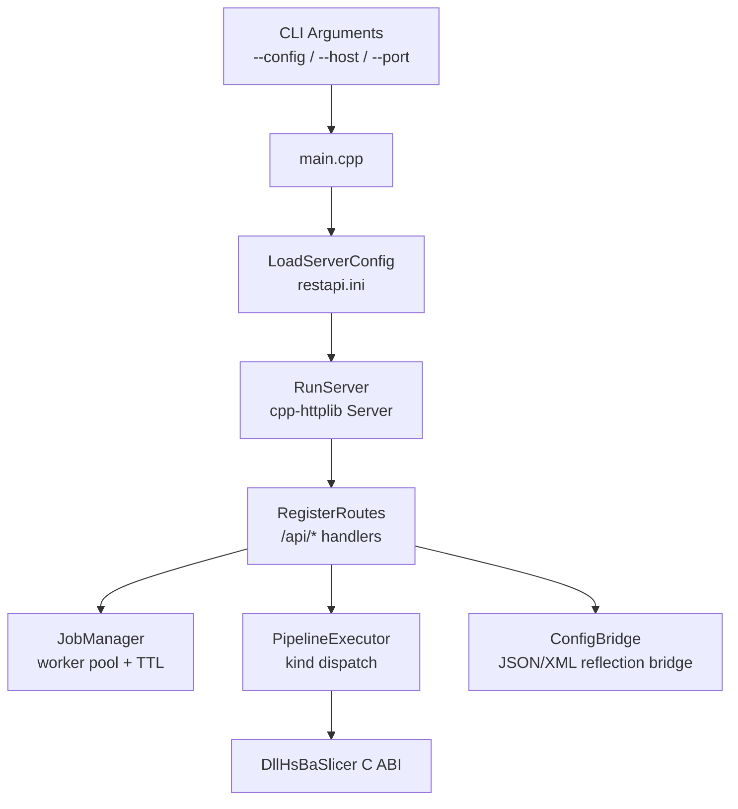
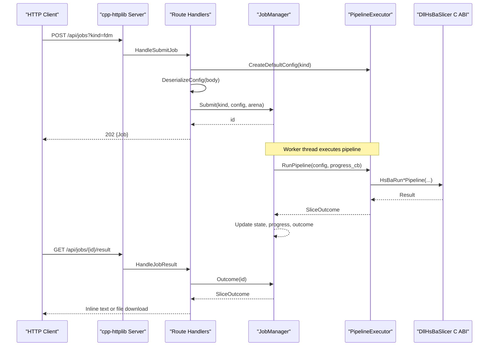
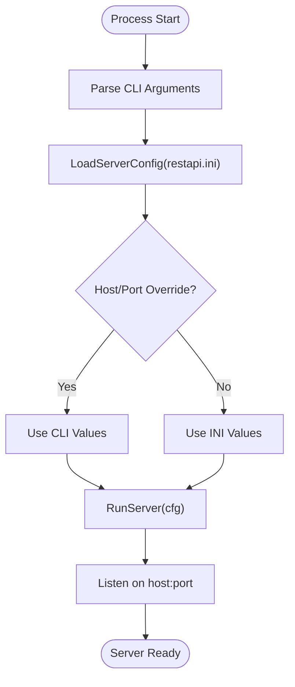
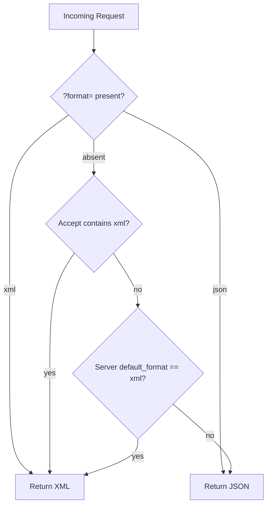
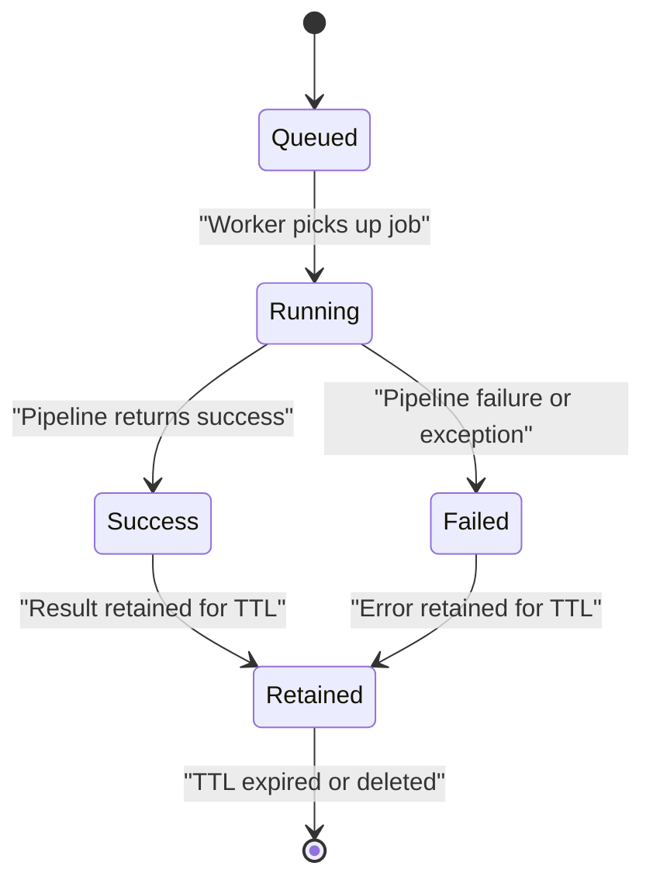
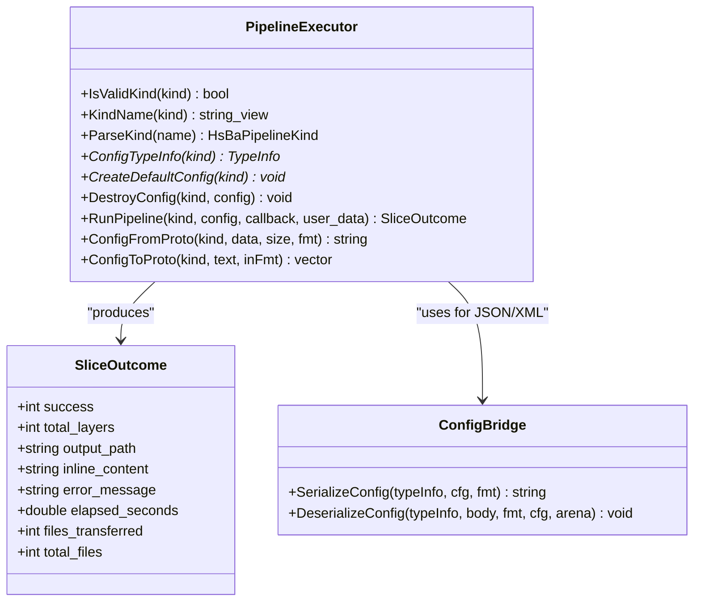
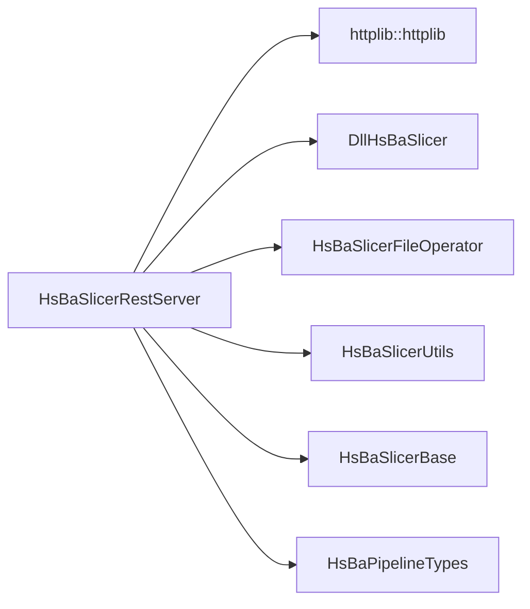

# REST API Server

<cite>
**Referenced Files in This Document**
- [CMakeLists.txt](file://restapi/CMakeLists.txt)
- [main.cpp](file://restapi/main.cpp)
- [routes.cpp](file://restapi/routes.cpp)
- [job_manager.hpp](file://restapi/job_manager.hpp)
- [job_manager.cpp](file://restapi/job_manager.cpp)
- [pipeline_executor.hpp](file://restapi/pipeline_executor.hpp)
- [pipeline_executor.cpp](file://restapi/pipeline_executor.cpp)
- [config_bridge.hpp](file://restapi/config_bridge.hpp)
- [config_bridge.cpp](file://restapi/config_bridge.cpp)
- [server_config.hpp](file://restapi/server_config.hpp)
- [server_config.cpp](file://restapi/server_config.cpp)
- [content_negotiate.hpp](file://restapi/content_negotiate.hpp)
- [content_negotiate.cpp](file://restapi/content_negotiate.cpp)
- [serialize_value.hpp](file://restapi/serialize_value.hpp)
- [restapi.ini](file://restapi/restapi.ini)
</cite>

## Table of Contents
1. [Introduction](#introduction)
2. [Project Structure](#project-structure)
3. [Core Components](#core-components)
4. [Architecture Overview](#architecture-overview)
5. [Detailed Component Analysis](#detailed-component-analysis)
6. [Dependency Analysis](#dependency-analysis)
7. [Performance Considerations](#performance-considerations)
8. [Troubleshooting Guide](#troubleshooting-guide)
9. [Conclusion](#conclusion)
10. [Appendices](#appendices)

## Introduction
This document describes the optional `HsBaSlicerRestServer` process, a desktop-only RESTful HTTP service that exposes HsBaSlicer slicing pipelines over HTTP. It is built behind the `HSBA_BUILD_REST_API` CMake option and depends on the cpp-httplib package exposed as `httplib::httplib`. The server:

- Parses command-line arguments and loads runtime settings from `restapi.ini`.
- Registers HTTP routes under `/api/*`.
- Supports JSON and XML responses with content negotiation.
- Exposes synchronous metadata/configuration endpoints and an asynchronous job queue for pipeline execution.
- Bridges to `DllHsBaSlicer` through its C ABI for configuration creation, pipeline execution, result handling, and parameter persistence.

The implementation is intentionally layered: HTTP routing is separate from job scheduling, which is separate from pipeline execution, which is separate from configuration serialization. This keeps the REST layer thin and reusable across different transport or deployment models.

## Project Structure
The REST API lives under `restapi/`. The build target is `HsBaSlicerRestServer`, linked against cpp-httplib, `DllHsBaSlicer`, utility libraries, and pipeline type definitions. A default `restapi.ini` is copied next to the executable at build time so the server can start without explicit configuration.

**Diagram sources**
- [main.cpp:27-83](file://restapi/main.cpp#L27-L83)
- [routes.cpp:441-530](file://restapi/routes.cpp#L441-L530)
- [job_manager.hpp:85-159](file://restapi/job_manager.hpp#L85-L159)
- [pipeline_executor.hpp:20-85](file://restapi/pipeline_executor.hpp#L20-L85)
- [config_bridge.hpp:26-51](file://restapi/config_bridge.hpp#L26-L51)
- [server_config.hpp:21-51](file://restapi/server_config.hpp#L21-L51)

**Section sources**
- [CMakeLists.txt:1-66](file://restapi/CMakeLists.txt#L1-L66)
- [main.cpp:1-84](file://restapi/main.cpp#L1-L84)
- [restapi.ini:1-50](file://restapi/restapi.ini#L1-L50)

## Core Components
The REST server is composed of six core components:

| Component | Responsibility | Key Interfaces |
|---|---|---|
| Entry point | Parse arguments, load config, start server | `main`, `RunServer` |
| Route layer | Register HTTP endpoints and translate requests into domain calls | `RegisterRoutes`, handler functions |
| Job manager | Thread-safe async job queue with worker pool, progress, TTL, pagination | `Submit`, `Status`, `Outcome`, `List`, `Remove`, `SetProgress` |
| Pipeline executor | Kind-dispatched wrapper around `DllHsBaSlicer` C ABI | `CreateDefaultConfig`, `RunPipeline`, `DestroyConfig`, `ConfigFromProto`, `ConfigToProto` |
| Config bridge | Reflection-driven JSON/XML serialization for flat C config structs | `SerializeConfig`, `DeserializeConfig` |
| Server configuration | Load `restapi.ini` into `ServerConfig` with defaults and validation | `LoadServerConfig`, `ServerConfig` fields |

**Section sources**
- [main.cpp:27-83](file://restapi/main.cpp#L27-L83)
- [routes.cpp:441-530](file://restapi/routes.cpp#L441-L530)
- [job_manager.hpp:85-159](file://restapi/job_manager.hpp#L85-L159)
- [pipeline_executor.hpp:20-85](file://restapi/pipeline_executor.hpp#L20-L85)
- [config_bridge.hpp:26-51](file://restapi/config_bridge.hpp#L26-L51)
- [server_config.hpp:21-51](file://restapi/server_config.hpp#L21-L51)

## Architecture Overview
The server follows a request → route → domain-layer pattern. Synchronous endpoints return immediately; asynchronous pipeline jobs are submitted to `JobManager`, which runs them on a fixed-size worker pool. Progress updates flow back through a callback bridge. Results may be returned inline (for example, G-code text) or served as downloadable files.

**Diagram sources**
- [routes.cpp:213-300](file://restapi/routes.cpp#L213-L300)
- [job_manager.cpp:292-332](file://restapi/job_manager.cpp#L292-L332)
- [pipeline_executor.cpp:224-236](file://restapi/pipeline_executor.cpp#L224-L236)

## Detailed Component Analysis

### Entry Point and Server Lifecycle
`main.cpp` parses `--config`, `--host`, `--port`, and `--help`. It loads `ServerConfig` from `restapi.ini`, applies host/port overrides, and calls `RunServer`. `RunServer` initializes the slicer, creates `JobManager`, registers routes, installs signal handlers, and starts listening.

Key behaviors:
- Missing `restapi.ini` is not fatal; built-in defaults are used.
- Invalid numeric port values are normalized to safe defaults.
- SIGINT/SIGTERM stop the httplib server gracefully.

**Diagram sources**
- [main.cpp:27-83](file://restapi/main.cpp#L27-L83)
- [routes.cpp:505-530](file://restapi/routes.cpp#L505-L530)
- [server_config.cpp:34-79](file://restapi/server_config.cpp#L34-L79)

**Section sources**
- [main.cpp:15-83](file://restapi/main.cpp#L15-L83)
- [server_config.cpp:34-79](file://restapi/server_config.cpp#L34-L79)

### HTTP Routes and Content Negotiation
`routes.cpp` registers all `/api/*` endpoints. Each handler determines the response format using `TargetFormat`, which implements the documented precedence:

1. Explicit `?format=` query parameter.
2. `Accept` header containing XML without a stronger JSON preference.
3. Server default format from `restapi.ini`.

Registered endpoints include:

| Method | Path | Behavior |
|---|---|---|
| GET | `/` | Machine-readable index with service name and endpoint hints |
| GET | `/api/health` | Liveness probe returning status and uptime |
| GET | `/api/version` | Version information in JSON or XML via `DllHsBaSlicer` |
| GET | `/api/pipelines` | List of supported pipeline kinds |
| GET | `/api/kinds` | Alias for `/api/pipelines` |
| GET | `/api/pipelines/{kind}/default-config` | Default configuration for a pipeline kind |
| GET | `/api/config/default/{kind}` | Spec-verbatim alias for default config |
| POST | `/api/config/convert` | Convert between proto bytes and JSON/XML |
| POST | `/api/jobs` | Submit a pipeline job |
| POST | `/api/jobs/{kind}` | Submit a pipeline job with kind in path |
| GET | `/api/jobs` | List jobs with optional `state`, `offset`, `limit` |
| GET | `/api/jobs/{id}` | Get job status |
| GET | `/api/jobs/{id}/result` | Download result or inline content |
| DELETE | `/api/jobs/{id}` | Delete queued or finished job |
| PUT | `/api/params/{kind}/{key}` | Save pipeline parameters |
| POST | `/api/params/{kind}?key=...` | Upsert pipeline parameters |
| GET | `/api/params/{kind}/{key}` | Load pipeline parameters |

Content negotiation helpers live in `content_negotiate.{hpp,cpp}` and provide `RequestBodyFormat`, `ResponseFormat`, and `ContentType`.

**Diagram sources**
- [routes.cpp:110-113](file://restapi/routes.cpp#L110-L113)
- [content_negotiate.cpp:24-61](file://restapi/content_negotiate.cpp#L24-L61)

**Section sources**
- [routes.cpp:31-113](file://restapi/routes.cpp#L31-L113)
- [routes.cpp:441-492](file://restapi/routes.cpp#L441-L492)
- [content_negotiate.hpp:14-50](file://restapi/content_negotiate.hpp#L14-L50)
- [content_negotiate.cpp:24-61](file://restapi/content_negotiate.cpp#L24-L61)

### Asynchronous Job Queue
`JobManager` implements a bounded, thread-safe job queue with:

- Fixed number of worker threads.
- Maximum tracked jobs (`max_jobs`).
- Finished-job retention controlled by `result_ttl_seconds`.
- Stable creation-order listing based on generated job IDs.
- Non-blocking status/result queries.
- Safe deletion of queued or terminal jobs; running jobs are rejected.

Lifecycle states:

| State | Meaning |
|---|---|
| `queued` | Accepted but not yet started |
| `running` | Currently executing on a worker thread |
| `success` | Completed successfully with usable result |
| `failed` | Completed with error or exception |

**Diagram sources**
- [job_manager.hpp:27-61](file://restapi/job_manager.hpp#L27-L61)
- [job_manager.cpp:264-349](file://restapi/job_manager.cpp#L264-L349)

**Section sources**
- [job_manager.hpp:27-159](file://restapi/job_manager.hpp#L27-L159)
- [job_manager.cpp:43-349](file://restapi/job_manager.cpp#L43-L349)

### Pipeline Executor and Configuration Serialization
`PipelineExecutor` maps wire names such as `fdm`, `sla`, `sls`, `slm`, `lom`, `tdp`, `waam`, `custom`, and `filetransfer` to concrete `DllHsBaSlicer` C ABI functions. It normalizes per-kind results into `SliceOutcome`, which is then serialized uniformly by the REST layer.

`ConfigBridge` converts flat C config structs into JSON or XML using reflection metadata from `fileoperator/param_reflect.hpp`. It converges field types through `FieldToAny`/`AnyToField`, uses rapidjson for JSON and tinyxml2 for XML, and manages string ownership through `StringArena`.

**Diagram sources**
- [pipeline_executor.hpp:20-85](file://restapi/pipeline_executor.hpp#L20-L85)
- [pipeline_executor.cpp:50-170](file://restapi/pipeline_executor.cpp#L50-L170)
- [config_bridge.hpp:26-51](file://restapi/config_bridge.hpp#L26-L51)

**Section sources**
- [pipeline_executor.hpp:20-85](file://restapi/pipeline_executor.hpp#L20-L85)
- [pipeline_executor.cpp:50-287](file://restapi/pipeline_executor.cpp#L50-L287)
- [config_bridge.hpp:1-56](file://restapi/config_bridge.hpp#L1-L56)
- [config_bridge.cpp:35-331](file://restapi/config_bridge.cpp#L35-L331)

### Parameter Store Integration
The `/api/params` endpoints persist and retrieve pipeline configurations through `DllHsBaSlicer`'s parameter store. When `paramstore_enabled` is false, these endpoints return `503`. When enabled, connection details are filled from `ServerConfig` and passed to `HsBaSavePipelineParams` and `HsBaLoadPipelineParams`.

Supported backend values:

| Backend Value | Mapped Backend |
|---|---|
| `sqlite` | SQLite |
| `mysql` | MySQL |
| `postgresql` | PostgreSQL |
| `postgres` | PostgreSQL |
| empty or `none` | Disabled |

**Section sources**
- [routes.cpp:363-439](file://restapi/routes.cpp#L363-L439)
- [server_config.hpp:31-40](file://restapi/server_config.hpp#L31-L40)
- [server_config.cpp:20-31](file://restapi/server_config.cpp#L20-L31)

## Dependency Analysis
The REST server depends on several layers:

- **HTTP transport**: cpp-httplib.
- **Business logic**: `DllHsBaSlicer` C ABI for pipeline execution, version info, and parameter store.
- **Serialization**: `HsBaSlicerUtils` for `struct_json`/`struct_xml`; `HsBaSlicerFileOperator` for reflection, INI parsing, and param conversion.
- **Types**: `HsBaPipelineTypes` for pipeline kind enumerations.
- **Threading**: C++ standard library threading primitives.

**Diagram sources**
- [CMakeLists.txt:41-48](file://restapi/CMakeLists.txt#L41-L48)

**Section sources**
- [CMakeLists.txt:10-48](file://restapi/CMakeLists.txt#L10-L48)

## Performance Considerations
- **Concurrent workers**: `max_concurrent_jobs` controls how many slicing jobs run simultaneously. Increase it only if CPU and memory allow; each worker holds a full pipeline configuration and may produce large outputs.
- **Job cap**: `max_jobs` prevents unbounded memory growth. Once reached, submissions receive HTTP 429.
- **Result retention**: `result_ttl_seconds` limits how long finished results stay in memory. Shorter TTL reduces memory pressure but requires clients to download results promptly.
- **Payload limit**: The server sets a generous payload maximum for embedded model configurations; very large uploads will still consume memory during deserialization.
- **Progress callbacks**: Progress updates are invoked synchronously on the worker thread through a trampoline; heavy logging or blocking operations inside callbacks can delay pipeline completion.
- **File downloads**: Large exported files are read into memory before being sent; consider external storage or streaming for very large outputs.

[No sources needed since this section provides general guidance]

## Troubleshooting Guide

### Server Fails to Start
- Verify `restapi.ini` exists or pass `--config <path>`.
- Check that `port` is within `1..65535`; invalid values are normalized to `8080`.
- Ensure no other process binds the same address.
- On Windows, UTF-8 code page support is applied automatically.

**Section sources**
- [main.cpp:27-83](file://restapi/main.cpp#L27-L83)
- [server_config.cpp:34-79](file://restapi/server_config.cpp#L34-L79)
- [CMakeLists.txt:54-65](file://restapi/CMakeLists.txt#L54-L65)

### Endpoint Returns 400 Bad Request
- Unknown pipeline kind in path or query.
- Invalid JSON/XML configuration body.
- Missing required query parameters, such as `key` for POST `/api/params/{kind}`.

**Section sources**
- [routes.cpp:198-211](file://restapi/routes.cpp#L198-L211)
- [routes.cpp:213-250](file://restapi/routes.cpp#L213-L250)
- [routes.cpp:466-480](file://restapi/routes.cpp#L466-L480)

### Endpoint Returns 404 Not Found
- Job ID does not exist.
- Parameter key does not exist.
- No downloadable result for a pipeline that does not produce one.

**Section sources**
- [routes.cpp:252-300](file://restapi/routes.cpp#L252-L300)
- [routes.cpp:404-439](file://restapi/routes.cpp#L404-L439)

### Endpoint Returns 409 Conflict
- Attempting to delete a running job.
- Requesting result for a job that did not finish successfully.

**Section sources**
- [routes.cpp:346-361](file://restapi/routes.cpp#L346-L361)
- [routes.cpp:264-300](file://restapi/routes.cpp#L264-L300)

### Endpoint Returns 429 Too Many Requests
- The tracked job count reached `max_jobs`.
- Reduce concurrent workloads or increase `max_jobs`.

**Section sources**
- [routes.cpp:239-250](file://restapi/routes.cpp#L239-L250)
- [job_manager.cpp:83-104](file://restapi/job_manager.cpp#L83-L104)

### Endpoint Returns 503 Service Unavailable
- Parameter store is not configured.
- Enable a backend in `[paramstore]` and restart the server.

**Section sources**
- [routes.cpp:363-370](file://restapi/routes.cpp#L363-L370)
- [routes.cpp:404-411](file://restapi/routes.cpp#L404-L411)
- [restapi.ini:26-42](file://restapi/restapi.ini#L26-L42)

## Conclusion
`HsBaSlicerRestServer` provides a clean, layered REST interface to HsBaSlicer’s slicing pipelines. It separates HTTP concerns from job scheduling and pipeline execution, supports both JSON and XML, and integrates with the existing `DllHsBaSlicer` C ABI and parameter store. For production use, tune concurrency, job capacity, and result TTL according to workload characteristics, and configure the parameter store backend when persistent configuration management is required.

[No sources needed since this section summarizes without analyzing specific files]

## Appendices

### REST API Endpoint Reference

| Method | Path | Query Parameters | Request Body | Response | Notes |
|---|---|---|---|---|---|
| GET | `/` | None | None | Index object | Machine-readable service index |
| GET | `/api/health` | None | None | Health object | Always `ok` while serving |
| GET | `/api/version` | None | None | Version JSON or XML | Uses `DllHsBaSlicer` version functions |
| GET | `/api/pipelines` | None | None | Pipeline kind list | Also available as `/api/kinds` |
| GET | `/api/pipelines/{kind}/default-config` | None | None | Default config JSON or XML | Validates kind |
| GET | `/api/config/default/{kind}` | None | None | Default config JSON or XML | Alias for previous endpoint |
| POST | `/api/config/convert` | `kind`, `to=proto` | JSON/XML or protobuf | Text or protobuf | Converts between formats |
| POST | `/api/jobs` | `kind` | Pipeline config JSON/XML | Job status (202) | Accepts `kind` in query |
| POST | `/api/jobs/{kind}` | None | Pipeline config JSON/XML | Job status (202) | Kind from path |
| GET | `/api/jobs` | `state`, `offset`, `limit` | None | Job list | Pagination supported |
| GET | `/api/jobs/{id}` | None | None | Job status | Poll until success or failed |
| GET | `/api/jobs/{id}/result` | None | None | Inline text or file | Depends on pipeline result |
| DELETE | `/api/jobs/{id}` | None | None | 204 on success | Cannot delete running jobs |
| PUT | `/api/params/{kind}/{key}` | None | Pipeline config JSON/XML | Param result | Requires enabled paramstore |
| POST | `/api/params/{kind}` | `key` | Pipeline config JSON/XML | Param result | Upsert mode |
| GET | `/api/params/{kind}/{key}` | None | None | Pipeline config JSON/XML | Returns 404 when missing |

**Section sources**
- [routes.cpp:166-492](file://restapi/routes.cpp#L166-L492)

### Runtime Configuration Reference

| Section | Key | Type | Default | Description |
|---|---|---|---|---|
| `[server]` | `host` | String | `127.0.0.1` | Bind address |
| `[server]` | `port` | Integer | `8080` | TCP port |
| `[server]` | `default_format` | String | `json` | Response format fallback |
| `[server]` | `max_concurrent_jobs` | Integer | `2` | Worker thread count |
| `[server]` | `max_jobs` | Integer | `128` | Tracked job limit |
| `[server]` | `result_ttl_seconds` | Integer | `3600` | Finished result retention |
| `[paramstore]` | `backend` | String | Empty | `sqlite`, `mysql`, `postgresql` |
| `[paramstore]` | `sqlite_path` | String | `hsba_params.db` | SQLite database file |
| `[paramstore]` | `host` | String | Empty | Database host |
| `[paramstore]` | `user` | String | Empty | Database user |
| `[paramstore]` | `password` | String | Empty | Database password |
| `[paramstore]` | `database` | String | Empty | Database name |
| `[paramstore]` | `port` | Integer | `0` | Database port |
| `[paramstore]` | `crypto_password` | String | Empty | Optional encryption password |
| `[auth]` | Reserved | N/A | N/A | Future use; not read currently |

**Section sources**
- [server_config.hpp:21-40](file://restapi/server_config.hpp#L21-L40)
- [server_config.cpp:34-79](file://restapi/server_config.cpp#L34-L79)
- [restapi.ini:9-50](file://restapi/restapi.ini#L9-L50)