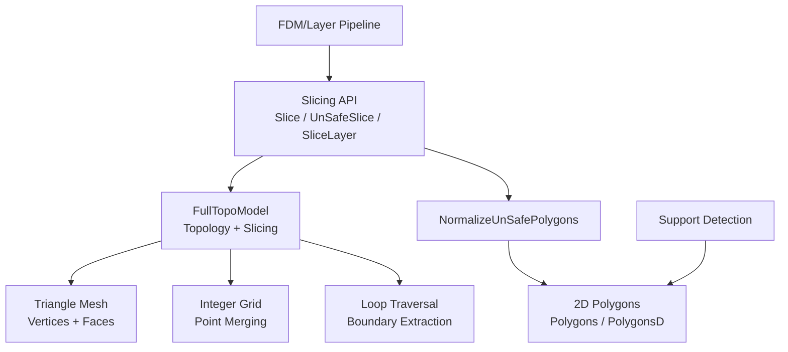
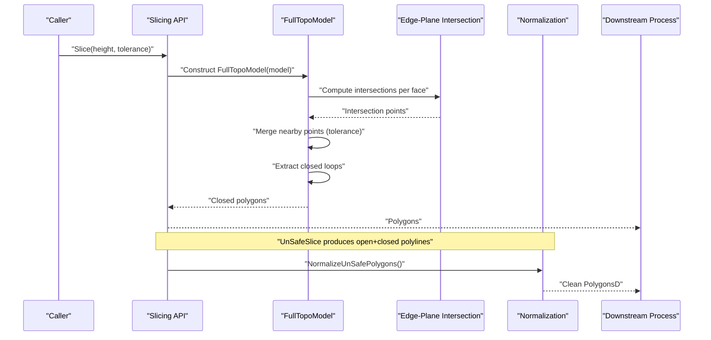
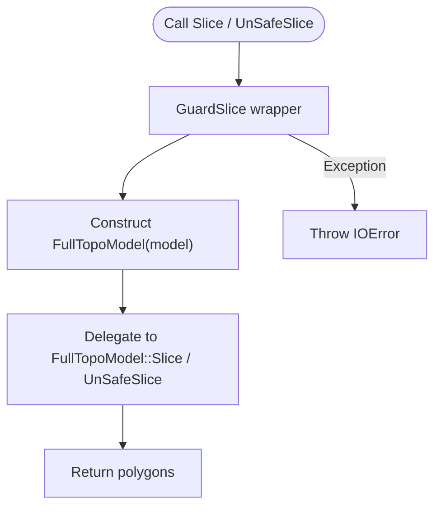
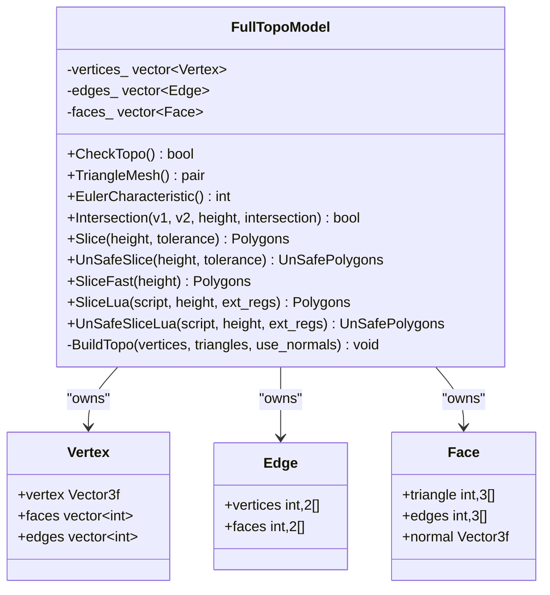
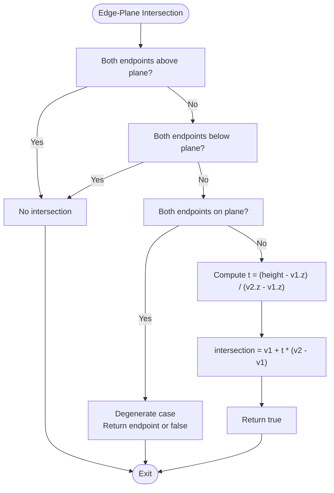
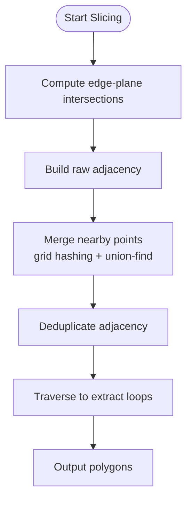
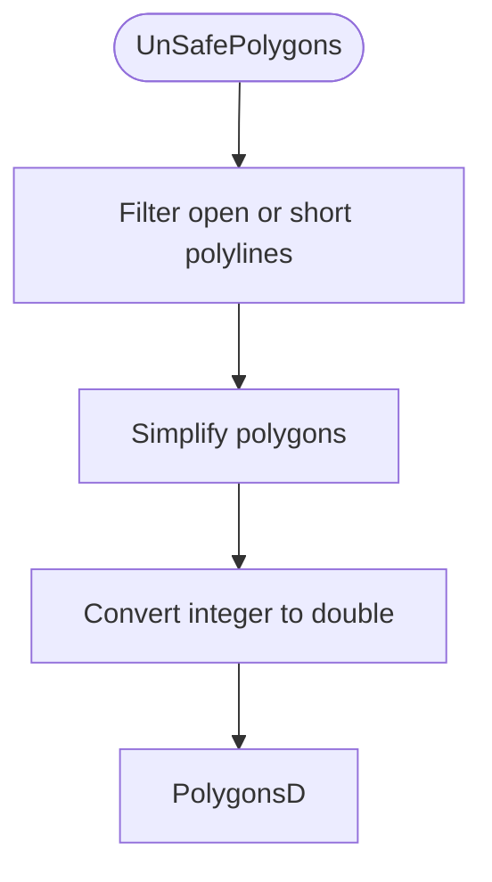
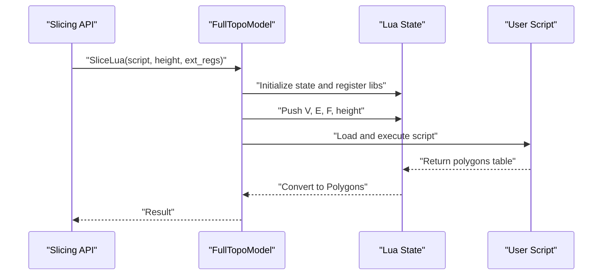
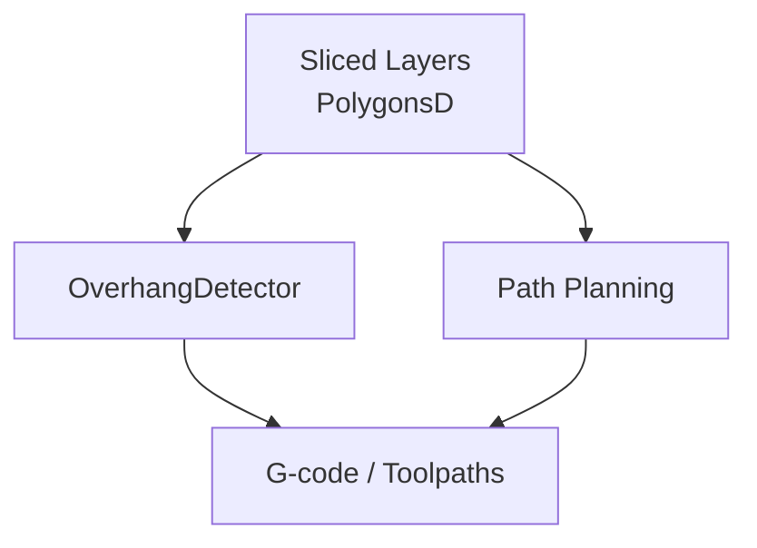
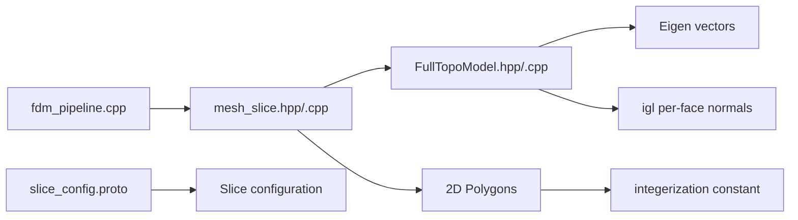

# Slicing Engine

<cite>
**Referenced Files in This Document**
- [mesh_slice.hpp](file://LibHsBaSlicer/Slice/mesh_slice.hpp)
- [mesh_slice.cpp](file://LibHsBaSlicer/Slice/mesh_slice.cpp)
- [FullTopoModel.hpp](file://meshmodel/FullTopoModel.hpp)
- [FullTopoModel.cpp](file://meshmodel/FullTopoModel.cpp)
- [IntPolygon.hpp](file://2D/IntPolygon.hpp)
- [FloatPolygons.cpp](file://2D/FloatPolygons.cpp)
- [fdm_pipeline.cpp](file://DllHsBaSlicer/fdm_pipeline.cpp)
- [OverhangDetector.hpp](file://support/OverhangDetector.hpp)
- [OverhangDetector.cpp](file://support/OverhangDetector.cpp)
- [slice_config.proto](file://proto/slice_config.proto)
</cite>

## Table of Contents
1. [Introduction](#introduction)
2. [Project Structure](#project-structure)
3. [Core Components](#core-components)
4. [Architecture Overview](#architecture-overview)
5. [Detailed Component Analysis](#detailed-component-analysis)
6. [Dependency Analysis](#dependency-analysis)
7. [Performance Considerations](#performance-considerations)
8. [Troubleshooting Guide](#troubleshooting-guide)
9. [Conclusion](#conclusion)
10. [Appendices](#appendices)

## Introduction
This document explains the slicing engine that converts 3D triangle meshes into 2D layer contours for 3D printing. It focuses on:
- The planar mesh slicing algorithm implemented by `FullTopoModel`.
- Safe and unsafe slicing APIs, including Lua-driven slicing.
- Tolerance-based point merging and numerical stability through integerization.
- Layer boundary extraction from triangle-plane intersections.
- Configuration parameters such as slice height, minimum layer height, deviation tolerances, and performance options.
- How slicing results feed downstream processes like support generation and path planning.

The implementation is primarily located under `LibHsBaSlicer/Slice` and `meshmodel`, with configuration and pipeline integration in `DllHsBaSlicer` and protocol definitions in `proto`.

## Project Structure
The slicing subsystem consists of:
- A public C++ API for slicing models at a given Z height.
- A topology-reconstructed mesh model dedicated to slicing.
- 2D polygon utilities used for normalization and coordinate scaling.
- Pipeline code that computes layer heights and calls the slicer.
- Support detection that consumes sliced layers.

**Diagram sources**
- [mesh_slice.hpp:22-103](file://LibHsBaSlicer/Slice/mesh_slice.hpp#L22-L103)
- [FullTopoModel.hpp:43-142](file://meshmodel/FullTopoModel.hpp#L43-L142)
- [IntPolygon.hpp:17-17](file://2D/IntPolygon.hpp#L17-L17)

**Section sources**
- [mesh_slice.hpp:22-103](file://LibHsBaSlicer/Slice/mesh_slice.hpp#L22-L103)
- [FullTopoModel.hpp:43-142](file://meshmodel/FullTopoModel.hpp#L43-L142)

## Core Components
- Slicing API
  - `Slice`: returns closed polygons only.
  - `UnSafeSlice`: returns open and closed polylines.
  - `SliceLua` / `UnSafeSliceLua`: script-driven slicing.
  - `BuildSliceTopology`: build reusable topology once.
  - `SliceLayer`: slice one layer from prebuilt topology.
  - `NormalizeUnSafePolygons`: clean and convert to double-precision polygons.

- FullTopoModel
  - Reconstructs vertex, edge, and face topology from a triangle mesh.
  - Provides `Intersection` between an edge and a horizontal plane.
  - Implements safe and unsafe slicing algorithms.
  - Offers fast slicing when topology is valid.
  - Supports Lua scripting for custom slicing logic.

- 2D Polygon Utilities
  - Integerization constant for stable geometry operations.
  - Conversion between integer and floating-point coordinates.

**Section sources**
- [mesh_slice.hpp:22-103](file://LibHsBaSlicer/Slice/mesh_slice.hpp#L22-L103)
- [FullTopoModel.hpp:43-142](file://meshmodel/FullTopoModel.hpp#L43-L142)
- [IntPolygon.hpp:17-17](file://2D/IntPolygon.hpp#L17-L17)

## Architecture Overview
The slicing engine follows a layered architecture:
- Public API layer exposes safe and unsafe slicing functions.
- Topology layer builds and stores full adjacency information.
- Geometry kernel computes intersections between edges and planes.
- Post-processing normalizes raw slices into usable 2D polygons.
- Downstream consumers include support detection and path planning.

**Diagram sources**
- [mesh_slice.cpp:46-84](file://LibHsBaSlicer/Slice/mesh_slice.cpp#L46-L84)
- [FullTopoModel.cpp:246-272](file://meshmodel/FullTopoModel.cpp#L246-L272)
- [FullTopoModel.cpp:328-600](file://meshmodel/FullTopoModel.cpp#L328-L600)

## Detailed Component Analysis

### Slicing API
Responsibilities:
- Provide safe and unsafe slicing entry points.
- Wrap external exceptions into project error types.
- Offer Lua-driven slicing for customization.
- Build reusable topology for multi-layer pipelines.
- Normalize unsafe polygons to clean double-precision output.

Key behaviors:
- `Slice` constructs a temporary `FullTopoModel` and delegates to its safe slicing method.
- `UnSafeSlice` similarly delegates but retains open contours.
- `SliceLua` and `UnSafeSliceLua` pass 3D helper functions into the Lua environment.
- `BuildSliceTopology` caches topology to avoid repeated reconstruction.
- `SliceLayer` reuses the cached topology and normalizes the result.

Error handling:
- External exceptions from CGAL or OCCT are caught and converted to `IOError`.
- Project `RuntimeError` exceptions propagate unchanged.

**Diagram sources**
- [mesh_slice.cpp:28-43](file://LibHsBaSlicer/Slice/mesh_slice.cpp#L28-L43)
- [mesh_slice.cpp:46-84](file://LibHsBaSlicer/Slice/mesh_slice.cpp#L46-L84)

**Section sources**
- [mesh_slice.hpp:22-103](file://LibHsBaSlicer/Slice/mesh_slice.hpp#L22-L103)
- [mesh_slice.cpp:28-116](file://LibHsBaSlicer/Slice/mesh_slice.cpp#L28-L116)

### FullTopoModel: Topology Reconstruction
Responsibilities:
- Convert input triangle mesh into a fully connected topological structure.
- Maintain adjacency between vertices, edges, and faces.
- Optionally compute per-face normals.
- Validate topological completeness.

Implementation highlights:
- Vertex, Edge, Face structures store indices and relationships.
- Edge map uses normalized index pairs to deduplicate shared edges.
- Optional normals computed via external library.
- Euler characteristic available for manifold checks.

Complexity:
- Building topology is approximately linear in the number of triangles plus hashing overhead.

**Diagram sources**
- [FullTopoModel.hpp:43-142](file://meshmodel/FullTopoModel.hpp#L43-L142)
- [FullTopoModel.cpp:27-48](file://meshmodel/FullTopoModel.cpp#L27-L48)
- [FullTopoModel.cpp:50-158](file://meshmodel/FullTopoModel.cpp#L50-L158)

**Section sources**
- [FullTopoModel.hpp:43-142](file://meshmodel/FullTopoModel.hpp#L43-L142)
- [FullTopoModel.cpp:27-158](file://meshmodel/FullTopoModel.cpp#L27-L158)

### Intersection Computation Between Edges and Planes
Algorithm:
- For each triangle edge, determine whether it crosses the slicing plane at height `z`.
- If both endpoints lie strictly above or below the plane, no intersection.
- If both endpoints lie exactly on the plane, handle degenerate cases.
- Otherwise, compute the parametric intersection point.

Numerical considerations:
- Uses float arithmetic; robustness depends on caller tolerance and integerization.
- Parallel edges aligned with the plane return endpoint or false depending on degeneracy.

**Diagram sources**
- [FullTopoModel.cpp:246-272](file://meshmodel/FullTopoModel.cpp#L246-L272)

**Section sources**
- [FullTopoModel.cpp:246-272](file://meshmodel/FullTopoModel.cpp#L246-L272)

### Layer Boundary Extraction Algorithm
Algorithm steps:
1. For each face, compute up to two intersection points with the slicing plane.
2. Build a raw adjacency list connecting intersection points across faces.
3. Merge nearby points using grid hashing and union-find based on tolerance.
4. Traverse merged adjacency to extract closed loops or open polylines.
5. Convert integerized keys back to 2D polygons.

Complexity analysis:
- Intersection computation: O(F), where F is the number of faces.
- Adjacency construction: O(F).
- Point merging: near-linear with hash map and grid bucketing.
- Loop traversal: proportional to number of merged nodes and edges.

Numerical stability:
- Coordinates are scaled by an integerization factor before rounding.
- Tolerance controls how close points must be to merge.
- Sorting and unique operations reduce duplicate edges.

**Diagram sources**
- [FullTopoModel.cpp:328-600](file://meshmodel/FullTopoModel.cpp#L328-L600)
- [FullTopoModel.cpp:604-873](file://meshmodel/FullTopoModel.cpp#L604-L873)

**Section sources**
- [FullTopoModel.cpp:328-600](file://meshmodel/FullTopoModel.cpp#L328-L600)
- [FullTopoModel.cpp:604-873](file://meshmodel/FullTopoModel.cpp#L604-L873)

### Normalization and Coordinate Scaling
Responsibilities:
- Filter out invalid polylines (open or too short).
- Simplify polygons and remove non-simple shapes.
- Convert integerized coordinates to double precision.

Coordinate system:
- Integerization constant scales coordinates to integers for stable operations.
- Conversion functions round-trip between integer and floating-point representations.

**Diagram sources**
- [mesh_slice.cpp:86-104](file://LibHsBaSlicer/Slice/mesh_slice.cpp#L86-L104)
- [FloatPolygons.cpp:189-208](file://2D/FloatPolygons.cpp#L189-L208)
- [IntPolygon.hpp:17-17](file://2D/IntPolygon.hpp#L17-L17)

**Section sources**
- [mesh_slice.cpp:86-104](file://LibHsBaSlicer/Slice/mesh_slice.cpp#L86-L104)
- [FloatPolygons.cpp:189-208](file://2D/FloatPolygons.cpp#L189-L208)
- [IntPolygon.hpp:17-17](file://2D/IntPolygon.hpp#L17-L17)

### Lua-Driven Slicing
Capabilities:
- Execute inline or file-based Lua scripts to produce polygons.
- Expose vertex, edge, and face data to Lua along with the current height.
- Register external 3D functions for advanced slicing logic.

Error handling:
- Lua load and runtime errors are wrapped into project exceptions.

**Diagram sources**
- [FullTopoModel.cpp:1027-1073](file://meshmodel/FullTopoModel.cpp#L1027-L1073)
- [FullTopoModel.cpp:1132-1186](file://meshmodel/FullTopoModel.cpp#L1132-L1186)
- [FullTopoModel.cpp:1188-1241](file://meshmodel/FullTopoModel.cpp#L1188-L1241)

**Section sources**
- [FullTopoModel.cpp:1027-1073](file://meshmodel/FullTopoModel.cpp#L1027-L1073)
- [FullTopoModel.cpp:1132-1186](file://meshmodel/FullTopoModel.cpp#L1132-L1186)
- [FullTopoModel.cpp:1188-1241](file://meshmodel/FullTopoModel.cpp#L1188-L1241)

### Relationship to Downstream Processes
- Support generation
  - Overhang detection consumes adjacent layer contours and layer height.
  - Computes maximum bridge distance based on angle threshold and layer height.
- Path planning
  - Layer paths depend on cleaned polygons produced by slicing and normalization.

**Diagram sources**
- [OverhangDetector.hpp:37-50](file://support/OverhangDetector.hpp#L37-L50)
- [OverhangDetector.cpp:23-43](file://support/OverhangDetector.cpp#L23-L43)

**Section sources**
- [OverhangDetector.hpp:37-50](file://support/OverhangDetector.hpp#L37-L50)
- [OverhangDetector.cpp:23-43](file://support/OverhangDetector.cpp#L23-L43)

## Dependency Analysis
Key dependencies:
- Slicing API depends on `FullTopoModel` for geometry and topology.
- `FullTopoModel` depends on Eigen vectors and optional external libraries for normals.
- 2D polygon utilities provide integerization and conversion helpers.
- Pipeline code computes layer heights and invokes slicing.
- Protocol definitions describe slice configuration messages.

**Diagram sources**
- [mesh_slice.hpp:9-16](file://LibHsBaSlicer/Slice/mesh_slice.hpp#L9-L16)
- [FullTopoModel.cpp:17-23](file://meshmodel/FullTopoModel.cpp#L17-L23)
- [IntPolygon.hpp:17-17](file://2D/IntPolygon.hpp#L17-L17)
- [fdm_pipeline.cpp:48-49](file://DllHsBaSlicer/fdm_pipeline.cpp#L48-L49)
- [slice_config.proto:18-27](file://proto/slice_config.proto#L18-L27)

**Section sources**
- [mesh_slice.hpp:9-16](file://LibHsBaSlicer/Slice/mesh_slice.hpp#L9-L16)
- [FullTopoModel.cpp:17-23](file://meshmodel/FullTopoModel.cpp#L17-L23)
- [IntPolygon.hpp:17-17](file://2D/IntPolygon.hpp#L17-L17)
- [fdm_pipeline.cpp:48-49](file://DllHsBaSlicer/fdm_pipeline.cpp#L48-L49)
- [slice_config.proto:18-27](file://proto/slice_config.proto#L18-L27)

## Performance Considerations
- Topology reuse
  - Use `BuildSliceTopology` once and call `SliceLayer` repeatedly to avoid rebuilding topology per layer.
- Fast slicing
  - `SliceFast` requires valid topology and skips some safety checks; use when topology integrity is guaranteed.
- Tolerance tuning
  - Larger tolerance reduces point count and speeds up merging but may reduce geometric fidelity.
- Integerization precision
  - High integerization improves precision but increases memory usage; default constant balances speed and accuracy.
- Lua scripting
  - Script execution adds overhead; prefer built-in slicing for performance-critical paths.

[No sources needed since this section provides general guidance]

## Troubleshooting Guide
Common issues and remedies:
- Slicing fails due to external geometry errors
  - Exceptions from CGAL or OCCT are wrapped into `IOError`; inspect error messages for geometry problems.
- Invalid topology
  - Call `CheckTopo` before using `SliceFast`; invalid topology will cause immediate failure.
- Open contours in unsupported processes
  - Use `Slice` for closed contours; use `UnSafeSlice` only when open polylines are acceptable.
- Numerical instability
  - Adjust tolerance to match model scale; ensure consistent units and avoid extremely small features relative to tolerance.
- Lua script errors
  - Errors during load or execution are reported as `RuntimeError`; verify script syntax and global names.

**Section sources**
- [mesh_slice.cpp:28-43](file://LibHsBaSlicer/Slice/mesh_slice.cpp#L28-L43)
- [FullTopoModel.cpp:875-880](file://meshmodel/FullTopoModel.cpp#L875-L880)
- [FullTopoModel.cpp:1027-1073](file://meshmodel/FullTopoModel.cpp#L1027-L1073)

## Conclusion
The slicing engine provides a robust, configurable pipeline for converting 3D meshes into 2D layers. Its core strengths include:
- Clear separation between API, topology, and geometry kernels.
- Tolerance-controlled point merging for numerical stability.
- Flexible slicing modes supporting safe, unsafe, and Lua-driven workflows.
- Efficient reuse of topology for multi-layer processing.
- Integration with downstream support detection and path planning.

For best results, tune tolerance and integerization to your model scale, reuse topology across layers, and validate topology before fast slicing.

[No sources needed since this section summarizes without analyzing specific files]

## Appendices

### Configuration Parameters
- Slice height
  - Defined in protocol message `msg_slice_config.slice_height`.
- Diff slice mode
  - Variable layer heights specified via `diff_string`.
- Ring and curved slicing
  - Supported via ring radius, center, normal, and curved path fields.

Example references:
- [slice_config.proto:18-27](file://proto/slice_config.proto#L18-L27)

**Section sources**
- [slice_config.proto:18-27](file://proto/slice_config.proto#L18-L27)

### Practical Slicing Configuration Examples
- Fine quality
  - Small slice height, small tolerance, high integerization.
- Standard quality
  - Moderate slice height, moderate tolerance.
- Draft quality
  - Larger slice height, larger tolerance, reduced integerization.

These settings influence layer resolution, geometric accuracy, and performance trade-offs.

[No sources needed since this section provides general guidance]