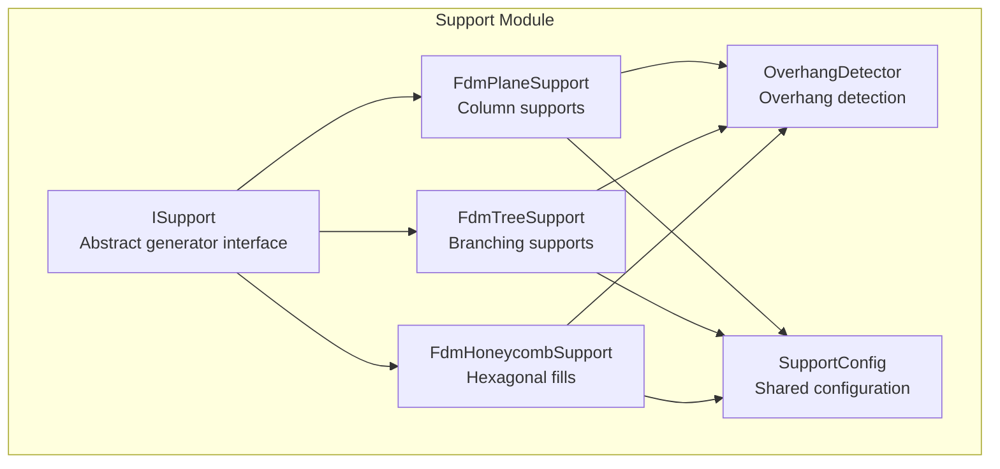
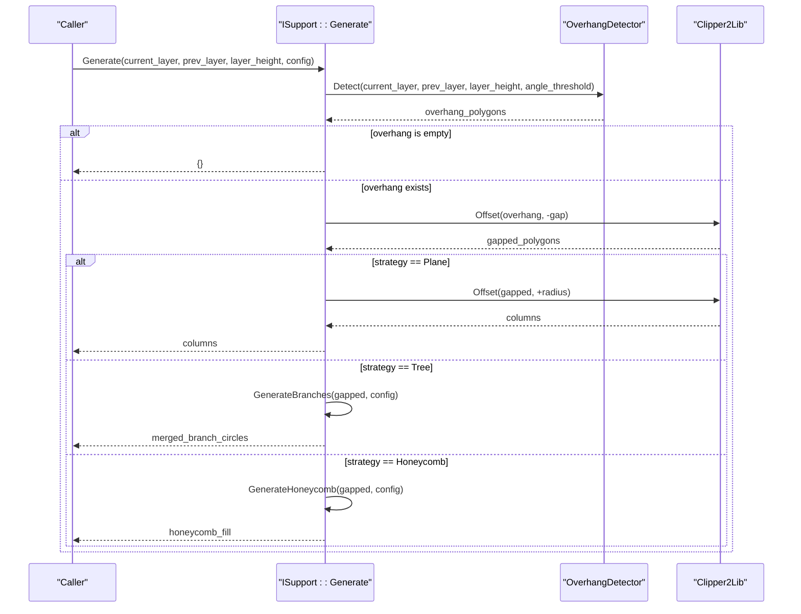
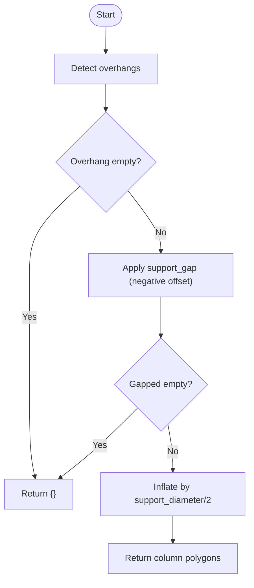
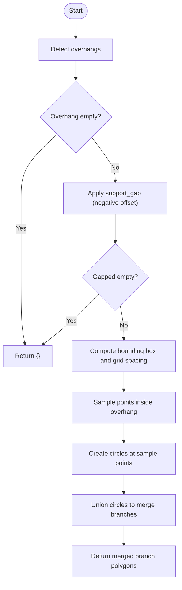
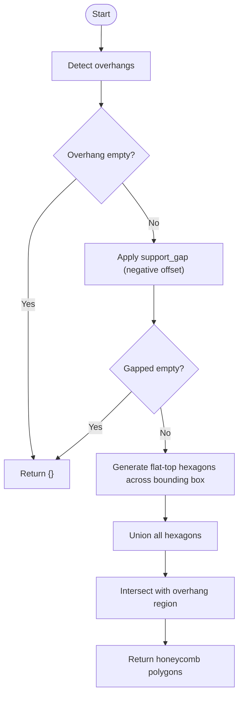
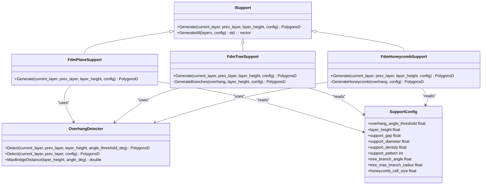

# FDM Support Strategies / FDM支撑策略

<cite>
**Referenced Files in This Document**
- [FdmSupport.hpp](file://support/FdmSupport.hpp)
- [FdmSupport.cpp](file://support/FdmSupport.cpp)
- [ISupport.hpp](file://support/ISupport.hpp)
- [ISupport.cpp](file://support/ISupport.cpp)
- [OverhangDetector.hpp](file://support/OverhangDetector.hpp)
- [OverhangDetector.cpp](file://support/OverhangDetector.cpp)
- [SupportConfig.hpp](file://support/SupportConfig.hpp)
</cite>

## Table of Contents
1. [Introduction](#introduction)
2. [Project Structure](#project-structure)
3. [Core Components](#core-components)
4. [Architecture Overview](#architecture-overview)
5. [Detailed Component Analysis](#detailed-component-analysis)
6. [Dependency Analysis](#dependency-analysis)
7. [Performance Considerations](#performance-considerations)
8. [Troubleshooting Guide](#troubleshooting-guide)
9. [Conclusion](#conclusion)
10. [Appendices](#appendices)

## Introduction
This document explains the FDM-specific support generation strategies implemented by the FdmPlaneSupport, FdmTreeSupport, and FdmHoneycombSupport classes. These strategies convert overhang regions detected between adjacent layers into per-layer support polygons:

- Plane supports create simple column structures from overhang regions using configurable diameter and gap settings.
- Tree supports generate branching structures growing upward from the build plate with automatic merging when branches meet; at each layer cross-section, circular branch tips are placed within the overhang region via GenerateBranches.
- Honeycomb supports fill overhang regions with hexagonal patterns for lightweight but rigid structures through GenerateHoneycomb.

The documentation covers configuration parameters, processing logic, performance characteristics, removal considerations, and practical usage guidance.

## Project Structure
The FDM support strategy code resides under the support module. The key files are:

- FdmSupport.hpp/cpp: Implementations of plane, tree, and honeycomb support generators.
- ISupport.hpp/cpp: Abstract interface and default layer iteration helper.
- OverhangDetector.hpp/cpp: Overhang detection between adjacent layers.
- SupportConfig.hpp: Shared configuration structure used by all support generators.

**Diagram sources**
- [ISupport.hpp:22-44](file://support/ISupport.hpp#L22-L44)
- [FdmSupport.hpp:19-63](file://support/FdmSupport.hpp#L19-L63)
- [OverhangDetector.hpp:20-49](file://support/OverhangDetector.hpp#L20-L49)
- [SupportConfig.hpp:14-25](file://support/SupportConfig.hpp#L14-L25)

**Section sources**
- [FdmSupport.hpp:1-67](file://support/FdmSupport.hpp#L1-L67)
- [ISupport.hpp:1-49](file://support/ISupport.hpp#L1-L49)
- [OverhangDetector.hpp:1-54](file://support/OverhangDetector.hpp#L1-L54)
- [SupportConfig.hpp:1-47](file://support/SupportConfig.hpp#L1-L47)

## Core Components
The core components are:

- ISupport: Defines a common interface for per-layer support generation and provides a default GenerateAll loop that iterates over layers.
- OverhangDetector: Computes overhang regions between current and previous layers based on layer height and angle threshold.
- FdmPlaneSupport: Inflates gapped overhangs by half the support diameter to produce cylindrical columns.
- FdmTreeSupport: Places circular branch tips at regular sample points inside the overhang region and unions overlapping circles.
- FdmHoneycombSupport: Generates flat-top hexagons across the bounding box and intersects them with the overhang region.

Key responsibilities:

- Detect overhangs consistently across strategies.
- Apply model-support separation using support_gap.
- Produce PolygonsD representing support cross-sections for the current layer.

**Section sources**
- [ISupport.hpp:22-44](file://support/ISupport.hpp#L22-L44)
- [ISupport.cpp:9-21](file://support/ISupport.cpp#L9-L21)
- [OverhangDetector.hpp:20-49](file://support/OverhangDetector.hpp#L20-L49)
- [FdmSupport.hpp:19-63](file://support/FdmSupport.hpp#L19-L63)

## Architecture Overview
The FDM support pipeline follows a consistent flow:

1. Detect overhang regions between current_layer and prev_layer using OverhangDetector.
2. Apply support_gap to separate the support from the model geometry.
3. Strategy-specific generation:
   - Plane: Inflate by support_diameter/2 to form columns.
   - Tree: Place circular branch tips at grid points inside the overhang and union them.
   - Honeycomb: Generate hexagonal cells and intersect with the overhang.

**Diagram sources**
- [FdmSupport.cpp:48-76](file://support/FdmSupport.cpp#L48-L76)
- [FdmSupport.cpp:145-168](file://support/FdmSupport.cpp#L145-L168)
- [FdmSupport.cpp:244-267](file://support/FdmSupport.cpp#L244-L267)
- [OverhangDetector.cpp:41-87](file://support/OverhangDetector.cpp#L41-L87)

## Detailed Component Analysis

### FdmPlaneSupport
FdmPlaneSupport creates simple column supports from overhang regions. It inflates the gapped overhang area by half the configured support diameter to produce cylindrical cross-sections.

Processing steps:

- Detect overhangs using OverhangDetector.
- Apply support_gap by negative offset.
- Inflate by support_diameter/2 to create columns.
- Return the resulting polygons.

Configuration parameters used:

- overhang_angle_threshold: Controls which areas are considered overhangs.
- support_gap: Separation distance between model and support.
- support_diameter: Column diameter; radius = diameter/2.

Practical guidance:

- Use plane supports for straightforward, robust support where ease of removal is important.
- Larger support_diameter increases strength but also material and removal effort.
- Larger support_gap improves surface finish but may reduce stability.

**Diagram sources**
- [FdmSupport.cpp:48-76](file://support/FdmSupport.cpp#L48-L76)

**Section sources**
- [FdmSupport.hpp:19-24](file://support/FdmSupport.hpp#L19-L24)
- [FdmSupport.cpp:48-76](file://support/FdmSupport.cpp#L48-L76)
- [SupportConfig.hpp:14-25](file://support/SupportConfig.hpp#L14-L25)

### FdmTreeSupport
FdmTreeSupport generates branching structures that grow upward from the build plate. At each layer cross-section, it places circular branch tips within the overhang region using GenerateBranches. Branches merge automatically when their circular tips overlap due to union operations.

Processing steps:

- Detect overhangs using OverhangDetector.
- Apply support_gap by negative offset.
- GenerateBranches:
  - Compute bounding box of the gapped overhang.
  - Sample candidate points on a grid with spacing proportional to support_diameter.
  - For each point inside the overhang, create a circle with radius support_diameter/2.
  - Union overlapping circles to merge branches.

Configuration parameters used:

- overhang_angle_threshold: Determines overhang regions.
- support_gap: Separation distance.
- support_diameter: Branch tip radius and spacing control.

Algorithmic notes:

- GenerateBranches uses a fixed spacing of approximately 1.5 times support_diameter between candidate points.
- Circle resolution is set to 24 segments per circle.
- Merging is performed via polygon union, producing continuous support regions where branches meet.

Practical guidance:

- Tree supports reduce material usage compared to solid fills while maintaining strength.
- Suitable for complex geometries with multiple isolated overhangs.
- Removal can be more involved than plane supports due to branching.

**Diagram sources**
- [FdmSupport.cpp:81-143](file://support/FdmSupport.cpp#L81-L143)
- [FdmSupport.cpp:145-168](file://support/FdmSupport.cpp#L145-L168)

**Section sources**
- [FdmSupport.hpp:26-44](file://support/FdmSupport.hpp#L26-L44)
- [FdmSupport.cpp:81-143](file://support/FdmSupport.cpp#L81-L143)
- [FdmSupport.cpp:145-168](file://support/FdmSupport.cpp#L145-L168)
- [SupportConfig.hpp:14-25](file://support/SupportConfig.hpp#L14-L25)

### FdmHoneycombSupport
FdmHoneycombSupport fills overhang regions with hexagonal patterns to provide lightweight but rigid support structures.

Processing steps:

- Detect overhangs using OverhangDetector.
- Apply support_gap by negative offset.
- GenerateHoneycomb:
  - Compute bounding box of the gapped overhang.
  - Generate flat-top hexagons across rows and columns with appropriate offsets.
  - Union all hexagons and intersect with the overhang region.

Configuration parameters used:

- overhang_angle_threshold: Determines overhang regions.
- support_gap: Separation distance.
- honeycomb_cell_size: Hexagon cell size controlling density and rigidity.

Algorithmic notes:

- Hexagon width equals cell_size; height equals cell_size multiplied by sqrt(3)/2.
- Rows alternate x-offset by 0.75 * cell_size to achieve a staggered honeycomb layout.
- Final output is the intersection of the unioned hexagons with the overhang region.

Practical guidance:

- Honeycomb supports offer good stiffness-to-weight ratio.
- Useful when minimizing material while maintaining structural integrity.
- Removal may require cutting or breaking hexagonal struts.

**Diagram sources**
- [FdmSupport.cpp:173-242](file://support/FdmSupport.cpp#L173-L242)
- [FdmSupport.cpp:244-267](file://support/FdmSupport.cpp#L244-L267)

**Section sources**
- [FdmSupport.hpp:46-63](file://support/FdmSupport.hpp#L46-L63)
- [FdmSupport.cpp:173-242](file://support/FdmSupport.cpp#L173-L242)
- [FdmSupport.cpp:244-267](file://support/FdmSupport.cpp#L244-L267)
- [SupportConfig.hpp:14-25](file://support/SupportConfig.hpp#L14-L25)

## Dependency Analysis
The FDM support strategies depend on shared infrastructure:

- All strategies implement ISupport and call OverhangDetector to compute overhang regions.
- Geometry operations rely on Clipper2Lib through local wrappers and integerization helpers.
- Configuration is provided via SupportConfig.

**Diagram sources**
- [ISupport.hpp:22-44](file://support/ISupport.hpp#L22-L44)
- [FdmSupport.hpp:19-63](file://support/FdmSupport.hpp#L19-L63)
- [OverhangDetector.hpp:20-49](file://support/OverhangDetector.hpp#L20-L49)
- [SupportConfig.hpp:14-25](file://support/SupportConfig.hpp#L14-L25)

**Section sources**
- [ISupport.hpp:22-44](file://support/ISupport.hpp#L22-L44)
- [FdmSupport.hpp:19-63](file://support/FdmSupport.hpp#L19-L63)
- [OverhangDetector.hpp:20-49](file://support/OverhangDetector.hpp#L20-L49)
- [SupportConfig.hpp:14-25](file://support/SupportConfig.hpp#L14-L25)

## Performance Considerations
- Overhang detection complexity depends on polygon difference and offset operations; large or highly detailed models increase computation time.
- Plane supports perform two offsets (gap and inflation), which are generally fast.
- Tree supports involve grid sampling and circle creation proportional to the bounding box area divided by spacing squared; union operations merge overlapping circles.
- Honeycomb supports generate many hexagons across the bounding box; union and intersection operations scale with the number of cells.
- Integerization and floating-point conversions occur during geometry operations; precision and rounding affect final shapes.

Optimization opportunities:

- Tune spacing in tree supports to balance coverage and performance.
- Adjust honeycomb_cell_size to control the number of generated hexagons.
- Avoid excessively small gaps or diameters that cause many tiny polygons.

[No sources needed since this section provides general guidance]

## Troubleshooting Guide
Common issues and remedies:

- No supports generated:
  - Check overhang_angle_threshold; too high values may classify no regions as overhangs.
  - Verify layer_height and model orientation; very thin layers or steep angles change bridge distances.
- Supports too weak:
  - Increase support_diameter for stronger columns or denser tree branches.
  - Reduce honeycomb_cell_size for finer hexagonal fills.
- Excessive material usage:
  - Increase support_gap to reduce contact area.
  - Prefer tree or honeycomb strategies over dense plane fills.
- Poor surface quality:
  - Increase support_gap to improve separation.
  - Use interface layers if available in higher-level configurations.

Error handling highlights:

- OverhangDetector returns empty results when no overhangs are detected or after erosion removes small bridges.
- Generators return empty polygons when gapped regions become empty after offset operations.

**Section sources**
- [OverhangDetector.cpp:23-39](file://support/OverhangDetector.cpp#L23-L39)
- [OverhangDetector.cpp:41-87](file://support/OverhangDetector.cpp#L41-L87)
- [FdmSupport.cpp:48-76](file://support/FdmSupport.cpp#L48-L76)
- [FdmSupport.cpp:145-168](file://support/FdmSupport.cpp#L145-L168)
- [FdmSupport.cpp:244-267](file://support/FdmSupport.cpp#L244-L267)

## Conclusion
FdmPlaneSupport, FdmTreeSupport, and FdmHoneycombSupport provide complementary strategies for FDM support generation:

- Plane supports are simple and reliable, suitable for easy removal and basic overhangs.
- Tree supports offer efficient branching with automatic merging, ideal for complex geometries.
- Honeycomb supports deliver lightweight yet rigid fills, useful when minimizing material while preserving strength.

Choosing the right strategy depends on model complexity, desired mechanical properties, print time, and post-processing constraints.

[No sources needed since this section summarizes without analyzing specific files]

## Appendices

### Configuration Reference
Key configuration fields used by FDM support strategies:

- overhang_angle_threshold: Angle threshold in degrees for overhang detection.
- layer_height: Layer height in millimeters.
- support_gap: Gap between model and support in millimeters.
- support_diameter: Diameter of support columns or branch tips in millimeters.
- support_density: Fill density for supports (used by higher-level systems).
- support_pattern: Enum selecting strategy (plane, tree, honeycomb).
- tree_branch_angle: Angle parameter for tree branching behavior.
- tree_max_branch_radius: Maximum radius for tree branches.
- honeycomb_cell_size: Size of hexagonal cells in honeycomb fills.

**Section sources**
- [SupportConfig.hpp:14-25](file://support/SupportConfig.hpp#L14-L25)