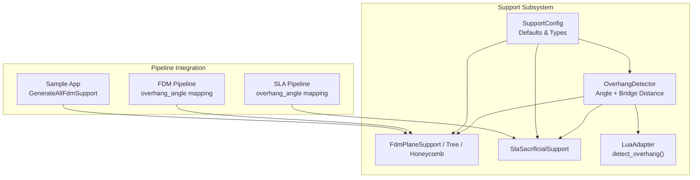
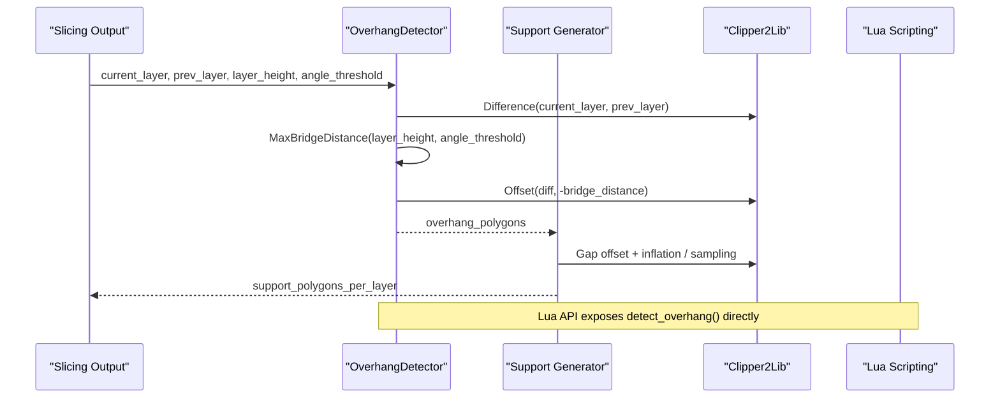
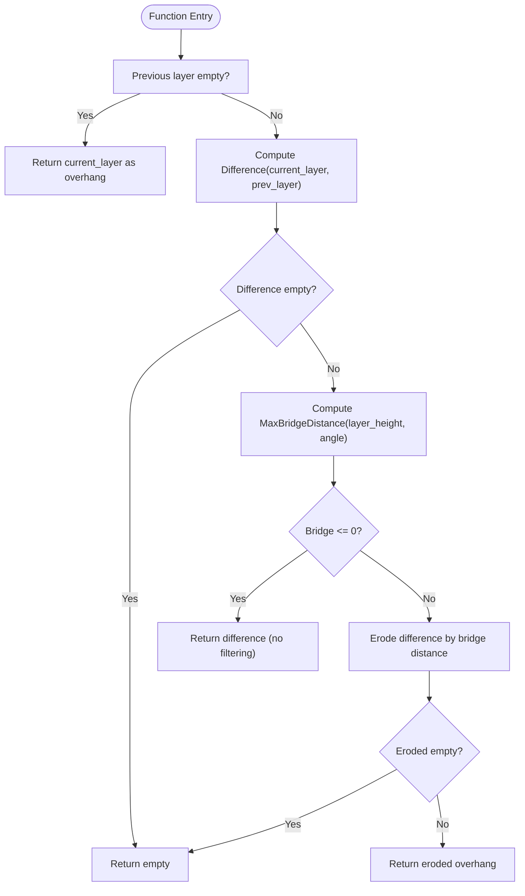
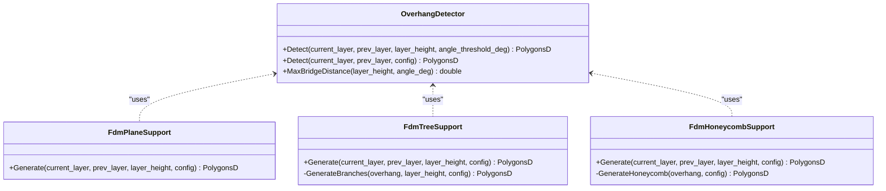
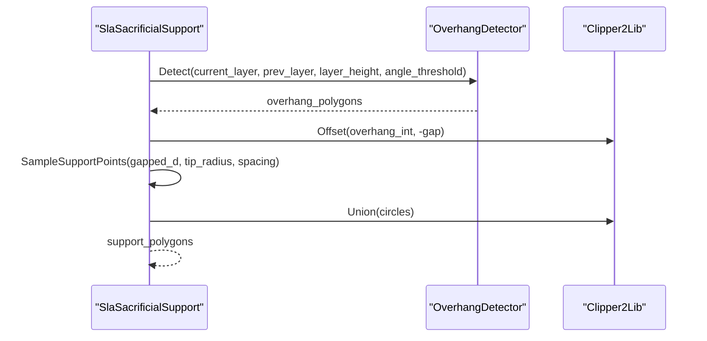
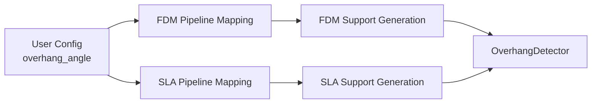
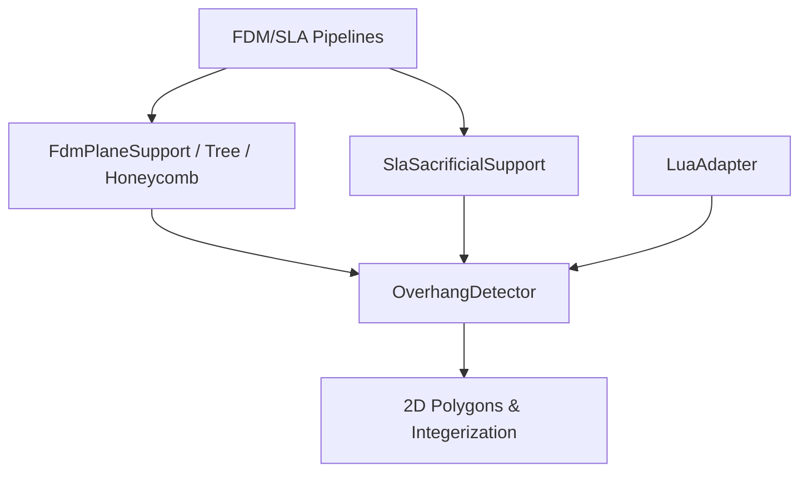

# Overhang Detection / 悬垂检测

<cite>
**Referenced Files in This Document**   
- [OverhangDetector.hpp](file://support/OverhangDetector.hpp)
- [OverhangDetector.cpp](file://support/OverhangDetector.cpp)
- [SupportConfig.hpp](file://support/SupportConfig.hpp)
- [FdmSupport.cpp](file://support/FdmSupport.cpp)
- [SlaSupport.cpp](file://support/SlaSupport.cpp)
- [LuaAdapter.cpp](file://support/LuaAdapter.cpp)
- [pipeline_types.h](file://pipelinetypes/pipeline_types.h)
- [fdm_pipeline.cpp](file://DllHsBaSlicer/fdm_pipeline.cpp)
- [sla_pipeline.cpp](file://DllHsBaSlicer/sla_pipeline.cpp)
- [main_header.cpp](file://samples/LibHsBaSlicer/main_header.cpp)
- [support_test.cpp](file://tests/Support/support_test.cpp)
</cite>

## Table of Contents
1. [Introduction](#introduction)
2. [Project Structure](#project-structure)
3. [Core Components](#core-components)
4. [Architecture Overview](#architecture-overview)
5. [Detailed Component Analysis](#detailed-component-analysis)
6. [Dependency Analysis](#dependency-analysis)
7. [Performance Considerations](#performance-considerations)
8. [Troubleshooting Guide](#troubleshooting-guide)
9. [Conclusion](#conclusion)
10. [Appendices](#appendices)

## Introduction
This document explains the overhang detection system used by HsBaSlicer to identify regions that require support material in 3D models. The core algorithm compares two adjacent slicing layers, computes unsupported areas, and filters them using an angle-based bridge distance. The implementation is centered on the `OverhangDetector` class and is consumed by FDM and SLA support generators as well as Lua scripting interfaces.

The documentation covers:
- How overhang regions are calculated between consecutive layers.
- The mathematical basis for critical angles and maximum bridge distances.
- Threshold configuration for different materials and print orientations.
- Integration with the slicing pipeline.
- Performance characteristics and optimization techniques.
- Examples, tuning recommendations, and troubleshooting guidance.

## Project Structure
The overhang detection feature lives under the support subsystem and integrates with both C++ support generators and the Lua scripting layer.

**Diagram sources**
- [OverhangDetector.hpp:12-50](file://support/OverhangDetector.hpp#L12-L50)
- [OverhangDetector.cpp:23-86](file://support/OverhangDetector.cpp#L23-L86)
- [SupportConfig.hpp:14-43](file://support/SupportConfig.hpp#L14-L43)
- [FdmSupport.cpp:48-76](file://support/FdmSupport.cpp#L48-L76)
- [FdmSupport.cpp:145-168](file://support/FdmSupport.cpp#L145-L168)
- [FdmSupport.cpp:244-267](file://support/FdmSupport.cpp#L244-L267)
- [SlaSupport.cpp:81-133](file://support/SlaSupport.cpp#L81-L133)
- [LuaAdapter.cpp:202-212](file://support/LuaAdapter.cpp#L202-L212)
- [fdm_pipeline.cpp:163-163](file://DllHsBaSlicer/fdm_pipeline.cpp#L163-L163)
- [sla_pipeline.cpp:393-393](file://DllHsBaSlicer/sla_pipeline.cpp#L393-L393)
- [main_header.cpp:116-122](file://samples/LibHsBaSlicer/main_header.cpp#L116-L122)

**Section sources**
- [OverhangDetector.hpp:12-50](file://support/OverhangDetector.hpp#L12-L50)
- [OverhangDetector.cpp:23-86](file://support/OverhangDetector.cpp#L23-L86)
- [SupportConfig.hpp:14-43](file://support/SupportConfig.hpp#L14-L43)
- [FdmSupport.cpp:48-76](file://support/FdmSupport.cpp#L48-L76)
- [SlaSupport.cpp:81-133](file://support/SlaSupport.cpp#L81-L133)
- [LuaAdapter.cpp:202-212](file://support/LuaAdapter.cpp#L202-L212)
- [fdm_pipeline.cpp:163-163](file://DllHsBaSlicer/fdm_pipeline.cpp#L163-L163)
- [sla_pipeline.cpp:393-393](file://DllHsBaSlicer/sla_pipeline.cpp#L393-L393)
- [main_header.cpp:116-122](file://samples/LibHsBaSlicer/main_header.cpp#L116-L122)

## Core Components
The overhang detection system consists of:
- `OverhangDetector`: Computes unsupported regions between adjacent layers using polygon difference and angle-based erosion.
- `SupportConfig`: Defines default thresholds such as overhang angle, layer height, gap, diameter, density, and pattern parameters.
- Support generators (`FdmPlaneSupport`, `FdmTreeSupport`, `FdmHoneycombSupport`, `SlaSacrificialSupport`): Use detected overhangs to generate per-layer support cross-sections.
- Lua adapter: Exposes `Support.detect_overhang()` and default configuration values to scripts.
- Pipeline integration: Maps user-facing overhang angle settings into internal support configuration.

Key responsibilities:
- Angle-to-distance conversion via `MaxBridgeDistance`.
- Layer comparison via polygon difference.
- Erosion-based filtering of small bridges.
- Configuration-driven behavior across FDM and SLA workflows.

**Section sources**
- [OverhangDetector.hpp:14-50](file://support/OverhangDetector.hpp#L14-L50)
- [OverhangDetector.cpp:23-86](file://support/OverhangDetector.cpp#L23-L86)
- [SupportConfig.hpp:14-43](file://support/SupportConfig.hpp#L14-L43)
- [FdmSupport.cpp:48-76](file://support/FdmSupport.cpp#L48-L76)
- [FdmSupport.cpp:145-168](file://support/FdmSupport.cpp#L145-L168)
- [FdmSupport.cpp:244-267](file://support/FdmSupport.cpp#L244-L267)
- [SlaSupport.cpp:81-133](file://support/SlaSupport.cpp#L81-L133)
- [LuaAdapter.cpp:202-212](file://support/LuaAdapter.cpp#L202-L212)

## Architecture Overview
The overhang detection flow starts from sliced layer contours and ends with support polygons or points.

**Diagram sources**
- [OverhangDetector.cpp:41-86](file://support/OverhangDetector.cpp#L41-L86)
- [FdmSupport.cpp:48-76](file://support/FdmSupport.cpp#L48-L76)
- [FdmSupport.cpp:145-168](file://support/FdmSupport.cpp#L145-L168)
- [FdmSupport.cpp:244-267](file://support/FdmSupport.cpp#L244-L267)
- [SlaSupport.cpp:81-133](file://support/SlaSupport.cpp#L81-L133)
- [LuaAdapter.cpp:202-212](file://support/LuaAdapter.cpp#L202-L212)

## Detailed Component Analysis

### OverhangDetector Class
`OverhangDetector` provides:
- `Detect(current_layer, prev_layer, layer_height, angle_threshold_deg)`: Returns unsupported polygons.
- `Detect(current_layer, prev_layer, config)`: Convenience overload using `SupportConfig`.
- `MaxBridgeDistance(layer_height, angle_deg)`: Converts angle threshold into a horizontal bridge distance.

Algorithm summary:
- If there is no previous layer, the entire current layer is considered overhang.
- Compute the difference between current and previous layers.
- Convert angle threshold to maximum bridge distance.
- Erode the difference by the bridge distance; if eroded result is empty, no support is needed.
- Return the remaining unsupported region.

**Diagram sources**
- [OverhangDetector.cpp:41-86](file://support/OverhangDetector.cpp#L41-L86)

Mathematical basis:
- Maximum bridge distance is computed as `layer_height / tan(angle_rad)`.
- For angles >= 90 degrees, no overhang is considered; bridge distance is zero.
- For angles <= 0 degrees, everything is treated as overhang; bridge distance is effectively infinite.

Complexity considerations:
- Polygon difference and offset operations dominate runtime.
- Integerization and un-integerization are used for robust geometric operations.
- Early exits reduce unnecessary computation when differences or eroded results are empty.

**Section sources**
- [OverhangDetector.hpp:20-50](file://support/OverhangDetector.hpp#L20-L50)
- [OverhangDetector.cpp:23-86](file://support/OverhangDetector.cpp#L23-L86)

### Support Configuration
`SupportConfig` defines shared defaults:
- `overhang_angle_threshold`: Default 45.0 degrees.
- `layer_height`: Default 0.2 mm.
- `support_gap`: Default 0.5 mm.
- `support_diameter`: Default 2.0 mm.
- `support_density`: Default 0.3.
- `support_pattern`: Pattern selector (plane/tree/honeycomb).
- Additional fields for tree and honeycomb strategies.

Derived configs:
- `FdmSupportConfig`: Adds interface layers and interface density.
- `SlaSupportConfig`: Adds tip diameter and raft thickness.

These fields control how aggressively overhangs are filtered and how supports are shaped after detection.

**Section sources**
- [SupportConfig.hpp:14-43](file://support/SupportConfig.hpp#L14-L43)

### FDM Support Generators
FDM generators consume overhang regions and produce per-layer support shapes:
- `FdmPlaneSupport`: Inflates gapped overhangs by half the support diameter to form column-like cross-sections.
- `FdmTreeSupport`: Samples branch tips within the overhang region at configurable spacing and unions circles.
- `FdmHoneycombSupport`: Generates hexagonal cells and intersects them with the overhang region.

Common steps:
- Call `OverhangDetector::Detect` with `config.overhang_angle_threshold`.
- Apply `support_gap` via negative offset.
- Generate support geometry based on strategy.

**Diagram sources**
- [OverhangDetector.hpp:20-50](file://support/OverhangDetector.hpp#L20-L50)
- [FdmSupport.cpp:48-76](file://support/FdmSupport.cpp#L48-L76)
- [FdmSupport.cpp:145-168](file://support/FdmSupport.cpp#L145-L168)
- [FdmSupport.cpp:244-267](file://support/FdmSupport.cpp#L244-L267)

**Section sources**
- [FdmSupport.cpp:48-76](file://support/FdmSupport.cpp#L48-L76)
- [FdmSupport.cpp:145-168](file://support/FdmSupport.cpp#L145-L168)
- [FdmSupport.cpp:244-267](file://support/FdmSupport.cpp#L244-L267)

### SLA Sacrificial Support
SLA sacrificial support generates thin columns sampled from overhang regions:
- Detect overhang using `OverhangDetector::Detect`.
- Apply gap via negative offset.
- Sample support points at spacing derived from `support_diameter`.
- Create circles around sample points and union them.

**Diagram sources**
- [SlaSupport.cpp:81-133](file://support/SlaSupport.cpp#L81-L133)
- [OverhangDetector.cpp:41-86](file://support/OverhangDetector.cpp#L41-L86)

**Section sources**
- [SlaSupport.cpp:81-133](file://support/SlaSupport.cpp#L81-L133)

### Lua Integration
The Lua adapter exposes:
- `Support.detect_overhang(current_layer, prev_layer, layer_height, angle_deg)` returning unsupported polygons.
- `Support.default_config()` returning default configuration fields including `overhang_angle_threshold`, `layer_height`, and `support_gap`.

This allows scripts to inspect or customize overhang detection without recompiling C++ code.

**Section sources**
- [LuaAdapter.cpp:202-212](file://support/LuaAdapter.cpp#L202-L212)
- [LuaAdapter.cpp:215-226](file://support/LuaAdapter.cpp#L215-L226)

### Pipeline Integration
User-facing pipeline configurations map to internal support settings:
- FDM pipeline sets `ic.support_config.overhang_angle_threshold` from `cfg->overhang_angle`.
- SLA pipeline sets `sla_support_cfg.overhang_angle_threshold` from `cfg.overhang_angle`.
- Sample application demonstrates setting `support_cfg.overhang_angle_threshold` and calling `GenerateAllFdmSupport`.

**Diagram sources**
- [fdm_pipeline.cpp:163-163](file://DllHsBaSlicer/fdm_pipeline.cpp#L163-L163)
- [sla_pipeline.cpp:393-393](file://DllHsBaSlicer/sla_pipeline.cpp#L393-L393)
- [main_header.cpp:116-122](file://samples/LibHsBaSlicer/main_header.cpp#L116-L122)

**Section sources**
- [fdm_pipeline.cpp:163-163](file://DllHsBaSlicer/fdm_pipeline.cpp#L163-L163)
- [sla_pipeline.cpp:393-393](file://DllHsBaSlicer/sla_pipeline.cpp#L393-L393)
- [main_header.cpp:116-122](file://samples/LibHsBaSlicer/main_header.cpp#L116-L122)

## Dependency Analysis
The overhang detection system has clear dependencies:
- `OverhangDetector` depends on 2D polygon utilities and integerization helpers.
- Support generators depend on `OverhangDetector` and Clipper2Lib for geometric operations.
- Lua adapter depends on `OverhangDetector` and configuration readers.
- Pipelines depend on user configuration and map it to internal support settings.

**Diagram sources**
- [OverhangDetector.cpp:5-10](file://support/OverhangDetector.cpp#L5-L10)
- [FdmSupport.cpp:5-12](file://support/FdmSupport.cpp#L5-L12)
- [SlaSupport.cpp:5-11](file://support/SlaSupport.cpp#L5-L11)
- [LuaAdapter.cpp:202-212](file://support/LuaAdapter.cpp#L202-L212)
- [fdm_pipeline.cpp:163-163](file://DllHsBaSlicer/fdm_pipeline.cpp#L163-L163)
- [sla_pipeline.cpp:393-393](file://DllHsBaSlicer/sla_pipeline.cpp#L393-L393)

**Section sources**
- [OverhangDetector.cpp:5-10](file://support/OverhangDetector.cpp#L5-L10)
- [FdmSupport.cpp:5-12](file://support/FdmSupport.cpp#L5-L12)
- [SlaSupport.cpp:5-11](file://support/SlaSupport.cpp#L5-L11)
- [LuaAdapter.cpp:202-212](file://support/LuaAdapter.cpp#L202-L212)
- [fdm_pipeline.cpp:163-163](file://DllHsBaSlicer/fdm_pipeline.cpp#L163-L163)
- [sla_pipeline.cpp:393-393](file://DllHsBaSlicer/sla_pipeline.cpp#L393-L393)

## Performance Considerations
- Polygon difference and offset operations are computationally expensive; they scale with polygon complexity and number of vertices.
- Integerization reduces floating-point precision issues but adds conversion overhead.
- Early exits (empty previous layer, empty difference, zero bridge distance, empty eroded result) avoid unnecessary work.
- For large models:
  - Prefer higher overhang angle thresholds to reduce overhang area.
  - Tune `support_gap` to minimize excessive erosion/inflation.
  - Use appropriate layer heights; smaller layers increase total layers and thus repeated computations.
  - Consider pre-filtering layers or bounding boxes before running full overhang detection.

[No sources needed since this section provides general guidance]

## Troubleshooting Guide
Common issues and resolutions:
- No supports generated:
  - Verify `overhang_angle_threshold` is not too high; very steep angles filter out most overhangs.
  - Ensure `layer_height` matches actual slicing settings.
  - Check that `prev_layer` is provided; first layer without previous layer is always overhang.
- Excessive supports:
  - Increase `overhang_angle_threshold` to allow larger bridges.
  - Reduce `support_diameter` or adjust `support_gap`.
- Missing supports on small features:
  - Lower `overhang_angle_threshold` to detect smaller overhangs.
  - Inspect `MaxBridgeDistance` behavior; near-zero angles treat everything as overhang.
- Lua script errors:
  - Confirm `Support.detect_overhang` arguments match expected types.
  - Validate configuration table fields like `overhang_angle_threshold`, `layer_height`, and `support_gap`.

Validation references:
- Tests assert that identical layers produce no overhang.
- Tests verify that small overhangs are filtered by angle threshold.
- Tests confirm `MaxBridgeDistance` returns expected values at 45, 90, and 0 degrees.

**Section sources**
- [support_test.cpp:41-89](file://tests/Support/support_test.cpp#L41-L89)
- [support_test.cpp:98-128](file://tests/Support/support_test.cpp#L98-L128)
- [support_test.cpp:137-159](file://tests/Support/support_test.cpp#L137-L159)
- [support_test.cpp:168-190](file://tests/Support/support_test.cpp#L168-L190)
- [support_test.cpp:199-222](file://tests/Support/support_test.cpp#L199-L222)

## Conclusion
The overhang detection system in HsBaSlicer provides a robust, angle-based method for identifying unsupported regions between adjacent slicing layers. By combining polygon difference, bridge distance calculation, and erosion filtering, it delivers accurate support requirements for FDM and SLA workflows. Configuration through `SupportConfig` and pipeline mappings enables fine-tuning for different materials and orientations. The Lua integration further empowers users to customize detection logic within scripts. Proper threshold tuning and awareness of performance characteristics ensure reliable and efficient support generation even for complex models.

[No sources needed since this section summarizes without analyzing specific files]

## Appendices

### Threshold Tuning Recommendations
- Typical starting point:
  - `overhang_angle_threshold = 45.0` degrees.
  - `layer_height = 0.2` mm.
  - `support_gap = 0.5` mm.
- For delicate features:
  - Lower angle threshold (e.g., 30–40 degrees) to detect smaller overhangs.
  - Reduce `support_gap` to maintain contact precision.
- For fast printing with minimal supports:
  - Raise angle threshold (e.g., 60–80 degrees) to allow larger bridges.
  - Increase `support_gap` to reduce support volume.
- Material-specific notes:
  - Resin (SLA): Smaller tip diameters and tighter gaps improve surface quality.
  - Filament (FDM): Larger diameters and denser patterns improve structural stability.

**Section sources**
- [SupportConfig.hpp:14-43](file://support/SupportConfig.hpp#L14-L43)
- [SlaSupport.cpp:104-107](file://support/SlaSupport.cpp#L104-L107)
- [FdmSupport.cpp:70-73](file://support/FdmSupport.cpp#L70-L73)