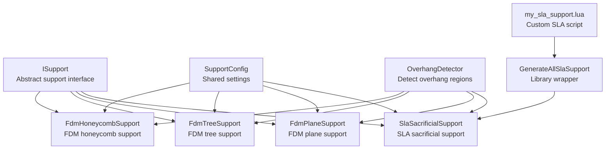
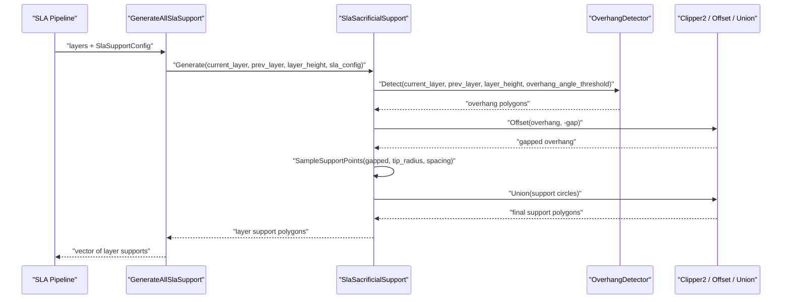
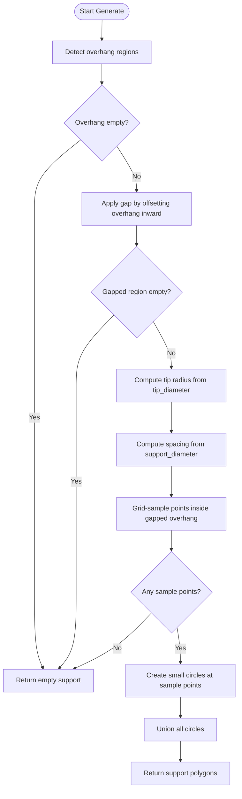
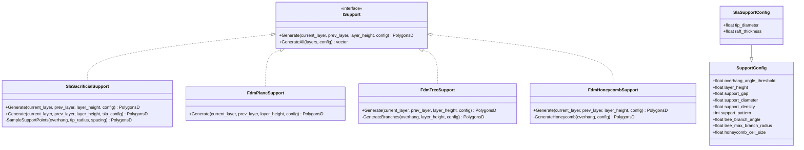
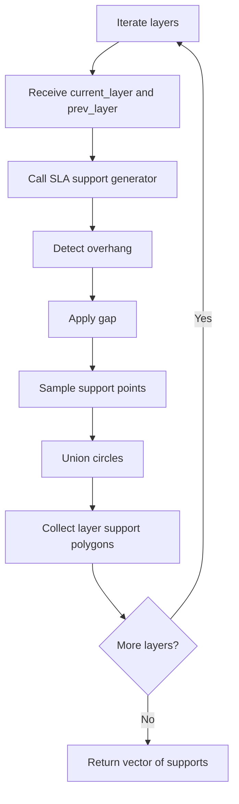
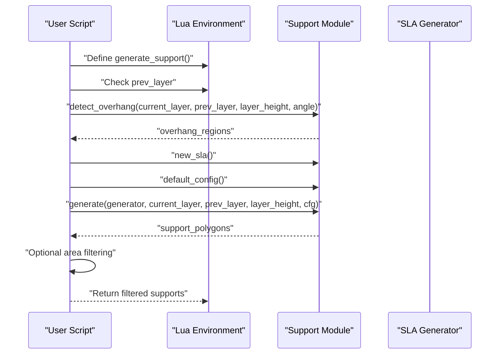
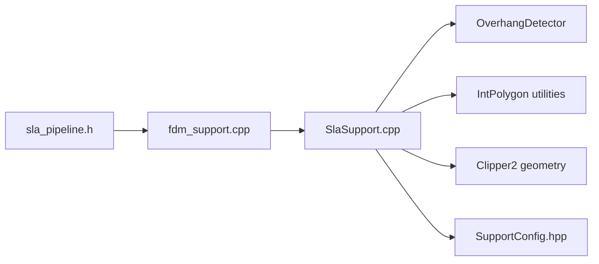

# SLA Support Generation / SLA支撑生成

<cite>
**Referenced Files in This Document**   
- [SlaSupport.hpp](file://support/SlaSupport.hpp)
- [SlaSupport.cpp](file://support/SlaSupport.cpp)
- [ISupport.hpp](file://support/ISupport.hpp)
- [SupportConfig.hpp](file://support/SupportConfig.hpp)
- [FdmSupport.hpp](file://support/FdmSupport.hpp)
- [FdmSupport.cpp](file://support/FdmSupport.cpp)
- [fdm_support.hpp](file://LibHsBaSlicer/Support/fdm_support.hpp)
- [fdm_support.cpp](file://LibHsBaSlicer/Support/fdm_support.cpp)
- [my_sla_support.lua](file://samples/SLA/scripts/my_sla_support.lua)
- [sla_pipeline.h](file://DllHsBaSlicer/sla_pipeline.h)
</cite>

## Table of Contents
1. [Introduction](#introduction)
2. [Project Structure](#project-structure)
3. [Core Components](#core-components)
4. [Architecture Overview](#architecture-overview)
5. [Detailed Component Analysis](#detailed-component-analysis)
6. [Dependency Analysis](#dependency-analysis)
7. [Performance Considerations](#performance-considerations)
8. [Troubleshooting Guide](#troubleshooting-guide)
9. [Conclusion](#conclusion)
10. [Appendices](#appendices)

## Introduction
This document explains the SLA sacrificial support generation implemented by the `SlaSacrificialSupport` class and its surrounding support system. It focuses on how temporary support structures are generated for resin printing, where supports are designed to be thin at the model contact points, easy to remove after printing, and optimized layer-by-layer for stereolithography processes.

The SLA approach differs from FDM supports: it uses small tip diameters and sparse circular support points rather than thick continuous columns or dense infill patterns. The configuration system provides shared parameters such as overhang detection angle, gap distance, support diameter, density, and pattern, plus SLA-specific fields like tip diameter and raft thickness.

## Project Structure
The SLA support implementation is part of a unified support subsystem that also contains FDM strategies and a Lua scripting interface. The key files are:

| Area | File | Responsibility |
|---|---|---|
| SLA support generator | [SlaSupport.hpp](file://support/SlaSupport.hpp), [SlaSupport.cpp](file://support/SlaSupport.cpp) | Generates thin sacrificial support circles per layer |
| Support interface | [ISupport.hpp](file://support/ISupport.hpp) | Abstract per-layer support API |
| Configuration | [SupportConfig.hpp](file://support/SupportConfig.hpp) | Shared and printer-specific support settings |
| FDM comparison | [FdmSupport.hpp](file://support/FdmSupport.hpp), [FdmSupport.cpp](file://support/FdmSupport.cpp) | Plane, tree, and honeycomb FDM supports |
| Library entry points | [fdm_support.hpp](file://LibHsBaSlicer/Support/fdm_support.hpp), [fdm_support.cpp](file://LibHsBaSlicer/Support/fdm_support.cpp) | Public C++ wrappers including SLA support generation |
| Lua customization | [my_sla_support.lua](file://samples/SLA/scripts/my_sla_support.lua) | Example custom SLA support script |
| Pipeline integration | [sla_pipeline.h](file://DllHsBaSlicer/sla_pipeline.h) | SLA pipeline stages including support |

**Diagram sources**
- [ISupport.hpp:22-44](file://support/ISupport.hpp#L22-L44)
- [SlaSupport.hpp:20-42](file://support/SlaSupport.hpp#L20-L42)
- [FdmSupport.hpp:19-63](file://support/FdmSupport.hpp#L19-L63)
- [SupportConfig.hpp:14-43](file://support/SupportConfig.hpp#L14-L43)
- [fdm_support.hpp:49-50](file://LibHsBaSlicer/Support/fdm_support.hpp#L49-L50)
- [my_sla_support.lua:32-75](file://samples/SLA/scripts/my_sla_support.lua#L32-L75)

**Section sources**
- [SlaSupport.hpp:1-46](file://support/SlaSupport.hpp#L1-L46)
- [SlaSupport.cpp:1-135](file://support/SlaSupport.cpp#L1-L135)
- [ISupport.hpp:1-49](file://support/ISupport.hpp#L1-L49)
- [SupportConfig.hpp:1-47](file://support/SupportConfig.hpp#L1-L47)
- [FdmSupport.hpp:1-67](file://support/FdmSupport.hpp#L1-L67)
- [FdmSupport.cpp:1-269](file://support/FdmSupport.cpp#L1-L269)
- [fdm_support.hpp:37-71](file://LibHsBaSlicer/Support/fdm_support.hpp#L37-L71)
- [fdm_support.cpp:1-37](file://LibHsBaSlicer/Support/fdm_support.cpp#L1-L37)
- [my_sla_support.lua:1-76](file://samples/SLA/scripts/my_sla_support.lua#L1-L76)
- [sla_pipeline.h:17-40](file://DllHsBaSlicer/sla_pipeline.h#L17-L40)

## Core Components
The SLA support system centers on a thin-column sacrificial strategy:

- **`SlaSacrificialSupport`**: Implements per-layer support generation using small circular tips sampled inside detected overhang regions.
- **`ISupport`**: Defines the common interface for all support generators, allowing FDM, SLA, and Lua-based strategies to be used uniformly.
- **`SupportConfig`**: Holds shared parameters such as overhang angle threshold, layer height, gap, support diameter, density, and pattern selection.
- **`SlaSupportConfig`**: Extends shared config with SLA-specific fields like tip diameter and raft thickness.
- **Overhang detection**: Uses an overhang detector to find regions where the current layer extends beyond the previous layer beyond a configurable angle.
- **Layer-by-layer generation**: Each layer receives current and previous layer contours and returns support polygons for that slice.

Key responsibilities:

| Component | Responsibility |
|---|---|
| `SlaSacrificialSupport::Generate` | Detect overhang, apply gap, sample support points, union into final support polygons |
| `SampleSupportPoints` | Grid-sample candidate points inside the gapped overhang region and create small circles |
| `ISupport::GenerateAll` | Default iteration over layers (used by higher-level pipelines) |
| `SupportConfig` | Provides defaults and shared tuning knobs |
| `SlaSupportConfig` | Adds SLA-specific removal-friendly geometry controls |

**Section sources**
- [SlaSupport.hpp:13-42](file://support/SlaSupport.hpp#L13-L42)
- [SlaSupport.cpp:38-123](file://support/SlaSupport.cpp#L38-L123)
- [ISupport.hpp:16-44](file://support/ISupport.hpp#L16-L44)
- [SupportConfig.hpp:11-43](file://support/SupportConfig.hpp#L11-L43)

## Architecture Overview
The SLA support flow integrates overhang detection, geometric offsetting, point sampling, and polygon union operations. At the library level, `GenerateAllSlaSupport` exposes SLA support generation through a public wrapper, while the SLA pipeline includes support as one of its processing stages.

**Diagram sources**
- [SlaSupport.cpp:81-123](file://support/SlaSupport.cpp#L81-L123)
- [fdm_support.hpp:49-50](file://LibHsBaSlicer/Support/fdm_support.hpp#L49-L50)
- [sla_pipeline.h:23-34](file://DllHsBaSlicer/sla_pipeline.h#L23-L34)

## Detailed Component Analysis

### SLA Sacrificial Support Algorithm
The SLA sacrificial support algorithm generates minimal-contact temporary structures suitable for resin printing. Instead of filling overhang areas with solid columns or dense patterns, it places small circular support points spaced apart. This reduces material usage, minimizes surface marks, and makes post-processing easier.

Algorithm steps:

1. **Detect overhang regions** using the configured overhang angle threshold.
2. **Apply a gap** by shrinking the overhang polygons so supports do not touch the model directly.
3. **Compute tip radius** from the SLA-specific tip diameter.
4. **Compute spacing** between support points based on the support diameter.
5. **Grid-sample** candidate points within the gapped overhang bounding box.
6. **Create small circles** at valid sample points.
7. **Union all circles** into final support polygons for the layer.

**Diagram sources**
- [SlaSupport.cpp:81-123](file://support/SlaSupport.cpp#L81-L123)

**Section sources**
- [SlaSupport.cpp:38-123](file://support/SlaSupport.cpp#L38-L123)

### Configuration Model
The configuration system separates shared support behavior from printer-specific details.

| Field | Type | Default | Meaning |
|---|---:|---:|---|
| `overhang_angle_threshold` | float | 45.0 | Angle threshold in degrees for overhang detection |
| `layer_height` | float | 0.2 | Layer height in millimeters |
| `support_gap` | float | 0.5 | Gap between support and model in millimeters |
| `support_diameter` | float | 2.0 | Base support column diameter in millimeters |
| `support_density` | float | 0.3 | Support fill density from 0 to 1 |
| `support_pattern` | int | 0 | Pattern selector: 0=Plane, 1=Tree, 2=Honeycomb |
| `tree_branch_angle` | float | 30.0 | Tree branch angle in degrees |
| `tree_max_branch_radius` | float | 5.0 | Maximum tree branch radius in millimeters |
| `honeycomb_cell_size` | float | 5.0 | Honeycomb cell size in millimeters |
| `tip_diameter` | float | 0.3 | SLA-specific tip diameter in millimeters |
| `raft_thickness` | float | 0.5 | SLA-specific raft layer thickness in millimeters |

For SLA sacrificial supports:

- `tip_diameter` controls the contact circle size; smaller values reduce adhesion area.
- `support_diameter` influences both spacing and base footprint.
- `support_gap` ensures supports do not fuse directly to the model surface.
- `support_density` and `support_pattern` are shared fields but primarily affect FDM strategies; SLA currently uses sparse circular points rather than dense infill patterns.

**Section sources**
- [SupportConfig.hpp:14-43](file://support/SupportConfig.hpp#L14-L43)

### Class Relationships
The SLA support class implements the generic support interface and relies on shared geometry utilities.

**Diagram sources**
- [ISupport.hpp:22-44](file://support/ISupport.hpp#L22-L44)
- [SupportConfig.hpp:14-43](file://support/SupportConfig.hpp#L14-L43)
- [SlaSupport.hpp:20-42](file://support/SlaSupport.hpp#L20-L42)
- [FdmSupport.hpp:19-63](file://support/FdmSupport.hpp#L19-L63)

**Section sources**
- [ISupport.hpp:16-44](file://support/ISupport.hpp#L16-L44)
- [SupportConfig.hpp:11-43](file://support/SupportConfig.hpp#L11-L43)
- [SlaSupport.hpp:13-42](file://support/SlaSupport.hpp#L13-L42)
- [FdmSupport.hpp:13-63](file://support/FdmSupport.hpp#L13-L63)

### Differences Between SLA and FDM Supports
SLA sacrificial supports differ from FDM supports in geometry, material usage, and post-processing behavior.

| Aspect | SLA Sacrificial Supports | FDM Plane Support | FDM Tree Support | FDM Honeycomb Support |
|---|---|---|---|---|
| Contact geometry | Small circular tips | Inflated overhang columns | Branch tips with upward growth | Hexagonal cells |
| Material usage | Sparse points | Solid-like columns | Branching structure | Lightweight cellular fill |
| Removal difficulty | Low due to small contact area | Higher due to larger contact area | Moderate branching connections | Easier due to open cell structure |
| Surface marking risk | Lower with small tips | Higher if gap is too small | Moderate at branch roots | Lower but can leave cell marks |
| Best use case | Resin models needing clean surfaces | General FDM overhangs | Tall or complex overhangs | Large flat overhangs |

Implementation differences:

- SLA uses `tip_diameter` to create small circles and `spacing = support_diameter * 2`.
- FDM plane support inflates the gapped overhang by `support_diameter / 2`.
- FDM tree support samples branch tips with spacing proportional to `support_diameter`.
- FDM honeycomb support fills the gapped overhang with hexagonal cells.

**Section sources**
- [SlaSupport.cpp:104-123](file://support/SlaSupport.cpp#L104-L123)
- [FdmSupport.cpp:48-76](file://support/FdmSupport.cpp#L48-L76)
- [FdmSupport.cpp:81-167](file://support/FdmSupport.cpp#L81-L167)
- [FdmSupport.cpp:173-266](file://support/FdmSupport.cpp#L173-L266)

### Layer-by-Layer Generation for Resin Printing
Resin printing builds models layer by layer, and support generation must produce cross-section polygons for each slice. The SLA support generator receives:

- `current_layer`: Polygon contours of the current model slice.
- `prev_layer`: Polygon contours of the previous slice.
- `layer_height`: Vertical distance between slices.
- `config`: Support configuration.

The generator returns support polygons for that specific layer. Higher-level code iterates over all layers and collects results.

**Diagram sources**
- [ISupport.hpp:38-44](file://support/ISupport.hpp#L38-L44)
- [SlaSupport.cpp:81-123](file://support/SlaSupport.cpp#L81-L123)

**Section sources**
- [ISupport.hpp:27-44](file://support/ISupport.hpp#L27-L44)
- [SlaSupport.cpp:81-133](file://support/SlaSupport.cpp#L81-L133)

### Lua Scripting Integration
The SLA support system can be customized through Lua scripts. The example script demonstrates:

- Checking whether the first layer exists.
- Detecting overhang regions.
- Creating an SLA support generator.
- Configuring support parameters.
- Generating support polygons.
- Optionally filtering results by area.

**Diagram sources**
- [my_sla_support.lua:32-75](file://samples/SLA/scripts/my_sla_support.lua#L32-L75)

**Section sources**
- [my_sla_support.lua:1-76](file://samples/SLA/scripts/my_sla_support.lua#L1-L76)

## Dependency Analysis
The SLA support generator depends on several core components:

- **Overhang detection**: Determines where supports are needed.
- **2D geometry utilities**: Integerization, offsetting, point-in-polygon tests, and polygon unions.
- **Configuration structs**: Provide shared and SLA-specific parameters.
- **Library wrapper**: Exposes SLA support generation to higher-level code.
- **Pipeline stage**: Includes support generation in the full SLA slicing workflow.

**Diagram sources**
- [SlaSupport.cpp:1-12](file://support/SlaSupport.cpp#L1-L12)
- [fdm_support.cpp:1-37](file://LibHsBaSlicer/Support/fdm_support.cpp#L1-L37)
- [sla_pipeline.h:23-34](file://DllHsBaSlicer/sla_pipeline.h#L23-L34)

**Section sources**
- [SlaSupport.cpp:1-12](file://support/SlaSupport.cpp#L1-L12)
- [fdm_support.cpp:1-37](file://LibHsBaSlicer/Support/fdm_support.cpp#L1-L37)
- [sla_pipeline.h:17-40](file://DllHsBaSlicer/sla_pipeline.h#L17-L40)

## Performance Considerations
The SLA sacrificial support algorithm is designed for efficiency:

- **Bounding box sampling**: Candidate points are generated only within the overhang bounding box.
- **Early exits**: Empty overhangs, empty gapped regions, and zero spacing return quickly.
- **Integerized geometry**: Point-in-polygon checks use integer coordinates for robustness.
- **Single union pass**: All support circles are collected and then unioned once.

Potential optimization opportunities:

- Adaptive spacing based on local overhang curvature.
- Spatial hashing for faster point-in-polygon queries.
- Parallel sampling across tiles for large models.
- Progressive refinement for high-resolution resin prints.

[No sources needed since this section provides general guidance]

## Troubleshooting Guide
Common SLA support issues and their likely causes:

| Symptom | Likely Cause | Recommended Action |
|---|---|---|
| No supports generated | Overhang angle threshold too low or no overhangs detected | Increase `overhang_angle_threshold` or verify model geometry |
| Supports too sparse | `support_diameter` too large or `tip_diameter` too small relative to overhang | Reduce `support_diameter`, increase `tip_diameter`, or adjust `support_gap` |
| Supports too dense | `support_diameter` too small or spacing calculation produces too many points | Increase `support_diameter` |
| Supports touch model surface | `support_gap` too small | Increase `support_gap` |
| Supports hard to remove | `tip_diameter` too large | Reduce `tip_diameter` |
| First layer has unnecessary supports | Script does not skip first layer | Ensure first-layer check in custom Lua script |
| Very slow generation | Large model with dense sampling | Reduce resolution, increase spacing, or tile processing |

Debugging tips:

- Inspect intermediate overhang polygons before gap application.
- Visualize gapped overhang regions to confirm expected shrinkage.
- Check sample point density by visualizing circles before union.
- Use the Lua script to add logging or filtering steps.

**Section sources**
- [SlaSupport.cpp:81-123](file://support/SlaSupport.cpp#L81-L123)
- [my_sla_support.lua:34-72](file://samples/SLA/scripts/my_sla_support.lua#L34-L72)

## Conclusion
The SLA sacrificial support implementation provides a lightweight, removal-friendly support strategy tailored for resin printing. By generating small circular contact points instead of thick columns or dense infill, it reduces material usage and post-processing effort. The configuration system allows fine control over overhang detection, gap distance, tip size, and spacing, while the layered architecture keeps SLA logic separate from FDM strategies. For most SLA models, tuning `tip_diameter`, `support_diameter`, and `support_gap` yields reliable results, and Lua scripting enables advanced customization when built-in behavior is insufficient.

[No sources needed since this section summarizes without analyzing specific files]

## Appendices

### SLA vs FDM Support Comparison Summary
| Property | SLA Sacrificial Support | FDM Plane Support | FDM Tree Support | FDM Honeycomb Support |
|---|---|---|---|---|
| Primary goal | Minimal adhesion, easy removal | Simple overhang bridging | Complex overhang coverage | Lightweight rigid fill |
| Contact shape | Small circles | Inflated columns | Branch tips | Hexagonal cells |
| Typical tip size | Small (`tip_diameter`) | Medium (`support_diameter`) | Medium (`support_diameter`) | N/A |
| Material volume | Low | Medium to high | Medium | Low to medium |
| Post-processing | Easy | Moderate | Moderate | Moderate |
| Recommended default | `tip_diameter ≈ 0.3 mm` | `support_diameter ≈ 2.0 mm` | `support_diameter ≈ 2.0 mm` | `honeycomb_cell_size ≈ 5.0 mm` |

**Section sources**
- [SupportConfig.hpp:14-43](file://support/SupportConfig.hpp#L14-L43)
- [SlaSupport.cpp:104-123](file://support/SlaSupport.cpp#L104-L123)
- [FdmSupport.cpp:48-76](file://support/FdmSupport.cpp#L48-L76)
- [FdmSupport.cpp:81-167](file://support/FdmSupport.cpp#L81-L167)
- [FdmSupport.cpp:173-266](file://support/FdmSupport.cpp#L173-L266)