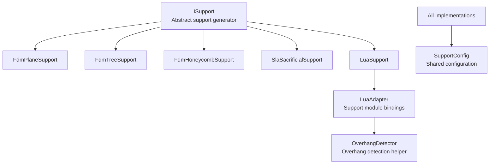
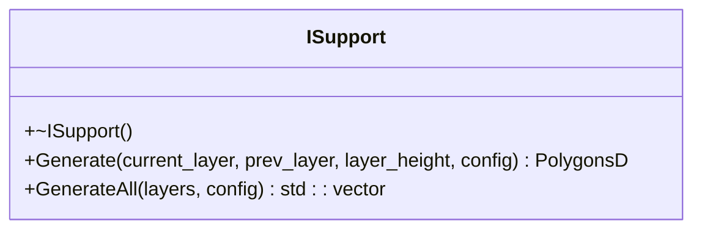
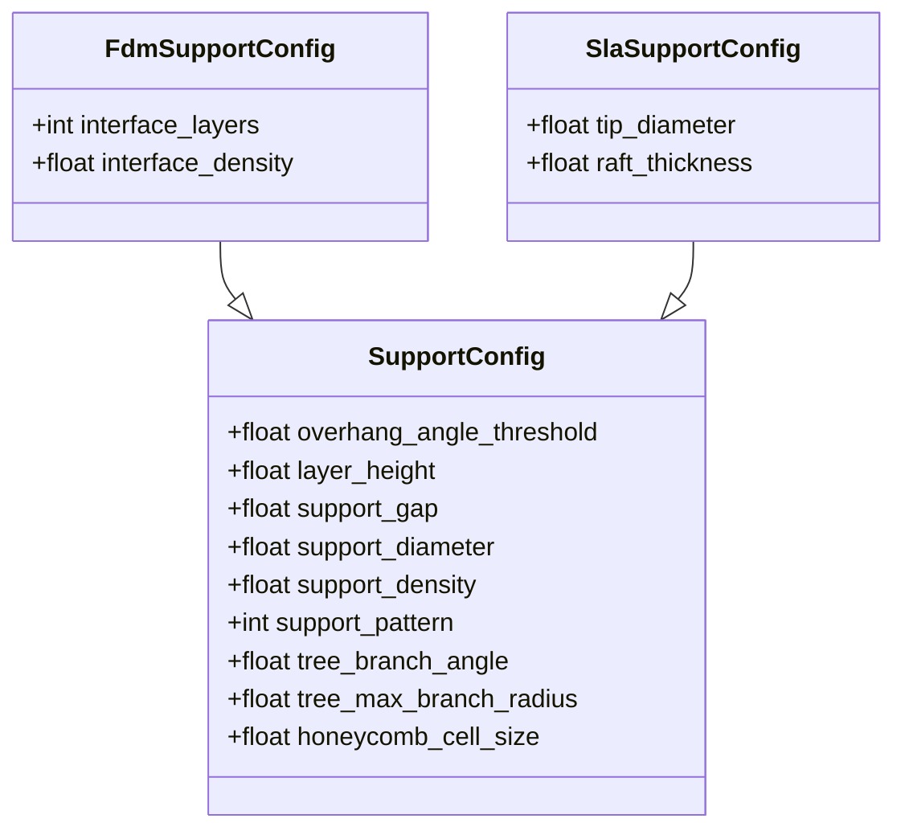
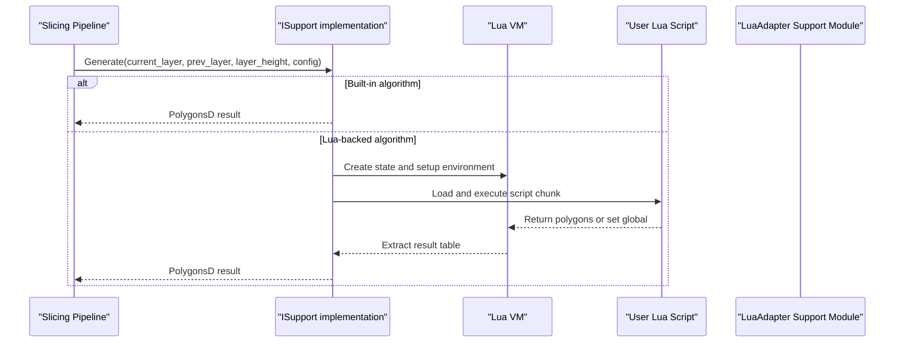
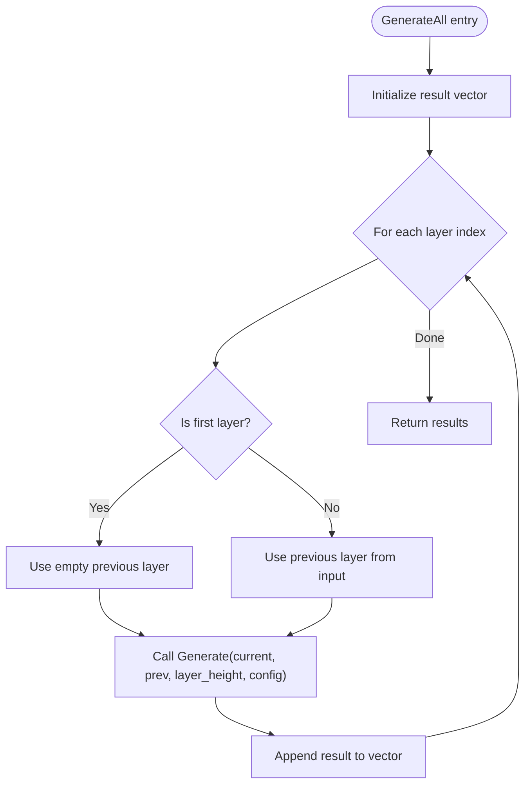
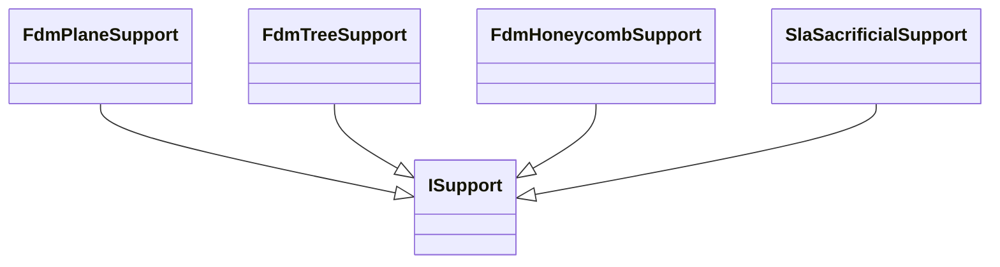
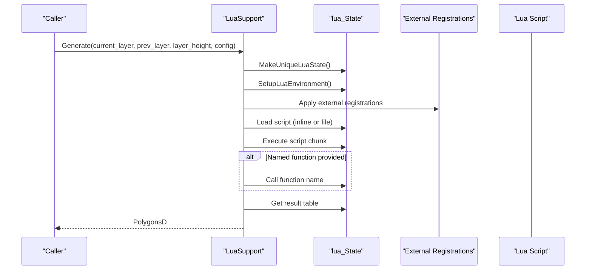
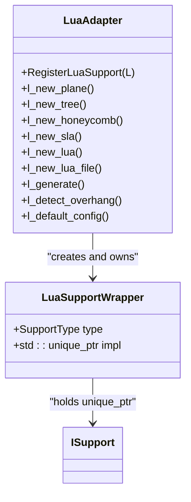
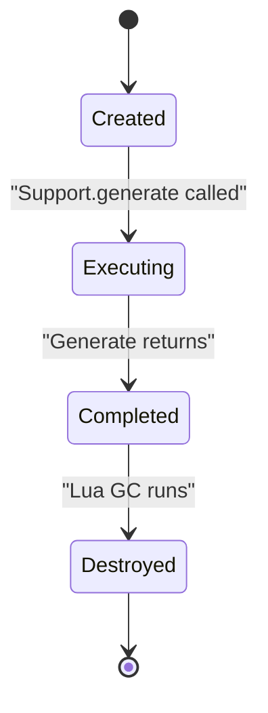
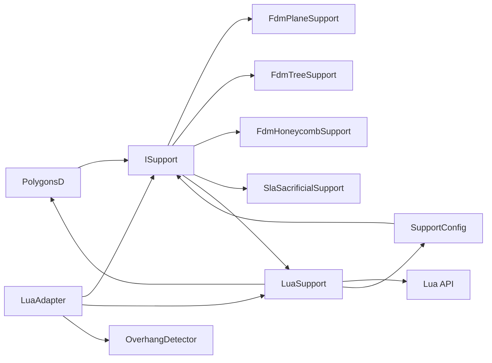

# Support Interface System / 支撑接口系统

<cite>
**Referenced Files in This Document**
- [ISupport.hpp](file://support/ISupport.hpp)
- [ISupport.cpp](file://support/ISupport.cpp)
- [SupportConfig.hpp](file://support/SupportConfig.hpp)
- [FdmSupport.hpp](file://support/FdmSupport.hpp)
- [SlaSupport.hpp](file://support/SlaSupport.hpp)
- [LuaSupport.hpp](file://support/LuaSupport.hpp)
- [LuaSupport.cpp](file://support/LuaSupport.cpp)
- [LuaAdapter.hpp](file://support/LuaAdapter.hpp)
- [LuaAdapter.cpp](file://support/LuaAdapter.cpp)
- [OverhangDetector.hpp](file://support/OverhangDetector.hpp)
- [support_test.cpp](file://tests/Support/support_test.cpp)
</cite>

## Table of Contents
1. [Introduction](#introduction)
2. [Project Structure](#project-structure)
3. [Core Components](#core-components)
4. [Architecture Overview](#architecture-overview)
5. [Detailed Component Analysis](#detailed-component-analysis)
6. [Dependency Analysis](#dependency-analysis)
7. [Performance Considerations](#performance-considerations)
8. [Troubleshooting Guide](#troubleshooting-guide)
9. [Conclusion](#conclusion)
10. [Appendices](#appendices)

## Introduction
This document explains the abstract support interface system that enables extensible, per-layer support generation for slicing pipelines. It focuses on:
- The `ISupport` base class and its required `Generate` method signature.
- The shared `SupportConfig` configuration model used by all support algorithms.
- Built-in support strategies such as FDM plane/tree/honeycomb and SLA sacrificial supports.
- Lua-based custom support integration through `LuaSupport`, including function registration, type binding, and memory management.
- The plugin-style architecture exposed to Lua scripts via the `Support` module, enabling third-party or user-defined support logic without modifying core C++ code.

The goal is to help both C++ developers extending the slicer and script authors writing custom support algorithms understand how to implement, register, and integrate new support strategies into the pipeline.

## Project Structure
The support subsystem lives under `support/`. Its main responsibilities are:
- Defining the abstract support generator interface.
- Providing built-in support implementations.
- Exposing a Lua-accessible API for creating and running support generators.
- Bridging between C++ data structures and Lua tables.

**Diagram sources**
- [ISupport.hpp:22-45](file://support/ISupport.hpp#L22-L45)
- [FdmSupport.hpp:19-63](file://support/FdmSupport.hpp#L19-L63)
- [SlaSupport.hpp:20-42](file://support/SlaSupport.hpp#L20-L42)
- [LuaSupport.hpp:40-81](file://support/LuaSupport.hpp#L40-L81)
- [LuaAdapter.cpp:253-276](file://support/LuaAdapter.cpp#L253-L276)
- [SupportConfig.hpp:14-43](file://support/SupportConfig.hpp#L14-L43)

**Section sources**
- [ISupport.hpp:1-49](file://support/ISupport.hpp#L1-L49)
- [LuaAdapter.hpp:1-34](file://support/LuaAdapter.hpp#L1-L34)

## Core Components
This section documents the foundational types and interfaces that every support algorithm must follow.

### ISupport Base Class
`ISupport` defines the contract for per-layer support generation. Implementations receive current and previous layer contours, layer height, and shared configuration, then return support polygons for the current layer.

Key points:
- `Generate` is pure virtual; all concrete support algorithms must implement it.
- `GenerateAll` provides a default loop over layers, calling `Generate` with the previous layer and `config.layer_height`.
- The interface is designed so that built-in algorithms and Lua-backed algorithms can be used interchangeably.

**Diagram sources**
- [ISupport.hpp:22-45](file://support/ISupport.hpp#L22-L45)
- [ISupport.cpp:9-21](file://support/ISupport.cpp#L9-L21)

**Section sources**
- [ISupport.hpp:22-45](file://support/ISupport.hpp#L22-L45)
- [ISupport.cpp:9-21](file://support/ISupport.cpp#L9-L21)

### Support Configuration Model
`SupportConfig` centralizes parameters used by all support generators. There are also specialized configurations for FDM and SLA.

Important fields:
- `overhang_angle_threshold`: angle threshold used to detect overhang regions.
- `layer_height`: layer thickness in millimeters.
- `support_gap`: gap between model and support.
- `support_diameter`: diameter of support columns.
- `support_density`: fill density for support patterns.
- `support_pattern`: pattern selector (plane, tree, honeycomb).
- `tree_branch_angle`, `tree_max_branch_radius`: tree support geometry.
- `honeycomb_cell_size`: honeycomb cell size.

Specialized configs:
- `FdmSupportConfig`: adds interface layers and interface density.
- `SlaSupportConfig`: adds tip diameter and raft thickness.

**Diagram sources**
- [SupportConfig.hpp:14-43](file://support/SupportConfig.hpp#L14-L43)

**Section sources**
- [SupportConfig.hpp:14-43](file://support/SupportConfig.hpp#L14-L43)

## Architecture Overview
The support system uses an interface-driven design where multiple algorithms implement the same contract. A Lua adapter exposes these algorithms and allows scripting custom behavior.

**Diagram sources**
- [LuaSupport.cpp:113-177](file://support/LuaSupport.cpp#L113-L177)
- [LuaAdapter.cpp:174-200](file://support/LuaAdapter.cpp#L174-L200)

## Detailed Component Analysis

### ISupport Contract and Default Layer Iteration
`ISupport` enforces a uniform API for all support generators. The default `GenerateAll` iterates through layers, passing the previous layer and using `config.layer_height`.

Implementation highlights:
- First layer has no previous contour.
- Each call delegates to `Generate` with the correct arguments.
- Result vector is pre-reserved for performance.

**Diagram sources**
- [ISupport.cpp:9-21](file://support/ISupport.cpp#L9-L21)

**Section sources**
- [ISupport.cpp:9-21](file://support/ISupport.cpp#L9-L21)

### Built-in Support Strategies
Built-in strategies include FDM plane, tree, honeycomb, and SLA sacrificial supports. They all implement `ISupport::Generate`.

- FDM Plane: generates simple column supports from overhang regions.
- FDM Tree: grows branching supports upward, merging branches.
- FDM Honeycomb: fills overhang areas with hexagonal cells.
- SLA Sacrificial: creates thin tapered supports suitable for resin printing.

**Diagram sources**
- [FdmSupport.hpp:19-63](file://support/FdmSupport.hpp#L19-L63)
- [SlaSupport.hpp:20-42](file://support/SlaSupport.hpp#L20-L42)

**Section sources**
- [FdmSupport.hpp:19-63](file://support/FdmSupport.hpp#L19-L63)
- [SlaSupport.hpp:20-42](file://support/SlaSupport.hpp#L20-L42)

### LuaSupport Integration
`LuaSupport` enables users to replace built-in support generation with custom Lua scripts. It manages a Lua state, sets up globals, loads scripts, executes them, and extracts polygon results.

Key behaviors:
- Supports inline scripts or script files.
- Registers polygon helpers and the `Support` module.
- Pushes `current_layer`, `prev_layer`, `layer_height`, and `config` into Lua globals.
- Optionally calls a named function (default `generate_support`).
- Returns polygons from either the script’s return value or a global `support_polys`.

**Diagram sources**
- [LuaSupport.cpp:113-177](file://support/LuaSupport.cpp#L113-L177)
- [LuaSupport.cpp:19-90](file://support/LuaSupport.cpp#L19-L90)

**Section sources**
- [LuaSupport.hpp:40-81](file://support/LuaSupport.hpp#L40-L81)
- [LuaSupport.cpp:19-90](file://support/LuaSupport.cpp#L19-L90)
- [LuaSupport.cpp:113-177](file://support/LuaSupport.cpp#L113-L177)

### LuaAdapter Support Module and Type Binding
The `Support` module in Lua exposes factory functions and utilities:
- Factory functions: `new_plane`, `new_tree`, `new_honeycomb`, `new_sla`, `new_lua`, `new_lua_file`.
- Execution function: `generate(support_obj, current_layer, prev_layer, layer_height, config_table)`.
- Helper function: `detect_overhang(current_layer, prev_layer, layer_height, angle_deg)`.
- Configuration helper: `default_config()` returns a table with default values.

Type binding details:
- A userdata metatable `HsBaSupport` wraps `LuaSupportWrapper`, which holds a type tag and a `std::unique_ptr<ISupport>`.
- Memory management uses a custom garbage collector to destroy the wrapper and underlying C++ object.
- Configuration is read from Lua tables into `SupportConfig`.

**Diagram sources**
- [LuaAdapter.cpp:33-39](file://support/LuaAdapter.cpp#L33-L39)
- [LuaAdapter.cpp:110-172](file://support/LuaAdapter.cpp#L110-L172)
- [LuaAdapter.cpp:174-200](file://support/LuaAdapter.cpp#L174-L200)
- [LuaAdapter.cpp:202-241](file://support/LuaAdapter.cpp#L202-L241)
- [LuaAdapter.cpp:243-276](file://support/LuaAdapter.cpp#L243-L276)

**Section sources**
- [LuaAdapter.hpp:13-30](file://support/LuaAdapter.hpp#L13-L30)
- [LuaAdapter.cpp:43-108](file://support/LuaAdapter.cpp#L43-L108)
- [LuaAdapter.cpp:110-172](file://support/LuaAdapter.cpp#L110-L172)
- [LuaAdapter.cpp:174-200](file://support/LuaAdapter.cpp#L174-L200)
- [LuaAdapter.cpp:202-241](file://support/LuaAdapter.cpp#L202-L241)
- [LuaAdapter.cpp:243-276](file://support/LuaAdapter.cpp#L243-L276)

### Plugin Architecture and Lifecycle Management
The plugin-like architecture is achieved through:
- An abstract interface (`ISupport`) that decouples callers from concrete algorithms.
- Lua factories that create instances of built-in or script-based support generators.
- A wrapper holding a smart pointer to ensure proper lifecycle management.
- Optional external registrations allowing additional Lua functions to be bound at runtime.

Lifecycle stages:
1. Creation: Lua factories construct `LuaSupportWrapper` with a specific `ISupport` implementation.
2. Execution: `Support.generate` invokes `Generate` on the wrapped implementation.
3. Destruction: Lua GC triggers the wrapper destructor, releasing the C++ object.

**Diagram sources**
- [LuaAdapter.cpp:33-39](file://support/LuaAdapter.cpp#L33-L39)
- [LuaAdapter.cpp:174-200](file://support/LuaAdapter.cpp#L174-L200)
- [LuaAdapter.cpp:243-251](file://support/LuaAdapter.cpp#L243-L251)

**Section sources**
- [LuaAdapter.cpp:33-39](file://support/LuaAdapter.cpp#L33-L39)
- [LuaAdapter.cpp:174-200](file://support/LuaAdapter.cpp#L174-L200)
- [LuaAdapter.cpp:243-251](file://support/LuaAdapter.cpp#L243-L251)

### Examples of Custom Support Strategies
There are two primary ways to provide custom support strategies:

1. C++ Implementation
   - Create a new class implementing `ISupport::Generate`.
   - Use `SupportConfig` for shared parameters.
   - Integrate by constructing your class and calling `Generate` or `GenerateAll`.

2. Lua Scripting
   - Provide a Lua script that computes support polygons.
   - Use the `Support` module to access built-in helpers like `detect_overhang`.
   - Either return polygons from the script’s main chunk or define a function (default `generate_support`) returning polygons.
   - Optionally use `Support.new_lua` or `Support.new_lua_file` to wrap the script as an `ISupport` instance.

Reference examples:
- Test coverage demonstrates registering the `Support` module and driving factory functions and overhang detection.

**Section sources**
- [support_test.cpp:362-385](file://tests/Support/support_test.cpp#L362-L385)

## Dependency Analysis
The support subsystem has clear dependency boundaries:
- `ISupport` depends on polygon types and `SupportConfig`.
- Built-in strategies depend on `ISupport` and may use overhang detection.
- `LuaSupport` depends on `ISupport`, Lua APIs, and adapters for polygon conversion.
- `LuaAdapter` depends on built-in strategies and `LuaSupport` to expose them to Lua.

**Diagram sources**
- [ISupport.hpp:9-12](file://support/ISupport.hpp#L9-L12)
- [FdmSupport.hpp:9-63](file://support/FdmSupport.hpp#L9-L63)
- [SlaSupport.hpp:9-42](file://support/SlaSupport.hpp#L9-L42)
- [LuaSupport.hpp:9-15](file://support/LuaSupport.hpp#L9-L15)
- [LuaAdapter.cpp:11-16](file://support/LuaAdapter.cpp#L11-L16)

**Section sources**
- [ISupport.hpp:9-12](file://support/ISupport.hpp#L9-L12)
- [LuaAdapter.cpp:11-16](file://support/LuaAdapter.cpp#L11-L16)

## Performance Considerations
- Pre-reserving vectors: `GenerateAll` reserves space for results to avoid reallocations.
- Per-layer processing: Algorithms operate on single-layer inputs, enabling incremental computation and easier parallelization if needed.
- Lua overhead: Creating a Lua state and loading scripts incurs cost; reuse strategies or caching may be considered for repeated executions.
- Polygon conversions: Converting between C++ polygons and Lua tables involves copying; minimize unnecessary conversions in hot paths.

[No sources needed since this section provides general guidance]

## Troubleshooting Guide
Common issues and resolutions:
- Lua state creation failure: `LuaSupport` throws a runtime error when it cannot create a Lua state. Check environment and Lua library availability.
- Script load errors: If `luaL_loadbuffer` or `luaL_loadfile` fails, the error message is propagated. Verify script syntax and file paths.
- Runtime execution errors: `lua_pcall` failures are caught and converted to runtime errors. Inspect script logic and returned values.
- Missing function name: If a named function is specified but not found, the script’s main chunk result is still used. Ensure the function exists if relying on it.
- Invalid support object in Lua: Calling `Support.generate` with an invalid userdata raises an error. Confirm objects are created via supported factory functions.

**Section sources**
- [LuaSupport.cpp:113-177](file://support/LuaSupport.cpp#L113-L177)
- [LuaAdapter.cpp:174-200](file://support/LuaAdapter.cpp#L174-L200)

## Conclusion
The support interface system provides a clean, extensible foundation for generating per-layer support structures. By adhering to the `ISupport` contract and leveraging `SupportConfig`, developers can add new algorithms seamlessly. The Lua integration offers flexibility for rapid experimentation and customization, while the adapter ensures safe memory management and consistent type binding. This design supports both high-performance built-in strategies and user-driven scripting workflows.

[No sources needed since this section summarizes without analyzing specific files]

## Appendices

### API Reference Summary

#### ISupport Methods
- `Generate(current_layer, prev_layer, layer_height, config)`
  - Parameters:
    - `current_layer`: Current layer polygons.
    - `prev_layer`: Previous layer polygons (empty for first layer).
    - `layer_height`: Layer height in millimeters.
    - `config`: Shared support configuration.
  - Returns: Support polygons for the current layer.
- `GenerateAll(layers, config)`
  - Parameters:
    - `layers`: Vector of layer polygons from bottom to top.
    - `config`: Shared support configuration.
  - Returns: Vector of support polygons per layer.

**Section sources**
- [ISupport.hpp:27-44](file://support/ISupport.hpp#L27-L44)
- [ISupport.cpp:9-21](file://support/ISupport.cpp#L9-L21)

#### SupportConfig Fields
- `overhang_angle_threshold`: float
- `layer_height`: float
- `support_gap`: float
- `support_diameter`: float
- `support_density`: float
- `support_pattern`: int
- `tree_branch_angle`: float
- `tree_max_branch_radius`: float
- `honeycomb_cell_size`: float

**Section sources**
- [SupportConfig.hpp:14-25](file://support/SupportConfig.hpp#L14-L25)

#### LuaAdapter Support Module Functions
- `Support.new_plane()`
- `Support.new_tree()`
- `Support.new_honeycomb()`
- `Support.new_sla()`
- `Support.new_lua(script [, funcName])`
- `Support.new_lua_file(path, funcName)`
- `Support.generate(support_obj, current_layer, prev_layer, layer_height, config_table)`
- `Support.detect_overhang(current_layer, prev_layer, layer_height, angle_deg)`
- `Support.default_config()`

**Section sources**
- [LuaAdapter.hpp:13-30](file://support/LuaAdapter.hpp#L13-L30)
- [LuaAdapter.cpp:253-276](file://support/LuaAdapter.cpp#L253-L276)