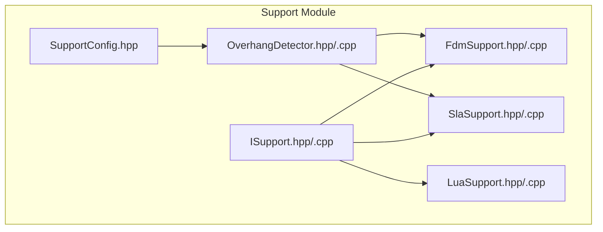
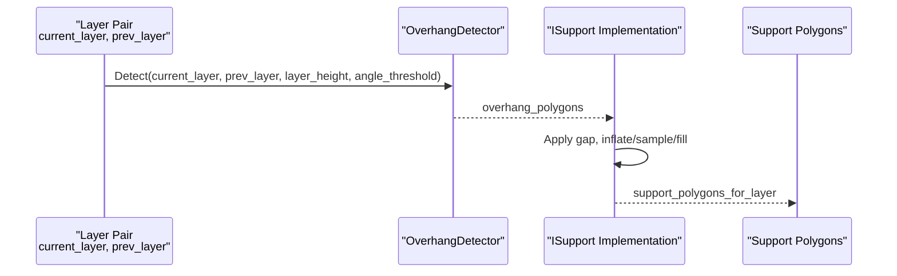
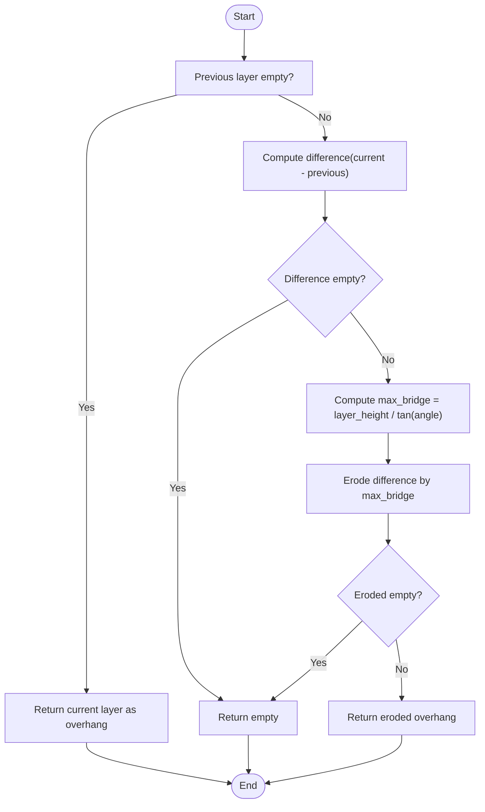
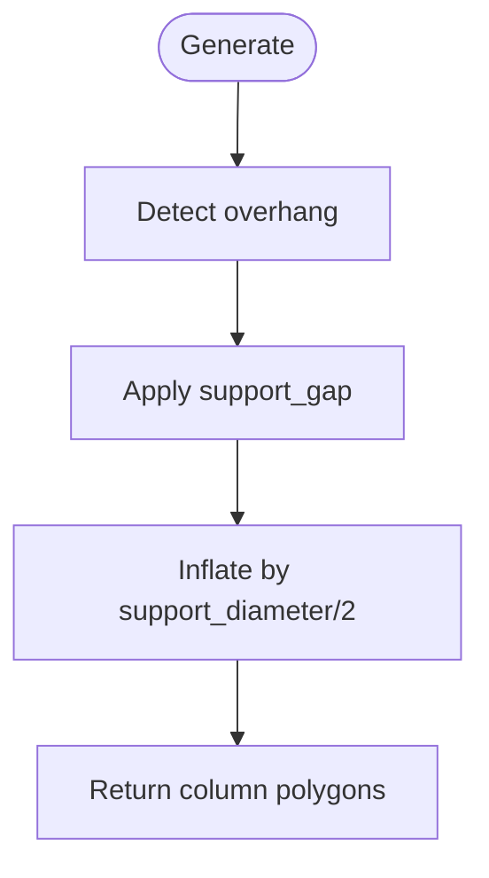
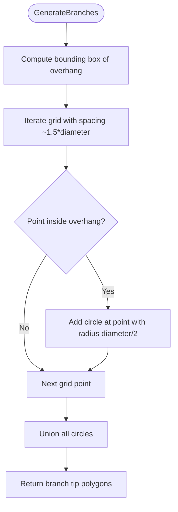
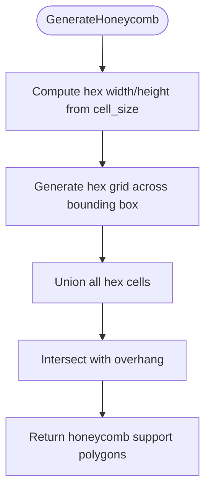
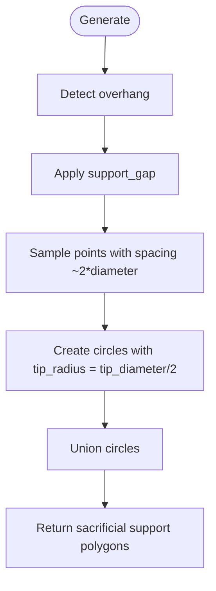
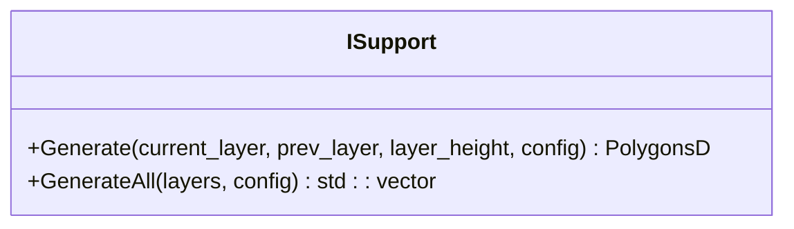
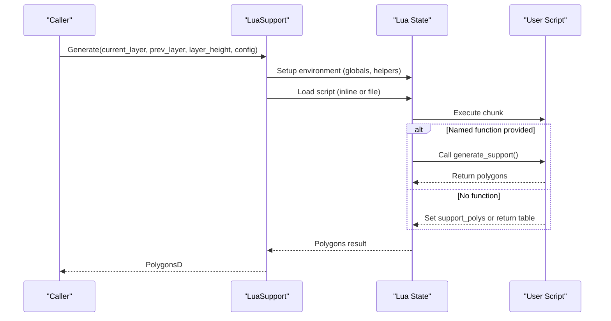
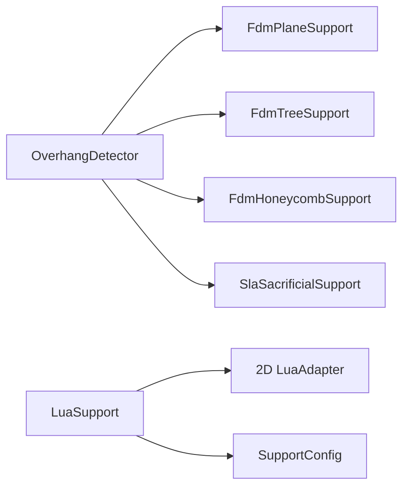

# Support Structure Generation / 支撑结构生成

<cite>
**Referenced Files in This Document**   
- [FdmSupport.hpp](file://support/FdmSupport.hpp)
- [FdmSupport.cpp](file://support/FdmSupport.cpp)
- [SlaSupport.hpp](file://support/SlaSupport.hpp)
- [SlaSupport.cpp](file://support/SlaSupport.cpp)
- [OverhangDetector.hpp](file://support/OverhangDetector.hpp)
- [OverhangDetector.cpp](file://support/OverhangDetector.cpp)
- [ISupport.hpp](file://support/ISupport.hpp)
- [ISupport.cpp](file://support/ISupport.cpp)
- [LuaSupport.hpp](file://support/LuaSupport.hpp)
- [LuaSupport.cpp](file://support/LuaSupport.cpp)
- [SupportConfig.hpp](file://support/SupportConfig.hpp)
</cite>

## Table of Contents
1. [Introduction](#introduction)
2. [Project Structure](#project-structure)
3. [Core Components](#core-components)
4. [Architecture Overview](#architecture-overview)
5. [Detailed Component Analysis](#detailed-component-analysis)
6. [Dependency Analysis](#dependency-analysis)
7. [Performance Considerations](#performance-considerations)
8. [Troubleshooting Guide](#troubleshooting-guide)
9. [Conclusion](#conclusion)
10. [Appendices](#appendices)

## Introduction
This document explains the support structure generation module that automatically creates support geometry for 3D printing. It covers:
- FDM support strategies: plane supports, tree supports with branching logic, and honeycomb internal structures.
- SLA sacrificial support generation optimized for resin printing.
- Overhang detection between consecutive layers to identify regions requiring support material.
- The ISupport abstract interface for custom support algorithms.
- LuaSupport for scripting custom support logic through a Lua environment.
- Support density controls, contact point optimization, removal strategy considerations, and performance tuning for large models.

The goal is to help both new users and advanced developers understand how support polygons are computed per layer, how different strategies trade off printability, material usage, and post-processing effort.

## Project Structure
The support module lives under `support/` and provides a layered design:
- Configuration types define shared parameters across all generators.
- OverhangDetector computes where supports are needed by comparing adjacent slices.
- ISupport defines the common generator interface.
- Concrete generators implement FDM and SLA strategies.
- LuaSupport enables user-defined support algorithms via Lua scripts.

**Diagram sources**
- [SupportConfig.hpp:11-43](file://support/SupportConfig.hpp#L11-L43)
- [OverhangDetector.hpp:14-49](file://support/OverhangDetector.hpp#L14-L49)
- [ISupport.hpp:16-44](file://support/ISupport.hpp#L16-L44)
- [FdmSupport.hpp:13-63](file://support/FdmSupport.hpp#L13-L63)
- [SlaSupport.hpp:13-42](file://support/SlaSupport.hpp#L13-L42)
- [LuaSupport.hpp:21-81](file://support/LuaSupport.hpp#L21-L81)

**Section sources**
- [SupportConfig.hpp:11-43](file://support/SupportConfig.hpp#L11-L43)
- [OverhangDetector.hpp:14-49](file://support/OverhangDetector.hpp#L14-L49)
- [ISupport.hpp:16-44](file://support/ISupport.hpp#L16-L44)
- [FdmSupport.hpp:13-63](file://support/FdmSupport.hpp#L13-L63)
- [SlaSupport.hpp:13-42](file://support/SlaSupport.hpp#L13-L42)
- [LuaSupport.hpp:21-81](file://support/LuaSupport.hpp#L21-L81)

## Core Components
- SupportConfig: Shared configuration fields including overhang angle threshold, layer height, gap, diameter, density, pattern selection, tree branch parameters, and honeycomb cell size.
- OverhangDetector: Computes unsupported regions between current and previous layers using geometric difference and erosion based on bridge distance derived from layer height and angle threshold.
- ISupport: Abstract interface defining per-layer Generate and batch GenerateAll.
- FdmPlaneSupport: Generates cylindrical column cross-sections from overhang areas after applying gap and inflation by half diameter.
- FdmTreeSupport: Places circular branch tips at sampled points within overhang; branches expand downward across layers.
- FdmHoneycombSupport: Fills overhang regions with hexagonal cells intersected against the overhang polygon set.
- SlaSacrificialSupport: Produces thin sacrificial columns with small tip diameters and configurable spacing for resin prints.
- LuaSupport: Executes user-provided Lua code to compute support polygons, exposing layer data, layer height, and config to the script.

**Section sources**
- [SupportConfig.hpp:11-43](file://support/SupportConfig.hpp#L11-L43)
- [OverhangDetector.cpp:23-87](file://support/OverhangDetector.cpp#L23-L87)
- [ISupport.cpp:9-21](file://support/ISupport.cpp#L9-L21)
- [FdmSupport.cpp:48-76](file://support/FdmSupport.cpp#L48-L76)
- [FdmSupport.cpp:145-168](file://support/FdmSupport.cpp#L145-L168)
- [FdmSupport.cpp:173-267](file://support/FdmSupport.cpp#L173-L267)
- [SlaSupport.cpp:38-133](file://support/SlaSupport.cpp#L38-L133)
- [LuaSupport.cpp:19-177](file://support/LuaSupport.cpp#L19-L177)

## Architecture Overview
The support pipeline processes each layer pair (current and previous) to produce support polygons:
1. OverhangDetector identifies unsupported regions.
2. A concrete ISupport implementation transforms overhang into support geometry according to its strategy.
3. For FDM, strategies include plane columns, tree branches, and honeycomb fill.
4. For SLA, sacrificial supports use small tips and wider base spacing.
5. LuaSupport allows full customization by running user scripts with access to layer data and configuration.

**Diagram sources**
- [OverhangDetector.cpp:41-87](file://support/OverhangDetector.cpp#L41-L87)
- [ISupport.hpp:27-44](file://support/ISupport.hpp#L27-L44)
- [FdmSupport.cpp:48-76](file://support/FdmSupport.cpp#L48-L76)
- [SlaSupport.cpp:81-133](file://support/SlaSupport.cpp#L81-L133)

## Detailed Component Analysis

### Overhang Detection Between Consecutive Layers
OverhangDetector determines where the current layer extends beyond the previous layer beyond what can be bridged given the angle threshold and layer height. It uses:
- Geometric difference between current and previous layers.
- Bridge distance calculation from layer height and angle threshold.
- Erosion (negative offset) to filter out small overhangs that can be bridged.

**Diagram sources**
- [OverhangDetector.cpp:23-87](file://support/OverhangDetector.cpp#L23-L87)

**Section sources**
- [OverhangDetector.hpp:14-49](file://support/OverhangDetector.hpp#L14-L49)
- [OverhangDetector.cpp:23-87](file://support/OverhangDetector.cpp#L23-L87)

### FDM Plane Supports
FdmPlaneSupport generates simple column supports:
- Detect overhang regions.
- Apply gap to separate support from model.
- Inflate by half support_diameter to create circular column cross-sections.

**Diagram sources**
- [FdmSupport.cpp:48-76](file://support/FdmSupport.cpp#L48-L76)

**Section sources**
- [FdmSupport.hpp:13-24](file://support/FdmSupport.hpp#L13-L24)
- [FdmSupport.cpp:48-76](file://support/FdmSupport.cpp#L48-L76)

### FDM Tree Supports with Branching Algorithms
FdmTreeSupport places circular branch tips at regular sample points within the overhang region:
- Sample points using a grid spaced by approximately 1.5 times support_diameter.
- Create circles of radius support_diameter/2 at valid points inside overhang.
- Union overlapping circles to form merged branch tips.
- Across layers, branches expand downward; this 2D step produces cross-sections that connect when processed layer-by-layer.

**Diagram sources**
- [FdmSupport.cpp:81-143](file://support/FdmSupport.cpp#L81-L143)

**Section sources**
- [FdmSupport.hpp:26-44](file://support/FdmSupport.hpp#L26-L44)
- [FdmSupport.cpp:81-168](file://support/FdmSupport.cpp#L81-L168)

### FDM Honeycomb Internal Structures
FdmHoneycombSupport fills overhang regions with hexagonal cells:
- Compute flat-top hexagons with configurable cell_size.
- Generate a grid of hexagons covering the bounding box.
- Intersect the union of hexagons with the overhang region to obtain support cells.

**Diagram sources**
- [FdmSupport.cpp:173-241](file://support/FdmSupport.cpp#L173-L241)

**Section sources**
- [FdmSupport.hpp:46-63](file://support/FdmSupport.hpp#L46-L63)
- [FdmSupport.cpp:173-267](file://support/FdmSupport.cpp#L173-L267)

### SLA Sacrificial Supports
SlaSacrificialSupport generates thin sacrificial supports suitable for resin printing:
- Detect overhang regions.
- Apply gap separation.
- Sample support points with spacing proportional to support_diameter.
- Use small tip_diameter for easy removal.
- Union circles to produce final support cross-sections.

**Diagram sources**
- [SlaSupport.cpp:38-133](file://support/SlaSupport.cpp#L38-L133)

**Section sources**
- [SlaSupport.hpp:13-42](file://support/SlaSupport.hpp#L13-L42)
- [SlaSupport.cpp:38-133](file://support/SlaSupport.cpp#L38-L133)

### ISupport Abstract Interface
ISupport defines:
- Per-layer Generate(current_layer, prev_layer, layer_height, config).
- Batch GenerateAll(layers, config) default implementation iterating layers and passing previous layer or empty for first layer.

**Diagram sources**
- [ISupport.hpp:16-44](file://support/ISupport.hpp#L16-L44)
- [ISupport.cpp:9-21](file://support/ISupport.cpp#L9-L21)

**Section sources**
- [ISupport.hpp:16-44](file://support/ISupport.hpp#L16-L44)
- [ISupport.cpp:9-21](file://support/ISupport.cpp#L9-L21)

### LuaSupport for Scripting Custom Support Logic
LuaSupport executes user-provided Lua scripts to compute support polygons:
- Exposes globals: current_layer, prev_layer, layer_height, config.
- Registers polygon helper functions and a Support module.
- Loads inline or file-based scripts, optionally calling a named function.
- Returns polygons from script return value or global support_polys.

**Diagram sources**
- [LuaSupport.cpp:19-177](file://support/LuaSupport.cpp#L19-L177)

**Section sources**
- [LuaSupport.hpp:21-81](file://support/LuaSupport.hpp#L21-L81)
- [LuaSupport.cpp:19-177](file://support/LuaSupport.cpp#L19-L177)

## Dependency Analysis
The support module has clear dependencies:
- All generators depend on OverhangDetector for identifying unsupported regions.
- Generators rely on 2D polygon operations (offset, union, intersection) via Clipper2 wrappers.
- LuaSupport depends on Lua runtime and registered polygon helpers.

**Diagram sources**
- [FdmSupport.cpp:48-76](file://support/FdmSupport.cpp#L48-L76)
- [FdmSupport.cpp:145-168](file://support/FdmSupport.cpp#L145-L168)
- [FdmSupport.cpp:173-267](file://support/FdmSupport.cpp#L173-L267)
- [SlaSupport.cpp:81-133](file://support/SlaSupport.cpp#L81-L133)
- [LuaSupport.cpp:67-90](file://support/LuaSupport.cpp#L67-L90)

**Section sources**
- [FdmSupport.cpp:48-76](file://support/FdmSupport.cpp#L48-L76)
- [FdmSupport.cpp:145-168](file://support/FdmSupport.cpp#L145-L168)
- [FdmSupport.cpp:173-267](file://support/FdmSupport.cpp#L173-L267)
- [SlaSupport.cpp:81-133](file://support/SlaSupport.cpp#L81-L133)
- [LuaSupport.cpp:67-90](file://support/LuaSupport.cpp#L67-L90)

## Performance Considerations
- Large models benefit from efficient sampling and geometry operations:
  - Tree supports use grid sampling with spacing proportional to support_diameter; reducing diameter increases point count and computational cost.
  - Honeycomb generation creates many hex cells; cell_size controls density and complexity.
  - Overhang detection performs difference and erosion; smaller angles increase bridge distance and may reduce overhang area but still require robust polygon operations.
- Memory and CPU usage:
  - Avoid excessively small gaps or diameters that inflate polygon counts.
  - Prefer larger cell sizes for honeycomb to limit number of hexagons.
  - Tune overhang_angle_threshold to balance support necessity vs. bridging capability.
- Parallelization:
  - GenerateAll iterates layers sequentially; consider parallelizing across layers if supported by the host pipeline.
- Lua scripting overhead:
  - Each call creates a Lua state; reuse or cache compiled scripts where possible to reduce initialization costs.

[No sources needed since this section provides general guidance]

## Troubleshooting Guide
Common issues and remedies:
- No supports generated:
  - Verify overhang_angle_threshold is not too high; very steep thresholds may classify everything as bridgeable.
  - Ensure layer_height matches actual slicing settings; incorrect values affect bridge distance computation.
- Supports too sparse or too dense:
  - Adjust support_diameter and spacing; larger diameters increase coverage but also material usage.
  - For honeycomb, tune honeycomb_cell_size; smaller cells increase density and complexity.
- Poor removal quality:
  - For SLA, reduce tip_diameter to ease removal; ensure raft_thickness is appropriate for build plate adhesion.
- Lua script errors:
  - Check script syntax and function name; ensure it returns polygons or sets support_polys.
  - Validate that config fields are correctly exposed and used.

**Section sources**
- [OverhangDetector.cpp:23-87](file://support/OverhangDetector.cpp#L23-L87)
- [SupportConfig.hpp:11-43](file://support/SupportConfig.hpp#L11-L43)
- [LuaSupport.cpp:141-177](file://support/LuaSupport.cpp#L141-L177)

## Conclusion
The support structure generation module provides flexible, layered support algorithms for FDM and SLA printing. OverhangDetector reliably identifies unsupported regions, while ISupport implementations offer diverse strategies:
- FDM plane supports for simple columnar structures.
- FDM tree supports for lightweight branching patterns.
- FDM honeycomb supports for rigid internal filling.
- SLA sacrificial supports for resin printing with small tips.
- LuaSupport for fully customizable support logic.

Tuning configuration parameters such as overhang_angle_threshold, support_diameter, support_gap, support_density, tree_branch_angle, tree_max_branch_radius, and honeycomb_cell_size allows balancing print quality, material usage, and post-processing effort.

[No sources needed since this section summarizes without analyzing specific files]

## Appendices

### Configuration Reference
- SupportConfig fields:
  - overhang_angle_threshold: degrees controlling bridge tolerance.
  - layer_height: mm used for bridge distance calculations.
  - support_gap: mm separating support from model.
  - support_diameter: mm for column/tree/honeycomb sizing.
  - support_density: [0,1] fill density control.
  - support_pattern: integer selecting strategy (plane/tree/honeycomb).
  - tree_branch_angle: degrees for tree branching behavior.
  - tree_max_branch_radius: mm limiting branch growth.
  - honeycomb_cell_size: mm for hex cell dimensions.
- FdmSupportConfig adds:
  - interface_layers: number of interface layers between support and model.
  - interface_density: [0,1] interface fill density.
- SlaSupportConfig adds:
  - tip_diameter: mm for sacrificial support tips.
  - raft_thickness: mm for build plate adhesion.

**Section sources**
- [SupportConfig.hpp:11-43](file://support/SupportConfig.hpp#L11-L43)