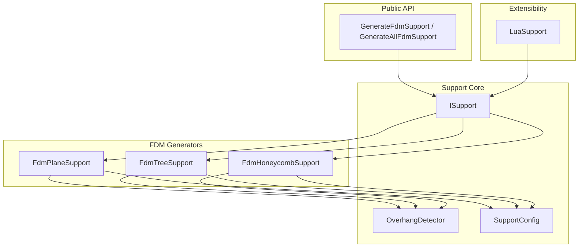
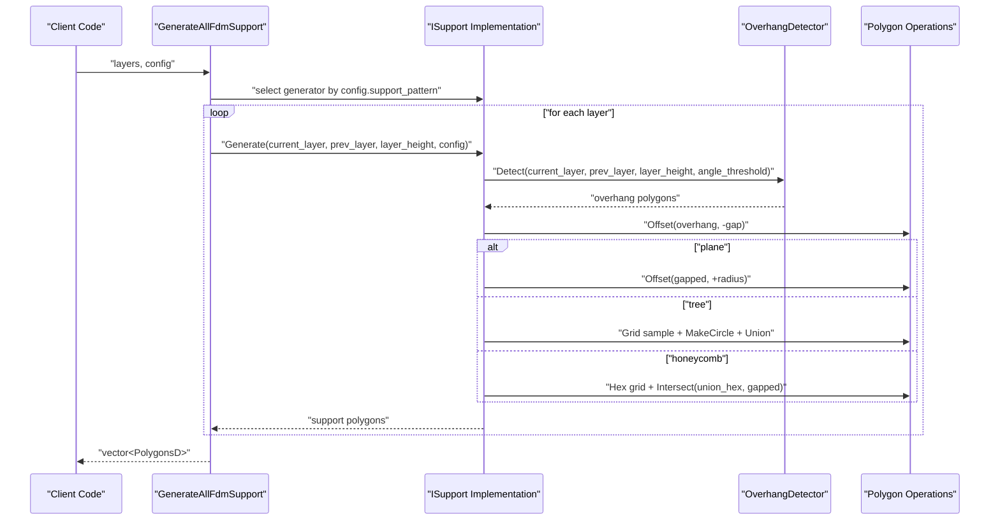
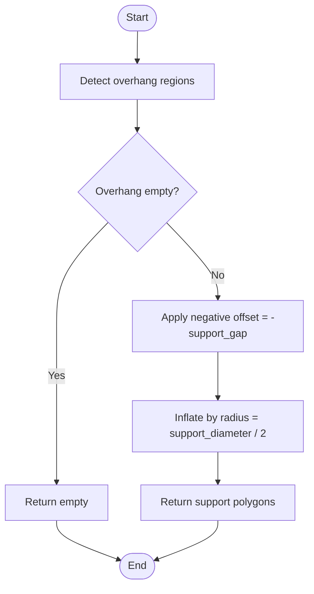
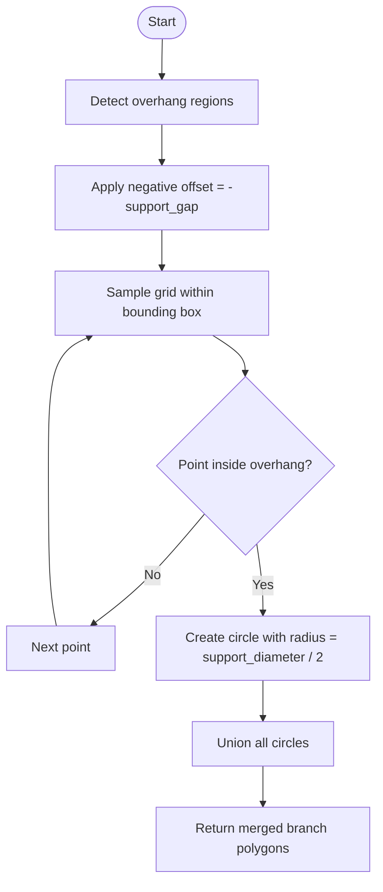
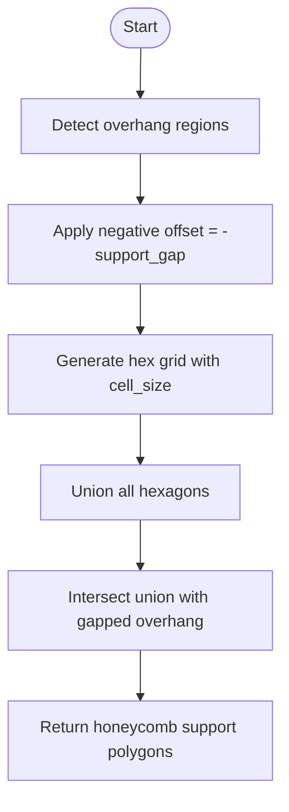
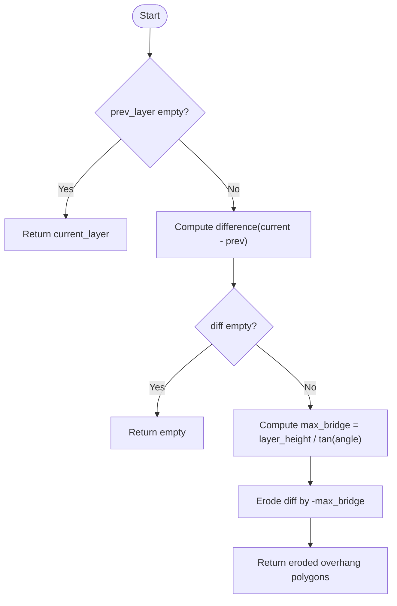
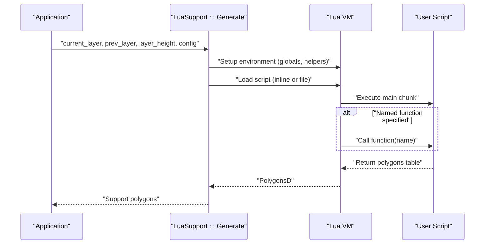
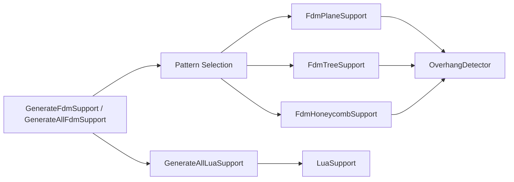

# FDM Support Generation

<cite>
**Referenced Files in This Document**
- [FdmSupport.hpp](file://support/FdmSupport.hpp)
- [FdmSupport.cpp](file://support/FdmSupport.cpp)
- [ISupport.hpp](file://support/ISupport.hpp)
- [ISupport.cpp](file://support/ISupport.cpp)
- [SupportConfig.hpp](file://support/SupportConfig.hpp)
- [OverhangDetector.hpp](file://support/OverhangDetector.hpp)
- [OverhangDetector.cpp](file://support/OverhangDetector.cpp)
- [LuaSupport.hpp](file://support/LuaSupport.hpp)
- [LuaSupport.cpp](file://support/LuaSupport.cpp)
- [fdm_support.cpp](file://LibHsBaSlicer/Support/fdm_support.cpp)
- [my_support.lua](file://samples/FDM/scripts/my_support.lua)
- [main.cpp](file://samples/FDM/main.cpp)
- [my_fdm_pipeline.lua](file://samples/Custom/scripts/my_fdm_pipeline.lua)
</cite>

## Table of Contents
1. [Introduction](#introduction)
2. [Project Structure](#project-structure)
3. [Core Components](#core-components)
4. [Architecture Overview](#architecture-overview)
5. [Detailed Component Analysis](#detailed-component-analysis)
6. [Dependency Analysis](#dependency-analysis)
7. [Performance Considerations](#performance-considerations)
8. [Troubleshooting Guide](#troubleshooting-guide)
9. [Conclusion](#conclusion)
10. [Appendices](#appendices)

## Introduction
This document explains Fused Deposition Modeling (FDM) support structure generation in the project. It covers three built-in support patterns: plane supports, tree supports, and honeycomb supports. For each pattern, it documents the algorithmic approach, configuration parameters, material usage strategies, and practical examples for different print scenarios. It also describes how to integrate custom FDM support algorithms through Lua scripting, and provides guidance on performance tuning for large models while balancing printability and material efficiency.

## Project Structure
The FDM support system is implemented under the support module and exposed via LibHsBaSlicer APIs. The key components are:
- Abstract support generator interface
- Built-in FDM support generators: plane, tree, honeycomb
- Overhang detection utility
- Configuration structures shared by all support generators
- Lua-based custom support generator
- Public API entry points that select a generator based on configuration

**Diagram sources**
- [ISupport.hpp:22-45](file://support/ISupport.hpp#L22-L45)
- [FdmSupport.hpp:19-63](file://support/FdmSupport.hpp#L19-L63)
- [OverhangDetector.hpp:20-49](file://support/OverhangDetector.hpp#L20-L49)
- [SupportConfig.hpp:14-43](file://support/SupportConfig.hpp#L14-L43)
- [LuaSupport.hpp:40-64](file://support/LuaSupport.hpp#L40-L64)
- [fdm_support.cpp:14-51](file://LibHsBaSlicer/Support/fdm_support.cpp#L14-L51)

**Section sources**
- [ISupport.hpp:22-45](file://support/ISupport.hpp#L22-L45)
- [FdmSupport.hpp:19-63](file://support/FdmSupport.hpp#L19-L63)
- [OverhangDetector.hpp:20-49](file://support/OverhangDetector.hpp#L20-L49)
- [SupportConfig.hpp:14-43](file://support/SupportConfig.hpp#L14-L43)
- [LuaSupport.hpp:40-64](file://support/LuaSupport.hpp#L40-L64)
- [fdm_support.cpp:14-51](file://LibHsBaSlicer/Support/fdm_support.cpp#L14-L51)

## Core Components
- ISupport: Abstract interface defining per-layer support generation and a default layer iterator.
- FdmPlaneSupport: Generates simple column supports from overhang regions using offset operations.
- FdmTreeSupport: Places circular branch tips within overhang areas and merges overlapping circles.
- FdmHoneycombSupport: Fills overhang regions with hexagonal cells intersected against the overhang shape.
- OverhangDetector: Computes unsupported regions between adjacent layers based on angle threshold and layer height.
- SupportConfig: Shared configuration including overhang angle, gap, diameter, density, pattern selection, tree parameters, and honeycomb cell size.
- LuaSupport: Custom support generator driven by Lua scripts, exposing polygon helpers and support utilities.

Key responsibilities:
- Detect where supports are needed.
- Apply model-support separation (gap).
- Produce per-layer support polygons for downstream path planning.

**Section sources**
- [ISupport.hpp:22-45](file://support/ISupport.hpp#L22-L45)
- [ISupport.cpp:9-20](file://support/ISupport.cpp#L9-L20)
- [FdmSupport.hpp:19-63](file://support/FdmSupport.hpp#L19-L63)
- [OverhangDetector.hpp:20-49](file://support/OverhangDetector.hpp#L20-L49)
- [SupportConfig.hpp:14-43](file://support/SupportConfig.hpp#L14-L43)
- [LuaSupport.hpp:40-64](file://support/LuaSupport.hpp#L40-L64)

## Architecture Overview
The public API selects a concrete support generator based on the configured pattern and runs either single-layer or all-layers generation. Each generator uses OverhangDetector to find unsupported regions, applies a gap, and then constructs support cross-sections according to its pattern.

**Diagram sources**
- [fdm_support.cpp:14-51](file://LibHsBaSlicer/Support/fdm_support.cpp#L14-L51)
- [FdmSupport.cpp:48-76](file://support/FdmSupport.cpp#L48-L76)
- [FdmSupport.cpp:145-168](file://support/FdmSupport.cpp#L145-L168)
- [FdmSupport.cpp:244-267](file://support/FdmSupport.cpp#L244-L267)
- [OverhangDetector.cpp:41-87](file://support/OverhangDetector.cpp#L41-L87)

## Detailed Component Analysis

### Plane Supports
Algorithm:
- Detect overhang regions using OverhangDetector.
- Apply a negative offset equal to the configured gap to separate support from the model.
- Inflate the gapped region by half the support diameter to create cylindrical columns.
- Return the resulting polygons as support cross-sections.

Parameter effects:
- support_gap: Larger gaps reduce contact area but increase removal difficulty; smaller gaps improve adhesion but may cause sticking.
- support_diameter: Larger diameters increase strength and stability but use more material; smaller diameters reduce material but may be less rigid.
- overhang_angle_threshold: Lower thresholds produce fewer supports; higher thresholds generate more conservative support placement.

Complexity considerations:
- Dominated by polygon offset and union operations; scales with overhang area and perimeter.

**Diagram sources**
- [FdmSupport.cpp:48-76](file://support/FdmSupport.cpp#L48-L76)
- [OverhangDetector.cpp:41-87](file://support/OverhangDetector.cpp#L41-L87)

**Section sources**
- [FdmSupport.cpp:48-76](file://support/FdmSupport.cpp#L48-L76)
- [OverhangDetector.cpp:41-87](file://support/OverhangDetector.cpp#L41-L87)

### Tree Supports
Algorithm:
- Detect overhang regions.
- Apply gap.
- Sample a regular grid across the bounding box of the gapped overhang.
- Place circular branch tips at sampled points inside the overhang, with radius derived from support_diameter.
- Merge overlapping circles using polygon union to form connected branches.

Parameter effects:
- support_diameter: Controls branch tip radius and spacing (spacing proportional to diameter).
- support_gap: Separates support from model.
- overhang_angle_threshold: Controls which regions require support.

Material optimization:
- Spacing and diameter trade off coverage vs. material volume.
- Merging overlapping circles reduces redundant material while maintaining connectivity.

**Diagram sources**
- [FdmSupport.cpp:81-143](file://support/FdmSupport.cpp#L81-L143)
- [FdmSupport.cpp:145-168](file://support/FdmSupport.cpp#L145-L168)

**Section sources**
- [FdmSupport.cpp:81-143](file://support/FdmSupport.cpp#L81-L143)
- [FdmSupport.cpp:145-168](file://support/FdmSupport.cpp#L145-L168)

### Honeycomb Supports
Algorithm:
- Detect overhang regions.
- Apply gap.
- Generate a grid of flat-top hexagons with configurable cell size.
- Compute the union of all hexagons.
- Intersect the union with the gapped overhang to obtain the final support pattern.

Parameter effects:
- honeycomb_cell_size: Larger cells reduce material but decrease rigidity; smaller cells increase strength and surface contact but consume more material.
- support_gap: Separation distance.
- overhang_angle_threshold: Determines overhang regions.

Complexity considerations:
- Hex grid generation is O(N_cells); intersection cost depends on polygon complexity.

**Diagram sources**
- [FdmSupport.cpp:173-242](file://support/FdmSupport.cpp#L173-L242)
- [FdmSupport.cpp:244-267](file://support/FdmSupport.cpp#L244-L267)

**Section sources**
- [FdmSupport.cpp:173-242](file://support/FdmSupport.cpp#L173-L242)
- [FdmSupport.cpp:244-267](file://support/FdmSupport.cpp#L244-L267)

### Overhang Detection
Algorithm:
- If there is no previous layer, treat the entire current layer as overhang.
- Compute the difference between current and previous layers.
- Calculate maximum bridge distance from layer height and angle threshold.
- Erode the difference by the bridge distance to filter small bridges that do not need support.
- Return the eroded polygons as overhang regions.

Practical implications:
- Increasing overhang_angle_threshold reduces max_bridge_distance, producing more supports.
- Decreasing layer_height increases resolution of overhang detection.

**Diagram sources**
- [OverhangDetector.cpp:23-39](file://support/OverhangDetector.cpp#L23-L39)
- [OverhangDetector.cpp:41-87](file://support/OverhangDetector.cpp#L41-L87)

**Section sources**
- [OverhangDetector.cpp:23-39](file://support/OverhangDetector.cpp#L23-L39)
- [OverhangDetector.cpp:41-87](file://support/OverhangDetector.cpp#L41-L87)

### Configuration Model
Shared configuration fields:
- overhang_angle_threshold: Angle used to determine overhang regions.
- layer_height: Layer thickness in mm.
- support_gap: Gap between model and support.
- support_diameter: Diameter used for plane and tree supports.
- support_density: Fill density parameter for support structures.
- support_pattern: Pattern selector (0=Plane, 1=Tree, 2=Honeycomb).
- tree_branch_angle: Tree-specific branch angle.
- tree_max_branch_radius: Tree-specific maximum branch radius.
- honeycomb_cell_size: Honeycomb cell size.

FDM-specific additions:
- interface_layers: Number of interface layers between support and model.
- interface_density: Interface fill density.

SLA-specific additions:
- tip_diameter: Small tip diameter for SLA supports.
- raft_thickness: Raft layer thickness.

**Section sources**
- [SupportConfig.hpp:14-43](file://support/SupportConfig.hpp#L14-L43)

### Lua Custom Support Generator
Purpose:
- Replace built-in support algorithms with user-defined logic via Lua scripts.
- Expose polygon helper functions and support utilities to scripts.
- Accept inline scripts or script files and optional function names.

Script environment:
- Globals: current_layer, prev_layer, layer_height, config.
- Helpers: PolygonOperations (offset, intersection, difference, union, makeCircle, area).
- Support module: new_plane, new_tree, new_honeycomb, generate, detect_overhang, default_config.

Execution flow:
- Create Lua state and register libraries.
- Push layer data and configuration into globals.
- Load and execute script chunk.
- Optionally call a named function.
- Parse returned table into PolygonsD.

Error handling:
- Throws runtime errors for Lua load and execution failures.

**Diagram sources**
- [LuaSupport.cpp:19-89](file://support/LuaSupport.cpp#L19-L89)
- [LuaSupport.cpp:113-178](file://support/LuaSupport.cpp#L113-L178)

**Section sources**
- [LuaSupport.hpp:40-64](file://support/LuaSupport.hpp#L40-L64)
- [LuaSupport.cpp:19-89](file://support/LuaSupport.cpp#L19-L89)
- [LuaSupport.cpp:113-178](file://support/LuaSupport.cpp#L113-L178)

## Dependency Analysis
The public API composes the support pipeline by selecting a generator based on configuration and iterating layers. Generators depend on OverhangDetector and polygon geometry operations. LuaSupport integrates external 2D and 3D functions into the Lua environment.

**Diagram sources**
- [fdm_support.cpp:14-51](file://LibHsBaSlicer/Support/fdm_support.cpp#L14-L51)
- [fdm_support.cpp:61-75](file://LibHsBaSlicer/Support/fdm_support.cpp#L61-L75)
- [FdmSupport.cpp:48-76](file://support/FdmSupport.cpp#L48-L76)
- [FdmSupport.cpp:145-168](file://support/FdmSupport.cpp#L145-L168)
- [FdmSupport.cpp:244-267](file://support/FdmSupport.cpp#L244-L267)
- [OverhangDetector.cpp:41-87](file://support/OverhangDetector.cpp#L41-L87)

**Section sources**
- [fdm_support.cpp:14-51](file://LibHsBaSlicer/Support/fdm_support.cpp#L14-L51)
- [fdm_support.cpp:61-75](file://LibHsBaSlicer/Support/fdm_support.cpp#L61-L75)

## Performance Considerations
- Large models:
  - Prefer tree supports for large overhangs to reduce material and improve printability compared to dense plane supports.
  - Increase honeycomb_cell_size to reduce polygon count and computational cost when rigidity allows.
- Overhang detection:
  - Adjust overhang_angle_threshold to balance support quantity and bridging capability.
  - Smaller layer_height improves detection accuracy but increases processing time.
- Polygon operations:
  - Offset and union operations dominate runtime; minimize unnecessary offsets and keep gap reasonable.
- Memory usage:
  - Avoid excessive subdivision in tree sampling; tune support_diameter and spacing to limit candidate points.
- Parallelization:
  - Use GenerateAll to iterate layers; consider parallelizing across layers if integrating with a thread pool.

[No sources needed since this section provides general guidance]

## Troubleshooting Guide
Common issues and remedies:
- Supports stick to model:
  - Increase support_gap to reduce contact area.
  - Verify overhang_angle_threshold is appropriate for the geometry.
- Weak supports causing print failure:
  - Increase support_diameter or switch to tree/honeycomb patterns.
  - Reduce honeycomb_cell_size for denser honeycomb.
- Excessive material usage:
  - Reduce support_density or increase honeycomb_cell_size.
  - Use tree supports instead of plane supports for large spans.
- Lua script errors:
  - Check script syntax and ensure return value is a table of polygons.
  - Validate function name and global variables availability.

**Section sources**
- [FdmSupport.cpp:48-76](file://support/FdmSupport.cpp#L48-L76)
- [FdmSupport.cpp:145-168](file://support/FdmSupport.cpp#L145-L168)
- [FdmSupport.cpp:244-267](file://support/FdmSupport.cpp#L244-L267)
- [LuaSupport.cpp:141-178](file://support/LuaSupport.cpp#L141-L178)

## Conclusion
The FDM support system offers flexible, efficient support generation through plane, tree, and honeycomb patterns. By tuning overhang detection, gap, diameter, density, and pattern-specific parameters, users can optimize for strength, printability, and material efficiency. Lua scripting enables full customization of support algorithms, integrating seamlessly with the existing pipeline. For large models, tree and honeycomb patterns typically provide better balance between structural integrity and material consumption.

[No sources needed since this section summarizes without analyzing specific files]

## Appendices

### Practical Configuration Examples

- Basic FDM pipeline with tree supports:
  - Set enable_support, overhang_angle, and support_pattern to tree.
  - Example reference: [main.cpp:124-128](file://samples/FDM/main.cpp#L124-L128)

- Lua-driven FDM pipeline with custom support script:
  - Configure support_lua_script and support_lua_func.
  - Example reference: [main.cpp:186-189](file://samples/FDM/main.cpp#L186-L189)

- Fully Lua-controlled FDM pipeline:
  - Use HsBa.fdmSupport with explicit parameters like layer_height, overhang_angle, support_gap, support_diameter, support_density, interface_layers, interface_density.
  - Example reference: [my_fdm_pipeline.lua:109-119](file://samples/Custom/scripts/my_fdm_pipeline.lua#L109-L119)

- Custom support script using built-in generators:
  - Read config.support_pattern and choose plane/tree/honeycomb via Support.new_* and Support.generate.
  - Example reference: [my_support.lua:47-73](file://samples/FDM/scripts/my_support.lua#L47-L73)

**Section sources**
- [main.cpp:124-128](file://samples/FDM/main.cpp#L124-L128)
- [main.cpp:186-189](file://samples/FDM/main.cpp#L186-L189)
- [my_fdm_pipeline.lua:109-119](file://samples/Custom/scripts/my_fdm_pipeline.lua#L109-L119)
- [my_support.lua:47-73](file://samples/FDM/scripts/my_support.lua#L47-L73)