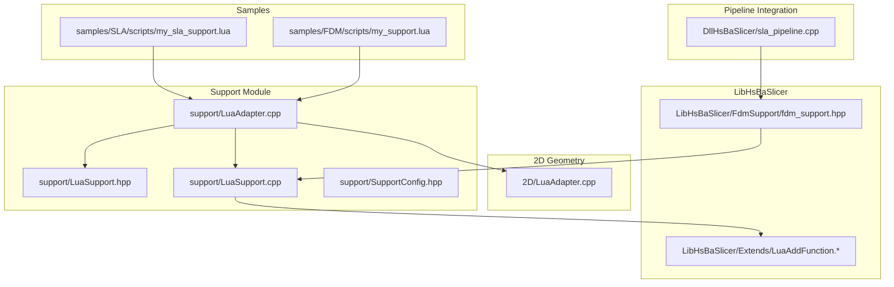
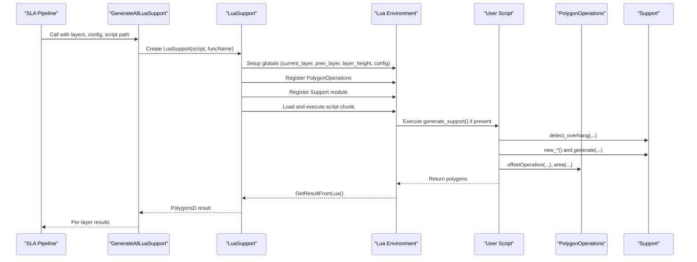
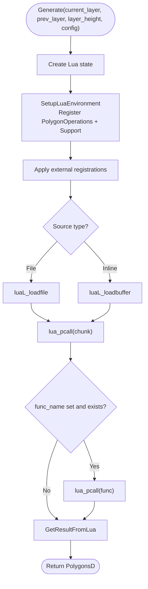
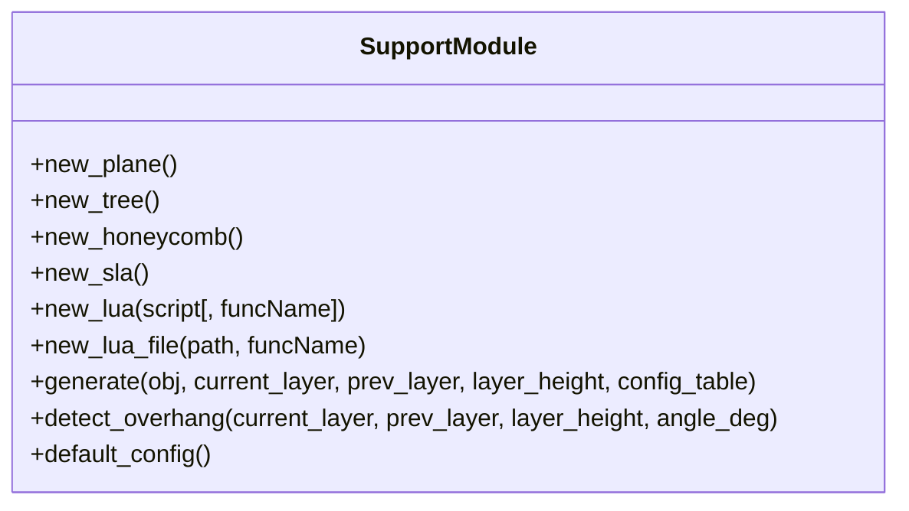
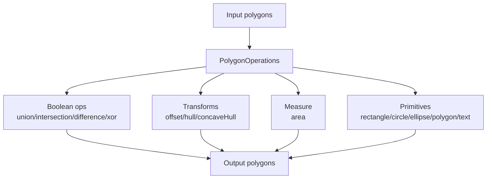
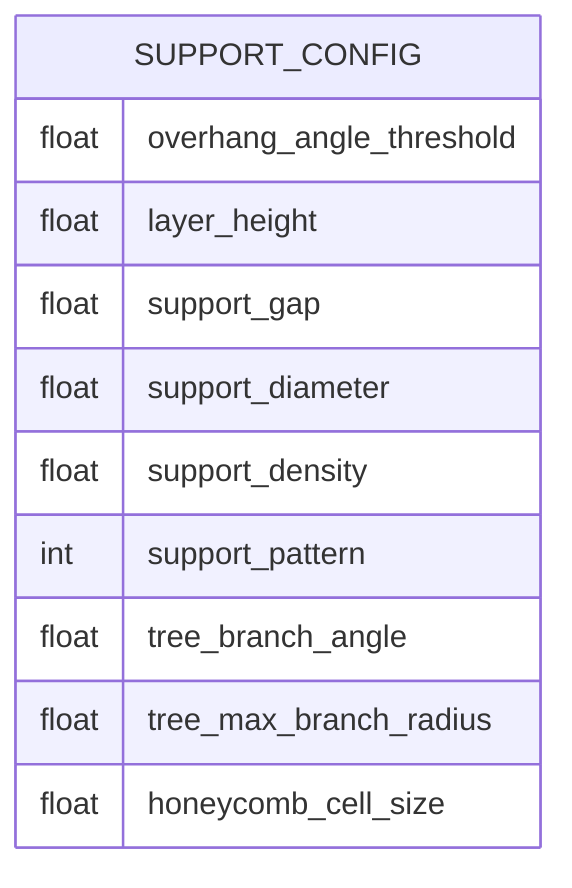
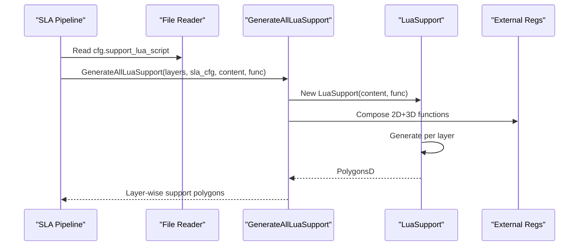
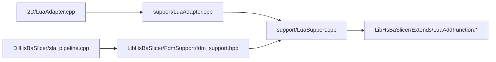

# Lua Support Scripting Interface

<cite>
**Referenced Files in This Document**
- [LuaSupport.hpp](file://support/LuaSupport.hpp)
- [LuaSupport.cpp](file://support/LuaSupport.cpp)
- [LuaAdapter.hpp](file://support/LuaAdapter.hpp)
- [LuaAdapter.cpp](file://support/LuaAdapter.cpp)
- [SupportConfig.hpp](file://support/SupportConfig.hpp)
- [2D LuaAdapter.cpp](file://2D/LuaAdapter.cpp)
- [fdm_support.hpp](file://LibHsBaSlicer/Extends/LuaAddFunction.hpp)
- [fdm_support.cpp](file://LibHsBaSlicer/Extends/LuaAddFunction.cpp)
- [FDM support wrapper](file://LibHsBaSlicer/FdmSupport/fdm_support.hpp)
- [SLA pipeline integration](file://DllHsBaSlicer/sla_pipeline.cpp)
- [FDM sample script](file://samples/FDM/scripts/my_support.lua)
- [SLA sample script](file://samples/SLA/scripts/my_sla_support.lua)
</cite>

## Table of Contents
1. [Introduction](#introduction)
2. [Project Structure](#project-structure)
3. [Core Components](#core-components)
4. [Architecture Overview](#architecture-overview)
5. [Detailed Component Analysis](#detailed-component-analysis)
6. [Dependency Analysis](#dependency-analysis)
7. [Performance Considerations](#performance-considerations)
8. [Troubleshooting Guide](#troubleshooting-guide)
9. [Conclusion](#conclusion)
10. [Appendices](#appendices)

## Introduction
This document describes the Lua scripting interface for custom support generation algorithms in HsBaSlicer. It explains how to write, register, and integrate Lua-based support generators into the slicing workflow. You will learn:
- The complete API exposed to Lua scripts for accessing layer data, manipulating polygons, and invoking built-in support generators.
- How to implement a custom support generator as a Lua function or main chunk.
- How the system wires 2D polygon operations and optional 3D/file functions into the Lua environment.
- Practical examples for FDM and SLA workflows, including edge cases and performance tips.
- Debugging techniques and best practices for maintainable custom algorithms.

## Project Structure
The Lua support scripting feature spans several modules:
- Support module bindings expose a `Support` table to Lua scripts.
- Polygon operations are registered under a `PolygonOperations` table.
- A Lua-backed support generator executes user scripts per layer.
- Pipeline integrations load scripts from files and call the public API.

**Diagram sources**
- [LuaAdapter.cpp:253-276](file://support/LuaAdapter.cpp#L253-L276)
- [LuaSupport.hpp:40-67](file://support/LuaSupport.hpp#L40-L67)
- [LuaSupport.cpp:113-177](file://support/LuaSupport.cpp#L113-L177)
- [2D LuaAdapter.cpp:487-491](file://2D/LuaAdapter.cpp#L487-L491)
- [fdm_support.hpp:24-58](file://LibHsBaSlicer/Extends/LuaAddFunction.hpp#L24-L58)
- [fdm_support.cpp:21-49](file://LibHsBaSlicer/Extends/LuaAddFunction.cpp#L21-L49)
- [FDM support wrapper:61-67](file://LibHsBaSlicer/FdmSupport/fdm_support.hpp#L61-L67)
- [SLA pipeline integration:400-413](file://DllHsBaSlicer/sla_pipeline.cpp#L400-L413)
- [FDM sample script:30-82](file://samples/FDM/scripts/my_support.lua#L30-L82)
- [SLA sample script:32-75](file://samples/SLA/scripts/my_sla_support.lua#L32-L75)

**Section sources**
- [LuaAdapter.cpp:253-276](file://support/LuaAdapter.cpp#L253-L276)
- [LuaSupport.hpp:40-67](file://support/LuaSupport.hpp#L40-L67)
- [LuaSupport.cpp:113-177](file://support/LuaSupport.cpp#L113-L177)
- [2D LuaAdapter.cpp:487-491](file://2D/LuaAdapter.cpp#L487-L491)
- [fdm_support.hpp:24-58](file://LibHsBaSlicer/Extends/LuaAddFunction.hpp#L24-L58)
- [fdm_support.cpp:21-49](file://LibHsBaSlicer/Extends/LuaAddFunction.cpp#L21-L49)
- [FDM support wrapper:61-67](file://LibHsBaSlicer/FdmSupport/fdm_support.hpp#L61-L67)
- [SLA pipeline integration:400-413](file://DllHsBaSlicer/sla_pipeline.cpp#L400-L413)
- [FDM sample script:30-82](file://samples/FDM/scripts/my_support.lua#L30-L82)
- [SLA sample script:32-75](file://samples/SLA/scripts/my_sla_support.lua#L32-L75)

## Core Components
- Support module bindings (`Support` table):
  - Constructors: `new_plane`, `new_tree`, `new_honeycomb`, `new_sla`, `new_lua(script[, funcName])`, `new_lua_file(path, funcName)`.
  - Generators: `generate(support_obj, current_layer, prev_layer, layer_height, config_table)` returns polygons.
  - Utilities: `detect_overhang(current_layer, prev_layer, layer_height, angle_deg)` returns overhang polygons; `default_config()` returns default configuration table.
- Polygon operations (`PolygonOperations` table):
  - Boolean ops: `union`, `intersection`, `difference`, `xor`, `booleanOperation(polys_a, polys_b, op_name)`.
  - Shape ops: `offsetOperation(polys, delta)`, `convexHullOperation(polys)`, `concaveHullOperation(polys, additional_points)`.
  - Area and primitives: `area(poly)`, `makeRectangle(x,y,width,height)`, `makeCircle(cx,cy,radius[,segments])`, `makeEllipse(cx,cy,rx,ry[,segments[,rotation]])`, `makeRegularPolygon(cx,cy,radius,sides[,rotation])`, `textToPolygons(text,font_file,font_size[,x[,y[,curve_segments]]])`.
- Lua execution environment:
  - Globals: `current_layer`, `prev_layer`, `layer_height`, `config`.
  - Script entry points: return polygons from main chunk or define `generate_support()`.
- Configuration:
  - `SupportConfig` fields include overhang threshold, layer height, gap, diameter, density, pattern, tree parameters, honeycomb cell size.

**Section sources**
- [LuaAdapter.cpp:110-241](file://support/LuaAdapter.cpp#L110-L241)
- [LuaAdapter.cpp:253-276](file://support/LuaAdapter.cpp#L253-L276)
- [2D LuaAdapter.cpp:22-329](file://2D/LuaAdapter.cpp#L22-L329)
- [2D LuaAdapter.cpp:487-491](file://2D/LuaAdapter.cpp#L487-L491)
- [LuaSupport.cpp:19-49](file://support/LuaSupport.cpp#L19-L49)
- [SupportConfig.hpp:14-25](file://support/SupportConfig.hpp#L14-L25)

## Architecture Overview
The Lua support scripting flow integrates user scripts with built-in geometry and support generators.

**Diagram sources**
- [SLA pipeline integration:400-413](file://DllHsBaSlicer/sla_pipeline.cpp#L400-L413)
- [FDM support wrapper:61-67](file://LibHsBaSlicer/FdmSupport/fdm_support.hpp#L61-L67)
- [LuaSupport.cpp:113-177](file://support/LuaSupport.cpp#L113-L177)
- [LuaAdapter.cpp:253-276](file://support/LuaAdapter.cpp#L253-L276)
- [2D LuaAdapter.cpp:487-491](file://2D/LuaAdapter.cpp#L487-L491)

## Detailed Component Analysis

### Lua Support Generator Execution
`LuaSupport` creates an isolated Lua state per call, sets up the environment, loads the script, and invokes either the main chunk or a named function. Results are read from the return value or a global variable.

Key behaviors:
- Environment setup registers polygon helpers and the support module.
- External registration callbacks can be injected via `SetExternalRegs`.
- Errors during load or runtime are converted to exceptions with messages.

**Diagram sources**
- [LuaSupport.cpp:113-177](file://support/LuaSupport.cpp#L113-L177)

**Section sources**
- [LuaSupport.cpp:19-49](file://support/LuaSupport.cpp#L19-L49)
- [LuaSupport.cpp:113-177](file://support/LuaSupport.cpp#L113-L177)

### Support Module Bindings
The `Support` table exposes constructors for built-in generators and a generic `generate` method. It also provides overhang detection and default configuration.

Exposed functions:
- `Support.new_plane()`
- `Support.new_tree()`
- `Support.new_honeycomb()`
- `Support.new_sla()`
- `Support.new_lua(script[, funcName])`
- `Support.new_lua_file(path, funcName)`
- `Support.generate(obj, current_layer, prev_layer, layer_height, config_table)`
- `Support.detect_overhang(current_layer, prev_layer, layer_height, angle_deg)`
- `Support.default_config()`

**Diagram sources**
- [LuaAdapter.cpp:110-241](file://support/LuaAdapter.cpp#L110-L241)
- [LuaAdapter.cpp:253-276](file://support/LuaAdapter.cpp#L253-L276)

**Section sources**
- [LuaAdapter.cpp:110-241](file://support/LuaAdapter.cpp#L110-L241)
- [LuaAdapter.cpp:253-276](file://support/LuaAdapter.cpp#L253-L276)

### Polygon Operations API
The `PolygonOperations` table provides comprehensive 2D geometry utilities for building custom supports.

Available operations:
- Boolean: `union`, `intersection`, `difference`, `xor`, `booleanOperation(a,b,op)`
- Shape transforms: `offsetOperation(polys,delta)`, `convexHullOperation(polys)`, `concaveHullOperation(polys,n)`
- Measurement: `area(poly)`
- Primitives: `makeRectangle(x,y,w,h)`, `makeCircle(cx,cy,r[,seg])`, `makeEllipse(cx,cy,rx,ry[,seg[,rot]])`, `makeRegularPolygon(cx,cy,r,sides[,rot])`
- Text: `textToPolygons(text,font,size[,x[,y[,segs]]])`

**Diagram sources**
- [2D LuaAdapter.cpp:22-329](file://2D/LuaAdapter.cpp#L22-L329)
- [2D LuaAdapter.cpp:487-491](file://2D/LuaAdapter.cpp#L487-L491)

**Section sources**
- [2D LuaAdapter.cpp:22-329](file://2D/LuaAdapter.cpp#L22-L329)
- [2D LuaAdapter.cpp:487-491](file://2D/LuaAdapter.cpp#L487-L491)

### Configuration Model
Scripts receive a `config` table populated from `SupportConfig`. Default values are defined in C++ and mirrored into Lua.

Fields:
- `overhang_angle_threshold`: degrees
- `layer_height`: mm
- `support_gap`: mm
- `support_diameter`: mm
- `support_density`: [0,1]
- `support_pattern`: integer (e.g., plane/tree/honeycomb)
- `tree_branch_angle`: degrees
- `tree_max_branch_radius`: mm
- `honeycomb_cell_size`: mm

**Diagram sources**
- [SupportConfig.hpp:14-25](file://support/SupportConfig.hpp#L14-L25)
- [LuaAdapter.cpp:215-241](file://support/LuaAdapter.cpp#L215-L241)

**Section sources**
- [SupportConfig.hpp:14-25](file://support/SupportConfig.hpp#L14-L25)
- [LuaAdapter.cpp:215-241](file://support/LuaAdapter.cpp#L215-L241)

### Writing Custom Support Scripts
Two common patterns:
- Define a function `generate_support()` that returns a table of polygons.
- Return polygons directly from the main chunk.

Recommended structure:
- Skip first layer when no previous layer exists.
- Detect overhang regions using `Support.detect_overhang`.
- Choose a generator based on `config.support_pattern`.
- Build a `Support.default_config()` table and override fields from `config`.
- Optionally refine results with `PolygonOperations.offsetOperation` or filtering by area.

Examples:
- FDM script demonstrates pattern selection and post-processing.
- SLA script demonstrates sacrificial support usage and area-based filtering.

**Section sources**
- [FDM sample script:30-82](file://samples/FDM/scripts/my_support.lua#L30-L82)
- [SLA sample script:32-75](file://samples/SLA/scripts/my_sla_support.lua#L32-L75)

### Integrating Custom Supports into the Slicing Workflow
For SLA pipelines:
- If a Lua script path is provided, the pipeline reads the file content and calls `GenerateAllLuaSupport`.
- The function constructs a `LuaSupport` instance and composes external 2D/3D function registrations before executing the script per layer.

**Diagram sources**
- [SLA pipeline integration:400-413](file://DllHsBaSlicer/sla_pipeline.cpp#L400-L413)
- [FDM support wrapper:61-67](file://LibHsBaSlicer/FdmSupport/fdm_support.hpp#L61-L67)
- [fdm_support.cpp:21-49](file://LibHsBaSlicer/Extends/LuaAddFunction.cpp#L21-L49)

**Section sources**
- [SLA pipeline integration:400-413](file://DllHsBaSlicer/sla_pipeline.cpp#L400-L413)
- [FDM support wrapper:61-67](file://LibHsBaSlicer/FdmSupport/fdm_support.hpp#L61-L67)
- [fdm_support.cpp:21-49](file://LibHsBaSlicer/Extends/LuaAddFunction.cpp#L21-L49)

## Dependency Analysis
The Lua support subsystem depends on:
- 2D geometry adapters for polygon conversion and operations.
- Built-in support generators (plane, tree, honeycomb, SLA).
- External function registries for 2D/3D/file capabilities.
- Pipeline code that loads scripts and invokes the public API.

**Diagram sources**
- [2D LuaAdapter.cpp:487-491](file://2D/LuaAdapter.cpp#L487-L491)
- [LuaAdapter.cpp:253-276](file://support/LuaAdapter.cpp#L253-L276)
- [LuaSupport.cpp:113-177](file://support/LuaSupport.cpp#L113-L177)
- [fdm_support.hpp:24-58](file://LibHsBaSlicer/Extends/LuaAddFunction.hpp#L24-L58)
- [SLA pipeline integration:400-413](file://DllHsBaSlicer/sla_pipeline.cpp#L400-L413)
- [FDM support wrapper:61-67](file://LibHsBaSlicer/FdmSupport/fdm_support.hpp#L61-L67)

**Section sources**
- [2D LuaAdapter.cpp:487-491](file://2D/LuaAdapter.cpp#L487-L491)
- [LuaAdapter.cpp:253-276](file://support/LuaAdapter.cpp#L253-L276)
- [LuaSupport.cpp:113-177](file://support/LuaSupport.cpp#L113-L177)
- [fdm_support.hpp:24-58](file://LibHsBaSlicer/Extends/LuaAddFunction.hpp#L24-L58)
- [SLA pipeline integration:400-413](file://DllHsBaSlicer/sla_pipeline.cpp#L400-L413)
- [FDM support wrapper:61-67](file://LibHsBaSlicer/FdmSupport/fdm_support.hpp#L61-L67)

## Performance Considerations
- Prefer returning minimal polygon sets: avoid unnecessary subdivisions or overly dense meshes.
- Use `polygonOperations.area` to filter tiny supports early.
- Reuse computed structures where possible; avoid repeated heavy hull computations inside tight loops.
- Tune `support_density` and `support_gap` to balance printability and material usage.
- Keep scripts deterministic and side-effect free to simplify debugging and caching.

[No sources needed since this section provides general guidance]

## Troubleshooting Guide
Common issues and resolutions:
- Script load errors: Check syntax and ensure the script path is valid. Errors are surfaced with descriptive messages.
- Runtime errors in `generate_support`: Validate input tables and types; ensure `current_layer` and `prev_layer` are well-formed.
- Missing `generate_support`: If not defined, the engine falls back to reading a global `support_polys`; prefer defining the function explicitly.
- Empty results: Verify overhang detection thresholds and layer height; adjust `overhang_angle_threshold` and `layer_height`.
- Unexpected polygon shapes: Inspect intermediate outputs using `PolygonOperations.convexHullOperation` or dump utilities if available.

Error handling paths:
- Lua load/runtime failures throw exceptions with error strings.
- Invalid support object userdata raises Lua errors.

**Section sources**
- [LuaSupport.cpp:141-177](file://support/LuaSupport.cpp#L141-L177)
- [LuaAdapter.cpp:174-200](file://support/LuaAdapter.cpp#L174-L200)

## Conclusion
The Lua support scripting interface enables flexible, user-defined support generation while leveraging robust 2D geometry tools and built-in generators. By following the documented API, structuring scripts around overhang detection and configuration-driven generator selection, and applying performance and debugging best practices, you can create maintainable custom support algorithms tailored to FDM and SLA workflows.

[No sources needed since this section summarizes without analyzing specific files]

## Appendices

### API Reference Summary

- Support module (`Support`):
  - Constructors: `new_plane`, `new_tree`, `new_honeycomb`, `new_sla`, `new_lua(script[, funcName])`, `new_lua_file(path, funcName)`
  - Methods: `generate(obj, current_layer, prev_layer, layer_height, config_table)`, `detect_overhang(current_layer, prev_layer, layer_height, angle_deg)`, `default_config()`
- Polygon operations (`PolygonOperations`):
  - Boolean: `union`, `intersection`, `difference`, `xor`, `booleanOperation(a,b,op)`
  - Transforms: `offsetOperation(polys,delta)`, `convexHullOperation(polys)`, `concaveHullOperation(polys,n)`
  - Measurement: `area(poly)`
  - Primitives: `makeRectangle`, `makeCircle`, `makeEllipse`, `makeRegularPolygon`, `textToPolygons`
- Globals:
  - `current_layer`, `prev_layer`, `layer_height`, `config`
- Configuration fields:
  - `overhang_angle_threshold`, `layer_height`, `support_gap`, `support_diameter`, `support_density`, `support_pattern`, `tree_branch_angle`, `tree_max_branch_radius`, `honeycomb_cell_size`

**Section sources**
- [LuaAdapter.cpp:110-241](file://support/LuaAdapter.cpp#L110-L241)
- [LuaAdapter.cpp:253-276](file://support/LuaAdapter.cpp#L253-L276)
- [2D LuaAdapter.cpp:22-329](file://2D/LuaAdapter.cpp#L22-L329)
- [2D LuaAdapter.cpp:487-491](file://2D/LuaAdapter.cpp#L487-L491)
- [SupportConfig.hpp:14-25](file://support/SupportConfig.hpp#L14-L25)