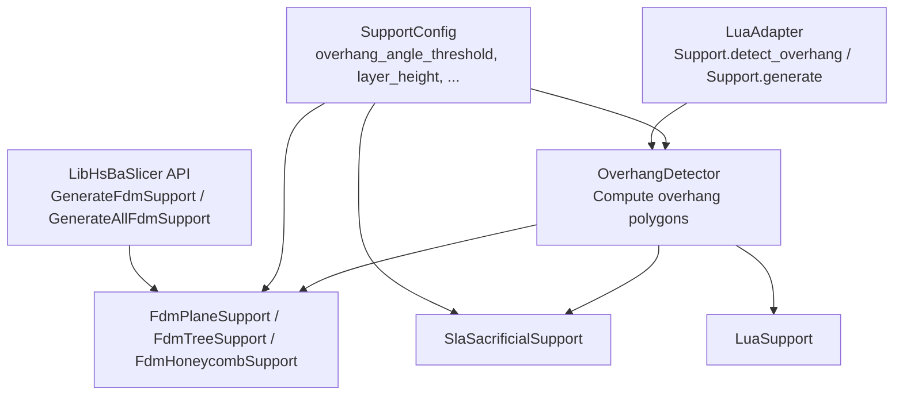
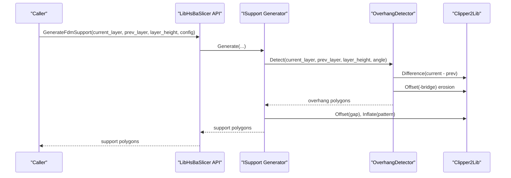
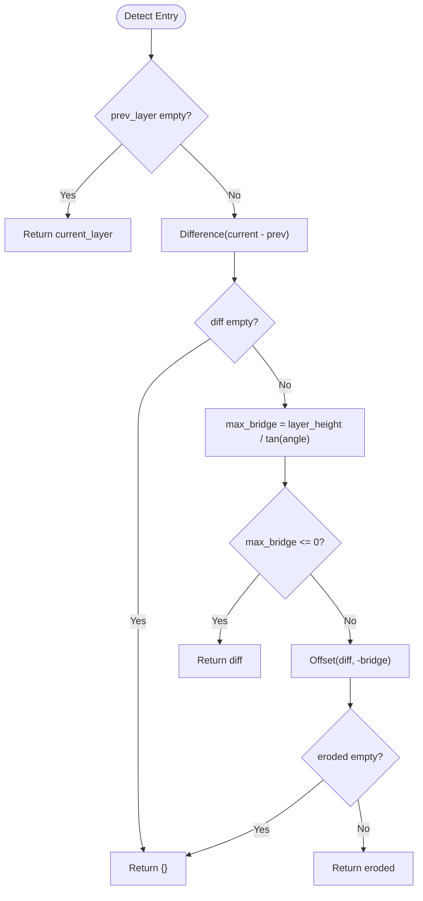
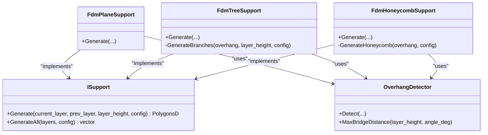
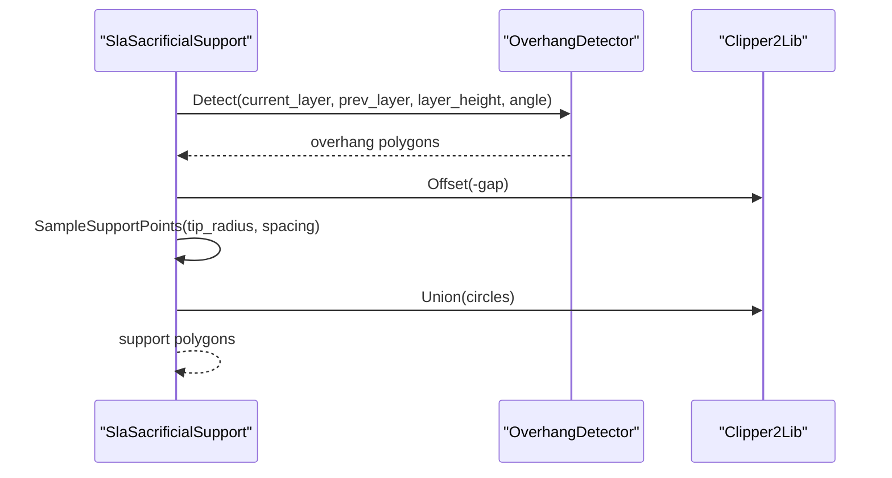
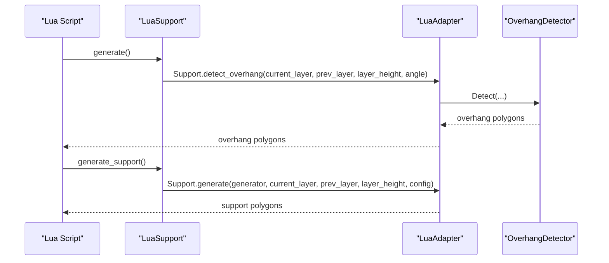
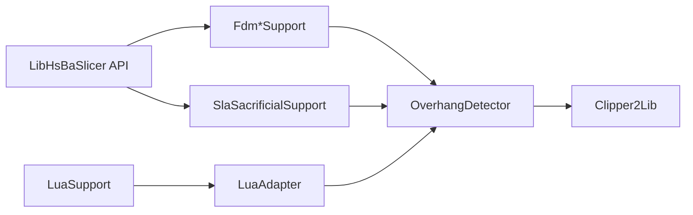

# Overhang Detection Algorithms

<cite>
**Referenced Files in This Document**
- [OverhangDetector.hpp](file://support/OverhangDetector.hpp)
- [OverhangDetector.cpp](file://support/OverhangDetector.cpp)
- [SupportConfig.hpp](file://support/SupportConfig.hpp)
- [ISupport.hpp](file://support/ISupport.hpp)
- [FdmSupport.hpp](file://support/FdmSupport.hpp)
- [FdmSupport.cpp](file://support/FdmSupport.cpp)
- [SlaSupport.hpp](file://support/SlaSupport.hpp)
- [SlaSupport.cpp](file://support/SlaSupport.cpp)
- [LuaSupport.hpp](file://support/LuaSupport.hpp)
- [LuaSupport.cpp](file://support/LuaSupport.cpp)
- [LuaAdapter.cpp](file://support/LuaAdapter.cpp)
- [pipeline_types.h](file://pipelinetypes/pipeline_types.h)
- [fdm_support.hpp](file://LibHsBaSlicer/Support/fdm_support.hpp)
- [fdm_support.cpp](file://LibHsBaSlicer/Support/fdm_support.cpp)
- [my_sla_support.lua](file://samples/SLA/scripts/my_sla_support.lua)
- [my_support.lua](file://samples/FDM/scripts/my_support.lua)
</cite>

## Table of Contents
1. [Introduction](#introduction)
2. [Project Structure](#project-structure)
3. [Core Components](#core-components)
4. [Architecture Overview](#architecture-overview)
5. [Detailed Component Analysis](#detailed-component-analysis)
6. [Dependency Analysis](#dependency-analysis)
7. [Performance Considerations](#performance-considerations)
8. [Troubleshooting Guide](#troubleshooting-guide)
9. [Conclusion](#conclusion)
10. [Appendices](#appendices)

## Introduction
This document explains the Overhang Detection system used by HsBaSlicer to identify regions that require support structures between adjacent layers. It focuses on the mathematical algorithms, geometric operations, and integration points for both FDM and SLA workflows. The detector computes overhang areas using layer height and an angle threshold, then supports downstream generators (plane, tree, honeycomb, sacrificial) produce per-layer support cross-sections.

## Project Structure
The overhang detection logic is implemented in a small, focused module under the support directory. It exposes:
- A core detector class for computing overhang polygons from two adjacent layers.
- A shared configuration structure for all support generators.
- Multiple generator implementations (FDM plane/tree/honeycomb, SLA sacrificial).
- A Lua-based custom generator interface.
- Library APIs that select and run the appropriate generator based on configuration.

**Diagram sources**
- [OverhangDetector.hpp:14-50](file://support/OverhangDetector.hpp#L14-L50)
- [FdmSupport.hpp:13-63](file://support/FdmSupport.hpp#L13-L63)
- [SlaSupport.hpp:13-42](file://support/SlaSupport.hpp#L13-L42)
- [LuaSupport.hpp:21-64](file://support/LuaSupport.hpp#L21-L64)
- [SupportConfig.hpp:11-43](file://support/SupportConfig.hpp#L11-L43)
- [fdm_support.hpp:19-37](file://LibHsBaSlicer/Support/fdm_support.hpp#L19-L37)
- [LuaAdapter.cpp:202-213](file://support/LuaAdapter.cpp#L202-L213)

**Section sources**
- [OverhangDetector.hpp:14-50](file://support/OverhangDetector.hpp#L14-L50)
- [SupportConfig.hpp:11-43](file://support/SupportConfig.hpp#L11-L43)
- [fdm_support.hpp:19-37](file://LibHsBaSlicer/Support/fdm_support.hpp#L19-L37)

## Core Components
- OverhangDetector: Computes overhang regions between current and previous layer contours using difference and erosion with a bridge distance derived from layer height and angle threshold.
- SupportConfig: Shared parameters including overhang angle threshold, layer height, gap, diameter, density, pattern, and geometry-specific options.
- ISupport: Abstract interface for per-layer support generators.
- FDM generators: Plane (columns), Tree (branch tips), Honeycomb (hexagonal fill).
- SLA generator: Sacrificial thin columns sampled from overhang regions.
- LuaSupport: Custom scriptable generator exposing polygon helpers and built-in Support functions.

Key responsibilities:
- Detect overhangs mathematically via 2D polygon operations.
- Provide consistent configuration across FDM and SLA pipelines.
- Expose detection and generation through C++ and Lua interfaces.

**Section sources**
- [OverhangDetector.hpp:14-50](file://support/OverhangDetector.hpp#L14-L50)
- [SupportConfig.hpp:11-43](file://support/SupportConfig.hpp#L11-L43)
- [ISupport.hpp:16-45](file://support/ISupport.hpp#L16-L45)
- [FdmSupport.hpp:13-63](file://support/FdmSupport.hpp#L13-L63)
- [SlaSupport.hpp:13-42](file://support/SlaSupport.hpp#L13-L42)
- [LuaSupport.hpp:21-64](file://support/LuaSupport.hpp#L21-L64)

## Architecture Overview
The overhang detection pipeline integrates into both FDM and SLA workflows:
- Layer contours are passed to a generator.
- Generators call OverhangDetector to compute overhang polygons.
- Generators apply gap and pattern-specific geometry to produce support cross-sections.
- LibHsBaSlicer API selects the generator based on configuration.
- Lua scripts can replace or augment built-in behavior.

**Diagram sources**
- [fdm_support.cpp:14-31](file://LibHsBaSlicer/Support/fdm_support.cpp#L14-L31)
- [FdmSupport.cpp:48-76](file://support/FdmSupport.cpp#L48-L76)
- [OverhangDetector.cpp:41-80](file://support/OverhangDetector.cpp#L41-L80)

## Detailed Component Analysis

### OverhangDetector: Mathematics and Geometry
- Angle-to-distance conversion:
  - Maximum horizontal bridge distance = layer_height / tan(angle_rad).
  - Angles >= 90 degrees imply no overhang; angles <= 0 degrees treat everything as overhang.
- Geometric workflow:
  - Compute difference between current and previous layers to find unsupported regions.
  - If no difference exists, return empty.
  - Erode the difference by max_bridge distance using negative offset to filter small bridges.
  - Return eroded polygons as overhang regions requiring support.

**Diagram sources**
- [OverhangDetector.cpp:23-80](file://support/OverhangDetector.cpp#L23-L80)

Complexity considerations:
- Polygon difference and offset operations depend on the number of vertices and complexity of shapes.
- Integerization before offset improves numerical stability but adds conversion overhead.

**Section sources**
- [OverhangDetector.cpp:23-80](file://support/OverhangDetector.cpp#L23-L80)
- [OverhangDetector.hpp:43-49](file://support/OverhangDetector.hpp#L43-L49)

### SupportConfig: Parameters and Defaults
Shared configuration fields include:
- overhang_angle_threshold: default 45.0 degrees.
- layer_height: default 0.2 mm.
- support_gap: default 0.5 mm.
- support_diameter: default 2.0 mm.
- support_density: default 0.3.
- support_pattern: 0=Plane, 1=Tree, 2=Honeycomb.
- Additional geometry-specific fields for tree and honeycomb patterns.

FDM and SLA extend this base with specialized fields such as interface layers, tip diameter, and raft thickness.

**Section sources**
- [SupportConfig.hpp:11-43](file://support/SupportConfig.hpp#L11-L43)
- [pipeline_types.h:198-215](file://pipelinetypes/pipeline_types.h#L198-L215)

### FDM Support Generators
- FdmPlaneSupport:
  - Uses overhang regions, applies gap, inflates by half support diameter to create column cross-sections.
- FdmTreeSupport:
  - Samples branch tips within overhang region at spacing proportional to support diameter, unions circles.
- FdmHoneycombSupport:
  - Generates hexagonal cells across bounding box, intersects with overhang region.

**Diagram sources**
- [ISupport.hpp:16-45](file://support/ISupport.hpp#L16-L45)
- [FdmSupport.hpp:13-63](file://support/FdmSupport.hpp#L13-L63)
- [OverhangDetector.hpp:14-50](file://support/OverhangDetector.hpp#L14-L50)

Implementation notes:
- All FDM generators first detect overhangs, apply gap via negative offset, then inflate or sample according to pattern.
- Tree and honeycomb strategies use sampling grids and geometric intersections.

**Section sources**
- [FdmSupport.cpp:48-76](file://support/FdmSupport.cpp#L48-L76)
- [FdmSupport.cpp:81-168](file://support/FdmSupport.cpp#L81-L168)
- [FdmSupport.cpp:173-266](file://support/FdmSupport.cpp#L173-L266)

### SLA Support Generator
- SlaSacrificialSupport:
  - Detects overhangs, applies gap, samples circular support points at spacing derived from support diameter.
  - Uses small tip diameter for easy removal and unions circles to form support cross-sections.

**Diagram sources**
- [SlaSupport.cpp:81-123](file://support/SlaSupport.cpp#L81-L123)
- [OverhangDetector.cpp:41-80](file://support/OverhangDetector.cpp#L41-L80)

**Section sources**
- [SlaSupport.cpp:38-123](file://support/SlaSupport.cpp#L38-L123)
- [SlaSupport.hpp:13-42](file://support/SlaSupport.hpp#L13-L42)

### Lua Integration
- LuaSupport:
  - Provides a scriptable environment with polygon helpers and Support module functions.
  - Supports inline scripts or file-based scripts, optional function name.
- LuaAdapter:
  - Exposes Support.generate and Support.detect_overhang to Lua scripts.
  - Translates between Lua tables and C++ polygon types.

**Diagram sources**
- [LuaSupport.cpp:113-177](file://support/LuaSupport.cpp#L113-L177)
- [LuaAdapter.cpp:187-213](file://support/LuaAdapter.cpp#L187-L213)

**Section sources**
- [LuaSupport.hpp:21-64](file://support/LuaSupport.hpp#L21-L64)
- [LuaSupport.cpp:19-90](file://support/LuaSupport.cpp#L19-L90)
- [LuaAdapter.cpp:187-213](file://support/LuaAdapter.cpp#L187-L213)

## Dependency Analysis
- OverhangDetector depends on 2D polygon operations (difference, offset) provided by Clipper2Lib wrappers.
- FDM and SLA generators depend on OverhangDetector and Clipper2Lib for gap application and pattern generation.
- LuaSupport depends on Lua runtime and LuaAdapter for polygon manipulation and Support module exposure.
- LibHsBaSlicer API selects generator implementation based on configuration.

**Diagram sources**
- [OverhangDetector.cpp:16-21](file://support/OverhangDetector.cpp#L16-L21)
- [FdmSupport.cpp:27-43](file://support/FdmSupport.cpp#L27-L43)
- [SlaSupport.cpp:26-36](file://support/SlaSupport.cpp#L26-L36)
- [LuaSupport.cpp:72-76](file://support/LuaSupport.cpp#L72-L76)
- [LuaAdapter.cpp:187-213](file://support/LuaAdapter.cpp#L187-L213)
- [fdm_support.cpp:14-31](file://LibHsBaSlicer/Support/fdm_support.cpp#L14-L31)

**Section sources**
- [OverhangDetector.cpp:16-21](file://support/OverhangDetector.cpp#L16-L21)
- [FdmSupport.cpp:27-43](file://support/FdmSupport.cpp#L27-L43)
- [SlaSupport.cpp:26-36](file://support/SlaSupport.cpp#L26-L36)
- [LuaSupport.cpp:72-76](file://support/LuaSupport.cpp#L72-L76)
- [LuaAdapter.cpp:187-213](file://support/LuaAdapter.cpp#L187-L213)
- [fdm_support.cpp:14-31](file://LibHsBaSlicer/Support/fdm_support.cpp#L14-L31)

## Performance Considerations
- Use integerization before offset operations to improve numerical stability and performance.
- Avoid unnecessary conversions between floating-point and integer polygon representations.
- For large models:
  - Prefer sparse sampling strategies (tree/honeycomb) to reduce union/intersection costs.
  - Tune support_diameter and spacing to balance coverage and computational load.
- Early exits when overhang regions are empty or fully covered reduce downstream work.

[No sources needed since this section provides general guidance]

## Troubleshooting Guide
Common issues and resolutions:
- No supports generated:
  - Verify overhang_angle_threshold is set appropriately (e.g., 45 degrees).
  - Ensure layer_height matches slicing settings.
  - Confirm prev_layer is not empty for non-first layers.
- Excessive supports:
  - Increase overhang_angle_threshold to reduce sensitivity.
  - Adjust support_gap to avoid overly aggressive inflation.
- Missing supports in complex geometries:
  - Check that difference operation returns non-empty polygons.
  - Validate that erosion does not eliminate small overhangs unintentionally.
- Lua script errors:
  - Inspect error messages from LuaSupport load/runtime exceptions.
  - Ensure Support.detect_overhang and Support.generate are called with correct argument types.

**Section sources**
- [OverhangDetector.cpp:41-80](file://support/OverhangDetector.cpp#L41-L80)
- [LuaSupport.cpp:141-177](file://support/LuaSupport.cpp#L141-L177)

## Conclusion
The Overhang Detection system in HsBaSlicer combines simple yet robust mathematics with efficient 2D polygon operations to identify regions needing support. It integrates seamlessly with FDM and SLA workflows, offering multiple generator strategies and extensibility via Lua scripting. Proper configuration of angle thresholds, layer heights, and geometric parameters ensures reliable support generation across diverse model complexities.

[No sources needed since this section summarizes without analyzing specific files]

## Appendices

### Configuration Examples
- FDM example (C++):
  - Set overhang_angle_threshold, layer_height, support_density, and support_pattern.
  - Call GenerateAllFdmSupport with layer contours.
- SLA example (Lua):
  - Use Support.detect_overhang to get overhang regions.
  - Configure Support.default_config(), adjust fields like support_gap and support_diameter.
  - Call Support.generate to obtain support polygons.

**Section sources**
- [fdm_support.hpp:19-37](file://LibHsBaSlicer/Support/fdm_support.hpp#L19-L37)
- [my_sla_support.lua:34-72](file://samples/SLA/scripts/my_sla_support.lua#L34-L72)
- [my_support.lua:66-79](file://samples/FDM/scripts/my_support.lua#L66-L79)