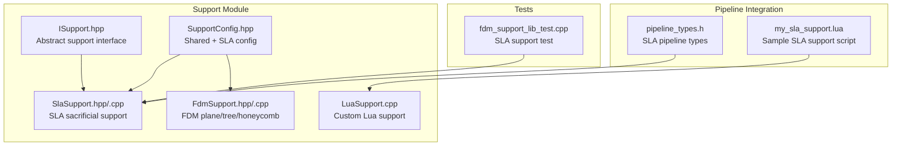
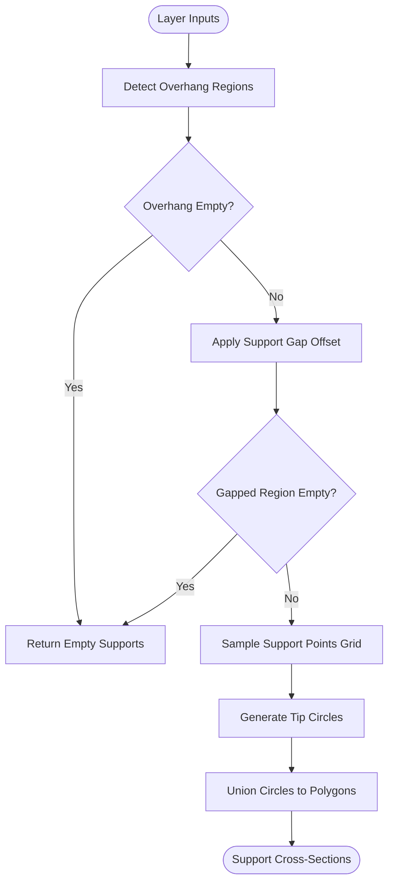
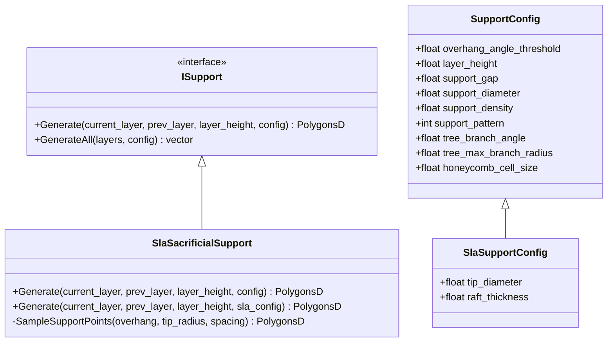
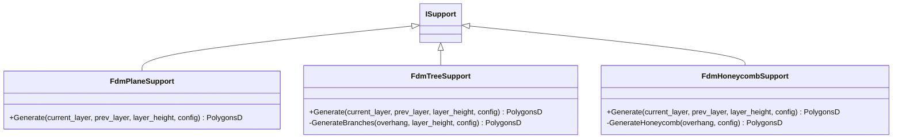
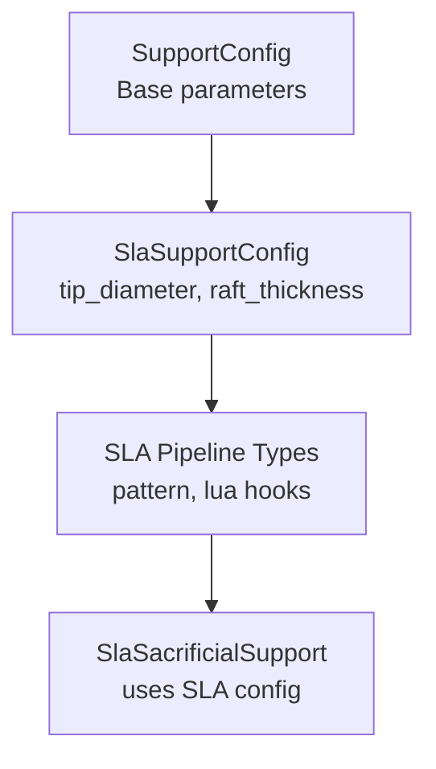
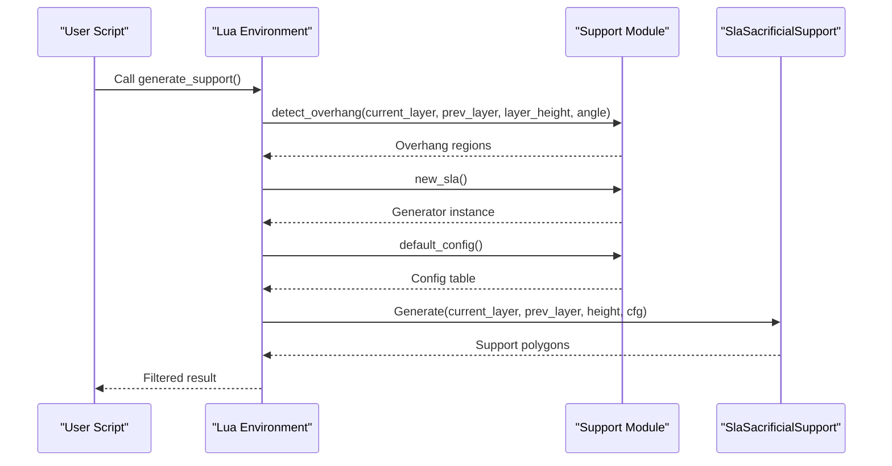
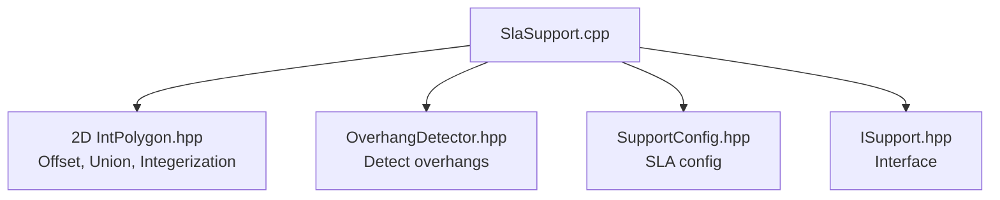

# SLA Support Generation

<cite>
**Referenced Files in This Document**
- [SlaSupport.hpp](file://support/SlaSupport.hpp)
- [SlaSupport.cpp](file://support/SlaSupport.cpp)
- [ISupport.hpp](file://support/ISupport.hpp)
- [SupportConfig.hpp](file://support/SupportConfig.hpp)
- [FdmSupport.hpp](file://support/FdmSupport.hpp)
- [FdmSupport.cpp](file://support/FdmSupport.cpp)
- [LuaSupport.cpp](file://support/LuaSupport.cpp)
- [my_sla_support.lua](file://samples/SLA/scripts/my_sla_support.lua)
- [pipeline_types.h](file://pipelinetypes/pipeline_types.h)
- [fdm_support_lib_test.cpp](file://tests\Support\fdm_support_lib_test.cpp)
</cite>

## Table of Contents
1. [Introduction](#introduction)
2. [Project Structure](#project-structure)
3. [Core Components](#core-components)
4. [Architecture Overview](#architecture-overview)
5. [Detailed Component Analysis](#detailed-component-analysis)
6. [Dependency Analysis](#dependency-analysis)
7. [Performance Considerations](#performance-considerations)
8. [Troubleshooting Guide](#troubleshooting-guide)
9. [Conclusion](#conclusion)
10. [Appendices](#appendices)

## Introduction
This document explains how SLA (stereolithography) support structures are generated in the project. It focuses on the specialized SLA sacrificial support algorithm, which is optimized for resin-based printing by using thin contact points, minimal support volume, and easy removal considerations. The documentation also contrasts SLA support generation with FDM support generation, describes the role of supports in SLA printing, and documents configuration options specific to resin materials. Examples show how to optimize supports for different model geometries, tune SLA-specific parameters, and balance surface quality with structural integrity during printing.

## Project Structure
The SLA support system lives under the `support` module and integrates with the broader slicer pipeline through a common interface. Key files include:
- SLA sacrificial support generator implementation and header
- Shared support configuration structs
- Abstract support generator interface
- FDM support generators for comparison
- Lua scripting bridge for custom support logic
- Pipeline type definitions exposing SLA support settings
- Sample Lua script demonstrating SLA support usage
- Tests validating SLA support generation

**Diagram sources**
- [ISupport.hpp:16-45](file://support/ISupport.hpp#L16-L45)
- [SupportConfig.hpp:11-43](file://support/SupportConfig.hpp#L11-L43)
- [SlaSupport.hpp:13-42](file://support/SlaSupport.hpp#L13-L42)
- [FdmSupport.hpp:13-63](file://support/FdmSupport.hpp#L13-L63)
- [LuaSupport.cpp:19-89](file://support/LuaSupport.cpp#L19-L89)
- [pipeline_types.h:198-206](file://pipelinetypes/pipeline_types.h#L198-L206)
- [my_sla_support.lua:1-76](file://samples/SLA/scripts/my_sla_support.lua#L1-L76)
- [fdm_support_lib_test.cpp:73-84](file://tests\Support\fdm_support_lib_test.cpp#L73-L84)

**Section sources**
- [SlaSupport.hpp:13-42](file://support/SlaSupport.hpp#L13-L42)
- [SupportConfig.hpp:11-43](file://support/SupportConfig.hpp#L11-L43)
- [pipeline_types.h:198-206](file://pipelinetypes/pipeline_types.h#L198-L206)

## Core Components
- Abstract support interface: defines per-layer support generation contract used by all strategies.
- SLA sacrificial support: generates thin column supports suitable for resin printing, using small tip diameters and spacing based on support diameter.
- FDM support strategies: plane, tree, and honeycomb patterns for filament printing; included for contrast and comparison.
- Configuration: shared base configuration plus SLA-specific fields such as tip diameter and raft thickness.
- Lua scripting: allows users to customize or replace built-in support algorithms via scripts.

Key responsibilities:
- Detect overhang regions from current and previous layer contours.
- Apply gap offsets to separate supports from the model.
- Sample support points within overhangs and generate circular cross-sections.
- Union overlapping circles into final support polygons.

**Section sources**
- [ISupport.hpp:16-45](file://support/ISupport.hpp#L16-L45)
- [SlaSupport.hpp:13-42](file://support/SlaSupport.hpp#L13-L42)
- [SlaSupport.cpp:38-123](file://support/SlaSupport.cpp#L38-L123)
- [SupportConfig.hpp:11-43](file://support/SupportConfig.hpp#L11-L43)
- [FdmSupport.hpp:13-63](file://support/FdmSupport.hpp#L13-L63)
- [LuaSupport.cpp:19-89](file://support/LuaSupport.cpp#L19-L89)

## Architecture Overview
The SLA support pipeline follows a layered architecture:
- Input: sliced layer contours (current and previous layers).
- Overhang detection: identifies unsupported areas based on angle threshold.
- Gap application: shrinks overhangs to create clearance between model and support.
- Point sampling: places support points at regular intervals inside gapped overhangs.
- Circle generation: creates small circles representing support tips.
- Union operation: merges overlapping circles into cohesive support polygons.

**Diagram sources**
- [SlaSupport.cpp:81-123](file://support/SlaSupport.cpp#L81-L123)

**Section sources**
- [SlaSupport.cpp:81-123](file://support/SlaSupport.cpp#L81-L123)

## Detailed Component Analysis

### SLA Sacrificial Support Generator
The SLA sacrificial support generator implements thin-column supports optimized for resin printing. It uses a small tip diameter for easy removal and larger spacing derived from the support diameter to minimize material usage while maintaining stability.

Implementation highlights:
- Overhang detection uses the configured angle threshold.
- Gap offset separates supports from the model surface.
- Point sampling iterates a grid within the bounding box of the overhang region.
- Each sampled point becomes a circle with radius equal to half the tip diameter.
- All circles are unioned to produce final support polygons.

**Diagram sources**
- [ISupport.hpp:16-45](file://support/ISupport.hpp#L16-L45)
- [SlaSupport.hpp:13-42](file://support/SlaSupport.hpp#L13-L42)
- [SupportConfig.hpp:11-43](file://support/SupportConfig.hpp#L11-L43)

**Section sources**
- [SlaSupport.hpp:13-42](file://support/SlaSupport.hpp#L13-L42)
- [SlaSupport.cpp:38-123](file://support/SlaSupport.cpp#L38-L123)

### FDM Support Generators (Comparison)
FDM support strategies differ significantly from SLA sacrificial supports:
- Plane support inflates overhangs by support diameter to form cylindrical columns.
- Tree support places branch tips at sample points and expands branches downward.
- Honeycomb support fills overhangs with hexagonal cells for lightweight rigidity.

These strategies are designed for filament extrusion, where supports often require interfaces and denser patterns to withstand mechanical stresses during printing.

**Diagram sources**
- [FdmSupport.hpp:13-63](file://support/FdmSupport.hpp#L13-L63)

**Section sources**
- [FdmSupport.cpp:48-76](file://support/FdmSupport.cpp#L48-L76)
- [FdmSupport.cpp:145-168](file://support/FdmSupport.cpp#L145-L168)
- [FdmSupport.cpp:244-267](file://support/FdmSupport.cpp#L244-L267)

### Configuration Options for SLA
SLA-specific configuration extends the shared support configuration with resin-oriented parameters:
- `tip_diameter`: Small diameter for easy removal after printing.
- `raft_thickness`: Thickness of the raft layer for build plate adhesion.
- Shared parameters like `support_gap`, `support_diameter`, and `overhang_angle_threshold` control clearance, spacing, and overhang detection.

Pipeline integration exposes these settings through SLA pipeline types, including pattern selection and Lua customization hooks.

**Diagram sources**
- [SupportConfig.hpp:11-43](file://support/SupportConfig.hpp#L11-L43)
- [pipeline_types.h:198-206](file://pipelinetypes/pipeline_types.h#L198-L206)
- [SlaSupport.cpp:126-133](file://support/SlaSupport.cpp#L126-L133)

**Section sources**
- [SupportConfig.hpp:11-43](file://support/SupportConfig.hpp#L11-L43)
- [pipeline_types.h:198-206](file://pipelinetypes/pipeline_types.h#L198-L206)

### Lua Scripting for Custom SLA Support
Users can override or extend the built-in SLA support algorithm using Lua scripts. The scripting environment provides:
- Layer data globals (`current_layer`, `prev_layer`, `layer_height`).
- Configuration table with support parameters.
- Polygon operations for geometric manipulation.
- Built-in support functions to detect overhangs and invoke the SLA generator.

The sample script demonstrates detecting overhangs, invoking the SLA generator, and optionally filtering results by area.

**Diagram sources**
- [LuaSupport.cpp:67-89](file://support/LuaSupport.cpp#L67-L89)
- [my_sla_support.lua:34-72](file://samples/SLA/scripts/my_sla_support.lua#L34-L72)

**Section sources**
- [LuaSupport.cpp:67-89](file://support/LuaSupport.cpp#L67-L89)
- [my_sla_support.lua:34-72](file://samples/SLA/scripts/my_sla_support.lua#L34-L72)

## Dependency Analysis
The SLA support generator depends on:
- 2D polygon utilities for integerization, offset, union, and point-in-polygon checks.
- Overhang detector to identify unsupported regions.
- Configuration structs for parameter access.
- Abstract interface for consistent API across support strategies.

**Diagram sources**
- [SlaSupport.cpp:5-11](file://support/SlaSupport.cpp#L5-L11)
- [SlaSupport.cpp:81-123](file://support/SlaSupport.cpp#L81-L123)

**Section sources**
- [SlaSupport.cpp:5-11](file://support/SlaSupport.cpp#L5-L11)
- [SlaSupport.cpp:81-123](file://support/SlaSupport.cpp#L81-L123)

## Performance Considerations
- Bounding box iteration: Point sampling loops over the bounding box of the overhang region; large overhangs increase computation time.
- Grid spacing: Larger spacing reduces the number of sampled points but may reduce support density.
- Union operations: Merging many circles can be computationally expensive; consider reducing overlap by tuning spacing.
- Integerization overhead: Converting between double and integer coordinates adds processing cost; use sparingly for large models.

Optimization recommendations:
- Increase `support_diameter` to reduce point density.
- Adjust `support_gap` to avoid excessive shrinking that eliminates overhangs.
- Use Lua scripting to filter small support areas before unioning.

[No sources needed since this section provides general guidance]

## Troubleshooting Guide
Common issues and resolutions:
- No supports generated: Check if overhang detection returns empty due to high angle thresholds or large gaps.
- Excessive support volume: Reduce `support_diameter` or increase spacing by adjusting configuration.
- Poor surface quality: Lower `support_gap` to improve contact precision, but ensure easy removal remains feasible.
- Lua script errors: Validate script syntax and ensure required functions are defined; check error messages from Lua runtime.

Validation examples:
- Test cases verify SLA support generation across multiple layers with configurable parameters.

**Section sources**
- [fdm_support_lib_test.cpp:73-84](file://tests\Support\fdm_support_lib_test.cpp#L73-L84)

## Conclusion
The SLA support generation system provides a specialized algorithm for resin-based printing, emphasizing thin contact points, minimal volume, and easy removal. By understanding the differences from FDM support strategies and tuning SLA-specific parameters, users can achieve optimal surface quality while maintaining structural integrity during printing. Lua scripting offers flexibility for advanced customization, enabling tailored support solutions for complex geometries.

[No sources needed since this section summarizes without analyzing specific files]

## Appendices

### SLA vs FDM Support Comparison
- SLA sacrificial supports: Thin tips, minimal volume, optimized for resin curing and post-processing.
- FDM plane/tree/honeycomb supports: Designed for filament extrusion, often requiring interfaces and denser patterns.

Configuration differences:
- SLA: `tip_diameter`, `raft_thickness`.
- FDM: `interface_layers`, `interface_density`, `honeycomb_cell_size`.

**Section sources**
- [SupportConfig.hpp:11-43](file://support/SupportConfig.hpp#L11-L43)
- [FdmSupport.hpp:13-63](file://support/FdmSupport.hpp#L13-L63)