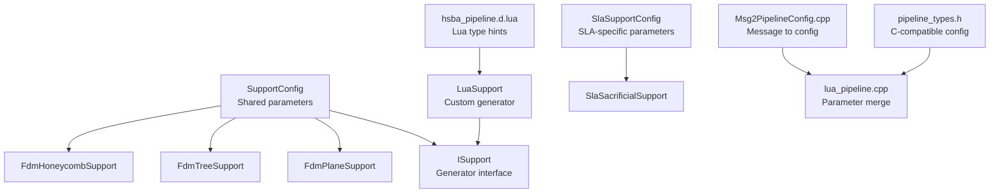
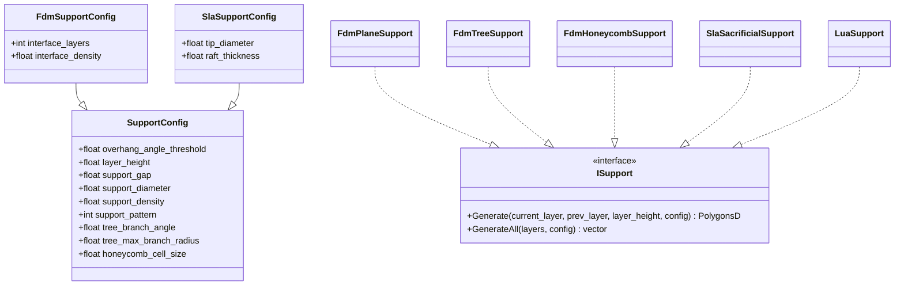
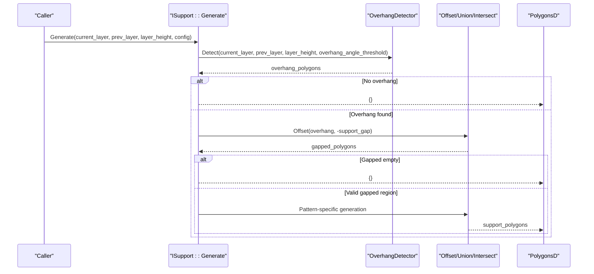
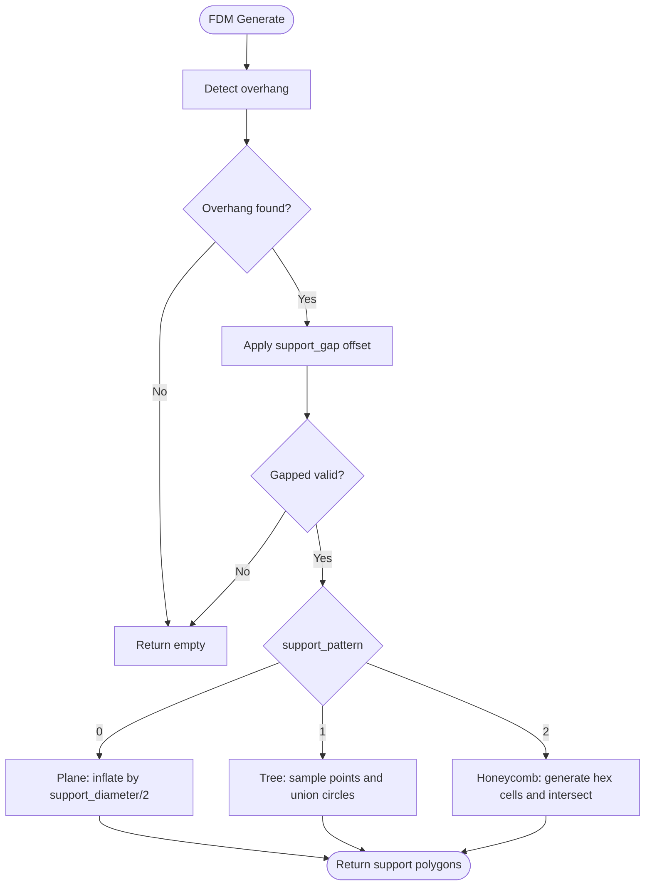
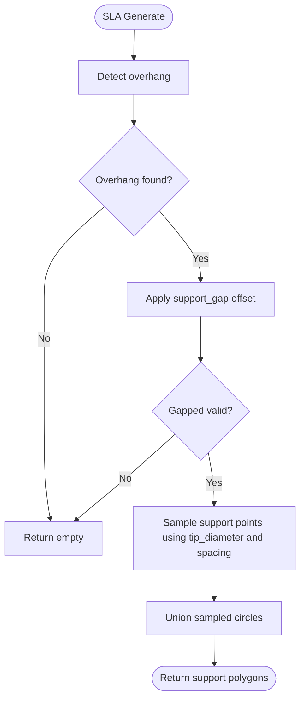
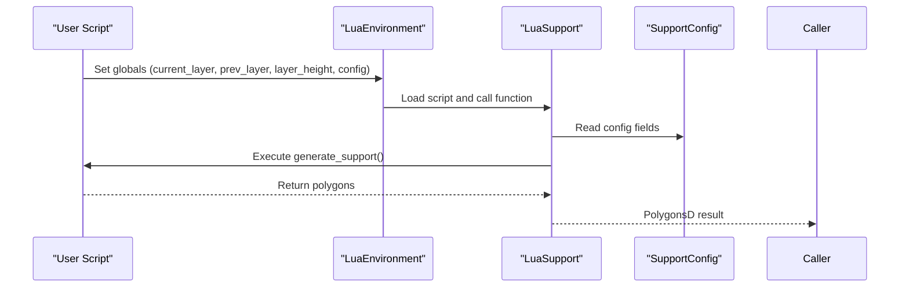
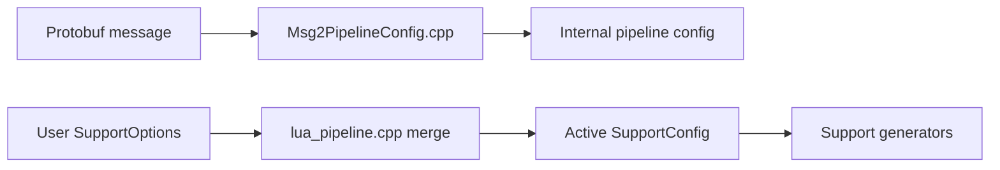
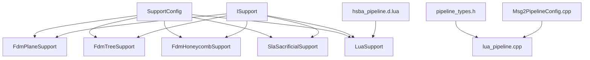

# Support Configuration System

<cite>
**Referenced Files in This Document**
- [SupportConfig.hpp](file://support/SupportConfig.hpp)
- [ISupport.hpp](file://support/ISupport.hpp)
- [FdmSupport.hpp](file://support/FdmSupport.hpp)
- [FdmSupport.cpp](file://support/FdmSupport.cpp)
- [SlaSupport.hpp](file://support/SlaSupport.hpp)
- [SlaSupport.cpp](file://support/SlaSupport.cpp)
- [LuaSupport.hpp](file://support/LuaSupport.hpp)
- [LuaSupport.cpp](file://support/LuaSupport.cpp)
- [hsba_pipeline.d.lua](file://types/hsba_pipeline.d.lua)
- [lua_pipeline.cpp](file://LibHsBaSlicer/Extends/lua_pipeline.cpp)
- [pipeline_types.h](file://pipelinetypes/pipeline_types.h)
- [Msg2PipelineConfig.cpp](file://convert/Msg2PipelineConfig.cpp)
- [my_sla_support.lua](file://samples/SLA/scripts/my_sla_support.lua)
</cite>

## Table of Contents
1. [Introduction](#introduction)
2. [Project Structure](#project-structure)
3. [Core Components](#core-components)
4. [Architecture Overview](#architecture-overview)
5. [Detailed Component Analysis](#detailed-component-analysis)
6. [Dependency Analysis](#dependency-analysis)
7. [Performance Considerations](#performance-considerations)
8. [Troubleshooting Guide](#troubleshooting-guide)
9. [Conclusion](#conclusion)
10. [Appendices](#appendices)

## Introduction
This document explains the support configuration system that controls all aspects of support structure generation across FDM and SLA manufacturing technologies. It focuses on the `SupportConfig` class hierarchy, parameter meanings, defaults, validation behavior, inheritance mechanisms, pipeline flow, dynamic configuration updates through Lua, and practical guidance for creating optimized configurations.

The support system is built around a shared configuration structure extended by technology-specific variants, an abstract generator interface, concrete generators for different patterns, and a Lua-based custom generator. Configuration values are propagated from high-level pipeline configuration into per-layer support generation, where they control overhang detection, gap handling, pattern selection, and geometry sizing.

## Project Structure
The support configuration system lives primarily under the `support/` directory and integrates with the broader pipeline through Lua bindings and type definitions:

- Core configuration types: `support/SupportConfig.hpp`
- Generator abstraction: `support/ISupport.hpp`
- FDM strategies: `support/FdmSupport.hpp`, `support/FdmSupport.cpp`
- SLA strategy: `support/SlaSupport.hpp`, `support/SlaSupport.cpp`
- Custom Lua generator: `support/LuaSupport.hpp`, `support/LuaSupport.cpp`
- Lua API type hints: `types/hsba_pipeline.d.lua`
- Lua pipeline parameter merging: `LibHsBaSlicer/Extends/lua_pipeline.cpp`
- C-compatible pipeline types: `pipelinetypes/pipeline_types.h`
- Message-to-pipeline conversion: `convert/Msg2PipelineConfig.cpp`
- Example SLA support script: `samples/SLA/scripts/my_sla_support.lua`

**Diagram sources**
- [SupportConfig.hpp:14-43](file://support/SupportConfig.hpp#L14-L43)
- [ISupport.hpp:22-45](file://support/ISupport.hpp#L22-L45)
- [FdmSupport.hpp:19-63](file://support/FdmSupport.hpp#L19-L63)
- [SlaSupport.hpp:20-42](file://support/SlaSupport.hpp#L20-L42)
- [LuaSupport.hpp:40-81](file://support/LuaSupport.hpp#L40-L81)
- [hsba_pipeline.d.lua:80-105](file://types/hsba_pipeline.d.lua#L80-L105)
- [lua_pipeline.cpp:520-537](file://LibHsBaSlicer/Extends/lua_pipeline.cpp#L520-L537)
- [pipeline_types.h:56-83](file://pipelinetypes/pipeline_types.h#L56-L83)
- [Msg2PipelineConfig.cpp:116-137](file://convert/Msg2PipelineConfig.cpp#L116-L137)

**Section sources**
- [SupportConfig.hpp:14-43](file://support/SupportConfig.hpp#L14-L43)
- [ISupport.hpp:22-45](file://support/ISupport.hpp#L22-L45)
- [FdmSupport.hpp:19-63](file://support/FdmSupport.hpp#L19-L63)
- [SlaSupport.hpp:20-42](file://support/SlaSupport.hpp#L20-L42)
- [LuaSupport.hpp:40-81](file://support/LuaSupport.hpp#L40-L81)
- [hsba_pipeline.d.lua:80-105](file://types/hsba_pipeline.d.lua#L80-L105)
- [lua_pipeline.cpp:520-537](file://LibHsBaSlicer/Extends/lua_pipeline.cpp#L520-L537)
- [pipeline_types.h:56-83](file://pipelinetypes/pipeline_types.h#L56-L83)
- [Msg2PipelineConfig.cpp:116-137](file://convert/Msg2PipelineConfig.cpp#L116-L137)

## Core Components
The core configuration consists of:

- `SupportConfig`: Shared base configuration used by all support generators.
- `FdmSupportConfig`: Extends `SupportConfig` with FDM-specific interface layer settings.
- `SlaSupportConfig`: Extends `SupportConfig` with SLA-specific tip diameter and raft thickness.

Key fields and default values:

| Field | Type | Default | Meaning and Effect |
|---|---:|---:|---|
| `overhang_angle_threshold` | float | 45.0 | Angle threshold (degrees) used to detect overhang regions between current and previous layers. Lower values reduce detected overhang; higher values increase it. |
| `layer_height` | float | 0.2 | Layer height in mm. Influences overhang detection sensitivity and spacing calculations. |
| `support_gap` | float | 0.5 | Gap in mm between model and support. Applied as an inward offset before generating support geometry. |
| `support_diameter` | float | 2.0 | Base column or branch diameter in mm. Controls radius of generated circles and spacing density. |
| `support_density` | float | 0.3 | Fill density range [0,1]. Used conceptually for support fill density; actual usage varies by generator. |
| `support_pattern` | int | 0 | Pattern selector: 0=Plane, 1=Tree, 2=Honeycomb. Determines which FDM generator path is taken. |
| `tree_branch_angle` | float | 30.0 | Tree branch angle in degrees. Affects tree-like branching behavior. |
| `tree_max_branch_radius` | float | 5.0 | Maximum branch radius in mm for tree supports. |
| `honeycomb_cell_size` | float | 5.0 | Hexagonal cell size in mm for honeycomb pattern. Smaller cells increase detail but also computation cost. |
| `interface_layers` | int | 2 | FDM-only: number of interface layers between support and model. |
| `interface_density` | float | 0.5 | FDM-only: interface layer fill density [0,1]. |
| `tip_diameter` | float | 0.3 | SLA-only: small tip diameter in mm for easy removal. |
| `raft_thickness` | float | 0.5 | SLA-only: raft layer thickness in mm. |

Validation rules observed in implementation:

- Overhang detection uses `overhang_angle_threshold`; if no overhang is detected, support generation returns empty results.
- `support_gap` is applied as an inward offset; if the result becomes empty after offsetting, support generation returns empty.
- `honeycomb_cell_size` must be positive; zero or negative values cause honeycomb generation to return empty.
- Spacing and sampling use `support_diameter` as a scaling factor; very small diameters can lead to dense sampling and increased computation.

**Section sources**
- [SupportConfig.hpp:14-43](file://support/SupportConfig.hpp#L14-L43)
- [FdmSupport.cpp:48-76](file://support/FdmSupport.cpp#L48-L76)
- [FdmSupport.cpp:145-168](file://support/FdmSupport.cpp#L145-L168)
- [FdmSupport.cpp:173-242](file://support/FdmSupport.cpp#L173-L242)
- [SlaSupport.cpp:81-124](file://support/SlaSupport.cpp#L81-L124)

## Architecture Overview
The support generation architecture follows a layered design:

- Configuration layer: `SupportConfig` and its derivatives define parameters.
- Abstraction layer: `ISupport` defines the per-layer generation contract.
- Implementation layer: Concrete generators implement specific strategies (plane, tree, honeycomb, sacrificial).
- Extension layer: `LuaSupport` allows custom scripts to replace built-in algorithms.
- Integration layer: Lua type hints and pipeline converters map external configuration into runtime configuration.

**Diagram sources**
- [SupportConfig.hpp:14-43](file://support/SupportConfig.hpp#L14-L43)
- [ISupport.hpp:22-45](file://support/ISupport.hpp#L22-L45)
- [FdmSupport.hpp:19-63](file://support/FdmSupport.hpp#L19-L63)
- [SlaSupport.hpp:20-42](file://support/SlaSupport.hpp#L20-L42)
- [LuaSupport.hpp:40-81](file://support/LuaSupport.hpp#L40-L81)

## Detailed Component Analysis

### SupportConfig Class Structure
`SupportConfig` is the central configuration object. All generators read from this object to determine overhang thresholds, gaps, diameters, densities, and pattern-specific parameters. The derived classes add technology-specific fields:

- `FdmSupportConfig`: Adds interface layer count and density for FDM printing.
- `SlaSupportConfig`: Adds tip diameter and raft thickness for SLA resin printing.

Inheritance behavior:

- SLA generator accepts either `SupportConfig` or `SlaSupportConfig`. When given `SupportConfig`, it constructs a `SlaSupportConfig` and copies base fields, using defaults for SLA-specific fields.
- FDM generators consume `SupportConfig` directly and select behavior based on `support_pattern`.

Complexity considerations:

- Configuration is lightweight and passed by reference to avoid copying large polygon sets.
- Parameter validation occurs at generator boundaries rather than in a centralized validator, keeping logic close to usage.

**Section sources**
- [SupportConfig.hpp:14-43](file://support/SupportConfig.hpp#L14-L43)
- [SlaSupport.cpp:126-133](file://support/SlaSupport.cpp#L126-L133)

### ISupport Interface and Generation Flow
`ISupport` defines:

- `Generate`: Produces support polygons for a single layer given current and previous layer contours, layer height, and configuration.
- `GenerateAll`: Iterates over all layers and returns per-layer support polygons.

The typical flow:

1. Detect overhang regions using `OverhangDetector::Detect`.
2. Apply gap via geometric offset.
3. Generate support geometry according to the selected pattern or strategy.
4. Return empty polygons when no overhang exists or when gap offset eliminates the region.

**Diagram sources**
- [ISupport.hpp:22-45](file://support/ISupport.hpp#L22-L45)
- [FdmSupport.cpp:48-76](file://support/FdmSupport.cpp#L48-L76)
- [FdmSupport.cpp:145-168](file://support/FdmSupport.cpp#L145-L168)
- [SlaSupport.cpp:81-124](file://support/SlaSupport.cpp#L81-L124)

**Section sources**
- [ISupport.hpp:22-45](file://support/ISupport.hpp#L22-L45)
- [FdmSupport.cpp:48-76](file://support/FdmSupport.cpp#L48-L76)
- [SlaSupport.cpp:81-124](file://support/SlaSupport.cpp#L81-L124)

### FDM Support Strategies
FDM supports three patterns controlled by `support_pattern`:

- Plane: Generates simple column supports from overhang regions by inflating the gapped overhang area by half the support diameter.
- Tree: Places circular branch tips within the overhang region at regular spacing derived from support diameter, then unions overlapping circles.
- Honeycomb: Fills the overhang region with hexagonal cells of configurable size, intersecting the union of cells with the overhang shape.

Pattern selection and parameter interactions:

- `support_pattern = 0` selects plane strategy.
- `support_pattern = 1` selects tree strategy; `tree_branch_angle` and `tree_max_branch_radius` influence branching behavior conceptually.
- `support_pattern = 2` selects honeycomb strategy; `honeycomb_cell_size` controls cell granularity.

**Diagram sources**
- [FdmSupport.cpp:48-76](file://support/FdmSupport.cpp#L48-L76)
- [FdmSupport.cpp:145-168](file://support/FdmSupport.cpp#L145-L168)
- [FdmSupport.cpp:173-242](file://support/FdmSupport.cpp#L173-L242)

**Section sources**
- [FdmSupport.hpp:19-63](file://support/FdmSupport.hpp#L19-L63)
- [FdmSupport.cpp:48-76](file://support/FdmSupport.cpp#L48-L76)
- [FdmSupport.cpp:145-168](file://support/FdmSupport.cpp#L145-L168)
- [FdmSupport.cpp:173-242](file://support/FdmSupport.cpp#L173-L242)

### SLA Sacrificial Support Strategy
SLA sacrificial supports generate thin columns suitable for resin printing:

- Uses `tip_diameter` for small, easily removable tips.
- Uses `support_diameter` to determine spacing between support points.
- Samples points inside the gapped overhang region and unions them into final support polygons.

Configuration inheritance:

- When called with `SupportConfig`, the SLA generator constructs a `SlaSupportConfig`, copying base fields and applying defaults for SLA-specific fields.

**Diagram sources**
- [SlaSupport.cpp:38-79](file://support/SlaSupport.cpp#L38-L79)
- [SlaSupport.cpp:81-124](file://support/SlaSupport.cpp#L81-L124)
- [SlaSupport.cpp:126-133](file://support/SlaSupport.cpp#L126-L133)

**Section sources**
- [SlaSupport.hpp:20-42](file://support/SlaSupport.hpp#L20-L42)
- [SlaSupport.cpp:38-79](file://support/SlaSupport.cpp#L38-L79)
- [SlaSupport.cpp:81-124](file://support/SlaSupport.cpp#L81-L124)
- [SlaSupport.cpp:126-133](file://support/SlaSupport.cpp#L126-L133)

### Lua Custom Support Generator
`LuaSupport` enables users to replace built-in algorithms with custom Lua scripts:

- Exposes globals: `current_layer`, `prev_layer`, `layer_height`, `config`.
- `config` is a Lua table mirroring `SupportConfig` fields.
- Scripts may return polygons directly or define a function (default `generate_support`) returning polygons.
- External registration functions can extend the Lua environment with additional 2D/3D operations.

Dynamic configuration updates:

- The pipeline merges user-provided `SupportOptions` into the active configuration, allowing runtime overrides for common fields such as `overhang_angle`, `layer_height`, `support_gap`, `support_diameter`, `support_density`, `support_pattern`, `tree_branch_angle`, `tree_max_branch_radius`, `honeycomb_cell_size`, plus FDM-specific `interface_layers` and `interface_density`, and SLA-specific `tip_diameter` and `raft_thickness`.

**Diagram sources**
- [LuaSupport.cpp:19-49](file://support/LuaSupport.cpp#L19-L49)
- [LuaSupport.cpp:67-90](file://support/LuaSupport.cpp#L67-L90)
- [LuaSupport.cpp:113-178](file://support/LuaSupport.cpp#L113-L178)
- [hsba_pipeline.d.lua:80-105](file://types/hsba_pipeline.d.lua#L80-L105)
- [lua_pipeline.cpp:520-537](file://LibHsBaSlicer/Extends/lua_pipeline.cpp#L520-L537)

**Section sources**
- [LuaSupport.hpp:40-81](file://support/LuaSupport.hpp#L40-L81)
- [LuaSupport.cpp:19-49](file://support/LuaSupport.cpp#L19-L49)
- [LuaSupport.cpp:67-90](file://support/LuaSupport.cpp#L67-L90)
- [LuaSupport.cpp:113-178](file://support/LuaSupport.cpp#L113-L178)
- [hsba_pipeline.d.lua:80-105](file://types/hsba_pipeline.d.lua#L80-L105)
- [lua_pipeline.cpp:520-537](file://LibHsBaSlicer/Extends/lua_pipeline.cpp#L520-L537)

### Configuration Flow Through the Pipeline
Configuration flows from high-level pipeline configuration into support generation:

1. C-compatible pipeline types define fields like `interface_layers` and `interface_density`.
2. Message-to-pipeline conversion maps protobuf messages into internal configuration structures.
3. Lua pipeline code merges user-provided options into the active configuration.
4. Support generators receive the merged configuration and apply it during per-layer generation.

**Diagram sources**
- [pipeline_types.h:56-83](file://pipelinetypes/pipeline_types.h#L56-L83)
- [Msg2PipelineConfig.cpp:116-137](file://convert/Msg2PipelineConfig.cpp#L116-L137)
- [lua_pipeline.cpp:520-537](file://LibHsBaSlicer/Extends/lua_pipeline.cpp#L520-L537)

**Section sources**
- [pipeline_types.h:56-83](file://pipelinetypes/pipeline_types.h#L56-L83)
- [Msg2PipelineConfig.cpp:116-137](file://convert/Msg2PipelineConfig.cpp#L116-L137)
- [lua_pipeline.cpp:520-537](file://LibHsBaSlicer/Extends/lua_pipeline.cpp#L520-L537)

## Dependency Analysis
The support configuration system has clear dependencies:

- Generators depend on `SupportConfig` for parameters.
- FDM and SLA generators depend on overhang detection and geometric operations.
- Lua support depends on Lua state management and polygon helper registration.
- Pipeline integration depends on type definitions and conversion utilities.

**Diagram sources**
- [SupportConfig.hpp:14-43](file://support/SupportConfig.hpp#L14-L43)
- [ISupport.hpp:22-45](file://support/ISupport.hpp#L22-L45)
- [FdmSupport.hpp:19-63](file://support/FdmSupport.hpp#L19-L63)
- [SlaSupport.hpp:20-42](file://support/SlaSupport.hpp#L20-L42)
- [LuaSupport.hpp:40-81](file://support/LuaSupport.hpp#L40-L81)
- [hsba_pipeline.d.lua:80-105](file://types/hsba_pipeline.d.lua#L80-L105)
- [pipeline_types.h:56-83](file://pipelinetypes/pipeline_types.h#L56-L83)
- [Msg2PipelineConfig.cpp:116-137](file://convert/Msg2PipelineConfig.cpp#L116-L137)
- [lua_pipeline.cpp:520-537](file://LibHsBaSlicer/Extends/lua_pipeline.cpp#L520-L537)

**Section sources**
- [SupportConfig.hpp:14-43](file://support/SupportConfig.hpp#L14-L43)
- [ISupport.hpp:22-45](file://support/ISupport.hpp#L22-L45)
- [FdmSupport.hpp:19-63](file://support/FdmSupport.hpp#L19-L63)
- [SlaSupport.hpp:20-42](file://support/SlaSupport.hpp#L20-L42)
- [LuaSupport.hpp:40-81](file://support/LuaSupport.hpp#L40-L81)
- [hsba_pipeline.d.lua:80-105](file://types/hsba_pipeline.d.lua#L80-L105)
- [pipeline_types.h:56-83](file://pipelinetypes/pipeline_types.h#L56-L83)
- [Msg2PipelineConfig.cpp:116-137](file://convert/Msg2PipelineConfig.cpp#L116-L137)
- [lua_pipeline.cpp:520-537](file://LibHsBaSlicer/Extends/lua_pipeline.cpp#L520-L537)

## Performance Considerations
Configuration choices have direct performance implications:

- `overhang_angle_threshold`: Lower thresholds reduce overhang detection, decreasing computational load but potentially missing areas needing support. Higher thresholds increase detection and processing time.
- `support_gap`: Larger gaps reduce support contact area but may require more complex geometry; very large gaps can eliminate overhang regions entirely.
- `support_diameter`: Larger diameters increase circle sizes and spacing, reducing sampling density and improving performance; smaller diameters increase density and computation.
- `support_pattern`:
  - Plane: Generally fastest due to simple inflation.
  - Tree: Moderate complexity due to point sampling and union operations.
  - Honeycomb: Highest complexity due to hex cell generation and intersection.
- `honeycomb_cell_size`: Smaller cells increase the number of hexagons and intersection operations, raising CPU and memory usage.
- `layer_height`: Finer layers increase the number of layers processed, linearly increasing total computation time.

Best practices:

- Use plane supports for quick iterations and models with minimal overhangs.
- Use tree supports for balanced strength and material usage on complex geometries.
- Use honeycomb supports only when rigid infill-style support is required and performance budget allows.
- Tune `support_diameter` and `honeycomb_cell_size` to balance detail and speed.
- Avoid excessively small `support_gap` values that create dense boolean operations.

[No sources needed since this section provides general guidance]

## Troubleshooting Guide
Common configuration-related issues and resolutions:

- No support generated:
  - Check `overhang_angle_threshold`; too low may prevent overhang detection.
  - Verify `support_gap` is not so large that the gapped region becomes empty.
  - Confirm `layer_height` matches the slicing configuration.

- Excessive support volume or slow generation:
  - Reduce `support_diameter` or increase spacing implicitly via larger diameters.
  - Switch from honeycomb to plane or tree patterns.
  - Increase `honeycomb_cell_size` to reduce cell count.

- SLA supports too thick or difficult to remove:
  - Decrease `tip_diameter` for finer tips.
  - Adjust `support_diameter` to control spacing and density.

- FDM interface layers not applied:
  - Ensure `interface_layers` and `interface_density` are set in FDM-specific configuration.
  - Verify pipeline conversion includes these fields.

- Lua script errors:
  - Validate that `config` table fields match expected names and types.
  - Ensure the script returns polygons or defines the expected function name.
  - Check external registrations if custom functions are used.

Practical example references:

- SLA support script demonstrates reading `config.overhang_angle_threshold`, constructing a default config, overriding fields, and calling built-in support generation.

**Section sources**
- [FdmSupport.cpp:48-76](file://support/FdmSupport.cpp#L48-L76)
- [FdmSupport.cpp:145-168](file://support/FdmSupport.cpp#L145-L168)
- [FdmSupport.cpp:173-242](file://support/FdmSupport.cpp#L173-L242)
- [SlaSupport.cpp:81-124](file://support/SlaSupport.cpp#L81-L124)
- [my_sla_support.lua:34-72](file://samples/SLA/scripts/my_sla_support.lua#L34-L72)

## Conclusion
The support configuration system provides a flexible, extensible framework for generating support structures across FDM and SLA technologies. `SupportConfig` serves as the central configuration hub, with technology-specific extensions for FDM and SLA. Generators implement distinct strategies controlled by pattern selection and geometric parameters, while Lua support enables dynamic customization. Proper tuning of parameters balances print quality, material usage, and performance. For robust pipelines, validate configuration inputs, choose appropriate patterns, and leverage Lua scripting for advanced scenarios.

[No sources needed since this section summarizes without analyzing specific files]

## Appendices

### Practical Configuration Examples

- Fast FDM iteration:
  - Use plane pattern with moderate `support_diameter` and default gap.
  - Keep `overhang_angle_threshold` near default unless model geometry requires adjustment.

- Balanced FDM tree supports:
  - Select tree pattern.
  - Tune `tree_branch_angle` and `tree_max_branch_radius` conceptually for branching behavior.
  - Use moderate `support_diameter` to control density.

- Rigid honeycomb FDM supports:
  - Select honeycomb pattern.
  - Increase `honeycomb_cell_size` to reduce computation.
  - Monitor performance due to intersection overhead.

- SLA sacrificial supports:
  - Use small `tip_diameter` for easy removal.
  - Adjust `support_diameter` for spacing.
  - Keep `support_gap` reasonable to avoid excessive material.

- Lua-driven customization:
  - Override `config` fields dynamically.
  - Filter support polygons by area or other criteria.
  - Combine built-in generators with custom logic.

**Section sources**
- [FdmSupport.hpp:19-63](file://support/FdmSupport.hpp#L19-L63)
- [SlaSupport.hpp:20-42](file://support/SlaSupport.hpp#L20-L42)
- [my_sla_support.lua:34-72](file://samples/SLA/scripts/my_sla_support.lua#L34-L72)