# Support Structure System (support/)

<cite>
**Referenced Files in This Document**
- [ISupport.hpp](file://support/ISupport.hpp)
- [ISupport.cpp](file://support/ISupport.cpp)
- [SupportConfig.hpp](file://support/SupportConfig.hpp)
- [OverhangDetector.hpp](file://support/OverhangDetector.hpp)
- [OverhangDetector.cpp](file://support/OverhangDetector.cpp)
- [FdmSupport.hpp](file://support/FdmSupport.hpp)
- [FdmSupport.cpp](file://support/FdmSupport.cpp)
- [SlaSupport.hpp](file://support/SlaSupport.hpp)
- [SlaSupport.cpp](file://support/SlaSupport.cpp)
- [LuaSupport.hpp](file://support/LuaSupport.hpp)
- [LuaSupport.cpp](file://support/LuaSupport.cpp)
- [LuaAdapter.hpp](file://support/LuaAdapter.hpp)
- [LuaAdapter.cpp](file://support/LuaAdapter.cpp)
- [parallel.hpp](file://base/parallel.hpp)
- [pipeline_parallel.hpp](file://DllHsBaSlicer/pipeline_parallel.hpp)
</cite>

## Update Summary
**Changes Made**
- Added documentation for the new `IsLayerIndependent()` virtual method that enables automatic layer-wise parallelization.
- Updated architecture diagrams to show the parallel processing infrastructure integration.
- Added new section on parallel execution model and thread safety considerations.
- Updated performance considerations to reflect the new parallel processing capabilities.
- Enhanced configuration guide with HSBA_PIPELINE_THREADS environment variable documentation.

## Table of Contents
1. [Introduction](#introduction)
2. [Project Structure](#project-structure)
3. [Core Components](#core-components)
4. [Architecture Overview](#architecture-overview)
5. [Parallel Execution Model](#parallel-execution-model)
6. [Detailed Component Analysis](#detailed-component-analysis)
7. [Dependency Analysis](#dependency-analysis)
8. [Performance Considerations](#performance-considerations)
9. [Configuration Guide](#configuration-guide)
10. [Lua Scripting Interface](#lua-scripting-interface)
11. [Integration with the Slicing Workflow](#integration-with-the-slicing-workflow)
12. [Troubleshooting Guide](#troubleshooting-guide)
13. [Conclusion](#conclusion)

## Introduction
The support structure system in HsBaSlicer is responsible for generating layer-wise support geometry that stabilizes overhanging model regions during additive manufacturing. It supports:
- FDM processes with plane, tree, and honeycomb support patterns.
- SLA resin printing with sacrificial thin-column supports.
- An extensible Lua scripting interface for custom per-layer support algorithms.
- A shared mathematical foundation for overhang detection based on layer height and angle thresholds.
- **Automatic parallel processing** through the `IsLayerIndependent()` mechanism for optimized performance.

This module operates at the slice level: it receives 2D polygonal contours for the current and previous layers, detects unsupported overhang regions, and returns support polygons for the current layer. The same interface is used by built-in generators and user-defined Lua scripts, with intelligent parallelization for independent operations.

## Project Structure
The `support/` directory contains a small but cohesive set of components integrated with the parallel processing infrastructure:
- An abstract generator interface with parallelization capability.
- Overhang detection logic.
- Built-in FDM and SLA strategies.
- A Lua-based extension mechanism.
- Shared configuration structures.
- Integration with the pipeline's parallel execution framework.

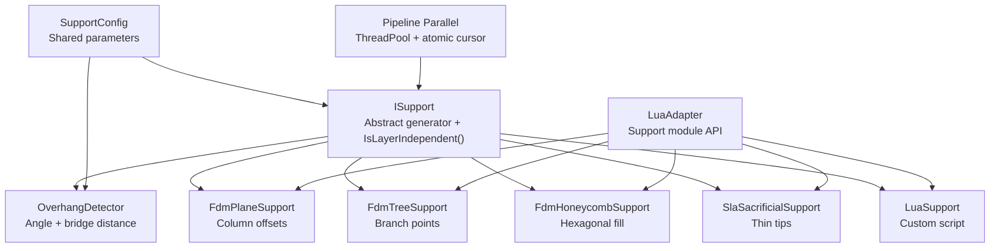

**Diagram sources**
- [ISupport.hpp:22-55](file://support/ISupport.hpp#L22-L55)
- [parallel.hpp:27-263](file://base/parallel.hpp#L27-L263)
- [pipeline_parallel.hpp:1-15](file://DllHsBaSlicer/pipeline_parallel.hpp#L1-L15)

**Section sources**
- [ISupport.hpp:22-55](file://support/ISupport.hpp#L22-L55)
- [SupportConfig.hpp:11-43](file://support/SupportConfig.hpp#L11-L43)

## Core Components
The core components are:
- `ISupport`: Abstract interface defining per-layer generation, batch iteration, and parallelization control via `IsLayerIndependent()`.
- `OverhangDetector`: Computes unsupported regions using geometric difference and angle-based bridge filtering.
- `FdmPlaneSupport`, `FdmTreeSupport`, `FdmHoneycombSupport`: FDM-specific support strategies.
- `SlaSacrificialSupport`: SLA-specific sacrificial support strategy.
- `LuaSupport` and `LuaAdapter`: Extensibility layer for custom support algorithms with forced serial execution.
- `SupportConfig`, `FdmSupportConfig`, `SlaSupportConfig`: Configuration structures.
- **Parallel Infrastructure**: Process-wide ThreadPool with atomic cursor scheduling for dynamic load balancing.

Key responsibilities:
- Detect where the current layer extends beyond the previous layer beyond what can be bridged.
- Convert overhang regions into printable support cross-sections.
- Provide both deterministic built-in strategies and user-defined Lua strategies.
- **Automatically parallelize independent layer operations while maintaining serial execution for stateful operations**.
- Expose a consistent C++ and Lua API.

**Section sources**
- [ISupport.hpp:22-55](file://support/ISupport.hpp#L22-L55)
- [ISupport.cpp:14-47](file://support/ISupport.cpp#L14-L47)
- [parallel.hpp:27-263](file://base/parallel.hpp#L27-L263)

## Architecture Overview
The support system follows a layered architecture with intelligent parallelization:
- Layer input: current and previous layer polygons.
- Parallelization decision: `IsLayerIndependent()` determines if operations can run concurrently.
- Overhang analysis: shared detector computes unsupported regions.
- Strategy selection: FDM or SLA built-in strategies, or Lua script.
- Output: per-layer support polygons.

```mermaid
sequenceDiagram
participant Slice as "Slice Engine"
participant Gen as "ISupport Generator"
participant Par as "Parallel Executor"
participant OD as "OverhangDetector"
participant Poly as "Polygon Operations"
participant Out as "Support Polygons"
Slice->>Gen : GenerateAll(layers, config)
Gen->>Gen : Check IsLayerIndependent()
alt Independent (true)
Gen->>Par : ParallelMapLayers(total, worker)
Par->>Gen : Generate(layer[i], prev_layer[i])
else Dependent (false)
Gen->>Gen : Serial loop Generate()
end
Gen->>OD : Detect(current_layer, prev_layer, layer_height, angle_threshold)
OD->>Poly : Difference(current_layer, prev_layer)
OD->>Poly : Offset(-bridge_distance)
OD-->>Gen : overhang_polygons
Gen->>Poly : Apply gap, inflate, pattern fill, or sample points
Gen-->>Out : current_layer_support_polygons
```

**Diagram sources**
- [ISupport.cpp:14-47](file://support/ISupport.cpp#L14-L47)
- [parallel.hpp:178-219](file://base/parallel.hpp#L178-L219)

## Parallel Execution Model
The support system now leverages a sophisticated parallel execution model that automatically optimizes performance while maintaining correctness:

### IsLayerIndependent() Mechanism
The `IsLayerIndependent()` virtual method serves as the primary control mechanism for parallelization:
- **Default behavior**: Returns `true`, enabling automatic parallelization for most generators.
- **Serial fallback**: Generators requiring state from previous layers override to return `false`.
- **Current implementations**: All built-in FDM and SLA generators use default parallelization; only `LuaSupport` forces serial execution.

### Pipeline Parallel Infrastructure
The underlying parallel execution uses a process-wide ThreadPool with advanced features:
- **Process-wide singleton**: Single ThreadPool instance reused across all pipeline stages.
- **Atomic cursor scheduling**: Dynamic load balancing using `std::atomic<int>` cursor for work distribution.
- **Progress reporting**: Non-blocking progress callbacks every 32 completed layers.
- **Exception handling**: Worker exceptions rethrown on the calling thread via futures.
- **Environment control**: `HSBA_PIPELINE_THREADS` environment variable controls parallelism level.

### Thread Safety Guarantees
- **Input isolation**: Each worker accesses only its own layer indices (`layers[i]`, `layers[i-1]`).
- **Output ordering**: Results written to pre-sized vector by index maintains original order.
- **State isolation**: No shared mutable state between concurrent layer operations.
- **Lua serialization**: Custom Lua scripts execute sequentially to avoid interpreter conflicts.

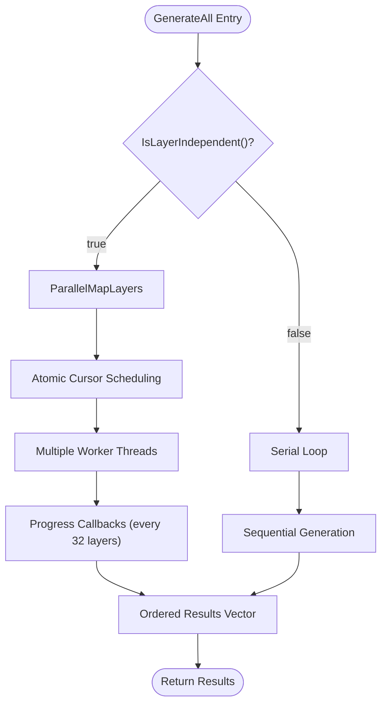

**Diagram sources**
- [ISupport.cpp:14-47](file://support/ISupport.cpp#L14-L47)
- [parallel.hpp:90-174](file://base/parallel.hpp#L90-L174)

**Section sources**
- [ISupport.hpp:46-55](file://support/ISupport.hpp#L46-L55)
- [ISupport.cpp:14-47](file://support/ISupport.cpp#L14-L47)
- [parallel.hpp:27-263](file://base/parallel.hpp#L27-L263)

## Detailed Component Analysis

### Abstract Generator Interface
`ISupport` defines:
- `Generate`: per-layer support generation.
- `GenerateAll`: default batch implementation with parallelization support.
- `IsLayerIndependent`: parallelization control mechanism.

Design notes:
- All concrete strategies implement the same signature, enabling interchangeable use.
- Batch iteration intelligently chooses between parallel and serial execution based on generator independence.
- The first layer without a previous layer makes the entire bottom layer an overhang candidate unless filtered by downstream logic.

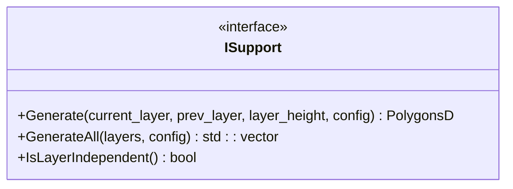

**Diagram sources**
- [ISupport.hpp:22-55](file://support/ISupport.hpp#L22-L55)
- [ISupport.cpp:14-47](file://support/ISupport.cpp#L14-L47)

**Section sources**
- [ISupport.hpp:22-55](file://support/ISupport.hpp#L22-L55)
- [ISupport.cpp:14-47](file://support/ISupport.cpp#L14-L47)

### Overhang Detection
`OverhangDetector` implements the mathematical foundation:
- If there is no previous layer, the entire current layer is considered unsupported.
- Otherwise, compute the region present in the current layer but not covered by the previous layer.
- Filter out small unsupported regions that can be bridged, using `MaxBridgeDistance`.
- Bridge distance formula: `max_bridge = layer_height / tan(angle_deg)`.
- Use negative offset to erode small overhangs; if erosion removes everything, no support is needed.

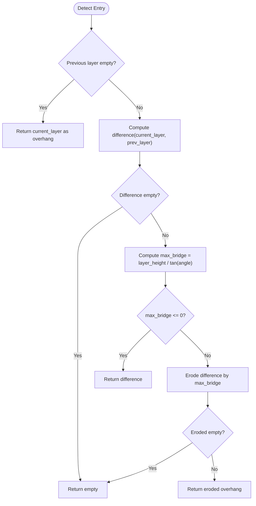

**Diagram sources**
- [OverhangDetector.cpp:23-38](file://support/OverhangDetector.cpp#L23-L38)
- [OverhangDetector.cpp:41-80](file://support/OverhangDetector.cpp#L41-L80)

Complexity considerations:
- Polygon difference and offset operations dominate runtime.
- Erosion scales with the number of vertices and the magnitude of the offset.
- For very small angles, bridge distance becomes large, potentially removing most overhangs.

**Section sources**
- [OverhangDetector.hpp:14-49](file://support/OverhangDetector.hpp#L14-L49)
- [OverhangDetector.cpp:23-80](file://support/OverhangDetector.cpp#L23-L80)

### FDM Plane Support
`FdmPlaneSupport` generates simple column supports:
- Detect overhang regions.
- Apply a gap between model and support via negative offset.
- Inflate the gapped region by half the support diameter to create cylindrical columns.
- Return the resulting polygons.

Use cases:
- Fast, predictable support generation.
- Good for models with moderate overhangs where dense support is acceptable.

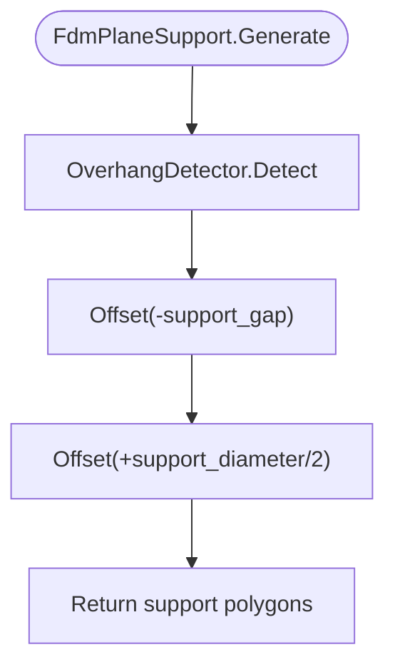

**Diagram sources**
- [FdmSupport.cpp:48-75](file://support/FdmSupport.cpp#L48-L75)

**Section sources**
- [FdmSupport.hpp:13-24](file://support/FdmSupport.hpp#L13-L24)
- [FdmSupport.cpp:48-75](file://support/FdmSupport.cpp#L48-L75)

### FDM Tree Support
`FdmTreeSupport` generates branching-like support points:
- Detect overhang regions.
- Apply gap.
- Sample branch points within the gapped overhang region using a grid spaced by approximately `support_diameter * 1.5`.
- Place circular branch tips at each sampled point.
- Union overlapping circles to produce connected-looking support points.

Notes:
- The current implementation produces 2D cross-sectional branch tips; vertical branching behavior across layers is conceptually described but not fully modeled here.
- Suitable for reducing material usage compared to solid fills while maintaining stability.
- Uses default parallelization since each layer's operation is independent.

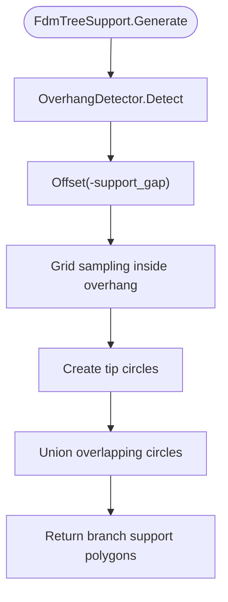

**Diagram sources**
- [FdmSupport.cpp:81-167](file://support/FdmSupport.cpp#L81-L167)

**Section sources**
- [FdmSupport.hpp:26-44](file://support/FdmSupport.hpp#L26-L44)
- [FdmSupport.cpp:81-167](file://support/FdmSupport.cpp#L81-L167)

### FDM Honeycomb Support
`FdmHoneycombSupport` fills overhang regions with hexagonal cells:
- Detect overhang regions.
- Apply gap.
- Generate flat-top hexagons across the bounding box of the overhang.
- Intersect the union of hexagons with the overhang region.

Use cases:
- Lightweight yet rigid support structures.
- Useful when minimizing material while preserving structural integrity.
- Uses default parallelization since each layer's operation is independent.

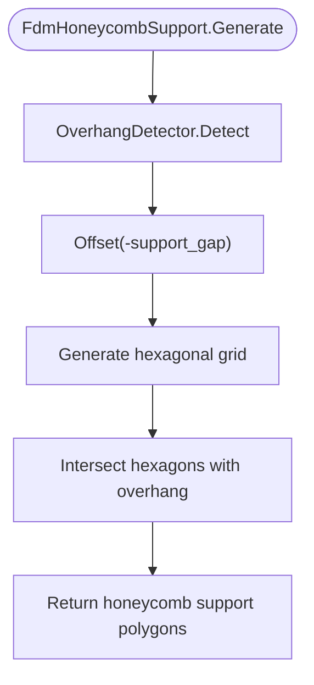

**Diagram sources**
- [FdmSupport.cpp:173-241](file://support/FdmSupport.cpp#L173-L241)
- [FdmSupport.cpp:244-266](file://support/FdmSupport.cpp#L244-L266)

**Section sources**
- [FdmSupport.hpp:46-63](file://support/FdmSupport.hpp#L46-L63)
- [FdmSupport.cpp:173-266](file://support/FdmSupport.cpp#L173-L266)

### SLA Sacrificial Support
`SlaSacrificialSupport` generates thin sacrificial supports for resin printing:
- Detect overhang regions.
- Apply gap.
- Sample support points using spacing derived from `support_diameter`.
- Create small circles at each point using `tip_diameter`.
- Union all circles.

Characteristics:
- Small tip diameter reduces post-processing effort.
- Spacing balances coverage and print time.
- Uses default parallelization since each layer's operation is independent.

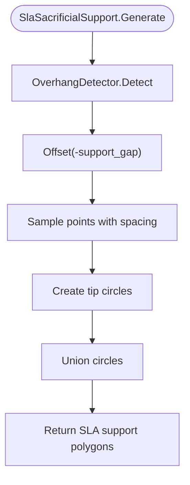

**Diagram sources**
- [SlaSupport.cpp:38-78](file://support/SlaSupport.cpp#L38-L78)
- [SlaSupport.cpp:81-123](file://support/SlaSupport.cpp#L81-L123)

**Section sources**
- [SlaSupport.hpp:13-42](file://support/SlaSupport.hpp#L13-L42)
- [SlaSupport.cpp:38-133](file://support/SlaSupport.cpp#L38-L133)

### Lua Custom Support Generator
`LuaSupport` allows users to replace built-in algorithms with custom Lua scripts:
- Supports inline scripts or script files.
- Provides globals: `current_layer`, `prev_layer`, `layer_height`, `config`.
- Registers polygon helper functions and the `Support` module.
- Executes the script and retrieves returned polygons.
- **Forces serial execution** via `IsLayerIndependent() = false` to prevent interpreter conflicts.

Extensibility:
- External registration functions can be injected to expose additional 2D/3D capabilities.
- Errors during load or execution are wrapped into runtime exceptions.

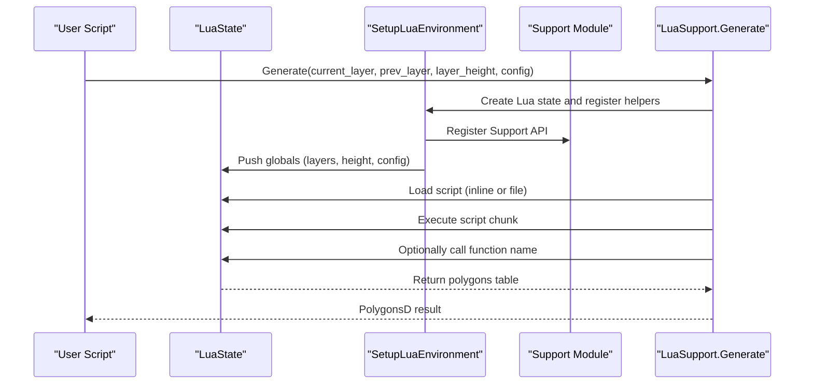

**Diagram sources**
- [LuaSupport.cpp:19-90](file://support/LuaSupport.cpp#L19-L90)
- [LuaSupport.cpp:113-177](file://support/LuaSupport.cpp#L113-L177)
- [LuaAdapter.cpp:265-276](file://support/LuaAdapter.cpp#L265-L276)

**Section sources**
- [LuaSupport.hpp:21-80](file://support/LuaSupport.hpp#L21-L80)
- [LuaSupport.cpp:19-177](file://support/LuaSupport.cpp#L19-L177)
- [LuaAdapter.hpp:13-30](file://support/LuaAdapter.hpp#L13-L30)
- [LuaAdapter.cpp:43-108](file://support/LuaAdapter.cpp#L43-L108)
- [LuaAdapter.cpp:174-213](file://support/LuaAdapter.cpp#L174-L213)

## Dependency Analysis
The support module has clear internal dependencies with parallel infrastructure integration:
- All generators depend on `ISupport`.
- Built-in generators depend on `OverhangDetector`.
- Lua integration depends on `LuaSupport` and `LuaAdapter`.
- Configuration is shared via `SupportConfig` and its subclasses.
- **Parallel execution depends on `base/parallel.hpp` for ThreadPool and atomic operations**.

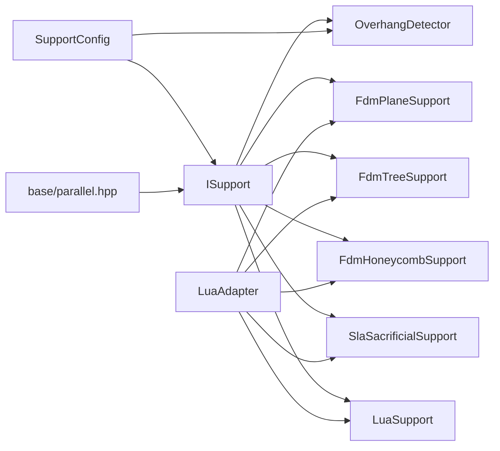

**Diagram sources**
- [ISupport.hpp:22-55](file://support/ISupport.hpp#L22-L55)
- [parallel.hpp:27-263](file://base/parallel.hpp#L27-L263)

**Section sources**
- [ISupport.hpp:22-55](file://support/ISupport.hpp#L22-L55)
- [SupportConfig.hpp:11-43](file://support/SupportConfig.hpp#L11-L43)

## Performance Considerations
The parallel execution model significantly impacts performance characteristics:

### Parallelization Benefits
- **Automatic optimization**: Independent layer operations automatically parallelized without code changes.
- **Dynamic load balancing**: Atomic cursor scheduling distributes work evenly across available threads.
- **Process-wide efficiency**: Single ThreadPool instance eliminates repeated initialization overhead.
- **Scalable progress reporting**: Non-blocking progress updates every 32 layers reduce UI overhead.

### Performance Implications
- **Overhang detection**: Still involves expensive polygon difference and offset operations; these remain the primary bottleneck.
- **FDM plane support**: Two offsets per layer benefit from parallelization; tree and honeycomb add sampling and union/intersection steps.
- **SLA sacrificial support**: Point sampling across bounding boxes benefits from parallelization; spacing controls density and performance.
- **Lua scripts**: Introduce interpreter overhead and force serial execution; keep scripts efficient and avoid unnecessary polygon operations.
- **Memory usage**: Parallel execution increases memory footprint due to multiple concurrent polygon operations.

### Tuning Guidelines
- **HSBA_PIPELINE_THREADS**: Controls parallelism level; set before pipeline execution for optimal performance.
- **Bridge distances**: Larger values reduce support volume but may compromise printability.
- **Generator selection**: Choose appropriate strategies based on model complexity and desired output quality.
- **Lua optimization**: Minimize script complexity and prefer built-in strategies when possible.

[No sources needed since this section provides general guidance]

## Configuration Guide
Shared configuration fields:
- `overhang_angle_threshold`: Angle threshold in degrees controlling bridge tolerance.
- `layer_height`: Layer height in mm.
- `support_gap`: Gap between model and support in mm.
- `support_diameter`: Base diameter for FDM columns and SLA spacing.
- `support_density`: Fill density for support structures.
- `support_pattern`: Pattern selector for FDM strategies.
- `tree_branch_angle`: Angle parameter for tree branches.
- `tree_max_branch_radius`: Maximum radius for tree branches.
- `honeycomb_cell_size`: Size of hexagonal cells.

FDM-specific:
- `interface_layers`: Number of interface layers between support and model.
- `interface_density`: Fill density for interface layers.

SLA-specific:
- `tip_diameter`: Diameter of sacrificial support tips.
- `raft_thickness`: Thickness of raft layers.

**Parallel execution configuration**:
- `HSBA_PIPELINE_THREADS`: Environment variable controlling number of parallel workers.
  - Default: `hardware_concurrency()` or 2 if unavailable.
  - Set to 1 for serial execution (useful for debugging and regression testing).
  - Must be set before pipeline execution takes effect.

Practical tuning advice:
- Increase `overhang_angle_threshold` to reduce supports for steep overhangs.
- Decrease `support_gap` to improve adhesion but risk surface defects.
- Increase `support_diameter` for stronger supports at the cost of material.
- Choose honeycomb for lightweight rigid supports; choose tree for sparse branching; choose plane for simplicity.
- For SLA, reduce `tip_diameter` for easier removal and increase spacing to reduce print time.
- Tune `HSBA_PIPELINE_THREADS` based on hardware capabilities and workload characteristics.

**Section sources**
- [SupportConfig.hpp:11-43](file://support/SupportConfig.hpp#L11-L43)
- [parallel.hpp:30-54](file://base/parallel.hpp#L30-L54)

## Lua Scripting Interface
The Lua interface exposes:
- `Support.new_plane()`, `Support.new_tree()`, `Support.new_honeycomb()`, `Support.new_sla()` to create built-in support objects.
- `Support.new_lua(script[, funcName])` and `Support.new_lua_file(path, funcName)` to create custom support objects.
- `Support.generate(support_obj, current_layer, prev_layer, layer_height, config_table)` to run generation.
- `Support.detect_overhang(current_layer, prev_layer, layer_height, angle_deg)` to detect overhangs.
- `Support.default_config()` to obtain default configuration values.

Script environment:
- Globals: `current_layer`, `prev_layer`, `layer_height`, `config`.
- Helper functions from 2D polygon operations are available.
- Scripts can return polygons directly or define a function named by `funcName`.

Example workflow:
1. Create a support object using `Support.new_*` or `Support.new_lua*`.
2. Prepare layer data and configuration tables.
3. Call `Support.generate` to obtain support polygons.
4. Handle errors thrown by Lua load/runtime/function calls.

Best practices:
- Validate input polygons before passing them to Lua.
- Keep Lua scripts minimal and focused on performance-critical logic.
- Use `Support.detect_overhang` to debug overhang regions.
- Prefer built-in strategies when possible for predictable performance.
- **Note**: Lua scripts execute serially regardless of `HSBA_PIPELINE_THREADS` setting.

**Section sources**
- [LuaAdapter.hpp:13-30](file://support/LuaAdapter.hpp#L13-L30)
- [LuaAdapter.cpp:110-171](file://support/LuaAdapter.cpp#L110-L171)
- [LuaAdapter.cpp:174-213](file://support/LuaAdapter.cpp#L174-L213)
- [LuaAdapter.cpp:215-241](file://support/LuaAdapter.cpp#L215-L241)
- [LuaSupport.cpp:67-90](file://support/LuaSupport.cpp#L67-L90)
- [LuaSupport.cpp:113-177](file://support/LuaSupport.cpp#L113-L177)

## Integration with the Slicing Workflow
Typical integration steps:
1. Slice the model into layers represented as polygons.
2. Select a support strategy: FDM plane/tree/honeycomb, SLA sacrificial, or Lua custom.
3. Configure support parameters using `SupportConfig` or Lua tables.
4. Iterate through layers using `ISupport::GenerateAll` or manual per-layer calls.
5. **Automatic parallelization** handles independent operations efficiently.
6. Merge generated support polygons with model layers for downstream path generation.

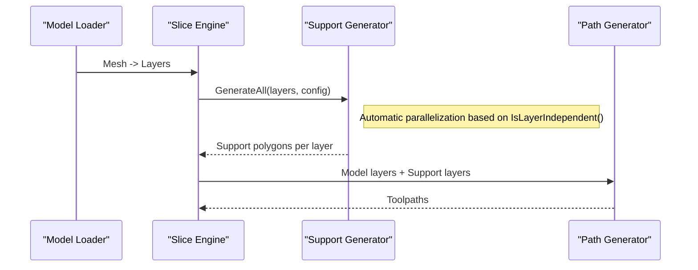

**Diagram sources**
- [ISupport.cpp:14-47](file://support/ISupport.cpp#L14-L47)
- [FdmSupport.cpp:48-75](file://support/FdmSupport.cpp#L48-L75)
- [SlaSupport.cpp:81-123](file://support/SlaSupport.cpp#L81-L123)
- [LuaSupport.cpp:113-177](file://support/LuaSupport.cpp#L113-L177)

**Section sources**
- [ISupport.cpp:14-47](file://support/ISupport.cpp#L14-L47)

## Troubleshooting Guide
Common issues and resolutions:
- No supports generated:
  - Check `overhang_angle_threshold`; too high may filter all overhangs.
  - Verify `layer_height` and angle relationship; very steep angles yield zero bridge distance.
  - Ensure previous layer is provided correctly; first layer treats entire current layer as overhang.
- Excessive supports:
  - Reduce `support_diameter` or increase spacing in SLA.
  - Increase `overhang_angle_threshold` to allow more bridging.
  - Switch from plane to tree or honeycomb for lighter supports.
- Poor adhesion or surface defects:
  - Adjust `support_gap`; smaller gaps improve adhesion but may mark surfaces.
  - Tune interface layers and densities for FDM.
- Lua script errors:
  - Inspect error messages from Lua load/runtime/function calls.
  - Validate polygon tables passed to Lua helpers.
  - Confirm function name matches the script's exported function.
- **Performance issues**:
  - Check `HSBA_PIPELINE_THREADS` setting; too high may cause resource contention.
  - Monitor memory usage during parallel execution.
  - Consider serial execution (`HSBA_PIPELINE_THREADS=1`) for debugging parallel-related issues.

Error handling highlights:
- Lua support throws runtime errors on Lua state creation failure, script load failure, runtime execution failure, and function call failure.
- Lua adapter wraps C++ exceptions into Lua errors.
- **Parallel execution**: Worker exceptions are rethrown on the calling thread for centralized error handling.

**Section sources**
- [OverhangDetector.cpp:23-38](file://support/OverhangDetector.cpp#L23-L38)
- [OverhangDetector.cpp:41-80](file://support/OverhangDetector.cpp#L41-L80)
- [LuaSupport.cpp:113-177](file://support/LuaSupport.cpp#L113-L177)
- [LuaAdapter.cpp:174-213](file://support/LuaAdapter.cpp#L174-L213)
- [parallel.hpp:170-174](file://base/parallel.hpp#L170-L174)

## Conclusion
The support structure system in HsBaSlicer provides a robust, extensible foundation for generating supports across FDM and SLA processes, now enhanced with intelligent parallel processing capabilities. Its design separates overhang detection from strategy-specific generation, enabling interchangeable algorithms and user-defined Lua extensions. The new `IsLayerIndependent()` mechanism automatically optimizes performance by parallelizing independent layer operations while maintaining serial execution for stateful operations like Lua scripts. By tuning configuration parameters, selecting appropriate strategies, and leveraging the parallel execution model, users can effectively balance printability, material usage, post-processing effort, and computational performance.