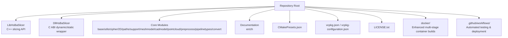
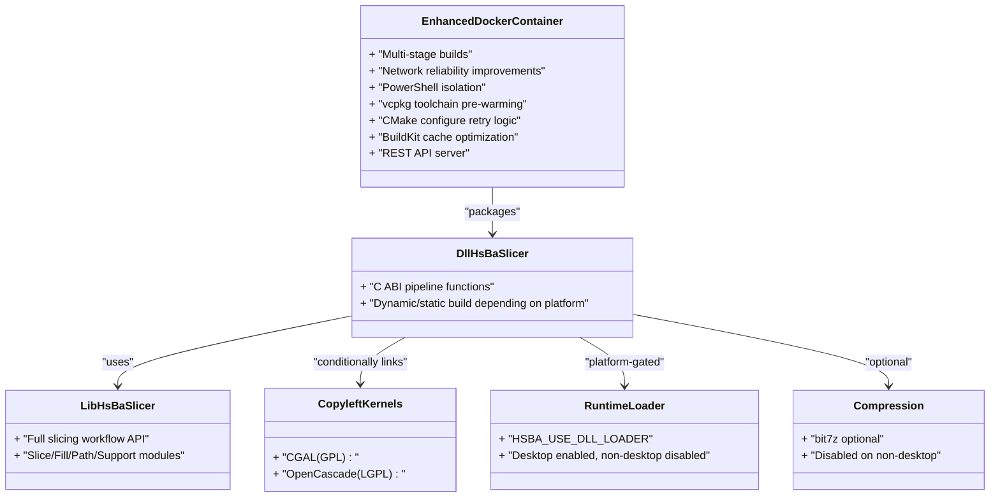
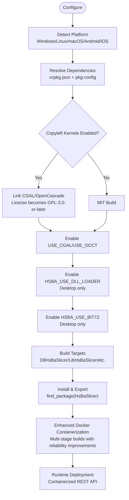
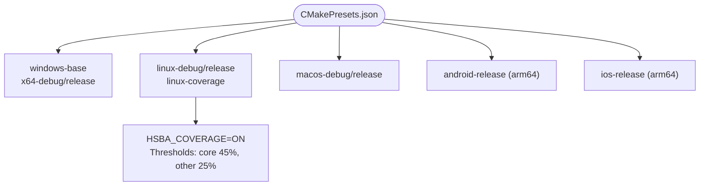
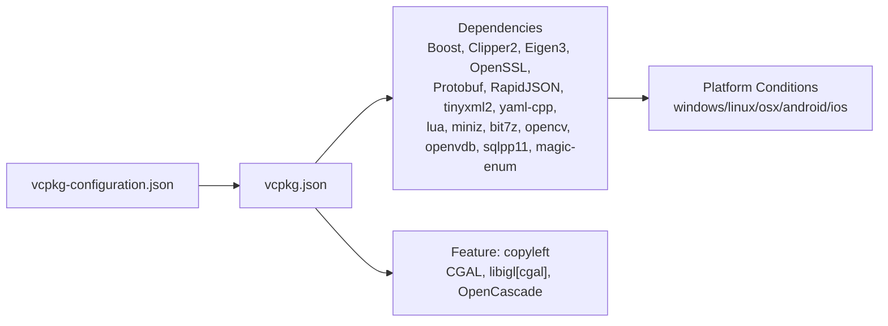
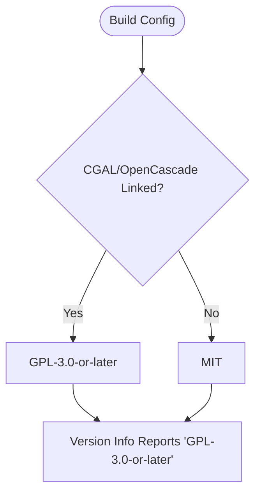
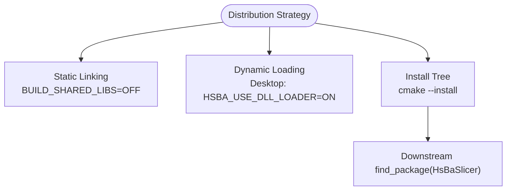
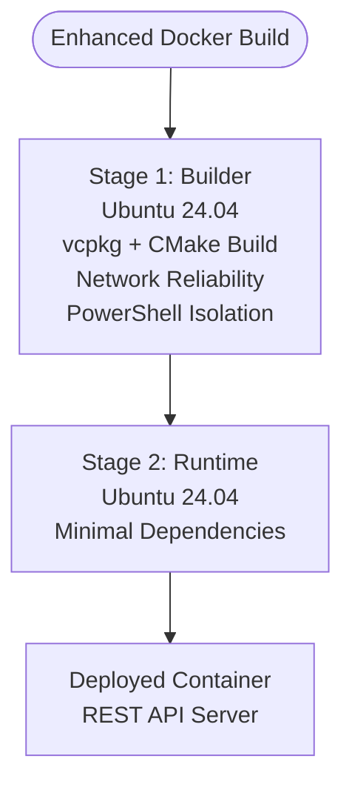
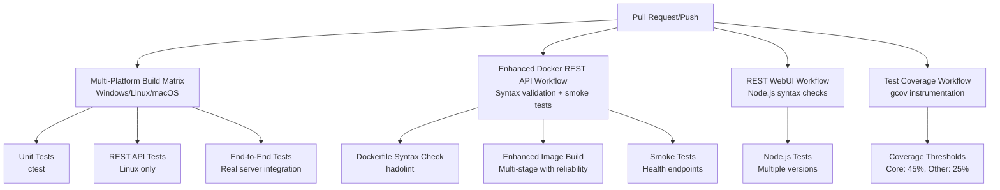

Based on my analysis of the enhanced Docker build system, I can now update the deployment troubleshooting documentation to reflect the significant improvements made. Here's the updated document:

<cite>
**Referenced Files in This Document**
- [README.md](file://README.md)
- [CMakeLists.txt](file://CMakeLists.txt)
- [vcpkg.json](file://vcpkg.json)
- [vcpkg-configuration.json](file://vcpkg-configuration.json)
- [CMakePresets.json](file://CMakePresets.json)
- [docs/en/vcpkg-dependencies.md](file://docs/en/vcpkg-dependencies.md)
- [cmake/deploy_dlls.cmake](file://cmake/deploy_dlls.cmake)
- [LICENSE.txt](file://LICENSE.txt)
- [tests/Models/openvdb_model_test.cpp](file://tests/Models/openvdb_model_test.cpp)
- [docker/Dockerfile](file://docker/Dockerfile)
- [docker/Dockerfile.dockerignore](file://docker/Dockerfile.dockerignore)
- [.github/workflows/docker-rest-api.yml](file://.github/workflows/docker-rest-api.yml)
- [.github/workflows/cmake-multi-platform.yml](file://.github/workflows/cmake-multi-platform.yml)
- [.github/workflows/test-coverage.yml](file://.github/workflows/test-coverage.yml)
- [.github/workflows/rest-webui.yml](file://.github/workflows/rest-webui.yml)
</cite>

## Update Summary
**Changes Made**
- Enhanced Docker build system with improved network reliability and retry logic
- Added PowerShell installation isolation using Microsoft official GitHub releases
- Implemented vcpkg toolchain pre-warming for faster builds
- Added CMake configure retry logic with exponential backoff
- Integrated BuildKit cache optimization for dependency caching
- Updated containerization section with advanced networking and reliability features

## Table of Contents
1. [Introduction](#introduction)
2. [Project Structure](#project-structure)
3. [Core Components](#core-components)
4. [Architecture Overview](#architecture-overview)
5. [Detailed Component Analysis](#detailed-component-analysis)
6. [Dependency Analysis](#dependency-analysis)
7. [Performance Considerations](#performance-considerations)
8. [Containerization and Deployment](#containerization-and-deployment)
9. [CI/CD Automation](#cicd-automation)
10. [Troubleshooting Guide](#troubleshooting-guide)
11. [Conclusion](#conclusion)
12. [Appendices](#appendices)

## Introduction
This document is the deployment troubleshooting and FAQ guide for HsBaSlicer. It focuses on build failures, dependency resolution with vcpkg, platform-specific issues, runtime performance and memory diagnostics, distribution packaging strategies, licensing implications, supported platforms, migration guidance, known limitations, and roadmap items. The content is derived from the repository's CMake configuration, vcpkg manifests, presets, documentation, tests, Docker files, and GitHub Actions workflows.

HsBaSlicer is a modular, cross-platform C++ framework for 3D-printing slicers. It exposes:
- A shared-library C ABI entry point (`DllHsBaSlicer`) for external languages.
- A static/shared library API (`LibHsBaSlicer`) for full slicing workflows.
- Optional copyleft kernels (CGAL, OpenCascade) that change the effective license to GPL-3.0-or-later when enabled.
- **Enhanced**: Advanced Docker containerization with improved network reliability, PowerShell isolation, vcpkg toolchain pre-warming, and CMake configure retry logic.

**Section sources**
- [README.md:21-39](file://README.md#L21-L39)
- [README.md:100-124](file://README.md#L100-L124)

## Project Structure
The project uses a layered structure:
- Core libraries under `base`, `utils`, `cipher`, `2D`, `paths`, `support`, `meshmodel`, `cadmodel`, `pointcloud`, `preprocess`, `pipelinetypes`, `convert`.
- Public APIs under `LibHsBaSlicer` (C++) and `DllHsBaSlicer` (C ABI).
- Build orchestration via top-level `CMakeLists.txt`, `CMakePresets.json`, and vcpkg manifests.
- **Enhanced**: Advanced containerization support under `docker/` with multi-stage Docker builds and improved reliability.
- **Enhanced**: CI/CD automation under `.github/workflows/` with comprehensive testing and deployment pipelines.
- Documentation under `docs`, including platform and dependency notes.



**Diagram sources**
- [README.md:29-39](file://README.md#L29-L39)
- [CMakePresets.json:1-239](file://CMakePresets.json#L1-L239)
- [vcpkg.json:1-113](file://vcpkg.json#L1-L113)
- [LICENSE.txt:1-23](file://LICENSE.txt#L1-L23)
- [docker/Dockerfile:1-229](file://docker/Dockerfile#L1-L229)
- [.github/workflows/docker-rest-api.yml:1-153](file://.github/workflows/docker-rest-api.yml#L1-L153)

**Section sources**
- [README.md:29-39](file://README.md#L29-L39)
- [CMakePresets.json:1-239](file://CMakePresets.json#L1-L239)

## Core Components
Key components relevant to deployment and operation:
- `DllHsBaSlicer`: Exposes C ABI pipelines; built as SHARED on desktop, STATIC on iOS.
- `LibHsBaSlicer`: Full C++ slicing pipeline API.
- Copyleft kernel integration: CGAL and OpenCascade are conditionally linked based on the `copyleft` feature and platform availability.
- Dynamic loading: Runtime DLL loader is enabled on desktop and disabled on non-desktop platforms.
- Compression: bit7z is optional and disabled on non-desktop platforms.
- **Enhanced**: Advanced Docker containerization with improved network reliability, PowerShell isolation, vcpkg toolchain pre-warming, and CMake configure retry logic.



**Diagram sources**
- [CMakeLists.txt:228-256](file://CMakeLists.txt#L228-L256)
- [CMakeLists.txt:284-318](file://CMakeLists.txt#L284-L318)
- [DllHsBaSlicer/CMakeLists.txt:1-58](file://DllHsBaSlicer/CMakeLists.txt#L1-L58)
- [docker/Dockerfile:1-229](file://docker/Dockerfile#L1-L229)

**Section sources**
- [CMakeLists.txt:228-256](file://CMakeLists.txt#L228-L256)
- [CMakeLists.txt:284-318](file://CMakeLists.txt#L284-L318)
- [DllHsBaSlicer/CMakeLists.txt:1-58](file://DllHsBaSlicer/CMakeLists.txt#L1-L58)

## Architecture Overview
At build time, CMake detects compiler capabilities, platform, and dependencies. At configure time, it decides whether to enable copyleft kernels, dynamic loading, compression, and which targets to install/export. At runtime, the application loads the appropriate pipeline interfaces through the C ABI or C++ API.

**Enhanced** Advanced Docker containerization architecture with improved network reliability, PowerShell isolation, vcpkg toolchain pre-warming, and CMake configure retry logic.



**Diagram sources**
- [CMakeLists.txt:129-157](file://CMakeLists.txt#L129-L157)
- [CMakeLists.txt:170-204](file://CMakeLists.txt#L170-L204)
- [CMakeLists.txt:228-256](file://CMakeLists.txt#L228-L256)
- [CMakeLists.txt:456-665](file://CMakeLists.txt#L456-L665)
- [docker/Dockerfile:1-229](file://docker/Dockerfile#L1-L229)

**Section sources**
- [CMakeLists.txt:129-157](file://CMakeLists.txt#L129-L157)
- [CMakeLists.txt:170-204](file://CMakeLists.txt#L170-L204)
- [CMakeLists.txt:228-256](file://CMakeLists.txt#L228-L256)
- [CMakeLists.txt:456-665](file://CMakeLists.txt#L456-L665)

## Detailed Component Analysis

### Build System and Presets
- Top-level CMake requires C++20 features and enforces minimum compiler capabilities.
- Presets define Windows/Linux/macOS/Android/iOS configurations, including coverage builds.
- Coverage preset enables gcov instrumentation and thresholds for core vs other modules.



**Diagram sources**
- [CMakePresets.json:1-239](file://CMakePresets.json#L1-L239)

**Section sources**
- [CMakeLists.txt:4-38](file://CMakeLists.txt#L4-L38)
- [CMakePresets.json:1-239](file://CMakePresets.json#L1-L239)

### Dependency Resolution with vcpkg
- `vcpkg.json` declares dependencies and the `copyleft` feature enabling CGAL, libigl[cgal], and OpenCascade.
- `vcpkg-configuration.json` pins the registry baseline and overlay locations.
- Desktop platforms get the full dependency set; Android/iOS exclude certain packages.



**Diagram sources**
- [vcpkg-configuration.json:1-21](file://vcpkg-configuration.json#L1-L21)
- [vcpkg.json:1-113](file://vcpkg.json#L1-L113)

**Section sources**
- [vcpkg.json:1-113](file://vcpkg.json#L1-L113)
- [vcpkg-configuration.json:1-21](file://vcpkg-configuration.json#L1-L21)
- [docs/en/vcpkg-dependencies.md:1-80](file://docs/en/vcpkg-dependencies.md#L1-L80)

### Licensing Model
- Conditional dual license: MIT unless copyleft kernels are linked, then GPL-3.0-or-later.
- Effective license is determined at configure time and exposed via version info.



**Diagram sources**
- [LICENSE.txt:1-23](file://LICENSE.txt#L1-L23)
- [README.md:196-210](file://README.md#L196-L210)

**Section sources**
- [LICENSE.txt:1-23](file://LICENSE.txt#L1-L23)
- [README.md:196-210](file://README.md#L196-L210)

### Distribution Packaging Strategies
- Static linking: Use `BUILD_SHARED_LIBS=OFF` or triplets like `linux-static`; internal static libraries must be included in export sets.
- Dynamic loading: On desktop, `HSBA_USE_DLL_LOADER` is ON; on Android/iOS, it is OFF and `HSBA_NO_DLL_LOADER` is defined.
- Distribution packaging: Use `cmake --install` to produce an install tree; downstream projects use `find_package(HsBaSlicer CONFIG REQUIRED)` and link against `HsBaSlicer::DllHsBaSlicer` or `HsBaSlicer::LibHsBaSlicer`.



**Diagram sources**
- [CMakeLists.txt:367-390](file://CMakeLists.txt#L367-L390)
- [CMakeLists.txt:456-665](file://CMakeLists.txt#L456-L665)
- [README.md:100-185](file://README.md#L100-L185)

**Section sources**
- [CMakeLists.txt:367-390](file://CMakeLists.txt#L367-L390)
- [CMakeLists.txt:456-665](file://CMakeLists.txt#L456-L665)
- [README.md:100-185](file://README.md#L100-L185)

## Dependency Analysis
The following table summarizes key dependencies and their platform support as documented:

| Component | Windows | Linux | macOS | Android | iOS |
|-----------|---------|-------|-------|---------|-----|
| boost-log | ✓ | ✓ | ✓ | ✗ | ✗ |
| boost-locale | ✓ | ✓ | ✓ | ✗ | ✗ |
| boost-dll | ✓ | ✓ | ✓ | ✗ | ✗ |
| boost-nowide | ✓ | ✓ | ✓ | ✗ | ✗ |
| boost-date-time | ✓ | ✓ | ✓ | ✓ | ✓ |
| opencv | ✓ | ✓ | ✓ | ✓ | ✗ |
| opencascade | ✓ | ✓ | ✓ | ✗ | ✗ |
| sqlpp11 (MySQL/PG) | ✓ | ✓ | ✓ | ✗ | ✗ |
| openvdb | ✓ | ✓ | ✓ | ✗ | ✗ |

**Section sources**
- [docs/en/vcpkg-dependencies.md:52-64](file://docs/en/vcpkg-dependencies.md#L52-L64)

## Performance Considerations
- Debug builds disable boolean operations and warn about high memory usage due to CGAL/IGL.
- Coverage builds instrument all targets; CI caps parallelism to avoid OOM on heavy translation units.
- Memory pools and object pools reduce allocation overhead; tests demonstrate disabling CRT leak checks where third-party libraries manage memory differently.

Recommendations:
- Prefer Release builds for production slicing workloads.
- Avoid Debug builds when using CGAL boolean operations if memory is constrained.
- Use coverage builds only for analysis; they increase binary size and execution time.

**Section sources**
- [CMakeLists.txt:294-298](file://CMakeLists.txt#L294-L298)
- [.github/workflows/test-coverage.yml:1-136](file://.github/workflows/test-coverage.yml#L1-L136)
- [tests/Models/openvdb_model_test.cpp:10-20](file://tests/Models/openvdb_model_test.cpp#L10-L20)

## Containerization and Deployment

### Enhanced Docker Containerization
**Enhanced** HsBaSlicer now provides advanced Docker containerization support with significantly improved network reliability, PowerShell installation isolation, vcpkg toolchain pre-warming, and CMake configure retry logic for deploying the REST API server.

#### Advanced Multi-Stage Build Architecture
The enhanced Docker implementation uses a sophisticated two-stage build process with multiple reliability improvements:
- **Builder stage**: Compiles dependencies using vcpkg with improved network handling and builds the HsBaSlicerRestServer binary
- **Runtime stage**: Contains only the minimal runtime dependencies and the compiled binary



**Diagram sources**
- [docker/Dockerfile:1-229](file://docker/Dockerfile#L1-L229)

#### Key Enhancements

##### Network Reliability Improvements
- **Retry Logic**: CMake configure attempts up to 5 times with 30-second intervals between retries
- **Download Resilience**: wget with `--tries=15 --timeout=60` for critical downloads
- **APT Mirror Support**: Optional custom apt mirror configuration for restricted networks
- **Connection Recovery**: Automatic cleanup of corrupted build artifacts before retry

##### PowerShell Installation Isolation
- **Microsoft Official Releases**: Direct download from GitHub releases instead of packages.microsoft.com
- **Isolated Layer**: PowerShell installation isolated in separate layer for better caching
- **Fallback Mechanism**: Automatic dependency resolution with `apt-get install -f` for missing dependencies
- **Clean Package Management**: Proper cleanup of temporary .deb files and apt lists

##### vcpkg Toolchain Pre-warming
- **Proactive Download**: Downloads cmake and ninja binaries before vcpkg needs them
- **Cache Optimization**: Uses BuildKit cache mounts for persistent toolchain downloads
- **Version Detection**: Automatically reads required versions from vcpkg-tool-metadata.txt
- **Graceful Fallback**: Continues build even if pre-warming fails, relying on retry logic

##### BuildKit Cache Optimization
- **Layer Caching**: Strategic use of `--mount=type=cache` for vcpkg downloads and installed packages
- **Selective Caching**: Only caches necessary directories to minimize image size
- **Cross-Build Reuse**: Cached layers persist across different build contexts
- **Efficient Updates**: Smart invalidation based on dependency changes

#### Basic Usage
```bash
# Build the container image with enhanced reliability
docker build -f docker/Dockerfile -t hsba-rest-api:latest .

# Run the container
docker run -d -p 8080:8080 -e HSBA_REST_AUTH_TOKEN=<token> hsba-rest-api:latest

# Health check
curl http://localhost:8080/api/health
```

#### Advanced Configuration
- **Feature selection**: Control copyleft kernel inclusion via `HSBA_FEATURES` environment variable
- **vcpkg baseline override**: Specify exact dependency versions with `VCPKG_BASELINE`
- **Parallel builds**: Control build parallelism with `JOBS` argument
- **Volume mounting**: Persist data with `-v hsba-data:/app/data`
- **Custom apt mirrors**: Configure alternative package sources with `APT_MIRROR`
- **PowerShell version override**: Use specific PowerShell version with `POWERSHELL_DEB_URL`

**Section sources**
- [docker/Dockerfile:1-229](file://docker/Dockerfile#L1-L229)
- [docker/Dockerfile.dockerignore:1-30](file://docker/Dockerfile.dockerignore#L1-L30)

### Enhanced Container Troubleshooting

#### Common Docker Issues

##### Network Connectivity Problems
Symptoms:
- Slow builds due to failed downloads or timeouts
- PowerShell installation failures from packages.microsoft.com
- vcpkg dependency download failures

Resolution:
- Enable BuildKit for optimal caching: `DOCKER_BUILDKIT=1`
- Use custom apt mirrors for restricted networks: `--build-arg APT_MIRROR=https://mirrors.tuna.tsinghua.edu.cn/ubuntu/`
- Clear Docker cache if corrupted: `docker builder prune`
- Verify Docker daemon has sufficient disk space

##### PowerShell Installation Failures
Symptoms:
- Unable to locate package powershell
- Missing PowerShell during version generation
- Permission errors during container startup

Resolution:
- PowerShell is now installed from Microsoft official GitHub releases
- Check container logs: `docker logs <container-id>`
- Verify network connectivity to GitHub releases
- Ensure proper volume permissions for data persistence

##### Build Reliability Issues
Symptoms:
- Intermittent build failures due to network issues
- Corrupted build artifacts causing repeated failures
- Timeout errors during dependency compilation

Resolution:
- Enhanced retry logic automatically handles transient failures
- Build artifacts are cleaned between retry attempts
- Monitor build progress for detailed error information
- Check BuildKit cache status: `docker builder ls`

#### Advanced Network Configuration
For environments with strict network policies:
```bash
# Build with custom apt mirror
docker build \
  --build-arg APT_MIRROR=https://your-custom-mirror/ubuntu/ \
  --build-arg POWERSHELL_DEB_URL=https://your-proxy/github/releases/download/v7.6.6/powershell_7.6.6-1.deb_amd64.deb \
  -f docker/Dockerfile -t hsba-rest-api:latest .
```

**Section sources**
- [docker/Dockerfile:39-43](file://docker/Dockerfile#L39-L43)
- [docker/Dockerfile:83-88](file://docker/Dockerfile#L83-L88)
- [docker/Dockerfile:119-140](file://docker/Dockerfile#L119-L140)
- [docker/Dockerfile:146-174](file://docker/Dockerfile#L146-L174)

## CI/CD Automation

### Enhanced GitHub Actions Workflows
**Enhanced** Comprehensive CI/CD automation with specialized workflows for different aspects of the build and deployment process, featuring improved reliability and caching.

#### Workflow Architecture


**Diagram sources**
- [.github/workflows/cmake-multi-platform.yml:1-517](file://.github/workflows/cmake-multi-platform.yml#L1-L517)
- [.github/workflows/docker-rest-api.yml:1-153](file://.github/workflows/docker-rest-api.yml#L1-L153)
- [.github/workflows/rest-webui.yml:1-79](file://.github/workflows/rest-webui.yml#L1-L79)
- [.github/workflows/test-coverage.yml:1-136](file://.github/workflows/test-coverage.yml#L1-L136)

#### Specialized Workflows

##### Enhanced Multi-Platform Build Matrix
- **Platforms**: Windows, Linux, macOS
- **Features**: Full test suite, REST API validation, end-to-end testing
- **Caching**: Optimized vcpkg binary caching across platforms with improved reliability

##### Enhanced Docker REST API Workflow
- **Triggers**: Changes to `docker/**` or workflow file
- **Validation**: Dockerfile syntax checking with hadolint
- **Testing**: Container build with enhanced reliability and smoke tests
- **Deployment**: Optional push to GitHub Container Registry
- **Reliability**: Improved network handling and retry mechanisms

##### REST WebUI Workflow
- **Scope**: Node.js console application only
- **Versions**: Tests against Node.js 20, 22, 24
- **Independence**: No C++ dependencies, pure JavaScript testing

##### Test Coverage Workflow
- **Metrics**: Line coverage with gcov/gcovr
- **Thresholds**: Core modules ≥45%, Other modules ≥25%
- **Reporting**: HTML/XML reports with job summary integration

#### Enhanced Build Optimization
- **Parallel builds**: Controlled parallelism to prevent OOM on CI runners
- **Dependency caching**: Extensive use of GitHub Actions caching for vcpkg downloads
- **Selective testing**: Platform-specific test execution to optimize CI time
- **Network resilience**: Improved handling of transient network failures

**Section sources**
- [.github/workflows/cmake-multi-platform.yml:1-517](file://.github/workflows/cmake-multi-platform.yml#L1-L517)
- [.github/workflows/docker-rest-api.yml:1-153](file://.github/workflows/docker-rest-api.yml#L1-L153)
- [.github/workflows/rest-webui.yml:1-79](file://.github/workflows/rest-webui.yml#L1-L79)
- [.github/workflows/test-coverage.yml:1-136](file://.github/workflows/test-coverage.yml#L1-L136)

## Troubleshooting Guide

### Common Build Issues

#### Compiler Requirements Failures
Symptoms:
- Errors indicating missing C++ concepts, ranges, source_location, or template-template matching.

Resolution:
- Ensure a C++20-capable compiler and update toolchain.
- Verify CMake version meets minimum requirements.

**Section sources**
- [CMakeLists.txt:4-38](file://CMakeLists.txt#L4-L38)
- [CMakeLists.txt:48-86](file://CMakeLists.txt#L48-L86)

#### vcpkg Dependency Resolution Problems
Symptoms:
- Missing packages, failed installs, or platform-incompatible dependencies.

Resolution:
- Confirm vcpkg bootstrapped and updated.
- For Android/iOS, rely on reduced dependency sets; do not force excluded packages.
- Disable default features to avoid copyleft kernels if you need an MIT build.

**Section sources**
- [docs/en/vcpkg-dependencies.md:72-80](file://docs/en/vcpkg-dependencies.md#L72-L80)
- [vcpkg.json:1-113](file://vcpkg.json#L1-L113)

#### Platform-Specific Build Failures
Symptoms:
- Android/iOS builds failing due to unsupported dependencies (e.g., OpenCV, OpenCascade, MySQL/PostgreSQL).

Resolution:
- Use provided presets for Android/iOS.
- Exclude complex libraries not suitable for mobile.

**Section sources**
- [docs/en/vcpkg-dependencies.md:23-42](file://docs/en/vcpkg-dependencies.md#L23-L42)
- [CMakePresets.json:114-208](file://CMakePresets.json#L114-L208)

### Enhanced Container-Specific Issues

#### Enhanced Docker Build Failures
Symptoms:
- Network connectivity issues during dependency downloads
- PowerShell installation failures
- Intermittent build failures due to transient network problems

Resolution:
- **Network Issues**: Enable BuildKit for optimal caching: `DOCKER_BUILDKIT=1`
- **PowerShell Issues**: PowerShell is now installed from Microsoft official GitHub releases
- **Transient Failures**: Enhanced retry logic automatically handles connection issues
- **Cache Issues**: Clear Docker cache if corrupted: `docker builder prune`
- **Disk Space**: Verify Docker daemon has sufficient disk space

#### Enhanced Container Runtime Issues
Symptoms:
- Container fails to start or crashes immediately
- Health check endpoints return errors
- Port binding conflicts

Resolution:
- Check container logs: `docker logs <container-id>`
- Verify port availability: `netstat -tulpn | grep 8080`
- Check volume permissions for data persistence
- Verify network connectivity to external services

#### Advanced Network Troubleshooting
For environments with strict network policies:
```bash
# Build with custom apt mirror
docker build \
  --build-arg APT_MIRROR=https://your-custom-mirror/ubuntu/ \
  -f docker/Dockerfile -t hsba-rest-api:latest .

# Monitor build progress for detailed error information
docker build -f docker/Dockerfile -t hsba-rest-api:latest . 2>&1 | tee build.log
```

**Section sources**
- [docker/Dockerfile:36-43](file://docker/Dockerfile#L36-L43)
- [docker/Dockerfile:83-88](file://docker/Dockerfile#L83-L88)
- [docker/Dockerfile:119-140](file://docker/Dockerfile#L119-L140)
- [docker/Dockerfile:146-174](file://docker/Dockerfile#L146-L174)

### CI/CD Pipeline Issues

#### Enhanced GitHub Actions Failures
Symptoms:
- Workflow runs fail with permission errors
- Cache misses causing slow builds
- Timeout errors on long-running jobs

Resolution:
- Verify workflow permissions in repository settings
- Clear GitHub Actions cache if corrupted
- Adjust timeout values for large builds
- Monitor BuildKit cache status for optimal performance

#### Coverage Threshold Failures
Symptoms:
- PR blocked due to insufficient code coverage
- Coverage reports not generated

Resolution:
- Add unit tests for uncovered code paths
- Review coverage thresholds in test-coverage workflow
- Check gcovr installation and configuration

**Section sources**
- [.github/workflows/test-coverage.yml:100-136](file://.github/workflows/test-coverage.yml#L100-L136)

### Runtime Issues

#### Dynamic Loading Failures
Symptoms:
- Application cannot load plugin libraries on non-desktop platforms.

Resolution:
- On Android/iOS, dynamic loading is disabled by design; ensure plugins are statically linked or use supported mechanisms.

**Section sources**
- [CMakeLists.txt:228-240](file://CMakeLists.txt#L228-L240)

#### Performance Bottlenecks
Symptoms:
- Slow slicing times, high CPU/memory usage.

Resolution:
- Use Release builds.
- Avoid Debug mode with CGAL boolean operations.
- Profile with coverage builds and analyze hotspots.

**Section sources**
- [CMakeLists.txt:294-298](file://CMakeLists.txt#L294-L298)
- [CMakePresets.json:86-113](file://CMakePresets.json#L86-L113)

#### Memory Leak Detection
Symptoms:
- False positives from third-party memory managers (e.g., OpenVDB).

Resolution:
- Tests disable CRT leak checks in debug builds for specific modules.
- Use platform-native tools (Valgrind, AddressSanitizer) alongside project-specific diagnostics.

**Section sources**
- [tests/Models/openvdb_model_test.cpp:10-20](file://tests/Models/openvdb_model_test.cpp#L10-L20)

### Deployment Scenarios

#### Static Linking
Use cases:
- Embedded/mobile environments where dynamic loading is restricted.
- Simplified distribution without runtime dependency management.

Steps:
- Set `BUILD_SHARED_LIBS=OFF` or use triplets like `linux-static`.
- Ensure all required internal static libraries are exported.

**Section sources**
- [CMakeLists.txt:367-390](file://CMakeLists.txt#L367-L390)
- [CMakeLists.txt:462-479](file://CMakeLists.txt#L462-L479)

#### Dynamic Loading
Use cases:
- Desktop applications needing plugin extensibility.

Steps:
- Keep `HSBA_USE_DLL_LOADER=ON` on desktop.
- Ensure runtime libraries are discoverable by the host application.

**Section sources**
- [CMakeLists.txt:228-240](file://CMakeLists.txt#L228-L240)

#### Distribution Packaging
Use cases:
- Delivering installable packages for downstream consumers.

Steps:
- Run `cmake --install` to produce an install tree.
- Provide CMake config files so downstream can `find_package(HsBaSlicer)`.

**Section sources**
- [README.md:100-185](file://README.md#L100-L185)
- [CMakeLists.txt:456-665](file://CMakeLists.txt#L456-L665)

#### Enhanced Containerized Deployment
Use cases:
- Cloud-native deployments with Kubernetes or Docker Swarm
- Isolated development environments
- Consistent production deployments across platforms
- Environments requiring enhanced network reliability

Steps:
- Build container image with enhanced reliability: `docker build -f docker/Dockerfile -t hsba-rest-api:latest .`
- Run with configuration: `docker run -d -p 8080:8080 -e HSBA_REST_AUTH_TOKEN=<token> hsba-rest-api:latest`
- Monitor health: `curl http://localhost:8080/api/health`
- For restricted networks: `docker build --build-arg APT_MIRROR=https://mirror.example.com/ubuntu/ -f docker/Dockerfile -t hsba-rest-api:latest .`

**Section sources**
- [docker/Dockerfile:1-229](file://docker/Dockerfile#L1-L229)

### Diagnostic Tools and Techniques
- Coverage builds: Instrumented Debug builds with gcov/gcovr; CI gates coverage thresholds.
- Compile commands: Enable `CMAKE_EXPORT_COMPILE_COMMANDS` for IDE/tooling integration.
- Logging: Configure logging via `logcfg.ini` copied into the output directory during configure.
- **Enhanced**: Container health monitoring with built-in health check endpoints.
- **Enhanced**: CI/CD pipeline monitoring through GitHub Actions workflow status.
- **Enhanced**: BuildKit cache monitoring for optimized dependency caching.

**Section sources**
- [CMakePresets.json:86-113](file://CMakePresets.json#L86-L113)
- [CMakePresets.json:22-32](file://CMakePresets.json#L22-L32)
- [CMakeLists.txt:355-365](file://CMakeLists.txt#L355-L365)
- [docker/Dockerfile:126-127](file://docker/Dockerfile#L126-L127)

### Frequently Asked Questions

#### What platforms are supported?
- Desktop: Windows, Linux, macOS.
- Mobile: Android (NDK), iOS (Xcode).
- Game consoles: Supported via triplets; some features disabled.
- **Enhanced**: Containerized deployments on any platform supporting Docker with improved reliability.

**Section sources**
- [CMakeLists.txt:131-157](file://CMakeLists.txt#L131-L157)
- [CMakePresets.json:114-208](file://CMakePresets.json#L114-L208)

#### How does licensing work?
- MIT if no copyleft kernels are linked.
- GPL-3.0-or-later if CGAL or OpenCascade are linked.
- Effective license is reported at runtime via version info.

**Section sources**
- [LICENSE.txt:1-23](file://LICENSE.txt#L1-L23)
- [README.md:196-210](file://README.md#L196-L210)

#### What are performance expectations?
- Release builds recommended for production.
- Debug builds may disable boolean operations and warn about high memory usage.
- Coverage builds are for analysis, not production.

**Section sources**
- [CMakeLists.txt:294-298](file://CMakeLists.txt#L294-L298)
- [CMakePresets.json:86-113](file://CMakePresets.json#L86-L113)

#### How do I migrate between versions?
- Use `find_package(HsBaSlicer CONFIG REQUIRED)` and link against namespaced targets (`HsBaSlicer::*`).
- Review installed headers and CMake config files after `cmake --install`.

**Section sources**
- [README.md:100-185](file://README.md#L100-L185)
- [CMakeLists.txt:641-665](file://CMakeLists.txt#L641-L665)

#### How do I deploy using enhanced Docker?
- Build the container image using the enhanced Dockerfile with improved reliability.
- Run with appropriate environment variables for authentication and configuration.
- Use volume mounts for persistent data storage.
- For restricted networks, configure custom apt mirrors and PowerShell sources.

**Section sources**
- [docker/Dockerfile:1-229](file://docker/Dockerfile#L1-L229)

### Known Limitations and Workarounds
- Dynamic loading disabled on non-desktop platforms; use static linking or supported plugin mechanisms.
- bit7z disabled on non-desktop platforms; rely on miniz or alternative compression if needed.
- Boolean operations disabled in Debug builds; use Release for geometry-heavy workflows.
- **Enhanced**: Docker builds require significant disk space for dependency compilation; ensure adequate storage.
- **Enhanced**: CI/CD workflows may timeout on first run due to dependency caching; subsequent runs are much faster.
- **Enhanced**: Network connectivity issues are now handled with improved retry logic and fallback mechanisms.

**Section sources**
- [CMakeLists.txt:228-256](file://CMakeLists.txt#L228-L256)
- [CMakeLists.txt:294-298](file://CMakeLists.txt#L294-L298)
- [docker/Dockerfile:21-23](file://docker/Dockerfile#L21-L23)

### Future Roadmap Items
- Expand game console support with tailored logger and feature toggles.
- Improve mobile compression options beyond miniz/bit7z constraints.
- Enhance coverage baselines as tests evolve.
- **Enhanced**: Expand container orchestration support with Helm charts and Kubernetes manifests.
- **Enhanced**: Add more granular CI/CD workflows for different deployment targets.
- **Enhanced**: Further improve network resilience and build reliability mechanisms.

[No sources needed since this section provides general guidance]

## Conclusion
This guide consolidates common build and runtime issues for HsBaSlicer, clarifies dependency and licensing behavior, and outlines deployment strategies including modern containerization approaches. The enhanced Docker containerization and CI/CD automation provide streamlined deployment options with significantly improved reliability, while maintaining the flexibility of traditional build methods. The new features include improved network handling, PowerShell isolation, vcpkg toolchain pre-warming, and CMake configure retry logic. Use the provided presets, CMake options, enhanced Docker configurations, and GitHub Actions workflows to tailor your deployment for your target platform and environment.

[No sources needed since this section summarizes without analyzing specific files]

## Appendices

### Windows Symbol Deployment Helper
A helper script copies PDB symbols next to executables when building on Windows.

Usage:
- `-DTARGET_BIN=<exe_path>`
- `-DPDB_FILES=<pdb1;pdb2;...>`

**Section sources**
- [cmake/deploy_dlls.cmake:1-27](file://cmake/deploy_dlls.cmake#L1-L27)

### Enhanced Docker Quick Reference
Common Docker commands for HsBaSlicer deployment with enhanced reliability:

```bash
# Build image with enhanced reliability
docker build -f docker/Dockerfile -t hsba-rest-api:latest .

# Run container
docker run -d \
  -p 8080:8080 \
  -e HSBA_REST_AUTH_TOKEN=mysecret \
  -v hsba-data:/app/data \
  hsba-rest-api:latest

# View logs
docker logs -f <container-id>

# Check health
curl http://localhost:8080/api/health

# Stop container
docker stop <container-id>

# Build with custom apt mirror for restricted networks
docker build \
  --build-arg APT_MIRROR=https://your-custom-mirror/ubuntu/ \
  -f docker/Dockerfile -t hsba-rest-api:latest .

# Monitor BuildKit cache
docker builder ls
```

**Section sources**
- [docker/Dockerfile:7-9](file://docker/Dockerfile#L7-L9)
- [docker/Dockerfile:118-134](file://docker/Dockerfile#L118-L134)

### Enhanced CI/CD Workflow Reference
GitHub Actions workflows available for automated testing and deployment:

- **Multi-Platform Builds**: `cmake-multi-platform.yml` - Tests on Windows, Linux, macOS
- **Enhanced Docker REST API**: `docker-rest-api.yml` - Container build with reliability improvements and smoke tests  
- **REST WebUI**: `rest-webui.yml` - Node.js console application testing
- **Test Coverage**: `test-coverage.yml` - Code coverage analysis and reporting

**Section sources**
- [.github/workflows/cmake-multi-platform.yml:1-517](file://.github/workflows/cmake-multi-platform.yml#L1-L517)
- [.github/workflows/docker-rest-api.yml:1-153](file://.github/workflows/docker-rest-api.yml#L1-L153)
- [.github/workflows/rest-webui.yml:1-79](file://.github/workflows/rest-webui.yml#L1-L79)
- [.github/workflows/test-coverage.yml:1-136](file://.github/workflows/test-coverage.yml#L1-L136)
</docs>