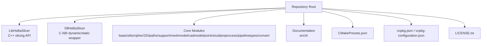
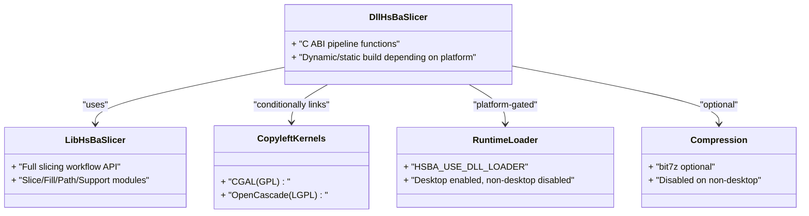
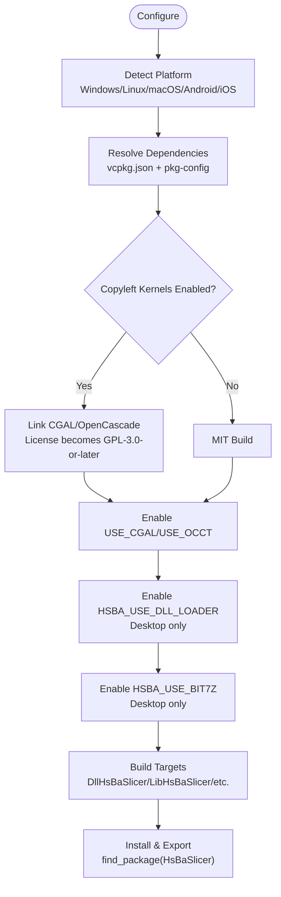
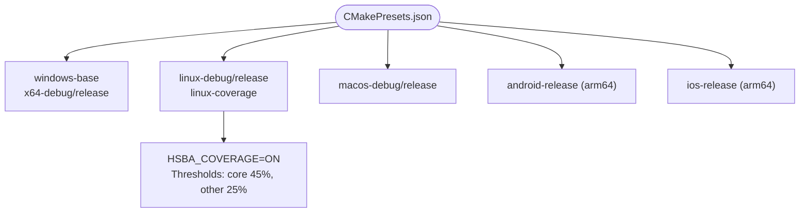
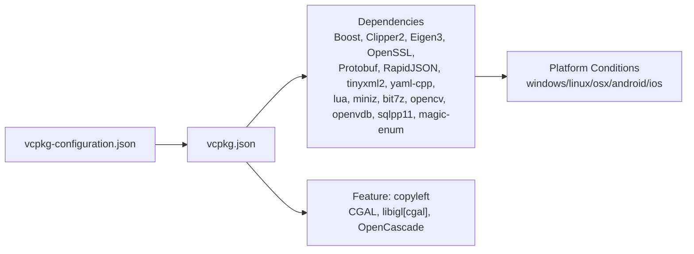
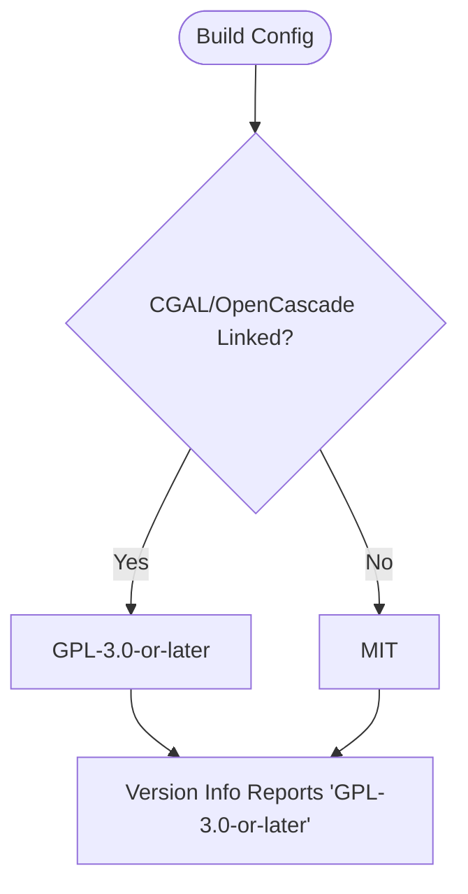
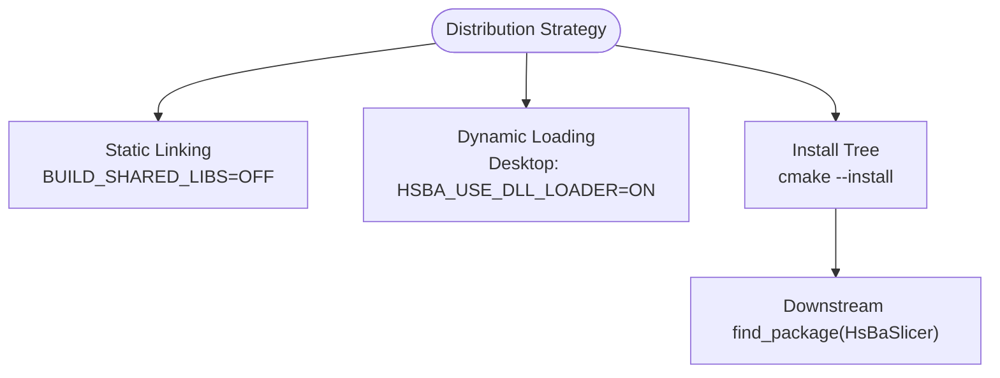

# Deployment Troubleshooting & FAQ

<cite>
**Referenced Files in This Document**
- [README.md](file://README.md)
- [CMakeLists.txt](file://CMakeLists.txt)
- [vcpkg.json](file://vcpkg.json)
- [vcpkg-configuration.json](file://vcpkg-configuration.json)
- [CMakePresets.json](file://CMakePresets.json)
- [docs/en/vcpkg-dependencies.md](file://docs/en/vcpkg-dependencies.md)
- [cmake/deploy_dlls.cmake](file://cmake/deploy_dlls.cmake)
- [LICENSE.txt](file://LICENSE.txt)
- [tests/Models/openvdb_model_test.cpp](file://tests/Models/openvdb_model_test.cpp)
</cite>

## Table of Contents
1. [Introduction](#introduction)
2. [Project Structure](#project-structure)
3. [Core Components](#core-components)
4. [Architecture Overview](#architecture-overview)
5. [Detailed Component Analysis](#detailed-component-analysis)
6. [Dependency Analysis](#dependency-analysis)
7. [Performance Considerations](#performance-considerations)
8. [Troubleshooting Guide](#troubleshooting-guide)
9. [Conclusion](#conclusion)
10. [Appendices](#appendices)

## Introduction
This document is the deployment troubleshooting and FAQ guide for HsBaSlicer. It focuses on build failures, dependency resolution with vcpkg, platform-specific issues, runtime performance and memory diagnostics, distribution packaging strategies, licensing implications, supported platforms, migration guidance, known limitations, and roadmap items. The content is derived from the repository’s CMake configuration, vcpkg manifests, presets, documentation, and tests.

HsBaSlicer is a modular, cross-platform C++ framework for 3D-printing slicers. It exposes:
- A shared-library C ABI entry point (`DllHsBaSlicer`) for external languages.
- A static/shared library API (`LibHsBaSlicer`) for full slicing workflows.
- Optional copyleft kernels (CGAL, OpenCascade) that change the effective license to GPL-3.0-or-later when enabled.

**Section sources**
- [README.md:21-39](file://README.md#L21-L39)
- [README.md:100-124](file://README.md#L100-L124)

## Project Structure
The project uses a layered structure:
- Core libraries under `base`, `utils`, `cipher`, `2D`, `paths`, `support`, `meshmodel`, `cadmodel`, `pointcloud`, `preprocess`, `pipelinetypes`, `convert`.
- Public APIs under `LibHsBaSlicer` (C++) and `DllHsBaSlicer` (C ABI).
- Build orchestration via top-level `CMakeLists.txt`, `CMakePresets.json`, and vcpkg manifests.
- Documentation under `docs`, including platform and dependency notes.

**Diagram sources**
- [README.md:29-39](file://README.md#L29-L39)
- [CMakePresets.json:1-239](file://CMakePresets.json#L1-L239)
- [vcpkg.json:1-113](file://vcpkg.json#L1-L113)
- [LICENSE.txt:1-23](file://LICENSE.txt#L1-L23)

**Section sources**
- [README.md:29-39](file://README.md#L29-L39)
- [CMakePresets.json:1-239](file://CMakePresets.json#L1-L239)

## Core Components
Key components relevant to deployment and operation:
- `DllHsBaSlicer`: Exposes C ABI pipelines; built as SHARED on desktop, STATIC on iOS.
- `LibHsBaSlicer`: Full C++ slicing pipeline API.
- Copyleft kernel integration: CGAL and OpenCascade are conditionally linked based on the `copyleft` feature and platform availability.
- Dynamic loading: Runtime DLL loader is enabled on desktop and disabled on non-desktop platforms.
- Compression: bit7z is optional and disabled on non-desktop platforms.

**Diagram sources**
- [CMakeLists.txt:228-256](file://CMakeLists.txt#L228-L256)
- [CMakeLists.txt:284-318](file://CMakeLists.txt#L284-L318)
- [DllHsBaSlicer/CMakeLists.txt:1-58](file://DllHsBaSlicer/CMakeLists.txt#L1-L58)

**Section sources**
- [CMakeLists.txt:228-256](file://CMakeLists.txt#L228-L256)
- [CMakeLists.txt:284-318](file://CMakeLists.txt#L284-L318)
- [DllHsBaSlicer/CMakeLists.txt:1-58](file://DllHsBaSlicer/CMakeLists.txt#L1-L58)

## Architecture Overview
At build time, CMake detects compiler capabilities, platform, and dependencies. At configure time, it decides whether to enable copyleft kernels, dynamic loading, compression, and which targets to install/export. At runtime, the application loads the appropriate pipeline interfaces through the C ABI or C++ API.

**Diagram sources**
- [CMakeLists.txt:129-157](file://CMakeLists.txt#L129-L157)
- [CMakeLists.txt:170-204](file://CMakeLists.txt#L170-L204)
- [CMakeLists.txt:228-256](file://CMakeLists.txt#L228-L256)
- [CMakeLists.txt:456-665](file://CMakeLists.txt#L456-L665)

**Section sources**
- [CMakeLists.txt:129-157](file://CMakeLists.txt#L129-L157)
- [CMakeLists.txt:170-204](file://CMakeLists.txt#L170-L204)
- [CMakeLists.txt:228-256](file://CMakeLists.txt#L228-L256)
- [CMakeLists.txt:456-665](file://CMakeLists.txt#L456-L665)

## Detailed Component Analysis

### Build System and Presets
- Top-level CMake requires C++20 features and enforces minimum compiler capabilities.
- Presets define Windows/Linux/macOS/Android/iOS configurations, including coverage builds.
- Coverage preset enables gcov instrumentation and thresholds for core vs other modules.

**Diagram sources**
- [CMakePresets.json:1-239](file://CMakePresets.json#L1-L239)

**Section sources**
- [CMakeLists.txt:4-38](file://CMakeLists.txt#L4-L38)
- [CMakePresets.json:1-239](file://CMakePresets.json#L1-L239)

### Dependency Resolution with vcpkg
- `vcpkg.json` declares dependencies and the `copyleft` feature enabling CGAL, libigl[cgal], and OpenCascade.
- `vcpkg-configuration.json` pins the registry baseline and overlay locations.
- Desktop platforms get the full dependency set; Android/iOS exclude certain packages.

**Diagram sources**
- [vcpkg-configuration.json:1-21](file://vcpkg-configuration.json#L1-L21)
- [vcpkg.json:1-113](file://vcpkg.json#L1-L113)

**Section sources**
- [vcpkg.json:1-113](file://vcpkg.json#L1-L113)
- [vcpkg-configuration.json:1-21](file://vcpkg-configuration.json#L1-L21)
- [docs/en/vcpkg-dependencies.md:1-80](file://docs/en/vcpkg-dependencies.md#L1-L80)

### Licensing Model
- Conditional dual license: MIT unless copyleft kernels are linked, then GPL-3.0-or-later.
- Effective license is determined at configure time and exposed via version info.

**Diagram sources**
- [LICENSE.txt:1-23](file://LICENSE.txt#L1-L23)
- [README.md:196-210](file://README.md#L196-L210)

**Section sources**
- [LICENSE.txt:1-23](file://LICENSE.txt#L1-L23)
- [README.md:196-210](file://README.md#L196-L210)

### Distribution Packaging Strategies
- Static linking: Use `BUILD_SHARED_LIBS=OFF` or triplets like `linux-static`; internal static libraries must be included in export sets.
- Dynamic loading: On desktop, `HSBA_USE_DLL_LOADER` is ON; on Android/iOS, it is OFF and `HSBA_NO_DLL_LOADER` is defined.
- Distribution packaging: Use `cmake --install` to produce an install tree; downstream projects use `find_package(HsBaSlicer CONFIG REQUIRED)` and link against `HsBaSlicer::DllHsBaSlicer` or `HsBaSlicer::LibHsBaSlicer`.

**Diagram sources**
- [CMakeLists.txt:367-390](file://CMakeLists.txt#L367-L390)
- [CMakeLists.txt:456-665](file://CMakeLists.txt#L456-L665)
- [README.md:100-185](file://README.md#L100-L185)

**Section sources**
- [CMakeLists.txt:367-390](file://CMakeLists.txt#L367-L390)
- [CMakeLists.txt:456-665](file://CMakeLists.txt#L456-L665)
- [README.md:100-185](file://README.md#L100-L185)

## Dependency Analysis
The following table summarizes key dependencies and their platform support as documented:

| Component | Windows | Linux | macOS | Android | iOS |
|-----------|---------|-------|-------|---------|-----|
| boost-log | ✓ | ✓ | ✓ | ✗ | ✗ |
| boost-locale | ✓ | ✓ | ✓ | ✗ | ✗ |
| boost-dll | ✓ | ✓ | ✓ | ✗ | ✗ |
| boost-nowide | ✓ | ✓ | ✓ | ✗ | ✗ |
| boost-date-time | ✓ | ✓ | ✓ | ✓ | ✓ |
| opencv | ✓ | ✓ | ✓ | ✓ | ✗ |
| opencascade | ✓ | ✓ | ✓ | ✗ | ✗ |
| sqlpp11 (MySQL/PG) | ✓ | ✓ | ✓ | ✗ | ✗ |
| openvdb | ✓ | ✓ | ✓ | ✗ | ✗ |

**Section sources**
- [docs/en/vcpkg-dependencies.md:52-64](file://docs/en/vcpkg-dependencies.md#L52-L64)

## Performance Considerations
- Debug builds disable boolean operations and warn about high memory usage due to CGAL/IGL.
- Coverage builds instrument all targets; CI caps parallelism to avoid OOM on heavy translation units.
- Memory pools and object pools reduce allocation overhead; tests demonstrate disabling CRT leak checks where third-party libraries manage memory differently.

Recommendations:
- Prefer Release builds for production slicing workloads.
- Avoid Debug builds when using CGAL boolean operations if memory is constrained.
- Use coverage builds only for analysis; they increase binary size and execution time.

**Section sources**
- [CMakeLists.txt:294-298](file://CMakeLists.txt#L294-L298)
- [.github/workflows/test-coverage.yml:1-31](file://.github/workflows/test-coverage.yml#L1-L31)
- [tests/Models/openvdb_model_test.cpp:10-20](file://tests/Models/openvdb_model_test.cpp#L10-L20)

## Troubleshooting Guide

### Common Build Issues

#### Compiler Requirements Failures
Symptoms:
- Errors indicating missing C++ concepts, ranges, source_location, or template-template matching.

Resolution:
- Ensure a C++20-capable compiler and update toolchain.
- Verify CMake version meets minimum requirements.

**Section sources**
- [CMakeLists.txt:4-38](file://CMakeLists.txt#L4-L38)
- [CMakeLists.txt:48-86](file://CMakeLists.txt#L48-L86)

#### vcpkg Dependency Resolution Problems
Symptoms:
- Missing packages, failed installs, or platform-incompatible dependencies.

Resolution:
- Confirm vcpkg bootstrapped and updated.
- For Android/iOS, rely on reduced dependency sets; do not force excluded packages.
- Disable default features to avoid copyleft kernels if you need an MIT build.

**Section sources**
- [docs/en/vcpkg-dependencies.md:72-80](file://docs/en/vcpkg-dependencies.md#L72-L80)
- [vcpkg.json:1-113](file://vcpkg.json#L1-L113)

#### Platform-Specific Build Failures
Symptoms:
- Android/iOS builds failing due to unsupported dependencies (e.g., OpenCV, OpenCascade, MySQL/PostgreSQL).

Resolution:
- Use provided presets for Android/iOS.
- Exclude complex libraries not suitable for mobile.

**Section sources**
- [docs/en/vcpkg-dependencies.md:23-42](file://docs/en/vcpkg-dependencies.md#L23-L42)
- [CMakePresets.json:114-208](file://CMakePresets.json#L114-L208)

### Runtime Issues

#### Dynamic Loading Failures
Symptoms:
- Application cannot load plugin libraries on non-desktop platforms.

Resolution:
- On Android/iOS, dynamic loading is disabled by design; ensure plugins are statically linked or use supported mechanisms.

**Section sources**
- [CMakeLists.txt:228-240](file://CMakeLists.txt#L228-L240)

#### Performance Bottlenecks
Symptoms:
- Slow slicing times, high CPU/memory usage.

Resolution:
- Use Release builds.
- Avoid Debug mode with CGAL boolean operations.
- Profile with coverage builds and analyze hotspots.

**Section sources**
- [CMakeLists.txt:294-298](file://CMakeLists.txt#L294-L298)
- [CMakePresets.json:86-113](file://CMakePresets.json#L86-L113)

#### Memory Leak Detection
Symptoms:
- False positives from third-party memory managers (e.g., OpenVDB).

Resolution:
- Tests disable CRT leak checks in debug builds for specific modules.
- Use platform-native tools (Valgrind, AddressSanitizer) alongside project-specific diagnostics.

**Section sources**
- [tests/Models/openvdb_model_test.cpp:10-20](file://tests/Models/openvdb_model_test.cpp#L10-L20)

### Deployment Scenarios

#### Static Linking
Use cases:
- Embedded/mobile environments where dynamic loading is restricted.
- Simplified distribution without runtime dependency management.

Steps:
- Set `BUILD_SHARED_LIBS=OFF` or use triplets like `linux-static`.
- Ensure all required internal static libraries are exported.

**Section sources**
- [CMakeLists.txt:367-390](file://CMakeLists.txt#L367-L390)
- [CMakeLists.txt:462-479](file://CMakeLists.txt#L462-L479)

#### Dynamic Loading
Use cases:
- Desktop applications needing plugin extensibility.

Steps:
- Keep `HSBA_USE_DLL_LOADER=ON` on desktop.
- Ensure runtime libraries are discoverable by the host application.

**Section sources**
- [CMakeLists.txt:228-240](file://CMakeLists.txt#L228-L240)

#### Distribution Packaging
Use cases:
- Delivering installable packages for downstream consumers.

Steps:
- Run `cmake --install` to produce an install tree.
- Provide CMake config files so downstream can `find_package(HsBaSlicer)`.

**Section sources**
- [README.md:100-185](file://README.md#L100-L185)
- [CMakeLists.txt:456-665](file://CMakeLists.txt#L456-L665)

### Diagnostic Tools and Techniques
- Coverage builds: Instrumented Debug builds with gcov/gcovr; CI gates coverage thresholds.
- Compile commands: Enable `CMAKE_EXPORT_COMPILE_COMMANDS` for IDE/tooling integration.
- Logging: Configure logging via `logcfg.ini` copied into the output directory during configure.

**Section sources**
- [CMakePresets.json:86-113](file://CMakePresets.json#L86-L113)
- [CMakePresets.json:22-32](file://CMakePresets.json#L22-L32)
- [CMakeLists.txt:355-365](file://CMakeLists.txt#L355-L365)

### Frequently Asked Questions

#### What platforms are supported?
- Desktop: Windows, Linux, macOS.
- Mobile: Android (NDK), iOS (Xcode).
- Game consoles: Supported via triplets; some features disabled.

**Section sources**
- [CMakeLists.txt:131-157](file://CMakeLists.txt#L131-L157)
- [CMakePresets.json:114-208](file://CMakePresets.json#L114-L208)

#### How does licensing work?
- MIT if no copyleft kernels are linked.
- GPL-3.0-or-later if CGAL or OpenCascade are linked.
- Effective license is reported at runtime via version info.

**Section sources**
- [LICENSE.txt:1-23](file://LICENSE.txt#L1-L23)
- [README.md:196-210](file://README.md#L196-L210)

#### What are performance expectations?
- Release builds recommended for production.
- Debug builds may disable boolean operations and warn about high memory usage.
- Coverage builds are for analysis, not production.

**Section sources**
- [CMakeLists.txt:294-298](file://CMakeLists.txt#L294-L298)
- [CMakePresets.json:86-113](file://CMakePresets.json#L86-L113)

#### How do I migrate between versions?
- Use `find_package(HsBaSlicer CONFIG REQUIRED)` and link against namespaced targets (`HsBaSlicer::*`).
- Review installed headers and CMake config files after `cmake --install`.

**Section sources**
- [README.md:100-185](file://README.md#L100-L185)
- [CMakeLists.txt:641-665](file://CMakeLists.txt#L641-L665)

### Known Limitations and Workarounds
- Dynamic loading disabled on non-desktop platforms; use static linking or supported plugin mechanisms.
- bit7z disabled on non-desktop platforms; rely on miniz or alternative compression if needed.
- Boolean operations disabled in Debug builds; use Release for geometry-heavy workflows.

**Section sources**
- [CMakeLists.txt:228-256](file://CMakeLists.txt#L228-L256)
- [CMakeLists.txt:294-298](file://CMakeLists.txt#L294-L298)

### Future Roadmap Items
- Expand game console support with tailored logger and feature toggles.
- Improve mobile compression options beyond miniz/bit7z constraints.
- Enhance coverage baselines as tests evolve.

[No sources needed since this section provides general guidance]

## Conclusion
This guide consolidates common build and runtime issues for HsBaSlicer, clarifies dependency and licensing behavior, and outlines deployment strategies. Use the provided presets and CMake options to tailor builds for your target platform, and consult the dependency matrix and licensing notes to plan your distribution model.

[No sources needed since this section summarizes without analyzing specific files]

## Appendices

### Windows Symbol Deployment Helper
A helper script copies PDB symbols next to executables when building on Windows.

Usage:
- `-DTARGET_BIN=<exe_path>`
- `-DPDB_FILES=<pdb1;pdb2;...>`

**Section sources**
- [cmake/deploy_dlls.cmake:1-27](file://cmake/deploy_dlls.cmake#L1-L27)