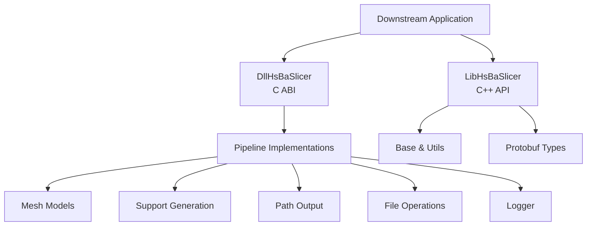
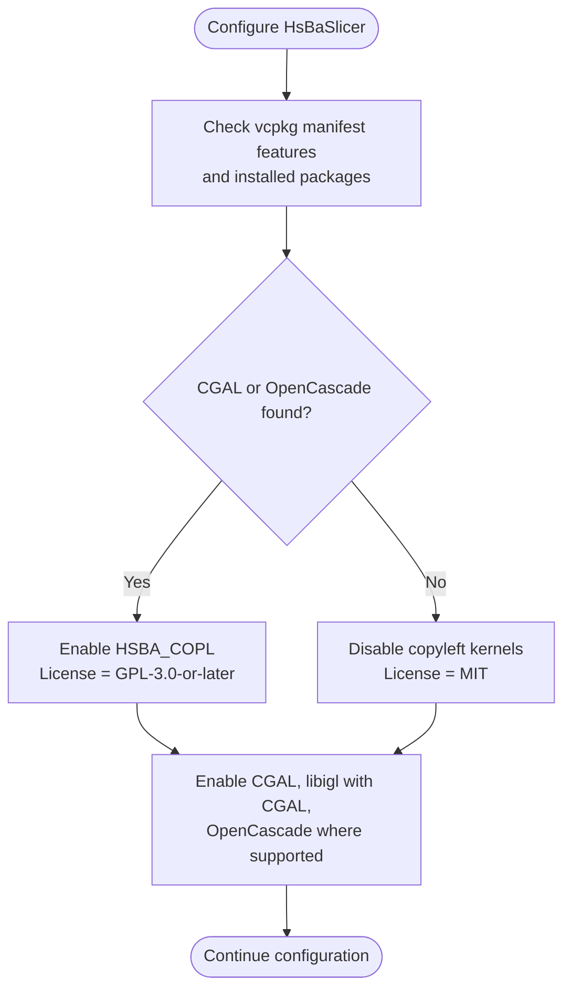
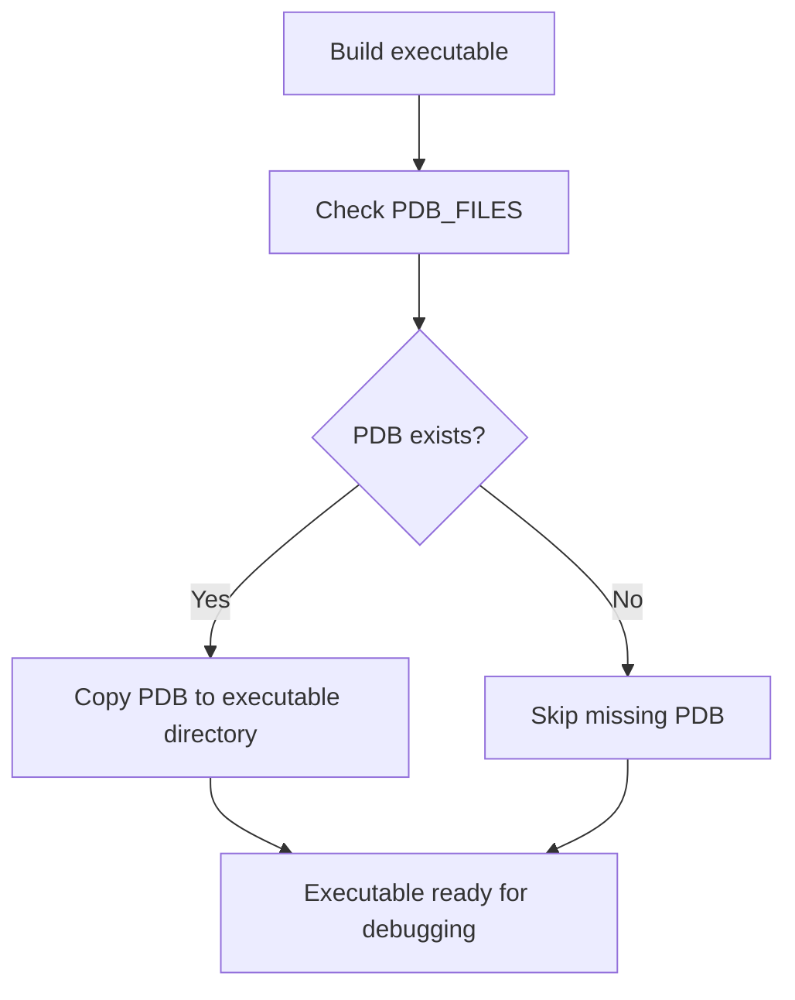
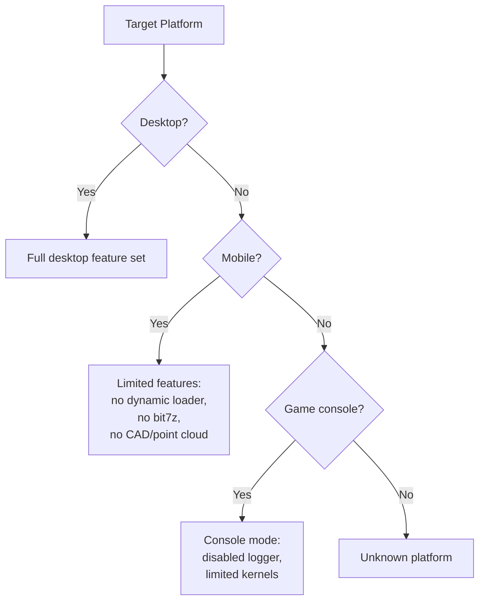
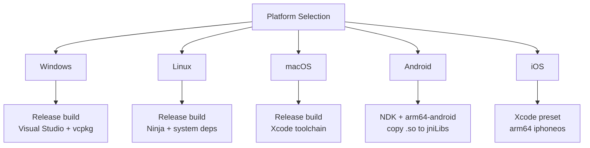
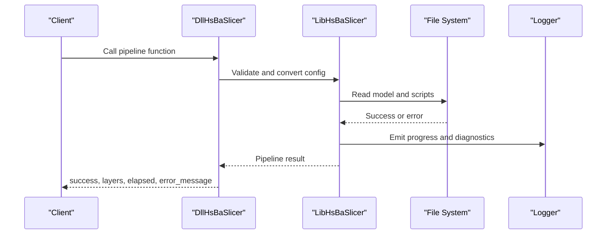
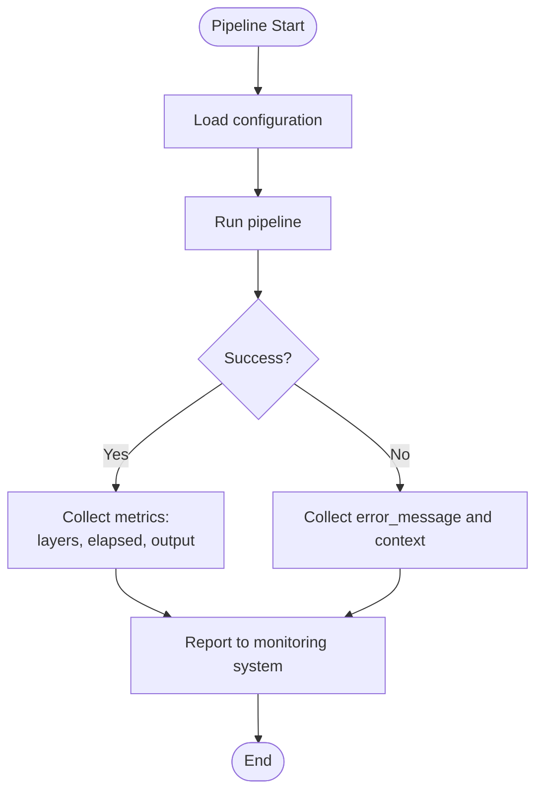
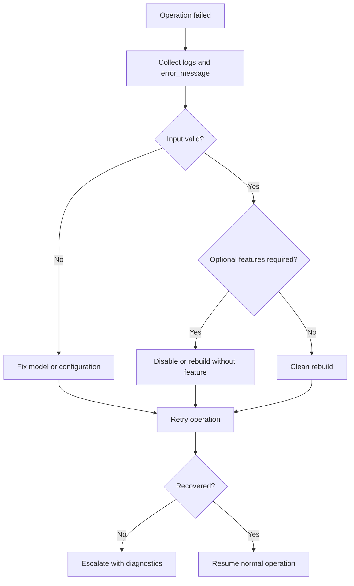

# Deployment, Troubleshooting & FAQ

<cite>
**Referenced Files in This Document**   
- [README.md](file://README.md)
- [CMakeLists.txt](file://CMakeLists.txt)
- [CMakePresets.json](file://CMakePresets.json)
- [vcpkg.json](file://vcpkg.json)
- [LICENSE.txt](file://LICENSE.txt)
- [android/README.md](file://android/README.md)
- [cmake/deploy_dlls.cmake](file://cmake/deploy_dlls.cmake)
- [logger/logger.hpp](file://logger/logger.hpp)
- [utils/logcfg.ini](file://utils/logcfg.ini)
- [DllHsBaSlicer/dllexport.h](file://DllHsBaSlicer/dllexport.h)
- [DllHsBaSlicer/fdm_pipeline.h](file://DllHsBaSlicer/fdm_pipeline.h)
- [DllHsBaSlicer/sla_pipeline.h](file://DllHsBaSlicer/sla_pipeline.h)
- [DllHsBaSlicer/custom_pipeline.h](file://DllHsBaSlicer/custom_pipeline.h)
- [LibHsBaSlicer/export.h](file://LibHsBaSlicer/export.h)
- [LibHsBaSlicer/version_info.hpp](file://LibHsBaSlicer/version_info.hpp)
- [base/error.hpp](file://base/error.hpp)
- [DllHsBaSlicer/file_transfer_pipeline.cpp](file://DllHsBaSlicer/file_transfer_pipeline.cpp)
</cite>

## Table of Contents
1. [Introduction](#introduction)
2. [Project Structure for Production](#project-structure-for-production)
3. [Production Build Strategy](#production-build-strategy)
4. [Distribution Packaging](#distribution-packaging)
5. [Runtime Dependency Management](#runtime-dependency-management)
6. [Platform-Specific Considerations](#platform-specific-considerations)
7. [Build Troubleshooting](#build-troubleshooting)
8. [Runtime Troubleshooting](#runtime-troubleshooting)
9. [Performance Troubleshooting](#performance-troubleshooting)
10. [Logging, Monitoring & Diagnostics](#logging-monitoring--diagnostics)
11. [Recovery Procedures](#recovery-procedures)
12. [FAQ](#faq)
13. [Support & Community Resources](#support--community-resources)
14. [Conclusion](#conclusion)

## Introduction
This document provides production-oriented deployment guidance for HsBaSlicer and a practical troubleshooting and FAQ reference. It focuses on:

- Choosing between MIT and GPL-3.0-or-later builds based on copyleft kernel usage.
- Using CMake presets for Windows, Linux, macOS, Android, and iOS.
- Installing and exporting targets through `cmake --install`.
- Managing runtime dependencies such as shared libraries, PDB symbols, and platform loggers.
- Resolving common build, runtime, and performance issues.
- Collecting logs, monitoring pipeline execution, and recovering from failures.

HsBaSlicer is a modular, cross-platform C++ framework for 3D-printing slicers. Its main production entry points are the C ABI exported by `DllHsBaSlicer` and the C++ API exposed by `LibHsBaSlicer`. The project supports installation via CMake package configuration so downstream applications can use `find_package(HsBaSlicer)` and link against namespaced targets such as `HsBaSlicer::DllHsBaSlicer`.

**Section sources**
- [README.md:21-39](file://README.md#L21-L39)
- [README.md:100-124](file://README.md#L100-L124)
- [CMakeLists.txt:44-44](file://CMakeLists.txt#L44-L44)

## Project Structure for Production
For production deployments, the most relevant parts of the repository are:

| Area | Purpose |
|---|---|
| `DllHsBaSlicer` | C ABI pipeline interface for external integrations such as Java, C#, Python, or game engines. |
| `LibHsBaSlicer` | C++ slicing core used by samples and downstream C++ applications. |
| `base`, `utils`, `cipher`, `logger` | Core utilities, logging, serialization, and configuration. |
| `meshmodel`, `cadmodel`, `pointcloud` | Geometry kernels; some are disabled on mobile or game consoles. |
| `pipelinetypes`, `convert`, `proto` | Pipeline types, protobuf conversion, and generated message headers. |
| `samples` | Example pipelines for FDM, SLA, SLS, SLM, LOM, TDP, WAAM, and custom pipelines. |
| `android` | Minimal Android app skeleton for packaging native libraries. |
| `ios/HsBaSlicerExample` | iOS example bridge files. |
| `cmake` | Installation, export, coverage, and helper scripts. |
| `version` | Version information available at runtime. |



**Diagram sources**
- [CMakeLists.txt:410-439](file://CMakeLists.txt#L410-L439)
- [README.md:104-124](file://README.md#L104-L124)

**Section sources**
- [README.md:29-39](file://README.md#L29-L39)
- [CMakeLists.txt:410-439](file://CMakeLists.txt#L410-L439)

## Production Build Strategy
### Recommended Production Builds
The repository provides CMake presets that configure toolchains, output directories, and build types. For production:

- **Windows**: Use `windows-release` or an equivalent Release preset with Visual Studio and vcpkg.
- **Linux**: Use `linux-release`.
- **macOS**: Use `macos-release`.
- **Android**: Use `android-release`; it sets `arm64-android`, `ANDROID_ABI=arm64-v8a`, and `ANDROID_PLATFORM=android-28`.
- **iOS**: Use `ios-release`; it uses Xcode, `arm64`, `iphoneos`, and deployment target settings.

The top-level CMake file enforces C++20, enables position-independent code for static libraries linked into shared libraries, and configures compiler standards conditionally.

### Copyleft Kernels and License Mode
HsBaSlicer uses a conditional dual license:

- If no copyleft kernel (CGAL or OpenCascade) is linked, the build is licensed under **MIT**.
- If CGAL or OpenCascade is linked, the build is licensed under **GPL-3.0-or-later**.

The effective license is determined during CMake configuration from `vcpkg.json` and environment variables, and can be queried at runtime through version information.



**Diagram sources**
- [CMakeLists.txt:170-204](file://CMakeLists.txt#L170-L204)
- [vcpkg.json:89-110](file://vcpkg.json#L89-L110)
- [LICENSE.txt:1-23](file://LICENSE.txt#L1-L23)

**Section sources**
- [CMakePresets.json:114-208](file://CMakePresets.json#L114-L208)
- [CMakeLists.txt:4-38](file://CMakeLists.txt#L4-L38)
- [CMakeLists.txt:170-204](file://CMakeLists.txt#L170-L204)
- [README.md:196-210](file://README.md#L196-L210)

## Distribution Packaging
### Install and Export Targets
After building, install the project to an install prefix. The top-level CMake file installs:

- Runtime binaries and libraries.
- Public headers for `DllHsBaSlicer` and `LibHsBaSlicer`.
- CMake package configuration files under `<install_prefix>/lib/cmake/HsBaSlicer`.
- Generated protobuf outputs when enabled.

Downstream projects should use:

```cmake
find_package(HsBaSlicer CONFIG REQUIRED)
target_link_libraries(my_app PRIVATE HsBaSlicer::DllHsBaSlicer)
```

### Key Installed Components
| Component | Install Location | Notes |
|---|---|---|
| Executables | `bin` | Samples and test executables may be included depending on options. |
| Shared libraries | `lib` | `DllHsBaSlicer` and other shared libraries. |
| Static archives | `lib` | Internal static libraries and optional static builds. |
| Public headers | `include/HsBaSlicer` | C ABI and C++ public API headers. |
| CMake config | `lib/cmake/HsBaSlicer` | `HsBaSlicerConfig.cmake`, version file, and targets. |
| Protobuf outputs | `share/HsBaSlicer/proto` | Optional multi-language protobuf exports. |

### Windows Symbol Deployment
On Windows, the helper script `cmake/deploy_dlls.cmake` copies PDB debug symbols next to the executable. It skips missing files and relies on vcpkg’s `applocal.ps1` for third-party DLL deployment.



**Diagram sources**
- [cmake/deploy_dlls.cmake:1-27](file://cmake/deploy_dlls.cmake#L1-L27)

**Section sources**
- [README.md:100-185](file://README.md#L100-L185)
- [CMakeLists.txt:456-665](file://CMakeLists.txt#L456-L665)
- [cmake/deploy_dlls.cmake:1-27](file://cmake/deploy_dlls.cmake#L1-L27)

## Runtime Dependency Management
### Shared vs Static Libraries
The default behavior depends on `VCPKG_TARGET_TRIPLET`:

- Windows and Xbox triplets default to shared libraries unless explicitly marked static.
- Linux, Android, and static triplets default to static libraries.
- Other triplets default to static libraries.

This matters for distribution because shared-library builds require the correct `.dll`, `.so`, or `.dylib` files to be present at runtime.

### Platform-Specific Dependencies
| Dependency | Desktop | Android | iOS | Game Console |
|---|---:|---:|---:|---:|
| Boost logging | Enabled | Disabled | Disabled | Disabled |
| Dynamic library loader | Enabled | Disabled | Disabled | Disabled |
| bit7z | Enabled | Disabled | Disabled | Disabled |
| OpenCV | Enabled | Enabled | Disabled | Disabled |
| CGAL | Conditional | Conditional | Disabled | Disabled |
| OpenCascade | Conditional | Disabled | Disabled | Disabled |
| OpenVDB | Enabled | Disabled | Disabled | Disabled |
| sqlpp11 MySQL/PostgreSQL | Enabled | SQLite only | SQLite only | Depends on triplet |

### Mobile and Embedded Constraints
- On Android and iOS, the dynamic library loader is disabled.
- bit7z is disabled on non-desktop platforms.
- CAD model support is excluded on Android, iOS, and game consoles.
- Point cloud support is excluded on Android, iOS, and game consoles.
- Tests are disabled on Android, iOS, and game consoles.



**Diagram sources**
- [CMakeLists.txt:229-256](file://CMakeLists.txt#L229-L256)
- [CMakeLists.txt:277-336](file://CMakeLists.txt#L277-L336)
- [CMakeLists.txt:370-400](file://CMakeLists.txt#L370-L400)

**Section sources**
- [CMakeLists.txt:229-256](file://CMakeLists.txt#L229-L256)
- [CMakeLists.txt:277-336](file://CMakeLists.txt#L277-L336)
- [CMakeLists.txt:370-400](file://CMakeLists.txt#L370-L400)
- [vcpkg.json:10-87](file://vcpkg.json#L10-L87)

## Platform-Specific Considerations
### Windows
- Use Visual Studio 2022 or newer with C++ desktop development tools.
- Prefer PowerShell 7.
- Use Release presets for production; Debug builds with CGAL may encounter issues.
- Ensure vcpkg is configured so third-party DLLs and PDBs can be deployed.

### Linux
- Install required system packages including CMake, Ninja, GCC/Clang, pkg-config, and graphics/font dependencies.
- Use `linux-release` for production.
- Coverage builds are available through `linux-coverage`.

### macOS
- Use `macos-debug` or `macos-release`.
- Local iOS builds are not broadly tested according to the README; CI validates iOS.

### Android
- Build native libraries using the Android NDK and vcpkg Android triplet.
- Copy produced `.so` files into the Android app’s `jniLibs` directory.
- Run or package the APK through Android Studio.

### iOS
- Use the Xcode generator preset.
- The iOS preset sets architecture, sysroot, and deployment target.
- iOS builds exclude several desktop-only features.



**Diagram sources**
- [README.md:57-99](file://README.md#L57-L99)
- [CMakePresets.json:114-208](file://CMakePresets.json#L114-L208)
- [android/README.md:1-22](file://android/README.md#L1-L22)

**Section sources**
- [README.md:57-99](file://README.md#L57-L99)
- [CMakePresets.json:114-208](file://CMakePresets.json#L114-L208)
- [android/README.md:1-22](file://android/README.md#L1-L22)

## Build Troubleshooting
### Common Build Issues
| Symptom | Likely Cause | Resolution |
|---|---|---|
| Missing C++ concepts or ranges error | Compiler does not meet C++20 requirements | Upgrade to a compiler supporting C++20 concepts, ranges, source location, and template-template matching. |
| `find_package` fails for Boost, Protobuf, Eigen, OpenSSL, etc. | vcpkg not configured or wrong triplet | Configure with `-DCMAKE_TOOLCHAIN_FILE=<vcpkg>/scripts/buildsystems/vcpkg.cmake` and ensure the correct triplet. |
| CGAL/OpenCascade not found | Copyleft feature not enabled or packages missing | Enable the `copyleft` feature in vcpkg or install CGAL and OpenCascade. |
| Android build fails | Missing `ANDROID_NDK_HOME` or wrong triplet | Set `ANDROID_NDK_HOME` and use `arm64-android` or another supported triplet. |
| iOS build fails | Xcode toolchain or deployment target mismatch | Use the provided `ios-release` preset and verify Xcode command-line tools. |
| Tests do not run | Cross-compilation disables automatic test execution | Expect tests to be built but not executed during cross-compilation. |

### Dependency Resolution Checklist
1. Install CMake ≥ 3.28 and a C++20-capable compiler.
2. Install vcpkg and bootstrap it.
3. Configure with the vcpkg toolchain.
4. Select the correct preset for the target platform.
5. If you need CGAL or OpenCascade, enable the `copyleft` feature.
6. For Android, set `ANDROID_NDK_HOME` and use the Android preset.
7. For iOS, use the Xcode preset on macOS.

### Compiler and Linker Errors
- **Concepts/ranges/source_location errors**: The project requires modern C++20 features.
- **Missing `_Generic` warnings**: Some C code falls back when the C compiler lacks C11/C23 `_Generic`.
- **Boolean operations slow or high memory in Debug**: Boolean operations are disabled in Debug builds for CGAL and IGL.
- **Dynamic loader unavailable on mobile**: The dynamic library loader is disabled on Android and iOS.

**Section sources**
- [CMakeLists.txt:4-104](file://CMakeLists.txt#L4-L104)
- [CMakeLists.txt:284-306](file://CMakeLists.txt#L284-L306)
- [CMakeLists.txt:392-407](file://CMakeLists.txt#L392-L407)
- [README.md:41-61](file://README.md#L41-L61)

## Runtime Troubleshooting
### Memory Issues
- Large models, boolean operations, and point cloud processing can consume significant memory.
- In Debug builds, boolean operations are disabled to avoid slowness and high memory usage.
- Model pool size differs when copyleft kernels are available versus when they are not.

Recommended actions:
- Use Release builds for production.
- Avoid unnecessary boolean operations if not required.
- Monitor memory usage per layer or per pipeline stage.
- Reduce model complexity before slicing when possible.

### File Access Problems
Common causes include missing input files, invalid paths, permission problems, or unsupported compression formats.

Checklist:
- Verify model path and filename encoding.
- Confirm write permissions for output directories.
- Ensure ZIP/unzip support matches the platform (bit7z is disabled on non-desktop).
- Inspect pipeline error messages returned by the C ABI.

### Configuration Errors
Pipeline configurations come from proto-based structures and Lua scripts. Typical issues include:

- Missing or invalid Lua script path.
- Invalid parameter values.
- Mismatched pipeline type and configuration structure.
- Missing required fields such as model name, model path, or output path.

Use the version info and pipeline result structures to inspect configuration round-trips and error messages.



**Diagram sources**
- [DllHsBaSlicer/file_transfer_pipeline.cpp:18-142](file://DllHsBaSlicer/file_transfer_pipeline.cpp#L18-L142)
- [README.md:104-124](file://README.md#L104-L124)

**Section sources**
- [CMakeLists.txt:294-306](file://CMakeLists.txt#L294-L306)
- [DllHsBaSlicer/file_transfer_pipeline.cpp:18-142](file://DllHsBaSlicer/file_transfer_pipeline.cpp#L18-L142)
- [base/error.hpp](file://base/error.hpp)

## Performance Troubleshooting
### Slow Processing
Possible causes:

- Debug builds disable boolean operations and add instrumentation overhead.
- Large meshes, complex CAD models, or point clouds increase processing time.
- Lua scripts perform expensive computations.
- Excessive logging or synchronous I/O.

Optimization steps:

- Use Release builds.
- Disable optional features not needed in production.
- Profile Lua scripts and geometry kernels.
- Limit model complexity and layer count where appropriate.
- Avoid unnecessary boolean operations.

### High Memory Usage
Likely contributors:

- CGAL and OpenCascade operations.
- OpenVDB point cloud data.
- Multiple model objects held in pools.
- Image rasterization and polygon fill operations.

Mitigation:

- Use MIT builds without copyleft kernels when feasible.
- Avoid enabling CGAL/OpenCascade/OpenVDB on constrained devices.
- Process models in smaller batches.
- Monitor peak memory per slice layer.

### CPU Bottlenecks
Likely contributors:

- Polygon filling and 2D geometry operations.
- Path generation and optimization.
- Support generation.
- Parallelism limited by thread pool configuration.

Mitigation:

- Tune thread pool usage.
- Offload heavy work to background threads.
- Avoid blocking calls in Lua scripts.
- Use profiling tools such as perf, VTune, Instruments, or OS-specific profilers.

**Section sources**
- [CMakeLists.txt:284-306](file://CMakeLists.txt#L284-L306)
- [CMakeLists.txt:258-262](file://CMakeLists.txt#L258-L262)
- [README.md:196-210](file://README.md#L196-L210)

## Logging, Monitoring & Diagnostics
### Logging Backend
- On desktop platforms, Boost logging is used.
- On Android, logging uses `__android_log_print`.
- On iOS, logging uses `os_log`.
- On game consoles, logging is disabled or replaced by platform-specific mechanisms.

The logger module is installed as `HsBaSlicerLog` and exposes public headers under `include/HsBaSlicer/logger`.

### Configuration File
The build copies `utils/logcfg.ini` into the binary output directory. This allows runtime-controlled logging behavior without recompiling.

### Monitoring Pipeline Execution
When integrating with `DllHsBaSlicer`, monitor:

- `success` flag.
- `total_layers`.
- `export_path`.
- `error_message`.
- `elapsed_seconds`.

Samples demonstrate progress callbacks and result inspection.

### Error Collection and Reporting
Recommended production practices:

- Capture pipeline result structures.
- Serialize error messages and configuration metadata.
- Include version information from `GetVersionInfo()` or `HsBaGetVersionJson()`.
- Correlate logs with request IDs and timestamps.
- Send telemetry to your backend while respecting privacy and licensing constraints.



**Diagram sources**
- [DllHsBaSlicer/file_transfer_pipeline.cpp:18-142](file://DllHsBaSlicer/file_transfer_pipeline.cpp#L18-L142)
- [README.md:196-210](file://README.md#L196-L210)

**Section sources**
- [CMakeLists.txt:210-223](file://CMakeLists.txt#L210-L223)
- [CMakeLists.txt:355-365](file://CMakeLists.txt#L355-L365)
- [logger/logger.hpp](file://logger/logger.hpp)
- [utils/logcfg.ini](file://utils/logcfg.ini)
- [README.md:196-210](file://README.md#L196-L210)

## Recovery Procedures
### Failed Pipeline Operation
1. Inspect the pipeline result structure.
2. Read `error_message`.
3. Validate input model path and format.
4. Validate Lua script path and function name.
5. Retry with reduced complexity or different parameters.
6. Collect logs and version info for support.

### Data Corruption Scenarios
If output files appear corrupted:

1. Verify input model integrity.
2. Check filesystem permissions and disk space.
3. Validate compression/decompression support for the platform.
4. Re-run with verbose logging.
5. Compare output checksums across runs.
6. Roll back to a known-good configuration or previous version if necessary.

### System Recovery Strategies
- Restore configuration files from backup.
- Reinstall dependencies using vcpkg.
- Rebuild with a clean build directory.
- Switch from Debug to Release for stability.
- Temporarily disable optional features such as CGAL, OpenCascade, or OpenVDB.
- Use the minimal Android skeleton to isolate native library packaging issues.



**Section sources**
- [DllHsBaSlicer/file_transfer_pipeline.cpp:18-142](file://DllHsBaSlicer/file_transfer_pipeline.cpp#L18-L142)
- [android/README.md:1-22](file://android/README.md#L1-L22)

## FAQ
### Licensing
**Q: Which license applies to my build?**  
A: If the build links CGAL or OpenCascade, it is GPL-3.0-or-later. If it does not link any copyleft kernel, it is MIT. The effective license is determined at configure time and can be queried at runtime through version information.

**Q: Can I use HsBaSlicer in a proprietary application?**  
A: Yes, if you build without copyleft kernels so the build remains MIT. If you enable CGAL or OpenCascade, GPL-3.0-or-later terms apply.

**Section sources**
- [LICENSE.txt:1-23](file://LICENSE.txt#L1-L23)
- [README.md:196-210](file://README.md#L196-L210)
- [CMakeLists.txt:170-204](file://CMakeLists.txt#L170-L204)

### Platform Compatibility
**Q: Does HsBaSlicer support Android and iOS?**  
A: Yes. Android builds are validated in CI and supported through the Android preset and skeleton app. iOS builds are validated in CI; local macOS builds are not broadly tested.

**Q: Why are some features disabled on mobile?**  
A: Mobile and embedded platforms have restrictions on dynamic loading, compression libraries, CAD kernels, and point cloud libraries.

**Section sources**
- [README.md:96-99](file://README.md#L96-L99)
- [CMakeLists.txt:229-256](file://CMakeLists.txt#L229-L256)
- [CMakeLists.txt:313-336](file://CMakeLists.txt#L313-L336)

### Feature Limitations
**Q: What is disabled in Debug builds?**  
A: Boolean operations are disabled for CGAL and IGL to avoid slowness and high memory usage.

**Q: Is the dynamic library loader available on all platforms?**  
A: No. It is enabled on desktop and disabled on Android, iOS, and game consoles.

**Section sources**
- [CMakeLists.txt:284-298](file://CMakeLists.txt#L284-L298)
- [CMakeLists.txt:229-240](file://CMakeLists.txt#L229-L240)

### Migration Between Versions
**Q: How do downstream projects upgrade?**  
A: Use `cmake --install` to update the install prefix, then update `find_package(HsBaSlicer)` and target links. Check version information at runtime and review changes to public headers in `DllHsBaSlicer` and `LibHsBaSlicer`.

**Section sources**
- [README.md:100-185](file://README.md#L100-L185)
- [LibHsBaSlicer/version_info.hpp](file://LibHsBaSlicer/version_info.hpp)

## Support & Community Resources
- **Issues and contributions**: The README invites issues and pull requests.
- **Documentation**: The repository includes English and Chinese documentation under `docs/en` and `docs/zh`.
- **Examples**: Samples demonstrate FDM, SLA, SLS, SLM, LOM, TDP, WAAM, and custom pipelines.
- **Android integration**: The Android skeleton explains how to package native libraries into an APK.

Recommended channels:

- Open a GitHub issue for bugs, build problems, or deployment questions.
- Review existing samples and docs before opening an issue.
- Attach logs, version info, platform details, and minimal reproduction steps.

**Section sources**
- [README.md:192-194](file://README.md#L192-L194)
- [android/README.md:1-22](file://android/README.md#L1-L22)

## Conclusion
For production deployments of HsBaSlicer:

- Choose the correct license mode by controlling copyleft kernel usage.
- Use CMake presets for consistent builds across Windows, Linux, macOS, Android, and iOS.
- Install and distribute through CMake package configuration.
- Manage runtime dependencies carefully, especially on mobile and embedded platforms.
- Monitor pipeline results, collect logs, and capture version information.
- Use this troubleshooting guide to resolve build, runtime, and performance issues.
- Follow recovery procedures to restore service after failures.