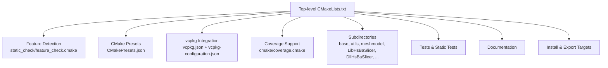
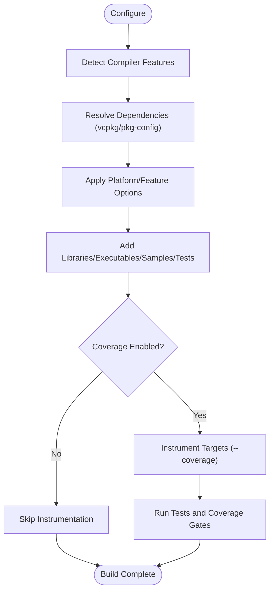
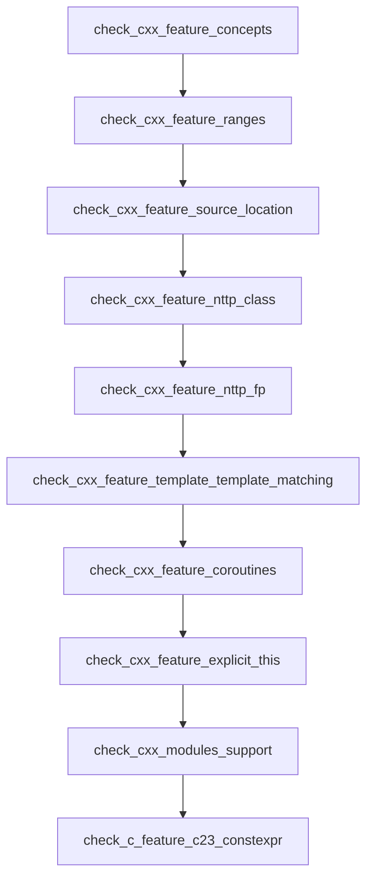
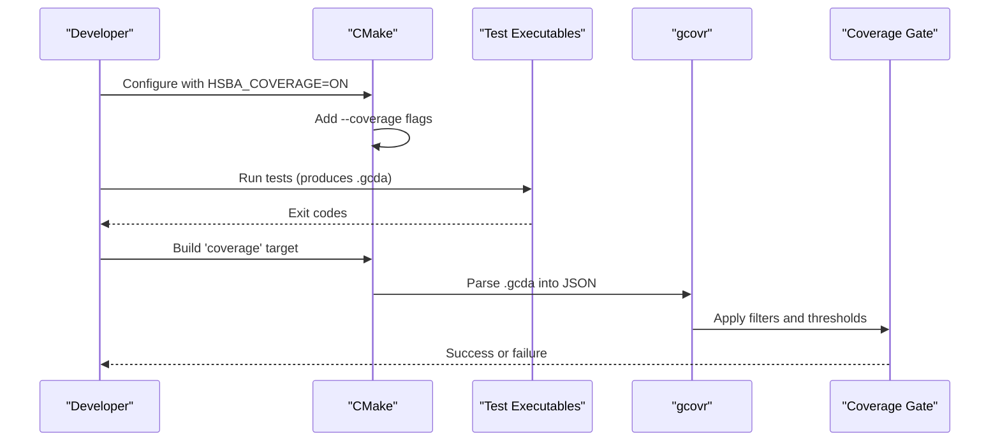
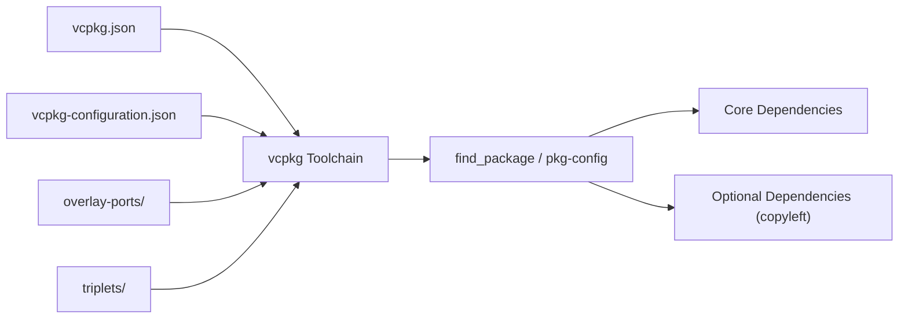
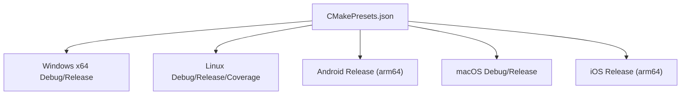
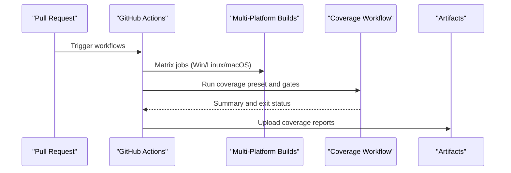

# Build System and Compilation

<cite>
**Referenced Files in This Document**   
- [CMakeLists.txt](file://CMakeLists.txt)
- [CMakePresets.json](file://CMakePresets.json)
- [vcpkg.json](file://vcpkg.json)
- [vcpkg-configuration.json](file://vcpkg-configuration.json)
- [feature_check.cmake](file://static_check/feature_check.cmake)
- [coverage.cmake](file://cmake/coverage.cmake)
- [build-linux.yml](file://.github/workflows/build-linux.yml)
- [test-coverage.yml](file://.github/workflows/test-coverage.yml)
- [cmake-multi-platform.yml](file://.github/workflows/cmake-multi-platform.yml)
- [README.md (triplets)](file://triplets/README.md)
- [README.md (overlay-ports)](file://overlay-ports/README.md)
</cite>

## Table of Contents
1. [Introduction](#introduction)
2. [Project Structure](#project-structure)
3. [Core Components](#core-components)
4. [Architecture Overview](#architecture-overview)
5. [Detailed Component Analysis](#detailed-component-analysis)
6. [Dependency Management with vcpkg](#dependency-management-with-vcpkg)
7. [Cross-Compilation and Platform Targets](#cross-compilation-and-platform-targets)
8. [Build Configurations, Optimization, and Profiling](#build-configurations-optimization-and-profiling)
9. [Static Analysis, Code Coverage, and CI](#static-analysis-code-coverage-and-ci)
10. [Troubleshooting Guide](#troubleshooting-guide)
11. [Conclusion](#conclusion)

## Introduction
This document explains HsBaSlicer’s CMake-based build system architecture. It covers:
- Feature detection for modern C++ features such as concepts, ranges, coroutines, modules, source location, non-type template parameters, and C/C++ language feature availability.
- Cross-compilation setup for Windows, Linux, macOS, Android, and iOS using CMake presets and vcpkg triplets.
- Build configurations including Debug/Release, coverage instrumentation, and performance-oriented builds.
- Dependency management through vcpkg, including manifest-driven dependencies, overlay ports, and custom triplets.
- Static analysis integration, code coverage collection, and continuous integration workflows.
- Troubleshooting guidance for common build issues and compiler compatibility problems.

## Project Structure
The build system is centered around a top-level CMake project that configures global toolchain behavior, detects compiler capabilities, discovers dependencies via vcpkg and pkg-config, and includes subprojects for core libraries, samples, tests, documentation, and install/export targets.

**Diagram sources**
- [CMakeLists.txt:1-695](file://CMakeLists.txt#L1-L695)
- [feature_check.cmake:1-123](file://static_check/feature_check.cmake#L1-L123)
- [CMakePresets.json:1-236](file://CMakePresets.json#L1-L236)
- [vcpkg.json:1-113](file://vcpkg.json#L1-L113)
- [vcpkg-configuration.json:1-21](file://vcpkg-configuration.json#L1-L21)
- [coverage.cmake:1-173](file://cmake/coverage.cmake#L1-L173)

**Section sources**
- [CMakeLists.txt:1-695](file://CMakeLists.txt#L1-L695)

## Core Components
- Top-level CMake configuration sets the minimum CMake version, enforces UTF-8 on MSVC, selects C/C++ standards, enables position-independent code, and defines output directories.
- Feature detection functions are included early to gate compilation on required C++20 features and to conditionally enable optional features like coroutines and C++20 modules.
- vcpkg is integrated via a toolchain file; dependency discovery uses find_package and pkg-config.
- Coverage support is optional and adds instrumentation and a coverage target with thresholds.
- The project installs targets and exports CMake package configuration files for downstream consumers.

Key responsibilities:
- Global compiler and standard selection.
- Required and optional feature checks.
- Platform-specific options (desktop/mobile/game console).
- Dependency resolution and conditional linking.
- Test and sample toggles.
- Install and export configuration.

**Section sources**
- [CMakeLists.txt:1-128](file://CMakeLists.txt#L1-L128)
- [CMakeLists.txt:129-205](file://CMakeLists.txt#L129-L205)
- [CMakeLists.txt:206-354](file://CMakeLists.txt#L206-L354)
- [CMakeLists.txt:355-440](file://CMakeLists.txt#L355-L440)
- [CMakeLists.txt:441-695](file://CMakeLists.txt#L441-L695)

## Architecture Overview
The build system composes several layers:
- Configuration layer: CMake presets define platform/toolchain settings and cache variables.
- Detection layer: feature_check.cmake compiles small test programs to validate compiler capabilities.
- Dependency layer: vcpkg manifests declare dependencies; pkg-config and find_package resolve them.
- Build layer: subdirectories add targets for libraries, executables, samples, and tests.
- Quality layer: coverage instrumentation and threshold gating.
- Distribution layer: install rules and CMake package export files.

**Diagram sources**
- [CMakeLists.txt:48-127](file://CMakeLists.txt#L48-L127)
- [feature_check.cmake:1-123](file://static_check/feature_check.cmake#L1-L123)
- [coverage.cmake:1-173](file://cmake/coverage.cmake#L1-L173)

**Section sources**
- [CMakeLists.txt:48-127](file://CMakeLists.txt#L48-L127)
- [feature_check.cmake:1-123](file://static_check/feature_check.cmake#L1-L123)
- [coverage.cmake:1-173](file://cmake/coverage.cmake#L1-L173)

## Detailed Component Analysis

### Feature Detection Functions
The static feature detection module provides functions to compile small test programs and set boolean results used by the top-level CMake configuration.

- Concepts: requires C++ concepts support.
- Ranges: requires std::ranges support.
- Source location: requires std::source_location.
- Non-type template parameters: class-type and floating-point variants.
- Template-template parameter matching: P0522R0 style.
- Coroutines: optional; when supported, HSBA_HAS_CXX_COROUTINES is defined.
- Explicit object parameter (explicit this): optional.
- C23 constexpr-like support: optional.
- C++20 modules: checked against CMake version and compiler versions; if enabled, HSBA_HAS_CXX_MODULES is defined.

**Diagram sources**
- [feature_check.cmake:15-123](file://static_check/feature_check.cmake#L15-L123)

**Section sources**
- [feature_check.cmake:1-123](file://static_check/feature_check.cmake#L1-L123)
- [CMakeLists.txt:48-127](file://CMakeLists.txt#L48-L127)

### Coverage Collection and Threshold Gating
When HSBA_COVERAGE is ON, the build instruments all targets with --coverage and adds a coverage target that runs gcovr to produce reports and enforce line coverage thresholds for core and other modules.

- Instrumentation: add_compile_options(--coverage) and add_link_options(--coverage).
- Thresholds: configurable via HSBA_COVERAGE_THRESHOLD_CORE and HSBA_COVERAGE_THRESHOLD_OTHER.
- Filters: core directories vs. others; excludes tests, samples, generated code, etc.
- Parallelism: adjustable via HSBA_COVERAGE_JOBS; auto-detects CPU count when possible.
- Reports: JSON tracefile, text summaries, XML, and HTML details.

**Diagram sources**
- [coverage.cmake:1-173](file://cmake/coverage.cmake#L1-L173)
- [CMakeLists.txt:106-112](file://CMakeLists.txt#L106-L112)

**Section sources**
- [coverage.cmake:1-173](file://cmake/coverage.cmake#L1-L173)
- [CMakeLists.txt:106-112](file://CMakeLists.txt#L106-L112)

### Module Wrapper and Optional Features
- C++20 modules wrapper: ModuleHsBaSlicer is built only when HSBA_SLICER_MODULE is ON and the toolchain supports modules. When enabled, HSBA_HAS_CXX_MODULES is defined.
- Thread pool coroutine support: optional via HSBA_ENABLE_THREAD_POOL_COROUTINE.
- Dynamic library loader: enabled on desktop platforms; disabled on Android/iOS and game consoles.

**Section sources**
- [CMakeLists.txt:116-127](file://CMakeLists.txt#L116-L127)
- [CMakeLists.txt:258-262](file://CMakeLists.txt#L258-L262)
- [CMakeLists.txt:228-240](file://CMakeLists.txt#L228-L240)

## Dependency Management with vcpkg
Dependencies are declared in vcpkg.json and resolved via the vcpkg toolchain file. The project also uses pkg-config for some dependencies and find_package for others.

- Manifest dependencies include Boost components, Clipper2, libjpeg-turbo, libpng, OpenCV, Eigen3, libigl, FreeType, miniz, OpenVDB, Protobuf, RapidJSON, tinyxml2, yaml-cpp, Lua, OpenSSL, sqlpp11, magic_enum, and vcpkg-pkgconfig-get-modules.
- Copyleft kernels (CGAL, OpenCASCADE) are optional and gated by the copyleft feature; enabling it changes the project license to GPL-3.0-or-later.
- Overlay ports and triplets are configured in vcpkg-configuration.json to allow local overrides.

**Diagram sources**
- [vcpkg.json:1-113](file://vcpkg.json#L1-L113)
- [vcpkg-configuration.json:1-21](file://vcpkg-configuration.json#L1-L21)
- [CMakeLists.txt:206-354](file://CMakeLists.txt#L206-L354)

**Section sources**
- [vcpkg.json:1-113](file://vcpkg.json#L1-L113)
- [vcpkg-configuration.json:1-21](file://vcpkg-configuration.json#L1-L21)
- [CMakeLists.txt:206-354](file://CMakeLists.txt#L206-L354)

## Cross-Compilation and Platform Targets
CMake presets provide standardized configurations for different platforms and architectures. They set generators, binary/install directories, toolchain files, and cache variables.

- Windows: Ninja generator, cl.exe compilers, x64 Debug/Release.
- Linux: Ninja generator, Debug/Release, and a dedicated coverage preset.
- Android: arm64-android triplet, NDK chainload, ABI and platform settings.
- macOS: Debug/Release presets.
- iOS: Xcode generator, arm64 architecture, deployment target.

**Diagram sources**
- [CMakePresets.json:1-236](file://CMakePresets.json#L1-L236)

**Section sources**
- [CMakePresets.json:1-236](file://CMakePresets.json#L1-L236)

## Build Configurations, Optimization, and Profiling
- Standards: C++20 enforced; C standard selected based on compiler version (C11 or C23 where supported).
- Position-independent code: enabled globally for shared library linkage.
- Output directories: unified runtime/library output under bin/$<CONFIG>.
- Debug suffix: Debug postfix applied.
- Coverage: optional instrumentation and threshold gating.
- Samples/docs/tests: toggleable via options.
- Shared/static libraries: influenced by VCPKG_TARGET_TRIPLET patterns.

Optimization and profiling:
- Use CMAKE_BUILD_TYPE=Release for optimized builds.
- Use CMAKE_BUILD_TYPE=Debug for debugging and coverage.
- Coverage builds instrument all targets and run tests to generate data.
- For performance profiling, use Release builds and external profilers (e.g., perf, VTune) with the appropriate toolchain.

**Section sources**
- [CMakeLists.txt:1-43](file://CMakeLists.txt#L1-L43)
- [CMakeLists.txt:355-390](file://CMakeLists.txt#L355-L390)
- [CMakeLists.txt:391-440](file://CMakeLists.txt#L391-L440)
- [CMakePresets.json:1-236](file://CMakePresets.json#L1-L236)

## Static Analysis, Code Coverage, and CI
Static analysis:
- clang-format batch script exists for formatting.
- cpp_analyzer.py and feature_check.cmake support static checks and feature validation.

Code coverage:
- HSBA_COVERAGE enables instrumentation and a coverage target.
- Thresholds are enforced for core and other modules.
- CI workflow runs tests and coverage gates on Linux.

CI setup:
- Multi-platform matrix builds for Windows, Linux, macOS.
- Android and iOS builds in separate jobs.
- Coverage workflow integrates with CMake presets and uploads artifacts.

**Diagram sources**
- [cmake-multi-platform.yml:1-457](file://.github/workflows/cmake-multi-platform.yml#L1-L457)
- [test-coverage.yml:1-136](file://.github/workflows/test-coverage.yml#L1-L136)
- [build-linux.yml:1-82](file://.github/workflows/build-linux.yml#L1-L82)

**Section sources**
- [cmake-multi-platform.yml:1-457](file://.github/workflows/cmake-multi-platform.yml#L1-L457)
- [test-coverage.yml:1-136](file://.github/workflows/test-coverage.yml#L1-L136)
- [build-linux.yml:1-82](file://.github/workflows/build-linux.yml#L1-L82)

## Troubleshooting Guide
Common issues and resolutions:

- Missing C++20 features:
  - Symptoms: fatal errors indicating missing concepts, ranges, source location, or template-template matching.
  - Resolution: ensure compiler meets minimum versions; update toolchain or switch to a supported compiler.

- C++20 modules not available:
  - Symptoms: HSBA_SLICER_MODULE disabled despite being ON.
  - Resolution: use CMake 3.28+ with a module-aware compiler (MSVC 19.34+, GCC 14+, Clang 16+); AppleClang excluded due to module import-graph discovery limitations.

- Coverage target fails:
  - Symptoms: coverage target cannot run or thresholds fail.
  - Resolution: install gcovr; ensure tests run successfully; adjust thresholds if necessary; verify GCDA files exist in the build tree.

- vcpkg dependency resolution failures:
  - Symptoms: find_package or pkg-config cannot locate dependencies.
  - Resolution: bootstrap vcpkg, set VCPKG_ROOT, ensure overlays/triplets are correctly configured; check VCPKG_TARGET_TRIPLET for cross-compilation.

- Android/iOS builds fail:
  - Symptoms: NDK or SDK environment variables missing; ABI/platform mismatches.
  - Resolution: set ANDROID_NDK_HOME, ANDROID_ABI, ANDROID_PLATFORM; use CMake presets or pass correct cache variables; ensure toolchain chainload is configured.

- Game console builds:
  - Symptoms: logger disabled or features limited.
  - Resolution: set VCPKG_TARGET_TRIPLET to match console triplet; HSBA_GAME_CONSOLE will be enabled automatically.

- Static tests disabled:
  - Symptoms: static_tests not built on mobile/console platforms.
  - Resolution: expected behavior; disable HSBA_SLICER_USE_STATIC_TESTS if needed; coverage preset disables static tests.

- Documentation not built:
  - Symptoms: Doxygen not found; docs disabled.
  - Resolution: install Doxygen or set HSBA_SLICER_BUILD_DOCS OFF.

**Section sources**
- [CMakeLists.txt:48-127](file://CMakeLists.txt#L48-L127)
- [CMakeLists.txt:116-127](file://CMakeLists.txt#L116-L127)
- [coverage.cmake:1-173](file://cmake/coverage.cmake#L1-L173)
- [CMakePresets.json:1-236](file://CMakePresets.json#L1-L236)

## Conclusion
HsBaSlicer’s build system is a robust, multi-platform CMake configuration that leverages vcpkg for dependency management, comprehensive feature detection for modern C++ capabilities, and optional coverage instrumentation with threshold gating. CMake presets streamline cross-compilation across Windows, Linux, macOS, Android, and iOS. Continuous integration ensures consistent builds and coverage quality. By following the troubleshooting guidance and leveraging the provided presets and scripts, developers can configure, build, test, and distribute HsBaSlicer reliably across diverse environments.