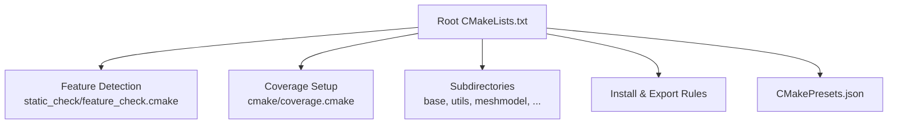
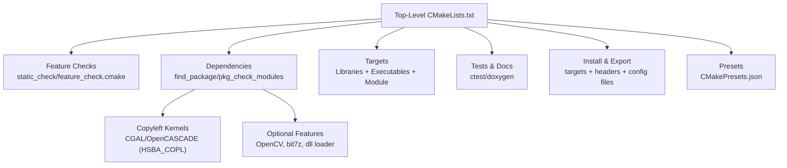
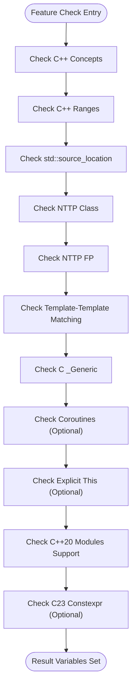
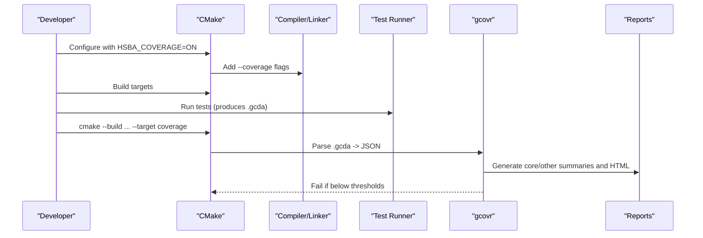
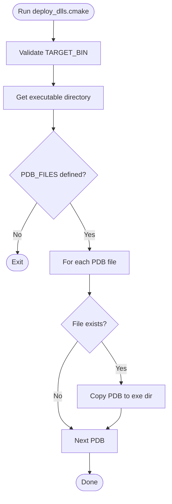
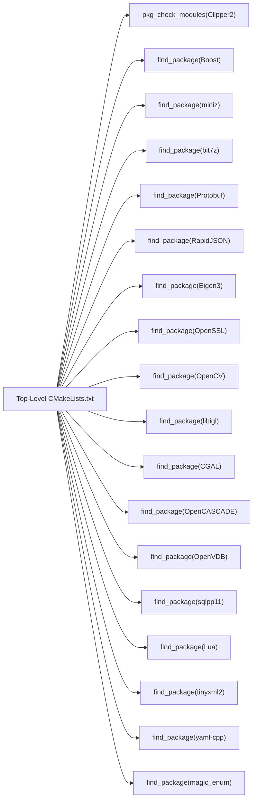

# CMake Configuration and Build Options

<cite>
**Referenced Files in This Document**
- [CMakeLists.txt](file://CMakeLists.txt)
- [feature_check.cmake](file://static_check/feature_check.cmake)
- [coverage.cmake](file://cmake/coverage.cmake)
- [deploy_dlls.cmake](file://cmake/deploy_dlls.cmake)
- [CMakePresets.json](file://CMakePresets.json)
</cite>

## Table of Contents
1. [Introduction](#introduction)
2. [Project Structure](#project-structure)
3. [Core Components](#core-components)
4. [Architecture Overview](#architecture-overview)
5. [Detailed Component Analysis](#detailed-component-analysis)
6. [Dependency Analysis](#dependency-analysis)
7. [Performance Considerations](#performance-considerations)
8. [Troubleshooting Guide](#troubleshooting-guide)
9. [Conclusion](#conclusion)

## Introduction
This document explains HsBaSlicer’s CMake configuration system with a focus on:
- The top-level CMake project structure and global settings
- Custom feature detection for modern C++ features (concepts, ranges, coroutines, modules)
- Build options and platform-specific behavior
- Coverage collection using gcov/lcov via gcovr
- Static analysis integration points
- DLL deployment helpers
- Build targets, dependency resolution, and optimization flags
- Common build commands, custom configurations, and troubleshooting

The goal is to help developers configure, extend, and troubleshoot the build reliably across Windows, Linux, macOS, Android, and iOS.

## Project Structure
At the root, the main CMake project:
- Sets minimum CMake version and language standards
- Enables position-independent code globally
- Forces UTF-8 encoding for MSVC
- Includes static feature checks and runs required checks early
- Configures optional features (coroutines, explicit this, C23 constexpr)
- Integrates coverage, modules, copyleft kernels, and many third-party dependencies
- Adds subprojects, samples, tests, docs, and install/export rules

**Diagram sources**
- [CMakeLists.txt:1-44](file://CMakeLists.txt#L1-L44)
- [CMakeLists.txt:48-104](file://CMakeLists.txt#L48-L104)
- [CMakeLists.txt:106-127](file://CMakeLists.txt#L106-L127)
- [CMakeLists.txt:456-665](file://CMakeLists.txt#L456-L665)
- [CMakePresets.json:1-236](file://CMakePresets.json#L1-L236)

**Section sources**
- [CMakeLists.txt:1-44](file://CMakeLists.txt#L1-L44)
- [CMakeLists.txt:456-665](file://CMakeLists.txt#L456-L665)
- [CMakePresets.json:1-236](file://CMakePresets.json#L1-L236)

## Core Components
- Global compiler and standard configuration
- Feature detection functions for C/C++ features
- Optional module support (C++20 modules)
- Platform and target type selection (desktop/mobile/game console)
- Dependency discovery and conditional linking
- Coverage instrumentation and gating
- Install and export configuration
- Presets for common workflows

Key behaviors:
- C++20 is enforced; C standard is selected based on compiler capabilities
- Required features (concepts, ranges, source_location, template-template matching) are fatal if missing
- Optional features (coroutines, explicit this, C23 constexpr) add compile definitions when supported
- Modules are conditionally built only if toolchain supports them
- Copyleft kernels (CGAL/OpenCASCADE) are auto-detected or forced via HSBA_COPL
- Coverage uses gcov/gcovr with core/other thresholds and parallel workers

**Section sources**
- [CMakeLists.txt:17-38](file://CMakeLists.txt#L17-L38)
- [CMakeLists.txt:48-104](file://CMakeLists.txt#L48-L104)
- [CMakeLists.txt:116-127](file://CMakeLists.txt#L116-L127)
- [CMakeLists.txt:170-204](file://CMakeLists.txt#L170-L204)
- [CMakeLists.txt:206-349](file://CMakeLists.txt#L206-L349)
- [CMakeLists.txt:356-390](file://CMakeLists.txt#L356-L390)
- [CMakeLists.txt:456-665](file://CMakeLists.txt#L456-L665)

## Architecture Overview
The build system composes multiple layers:
- Top-level configuration and feature detection
- Dependency resolution (Boost, Clipper2, miniz, bit7z, Protobuf, RapidJSON, Eigen3, OpenSSL, OpenCV, libigl, CGAL/OpenCASCADE, OpenVDB, sqlpp11, Lua, tinyxml2, yaml-cpp, magic_enum)
- Target composition (libraries, executables, modules)
- Testing and documentation toggles
- Installation and package config generation

**Diagram sources**
- [CMakeLists.txt:48-104](file://CMakeLists.txt#L48-L104)
- [CMakeLists.txt:206-349](file://CMakeLists.txt#L206-L349)
- [CMakeLists.txt:410-454](file://CMakeLists.txt#L410-L454)
- [CMakeLists.txt:456-665](file://CMakeLists.txt#L456-L665)
- [CMakePresets.json:1-236](file://CMakePresets.json#L1-L236)

## Detailed Component Analysis

### Top-Level CMake Configuration
Responsibilities:
- Language standards and compiler defaults
- Position-independent code and debug postfix
- UTF-8 enforcement on MSVC
- Early inclusion of feature checks and execution of required checks
- Optional feature detection and compile definitions
- Coverage integration toggle
- Module support detection and conditional build
- Platform classification (desktop/mobile/game console)
- Polygon dump utilities option
- Copyleft kernel detection and license implications
- Third-party dependency discovery and conditional compilation
- Output directory unification and resource copying
- Shared/static library mode controlled by VCPKG triplet
- Tests, samples, docs toggles
- Install/export rules and package config generation

Important options:
- HSBA_COVERAGE: enable coverage instrumentation and target
- HSBA_SLICER_MODULE: build C++20 module wrapper
- HSBA_POLYGON_DUMP: enable SVG polygon dump utilities
- HSBA_USE_DLL_LOADER: dynamic library loader availability
- HSBA_HSBA_USE_BIT7Z: enable bit7z compression
- HSBA_ENABLE_THREAD_POOL_COROUTINE: coroutine-enabled thread pool
- HSBA_PROTOBUF_OUT: generate protobuf outputs
- BUILD_SHARED_LIBS: shared vs static libraries
- HSBA_SLICER_USE_TESTS / HSBA_SLICER_RUN_TESTS_AFTER_BUILD
- HSBA_SLICER_USE_STATIC_TESTS
- HSBA_SLICER_BUILD_DOCS

Build flow highlights:
- If HSBA_COVERAGE is ON, include coverage.cmake and instrument all targets
- If HSBA_SLICER_MODULE is ON and modules are supported, define HSBA_HAS_CXX_MODULES and build ModuleHsBaSlicer
- If HSBA_COPL is AUTO, detect CGAL/OpenCASCADE presence or environment variables to decide enabling copyleft kernels
- On Debug builds, boolean operations may be disabled to reduce memory/time usage

**Section sources**
- [CMakeLists.txt:1-44](file://CMakeLists.txt#L1-L44)
- [CMakeLists.txt:48-104](file://CMakeLists.txt#L48-L104)
- [CMakeLists.txt:106-127](file://CMakeLists.txt#L106-L127)
- [CMakeLists.txt:159-204](file://CMakeLists.txt#L159-L204)
- [CMakeLists.txt:206-349](file://CMakeLists.txt#L206-L349)
- [CMakeLists.txt:356-390](file://CMakeLists.txt#L356-L390)
- [CMakeLists.txt:392-454](file://CMakeLists.txt#L392-L454)
- [CMakeLists.txt:456-665](file://CMakeLists.txt#L456-L665)

### Custom Feature Detection Functions
The feature detection module provides small compile-check functions for:
- C _Generic (C11/C23)
- C++ concepts
- C++ ranges
- std::source_location
- Non-type template parameters (class-type and floating-point)
- Template-template parameter matching (P0522R0 style)
- C++ coroutines
- Explicit object parameter (explicit this)
- C++20 modules support (compiler/version matrix)
- C23 constexpr-like support

Usage pattern:
- Each function compiles a minimal snippet and sets a result variable
- The top-level CMake calls these functions and either fails fast (required features) or adds compile definitions (optional features)

**Diagram sources**
- [feature_check.cmake:5-12](file://static_check/feature_check.cmake#L5-L12)
- [feature_check.cmake:15-67](file://static_check/feature_check.cmake#L15-L67)
- [feature_check.cmake:69-113](file://static_check/feature_check.cmake#L69-L113)
- [feature_check.cmake:115-123](file://static_check/feature_check.cmake#L115-L123)

**Section sources**
- [feature_check.cmake:1-123](file://static_check/feature_check.cmake#L1-L123)
- [CMakeLists.txt:48-104](file://CMakeLists.txt#L48-L104)

### Coverage Collection with gcov/lcov Integration
The coverage subsystem:
- Requires GCC or Clang
- Instruments all targets with --coverage at compile and link time
- Defines thresholds for core and other modules
- Uses gcovr to parse .gcda data into JSON and produce summaries
- Enforces anti-regression line coverage thresholds
- Supports parallel gcov parsing via -j
- Excludes tests, samples, generated/build trees, vcpkg, and system paths
- Provides a "coverage" custom target that runs after building and running tests

Configuration:
- HSBA_COVERAGE: enables coverage setup
- HSBA_COVERAGE_THRESHOLD_CORE: minimum line coverage for core modules
- HSBA_COVERAGE_THRESHOLD_OTHER: minimum line coverage for non-core modules
- HSBA_COVERAGE_JOBS: number of parallel gcov workers (0 = auto-detect)
- HSBA_COVERAGE_CORE_FILTERS: directories considered core
- HSBA_COVERAGE_EXCLUDES: directories always excluded

Workflow:
- Configure with HSBA_COVERAGE=ON
- Build and run tests to generate .gcda files
- Run the "coverage" target to generate reports and enforce thresholds

**Diagram sources**
- [coverage.cmake:16-25](file://cmake/coverage.cmake#L16-L25)
- [coverage.cmake:27-65](file://cmake/coverage.cmake#L27-L65)
- [coverage.cmake:67-91](file://cmake/coverage.cmake#L67-L91)
- [coverage.cmake:93-156](file://cmake/coverage.cmake#L93-L156)
- [coverage.cmake:158-173](file://cmake/coverage.cmake#L158-L173)

**Section sources**
- [CMakeLists.txt:106-112](file://CMakeLists.txt#L106-L112)
- [coverage.cmake:1-173](file://cmake/coverage.cmake#L1-L173)

### Static Analysis Tools Integration
Static analysis integration points:
- The repository includes static analysis scripts under static_check/, but they are not directly invoked from the top-level CMake. They can be used externally or integrated into CI pipelines.
- The feature_check.cmake file performs compile-time feature detection rather than static analysis.
- For formatting and linting, there are scripts like clang-format-batch.py and cpp_analyzer.py available for external use.

Recommendation:
- Integrate clang-tidy or similar tools via CI steps outside CMake, or add a dedicated CMake target that invokes these scripts.

**Section sources**
- [feature_check.cmake:1-123](file://static_check/feature_check.cmake#L1-L123)

### DLL Deployment Scripts
The deploy_dlls.cmake helper:
- Copies PDB debugging symbols next to the executable
- Skips missing files gracefully
- Designed to be run as a standalone script with TARGET_BIN and PDB_FILES arguments
- Notes that vcpkg-managed DLLs are deployed automatically by vcpkg’s applocal.ps1

Usage:
- Provide TARGET_BIN pointing to the built executable
- Provide PDB_FILES list of PDB paths to copy alongside the executable

**Diagram sources**
- [deploy_dlls.cmake:1-27](file://cmake/deploy_dlls.cmake#L1-L27)

**Section sources**
- [deploy_dlls.cmake:1-27](file://cmake/deploy_dlls.cmake#L1-L27)

### Build Targets, Dependency Resolution, and Optimization Flags
Targets:
- Libraries: base, utils, cipher, logger, 2D, paths, fileoperator, meshmodel, cadmodel (conditional), pointcloud (conditional), preprocess, support, pipelinetypes, convert, LibHsBaSlicer, ModuleHsBaSlicer (conditional), DllHsBaSlicer, HsBaSlicer, HsBaVersion
- Samples: FDM, SLA, SLS, SLM, LOM, TDP, WAAM, Custom, LibHsBaSlicer sample
- Tests: unit tests and static tests (conditionally enabled)
- Docs: Doxygen-based documentation (conditionally enabled)

Dependency resolution:
- Boost (log/log_setup depending on platform)
- Clipper2 via pkg-config
- miniz and bit7z (conditional)
- Protobuf, RapidJSON, Eigen3, OpenSSL, OpenCV (conditional)
- libigl and CGAL/OpenCASCADE (conditional on HSBA_COPL and platform)
- OpenVDB (conditional)
- sqlpp11 with SQLite3/MySQL/PostgreSQL (conditional)
- Lua, tinyxml2, yaml-cpp, magic_enum

Optimization flags:
- Global position-independent code enabled
- Debug suffix applied
- Boolean operations disabled in Debug builds to reduce memory/time usage
- Model pool size adjusted based on copyleft kernel availability
- No sanitizer flags are set by default; sanitizers can be added via CI or local presets

**Section sources**
- [CMakeLists.txt:6-8](file://CMakeLists.txt#L6-L8)
- [CMakeLists.txt:294-306](file://CMakeLists.txt#L294-L306)
- [CMakeLists.txt:206-349](file://CMakeLists.txt#L206-L349)
- [CMakeLists.txt:410-454](file://CMakeLists.txt#L410-L454)

### Examples of Common Build Commands
- Configure and build Debug on Windows:
  - cmake -B out/build/windows-debug -S . -DCMAKE_BUILD_TYPE=Debug
  - cmake --build out/build/windows-debug
- Configure and build Release on Linux:
  - cmake -B out/build/linux-release -S . -DCMAKE_BUILD_TYPE=Release
  - cmake --build out/build/linux-release
- Enable coverage on Linux:
  - cmake -B out/build/linux-coverage -S . -DCMAKE_BUILD_TYPE=Debug -DHSBA_COVERAGE=ON
  - cmake --build out/build/linux-coverage
  - ctest --test-dir out/build/linux-coverage
  - cmake --build out/build/linux-coverage --target coverage
- Disable samples/docs/tests for faster builds:
  - cmake -B out/build/fast -S . -DHSBA_SLICER_BUILD_SAMPLES=OFF -DHSBA_SLICER_BUILD_DOCS=OFF -DHSBA_SLICER_USE_TESTS=OFF
- Use presets:
  - cmake --preset linux-coverage
  - cmake --build --preset linux-coverage
  - cmake --test --preset linux-coverage
  - cmake --build --preset linux-coverage-report

**Section sources**
- [CMakePresets.json:83-111](file://CMakePresets.json#L83-L111)
- [CMakePresets.json:207-236](file://CMakePresets.json#L207-L236)

### Custom Build Configurations
Useful cache variables:
- HSBA_COVERAGE: enable coverage instrumentation and target
- HSBA_COVERAGE_THRESHOLD_CORE: core module coverage threshold
- HSBA_COVERAGE_THRESHOLD_OTHER: other module coverage threshold
- HSBA_COVERAGE_JOBS: parallel gcov workers
- HSBA_SLICER_MODULE: build C++20 module wrapper
- HSBA_POLYGON_DUMP: enable SVG polygon dump utilities
- HSBA_USE_DLL_LOADER: enable dynamic library loader
- HSBA_HSBA_USE_BIT7Z: enable bit7z
- HSBA_ENABLE_THREAD_POOL_COROUTINE: enable coroutine support in thread pool
- HSBA_PROTOBUF_OUT: generate protobuf outputs
- BUILD_SHARED_LIBS: shared vs static libraries
- HSBA_SLICER_USE_TESTS / HSBA_SLICER_RUN_TESTS_AFTER_BUILD
- HSBA_SLICER_USE_STATIC_TESTS
- HSBA_SLICER_BUILD_DOCS
- HSBA_COPL: copyleft kernels (AUTO/ON/OFF)

Platform-specific notes:
- Desktop platforms get more features (OpenCV, bit7z, dll loader)
- Mobile platforms disable certain features (dll loader, bit7z)
- Game consoles detected via VCPKG_TARGET_TRIPLET and get specific defines

**Section sources**
- [CMakeLists.txt:106-127](file://CMakeLists.txt#L106-L127)
- [CMakeLists.txt:159-204](file://CMakeLists.txt#L159-L204)
- [CMakeLists.txt:229-262](file://CMakeLists.txt#L229-L262)
- [CMakeLists.txt:356-390](file://CMakeLists.txt#L356-L390)
- [CMakeLists.txt:392-454](file://CMakeLists.txt#L392-L454)

## Dependency Analysis
The top-level CMake orchestrates dependency discovery and conditional linking:
- pkg-config for Clipper2
- find_package for most dependencies
- Conditional blocks for platform and feature toggles
- Copyleft kernel detection influences both linking and compile definitions

**Diagram sources**
- [CMakeLists.txt:206-349](file://CMakeLists.txt#L206-L349)

**Section sources**
- [CMakeLists.txt:206-349](file://CMakeLists.txt#L206-L349)

## Performance Considerations
- Boolean operations are disabled in Debug builds to reduce memory and time consumption
- Model pool size is increased when copyleft kernels are available to support multiple models during boolean operations
- Coverage instrumentation adds overhead; use it selectively in CI or local Debug builds
- Parallel gcov parsing can be tuned via HSBA_COVERAGE_JOBS to balance speed and memory usage
- Disabling samples/docs/tests reduces build time significantly

[No sources needed since this section provides general guidance]

## Troubleshooting Guide
Common issues and resolutions:
- Missing required C++ features:
  - Ensure your compiler supports C++ concepts, ranges, std::source_location, and template-template matching. The build will fail fast if any are missing.
- C++ modules not built:
  - HSBA_SLICER_MODULE requires a module-aware compiler and sufficient CMake version. If unsupported, the module is disabled automatically.
- Coverage target fails:
  - Ensure gcovr is installed. Verify you have built and run tests to generate .gcda files before invoking the coverage target.
- Coverage thresholds not met:
  - Adjust HSBA_COVERAGE_THRESHOLD_CORE and HSBA_COVERAGE_THRESHOLD_OTHER if necessary, or improve test coverage.
- Dynamic library loader disabled:
  - On non-desktop platforms, HSBA_USE_DLL_LOADER is disabled by default. This is expected due to platform restrictions.
- bit7z disabled:
  - On non-desktop platforms, HSBA_HSBA_USE_BIT7Z is disabled by default.
- Copyleft kernels not linked:
  - HSBA_COPL=AUTO probes for CGAL/OpenCASCADE. You can force HSBA_COPL=ON or OFF explicitly.
- Protobuf outputs not generated:
  - Ensure HSBA_PROTOBUF_OUT is ON and related output options are configured.

**Section sources**
- [CMakeLists.txt:48-104](file://CMakeLists.txt#L48-L104)
- [CMakeLists.txt:116-127](file://CMakeLists.txt#L116-L127)
- [CMakeLists.txt:229-262](file://CMakeLists.txt#L229-L262)
- [CMakeLists.txt:170-204](file://CMakeLists.txt#L170-L204)
- [coverage.cmake:67-71](file://cmake/coverage.cmake#L67-L71)
- [coverage.cmake:158-173](file://cmake/coverage.cmake#L158-L173)

## Conclusion
HsBaSlicer’s CMake configuration provides a robust, extensible build system:
- It enforces modern C++ standards and detects key features early
- It integrates coverage with clear thresholds and reporting
- It supports optional modules, copyleft kernels, and platform-specific features
- It offers presets for common workflows and flexible options for customization
- It centralizes dependency discovery and install/export rules

Developers can rely on the provided presets for quick starts and extend the configuration through cache variables and additional CMake logic where needed.

[No sources needed since this section summarizes without analyzing specific files]