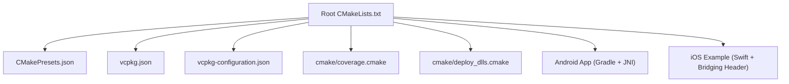
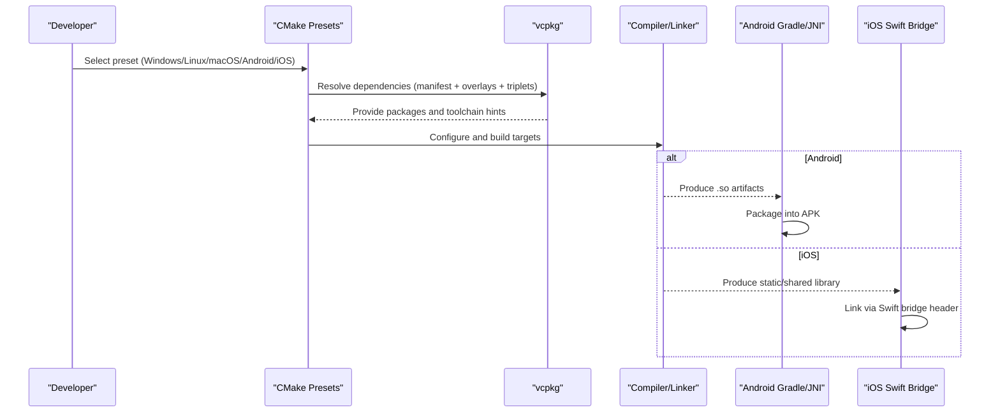
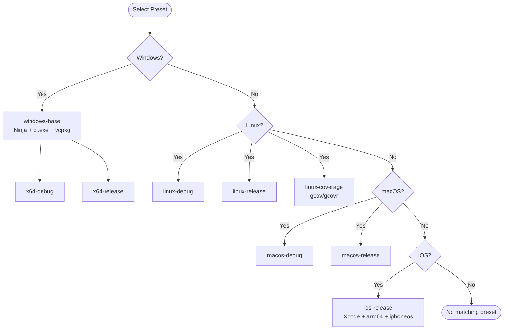
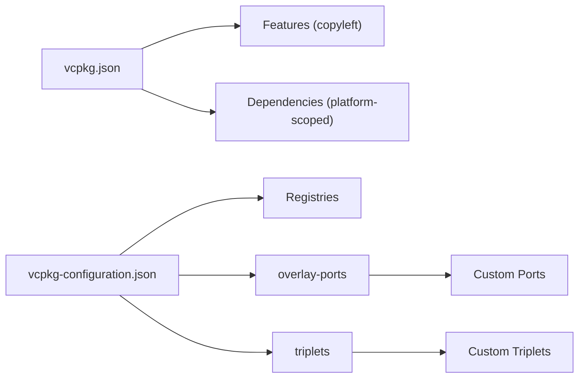
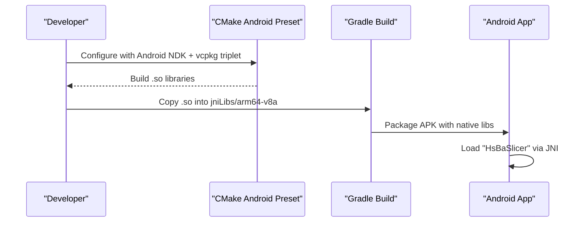
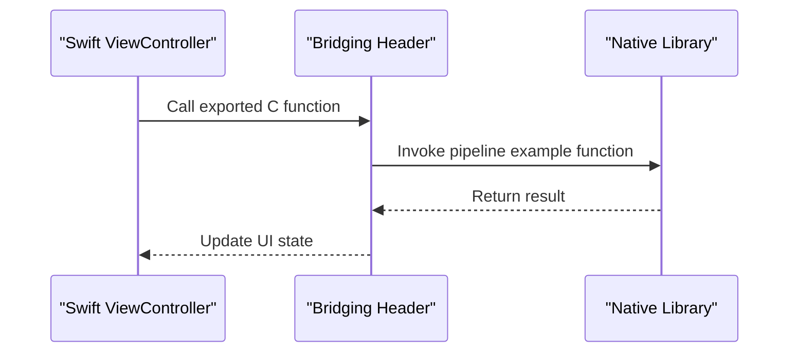
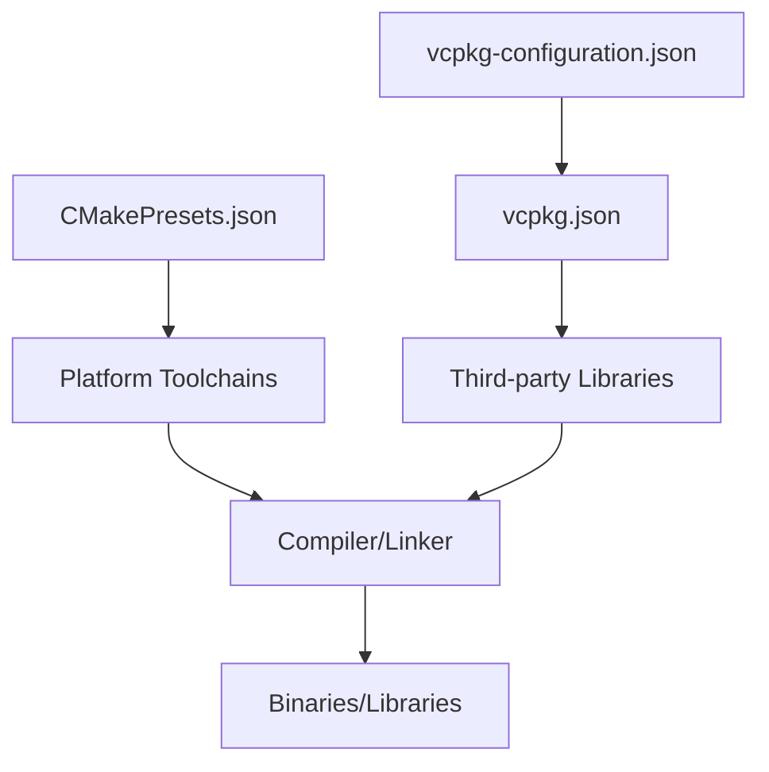

# Cross-Platform Compilation and Deployment

<cite>
**Referenced Files in This Document**
- [CMakePresets.json](file://CMakePresets.json)
- [vcpkg.json](file://vcpkg.json)
- [vcpkg-configuration.json](file://vcpkg-configuration.json)
- [overlay-ports/README.md](file://overlay-ports/README.md)
- [triplets/README.md](file://triplets/README.md)
- [CMakeLists.txt](file://CMakeLists.txt)
- [cmake/coverage.cmake](file://cmake/coverage.cmake)
- [cmake/deploy_dlls.cmake](file://cmake/deploy_dlls.cmake)
- [android/README.md](file://android/README.md)
- [android/app/build.gradle](file://android/app/build.gradle)
- [android/app/src/main/java/com/hsmbanlance/hsbaslicer/example/MainActivity.java](file://android/app/src/main/java/com/hsmbanlance/hsbaslicer/example/MainActivity.java)
- [ios/HsBaSlicerExample/ViewController.swift](file://ios/HsBaSlicerExample/ViewController.swift)
- [ios/HsBaSlicerExample/HsBaSlicerBridge.h](file://ios/HsBaSlicerExample/HsBaSlicerBridge.h)
</cite>

## Table of Contents
1. [Introduction](#introduction)
2. [Project Structure](#project-structure)
3. [Core Components](#core-components)
4. [Architecture Overview](#architecture-overview)
5. [Detailed Component Analysis](#detailed-component-analysis)
6. [Dependency Analysis](#dependency-analysis)
7. [Performance Considerations](#performance-considerations)
8. [Troubleshooting Guide](#troubleshooting-guide)
9. [Conclusion](#conclusion)

## Introduction
This document explains how HsBaSlicer is configured for cross-platform compilation and deployment across Windows, Linux, macOS, Android, and iOS. It covers:
- CMake presets for each platform and build type
- vcpkg dependency management with overlay ports and custom triplets
- Android JNI integration and Gradle packaging
- iOS Swift bridging via a C header
- Mobile-specific optimizations and common cross-compilation issues

The goal is to provide actionable guidance for building, testing, and deploying HsBaSlicer on all supported platforms.

## Project Structure
HsBaSlicer uses a top-level CMake project with modular subdirectories and platform-aware configuration. Key areas relevant to cross-platform builds:
- Root CMake configuration and feature detection
- CMake presets for Windows, Linux, macOS, Android, and iOS
- vcpkg manifest and configuration for dependencies and overlays
- Android app skeleton and Gradle configuration
- iOS example app and Swift/C bridging header

**Diagram sources**
- [CMakeLists.txt:1-695](file://CMakeLists.txt#L1-L695)
- [CMakePresets.json:1-236](file://CMakePresets.json#L1-L236)
- [vcpkg.json:1-113](file://vcpkg.json#L1-L113)
- [vcpkg-configuration.json:1-21](file://vcpkg-configuration.json#L1-L21)
- [cmake/coverage.cmake:1-173](file://cmake/coverage.cmake#L1-L173)
- [cmake/deploy_dlls.cmake:1-27](file://cmake/deploy_dlls.cmake#L1-L27)
- [android/app/build.gradle:1-37](file://android/app/build.gradle#L1-L37)
- [ios/HsBaSlicerExample/ViewController.swift:1-86](file://ios/HsBaSlicerExample/ViewController.swift#L1-L86)
- [ios/HsBaSlicerExample/HsBaSlicerBridge.h:1-32](file://ios/HsBaSlicerExample/HsBaSlicerBridge.h#L1-L32)

**Section sources**
- [CMakeLists.txt:1-100](file://CMakeLists.txt#L1-L100)
- [CMakePresets.json:1-236](file://CMakePresets.json#L1-L236)
- [vcpkg.json:1-113](file://vcpkg.json#L1-L113)
- [vcpkg-configuration.json:1-21](file://vcpkg-configuration.json#L1-L21)

## Core Components
- CMake presets define per-platform generators, toolchains, output directories, and cache variables.
- vcpkg manages third-party libraries; the manifest declares platform-scoped dependencies and features.
- The root CMake script detects platform capabilities, toggles optional subsystems (OpenCV, OpenVDB, CGAL/OpenCASCADE), and configures shared/static linking behavior based on target triplet.
- Android integrates via Gradle and JNI; iOS integrates via a Swift example app and a C bridging header.

Key behaviors:
- Desktop vs mobile detection controls features like dynamic loader, bit7z, OpenCV, OpenVDB, and database backends.
- Coverage instrumentation is available on GCC/Clang through a dedicated preset and helper script.
- Windows PDB symbol deployment is supported by a helper script.

**Section sources**
- [CMakeLists.txt:129-157](file://CMakeLists.txt#L129-L157)
- [CMakeLists.txt:229-256](file://CMakeLists.txt#L229-L256)
- [CMakeLists.txt:276-336](file://CMakeLists.txt#L276-L336)
- [CMakeLists.txt:367-390](file://CMakeLists.txt#L367-L390)
- [cmake/coverage.cmake:1-173](file://cmake/coverage.cmake#L1-L173)
- [cmake/deploy_dlls.cmake:1-27](file://cmake/deploy_dlls.cmake#L1-L27)

## Architecture Overview
The build system composes platform-specific configurations into a unified workflow:
- CMake presets select generator, toolchain, and environment variables.
- vcpkg resolves dependencies using the manifest and configuration, including overlay ports and triplets.
- The root CMake script adapts feature availability and linking strategy per platform.
- Android and iOS examples demonstrate runtime integration.

**Diagram sources**
- [CMakePresets.json:1-236](file://CMakePresets.json#L1-L236)
- [vcpkg.json:1-113](file://vcpkg.json#L1-L113)
- [vcpkg-configuration.json:1-21](file://vcpkg-configuration.json#L1-L21)
- [CMakeLists.txt:129-157](file://CMakeLists.txt#L129-L157)
- [android/app/build.gradle:1-37](file://android/app/build.gradle#L1-L37)
- [ios/HsBaSlicerExample/HsBaSlicerBridge.h:1-32](file://ios/HsBaSlicerExample/HsBaSlicerBridge.h#L1-L32)

## Detailed Component Analysis

### CMakePresets.json Configuration
CMake presets define:
- Windows base preset with Ninja generator, MSVC compilers, and vcpkg toolchain.
- Linux debug/release and coverage presets with vcpkg toolchain and coverage flags.
- Android release preset targeting arm64-v8a with NDK chainload and ABI/platform settings.
- macOS debug/release presets.
- iOS release preset using Xcode generator with iOS sysroot and architecture.

Important variables:
- CMAKE_SYSTEM_NAME, CMAKE_OSX_ARCHITECTURES, CMAKE_OSX_SYSROOT, CMAKE_OSX_DEPLOYMENT_TARGET for Apple platforms.
- ANDROID_ABI, ANDROID_PLATFORM, ANDROID_NDK, VCPKG_CHAINLOAD_TOOLCHAIN_FILE, VCPKG_TARGET_TRIPLET for Android.

**Diagram sources**
- [CMakePresets.json:1-236](file://CMakePresets.json#L1-L236)

**Section sources**
- [CMakePresets.json:1-236](file://CMakePresets.json#L1-L236)

### vcpkg Dependency Management
The project uses vcpkg with:
- Manifest file declaring dependencies with platform scoping and features.
- Configuration enabling registries, overlay ports, and overlay triplets.
- Copyleft feature that pulls CGAL, libigl (with cgal), and OpenCascade when enabled.

Highlights:
- Platform-scoped dependencies (e.g., OpenCV on windows/linux/osx/android; sqlpp11 features differ for android/ios).
- Overlay ports directory for custom ports.
- Custom triplets directory for platform-specific builds.

**Diagram sources**
- [vcpkg.json:1-113](file://vcpkg.json#L1-L113)
- [vcpkg-configuration.json:1-21](file://vcpkg-configuration.json#L1-L21)
- [overlay-ports/README.md:1-4](file://overlay-ports/README.md#L1-L4)
- [triplets/README.md:1-6](file://triplets/README.md#L1-L6)

**Section sources**
- [vcpkg.json:1-113](file://vcpkg.json#L1-L113)
- [vcpkg-configuration.json:1-21](file://vcpkg-configuration.json#L1-L21)
- [overlay-ports/README.md:1-4](file://overlay-ports/README.md#L1-L4)
- [triplets/README.md:1-6](file://triplets/README.md#L1-L6)

### Android JNI Integration Setup
Android integration includes:
- Minimal Android app skeleton with Gradle configuration.
- JNI loading of native library via System.loadLibrary("HsBaSlicer").
- CI steps to copy built .so files into jniLibs and build APK.

Key points:
- ABI filtering set to arm64-v8a.
- Minimum SDK and target SDK defined.
- Native libs produced by CMake are packaged into the app.

**Diagram sources**
- [CMakePresets.json:112-138](file://CMakePresets.json#L112-L138)
- [android/README.md:1-22](file://android/README.md#L1-L22)
- [android/app/build.gradle:1-37](file://android/app/build.gradle#L1-L37)
- [android/app/src/main/java/com/hsmbanlance/hsbaslicer/example/MainActivity.java:1-46](file://android/app/src/main/java/com/hsmbanlance/hsbaslicer/example/MainActivity.java#L1-L46)

**Section sources**
- [android/README.md:1-22](file://android/README.md#L1-L22)
- [android/app/build.gradle:1-37](file://android/app/build.gradle#L1-L37)
- [android/app/src/main/java/com/hsmbanlance/hsbaslicer/example/MainActivity.java:1-46](file://android/app/src/main/java/com/hsmbanlance/hsbaslicer/example/MainActivity.java#L1-L46)

### iOS Swift Bridging Configuration
iOS integration includes:
- Swift example app calling a C function exported from the native library.
- Bridging header declaring the C entry point for Swift consumption.

Key points:
- The bridging header exposes a C function used by Swift.
- iOS preset configures Xcode generator, arm64 architecture, and deployment target.

**Diagram sources**
- [ios/HsBaSlicerExample/ViewController.swift:1-86](file://ios/HsBaSlicerExample/ViewController.swift#L1-L86)
- [ios/HsBaSlicerExample/HsBaSlicerBridge.h:1-32](file://ios/HsBaSlicerExample/HsBaSlicerBridge.h#L1-L32)
- [CMakePresets.json:181-205](file://CMakePresets.json#L181-L205)

**Section sources**
- [ios/HsBaSlicerExample/ViewController.swift:1-86](file://ios/HsBaSlicerExample/ViewController.swift#L1-L86)
- [ios/HsBaSlicerExample/HsBaSlicerBridge.h:1-32](file://ios/HsBaSlicerExample/HsBaSlicerBridge.h#L1-L32)
- [CMakePresets.json:181-205](file://CMakePresets.json#L181-L205)

### Mobile-Specific Optimizations
Mobile builds adjust features and linking:
- Dynamic library loader disabled on non-desktop platforms.
- bit7z disabled on non-desktop platforms.
- OpenCV, OpenVDB, and CAD kernels disabled on Android/iOS.
- Database backends reduced to SQLite only on Android/iOS.
- Tests disabled on Android/iOS due to output limitations.

These choices reduce binary size and avoid unsupported APIs on mobile.

**Section sources**
- [CMakeLists.txt:229-256](file://CMakeLists.txt#L229-L256)
- [CMakeLists.txt:276-336](file://CMakeLists.txt#L276-L336)
- [CMakeLists.txt:396-407](file://CMakeLists.txt#L396-L407)

### Step-by-Step Guides

#### Windows
- Use the Windows base preset with Ninja and MSVC.
- Choose x64-debug or x64-release.
- Ensure Visual Studio and vcpkg are installed.

Steps:
1. Configure with preset: `cmake --preset=x64-debug` or `cmake --preset=x64-release`.
2. Build: `cmake --build --preset=x64-debug` or `cmake --build --preset=x64-release`.
3. Optionally deploy PDB symbols using the helper script.

Notes:
- vcpkg toolchain is automatically applied via preset.
- For debugging, use the deploy script to copy PDB files next to executables.

**Section sources**
- [CMakePresets.json:4-40](file://CMakePresets.json#L4-L40)
- [cmake/deploy_dlls.cmake:1-27](file://cmake/deploy_dlls.cmake#L1-L27)

#### Linux
- Use linux-debug or linux-release presets.
- For coverage, use linux-coverage preset and run coverage target.

Steps:
1. Configure: `cmake --preset=linux-debug` or `cmake --preset=linux-release`.
2. Build: `cmake --build --preset=linux-debug` or `cmake --build --preset=linux-release`.
3. Coverage: `cmake --preset=linux-coverage`, then `cmake --build --target=coverage`.

Notes:
- Coverage requires gcovr and GCC/Clang.
- Thresholds can be tuned via cache variables.

**Section sources**
- [CMakePresets.json:42-111](file://CMakePresets.json#L42-L111)
- [cmake/coverage.cmake:1-173](file://cmake/coverage.cmake#L1-L173)

#### macOS
- Use macos-debug or macos-release presets.

Steps:
1. Configure: `cmake --preset=macos-debug` or `cmake --preset=macos-release`.
2. Build: `cmake --build --preset=macos-debug` or `cmake --build --preset=macos-release`.

Notes:
- Uses Ninja generator and vcpkg toolchain.

**Section sources**
- [CMakePresets.json:140-180](file://CMakePresets.json#L140-L180)

#### Android
- Use android-release preset targeting arm64-v8a.

Steps:
1. Set environment variables: ANDROID_NDK_HOME, VCPKG_ROOT.
2. Configure: `cmake --preset=android-release`.
3. Build: `cmake --build --preset=android-release`.
4. Copy .so files into android/app/src/main/jniLibs/arm64-v8a.
5. Build APK via Gradle or Android Studio.

Notes:
- ABI and platform are specified in preset.
- Gradle filters abiFilters to arm64-v8a.

**Section sources**
- [CMakePresets.json:112-138](file://CMakePresets.json#L112-L138)
- [android/README.md:1-22](file://android/README.md#L1-L22)
- [android/app/build.gradle:1-37](file://android/app/build.gradle#L1-L37)

#### iOS
- Use ios-release preset with Xcode generator.

Steps:
1. Ensure Xcode and command-line tools are installed.
2. Configure: `cmake --preset=ios-release`.
3. Build with Xcode or CMake.
4. Integrate with Swift example app using the bridging header.

Notes:
- Target architecture is arm64; deployment target is set in preset.
- Swift example calls exported C function via bridging header.

**Section sources**
- [CMakePresets.json:181-205](file://CMakePresets.json#L181-L205)
- [ios/HsBaSlicerExample/HsBaSlicerBridge.h:1-32](file://ios/HsBaSlicerExample/HsBaSlicerBridge.h#L1-L32)
- [ios/HsBaSlicerExample/ViewController.swift:1-86](file://ios/HsBaSlicerExample/ViewController.swift#L1-L86)

## Dependency Analysis
The build depends on:
- CMake presets for platform selection and toolchain injection.
- vcpkg for dependency resolution, with overlay ports and triplets.
- Platform-specific toolchains (MSVC, GCC/Clang, NDK, Xcode).
- Optional coverage tooling (gcovr) on Linux.

**Diagram sources**
- [CMakePresets.json:1-236](file://CMakePresets.json#L1-L236)
- [vcpkg-configuration.json:1-21](file://vcpkg-configuration.json#L1-L21)
- [vcpkg.json:1-113](file://vcpkg.json#L1-L113)

**Section sources**
- [CMakePresets.json:1-236](file://CMakePresets.json#L1-L236)
- [vcpkg-configuration.json:1-21](file://vcpkg-configuration.json#L1-L21)
- [vcpkg.json:1-113](file://vcpkg.json#L1-L113)

## Performance Considerations
- Mobile builds disable heavy features (OpenCV, OpenVDB, CAD kernels) to reduce binary size and improve startup time.
- Debug builds disable boolean operations to mitigate performance and memory usage.
- Coverage instrumentation adds overhead; use it selectively in CI or local development.

Recommendations:
- Prefer Release builds for production deployments.
- On mobile, keep features minimal and rely on prebuilt libraries where possible.
- Use coverage thresholds to prevent regressions without impacting release builds.

**Section sources**
- [CMakeLists.txt:294-298](file://CMakeLists.txt#L294-L298)
- [cmake/coverage.cmake:1-173](file://cmake/coverage.cmake#L1-L173)

## Troubleshooting Guide
Common issues and resolutions:
- Missing compiler support for required C++ features: ensure a modern compiler (GCC/Clang/MSVC) meeting the project’s requirements.
- Android NDK not found: verify ANDROID_NDK_HOME and that the NDK path matches the toolchain file referenced in the preset.
- iOS build fails due to sysroot/arch mismatch: confirm CMAKE_OSX_SYSROOT and CMAKE_OSX_ARCHITECTURES in the iOS preset.
- Coverage target not found or failing: install gcovr and ensure GCC/Clang toolchain is active.
- PDB symbols missing after build: use the deploy script to copy PDB files next to executables.

Actionable checks:
- Validate environment variables (ANDROID_NDK_HOME, VCPKG_ROOT).
- Confirm platform conditions in presets match hostSystemName.
- Review feature toggles in root CMake for mobile/desktop differences.

**Section sources**
- [CMakeLists.txt:129-157](file://CMakeLists.txt#L129-L157)
- [CMakePresets.json:112-205](file://CMakePresets.json#L112-L205)
- [cmake/coverage.cmake:1-173](file://cmake/coverage.cmake#L1-L173)
- [cmake/deploy_dlls.cmake:1-27](file://cmake/deploy_dlls.cmake#L1-L27)

## Conclusion
HsBaSlicer provides a robust, cross-platform build system driven by CMake presets and vcpkg. The configuration cleanly separates desktop and mobile concerns, enabling optimized builds for Android and iOS while maintaining rich functionality on Windows, Linux, and macOS. By following the step-by-step guides and troubleshooting tips, developers can reliably compile, test, and deploy HsBaSlicer across all supported platforms.