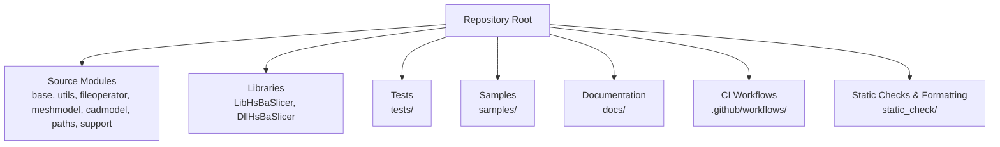
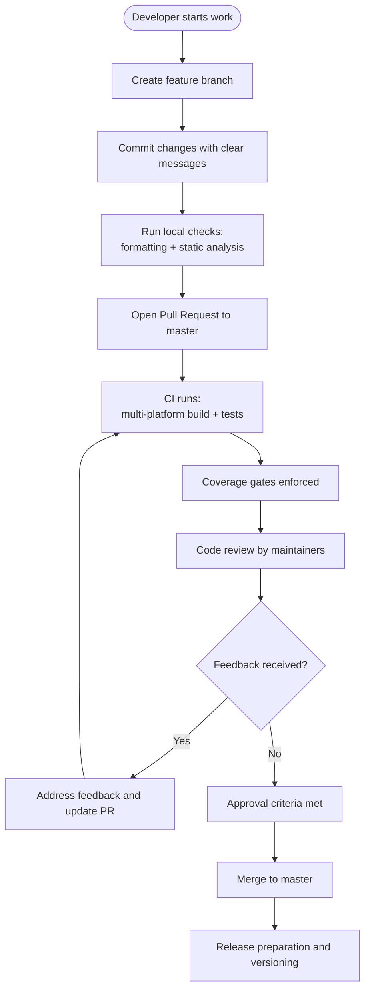
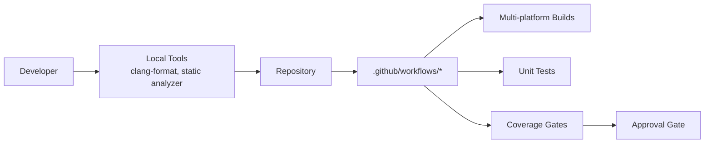

# Contribution Workflow

<cite>
**Referenced Files in This Document**
- [README.md](file://README.md)
- [LICENSE.txt](file://LICENSE.txt)
- [.github/copilot-instructions.md](file://.github/copilot-instructions.md)
- [.github/workflows/cmake-multi-platform.yml](file://.github/workflows/cmake-multi-platform.yml)
- [.github/workflows/test-coverage.yml](file://.github/workflows/test-coverage.yml)
- [static_check/cpp_analyzer.py](file://static_check/cpp_analyzer.py)
- [static_check/clang-format-batch.py](file://static_check/clang-format-batch.py)
</cite>

## Table of Contents
1. [Introduction](#introduction)
2. [Project Structure](#project-structure)
3. [Core Components](#core-components)
4. [Architecture Overview](#architecture-overview)
5. [Detailed Component Analysis](#detailed-component-analysis)
6. [Dependency Analysis](#dependency-analysis)
7. [Performance Considerations](#performance-considerations)
8. [Troubleshooting Guide](#troubleshooting-guide)
9. [Conclusion](#conclusion)
10. [Appendices](#appendices)

## Introduction
This document defines the end-to-end contribution workflow for HsBaSlicer, from issue creation to merge approval. It covers branch naming conventions, commit message standards, pull request templates, code review process, release management and versioning, changelog maintenance, documentation updates, translation contributions, community interaction standards, and licensing considerations.

HsBaSlicer is a modular, cross-platform C++ framework for 3D-printing slicers with CI across Windows, Linux, macOS, Android, and iOS. The repository includes build tooling, static analysis, formatting helpers, and multi-platform workflows that gate quality and coverage.

## Project Structure
The repository is organized by modules (base, utils, fileoperator, meshmodel, cadmodel, paths, support, LibHsBaSlicer, DllHsBaSlicer), with tests under tests/, samples under samples/, documentation under docs/, and CI under .github/workflows/. Static checks and formatting tools are provided under static_check/.

**Diagram sources**
- [.github/copilot-instructions.md:5-11](file://.github/copilot-instructions.md#L5-L11)

**Section sources**
- [.github/copilot-instructions.md:5-11](file://.github/copilot-instructions.md#L5-L11)

## Core Components
This section summarizes the core components relevant to contributing:

- Build system and dependencies
  - CMake-based project with vcpkg dependency management.
  - Multi-platform CI builds and tests on Windows, Linux, macOS, Android, iOS.
- Testing and coverage
  - Unit tests using Boost.Test collected under tests/.
  - Coverage gates enforced via gcovr with thresholds for core and other modules.
- Code quality tools
  - Static analyzer script enforcing coding rules (no catch-all exceptions, unsafe functions, magic numbers, high complexity).
  - Batch clang-format helper to enforce consistent style.

**Section sources**
- [.github/copilot-instructions.md:13-33](file://.github/copilot-instructions.md#L13-L33)
- [.github/workflows/test-coverage.yml:1-15](file://.github/workflows/test-coverage.yml#L1-L15)
- [static_check/cpp_analyzer.py:1-15](file://static_check/cpp_analyzer.py#L1-L15)
- [static_check/clang-format-batch.py:1-21](file://static_check/clang-format-batch.py#L1-L21)

## Architecture Overview
The contribution pipeline integrates local development practices with CI checks:

[No sources needed since this diagram shows conceptual workflow, not actual code structure]

## Detailed Component Analysis

### Issue Creation and Triage
- Use the repository’s issue tracker to report bugs or propose features.
- Include environment details (platform, compiler, CMake/vcpkg versions), steps to reproduce, and expected vs actual behavior.
- For feature requests, describe use cases, impact, and any constraints.

[No sources needed since this section doesn't analyze specific source files]

### Branch Naming Conventions
Recommended patterns:
- Feature branches: `feature/<short-description>`
- Bug fixes: `fix/<short-description>`
- Documentation: `docs/<short-description>`
- Tests: `test/<short-description>`
- Maintenance: `chore/<short-description>`
- Releases: `release/<version>`

Rationale:
- Clear intent and scope.
- Easy filtering and automation (e.g., changelog generation).
- Aligns with standard GitFlow-like practices.

[No sources needed since this section doesn't analyze specific source files]

### Commit Message Standards
Adopt a concise, descriptive format:
- Type: `feat`, `fix`, `docs`, `test`, `chore`
- Scope: optional module or area (e.g., `support`, `paths`)
- Subject: imperative, short summary
- Body: explain motivation and context
- Footer: link issues (e.g., `Closes #123`)

Examples:
- `feat(support): add overhang detection threshold parameter`
- `fix(paths): correct layer path export for SLS`
- `docs(base): clarify memory pool usage`

[No sources needed since this section doesn't analyze specific source files]

### Pull Request Templates
A minimal template should include:
- Summary of changes
- Motivation and context
- Test coverage added/updated
- Breaking changes (if any)
- Related issues
- Screenshots/logs (if applicable)

[No sources needed since this section doesn't analyze specific source files]

### Code Review Process
Review checklist:
- Correctness and robustness
- Adherence to coding standards (static analyzer passes)
- Performance implications
- Test coverage and edge cases
- Documentation updates
- Licensing compliance

Reviewer assignment:
- Assign maintainers familiar with the affected module.
- Encourage peer reviews for cross-module changes.

Feedback handling:
- Address comments promptly.
- Keep PRs focused; split large changes into smaller PRs if needed.

Approval criteria:
- All CI checks pass (builds, tests, coverage).
- No unresolved reviewer comments.
- Changes align with project goals and standards.

**Section sources**
- [.github/workflows/cmake-multi-platform.yml:1-8](file://.github/workflows/cmake-multi-platform.yml#L1-L8)
- [.github/workflows/test-coverage.yml:16-20](file://.github/workflows/test-coverage.yml#L16-L20)

### Release Management and Versioning
Versioning strategy:
- Semantic versioning (MAJOR.MINOR.PATCH).
- Increment MAJOR for breaking changes, MINOR for new features, PATCH for bug fixes.

Release preparation:
- Update version metadata consistently across generated headers and runtime info.
- Ensure all CI checks pass on target platforms.
- Tag releases and publish artifacts as appropriate.

Changelog maintenance:
- Maintain a changelog aligned with commits and PRs.
- Group entries by type (features, fixes, docs, chore).
- Reference related issues and PRs.

**Section sources**
- [README.md:192-203](file://README.md#L192-L203)

### Documentation Updates
Guidelines:
- Update user-facing docs under docs/en and docs/zh when adding features or changing behavior.
- Keep API references current (headers, C ABI, Lua bindings).
- Provide examples where helpful.

Translation contributions:
- Mirror English content in docs/zh.
- Ensure terminology consistency.
- Validate links and diagrams after translation.

**Section sources**
- [README.md:126-172](file://README.md#L126-L172)

### Community Interaction Standards
- Be respectful and constructive in discussions.
- Provide reproducible examples and logs.
- Follow project guidelines for security disclosures.
- Acknowledge contributors and reviewers.

[No sources needed since this section doesn't analyze specific source files]

### Licensing Considerations and Contributor Agreement
HsBaSlicer uses a conditional dual license:
- MIT for builds without GPL/LGPL components (e.g., iOS, game consoles without CGAL/OpenCascade).
- GPL-3.0-or-later for builds including copyleft kernels (CGAL, OpenCascade).

Contributor requirements:
- Contributions must be compatible with both licenses depending on build configuration.
- Avoid introducing incompatible third-party code.
- Ensure proper attribution and notices.

Runtime license reporting:
- Effective license determined at configure time and available via version info APIs.

**Section sources**
- [LICENSE.txt:1-23](file://LICENSE.txt#L1-L23)
- [README.md:196-210](file://README.md#L196-L210)

## Dependency Analysis
Contribution-related dependencies and their roles:

**Diagram sources**
- [.github/workflows/cmake-multi-platform.yml:1-8](file://.github/workflows/cmake-multi-platform.yml#L1-L8)
- [.github/workflows/test-coverage.yml:16-20](file://.github/workflows/test-coverage.yml#L16-L20)

**Section sources**
- [.github/workflows/cmake-multi-platform.yml:1-8](file://.github/workflows/cmake-multi-platform.yml#L1-L8)
- [.github/workflows/test-coverage.yml:16-20](file://.github/workflows/test-coverage.yml#L16-L20)

## Performance Considerations
- Prefer small, focused PRs to reduce review time and CI load.
- Run local static analysis and formatting before opening PRs.
- Optimize algorithms and avoid unnecessary allocations; adhere to static analyzer rules.
- Respect CI resource limits (parallelism settings) and ensure tests run efficiently.

[No sources needed since this section provides general guidance]

## Troubleshooting Guide
Common issues and resolutions:
- Static analyzer failures
  - Remove catch-all exceptions and unsafe functions.
  - Replace magic numbers with named constants.
  - Reduce function complexity or refactor logic.
- Formatting inconsistencies
  - Use the batch clang-format script to auto-format code.
- Coverage gate failures
  - Add unit tests for critical paths.
  - Ensure tests execute under coverage builds.

**Section sources**
- [static_check/cpp_analyzer.py:237-291](file://static_check/cpp_analyzer.py#L237-L291)
- [static_check/clang-format-batch.py:183-274](file://static_check/clang-format-batch.py#L183-L274)
- [.github/workflows/test-coverage.yml:100-103](file://.github/workflows/test-coverage.yml#L100-L103)

## Conclusion
Following this contribution workflow ensures consistent quality, reliable CI outcomes, and smooth collaboration. By adhering to branch naming, commit standards, PR templates, review criteria, and licensing guidelines—and leveraging the provided tooling—you help maintain HsBaSlicer’s stability and extensibility across platforms.

[No sources needed since this section summarizes without analyzing specific files]

## Appendices

### Local Development Checklist
- Install required tools (CMake, vcpkg, PowerShell).
- Configure and build using CMake presets or documented commands.
- Run tests with ctest.
- Format code with clang-format batch script.
- Run static analyzer and fix reported issues.
- Update documentation and tests as needed.

**Section sources**
- [.github/copilot-instructions.md:13-33](file://.github/copilot-instructions.md#L13-L33)

### CI Workflows Overview
- Multi-platform builds on Windows, Linux, macOS.
- Android and iOS builds verified in CI.
- Coverage gates enforced on PRs targeting master and dev.

**Section sources**
- [.github/workflows/cmake-multi-platform.yml:1-8](file://.github/workflows/cmake-multi-platform.yml#L1-L8)
- [.github/workflows/test-coverage.yml:16-20](file://.github/workflows/test-coverage.yml#L16-L20)