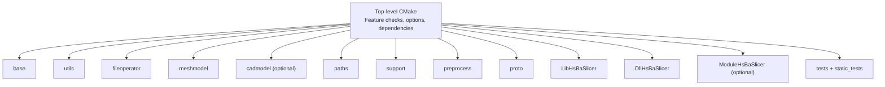
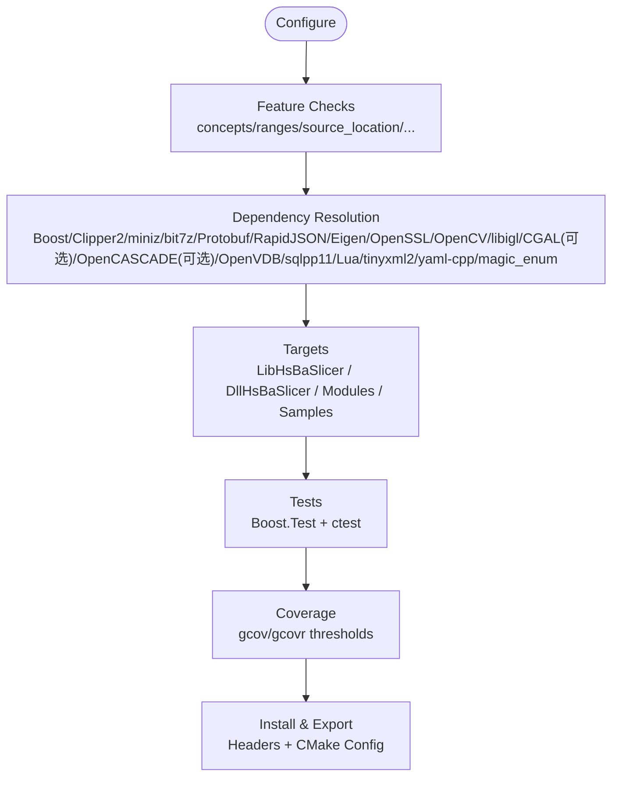
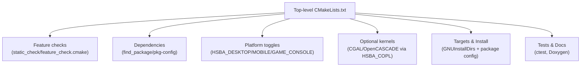
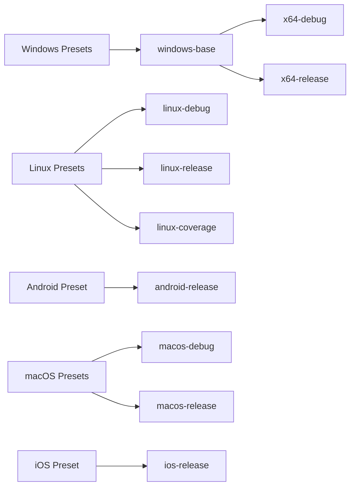
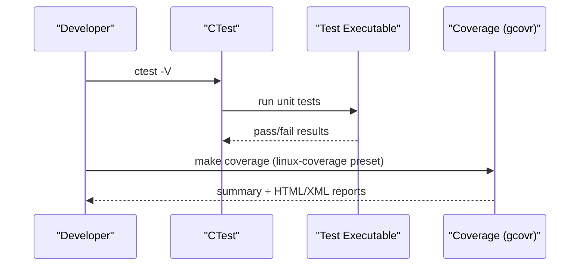
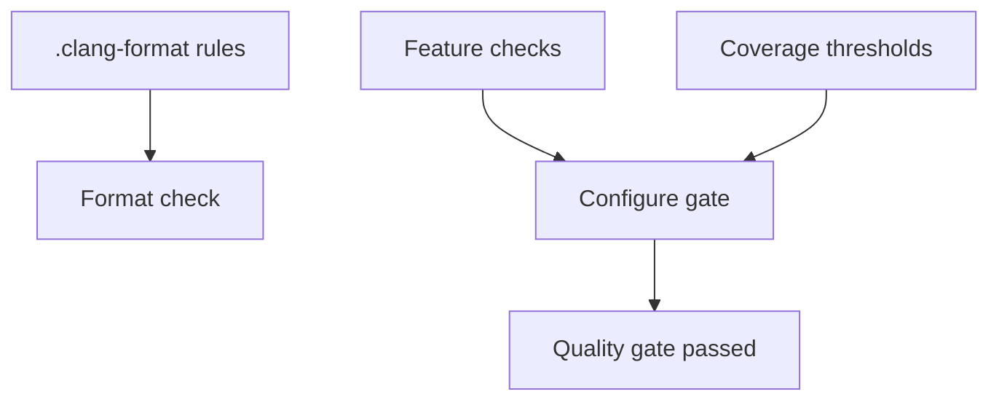
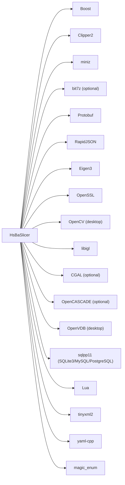

# Development Guide

<cite>
**Referenced Files in This Document**   
- [README.md](file://README.md)
- [CMakeLists.txt](file://CMakeLists.txt)
- [CMakePresets.json](file://CMakePresets.json)
- [cmake/coverage.cmake](file://cmake/coverage.cmake)
- [static_check/feature_check.cmake](file://static_check/feature_check.cmake)
- [.clang-format](file://.clang-format)
- [tests/CMakeLists.txt](file://tests/CMakeLists.txt)
- [static_tests/CMakeLists.txt](file://static_tests/CMakeLists.txt)
</cite>

## Table of Contents
1. [Introduction](#introduction)
2. [Project Structure](#project-structure)
3. [Core Components](#core-components)
4. [Architecture Overview](#architecture-overview)
5. [Detailed Component Analysis](#detailed-component-analysis)
6. [Dependency Analysis](#dependency-analysis)
7. [Performance Considerations](#performance-considerations)
8. [Troubleshooting Guide](#troubleshooting-guide)
9. [Conclusion](#conclusion)
10. [Appendices](#appendices)

## Introduction
This guide explains how to set up the development environment, build and test HsBaSlicer, and contribute code with consistent quality. It covers:
- Required tools and IDE setup
- CMake-based build system architecture, feature detection, and cross-compilation presets
- Testing framework (unit tests, static tests), coverage gating, and static analysis
- Code style guidelines and quality gates
- Contribution workflow, review standards, and release/export mechanics
- Performance profiling, benchmarking, and optimization strategies
- Debugging techniques for geometric algorithms and memory issues

HsBaSlicer is a modular, cross-platform C++ framework for 3D-printing slicers, exposing both a C ABI dynamic library and a C++ static library API.

**Section sources**
- [README.md:21-39](file://README.md#L21-L39)

## Project Structure
High-level modules include base utilities, file operations, mesh/CAD models, path generation, support structures, and pipeline libraries. The top-level CMake orchestrates dependency discovery, feature detection, optional copyleft kernels, and install/export targets.

**Diagram sources**
- [CMakeLists.txt:409-440](file://CMakeLists.txt#L409-L440)

**Section sources**
- [README.md:25-39](file://README.md#L25-L39)
- [CMakeLists.txt:409-440](file://CMakeLists.txt#L409-L440)

## Core Components
- Build system: Top-level CMake enforces C++20, detects compiler features, configures optional copyleft kernels (CGAL/OpenCASCADE), and wires dependencies via vcpkg/pkg-config.
- Presets: CMakePresets.json provides Windows/Linux/macOS/iOS/Android configurations, including a coverage preset.
- Coverage: cmake/coverage.cmake instruments builds and enforces line-coverage thresholds for core vs other modules.
- Static checks: static_check/feature_check.cmake validates required C++20 features at configure time.
- Tests: tests/CMakeLists.txt defines many Boost.Test executables; static_tests/CMakeLists.txt includes compile-time/static tests.

Key configuration highlights:
- Compiler standards: C++20 enforced; C standard auto-detected per compiler version.
- Feature flags: concepts, ranges, source_location, NTTP class/fp, template-template matching, coroutines, explicit this, C23 constexpr.
- Copyleft kernel gating: HSBA_COPL AUTO/ON/OFF controls CGAL/OpenCascade inclusion and license mode.
- Platform toggles: desktop/mobile/game console, DLL loader availability, bit7z, OpenCV, OpenVDB, SQL backends.
- Install/export: GNUInstallDirs + package config files for downstream find_package(HsBaSlicer).

**Section sources**
- [CMakeLists.txt:4-38](file://CMakeLists.txt#L4-L38)
- [CMakeLists.txt:48-104](file://CMakeLists.txt#L48-L104)
- [CMakeLists.txt:170-204](file://CMakeLists.txt#L170-L204)
- [CMakeLists.txt:206-349](file://CMakeLists.txt#L206-L349)
- [CMakeLists.txt:459-665](file://CMakeLists.txt#L459-L665)
- [cmake/coverage.cmake:1-173](file://cmake/coverage.cmake#L1-L173)
- [static_check/feature_check.cmake:1-123](file://static_check/feature_check.cmake#L1-L123)

## Architecture Overview
The build system integrates multiple layers:
- Configure phase: feature checks, dependency resolution, platform-specific options.
- Build phase: static/shared libraries, samples, tests, docs.
- Test phase: ctest integration, optional post-build runs.
- Coverage phase: gcov instrumentation and gcovr threshold gating.
- Install phase: headers, libraries, CMake package config, protobuf multi-language outputs.

**Diagram sources**
- [CMakeLists.txt:48-104](file://CMakeLists.txt#L48-L104)
- [CMakeLists.txt:206-349](file://CMakeLists.txt#L206-L349)
- [CMakeLists.txt:459-665](file://CMakeLists.txt#L459-L665)
- [cmake/coverage.cmake:1-173](file://cmake/coverage.cmake#L1-L173)

## Detailed Component Analysis

### Development Environment Setup
- Required tools:
  - CMake >= 3.28 (top-level minimum), C++20-capable compiler
  - vcpkg recommended for dependency management
  - PowerShell on Windows
- Suggested toolchains:
  - Windows: Visual Studio 2022+ with Desktop development with C++, CMake tools, vcpkg
  - Linux/macOS: GCC/Clang, Ninja, pkg-config, automake, libtool, m4, autoconf, plus X11/GLU/XI/Xrender/Xtst/bison/flex/ncurses/fontconfig as needed by dependencies
- Android/iOS:
  - Android requires SDK/NDK and ANDROID_NDK_HOME; iOS preset available on macOS

Build examples:
- Manual: configure with vcpkg toolchain, then build Release
- Presets: use CMakePresets.json for linux-release/windows-base/android-release/ios-release

**Section sources**
- [README.md:41-98](file://README.md#L41-L98)
- [CMakePresets.json:1-236](file://CMakePresets.json#L1-L236)

### IDE Configuration
- Use CMake presets to drive generator/toolchain/build type:
  - windows-base/x64-debug/x64-release
  - linux-debug/linux-release/linux-coverage
  - android-release
  - macos-debug/macos-release
  - ios-release
- For VS/CLion/VSCode: import CMakePresets.json to select presets and automatically apply vcpkg toolchain and cache variables.

**Section sources**
- [CMakePresets.json:1-236](file://CMakePresets.json#L1-L236)

### Debugging Setup
- Use Debug builds from presets (e.g., x64-debug, linux-debug, macos-debug).
- On Linux/WSL, enable coverage preset to instrument binaries and run tests under gcov.
- Run tests via ctest or individual test executables produced by tests/CMakeLists.txt.

**Section sources**
- [CMakePresets.json:22-111](file://CMakePresets.json#L22-L111)
- [tests/CMakeLists.txt:1-800](file://tests/CMakeLists.txt#L1-L800)

### Build System Architecture (CMake)
- Global settings:
  - Position-independent code enabled for static libs linked into shared libraries
  - UTF-8 encoding for MSVC
  - C++20 standard; C standard auto-selected per compiler family/version
- Feature detection:
  - Mandatory: concepts, ranges, source_location, NTTP class, template-template matching
  - Optional: coroutines, explicit this, C23 constexpr
  - C11/C23 _Generic availability checked
- Copyleft kernels:
  - HSBA_COPL AUTO/ON/OFF controls CGAL/OpenCascade linkage and project license mode
- Dependencies:
  - Boost (log/log_setup), Clipper2 (pkg-config), miniz, bit7z (optional), Protobuf, RapidJSON, Eigen3, OpenSSL, OpenCV (desktop), libigl, CGAL (optional), OpenCASCADE (optional), OpenVDB (desktop), sqlpp11 (SQLite3/MySQL/PostgreSQL on desktop), Lua, tinyxml2, yaml-cpp, magic_enum
- Output layout:
  - Unified runtime/library output directories under bin/<CONFIG>
  - logcfg.ini copied to output directory
- Install/export:
  - GNUInstallDirs, export targets under HsBaSlicer:: namespace
  - Package config files generated and installed
  - Public headers installed per module
  - Protobuf multi-language outputs optionally installed

**Diagram sources**
- [CMakeLists.txt:4-38](file://CMakeLists.txt#L4-L38)
- [CMakeLists.txt:48-104](file://CMakeLists.txt#L48-L104)
- [CMakeLists.txt:170-204](file://CMakeLists.txt#L170-L204)
- [CMakeLists.txt:206-349](file://CMakeLists.txt#L206-L349)
- [CMakeLists.txt:459-665](file://CMakeLists.txt#L459-L665)

**Section sources**
- [CMakeLists.txt:4-38](file://CMakeLists.txt#L4-L38)
- [CMakeLists.txt:48-104](file://CMakeLists.txt#L48-L104)
- [CMakeLists.txt:170-204](file://CMakeLists.txt#L170-L204)
- [CMakeLists.txt:206-349](file://CMakeLists.txt#L206-L349)
- [CMakeLists.txt:459-665](file://CMakeLists.txt#L459-L665)

### Cross-Compilation and Presets
- Windows: windows-base uses cl.exe and Ninja; x64-debug/release variants set CMAKE_BUILD_TYPE.
- Linux: linux-debug/release; linux-coverage enables coverage instrumentation and thresholds.
- Android: android-release sets VCPKG_TARGET_TRIPLET=arm64-android, chains Android NDK toolchain, and sets ABI/platform.
- macOS: macos-debug/release.
- iOS: ios-release uses Xcode generator with arm64 sysroot and deployment target.

**Diagram sources**
- [CMakePresets.json:1-236](file://CMakePresets.json#L1-L236)

**Section sources**
- [CMakePresets.json:1-236](file://CMakePresets.json#L1-L236)

### Testing Framework
- Unit tests:
  - Built using Boost.Test; each test target links against relevant HsBaSlicer modules
  - Registered with ctest; optional automatic post-build execution
  - Many tests are conditionally built based on platform and copyleft kernel availability
- Static tests:
  - Compile-time checks aggregated via static_tests/CMakeLists.txt
- Coverage:
  - linux-coverage preset enables --coverage instrumentation and adds a coverage target that enforces thresholds for core vs other modules

**Diagram sources**
- [tests/CMakeLists.txt:1-800](file://tests/CMakeLists.txt#L1-L800)
- [cmake/coverage.cmake:1-173](file://cmake/coverage.cmake#L1-L173)

**Section sources**
- [tests/CMakeLists.txt:1-800](file://tests/CMakeLists.txt#L1-L800)
- [static_tests/CMakeLists.txt:1-4](file://static_tests/CMakeLists.txt#L1-L4)
- [cmake/coverage.cmake:1-173](file://cmake/coverage.cmake#L1-L173)

### Static Analysis and Code Style
- clang-format:
  - Allman brace style, 4-space indent, column limit 120, pointer/reference alignment left, include sorting preserved, etc.
- Feature checks:
  - Enforce required C++20 features at configure time; fail fast if missing
- Coverage gating:
  - Thresholds for core and other modules; CI can fail on regressions

**Diagram sources**
- [.clang-format:1-99](file://.clang-format#L1-L99)
- [static_check/feature_check.cmake:1-123](file://static_check/feature_check.cmake#L1-L123)
- [cmake/coverage.cmake:1-173](file://cmake/coverage.cmake#L1-L173)

**Section sources**
- [.clang-format:1-99](file://.clang-format#L1-L99)
- [static_check/feature_check.cmake:1-123](file://static_check/feature_check.cmake#L1-L123)
- [cmake/coverage.cmake:1-173](file://cmake/coverage.cmake#L1-L173)

### Contribution Workflow
- Issue and PR process:
  - Follow repository contribution guidance; ensure builds pass with presets and tests run successfully
- Code review standards:
  - Adhere to .clang-format
  - Ensure feature checks pass
  - Maintain or improve coverage thresholds when changing core modules
- Release management:
  - Use install/export to produce distributable packages
  - Downstream projects can consume via find_package(HsBaSlicer CONFIG REQUIRED)

**Section sources**
- [README.md:192-195](file://README.md#L192-L195)
- [README.md:100-185](file://README.md#L100-L185)

## Dependency Analysis
The top-level CMake resolves numerous third-party libraries and conditionally includes copyleft components.

**Diagram sources**
- [CMakeLists.txt:206-349](file://CMakeLists.txt#L206-L349)

**Section sources**
- [CMakeLists.txt:206-349](file://CMakeLists.txt#L206-L349)

## Performance Considerations
- Profiling:
  - Use platform profilers (Visual Studio Profiler, perf, Instruments) with Debug/Release builds
  - Leverage coverage builds to identify hot paths and validate improvements
- Benchmarking:
  - Add targeted benchmarks around slicing stages (mesh slice, polygon fill, path generation)
  - Compare before/after changes using consistent datasets and measurement methodology
- Optimization strategies:
  - Prefer memory pools and object pools where appropriate
  - Avoid heavy boolean operations in Debug builds (disabled by default)
  - Tune thread pool usage and coroutine-enabled features when applicable
  - Reduce unnecessary allocations in tight loops; reuse buffers

[No sources needed since this section provides general guidance]

## Troubleshooting Guide
Common issues and resolutions:
- Missing C++20 features:
  - Ensure compiler supports concepts, ranges, source_location, NTTP class, template-template matching
  - If not supported, upgrade toolchain or adjust requirements
- CGAL/OpenCASCADE not found:
  - Enable copyleft manifest feature or install manually; verify HSBA_COPL setting
- Coverage target fails:
  - Ensure gcovr is installed; adjust HSBA_COVERAGE_JOBS on constrained CI runners
- Tests do not run after build:
  - Check HSBA_SLICER_RUN_TESTS_AFTER_BUILD and HSBA_SLICER_USE_TESTS options
- Cross-compilation:
  - Verify VCPKG_TARGET_TRIPLET and NDK paths for Android; ensure correct sysroot for iOS

**Section sources**
- [CMakeLists.txt:48-104](file://CMakeLists.txt#L48-L104)
- [CMakeLists.txt:170-204](file://CMakeLists.txt#L170-L204)
- [cmake/coverage.cmake:1-173](file://cmake/coverage.cmake#L1-L173)
- [CMakeLists.txt:392-407](file://CMakeLists.txt#L392-L407)

## Conclusion
HsBaSlicer’s build system is robust and configurable, supporting modern C++ features, cross-platform builds, and comprehensive testing and coverage. By following the provided presets, adhering to code style and feature checks, and leveraging the testing and coverage infrastructure, contributors can maintain high quality while iterating quickly.

[No sources needed since this section summarizes without analyzing specific files]

## Appendices

### A. Key CMake Options Summary
- HSBA_COVERAGE: Enable gcov coverage instrumentation and coverage target
- HSBA_SLICER_MODULE: Build C++20 module wrapper
- HSBA_COPL: Link copyleft kernels (AUTO/ON/OFF)
- HSBA_POLYGON_DUMP: Enable SVG polygon dump utilities
- HSBA_USE_DLL_LOADER: Dynamic library loader availability
- HSBA_HSBA_USE_BIT7Z: Use bit7z compression
- HSBA_ENABLE_THREAD_POOL_COROUTINE: Coroutine support in thread pool
- HSBA_PROTOBUF_OUT: Generate protobuf multi-language outputs
- BUILD_SHARED_LIBS: Shared vs static libraries
- HSBA_SLICER_USE_TESTS: Enable tests
- HSBA_SLICER_RUN_TESTS_AFTER_BUILD: Run tests after build
- HSBA_SLICER_BUILD_SAMPLES: Build sample applications
- HSBA_SLICER_BUILD_DOCS: Build documentation (requires Doxygen)

**Section sources**
- [CMakeLists.txt:106-127](file://CMakeLists.txt#L106-L127)
- [CMakeLists.txt:168-169](file://CMakeLists.txt#L168-L169)
- [CMakeLists.txt:170-204](file://CMakeLists.txt#L170-L204)
- [CMakeLists.txt:229-262](file://CMakeLists.txt#L229-L262)
- [CMakeLists.txt:351-352](file://CMakeLists.txt#L351-L352)
- [CMakeLists.txt:368-390](file://CMakeLists.txt#L368-L390)
- [CMakeLists.txt:392-407](file://CMakeLists.txt#L392-L407)
- [CMakeLists.txt:442-454](file://CMakeLists.txt#L442-L454)
- [CMakeLists.txt:682-694](file://CMakeLists.txt#L682-L694)

### B. Preset Quickstart
- Windows: cmake --preset windows-base; cmake --build out/build/windows-base --config Release
- Linux: cmake --preset linux-release; cmake --build out/build/linux-release --config Release
- Coverage: cmake --preset linux-coverage; cmake --build out/build/linux-coverage --target coverage
- Android: cmake --preset android-release; cmake --build out/build/android-release --config Release
- iOS: cmake --preset ios-release; open out/build/ios-release/HsBaSlicer.xcodeproj

**Section sources**
- [CMakePresets.json:1-236](file://CMakePresets.json#L1-L236)