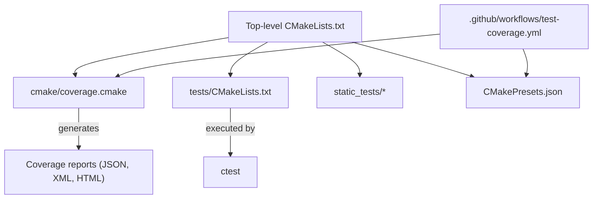
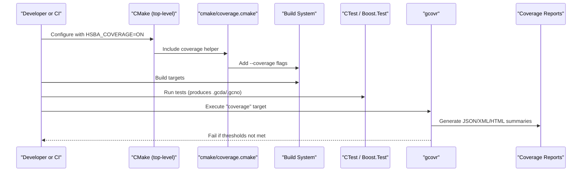
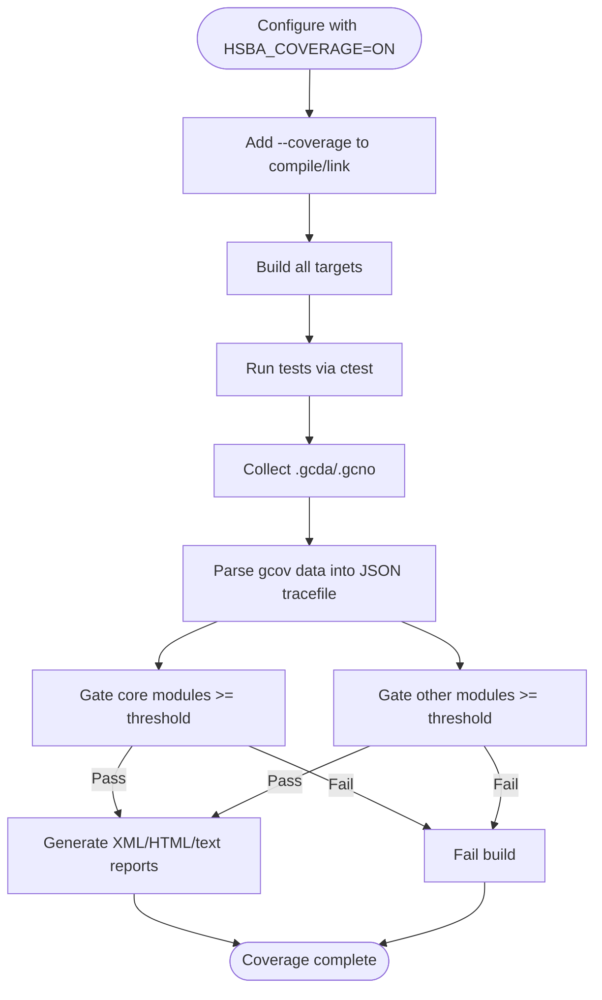
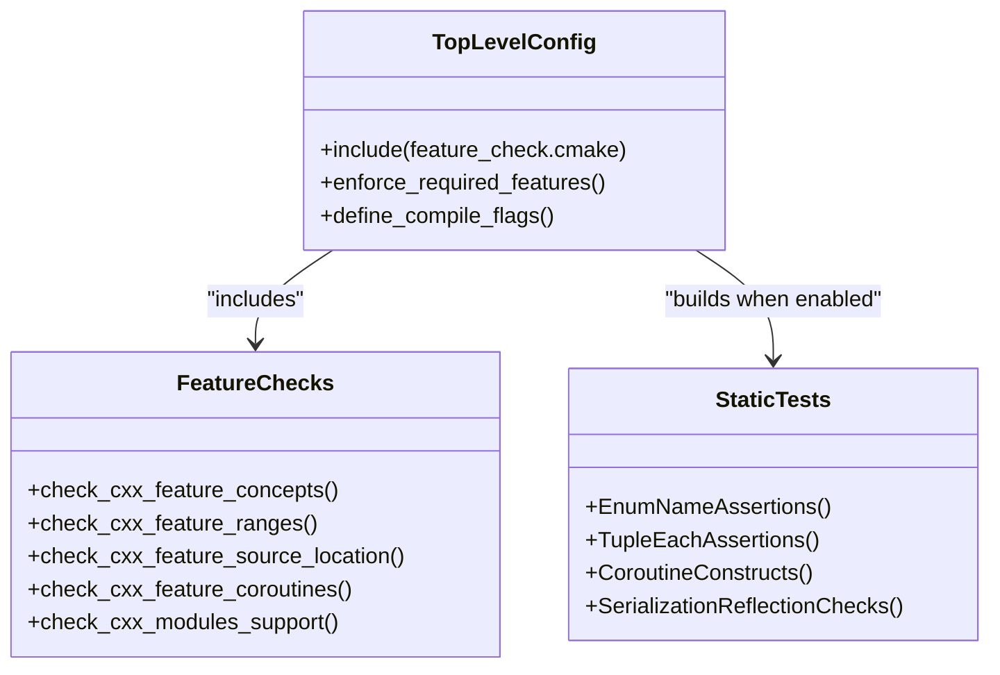
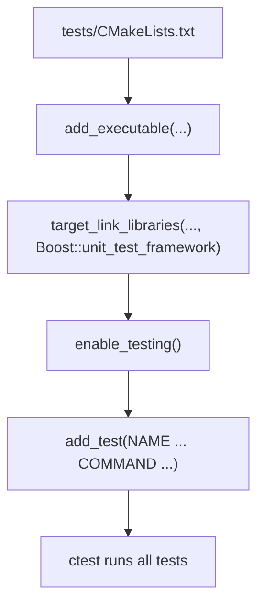
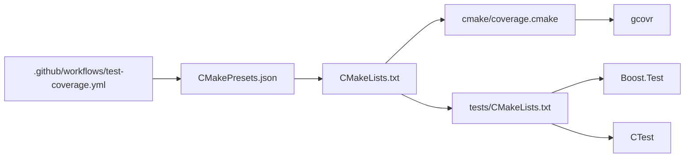

# Code Coverage and Performance Testing

<cite>
**Referenced Files in This Document**
- [CMakeLists.txt](file://CMakeLists.txt)
- [cmake/coverage.cmake](file://cmake/coverage.cmake)
- [CMakePresets.json](file://CMakePresets.json)
- [.github/workflows/test-coverage.yml](file://.github/workflows/test-coverage.yml)
- [static_tests/README.md](file://static_tests/README.md)
- [static_tests/base_static_tests/base_static_tests.cpp](file://static_tests/base_static_tests/base_static_tests.cpp)
- [static_tests/utils_static_tests/utils_static_tests.cpp](file://static_tests/utils_static_tests/utils_static_tests.cpp)
- [tests/CMakeLists.txt](file://tests/CMakeLists.txt)
- [tests/Pool/memory_pool_test.cpp](file://tests/Pool/memory_pool_test.cpp)
- [static_check/feature_check.cmake](file://static_check/feature_check.cmake)
- [docs/en/base/memory_pool.md](file://docs/en/base/memory_pool.md)
</cite>

## Table of Contents
1. [Introduction](#introduction)
2. [Project Structure](#project-structure)
3. [Core Components](#core-components)
4. [Architecture Overview](#architecture-overview)
5. [Detailed Component Analysis](#detailed-component-analysis)
6. [Dependency Analysis](#dependency-analysis)
7. [Performance Considerations](#performance-considerations)
8. [Troubleshooting Guide](#troubleshooting-guide)
9. [Conclusion](#conclusion)

## Introduction
This document explains how HsBaSlicer performs code coverage measurement, static testing, and performance verification. It covers:
- Generating coverage reports with gcov/lcov via CMake and gcovr
- Interpreting coverage metrics and identifying untested paths
- Using the static testing framework for compile-time assertions and template metaprogramming validation
- Benchmarking methodologies, memory profiling techniques, and optimization verification strategies
- Setting up coverage reporting across different build configurations and interpreting results for regression detection

The guidance is grounded in the repository’s CMake configuration, presets, CI workflow, and test sources.

## Project Structure
HsBaSlicer uses a layered CMake-based build system with:
- A top-level project that enables optional coverage instrumentation and test execution
- A dedicated coverage helper module that configures gcov/gcovr and enforces coverage thresholds
- Presets for local and CI workflows, including a Linux coverage preset
- A GitHub Actions workflow that runs tests and gates coverage on core and other modules
- Static tests that validate compile-time behavior without runtime dependencies
- Unit tests built with Boost.Test and executed through CTest

**Diagram sources**
- [CMakeLists.txt:106-112](file://CMakeLists.txt#L106-L112)
- [cmake/coverage.cmake:1-173](file://cmake/coverage.cmake#L1-L173)
- [CMakePresets.json:84-111](file://CMakePresets.json#L84-L111)
- [.github/workflows/test-coverage.yml:1-123](file://.github/workflows/test-coverage.yml#L1-L123)
- [tests/CMakeLists.txt:1-800](file://tests/CMakeLists.txt#L1-L800)

**Section sources**
- [CMakeLists.txt:106-112](file://CMakeLists.txt#L106-L112)
- [CMakePresets.json:84-111](file://CMakePresets.json#L84-L111)
- [.github/workflows/test-coverage.yml:1-123](file://.github/workflows/test-coverage.yml#L1-L123)

## Core Components
- Coverage instrumentation and gating:
  - The top-level CMakeLists.txt toggles HSBA_COVERAGE and includes cmake/coverage.cmake when enabled.
  - cmake/coverage.cmake adds --coverage to all targets, defines thresholds for core and other modules, and provides a "coverage" target that runs gcovr and fails if thresholds are not met.
- Presets and CI:
  - CMakePresets.json defines linux-coverage configure/build/test presets and a report target.
  - .github/workflows/test-coverage.yml automates building, running tests, and enforcing coverage thresholds in CI.
- Static testing:
  - static_tests contains compile-time checks for templates and constexpr behavior; they are excluded from coverage computation.
  - static_check/feature_check.cmake probes compiler features at configure time.
- Unit testing:
  - tests/CMakeLists.txt builds many Boost.Test executables and registers them with CTest.

**Section sources**
- [CMakeLists.txt:106-112](file://CMakeLists.txt#L106-L112)
- [cmake/coverage.cmake:1-173](file://cmake/coverage.cmake#L1-L173)
- [CMakePresets.json:84-111](file://CMakePresets.json#L84-L111)
- [.github/workflows/test-coverage.yml:1-123](file://.github/workflows/test-coverage.yml#L1-L123)
- [static_tests/README.md:1-4](file://static_tests/README.md#L1-L4)
- [static_check/feature_check.cmake:1-123](file://static_check/feature_check.cmake#L1-L123)
- [tests/CMakeLists.txt:1-800](file://tests/CMakeLists.txt#L1-L800)

## Architecture Overview
The coverage pipeline integrates build, test execution, and report generation:

**Diagram sources**
- [CMakeLists.txt:106-112](file://CMakeLists.txt#L106-L112)
- [cmake/coverage.cmake:22-31](file://cmake/coverage.cmake#L22-L31)
- [cmake/coverage.cmake:158-173](file://cmake/coverage.cmake#L158-L173)
- [CMakePresets.json:207-234](file://CMakePresets.json#L207-L234)
- [.github/workflows/test-coverage.yml:88-102](file://.github/workflows/test-coverage.yml#L88-L102)

## Detailed Component Analysis

### Coverage Measurement with gcov/gcovr
- Instrumentation:
  - When HSBA_COVERAGE is ON, cmake/coverage.cmake adds --coverage to both compile and link steps so that test runs produce coverage data files inside the build tree.
- Thresholds and gating:
  - Two thresholds are enforced:
    - Core modules threshold (default 45%)
    - Other modules threshold (default 25%)
  - The "coverage" custom target parses gcov data into a JSON tracefile once, then applies filters/excludes and generates per-group summaries and HTML details. If either threshold is not met, the target fails.
- Filters and exclusions:
  - Core directories include base, 2D, utils, cipher, meshmodel, paths, preprocess, support, LibHsBaSlicer.
  - Excluded directories include tests, samples, static_tests, static_check, third_parts_without_vcpkg, docs, out, build, plus vcpkg_installed/vcpkg and /usr.
- Parallelism:
  - gcovr parallel workers can be set via HSBA_COVERAGE_JOBS; auto-detection uses CPU count when supported by the installed gcovr version.
- Outputs:
  - JSON tracefile, text summaries, XML reports, and HTML detail pages under the configured coverage directory.

**Diagram sources**
- [cmake/coverage.cmake:22-31](file://cmake/coverage.cmake#L22-L31)
- [cmake/coverage.cmake:42-65](file://cmake/coverage.cmake#L42-L65)
- [cmake/coverage.cmake:73-91](file://cmake/coverage.cmake#L73-L91)
- [cmake/coverage.cmake:115-156](file://cmake/coverage.cmake#L115-L156)
- [cmake/coverage.cmake:158-173](file://cmake/coverage.cmake#L158-L173)

**Section sources**
- [cmake/coverage.cmake:1-173](file://cmake/coverage.cmake#L1-L173)

### Interpreting Coverage Metrics and Identifying Untested Paths
- Core vs. Other:
  - Core modules are explicitly filtered and must meet a higher threshold than other modules.
- Reports:
  - Text summaries show line coverage percentages per group.
  - XML reports provide machine-readable coverage data.
  - HTML details allow browsing uncovered lines and branches per file.
- Regression detection:
  - The "coverage" target fails if any threshold is not met, making it suitable for CI gates.
- Uncovered paths:
  - Use the generated HTML details to locate specific files and lines not covered by tests.
  - Adjust tests to cover new logic; raise thresholds incrementally alongside test additions.

**Section sources**
- [cmake/coverage.cmake:27-31](file://cmake/coverage.cmake#L27-L31)
- [cmake/coverage.cmake:115-156](file://cmake/coverage.cmake#L115-L156)
- [cmake/coverage.cmake:158-173](file://cmake/coverage.cmake#L158-L173)

### Static Testing Framework for Compile-Time Assertions and Template Metaprogramming Validation
- Purpose:
  - Validate constexpr results and template behaviors at compile time, independent of desktop-only runtime environments.
- Scope:
  - static_tests contain compile-time checks for utilities such as enum name conversion, tuple iteration, coroutine constructs, and serialization reflection.
  - These tests are excluded from coverage computation and do not require runtime libraries like Boost.Test.
- Compiler feature checks:
  - static_check/feature_check.cmake probes required and optional C/C++ features (e.g., concepts, ranges, source_location, coroutines, explicit this).
  - Top-level CMakeLists.txt enforces required features and sets compile definitions accordingly.

**Diagram sources**
- [static_check/feature_check.cmake:1-123](file://static_check/feature_check.cmake#L1-L123)
- [CMakeLists.txt:48-104](file://CMakeLists.txt#L48-L104)
- [static_tests/base_static_tests/base_static_tests.cpp:1-257](file://static_tests/base_static_tests/base_static_tests.cpp#L1-L257)
- [static_tests/utils_static_tests/utils_static_tests.cpp:1-108](file://static_tests/utils_static_tests/utils_static_tests.cpp#L1-L108)

**Section sources**
- [static_tests/README.md:1-4](file://static_tests/README.md#L1-L4)
- [static_check/feature_check.cmake:1-123](file://static_check/feature_check.cmake#L1-L123)
- [CMakeLists.txt:48-104](file://CMakeLists.txt#L48-L104)
- [static_tests/base_static_tests/base_static_tests.cpp:1-257](file://static_tests/base_static_tests/base_static_tests.cpp#L1-L257)
- [static_tests/utils_static_tests/utils_static_tests.cpp:1-108](file://static_tests/utils_static_tests/utils_static_tests.cpp#L1-L108)

### Unit Testing and Test Execution
- Test framework:
  - Boost.Test is used across unit tests; each test executable links against Boost::unit_test_framework and is registered with CTest.
- Test registration:
  - tests/CMakeLists.txt creates multiple test targets and add_test entries, enabling ctest to run them.
- Post-build automation:
  - Optional post-build commands can run individual tests via ctest when HSBA_RUN_TESTS_AFTER_BUILD is ON.

**Diagram sources**
- [tests/CMakeLists.txt:1-800](file://tests/CMakeLists.txt#L1-L800)

**Section sources**
- [tests/CMakeLists.txt:1-800](file://tests/CMakeLists.txt#L1-L800)

### Performance Benchmarking Methodologies
- Built-in examples:
  - Documentation includes a memory pool benchmark comparing allocations using a custom allocator versus standard new/delete.
- How to use:
  - Follow the documented example to measure allocation throughput and compare performance characteristics between approaches.
- Integration:
  - While there is no dedicated benchmark harness in the repository, you can adapt the documented pattern to create repeatable micro-benchmarks for critical paths.

**Section sources**
- [docs/en/base/memory_pool.md:232-303](file://docs/en/base/memory_pool.md#L232-L303)

### Memory Profiling Techniques
- Coverage instrumentation:
  - Running tests under coverage produces .gcda/.gcno files that can be analyzed with gcov/gcovr to identify hotspots and uncovered paths.
- Practical tips:
  - Use the generated HTML details to find frequently executed or untested code paths.
  - Combine coverage insights with external profilers (e.g., perf, Valgrind) to analyze memory usage patterns beyond line coverage.

**Section sources**
- [cmake/coverage.cmake:73-91](file://cmake/coverage.cmake#L73-L91)
- [cmake/coverage.cmake:115-156](file://cmake/coverage.cmake#L115-L156)

### Optimization Verification Strategies
- Baseline and regression prevention:
  - Use coverage thresholds as a baseline for test quality; improvements should be accompanied by corresponding tests.
- Micro-benchmarking:
  - Apply the documented memory pool benchmark pattern to verify that optimizations reduce allocation overhead or improve throughput.
- CI integration:
  - Extend CI to capture benchmark results over time and alert on regressions.

**Section sources**
- [docs/en/base/memory_pool.md:232-303](file://docs/en/base/memory_pool.md#L232-L303)
- [cmake/coverage.cmake:27-31](file://cmake/coverage.cmake#L27-L31)

## Dependency Analysis
The coverage and testing subsystem depends on:
- CMake options and presets controlling instrumentation and execution
- gcovr for parsing and reporting coverage data
- Boost.Test for unit tests
- CTest for orchestrating test execution

**Diagram sources**
- [CMakeLists.txt:106-112](file://CMakeLists.txt#L106-L112)
- [cmake/coverage.cmake:1-173](file://cmake/coverage.cmake#L1-L173)
- [tests/CMakeLists.txt:1-800](file://tests/CMakeLists.txt#L1-L800)
- [CMakePresets.json:84-111](file://CMakePresets.json#L84-L111)
- [.github/workflows/test-coverage.yml:88-102](file://.github/workflows/test-coverage.yml#L88-L102)

**Section sources**
- [CMakeLists.txt:106-112](file://CMakeLists.txt#L106-L112)
- [cmake/coverage.cmake:1-173](file://cmake/coverage.cmake#L1-L173)
- [tests/CMakeLists.txt:1-800](file://tests/CMakeLists.txt#L1-L800)
- [CMakePresets.json:84-111](file://CMakePresets.json#L84-L111)
- [.github/workflows/test-coverage.yml:88-102](file://.github/workflows/test-coverage.yml#L88-L102)

## Performance Considerations
- Coverage instrumentation increases binary size and may slow down builds and tests due to extra metadata collection.
- On resource-constrained CI runners, limit parallelism for gcovr and compilation to avoid OOM conditions.
- Exclude non-core and generated code from coverage gating to focus on meaningful metrics.

[No sources needed since this section provides general guidance]

## Troubleshooting Guide
- gcovr not found:
  - Install gcovr via package manager or pip; the coverage helper warns if it is missing.
- Threshold failures:
  - Review core and other summaries to understand which groups missed thresholds.
  - Add targeted tests for uncovered paths before raising thresholds.
- Slow coverage parsing:
  - Reduce HSBA_COVERAGE_JOBS on constrained systems; the helper supports auto-detection but allows manual caps.
- Static tests disabled:
  - The coverage preset disables static tests to avoid platform-specific issues; they are also excluded from coverage computation.

**Section sources**
- [cmake/coverage.cmake:67-71](file://cmake/coverage.cmake#L67-L71)
- [cmake/coverage.cmake:73-91](file://cmake/coverage.cmake#L73-L91)
- [cmake/coverage.cmake:158-173](file://cmake/coverage.cmake#L158-L173)
- [CMakePresets.json:84-111](file://CMakePresets.json#L84-L111)

## Conclusion
HsBaSlicer provides a robust coverage and testing infrastructure:
- Coverage is instrumented via --coverage and gated with gcovr thresholds for core and other modules.
- Static tests ensure compile-time correctness of templates and constexpr logic.
- Unit tests leverage Boost.Test and CTest for comprehensive runtime validation.
- Performance documentation offers practical benchmarking patterns for memory allocation strategies.
- CI automates coverage enforcement, ensuring regressions are caught early.

[No sources needed since this section summarizes without analyzing specific files]