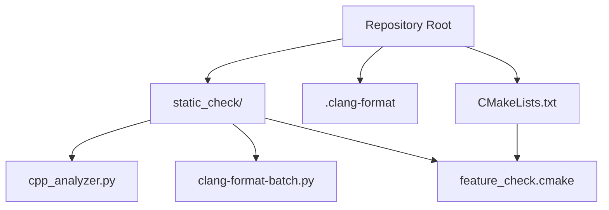
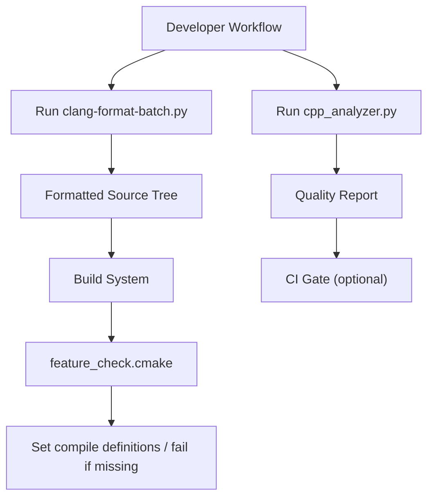
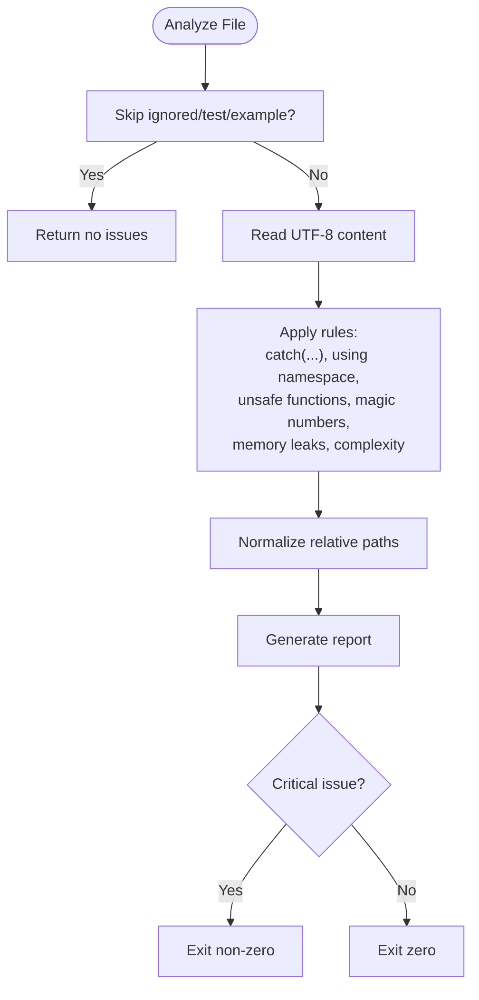
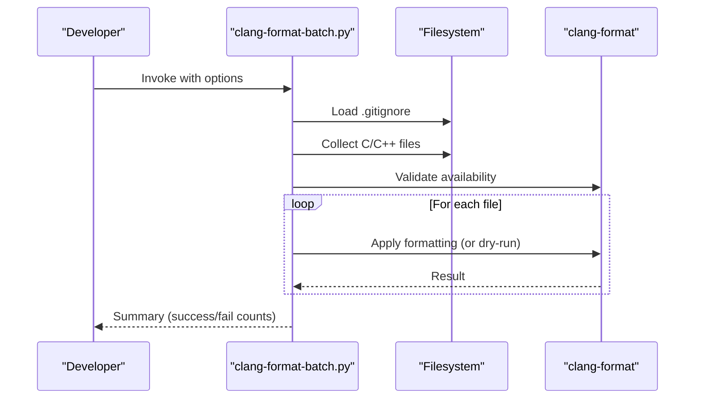
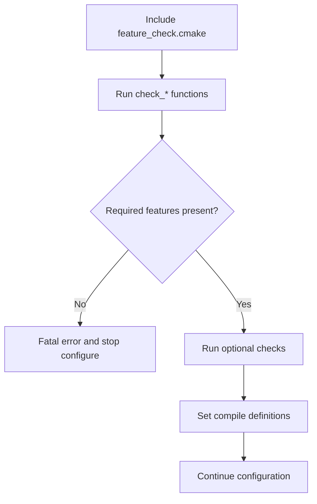
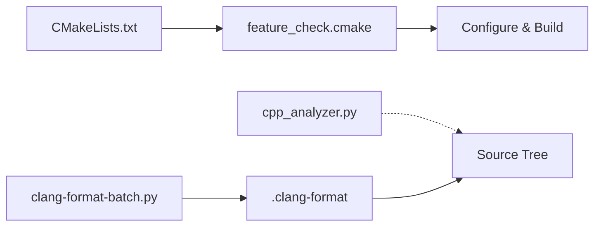

# Static Analysis and Code Quality

<cite>
**Referenced Files in This Document**
- [cpp_analyzer.py](file://static_check/cpp_analyzer.py)
- [.clang-format](file://.clang-format)
- [feature_check.cmake](file://static_check/feature_check.cmake)
- [CMakeLists.txt](file://CMakeLists.txt)
- [clang-format-batch.py](file://static_check/clang-format-batch.py)
- [copilot-instructions.md](file://.github/copilot-instructions.md)
</cite>

## Table of Contents
1. [Introduction](#introduction)
2. [Project Structure](#project-structure)
3. [Core Components](#core-components)
4. [Architecture Overview](#architecture-overview)
5. [Detailed Component Analysis](#detailed-component-analysis)
6. [Dependency Analysis](#dependency-analysis)
7. [Performance Considerations](#performance-considerations)
8. [Troubleshooting Guide](#troubleshooting-guide)
9. [Conclusion](#conclusion)
10. [Appendices](#appendices)

## Introduction
This document explains the static analysis and code quality tooling used by HsBaSlicer. It focuses on:
- The custom C/C++ static analyzer script for automated code quality checks.
- The clang-format integration for consistent code formatting.
- The compile-time feature validation logic implemented via CMake.
- How to integrate these tools into local development and CI/CD pipelines.
- Guidelines for fixing common issues and maintaining coding standards across the codebase.

The goal is to help developers understand what rules are enforced, how the tools work together, and how to keep the repository clean and portable across compilers and platforms.

## Project Structure
The static analysis and formatting tooling lives under `static_check/`, with a top-level `.clang-format` configuration file and CMake integration at the project root.

**Diagram sources**
- [CMakeLists.txt:48-58](file://CMakeLists.txt#L48-L58)
- [.clang-format:1-99](file://.clang-format#L1-L99)
- [cpp_analyzer.py:1-383](file://static_check/cpp_analyzer.py#L1-L383)
- [clang-format-batch.py:1-274](file://static_check/clang-format-batch.py#L1-L274)
- [feature_check.cmake:1-123](file://static_check/feature_check.cmake#L1-L123)

**Section sources**
- [CMakeLists.txt:48-58](file://CMakeLists.txt#L48-L58)
- [.clang-format:1-99](file://.clang-format#L1-L99)
- [cpp_analyzer.py:1-383](file://static_check/cpp_analyzer.py#L1-L383)
- [clang-format-batch.py:1-274](file://static_check/clang-format-batch.py#L1-L274)
- [feature_check.cmake:1-123](file://static_check/feature_check.cmake#L1-L123)

## Core Components
- Custom static analyzer (`cpp_analyzer.py`)
  - Scans C/C++ files while respecting `.gitignore`.
  - Detects unsafe patterns such as broad exception catches, global namespace usage, unsafe functions, magic numbers, potential memory leaks, and high cyclomatic complexity.
  - Produces a human-readable report and exits non-zero on critical issues.
- Clang-format integration
  - A project-wide `.clang-format` defines Allman-style braces, column limits, pointer/reference alignment, include sorting, and other style rules.
  - A batch formatter (`clang-format-batch.py`) applies formatting in parallel, skipping ignored paths and selected generated files.
- Compile-time feature validation (`feature_check.cmake`)
  - Uses CMake’s source compilation checks to detect compiler support for modern C/C++ features.
  - Top-level `CMakeLists.txt` enforces required features and sets compile definitions for optional ones.

**Section sources**
- [cpp_analyzer.py:18-40](file://static_check/cpp_analyzer.py#L18-L40)
- [cpp_analyzer.py:44-193](file://static_check/cpp_analyzer.py#L44-L193)
- [cpp_analyzer.py:197-339](file://static_check/cpp_analyzer.py#L197-L339)
- [.clang-format:1-99](file://.clang-format#L1-L99)
- [clang-format-batch.py:24-151](file://static_check/clang-format-batch.py#L24-L151)
- [clang-format-batch.py:154-274](file://static_check/clang-format-batch.py#L154-L274)
- [feature_check.cmake:1-123](file://static_check/feature_check.cmake#L1-L123)
- [CMakeLists.txt:48-104](file://CMakeLists.txt#L48-L104)

## Architecture Overview
The quality pipeline combines three layers:
- Style enforcement via clang-format.
- Static analysis via the Python-based analyzer.
- Feature gating via CMake to ensure the compiler supports required language features.

**Diagram sources**
- [clang-format-batch.py:183-274](file://static_check/clang-format-batch.py#L183-L274)
- [cpp_analyzer.py:342-383](file://static_check/cpp_analyzer.py#L342-L383)
- [feature_check.cmake:1-123](file://static_check/feature_check.cmake#L1-L123)
- [CMakeLists.txt:48-104](file://CMakeLists.txt#L48-L104)

## Detailed Component Analysis

### Custom Static Analyzer: cpp_analyzer.py
Responsibilities:
- Skip test/example directories and build artifacts using `.gitignore` and built-in defaults.
- Detect problematic patterns:
  - Catch-all exceptions.
  - Global `using namespace` declarations (with an exception for namespaces containing “Literals”).
  - Unsafe legacy functions.
  - Magic numbers outside allowed contexts.
  - Potential memory leaks from manual allocation without paired deallocation or smart pointers nearby.
  - High cyclomatic complexity per function.
- Output a structured report and exit with failure on critical issues.

Key implementation highlights:
- Gitignore matching uses a pathspec matcher with default exclusions for build outputs and third-party folders.
- Memory leak detection strips strings and comments before scanning for `new`/`malloc`/`calloc`/`realloc`, then looks for paired `delete`/`free` within a limited window and allows known smart pointer types.
- Complexity calculation counts branching constructs and operators per function body.

**Diagram sources**
- [cpp_analyzer.py:18-40](file://static_check/cpp_analyzer.py#L18-L40)
- [cpp_analyzer.py:44-193](file://static_check/cpp_analyzer.py#L44-L193)
- [cpp_analyzer.py:197-339](file://static_check/cpp_analyzer.py#L197-L339)
- [cpp_analyzer.py:342-383](file://static_check/cpp_analyzer.py#L342-L383)

Recommended usage:
- Run against a single file or directory.
- Adjust complexity threshold when needed.
- Save reports to a file for CI artifacts.

Common fixes:
- Replace catch-all exceptions with specific handlers.
- Avoid global `using namespace`; prefer explicit qualification.
- Replace unsafe functions with safer alternatives.
- Introduce named constants instead of magic numbers.
- Use smart pointers or RAII; ensure paired deallocation for manual allocations.
- Refactor complex functions to reduce cyclomatic complexity.

**Section sources**
- [cpp_analyzer.py:18-40](file://static_check/cpp_analyzer.py#L18-L40)
- [cpp_analyzer.py:44-193](file://static_check/cpp_analyzer.py#L44-L193)
- [cpp_analyzer.py:197-339](file://static_check/cpp_analyzer.py#L197-L339)
- [cpp_analyzer.py:342-383](file://static_check/cpp_analyzer.py#L342-L383)

### Clang-format Integration
Style configuration:
- Language and standard: C++, C++17.
- Indentation: 4 spaces, no tabs.
- Braces: Allman style (always on a new line).
- Column limit: 120.
- Alignment: operands and trailing comments aligned; pointer/reference alignment left.
- Short statements: allow short inline functions only; disallow short blocks/loops/if on one line.
- Includes: sorted case-sensitively, preserve include block order.
- Miscellaneous: braced list style, namespace indentation disabled, comment reflow enabled.

Batch formatter:
- Recursively collects C/C++ files while honoring `.gitignore`.
- Excludes certain generated files (e.g., version-related files).
- Supports parallel execution, dry-run mode, and custom style overrides.
- Verifies that `clang-format` is available before running.

**Diagram sources**
- [clang-format-batch.py:24-151](file://static_check/clang-format-batch.py#L24-L151)
- [clang-format-batch.py:154-274](file://static_check/clang-format-batch.py#L154-L274)

Guidelines:
- Keep `.clang-format` as the single source of truth for formatting.
- Prefer running the batch formatter pre-commit or in CI to enforce consistency.
- Use `--dry-run` to preview changes without modifying files.

**Section sources**
- [.clang-format:1-99](file://.clang-format#L1-L99)
- [clang-format-batch.py:24-151](file://static_check/clang-format-batch.py#L24-L151)
- [clang-format-batch.py:154-274](file://static_check/clang-format-batch.py#L154-L274)

### Compile-Time Feature Validation: feature_check.cmake
Purpose:
- Probe compiler capabilities for modern C/C++ features early during configuration.
- Fail fast if required features are missing.
- Define macros for optional features so conditional code can adapt.

Features checked:
- C: `_Generic` support.
- C++: concepts, ranges, `std::source_location`, class-type NTTP, floating-point NTTP, template-template parameter matching (P0522R0), coroutines, explicit object parameter (`explicit this`).
- Optional: C23 constexpr-like support and C++20 modules support detection.

Integration:
- Included by the top-level `CMakeLists.txt`.
- Required checks cause fatal errors if unsupported.
- Optional checks set compile definitions like `HSBA_HAS_CXX_COROUTINES`, `HSBA_HAS_CXX_EXPLICIT_THIS`, etc.

**Diagram sources**
- [feature_check.cmake:1-123](file://static_check/feature_check.cmake#L1-L123)
- [CMakeLists.txt:48-104](file://CMakeLists.txt#L48-L104)

Usage notes:
- If your compiler lacks required features, upgrade the toolchain or adjust requirements.
- When optional features are unavailable, code should guard usage behind the provided compile definitions.

**Section sources**
- [feature_check.cmake:1-123](file://static_check/feature_check.cmake#L1-L123)
- [CMakeLists.txt:48-104](file://CMakeLists.txt#L48-L104)

## Dependency Analysis
Relationships between components:
- `CMakeLists.txt` includes `feature_check.cmake` and enforces required features.
- `.clang-format` is consumed by `clang-format-batch.py` automatically.
- `cpp_analyzer.py` operates independently but complements the style and feature checks.

**Diagram sources**
- [CMakeLists.txt:48-58](file://CMakeLists.txt#L48-L58)
- [.clang-format:1-99](file://.clang-format#L1-L99)
- [clang-format-batch.py:183-274](file://static_check/clang-format-batch.py#L183-L274)
- [cpp_analyzer.py:342-383](file://static_check/cpp_analyzer.py#L342-L383)

**Section sources**
- [CMakeLists.txt:48-58](file://CMakeLists.txt#L48-L58)
- [.clang-format:1-99](file://.clang-format#L1-L99)
- [clang-format-batch.py:183-274](file://static_check/clang-format-batch.py#L183-L274)
- [cpp_analyzer.py:342-383](file://static_check/cpp_analyzer.py#L342-L383)

## Performance Considerations
- The batch formatter uses parallel execution to speed up formatting across many files.
- The analyzer processes files sequentially but skips ignored and test/example directories early.
- Memory leak detection scans a limited window around allocations to balance accuracy and performance.
- Complexity checks operate per function body; very large functions may increase processing time.

Recommendations:
- Run formatting in parallel locally and in CI.
- Limit analyzer scope to changed files in CI where possible.
- Tune complexity thresholds based on module characteristics.

[No sources needed since this section provides general guidance]

## Troubleshooting Guide
Common issues and resolutions:
- clang-format not found
  - Ensure LLVM/Clang is installed and available in PATH.
  - Use the `--clang-format` option to specify a custom path.
- Formatting fails on specific files
  - Verify `.clang-format` exists at the repository root.
  - Use `--dry-run` to preview which files would change.
- Static analyzer reports critical issues
  - Fix catch-all exceptions and unsafe functions first.
  - Remove global `using namespace` or move to narrower scopes.
  - Replace magic numbers with named constants.
  - Address potential memory leaks by using smart pointers or ensuring paired deallocation.
  - Refactor highly complex functions to reduce cyclomatic complexity.
- CMake configure fails due to missing features
  - Upgrade the compiler/toolchain to meet required feature levels.
  - Review warnings for optional features and add guards in code if necessary.

Operational tips:
- Use the copilot instructions to locate static tools quickly.
- Keep `.gitignore` updated so both tools skip irrelevant directories consistently.

**Section sources**
- [clang-format-batch.py:210-217](file://static_check/clang-format-batch.py#L210-L217)
- [cpp_analyzer.py:378-383](file://static_check/cpp_analyzer.py#L378-L383)
- [CMakeLists.txt:60-86](file://CMakeLists.txt#L60-L86)
- [copilot-instructions.md:40-47](file://.github/copilot-instructions.md#L40-L47)

## Conclusion
HsBaSlicer’s quality pipeline combines style enforcement, static analysis, and compile-time feature validation to maintain a consistent, safe, and portable codebase. By integrating clang-format, the custom analyzer, and CMake feature checks into daily workflows and CI, teams can prevent regressions, improve readability, and ensure compatibility across modern compilers.

[No sources needed since this section summarizes without analyzing specific files]

## Appendices

### Integrating Tools into CI/CD Pipelines
- Pre-commit or pre-push hooks
  - Run `clang-format-batch.py --dry-run` to fail on unformatted code.
  - Run `cpp_analyzer.py` over changed files to catch quality issues early.
- CI jobs
  - Install LLVM/Clang and Python dependencies.
  - Execute the batch formatter in dry-run mode.
  - Execute the static analyzer and upload reports as artifacts.
  - Run CMake configuration to validate feature support; fail if required features are missing.
- Example steps
  - Configure and build with CMake.
  - Run tests with CTest.
  - Optionally run coverage collection if enabled.

[No sources needed since this section provides general guidance]

### Coding Standards Checklist
- Use Allman-style braces and follow `.clang-format` rules.
- Avoid global `using namespace`; qualify names explicitly.
- Do not use catch-all exceptions; handle specific exceptions.
- Replace unsafe functions with safer alternatives.
- Introduce named constants instead of magic numbers.
- Prefer smart pointers and RAII; avoid raw `new`/`malloc` unless absolutely necessary.
- Keep functions focused and below the configured complexity threshold.
- Guard optional feature usage with compile definitions provided by `feature_check.cmake`.

[No sources needed since this section provides general guidance]