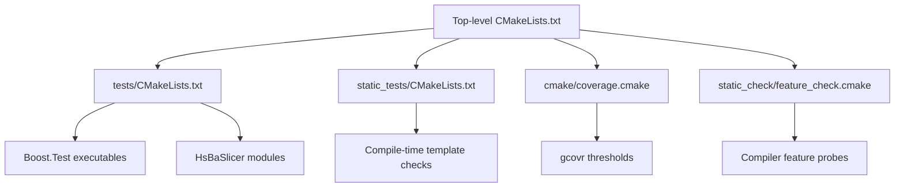
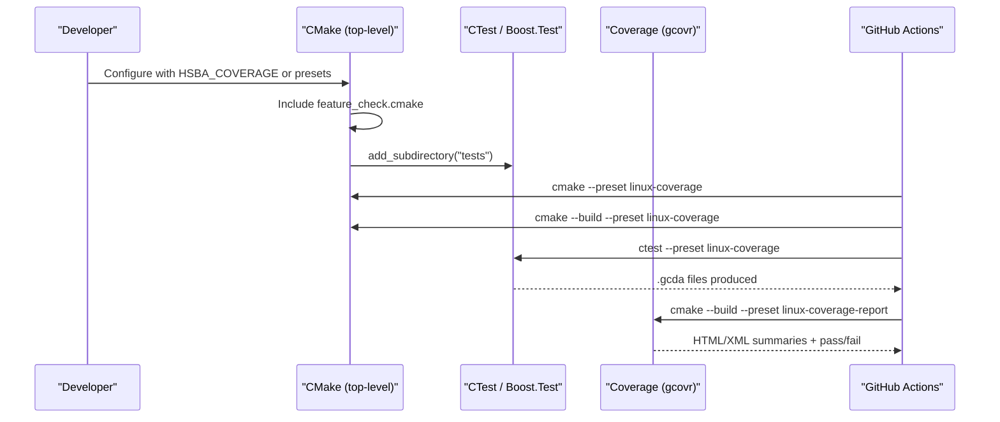
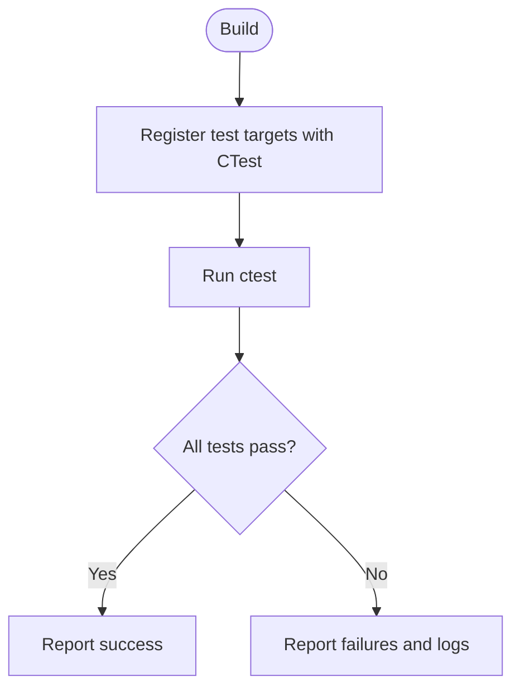
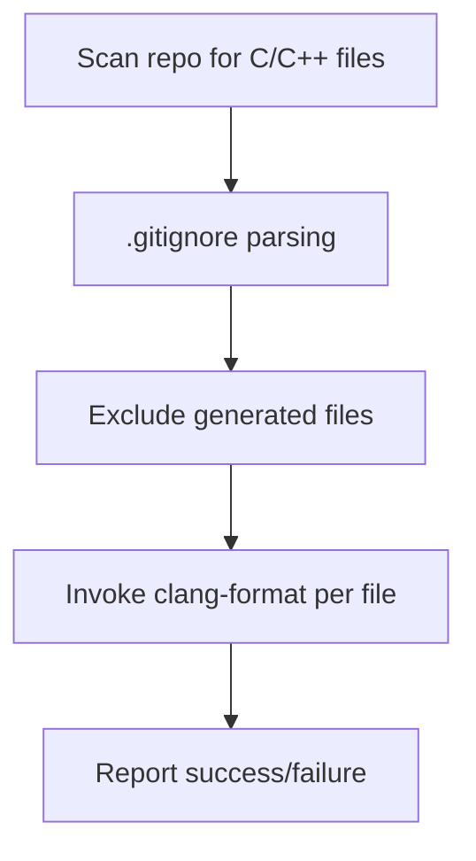
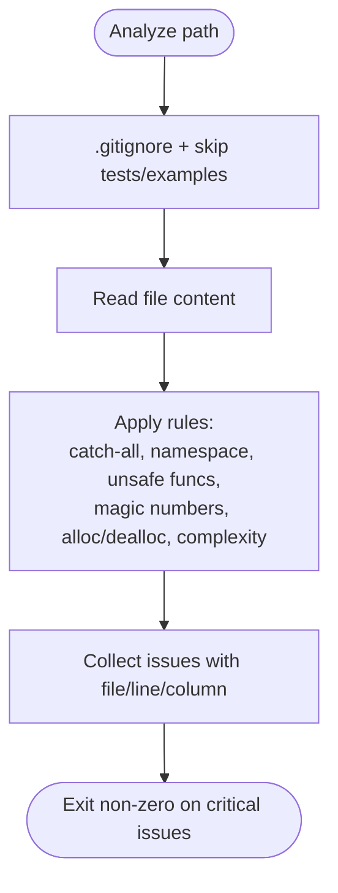
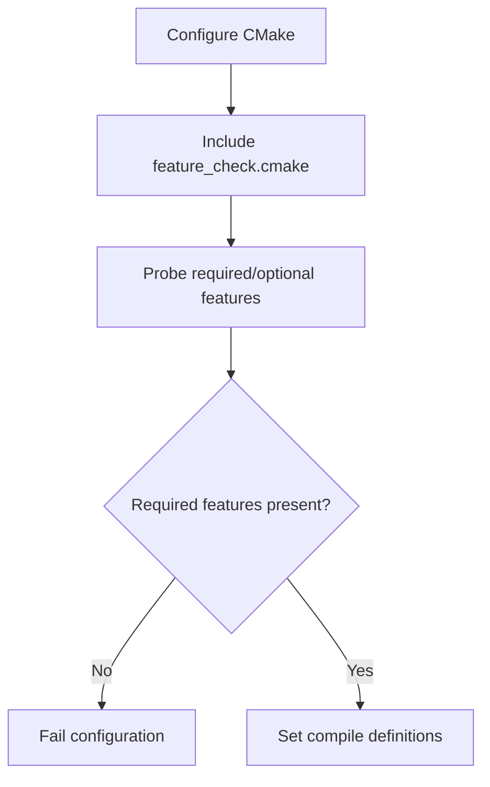
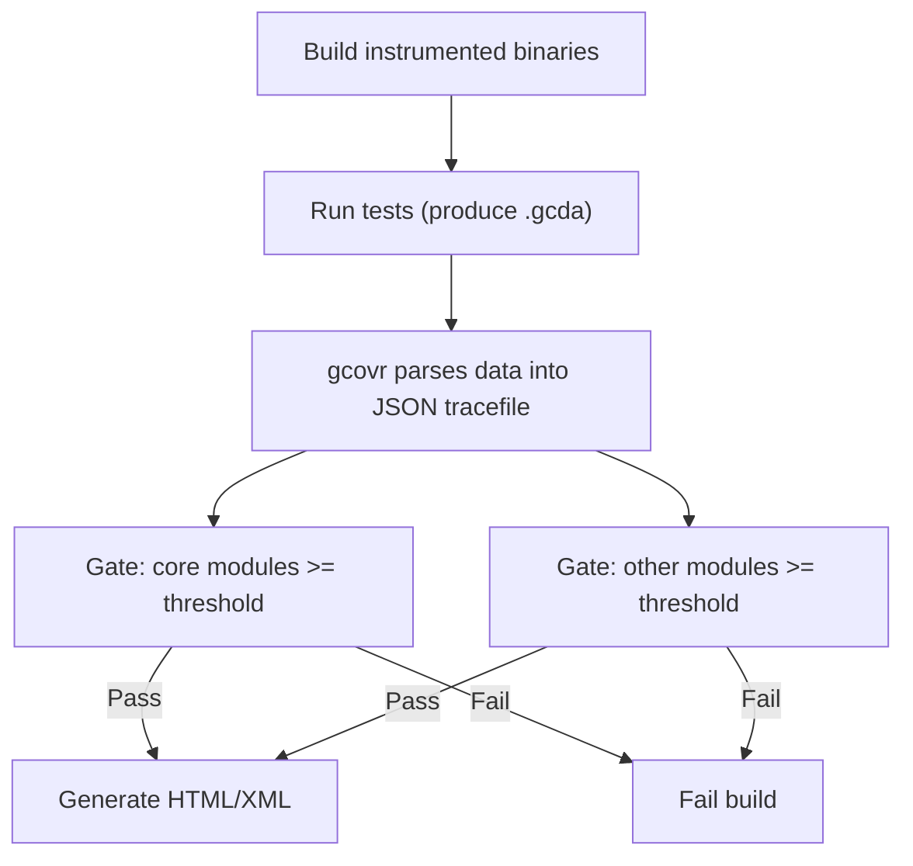
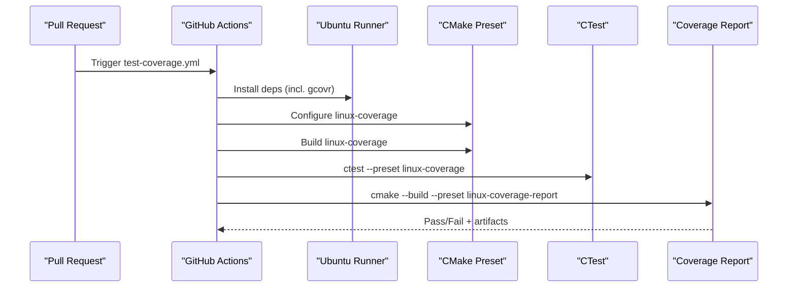
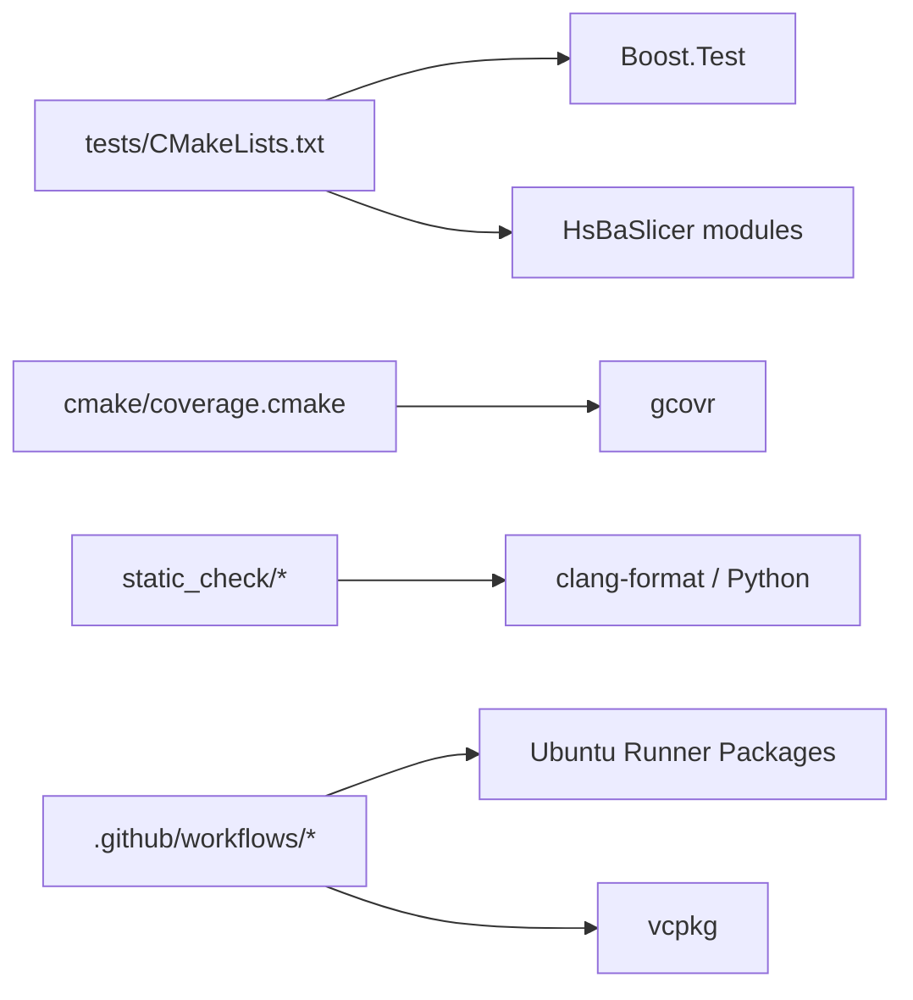

# Testing and Quality Assurance

<cite>
**Referenced Files in This Document**
- [CMakeLists.txt](file://CMakeLists.txt)
- [tests/CMakeLists.txt](file://tests/CMakeLists.txt)
- [cmake/coverage.cmake](file://cmake/coverage.cmake)
- [static_check/cpp_analyzer.py](file://static_check/cpp_analyzer.py)
- [static_check/clang-format-batch.py](file://static_check/clang-format-batch.py)
- [static_check/feature_check.cmake](file://static_check/feature_check.cmake)
- [.github/workflows/test-coverage.yml](file://.github/workflows/test-coverage.yml)
- [.github/workflows/build-linux.yml](file://.github/workflows/build-linux.yml)
- [.clang-format](file://.clang-format)
</cite>

## Table of Contents
1. [Introduction](#introduction)
2. [Project Structure](#project-structure)
3. [Core Components](#core-components)
4. [Architecture Overview](#architecture-overview)
5. [Detailed Component Analysis](#detailed-component-analysis)
6. [Dependency Analysis](#dependency-analysis)
7. [Performance Considerations](#performance-considerations)
8. [Troubleshooting Guide](#troubleshooting-guide)
9. [Conclusion](#conclusion)
10. [Appendices](#appendices)

## Introduction
This document describes the testing and quality assurance system for HsBaSlicer. It explains how unit tests, integration-style test targets, and static template checks are organized; how to run the suites with CTest; how to generate and interpret coverage reports; and how the static analysis pipeline enforces code style, complexity, memory safety, and compiler feature requirements. It also provides guidelines for writing new tests, mocking external dependencies, and establishing automated quality gates.

## Project Structure
HsBaSlicer uses a layered approach:
- Top-level CMake orchestrates options, feature detection, and inclusion of subprojects.
- Unit tests live under `tests/` and are registered with CTest.
- Static template-only checks live under `static_tests/`.
- Static analysis tools live under `static_check/`.
- Coverage is configured via a dedicated CMake module and enforced by CI.

**Diagram sources**
- [CMakeLists.txt:48-112](file://CMakeLists.txt#L48-L112)
- [CMakeLists.txt:392-407](file://CMakeLists.txt#L392-L407)
- [CMakeLists.txt:667-680](file://CMakeLists.txt#L667-L680)
- [tests/CMakeLists.txt:1-33](file://tests/CMakeLists.txt#L1-L33)
- [cmake/coverage.cmake:1-31](file://cmake/coverage.cmake#L1-L31)
- [static_check/feature_check.cmake:1-12](file://static_check/feature_check.cmake#L1-L12)

**Section sources**
- [CMakeLists.txt:48-112](file://CMakeLists.txt#L48-L112)
- [CMakeLists.txt:392-407](file://CMakeLists.txt#L392-L407)
- [CMakeLists.txt:667-680](file://CMakeLists.txt#L667-L680)

## Core Components
- Test orchestration and registration: top-level CMake enables testing and includes the tests subdirectory; each test target links against Boost.Test and relevant modules.
- Static template checks: compile-only targets under `static_tests/` validate concepts and type traits at build time.
- Static analysis: Python scripts enforce formatting and code quality rules; CMake feature checks gate modern C++ features.
- Coverage: gcov instrumentation and gcovr threshold gating for core and other modules.
- CI automation: GitHub Actions workflows run builds, tests, and coverage gates on pull requests.

Key responsibilities:
- `CMakeLists.txt`: global configuration, feature checks, coverage option, test enablement, and subdirectory inclusion.
- `tests/CMakeLists.txt`: per-test executable definitions, linking, and CTest registration.
- `cmake/coverage.cmake`: instrumentation, filtering, and threshold enforcement.
- `static_check/*`: formatting and analyzer scripts plus feature probes.
- `.github/workflows/*`: CI jobs that execute the above.

**Section sources**
- [CMakeLists.txt:48-112](file://CMakeLists.txt#L48-L112)
- [CMakeLists.txt:392-407](file://CMakeLists.txt#L392-L407)
- [CMakeLists.txt:667-680](file://CMakeLists.txt#L667-L680)
- [tests/CMakeLists.txt:1-33](file://tests/CMakeLists.txt#L1-L33)
- [cmake/coverage.cmake:1-31](file://cmake/coverage.cmake#L1-L31)
- [static_check/feature_check.cmake:1-12](file://static_check/feature_check.cmake#L1-L12)

## Architecture Overview
The QA pipeline integrates build-time checks, runtime tests, and post-run coverage gating.

**Diagram sources**
- [CMakeLists.txt:48-112](file://CMakeLists.txt#L48-L112)
- [CMakeLists.txt:667-680](file://CMakeLists.txt#L667-L680)
- [cmake/coverage.cmake:158-172](file://cmake/coverage.cmake#L158-L172)
- [.github/workflows/test-coverage.yml:88-102](file://.github/workflows/test-coverage.yml#L88-L102)

## Detailed Component Analysis

### Unit Test Framework and Execution
- All unit tests use Boost.Test and are built as separate executables.
- Each test target is linked against required modules and registered with CTest via `add_test`.
- The top-level CMake enables testing globally and includes the `tests` subdirectory when enabled.
- A convenience target `RunAllTests` runs the full suite via CTest when enabled.

How to run:
- Build and run all tests:
  - Configure once (e.g., using a preset or standard configure).
  - Run `ctest` from the build directory to execute all registered tests.
- Run a single test:
  - Use `ctest -R <test_name>` to filter by name.
- Post-build auto-run:
  - When `HSBA_RUN_TESTS_AFTER_BUILD` is ON, individual test targets can trigger CTest after building.

Interpreting results:
- Passing tests show success counts and no failures.
- Failing tests print diagnostic output; use verbose mode (`ctest -V`) for details.

**Diagram sources**
- [CMakeLists.txt:667-674](file://CMakeLists.txt#L667-L674)
- [tests/CMakeLists.txt:1-33](file://tests/CMakeLists.txt#L1-L33)
- [tests/CMakeLists.txt:355-411](file://tests/CMakeLists.txt#L355-L411)

**Section sources**
- [CMakeLists.txt:667-674](file://CMakeLists.txt#L667-L674)
- [tests/CMakeLists.txt:1-33](file://tests/CMakeLists.txt#L1-L33)
- [tests/CMakeLists.txt:355-411](file://tests/CMakeLists.txt#L355-L411)

### Static Template Checks
- Located under `static_tests/`, these are compile-time-only checks that validate concepts and type traits without requiring Boost.Test.
- Enabled via `HSBA_SLICER_USE_STATIC_TESTS`; disabled on Android/iOS/game consoles by default due to toolchain constraints.

How to run:
- Build the project with static tests enabled (default on desktop platforms).
- Compilation failures indicate concept/type constraint violations.

**Section sources**
- [CMakeLists.txt:676-680](file://CMakeLists.txt#L676-L680)
- [static_tests/CMakeLists.txt:1-4](file://static_tests/CMakeLists.txt#L1-L4)

### Static Analysis Pipeline

#### clang-format Enforcement
- Style is defined in `.clang-format` (Allman braces, 4-space indent, column limit 120, etc.).
- Batch formatter script scans C/C++ files, respects `.gitignore`, excludes generated files, and formats in parallel.

Usage:
- Format all files: run the batch script with default settings.
- Dry-run preview: use the dry-run flag to list files that would be changed.
- Enforce in CI: integrate the script into pre-commit hooks or CI steps.

**Diagram sources**
- [.clang-format:1-99](file://.clang-format#L1-L99)
- [static_check/clang-format-batch.py:18-21](file://static_check/clang-format-batch.py#L18-L21)
- [static_check/clang-format-batch.py:24-111](file://static_check/clang-format-batch.py#L24-L111)
- [static_check/clang-format-batch.py:155-178](file://static_check/clang-format-batch.py#L155-L178)

**Section sources**
- [.clang-format:1-99](file://.clang-format#L1-L99)
- [static_check/clang-format-batch.py:18-21](file://static_check/clang-format-batch.py#L18-L21)
- [static_check/clang-format-batch.py:24-111](file://static_check/clang-format-batch.py#L24-L111)
- [static_check/clang-format-batch.py:155-178](file://static_check/clang-format-batch.py#L155-L178)

#### cpp_analyzer.py Code Quality Checks
The analyzer performs several checks while skipping tests/examples and respecting `.gitignore`:
- Disallows `catch(...)`.
- Flags `using namespace ...` unless the namespace contains “Literals”.
- Warns about unsafe functions (`gets`, `strcpy`, `strcat`, `sprintf`, `vsprintf`).
- Detects magic numbers with exceptions for common constants and literals.
- Identifies potential memory leaks around `new/malloc/calloc/realloc` if paired `delete/free` is not found nearby or smart pointers are not used.
- Computes function cyclomatic complexity and flags functions exceeding a threshold.

**Diagram sources**
- [static_check/cpp_analyzer.py:17-40](file://static_check/cpp_analyzer.py#L17-L40)
- [static_check/cpp_analyzer.py:43-193](file://static_check/cpp_analyzer.py#L43-L193)
- [static_check/cpp_analyzer.py:196-298](file://static_check/cpp_analyzer.py#L196-L298)
- [static_check/cpp_analyzer.py:342-383](file://static_check/cpp_analyzer.py#L342-L383)

**Section sources**
- [static_check/cpp_analyzer.py:17-40](file://static_check/cpp_analyzer.py#L17-L40)
- [static_check/cpp_analyzer.py:43-193](file://static_check/cpp_analyzer.py#L43-L193)
- [static_check/cpp_analyzer.py:196-298](file://static_check/cpp_analyzer.py#L196-L298)
- [static_check/cpp_analyzer.py:342-383](file://static_check/cpp_analyzer.py#L342-L383)

#### Custom CMake-based Feature Validation
- Early in configuration, the project includes `static_check/feature_check.cmake`.
- Required features (concepts, ranges, source_location, NTTP class, template-template matching) are probed; missing features cause fatal errors.
- Optional features (coroutines, explicit this, C23 constexpr-like support) set compile definitions when available.
- C++20 modules support is detected and conditionally enabled.

**Diagram sources**
- [CMakeLists.txt:48-104](file://CMakeLists.txt#L48-L104)
- [static_check/feature_check.cmake:1-12](file://static_check/feature_check.cmake#L1-L12)
- [static_check/feature_check.cmake:14-67](file://static_check/feature_check.cmake#L14-L67)
- [static_check/feature_check.cmake:69-123](file://static_check/feature_check.cmake#L69-L123)

**Section sources**
- [CMakeLists.txt:48-104](file://CMakeLists.txt#L48-L104)
- [static_check/feature_check.cmake:1-12](file://static_check/feature_check.cmake#L1-L12)
- [static_check/feature_check.cmake:14-67](file://static_check/feature_check.cmake#L14-L67)
- [static_check/feature_check.cmake:69-123](file://static_check/feature_check.cmake#L69-L123)

### Coverage Reports and Threshold Gates
- Enable coverage via `HSBA_COVERAGE` or the `linux-coverage` preset.
- Instrumentation adds `--coverage` to compile/link steps.
- The `coverage` custom target runs gcovr to parse data and enforce thresholds:
  - Core modules: minimum line coverage threshold (default 45%).
  - Other modules: minimum line coverage threshold (default 25%).
- Exclusions cover tests, samples, static checks, vendored code, and generated outputs.
- CI workflow configures, builds, runs tests, then executes the coverage report target and uploads artifacts.

How to generate locally:
- Configure with coverage enabled (or use the preset).
- Build and run tests to produce `.gcda` files.
- Run the coverage target to generate HTML/XML reports and enforce thresholds.

Interpreting results:
- If thresholds are not met, the coverage target fails the build.
- Reports include per-module summaries and detailed HTML pages.

**Diagram sources**
- [cmake/coverage.cmake:16-31](file://cmake/coverage.cmake#L16-L31)
- [cmake/coverage.cmake:67-71](file://cmake/coverage.cmake#L67-L71)
- [cmake/coverage.cmake:93-126](file://cmake/coverage.cmake#L93-L126)
- [cmake/coverage.cmake:128-172](file://cmake/coverage.cmake#L128-L172)
- [.github/workflows/test-coverage.yml:88-102](file://.github/workflows/test-coverage.yml#L88-L102)

**Section sources**
- [cmake/coverage.cmake:16-31](file://cmake/coverage.cmake#L16-L31)
- [cmake/coverage.cmake:67-71](file://cmake/coverage.cmake#L67-L71)
- [cmake/coverage.cmake:93-126](file://cmake/coverage.cmake#L93-L126)
- [cmake/coverage.cmake:128-172](file://cmake/coverage.cmake#L128-L172)
- [.github/workflows/test-coverage.yml:88-102](file://.github/workflows/test-coverage.yml#L88-L102)

### CI Quality Gates
- Pull request coverage job:
  - Installs dependencies including gcovr.
  - Uses the `linux-coverage` preset to configure and build.
  - Runs tests via CTest.
  - Executes the coverage report target to enforce thresholds.
  - Writes summary to the job summary and uploads artifacts.
- Linux build job:
  - Builds Release and runs tests via CTest (non-fatal in the provided workflow).

**Diagram sources**
- [.github/workflows/test-coverage.yml:1-15](file://.github/workflows/test-coverage.yml#L1-L15)
- [.github/workflows/test-coverage.yml:51-66](file://.github/workflows/test-coverage.yml#L51-L66)
- [.github/workflows/test-coverage.yml:88-102](file://.github/workflows/test-coverage.yml#L88-L102)
- [.github/workflows/test-coverage.yml:104-136](file://.github/workflows/test-coverage.yml#L104-L136)
- [.github/workflows/build-linux.yml:64-81](file://.github/workflows/build-linux.yml#L64-L81)

**Section sources**
- [.github/workflows/test-coverage.yml:1-15](file://.github/workflows/test-coverage.yml#L1-L15)
- [.github/workflows/test-coverage.yml:51-66](file://.github/workflows/test-coverage.yml#L51-L66)
- [.github/workflows/test-coverage.yml:88-102](file://.github/workflows/test-coverage.yml#L88-L102)
- [.github/workflows/test-coverage.yml:104-136](file://.github/workflows/test-coverage.yml#L104-L136)
- [.github/workflows/build-linux.yml:64-81](file://.github/workflows/build-linux.yml#L64-L81)

## Dependency Analysis
- Tests depend on Boost.Test and specific HsBaSlicer modules.
- Coverage depends on gcov/gcovr and the presence of `.gcda` files from instrumented builds.
- Static checks depend on Python and optional external tools (clang-format, gcovr).
- CI depends on Ubuntu runner packages and vcpkg for dependencies.

**Diagram sources**
- [tests/CMakeLists.txt:1-33](file://tests/CMakeLists.txt#L1-L33)
- [cmake/coverage.cmake:67-71](file://cmake/coverage.cmake#L67-L71)
- [static_check/clang-format-batch.py:18-21](file://static_check/clang-format-batch.py#L18-L21)
- [.github/workflows/test-coverage.yml:51-66](file://.github/workflows/test-coverage.yml#L51-L66)

**Section sources**
- [tests/CMakeLists.txt:1-33](file://tests/CMakeLists.txt#L1-L33)
- [cmake/coverage.cmake:67-71](file://cmake/coverage.cmake#L67-L71)
- [static_check/clang-format-batch.py:18-21](file://static_check/clang-format-batch.py#L18-L21)
- [.github/workflows/test-coverage.yml:51-66](file://.github/workflows/test-coverage.yml#L51-L66)

## Performance Considerations
- Parallelism:
  - CI caps parallel compilation and vcpkg concurrency to avoid OOM on large translation units.
  - gcovr supports parallel workers controlled by `HSBA_COVERAGE_JOBS`.
- Debug vs Release:
  - Boolean operations may be disabled in Debug builds to reduce memory usage and improve performance.
- Coverage overhead:
  - Instrumented builds increase binary size and execution time; keep parallelism conservative in CI.

[No sources needed since this section provides general guidance]

## Troubleshooting Guide
Common issues and resolutions:
- Missing gcovr:
  - The coverage module warns if gcovr is not found and the coverage target will fail. Install gcovr before running coverage.
- Cross-compiling:
  - Tests are built but not executed during cross-compilation; disable auto-run accordingly.
- Platform-specific test disabling:
  - Tests are disabled on Android, iOS, and game consoles due to output limitations.
- Large graph tests on MSVC:
  - Some tests require `/bigobj` due to template instantiation limits.

Actionable checks:
- Ensure gcovr is installed when enabling coverage.
- Verify platform capabilities and adjust options like `HSBA_SLICER_USE_TESTS` and `HSBA_SLICER_RUN_TESTS_AFTER_BUILD`.
- For Windows builds, confirm `/bigobj` is applied where necessary.

**Section sources**
- [cmake/coverage.cmake:67-71](file://cmake/coverage.cmake#L67-L71)
- [CMakeLists.txt:401-407](file://CMakeLists.txt#L401-L407)
- [CMakeLists.txt:392-400](file://CMakeLists.txt#L392-L400)
- [tests/CMakeLists.txt:182-188](file://tests/CMakeLists.txt#L182-L188)

## Conclusion
HsBaSlicer’s QA system combines robust unit testing, compile-time static checks, comprehensive static analysis, and strict coverage gating. By following the guidelines here—running CTest, generating coverage reports, enforcing formatting and analyzer rules, and leveraging CI—you can maintain high code quality and prevent regressions across the slicing pipeline.

[No sources needed since this section summarizes without analyzing specific files]

## Appendices

### How to Run Test Suites
- Build and run all tests:
  - From the build directory, run `ctest`.
- Run a subset:
  - Use `ctest -R <pattern>` to filter by test name.
- Auto-run after build:
  - When `HSBA_RUN_TESTS_AFTER_BUILD` is ON, individual test targets can trigger CTest automatically.

**Section sources**
- [CMakeLists.txt:667-674](file://CMakeLists.txt#L667-L674)
- [tests/CMakeLists.txt:355-411](file://tests/CMakeLists.txt#L355-L411)

### Writing New Tests
- Create a new executable target in `tests/CMakeLists.txt`.
- Link against Boost.Test and any required modules.
- Register the test with `add_test`.
- Optionally add a POST_BUILD command to run the test immediately after building.

Guidelines:
- Keep tests focused and deterministic.
- Avoid heavy I/O or network calls; prefer mocks or small fixtures.
- Group related tests logically within directories.

**Section sources**
- [tests/CMakeLists.txt:1-33](file://tests/CMakeLists.txt#L1-L33)

### Mocking External Dependencies
- Prefer isolating external calls behind interfaces or adapters.
- Use mock DLLs or stubs where dynamic loading is involved (see existing mock patterns in tests).
- For Lua interactions, isolate Lua state setup and teardown within tests.

[No sources needed since this section provides general guidance]

### Performance Benchmarking Methodologies
- Use Release builds for benchmarking to avoid debug overhead.
- Isolate hot paths and measure with consistent inputs.
- Track regression trends over time rather than absolute values.

[No sources needed since this section provides general guidance]

### Code Review Standards and Pull Request Requirements
- Formatting: ensure code passes clang-format checks using the repository style.
- Static analysis: resolve issues reported by `cpp_analyzer.py`.
- Feature compliance: ensure required compiler features are supported.
- Tests: add or update tests for changes; ensure CTest passes.
- Coverage: maintain or improve coverage thresholds; do not lower baselines without review.

[No sources needed since this section provides general guidance]